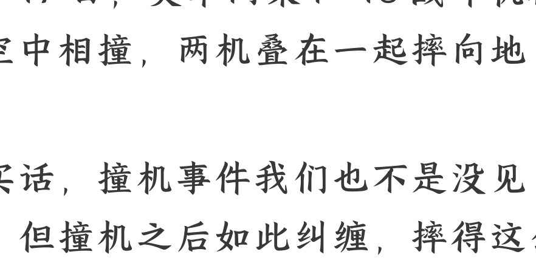

## 美军两架飞机相撞，暴露了什么问题？

**260519 文/卢克文工作室嘉宾 概略北方**  
整理：公众号懒人搜索，[懒人专属群](https://t.cn/A6qQ7vZx)精选  
懒人微信：lazyhelper1

5月17日，美军两架F-18战斗机在天空中相撞，两机叠在一起摔向地面。

说实话，撞机事件我们也不是没见过，但撞机之后如此纠缠，摔得这么赏心悦目的，还真没见过。

撞击背后，暴露了什么问题？

撞机发生在美国爱达荷州的芒廷霍姆空军基地，这里一般人可能不了解，但军迷圈里却小有名气，因为2003年雷鸟飞行表演队的1架F16C，就是在这里摔的，奉献了航空圈里著名的“抛盖弹射”名场面。

谁能想到，同样一个地方，能两次贡献出历史名场面啊！

出事当天，这里正在举办一个叫枪手天空的air show的活动，战斗机搞搞飞行表演，属于美国军民共建、国防教育的正常安排。

从机号来看，这两架飞机是来自华盛顿州惠德贝岛海军航空站的第129电子攻击中队（“维京人”中队，VAQ-129）的EA-18G。

不过呢？这个VAQ-129并不是作战部署的中队，而是FRS，也就是负责训练机组人员的替换中队，主要任务是训练刚分配下来的飞行员，熟悉EA-18G的操作。

但是，恰恰就是因为VAQ-129和EA-18G这两点，造成了今天的事故。

首先，相撞的不是普通的F18战斗机，而是EA-18G“咆哮者”，是在F/A-18F“超级大黄蜂”的机体基础上，改装而来的电子战飞机，就像在歼-16基础上改出的歼-16D。

EA-18G的主要任务是什么？不是去扔炸弹，而是伴随攻击机群，用ALQ-99或新一代的ALQ-249干扰吊舱，去压制敌人的雷达和防空导弹，相当于给攻击机群撑了一个电子保护伞。

在伊朗战争中，如果没有EA-18G开路，就连F-35都不敢轻易突防，这就是美军常说的“无电战、不升空”。EA-18G虽然电子战厉害，但因安装了大量电子战设备，导致机动性、滚转率和加速能力，都要比原版的F18差一大截。

而且，人家FRS中队的训练重点，是电子战战术，而不是飞行技巧，所以让他们搞个常规飞行问题不大，但让他们飞特技，就有点难为人了。

你让这样一种本来就不是为了飞行表演设计而成的战斗机，也不是专业的特技飞行员去搞飞行表演，就像让一个远程放大招的法师，去近距离秀剑术，不出事才怪呢。

EA-18G造价特别贵，高达1亿美元，美国自己都不多，一个航母舰载机联队，只有1个电子战中队，装备5架EA-18G，现在一天之内，就摔掉了一艘航母40%的电子战力量，足够美国人心疼一阵子了。

更关键的是，EA-18G在2023年就已经停产，属于摔一架少一架。

那这两架EA-18G是咋撞机的呢？很多人看不明白，两架飞机在空中蹭了一下，怎么就被吸在一起了呢？

这就牵扯到非常专业的空气动力学知识了：气动干扰与尾流吸附。

当两架喷气式战机以密集编队（通常间距只有几米甚至更短）飞行时，根据伯努利原理，流速越快的地方，压强越小。当两架飞机靠得极近时，它们之间的气流会被严重压缩并加速，导致两架飞机之间形成一个局部的“低压区”。

这样一来，两侧的高压就会把飞机往低压区压，形成两架飞机吸在一起的效果。

大家可以自己做一个实验，你双手拿两根纸条，然后向纸条中间吹气，纸条是不是就吸在一起了？

如果飞行员能有效控制飞机，有意识地去对抗这种“吸力”，那问题还不大，但如果飞行员有一点点操作失误，那就非常危险了。

美军在双机编队飞行（特别是战术密集编队）中，有一个规定，僚机必须时刻保持对长机的绝对目视。长机负责看路和规划轨迹，僚机的所有动作都是根据长机的姿态来做镜像或跟随。

如果僚机丢了长机的视野，哪怕只有一秒钟，也必须立刻 Breakaway（拉起脱离编队），绝对不能凭感觉瞎飞。

但现场发生了什么呢？

在进行战术转弯时，长机飞行姿态发生了改变，而此时它正处于后机机头的正下方，那里刚好是后机飞行员的视野盲区。就像你在高速公路上开车，前车突然变道减速，而你正好被A柱挡住了视线，根本不知道前车在哪里。

按理说，失去目视的瞬间，僚机应该立刻推油门、拉杆向安全方向脱离。但从视频来看，后机飞行员出现了零点几秒的迟疑，没能及时修正位置。

结果大家都看到了，后机从斜上方直接插进了前机的机背和尾部。

说实话，如果单纯擦碰一下，因为相对速度比较小，问题可能还不大，只要没有当场爆炸，只要及时分离，迫降是有可能的。

但由于 EA-18G 浑身安装了各种乱七八糟的天线，这次剐蹭有可能让天线或者什么设备钩挂在了一起，直接破坏了两架飞机的气动外形，升力彻底丧失。

所以，两机“合体”后，机头猛地向上一抬，随后彻底失速，翻滚着砸向了地面。

在这个事故中，美军唯一可以吹嘘的，就是他们的弹射了。

这么复杂的姿态，缠绕、钩挂、旋转、下坠，四个飞行员全部弹射成功，这非常难得。

EA-18G 配备的是英国马丁·贝克公司生产的 NACES 弹射座椅，双座均具备独立弹射能力，可在任意姿态（倒飞、侧飞）下安全弹射。

但是，双座机的弹射是有严苛的程序的。

如果两个人同时弹射，前座火箭会把后座飞行员烤熟，必须后座先弹射、前座后弹射。

当两架飞机处在叠在一起的状态，如何保证 4 个人都能安全逃生？这就是运气了，两架飞机虽然叠在了一起，但没有遮挡弹射路径，就在短短几秒内，4个飞行员能够依次以不同的角度弹射到空中，且没有相撞或干扰。这次弹射充分说明了马丁·贝克弹射座椅的可靠性。

很多人看到飞机掉下来，第一反应是“飞行员手滑了，没啥，操作失误嘛，谁能不犯错？”但这绝不是一句“手滑”就能解释的。

## 2

我们可以简单梳理一下，特朗普上台以来，美国摔了多少飞机了？

- 2025年2月12日，特朗普上任不到一个月，美国海军EA-18G在加州圣迭戈港坠海；
- 4月28日，海军F/A-18E从航母上滑入海中；
- 5月6日，海军F/A-18F着舰时阻拦索失效坠海；
- 7月30日，海军F-35C在加州附近海域坠毁；
- 8月20日，海军F/A-18E在弗吉尼亚海岸训练坠海，等等等等。

这么算下来，光特朗普上台这一年多的时间，美军就损失了超过16架军机，这个数字远超正常年份的损失，其中8架，都是F18系列飞机，这还只是事故损失，不算伊朗战争中的战争损失。

这么高的事故率，显然不能单纯用“手滑”来解释，同一类事故频频发生，大概率不是某个人的问题，而是整个系统都出了问题。

仍然以 VAQ-129“维京人”中队来说吧。

- 理论上，能留在 VAQ-129当教官的，都是老油条，由他们去执行飞行表演，技术应该是最让人放心的。
- 可为什么还是发生了事故呢？
- 和美军的飞行小时数指标急速下跌，有很大关系。
- 冷战时期，一名美国海军飞行员，每年飞行小时数可以轻松达到200或250小时以上，所有的编队距离啊、转弯率啊、对盲区的预判啊，都是肌肉记忆，可以说，海湾战争美军战斗机的优异表现，是航空煤油烧出来的。
- 但现在呢？很多美军战斗机飞行员，每年的飞行时间已经降到了120小时甚至更低，而且训练时间多集中在春秋两季。
- 3月让你每天开1个小时的车，然后把车收走，让你8月再碰车，你手生不手生？
- 为啥飞行小时数下降这么厉害？
- 很简单，美军也没有余粮啊，一方面是军费在通胀面前的实际购买力缩水（少不了史密斯专员的功劳），另一方面是战机维护成本的飙升（五代机的使用成本和维护成本要远远高于四代机），美军只能削减一线部队的实际飞行训练时间。

那怎么维持飞行员的驾驶手感呢？模拟器。

问题在于，模拟器可以训练你怎么驾驶，怎么看雷达，甚至怎么空战，但它没法模拟出两架飞机以几米的间距高速机动时，那种本能的心理压力，也无法模拟高G状态下，你大脑的缺氧感。

缺乏实机训练的飞行员，被派去飞高难度的飞行表演，他们的心理素质和肌肉记忆，支撑不起这种极限操作。所以，所谓“手滑”，所谓“事故”，本质上就是美国飞行员队伍素质长期下滑后的必然结果。

美国《DefenseNews》曾经发布过一份报告，显示美军近5年的军用飞机的事故损失数量大幅度提升，达到“让人不安”的地步。

- 比如，整个2024财年，美军每10万飞行小时的严重事故发生率比四年前上升了55%，海军陆战队最严重，事故率翻了三倍。
- 比如，阿帕奇机队的A类事故（机毁人亡）是4年前的4.5倍。哪怕是以安全著称的C130运输机，这一期间的事故率也翻倍了。

对于这些事故，报告认为不是单一原因造成的，属于整体趋势恶化。

你看，美军也不是没有意识到问题，但改变不了。

通胀和维护成本，又不是美军能改变的。

而且，美军飞行员队伍已经青黄不接了，就连美军自己都承认，正在面临严重的“招募危机”。

战斗机飞行员是精英中的精英，选拔好比沙里淘金，要想淘到足够的金，首先要有足够含金的河沙。现在的美国年轻人，文盲率超标、肥胖率超标、吸毒比例上升、心理问题频发，能符合入伍标准的本就没几个，又怎么能选拔出精英的飞行员呢？

2010年前，约30%适龄青年符合参军条件，现在已经暴跌到了23%，也就是说，17-24岁的美国年轻人，4个人只有1个够格参军，剩下77%因为学历不够（连高中毕业证都没有）、读写差、肥胖、吸毒、犯罪记录、精神问题等被刷掉了。

符合条件的人少，而军队招募员额又不可能降太多，那怎么办？

只能想办法降低标准，于是，美国陆军把ASVAB（智力/能力测试）合格分数从31分降到25分，Ⅳ类（低分）比例从6%放宽到10%，美国海军也放弃了“必须高中毕业”的条件，会写名字、分得清左右就能入伍。

这样搞，征兵问题是解决了，但军队的整体水平就下降了。

目前，美国海军陆战队 41%新军官，达不到 1980 年的智力标准，不少士兵看不懂发动机故障手册，复杂装备学不会、用不好、修不了，只能大量招募无国籍的亚裔来充实队伍。

可是，陆军、海军、陆战队可以这么搞，飞行员能这么搞吗？飞行员是要上天的，操作不好是要摔下来的！

所以飞行员队伍的招募，还算保持了原来的标准，优中选优。

但那些身体健康、头脑聪明的年轻人，宁愿去硅谷敲代码，去华尔街搞金融，甚至去送外卖，也不愿意去军队受约束，去卖命。现在知道为啥要搞开放日这种活动了吧？说白了就是一场公关秀，一场海军航空兵的招募大会。

也正因为如此，原本应该训练电子战的 VAQ-129 中队，只能硬着头皮去搞飞行表演。

你看，为了招几个飞行员，硬搭上去两架飞机，这笔账，怎么算都是亏到姥姥家了。

曾经的全球霸主美国，正在经历过度扩张后的系统疲劳，前线处处冒火，后方青黄不接，美国出于战略需要又不能退缩，加上波音等军工复合体的拉垮，供应链断裂，质量造假，这台战争机器内部，已经积累了大量的隐患。

当所有的疲劳、所有的妥协、所有的系统性拉胯层层叠加，最终在爱达荷州那个晴朗的下午，找到了一个突破口。

为了维持全球帝国的门面，美国正在以透支未来的方式，燃烧着自己最后的核心资源，而这些资源，总有一天是要烧完的。今天，还算和平的时期，掉下来的是两架战斗机，那明天，真正处于大国的战争时期了，掉下来的，又会是什么呢？

> **分割线**

绝大多数人只盯着眼前的工资，却不知道一次远在中东的冲突、一次降息的决议，就能在一夜之间洗牌普通人的财富。

看懂宏观，是为了在周期切换时，不被当作代价。

如果你认同这种“抬头看路”的长期主义，欢迎围观我的个人情报智库：【懒人专属群】。

圈子已稳定运行 7 年。我们每天利用 Python 爬虫与大模型算力，过滤全网最顶级的政经内参和搞钱风向标，做你最冷酷的“外部大脑”。

查阅圈子完整数字资产与上车门槛：https://lazyso.com/insider/  
认同价值的。扫码加我微信，备注：【进群】

