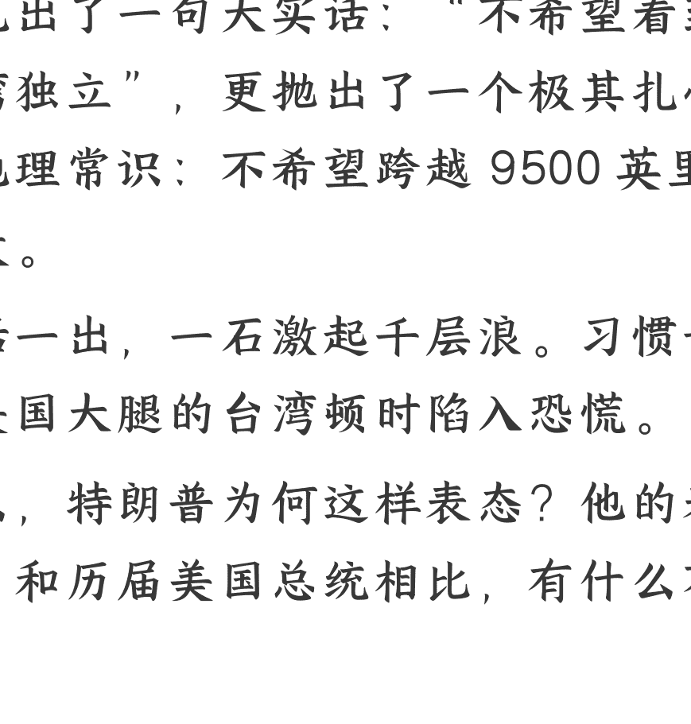

# 特朗普一句话，“台独”分子天塌了？

**260520 文/卢克文工作室嘉宾 云梦竹  
整理：公众号懒人搜索，[懒人专属群](https://t.cn/xxxx)精选  
懒人微信：**lazyhelper1**

中美峰会后，美国总统特朗普在采访中甩出了一句大实话：“不希望看到台湾独立”，更抛出了一个极其扎心的地理常识：不希望跨越 9500 英里去打仗。

此话一出，一石激起千层浪。习惯于抱美国大腿的台湾顿时陷入恐慌。

那么，特朗普为何这样表态？他的表态，和历届美国总统相比，有什么不同？

## 01

翻看美国官方的标准话术，大家不必对特朗普的言论过度惊讶。“不允许台湾独立”，是美国长期挂在嘴边的官方态度。回顾拜登政府时期，虽然在 2022 年 10 月（CBS《60 分钟》访谈）和 2023 年（接受 CNN 采访）等多个公开场合，拜登曾多次信誓旦旦地表示“若台湾受到攻击，美国会防卫台湾”；但有趣的是，每次拜登刚放下狠话，白宫官员就会立刻跑出来“灭火”，进行所谓的“政策澄清”，重申美国的一个中国政策并未改变。

这就是美国玩弄了多年的“战略模糊”把戏——口头上模糊承诺以安抚我们，行动上暗中加码以增强台湾实力。换句话来讲，哪怕是拜登也不会直接表示支持台湾独立，他们会支持维持现状，支持所谓的台湾海峡自由航线，而不会支持独立。拜登甚至亲口说过。

问题来了：既然拜登也说过不支持“台独”，为什么特朗普的表态依然惊人？答案很简单：因为特朗普不是拜登，他说的不是套话，而是真心话。

拜登及其背后的民主党，代表的是华尔街金融资本和跨国资本的利益。推动资本全球化，就必然要求美国在全球范围内维持绝对的军事霸权。无论是死保乌克兰，还是武装台湾，在民主党眼中，这些都是维护美国“自由世界领袖”地位的必要开销，是其全球战略布局中不可或缺的棋子。相比之下，特朗普背后，是 MAGA 群体，这些人骨子里极其厌恶对外战争，这也是美国战略收缩的核心逻辑：既维持世界霸权，又维持盟友利益，太亏本了。

在战略收缩的大背景下，台海问题就显得明了。早在 2023 年的竞选集会上，特朗普就多次用极其通俗甚至粗鄙的语言算过这笔账：“台湾距离美国大约 9500 英里，而它距离中国只有 68 英里，我们为什么要为保卫台湾而流血牺牲？”在他看来，跨越大半个地球去替别人打仗，纯粹是赔本赚吆喝的买卖。

因此，当拜登说出“不支持‘台独’"时，那只是一句毫无成本的政客套话，没人会相信拜登真的会放弃；但当这句话从特朗普嘴里说出来，分量就完全不同了，因为特朗普真的想放弃，就像放弃乌克兰。而随后那句，“不希望美国跨越 9500 英里去打仗”，不仅道破了天机，也暴露了当今美国在台海战略上的终极困境。

台海问题，表面上看是外交问题，实际上是军事问题。在过去几十年的推演中，几乎所有的台海推演美军都设置了一个前提：即包括日本在内的美军基地设施完好无虞，可以肆无忌惮地起飞战斗机，对我舰船人员进行攻击。然而，这个范式在伊朗战争中被打破了。随着导航及制导技术的迅猛发展，中程导弹的圆概率误差（CEP）已经下降到几十米级别。导弹可以精确打击节点、点杀指挥设施、连续打击同一目标。

美国《华盛顿邮报》对卫星图像的分析显示，伊朗的空袭对中东 15 处美军基地造成了重创，共有 228 处结构或设备被毁，远超官方披露数据。由于前线基地的机库被炸、燃料库起火、防空网瘫痪，美军在中东的地面部队处境极为狼狈。据《纽约时报》披露，除了必要的航空地勤，大量美军士兵被迫撤离基地，分散躲进当地的酒店和办公楼里，开启了“远程作战”模式。

而美军在台海推演周边基地，全部处于中程及远程导弹覆盖范围内。既然中东的爱国者很难拦截伊朗的导弹，那么东大的导弹，大概率也是拦不住的。美军在亚洲的基地，并不会比中东的多安全。所以，就算美国想保台湾，也是很难保的。这两者叠加在一起，就决定了美国在台海问题上只会更加谨慎。所以，特朗普有必要警告台湾当局，不要给美国添麻烦。

此外，特朗普的表态，不只敲打了岛内独派，还泼了日本一盆冷水。

### 02

在台海问题上，日本比美国更加积极。而这种积极，不是因为所谓的台日感情，而是冷静的深层目标：借助区域危机，推动日本彻底摆脱战后体系限制，实现所谓“正常国家化”。这种思路，在日本历史上有过一次成功案例，那就是朝鲜战争。1945 年日本战败后，实施的《日本国宪法》第九条，明确规定日本“放弃战争权”，禁止拥有“陆海空军及其他战争力量”。与此同时，美军还推动财阀解体、军工拆分，并严格限制日本重工业恢复。当时美国对日本的定位，并不是军事盟友，而是一个被解除武装的占领区；但朝鲜战争改变了这一切。1950 年朝鲜战争爆发后，美国突然发现，自己在东亚缺乏一个稳定的大后方，缺少一个就近补给的工业基地，从美国运送补给毕竟太远了。思来想去，美国最终决定对日本工业进行扶持。于是，日本迅速从“战败国”转变为“战争支援基地”。

**所以，日本经济学界存在一个说法：**  
> “朝鲜战争是日本战后经济真正的起点。”

**而更关键的是军事层面。** 1950 年，在朝鲜战争爆发仅一个月后，美国便要求日本建立“警察预备队”，人数约 7.5 万人。这支部队后来逐步扩展，并最终演变为今天的日本陆上自卫队。  
**也就是说：** 日本军队的重建，并不是日本主动突破美国限制，而是美国在战争压力下主动松绑。换句话说，战争本身，成为了日本突破战后体系的最大契机。而这一历史经验，对今天的日本右翼与安全战略学界影响极深。

**日本前首相安倍晋三多次强调**，“台湾有事就是日本有事，也是日美同盟有事”。  
**从日本内部政治逻辑来看**，其真正意义在于：**将台海问题“日本本土化”**。只有将台湾问题定义为“日本生存问题”，日本政府才能进一步突破和平宪法与专守防卫限制。**这也是日本在台海问题上如此激进的关键**。

**日本方面很担心中美缓和关系**，尤其是在台海问题上做什么交易；那样，日本的“大棋”就要破灭。所以，特朗普访华前几个月，日本一直在做美国的工作，希望在行程上，特朗普先到访日本，再访华。但特朗普没答应。眼看不成，日本又想了别的招：特朗普访华期间，日本国内流出 2026 年版《防卫白皮书》草案，再次强化“中国威胁叙事”，指责解放军军机“照射雷达”，把中国定为“前所未有的最大战略挑战”。美国总统正在访华，身为“小弟”的日本，却在这个时候强化中国威胁叙事，不就是想把缓和的事情给搅和掉？

就在特朗普离京的同一天，日本首相高市早苗的电话打到了“空军一号”，日媒披露，通话时间为 15 分钟。但美方没有像以往那样发布联合声明、通话纪要，只由日方自己对外放风。从美国这个动作来看，大概率双方谈得不怎么样。

特朗普对日本的小九九其实心知肚明：他的发言不仅仅是针对台湾，还针对日本。作为一个正在战略收缩的国家，能够伤害美国的、能够把美国拖下水的，反而是那些盟友；既然这样，不如此刻就把话说清楚。对美国而言，台岛和日本是一张牌，应该是其为美国的战略利益服务，而不是被日本和台岛的独派拖下水。

特朗普那句话最震撼的内容，就是直接戳破了这一点：美国不会支持他们，因为这不符合美国利益。

——————分割线——————

绝大多数人只盯着眼前的工资，却不知道一次远在中东的冲突、一次降息的决议，就能在一夜之间洗牌普通人的财富。看懂宏观，是为了在周期切换时，不被当作代价。如果你认同这种“抬头看路”的长期主义，欢迎围观我的个人情报智库：【懒人专属群】。圈子已稳定运行 7 年。我们每天利用 Python 爬虫与大模型算力，过滤全网最顶级的政经内参和搞钱风向标，做你最冷酷的“外部大脑”。

查阅圈子完整数字资产与上车门槛：  
https://lazyso.com/insider/  

认同价值的，扫码加我微信，备注：**【进群】**