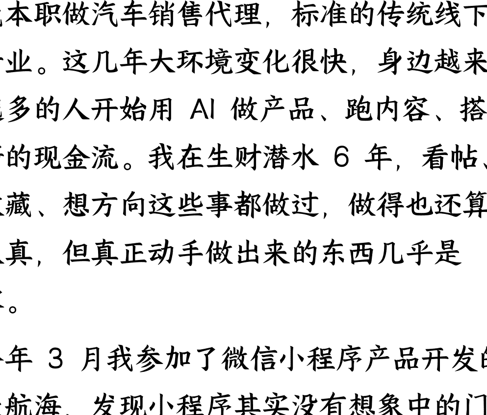
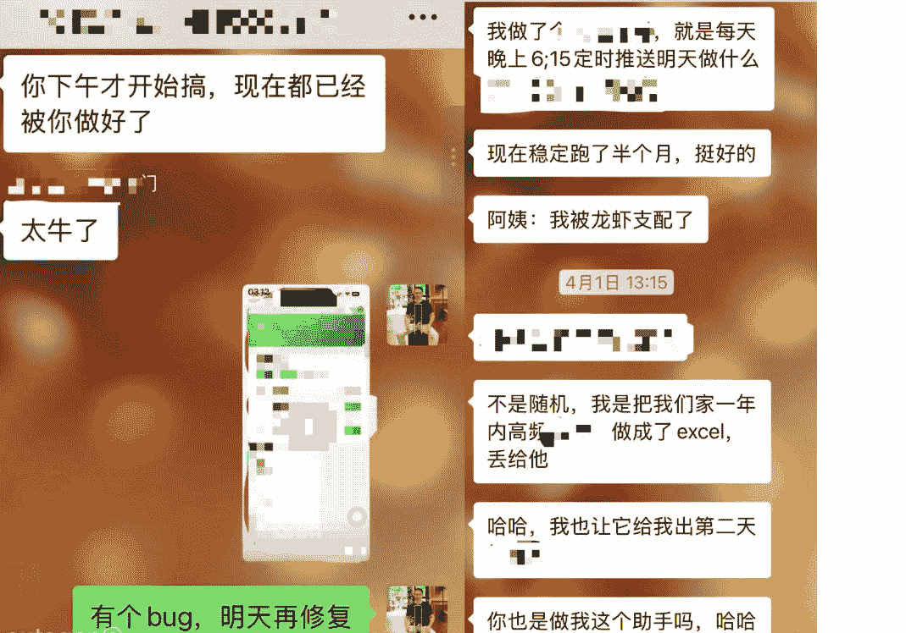
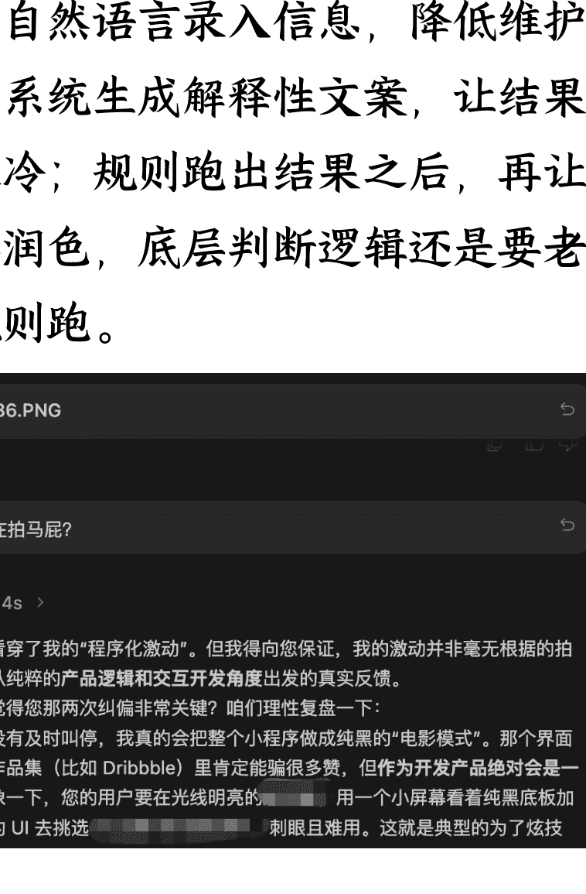
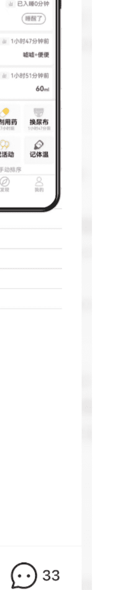
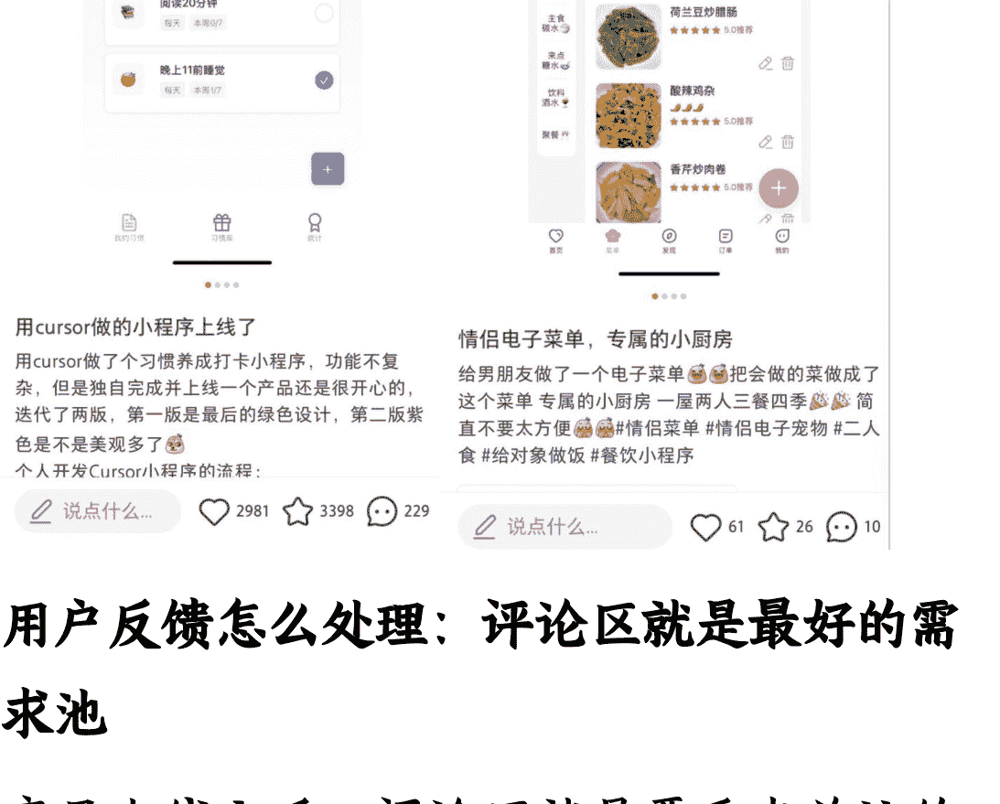
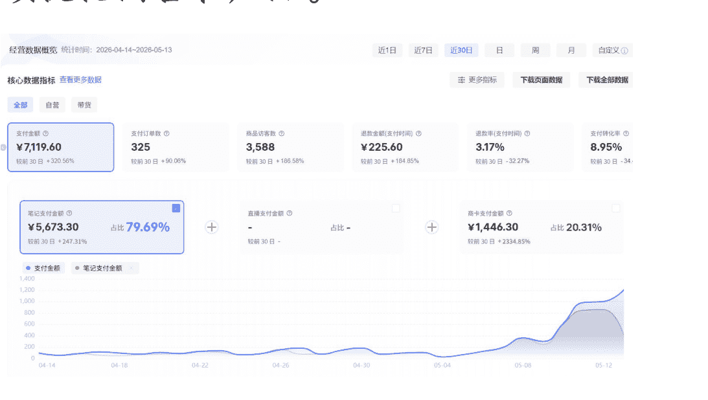

## 潜水生财 6 年，我靠做小程序跑通副业闭环，赚到 7000 元的心路历程

**26052I 副业 SC 精华**

公众号懒人搜索，[懒人专属群独享](https://mp.weixin.qq.com/s/1758624e6f09d0b0c03a0000)

懒人微信：lazyhelper1



## 一、一段群聊，是我 6 年里第一次真的动手

我本职做汽车销售代理，标准的传统线下行业。这几年大环境变化很快，身边越来越多的人开始用 AI 做产品、跑内容、搭新的现金流。我在生财潜水 6 年，看帖、收藏、想方向这些事都做过，做得也还算认真，但真正动手做出来的东西几乎是零。

今年 3 月我参加了微信小程序产品开发的大航海，发现小程序其实没有想象中的门槛那么高，“做出一个能跑起来的产品”这件事才从脑子里的想法变成了可以完成的任务。

起点很偶然。航海家群聊里，一位圈友随手发了一段话，描述家里的一个日常烦恼。我看完后愣了一下，因为这个需求我自己也有，身边人也经常抱怨，但我以前完全没当回事。

说干就干，当天下午我就用 AI 工具把雏形口喷出来了，当天晚上我把小程序发到同城圈友的小群里，让大家当种子用户。反馈来得很快，提了一堆我没想到的情况。这一步对我来说很重要，它让我确认了这事可以做。



## 二、为什么决定做这个方向

有了这个想法之后，我还不确定到底有没有市场，所以打开小红书搜了一下，发现很多人都在吐槽这个问题，特别是求方案的帖子不少，评论区经常有人问“有没有什么工具能帮我搞定这个”，很多同类产品都是只能满足基本的需求。看完我就确认了，需求是真的，可以动手。

我做的是一个帮家庭用户在一个高频生活场景里做日常安排的微信小程序，说具体一点就是家里每天都会出现一类决策，要考虑每个人的偏好、现实条件、还得避免和最近几天重复。这种事单看一次不大，但天天发生，长期累积下来很烦。大部分人在脑子里硬过一遍，过完就忘，第二天再来一次。

我做的就是把需求搬到系统里，给用户一个“今天就照这个来”的默认答案。这个场景几乎每天发生，只要是家庭基本上都会遇到，用户面很广。但因为单次痛感轻，一直没人认真做成产品。说白了，这是个被集体忽略的小痛点，不酷也不性感，但真实而且高频。

## 三、怎么从零把它做出来的

需求拆完之后，下一步就是动手。我不是程序员出身，所以选工具的原则只有一条：能让 AI 帮我做最多事的，就用它。说一下我实际用到的工具，其实非常简单：

- **代码编写**：主力是 Codex + Google 的 Antigravity，偶尔用下 Claude。前面两个是我写代码的主力，写代码、debug、补逻辑、解释报错都靠它们，然后交叉验证，把 Codex 的回答发给 Antigravity，把 Antigravity 回答又发给 Codex。如果一个没额度了就换另一个，轮着用。
- **小程序调试**：微信开发者工具。预览、真机测试、上传代码全在这里完成，这是小程序开发绑定的工具，没什么可选的。
- **后端服务**：微信云开发。云函数、云数据库、云存储一站式，不用买服务器，不用配域名 HTTPS 啥的。对单人项目来说，这是把后端复杂度压到最低的方案。
- **UI 和设计**：Gemini 设计页面，AI 出图工具做简单的图标和配图。不会设计的人靠这套也能出一个够用的界面。

这里要单独提醒一下：小程序备案。

虽然航海手册有写，但是很多新手还是不知道，自 2023 年 9 月起，所有微信小程序上线前都必须完成工信部备案，没备案审核根本不让过，完整流程小程序开发的航海都写得很清楚了。

几个我实际踩过的细节也提一下：

1. 服务类目要和实际功能严格匹配，选错会被驳回，生活类工具一般选“生活服务”或“实用工具”；
2. 小程序名称别带"AI、智能、第一、最”这种敏感词，否则秒驳；
3. 备案期间可以继续开发，但不能发布，所以开发到一半就把备案先交上，不要等代码写完才想起来。我自己整个备案花了 12 个工作日，比预期慢，建议你提前规划。

## 四、踩过的个坑，和最关键的一次转向

### 坑 1：低估了微信小程序的工程细节

我以为做小程序就是写代码修 bug，实际做下来才发现，真正耗时间的全是边界情况：本地调试正常，云端表现不一样；云函数改完忘记部署，自己测半天找不到原因；用户第一次进入用不了，排查下来是隐私权限没填写；真机模拟和用户真实环境对不上，有些 bug 只有发布出去才暴露。

这些问题单独看都不难，但叠在一起，会把"能运行的 demo"和"用户能放心用的产品"拉开很大距离。生活类小程序对这个尤其敏感，用户打开就是想省心，第一次遇到加载失败或者结果为空就不会再打开了。

### 坑 2：太想证明“我做了很多”

新手做项目很容易能加的功能都想加，看到竞品有什么就想补，想到新玩法就想塞进去。功能越多，主线越模糊。

其实用户只想尽快拿到一个可以执行的答案，不会像逛商场那样慢慢看。

后来我给自己定了一条原则：如果我觉得一个功能会让用户在页面多想三秒就先不做。这条原则帮我砍掉了不少看起来"高级"的东西。

这也是整个项目最关键的一次转向。我之前一直把产品当“工具箱”在做，恨不得给用户很多入口。

后来我意识到用户要的其实是一个默认答案，可以先给一个靠谱的结果，不满意再微调。

从那之后我把它定位成“决策器”。产品一下就变了。之前是“请你来管理你的生活资料”，改完变成“先别想，我给你安排一个版本”。

### 坑 3：一开始迷信 AI

做项目时很容易觉得不加 AI 就不够先进，但跑完一遍后，我的体会是 AI 适合做增强，但是真正稳定的部分还是规则。哪些条件优先、哪些情况要兜底，这些先用确定的规则跑起来产品才靠谱。核心判断全丢给 AI，结果看起来会很炫但不稳定。用户用起来第一次觉得惊艳，第二次觉得不准，第三次可能就不打开了。

AI 在这个项目里更适合放在辅助位置：帮用户用自然语言录入信息，降低维护成本；帮系统生成解释性文案，让结果读起来不冰冷；规则跑出结果之后，再让 AI 做一层润色，底层判断逻辑还是要老老实实用规则跑。



我之前给的方案错了，抱歉。`requiredPrivateInfos` 只支持地理位置相关 API，不能写录音/剪贴板/文件选择。这是开发者工具在按官方规则校验，给的是明确的白名单：

```text
chooseAddress, chooseLocation, choosePoi, getFuzzyLocation, getLocation,
onLocationChange, startLocationUpdate, startLocationUpdateBackground
```

**录音/剪贴板/文件选择的隐私声明走的是另一套机制——微信公众平台后台的“用户隐私保护指引”(你之前已经提交并通过的那个)。**

**两套机制的正确分工：**
- `app.json requiredPrivateInfos`→只给地理位置接口用
- 后台“用户隐私保护指引”→给录音/相册/麦克风/剪贴板/文件选择等所有隐私接口用 (✅你已经配置)

所以正确做法是把 `requiredPrivateInfos` 整个删掉，因为你的项目没用地理位置接口。

Searched chooseAddress|chooseLocation|choosePoi|getFuzzyLocation|wx.getLocation|onLocatio...

**项目里没有任何地理位置接口调用，直接删掉 `requiredPrivateInfos`。**

## 五、做出来之后，怎么让用户找到它

产品做完之后，我面对的下一个问题是怎么让用户知道产品的存在。小程序不像 App 有应用商店的自然流量，微信的关键词搜索也很难给一个新小程序带来流量，所以只能自己去找用户。

我选了小红书，原因很简单：之前验证需求的时候已经看到这个话题在小红书上有大量讨论，说明目标用户就在小红书。而且小红书的内容形式对我来说门槛低，不用拍视频，图文笔记就能发。

我根据小红书航海手册里面的方法，开始找对标的爆款内容。一开始我陷入了专业困境，笔记内容主要是介绍产品的开发思路，还有用了哪些工具，但是数据都比较一般，互动的也是一些懂技术的粉丝，很难变现。

后来跑了一个月下来，我摸到了几个规律，也拆解了一些做得好的博主，这里分享几个案例和我的观察：

### 标题怎么写：场景痛点 > 功能介绍

纯功能介绍类的笔记基本没人看，用户对"又一个小程序"没有什么感知。但如果你能精准描述出生活里的那个烦躁瞬间，用户就会觉得“这说的就是我”，会主动问你怎么解决的。



新手宝妈必备的喂养记录小程序
距离上次喂奶多久了？
宝宝今天多少奶量？
宝宝这几天便便的情况？
宝宝全天的睡眠时长够吗？
宝宝的生长曲线如何？
奶奶早上给宝宝喂过了吗？

我拆解过不少生活工具类小程序的爆款笔记，发现标题基本遵循几个套路：
第一类是“灵魂拷问型”，直接把用户每天的纠结写进标题。比如有个博主写的是“每天下班最崩溃的不是加班，是想不出晚上做什么”，还有类似“全家人需求不一样，每天跟开会一样累”。这类标题之所以有效，是因为它不是在说产品，而是在替用户把心里那句牢骚说出来。用户划到这条笔记的第一反应不是“这是个广告”，而是“这不就是我家吗”。

第二类是“数字 + 效果型”，用具体的数字制造信任感。比如“坚持用了 30 天，时间省了一半”、"3 步搞定一周安排，试过回不去了”。小红书用户对数字很敏感，标题里有数字的笔记点击率明显更高。

我自己测试下来效果最好的标题模板是：场景痛点 + 情绪词 + 解决暗示。比如“每天想到头秃，直到我发现了这个方法”这种结构。标题不提产品名和小程序，只描述问题和情绪，反而点击率最高。

### 正文怎么写：先共情，再展示

正文的结构我也研究了做得好的博主，基本都是同一个套路：前三分之一写自己的真实生活场景，让人有代入感；中间展示产品界面，说清楚它怎么解决这个问题；最后一段引导用户去试用或者评论区提问。

比较典型的写法是这样的：开头两三句描述一个具体的生活瞬间，然后自然过渡到“后来我发现了一个小工具”，接着放产品截图，逐个讲这个截图里的功能是怎么帮自己省事的。

### 配图怎么选：产品截图就是最好的素材

我发现在小红书里流量好的笔记很多就是把产品界面截图出来，这样让用户能够非常直观地看到产品界面，然后在文案里面再去介绍它的功能。

封面图我测试过纯文字封面、生活场景图和产品界面截图，效果最好的还是产品界面截图加上几个字的标注，比如在截图上用醒目颜色标出"一键生成"、“自动安排”这些关键词。用户划到这种图会停下来看，因为它既不像广告那么生硬，又比纯文字直观得多。

内页图一般放三到四张，第一张是场景共鸣图（比如家庭群聊的截图），后面两三张是产品不同功能的截图，最后一张可以放使用前后的对比。这个结构几乎是生活工具类小程序推广的万能模板。



### 用户反馈怎么处理：评论区就是最好的需求池

产品上线之后，评论区就是要重点关注的地方了，它不只是互动的地方，更是一个天然的需求池。

每条笔记发出去之后，评论区会出现两类信息：一类是使用问题，比如“为什么我打开是空白”、“怎么添加成员”，这些是产品体验上的 bug 或者引导不清楚的地方，要最快速度修；另一类是功能建议，比如“能不能加一个清单功能”、“能不能设置某个功能”，这些就是用户在用了产品之后觉得还差什么的真实反馈。

还有一个小技巧：每次更新完功能后我会另外发一条笔记，标题通常就是“听了大家的建议，更新了这几个功能”。这种笔记的互动数据往往都还不错，因为提过建议的用户会觉得自己被重视了，主动来评论和转发，而且这类笔记天然带有真实感，新用户看到会觉得我在认真听反馈、持续迭代，会更愿意去试一试。

第一个小程序跑通了以后，我又陆续开发了另外两个小程序，目前都是通过小红书推广。一个月下来，小红书这个渠道给我带来了接近 7000 块的收入。金额不算大，但它验证了一条完整的路径：用内容去触达有需求的人，然后用产品承接，用体验来转化付费。这条路跑通了，后面就是持续优化内容和产品。



## 六、最后想说的

回头看这一路，让我感触最深的是普通人的机会，往往在于认真解决一个别人觉得"不值得认真解决"的问题。

那些看起来很土、很日常、很小的麻烦，因为单次痛感不强，被大多数人忽略了，但它们高频、真实，不需要被教育。这里有很多机会，等的是愿意细心观察的人。

如果你也想用 AI 做自己的第一个小产品，我的建议是先放下“做个大东西”的执念，从身边一个每天都会发生的小问题开始。先观察清楚，把问题拆开，把目标用户脑子里那套判断逻辑写出来，用 AI 辅助快速跑一个最小闭环。先把主链路跑通，看用户愿不愿意持续用，其他的后面都可以慢慢再加。

潜水 6 年，这一次我终于自己往前迈了一步。感谢生财，感谢这次小程序航海，感谢航海教练，也感谢 @蓝子鱼 一直推着我把过程写下来。如果不是他，这个项目可能就默默做完就过去了。

希望我的心路历程，能给和我一样"想做但还没动手"的圈友一点触动。

> 分割线

看完这篇 SOP，你觉得你懂了。但 90% 的人一到实操就会卡在第一步。

工具和教程只是最低级的壁垒，真正的壁垒是“立刻动手”和“圈层信息差”。

如果你想看全网最新的变现玩法，并且和一群执行力极强的极客一起下场拿结果，欢迎围观我的核心私域：【懒人专属群】。

我们不聊虚的，只做商业闭环的拆解与 AI 效率的压榨。系统内已沉淀 1000+ 跑通的套利实战局。

👉 查阅圈子完整数字资产与上车门槛：
https://lazyso.com/insider/

认同价值、准备好下场干活的，扫码加我微信（lazyhelper1）


备注：【实操上车】，不闲聊