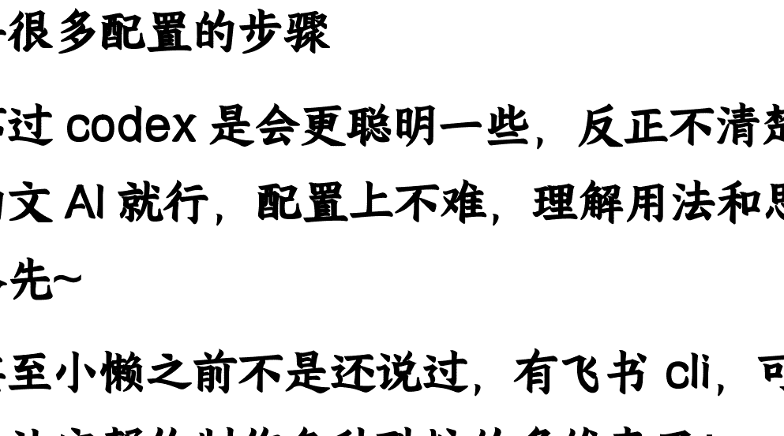
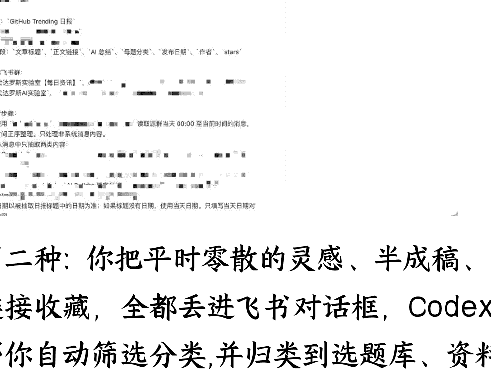
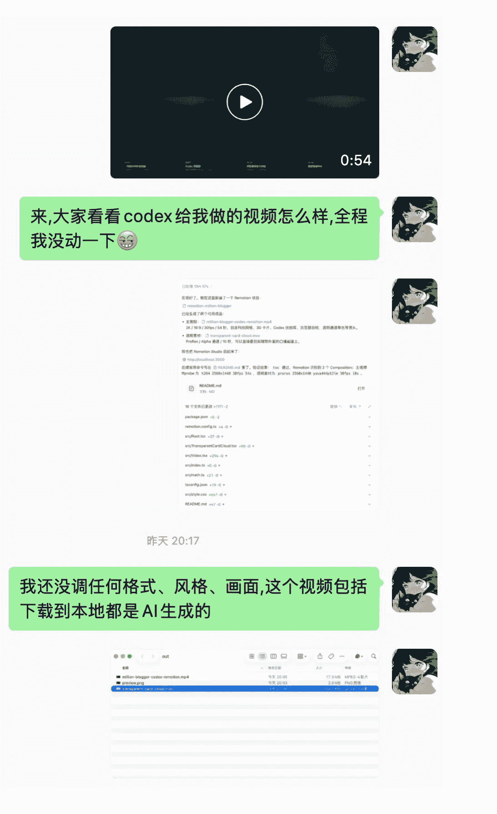

# 比 Obsidian 好用一万倍！把飞书开源 CLI 接入 Codex，让 AI 自动整理你的个人知识库

260522 副业 SC 精华

公众号懒人搜索，[懒人专属群](https://t.cn/xxxx) 独享

懒人微信：lazyhelper1

小懒人备注：其实不用那么麻烦，飞书 Cli 现在开放了，Trae solo 可以直接绑定，省去很多配置的步骤。不过 codex 是会更聪明一些，反正不清楚的文 AI 就行，配置上不难，理解用法和思路先~甚至小懒之前不是还说过，有飞书 cli，可以让它帮你制作各种酷炫的多维表了！

以下为原文:

HI，你好，我是九思 Summer.

事情是这样的。这段时间很多人在聊 Obsidian + Claude Code 做个人知识库，当然很好用，但我后来发现了一条对更多人更简单方便的路子。

我记得关于 obsidian 知识库的架构，有一个专门的 github 页面是介绍这个的，但是我好像有点忘记了。昨天 18:21：是的，但是知识库我断断续续试着做了很多年，发现最容易坚持下去的还是方便、越方便越好。如果你在要记知识库的基础上，还要再加上学架构、学多维表格怎么设计，学分类、操作技巧等等，你会发现你每天都不想打开第一步就卡住了。**如果你的资料、想法、群聊、待办，本来就大多躺在飞书里**，那你其实没必要再折腾一套新的知识管理中枢。用飞书+codex,就能在手机上随时随地的直接指挥 AI 帮你整理你的知识库.除此之外，还可以让 codex 给你生成你的定时任务和工作流，每日定时触发。

全程无需自己操作飞书的任何界面,codex会帮你完成一切,甚至如果你打开了 codex 的 computer use 功能，它连你的电脑本地都可以操作。我已经连续使用了好多天，现在甚至凌晨两点我睡觉时,AI 还在给我干活，并在我的手机上回复。11:27 <话题来自：每日 AI 资讯>

codex 02:52
已确认有更新，最近一次集中更新发生在 **2026年5月12日 19:56-20:07**。本次更新主要有两块：
1. `remotion-million-blogger`项目新增/完善了Remotion动画工程，包含主视频合成和透明背景卡片云素材，相关`package.json`、`src/*`、`README.md`都在这段时间内更新。
2. 飞书Codex代理说明文档也在**2026年5月12日20:00**更新过，文档里记录的daemon路径已经指向新的`~/.codex/feishu-codex-agent/...`。

补充一点：日志里还能看到一个未完全收口的问题，旧的启动配置一度还在尝试运行知识库目录下的`tools/feishu_codex_agent.py`，因此出现过启动失败记录。如果你要，我下一步可以直接帮你继续确认：**现在实际运行的是不是新版本配置**。

先别急着讲玄学，接下来我会手把手地教你我是如何实现的。

## 先把 Codex 和飞书 CLI 装好

**先装 Codex**(详细教程可见下面我之前写过的文章👆点击链接即可阅读)。
**完全不会写代码的我，是怎么使用 codex的？（附零基础保姆级教程）**。
**或者直接搜索**Qhttps://chatgpt.com/zh-Hans-CN/codex/,这个网址，下载安装codex桌面版即可.

**再让 codex帮你装飞书开源 CLI**，把以下内容直接复制发给你的codex,立即完成安装：

# 飞书
帮我安装飞书 CLI: https://open.feishu.cn/document/no_class/mcp-archive/feishu-cli-installation-guide.mdPlain

# Lark（海外版本）
帮我安装 Lark CLI: https://github.com/larksuite/cli

配置完成后，为了确保 skills完整加载，需要重启你的Codex，然后便可以发送指令开始操作飞书。配置应用时，默认会创建一个新应用，也可以选择一个已有应用。02

## 先让它学会读你的飞书知识库

这一步才是最爽的地方。你不需要自己去翻 CLI 文档，不需要自己拼参数，不需要自己盯 TSON 结构。你只要把飞书链接甩给 Codex。比如这样：请读取这篇飞书 wiki，链接是 https://你的飞书链接。帮我做四件事:
1.总结这篇文档现在在讲什么
2.找出结构混乱、重复表达和空标题
3.提出一个更适合继续扩写的结构
4.先不要改,等我确认

这一步的本质，是 Codex 在背后替你做了原本应该由你自己手动完成的 CLI 调用。而你感知到的，只是一句自然语言。我非常建议，一开始不要把权力放得太猛。先让它读。再让它提方案。最后再让它动手。比如你确认方案没问题以后，可以继续在 Codex 里这样说：按照你刚才的整理方案，直接帮我更新这篇飞书 wiki。要求:
1.不要编造新信息
2.保留原意
3.如果涉及大段改写,先分块处理
4.改完以后告诉我你改了哪些地方

说真的，这一步一旦跑通，你对个人知识库这件事的感受会一下子不一样。以前是你亲自当编辑、当排版工、当整理员。现在是你只负责判断，AI 负责动手。这个角色切换太关键了。

### 03
一些更高阶的玩法

一旦你接受了这个视角，后面的玩法就会自然长出来。比如：
第一种：你希望几个高价值飞书群聊里的讨论，沉淀成知识卡片积累到你的知识库中，你还希望每日定时触发，不用你提醒👉: 
第二种：你把平时零散的灵感、半成稿、链接收藏，全都丢进飞书对话框，Codex帮你自动筛选分类，并归类到选题库、资料库、项目库。

好，我继续接上授权进程，然后去搜目标多维表格和读取字段格式。授权成功。现在我会先用云空间搜索找 Base，再列表和字段，尽量用已有记录的格式来写。这三个精确搜索没命中，可能 Base 在知识库 Wiki 里、标题不是这个完整叫法，或者不在 BITABLE 类型筛选下。我要放宽关键词和类型，再沿着“代达罗斯AI实验室”这个群里分享过的文档查一轮。找到了一个叫"AI做图提示词”的 Wiki 文档，不是搜索结果里直接显示的 BITABLE。看起来目标内容可能嵌在文档/知识库页里；我会读取这个页面内容，确认里面是否有表格或嵌入的多维表格入口。页面里确实嵌了多维表格：app token 和 table id 都拿到了。接下来我读表结构和几条旧记录，找准字段映射。

字段很简单：附件、名称、1级标签、2级标签、提示词。我要读几条旧记录确认命名和标签用法，然后创建新记录；图片附件需要单独处理，看旧记录里附件是否常填。旧记录会保留参考图附件，所以这条也应该先建记录，再把九思消息里的两张图下载并上传到“附件”字段。分类我会按现有选项放到 1级标签=真人，2级标签目前没有"写真/商拍”这类选项；为了不乱造新选项，我先留空。我准备写入一条新记录：名称用"GPT Image 2 提示词分享：新中式锦鲤高定艺术写真”，提示词保留完整结构文本，标签先写 真人。创建成功后再把两张参考图补到附件字段。新记录已经创建，record id 是 recvjoKpoUjzIh。现在我下载九思消息里的两张参考图，再上传这条记录的附件字段。两张图都上传成功了，但我注意到附件字段的返回像是每次写入单张。为了不把第一张误覆盖掉，我会马上读回这条记录确认附件列表。读回结果发现只保留了第二张，刚才并行上传触发了附件字段覆盖。这个我来修：我先看一下 CLI 上传附件的实现能不能带已有附件一起写回，再把两张恢复成同一个附件列表。

第三种：你甚至可以在飞书的对话框中直接指挥电脑上的 codex 给你干活，不只是飞书知识库，甚至可以是在电脑本地干活: 
第四种：让 codex 根据我的飞书知识库中的文章，一键生成视频，就连下载这个视频到本地都是 AI 完成的:

在这套系统里，三样东西分工很明确。
- **第一层**，飞书。它负责承载你的知识库、消息流、表格、文档和日常信息输入。
- **第二层**，飞书开源 CLI。它负责把这些飞书里的能力暴露成 AI 可以稳定调用的接口。说得再直接一点，它就是 Codex 的手。
- **第三层**，Codex 桌面端。它负责理解你的意图、拆任务、调用工具、执行流程、汇总结果。

#### 直接在飞书对话框中指挥 codex

以上这些，你全都不需要在电脑前手动发指令，直接在飞书对话框中指挥就可以。也就是说，你在手机上发一句话，本地进程收到飞书事件，再去调用`codex exec`，最后把结果自动回到飞书线程里。这个味道就完全不一样了。它已经不是一个工具，而是一套在后台持续运转的小型工作流。

对于小白来讲，你就这么理解：整套东西分 4 层:
1. 飞书里有一个 bot
2. 本机有 lark-cli，负责收飞书事件、回飞书消息
3. 本机有 codex，负责真正执行任务
4. 本机有一个常驻 Python 守护进程，把 2 和 3 串起来

**你只需要第一次时在 codex 里输入这个提示词：**请帮我这台 Mac 上搭一个“飞书对话框里直接指挥 Codex"的本地工作流，我是小白，请你不要只讲思路，直接帮我检查环境、创建文件、配置后台服务，并在每一步告诉我需要我点击或确认什么。目标是：我在飞书里给一个 bot 发消息 -> 本机后台进程收到飞书消息事件 -> 本机自动调用 codex exec 执行任务 -> 执行结果自动回复到原飞书线程 -> 整套流程配置成后台常驻，电脑开着就能用。**要求你按这个顺序帮我完成：**检查这台电脑有没有安装 Python、Codex CLI、lark-cli；如果缺东西，告诉我最简单的安装方式；引导我在飞书开放平台创建一个 bot 应用；告诉我这个应用要开哪些权限、订阅哪个事件；帮我完成 lark-cli 配置和授权；帮我生成本地桥接脚本，要求只允许我本人触发；帮我生成 launchd 配置，让它在 macOS 后台常驻；帮我做最小测试，比如 /codex ping；如果测试失败，继续排查，不要停在分析；最后把我在飞书里能用的指令写成一份简短说明给我。

注意：我是新手，不要默认我会命令行需要我手动点网页、登录、授权的时候再叫我其它能自动做的你都直接做不要只给教程，请你直接在本机帮我搭好然后，等着 AI 给你干活就好啦!

##### 把 codex 机器人接入对应的群聊

我按飞书当前常见中文界面整理了，少数按钮名字如果有轻微差异，一般都在同一位置。
官方入口:
- [飞书开放平台](https://open.feishu.cn/) - 开发者后台 / 我的应用
- [飞书管理后台](https://open.feishu.cn/)

参考官方说明:
- [认识与配置飞书集成（飞书官方）](https://open.feishu.cn/)
- [飞书接入 OpenClaw 的安全防护与治理指南（飞书官方）](https://open.feishu.cn/)

###### 一、先创建飞书机器人应用
1. 打开 [开发者后台](https://open.feishu.cn/), 用你的飞书账号登录。
2. 点击 **创建企业自建应用**。
3. 填应用名称。推荐直接写成 Codex 助手、我的 Codex 机器人这种，后面群里更容易识别。

###### 二、给应用开“机器人能力”
4. 上传头像，填一句应用描述。例如：在飞书里一句话触发本地 Codex 执行任务并自动回复结果。
5. 点 **创建**。
6. 进入刚创建的应用后台。找到左侧类似 **添加应用能力**、**能力**、**机器人**的区域。
7. 把 **机器人**能力打开。如果看到机器人欢迎语、消息卡片、可见范围之类的配置，先保持默认即可，后面跑通再细调。

###### 三、开权限
这一步很关键。没有权限，机器人就算在群里也收不到消息、回不了消息。
8. 打开左侧 **权限管理**或**权限配置**。搜索并开通和 IM 消息相关的权限。对“飞书里一句话触发 Codex"这类场景，优先开这些常用权限：
- `im:message:send_as_bot`
- `im:message:readonly`
- `im:message.group_at_msg:readonly`
- `im:message.p2p_msg:readonly`
- `im:chat:read`

如果你后面还想让机器人收图片、文件、语音，再补这些：
- `im:resource`
- `im:message.reactions:read`

开完后，点页面里的 **申请权限**、**批量开通**或同类按钮。

###### 四、订阅事件
这一步是让飞书把新消息“推”给本地进程。
9. 打开左侧事件订阅。找到添加事件或订阅事件。搜索并添加：`im.message.receive_v1`。如果界面要求先填写“请求网址”或“回调地址”，你有两种情况:
- 如果你走的是 lark-cli event consume这种本地事件消费方式，通常是由本地工具接管，不一定需要你自己手填公网回调。
- 如果你的方案是传统 webhook 回调，就需要填一个外网可访问的回调地址。你现在这套“本地收到事件 -> 调Codex"方案，本质目标就是让这条消息事件能被订阅成功。

###### 五、发布应用
很多小白会漏这一步。不发布，前面配的权限和能力经常不会真正生效。
10. 打开左侧版本管理与发布。点击创建版本。填版本号（例如：1.0.0）。填发布说明（例如：开通机器人消息接收与回复能力）。按页面提示继续下一步。如果系统提示有权限待申请，就先补齐。提交发布。如果是企业内应用，通常还要把可用范围设给自己或测试成员。

###### 六、把机器人加进飞书群聊
这一步完全在飞书聊天界面里做。
1. 打开飞书，先新建一个测试群。推荐只拉你自己或 1 到 2 个测试成员，别一上来进正式群。进入群聊右上角 ... 或 **群设置**。找 **群机器人**、**机器人**、**应用**、**添加机器人**之类入口。在机器人列表里搜索你刚创建的应用名字（例如：Codex 助手）。点 **添加**。如果飞书提示你确认权限或使用范围，点确认。添加成功后，群里通常会看到机器人加入提示。

###### 七、测试群里能不能触发
2. 先在群里 @机器人。发一条最简单的测试消息。例如: `@Codex 助手 /codex ping`如果是私聊机器人，就直接发：`/codex ping`正常情况下，后面的本地进程收到事件后，会再把结果回复回这个线程。

###### 八、最常见的卡点
1. 只创建了应用，但没开机器人能力。
2. 开了权限，但没发布版本。
3. 发布了应用，但没把机器人加进群。
4. 机器人在群里，但没开消息接收相关权限。
5. 机器人能收私聊，不能收群消息，通常是群 @ 消息权限没开。
6. 群里能触发，但回复失败，通常是 send_as_bot 权限没开，或者可用范围没放通。

###### 九、简单总结一段话
先去飞书开放平台创建一个“企业自建应用”，开启机器人能力，开通消息读取和机器人发消息权限，订阅 im.message.receive_v1事件（原文误写为receive_vl），创建版本并发布。然后回到飞书聊天界面，新建一个测试群，在群设置里把这个机器人添加进来。完成以后，再让 Codex 帮你接本地执行链路。

##### 最后一句真心话
我越来越觉得，个人知识库这件事，真正的问题不是存不存得进去。而是谁来整理，谁来回看，谁来持续维护。以前这个人只能是你自己。所以大多数人的知识库，最后都会慢慢长成一个信息坟场。但现在不一样了。飞书负责承载你的内容，飞书开源 CLI 负责打通读写能力，Codex 负责理解和执行。你终于有机会把知识库从一个静态仓库，变成一个会被持续加工的活系统。这件事我是真的觉得很重要。因为它不是让你多了一个 AI 玩具。它是在帮你，把脑子里那些本来会散掉的东西，慢慢留下来。

> ———分割线———

看完这篇 SOP，你觉得你懂了。但 90%的人一到实操就会卡在第一步。**工具和教程只是最低级的壁垒，真正的壁垒是“立刻动手”和“圈层信息差”。**如果你想看全网最新的变现玩法，并且和一群执行力极强的极客一起下场拿结果，欢迎围观我的核心私域：【懒人专属群】。我们不聊虚的，只做商业闭环的拆解与 AI 效率的压榨。系统内已沉淀1000+跑通的套利实战局。👉查阅圈子完整数字资产与上车门槛：**https://lazyso.com/insider/**认同价值、准备好下场干活的，扫码加我微信（**lazyhelperl**）**备注：【实操上车】，不闲聊**公众号懒人搜索，懒人专属群分享