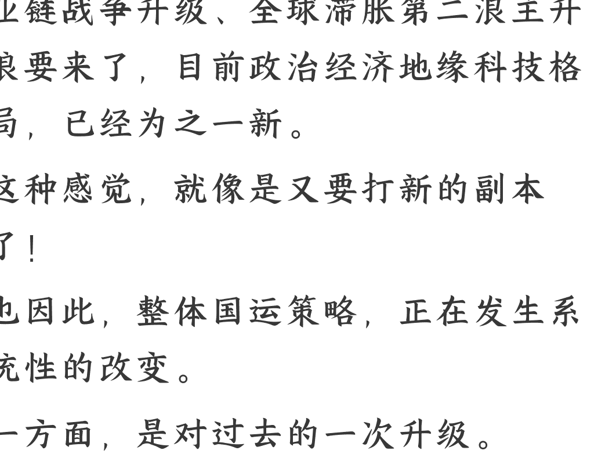
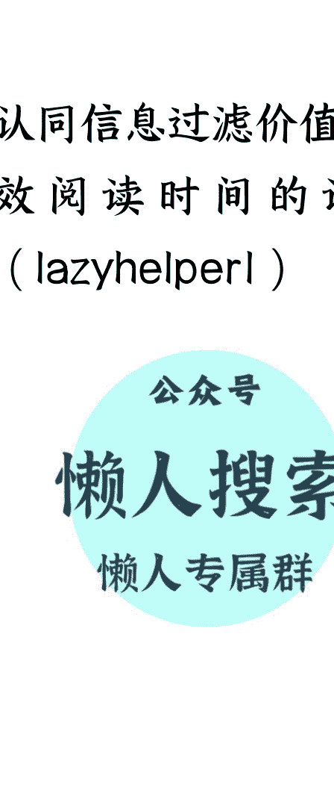

## 合集《国运战略》之——I、迎接终极摊牌：一场悄无声息的全域拆雷行动

**260525 A视野付费**

整理：公众号懒人搜索，[懒人专属群](https://t.cn/xxxx)精选

懒人微信：lazyhelper1

随着美伊战争僵持、中美俄新一轮互动开启、中日军事博弈升温、中欧产业链战争升级、全球滞胀第二浪主升浪要来了，目前政治经济地缘科技格局，已经为之一新。

这种感觉，就像是又要打新的副本了！

也因此，整体国运策略，正在发生系统性的改变。

一方面，是对过去的一次升级。

一方面，又是面对全新的博弈格局的所进行的重大转型。

尤其是川普来了后，普京又来，有形之手后续的策略，即将开启新的改变。

也正是因为这个重大原因，A 森觉得，当前的时间节点，极为有必要，给大家盘一下这个逻辑。

考虑到这一次的转向，是直接决定我们后续国运能否长虹的重大节点，因此，A 森会以国运为主轴，提供全新的视野、策略思路、有形之手近期新的重大政策改变等诸多问题，做一次前瞻性的深度、体系性的分析。本系列围绕【国运战略】，将前后分三篇文章：

- 第一篇《迎接终极摊牌：一场悄无声息的全域拆雷行动》——即本篇文章
- 第二篇《工业内嵌化，全新的国运战略压舱石》
- 第三篇《合成暴风雨，国运筹谋的最终指向》——同日发布

本系列将从三个维度，系统性、一次性、独家原创性的给大家讲清楚底层逻辑。

1. 国运战略的核心主轴
2. 看懂国运战略的进攻端、飞轮效应和全球外溢效应，以及有形之手背后的真实图谋
3. 多重周期共振的关键窗口期，有形之手的国运策略压舱石是什么大佬们不断的根据博弈的最新态势，进行策略升级和调整。放在每个人身上，那就是一道又一道难以跨越的门槛，左右着众人的命运和财富。所以，理解本系列的核心内容，将是你绕不开的超级干货。使用 880 微信豆可以阅读整个合集的完整 3 篇文章。

下面开始本篇正文，各位多多支持！

自从 2017 年川普来过我们这里后，中美正面撕破脸，已经 9 年左右了。

老美初期的策略，是基于这么一种假设：

老中是一个综合实力很一般的落后国家，只要把对付苏联和罪国日本的两套工具都用上，就可以打爆其。

事实上，当时我们已经有了稀土牌。可是，我们不敢在 2018 年使用。

核心点在于，老美把控的一些关键上游原材料，可以随意拿捏我们，最终逼我们放弃稀土牌。

2025 年我们敢于用稀土牌，也是因为上游原材料大部分我们已经可以找到替代，或者完全国产替代，不怕被拿捏，也能够确保稀土牌威力最大化。也因此，2019 年年底，我们还是“很容易”跟老美达成了所谓的第一阶段的协议。

可是，如此屈辱的经历，结合 2016 年奥巴马差点在南海跟我们动手，让村里充分意识到：全域拆雷从当时帐面来看，我们的实力也已经不弱了。

可是，实则是极为脆弱，所谓的 GDP 全球第二，跟老美可以随意拿捏我们的筹码对比，不堪一击。

尤其是这次的经历，意味着，未来老美只要缺钱，就可以把我们当肉头，随意找理由拿捏，随意收割。

以当时的我们高龄少子化趋势，再被老美随意拿捏收割，都要不了 2030 年，高龄少子化的负面冲击就要直接显性冲击我们。到时候，人家再吹一波叙事，说我们制度、人种、文化有问题，所以陷入了“中等收入陷阱”。请注意，当时老美还很自信，并没有完全动用整个盟友体系一起对付我们，也没有马上使用金融战和军事拱火。

从此后发生的林林种种的事件，村里补齐短板，全面启动拆雷，确实是极富前瞻性的。

老美对我们的进攻，主要分为三个阶段。

- 第一阶段：川普 1.0，单纯是要钱。
- 第二阶段：拜登利用“买战争 + 金融战 + 舆论战 + 盟友体系”，给我们造成了巨大的冲击，使得我们过去高度依赖全球一体化的短板全部曝露出来，至今未能全部完成回血。
- 第三阶段：川普 2.0，前后使用“关税战 + 军事牌”。

从这些年的博弈，我们前后拆除了大量的雷：印度制造替代中国制造、金融战收割我们、友岸外包、芯片战、AI 科技封锁、贸易战、产业链战争、代理人战争、舆论陷阱…但是，村里始终秉持一种极为有华夏思维风格的策略去应对：权力结构型博弈理论。

这个理论，是我们【A 视野】首次披露的一个独家理论。

它的核心思路是：**不关心一城一池的博弈，而是始终秉持“中国也是全球权力结构型的有机组成部分”，我们的任何动作会导致整个权力结构的改变，进而影响我们自己。类似的情况，对于美国等其它玩家也是如此。所以，如何确保整个全球权力结构中我们利益最大化，远比随意改变结构、打爆对手，更至关重要。**

与此同时，其它玩家，就算要对我们产生冲击，本质上，也是在改变全球权力结构的生态，才能发挥作用。这种生态的改变，正是我们用来对冲对手的重要套利工具和平台。

于是，老美让菲律宾冲时候，我们利用跟东盟的默契，进行化解。

美国要用印度制造替代我们，我们就强化自己产业升级的同时，对其它市场的出口进行赋能。

美国要扼杀我们的科技企业，我们在反制和积极培育自己企业的同时，并未过激反应，而是更加拥抱全球化。类似的操作，都是以全局一盘棋的角度去看问题，除了关键节点画红线，其它挑战都是用这盘棋中的其它地方找补对冲。**

但是，对于改变全球权力结构的事情，始终是谨小慎微，避免自己被反噬**。

所以，当川普怂恿莫迪去年军事秀肌肉的时候，我们也就用巴铁反制。一点没有改变全球权力结构的基础架构，却直接化解了重大的风险，也彻底打断了印太战略和印度制造业的迷梦。

从中我们不难看出，充分利用各种内外工具，尽可能将潜在的雷一个个排除，或者是找到对冲方式，已经是村里最核心的战略之一。

我们是在美元体系内猥琐发育，才有了今天的发展成果，这一点毋庸置疑。

可是，如今美元体系对于我们的影响，不完全是对我们的压制这个维度。更重要的是，我们必须承认，今天我们的反制、图存、求突围，还是改变了全球权力中心架构的不少维度。

就像关税战，当老美玩不下去的时候，其它国家就心理不平衡，也要学习我们的好榜样。

所以，美元体系内生矛盾，就加速显性化。这个事情，正在形成重大的风险，正在制约着我们。

强美元与制造业回流，是矛盾。

可是，今天老美就是要这么干，势必导致中美在产业链战争维度不可能轻易罢手，而我们的货币政策和内需侧就会被人家的强美元压制，无法独立自主的对内进行救市。

另一边，基于“权力结构型博弈理论”，老中最好不要轻易去直接改变全球权力结构的基础架构。

毕竟，我们依旧还要依赖它去混饭吃。

很明显，我们也陷入了很深的两难，再平衡是极为困难的。近期，有形之手竟然提出。

传统产业是现代化产业体系的基础，中国应着力提升相关产业竞争力，而非将这简单视为“低端产业”加以淘汰。

这已经不是简单的保就业的问题，而是意识到，未来全球权力结构失去平衡是板上钉钉的事情，需要未雨绸缪。

这些所谓的低端产业，到了那个时候，反而是不可或缺的。

所以，拆雷工程的关键，势必是指向“备战备荒备危机”。

即，公众号在确定未来所有的这些脆弱平衡难以延续的前提下，按照最坏剧本去筹谋，是最终极的拆雷。

你只有趁着现在全球权力结构还能够运作的最后时机，拼命去准备，就像去年中国拼命买油气一般。

一旦冲击波来了，一切就太晚了，就完全来不及了。

拆雷的指向，也就不完全是大国博弈这点东西，而是对当前全球经济运作模式的担忧，对全球权力结构的失衡风险警觉。

这次川普和普京分别来，不过是三大强权再合作一把，把全球权力结构的脆弱平衡，以彼此适度妥协的方式，往后再延一延。

可是，事到如今，大家都知道，这种权力结构的脆弱平衡，未来终将被打破，然后，就是腥风血雨。

这里，我们就要补充一个重要的知识。

经济学家们只关注经济学规律，或者是周期，然后，好像这就是对底层的运作逻辑。

事实上，人类社会就是权力金字塔的结构，人就是权力意志的动物。

任何制度，无论老美如何吹嘘自己的制度，也是如此，并无本质不同。不同的广义制度架构，对于经济运作是有着决定性的影响，诚如当年美苏争霸所展现的那样。

因此，如果当前全球权力结构彻底崩溃、或者严重失衡而破功，则全球经济的运作方式，也会完全改变，对应的，资产价格的走势也会不可逆的改变。

这也是为何本文如此强调，全球权力结构的稳态。

包括市面上很多财经声音喜欢谈论美联储的货币政策，好像这就是大根大本。

回溯本源，货币即权力，权力即政治。

在本世纪前面 10 多年，我们的中观驱动经济模式，连大量决策权也完全下放。

实际产生的制度运作是：进群地方财爸 + 土地财政 + 外贸端口——>与海外累世之家利益锁定一一>大量财富滞留海外一一>掏空郡县制的效益一一>各种爆雷层出不穷——>而这几年强化郡县制总动员模式，就是在这个特殊的历史时期，要先打断这个循环，确保大量储蓄滞留国内，并被引导去中央财爸喜闻乐见的地方搞发展。

与此同时，也用好这些有限的资源加速内部拆雷，强化备战备荒备危机。这里我们提到“危机”，绝不是类似 2008 年那种，也不是看谁家的笑话。这是全球所有国家的危机，是由供给侧驱动、进而冲击所有领域的系统性风险。

甚至，我们可以这么说，这次会变成“市场经济自身的危机”。

因为，市场经济也是建立在全球权力既有架构的稳态才能运作，如果大家都胡来，产权机制、协商机制等全部崩溃，也就不会有市场经济。

可是，这个问题，并不可能靠身在其中的老中一家可以解决的。

我们要自保，尚且难于上青天，更何况其它国家还有这么多短视的思路。整个事态的发展，其实，是超预期的。

这里的“超预期”，初期是大家都想着做存量博弈，老美以为割了我们就可以继续躺赢。

然而，到了今天，一切都回不去了。直接的结果是，已经演变成“市场经济危机本身”。

所以，这些年，大家也看到，其它各国无底线的微操，越来越多。又如，我们大基建帮助印尼搞镍矿开发，转身，印尼就用这些镍矿要收割我们的中企。

巴拿马运河、荷兰安世、波兰搞中欧班列、钱凯港..层出不穷。老美拱火只是表征，这些经济体也想从中套利是关键。大家都对当前的市场经济体系，心生不满，这套体系也无法继续支撑全球各地的现有生活水平。

于是，中国的拆雷，从前期怕被老美及其盟友收割，逐步变成拍被“市场经济体系危机”搞死。

整个事态最可怕的地方是，没有人知道，市场经济下一个成功运作的模式，到底长什么样。

因为，还没有一个列强可以提供一套足以平替、更加高效的全球化新方案。可是，同期，中国崛起，导致很多国家的焦虑，导致全球权力结构生态的根本性改变。美国是霸权焦虑，欧日韩是返贫焦虑，印度等是生存空间焦虑。

此外，老中现在的出口如此成功，也是一把双刃剑。

**出口导向=和平式战争**毕竟，这是以消灭其它国家的同行、抢走人家的饭碗作为主要目标的。

看似没有真的干架，实则跟战争区别已经不大，就是没有要人性命罢了。这也意味着，当我们不断追求出口的成功的同时，其它国家会认为我们已经在对他们发动战争。

近期，罪国日本内部年轻人就是这么看的，去年的韩国年轻人也是如此看，欧洲人和印度人是这么看的，美国人也是如此。村里不断强调自己爱好和平，精妙也就在这里。因为，你等于已经打了人家，可是，又没有用暴力去打。这本身就是一个巨大的雷，是以掀翻全球权力结构为锚的超级巨雷。试想，在康波周期理论，没有新的利润爆发，大家都是存量博弈，我们的产业升级成功，就是其它国家的大规模返贫，我们也确实在同步制造更多的雷。可是，为了发展，我们也没有选择。所以，村里只能以最坏的剧本可能性，拼命玩国产替代，拼命做好能源危机的风控，拼命提升人民币有限国际化，拼命提高军事防御能力。

如果全球当前的权力结构终将崩坏，那么，能不能利用最后的余温，助力我们加速完成资源整合，来应对后续各种不确定的超级冲击，也就是村里摆在第一位的事情。

2027 年 6 月，要完成大规模化债，这到底是什么用意，背后是什么信号，不言自明。

老美从口罩至今，不断疯狂加杠杆，初期是央妈加杠杆，然后变成财爸加杠杆，一直玩到今天。

村里明显是对赌，老美加杠杆的阶段性空间极为有限。

如果不能在此之前完成内部化债，不能在此之前把老中内部加杠杆的空间腾出来，一旦老美真的没有办法接续加杠杆，我们会被重创的。

这背后，依旧是浓浓的对当前美元体系运作效率低下的担忧。

也是对后续出口顺差保持高位的忧心忡忡，所以，才一手讲和平，一手做需求侧的挑战。

毕竟，你经济上已经打爆人家了，你再主动干架，那么，反而就会成为众矢之的。出口创新高，必须用和平来对冲，而不仅仅是用和平支持。

近期，村里公开说下面的话，大家细品：

> 全球环境充满挑战之际，中国要求推进地方政府债务化解工作，增强地方自主偿债能力。

对于“市场经济体系危机”本身的担心，也是跃然纸上，远不只是对于海外需求不振的担心。

上一次出现“市场经济体系危机”，是两次世界大战。此后，人类已经很久没有遭遇这样的窘境。

而老中的处境，比老美更加不容易。美国要的是盟友体系内多元协同发展，中国只能完全自主可控与双循环。

我们历史上，吃过很多所谓结盟的亏。

所以，只能靠自己，也只应该靠自己，注定了我们面对这场“市场经济体系危机”的拆雷工程，只会是料敌从宽。

如果有一天市场经济无法正常运行，尤其是国际贸易前途坎坷，那我们该怎么办？

这才是国运策略要解决的核心问题！

---

### 分割线

在这个 AI 能替你写代码、写文章的时代，基础技能正在迅速贬值。绝大多数人正被淹没在海量的免费垃圾信息里，陷入低效的体力内卷。

当“努力”不再是壁垒，人与人之间唯一的护城河，只剩下“信息过滤”的效率与“认知系统”的维度。

圈子已稳定运行 7 年。我们每天利用 Python 爬虫与大模型算力，过滤全网最顶级的政经内参和搞钱风向标，做你最冷酷的“外部大脑”。

如果你认同这种“重塑认知防线”的极客主义，欢迎围观我的个人情报智库：【懒人专属群】。
https://lazyso.com/insider/

认同信息过滤价值、想省下每天 3 小时无效阅读时间的读者，扫码加我微信（lazyhelper1）

