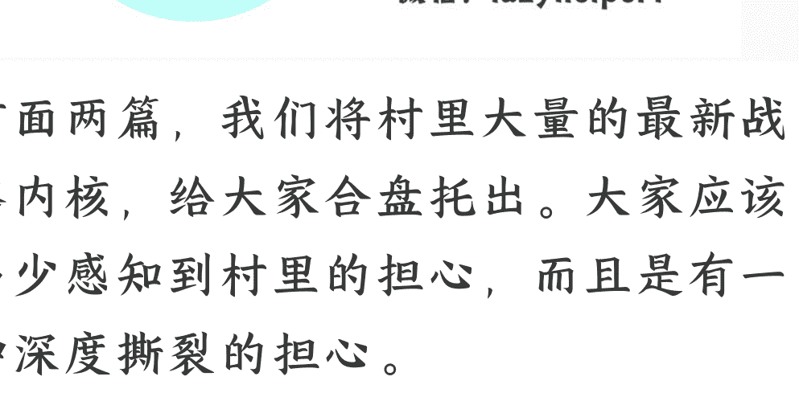

# 合集《国运战略》之——3、合成暴风雨，国运筹谋的最终指向

**260525 A 视野付费**  
整理：公众号懒人搜索，[懒人专属群](https://t.cn/xxxx) 精选  
懒人微信：lazyhelper1

前面两篇，我们将村里大量的最新战略内核，给大家合盘托出。大家应该多少感知到村里的担心，而且是有一种深度撕裂的担心。

但是，他们到底最担心的是什么？仅仅是一场金融危机？

仅仅是一场真理发射器对轰？仅仅是一场国际秩序的崩塌？

其实，想简单了~图穷见匕，A 森将在本文，给大家亮出重大研判！本系列围绕【国运战略】，将前后分三篇文章：

- 第一篇《迎接终极摊牌：一场悄无声息的全域拆雷行动》
- 同日发布第二篇《工业内嵌化，全新的国运战略压舱石》
- 同日发布第三篇《合成暴风雨，国运筹谋的最终指向》——即本篇文章

本系列将从三个维度，系统性、一次性、独家原创性的给大家讲清楚底层逻辑。

## 1、国运战略的核心主轴

2、看懂国运战略的进攻端、飞轮效应和全球外溢效应，以及有形之手背后的真实图谋  
3、多重周期共振的关键窗口期，有形之手的国运策略压舱石是什么  

大佬们不断的根据博弈的最新态势，进行策略升级和调整。放在每个人身上，那就是一道又一道难以跨越的门槛，左右着众人的命运和财富。所以，理解本系列的核心内容，将是你绕不开的超级干货。使用 880 微信豆可以阅读整个合集的完整 3 篇文章。下面开始本篇正文，各位多多支持！

最近，罪国日本的国债市场，整体收益率暴增。

真正懂经的人，马上意识到，这可是非同小可的事情！此前，A 森提出过，老中的产业升级越是成功，则其从供给侧传导风险给老美的金融市场（需求侧）也会愈发夸张。很不幸，当然，主流叙事，对此的关注，依然是极低。

仿佛，这件事，跟中美的直接关联度不大。

罪国日本的日元，为何在 90 年代金融自由化后可以变成“套息货币”？

首先是，罪国日本可以从海外获得庞大的美元收入。这份收入，除了是日美经济同盟的绑定，更重要的是，罪国日本的产业在出口竞争力方面确实极为能打。所以，当老中现在围剿罪国日本的最核心产业，汽车，严重打击了罪国日本的对外赚美元的能力。

还要花钱去对付老中的军备崛起，一进一出，罪国日本继续当全球流动性的奶妈，已经做不到了，这还没有提他们的人口问题。过去这几年，如果没有罪国日本铁了心当奶妈，就鲍威尔极限加息的做法，怕是美债市场早就扛不住了，更遑论还要疯狂实施大财政刺激。于是，整个格局为之一新。

一下子，国际上的过剩流动性，开始紧张了。

美国及其盟友之间，在流动性维度，开始进入“互屠模式”。当然，最终老美只要大规模放水，或许还是可以缓冲这种“互屠模式”的残酷性。

可是，不要忘记，现在的放水，将不再仅仅是“产出效应”，还会直接引发“物价效应”。为何如此？

虽然口罩至今，这个现象也让不少人是有所感知。核心的一切，就是本轮超级繁荣周期，实在是太过繁荣，太久繁荣，严重透支，至今还在透支。

任何的刺激，要有效果，前提是你要有大量的闲置资源，还没有被纳入配置的闲置资源。刺激，就是把这些闲置资源放进运作中的市场体系内，从而产生经济产出效果。可是，如果没有闲置资源，你还要强行刺激，那就只能将有限的生产要素价格炒上天。

从这 3 年的经济实践来看，主要经济体的情况，已经是昭然若揭。老中还有偏通缩，意味着，短期还有大量闲置资源，比如闲置的劳动力、信贷等等。

可是，其它主要经济体，都是普遍性的难以压制顽固的通胀，明显是闲置资源不足。

因此，任何的刺激，就会产生“物价效应>产出效应”的残酷情况。

比如，我们看看美日英等经济体，都是 10 年期国债收益率（融资成本）竟然远高于实际 GDP 增速，这就是肉眼可见。怎么办？

只能不断靠借贷，靠从南方穷国变相抽税，来填补这些发达国家的内用。然而，这个玩法拖久了，注定未来不久，大多数南方穷国都会陷入很严重的危机，也没有多少可以被纳入市场经济体系的闲置资源了。

至于大国之间，我们就会发现：一切大国博弈，最终都是“国债保卫战”。

请注意，这不仅是各种风险的汇聚池子，也会成为强化各个领域风险的鼓风机。

- 第一维：康波周期尾部，是一根时代的核心主线。
- 第二维：人性的对抗导致高通胀、高债务、严重的贫富拉开、高龄少子化、贸易保护、买战争、卖战争、科技军备赛、制裁浪潮、金融风暴、种族纷争、历史仇恨、宗教战争、关税战、产业链战争..
- 第三维：国债风暴以上的所有这些微操，都会依赖国债的同时，放大国债的压力，进而国债的间歇性“泄洪效应”又会激化上述微操，构成严重的“合成暴风雨”。
- 第四维：政治恶斗一方面，各国经济体内部不同政府部门都从自己的立场和 KPI 出发，最终很容易形成合成谬误和激发灰犀牛加速而来，这是康波周期尾部人性对抗周期的必然。公众号这就是不少人以为的“草台班子效果”。一方面，政治内斗和外斗，相互裹挟，相互掣肘，相互强化，大多数国家会逐步失去总动员能力，而这个能力又是时代需要的。
- 第五维：同归于尽结合上述四个维度，大家应该已经感受到，事情非常棘手。

事实上，1966 年~1980 年，当时也是类似的情况，根本无法改变。

于是，不得不祭出终极大杀器：

大家同归于尽~这就是 1980 年大神级美联储主席，保罗沃尔克，半年就把联邦基准利率拉爆到 21% 的真相。

**第六维：** 前所未有的场景因为有了保罗沃尔克的成功经验，后续全球主要的精英们，很容易按照 1980~1982 年的宝贵经验，刻舟求剑，也这么干。

但是，真正对经济史有真切理解的人，这次反而要谨慎了。

**首先**，本轮繁荣，透支太过。

70 年代末开始，还可以通过引入东南亚等许多其它地区的人口进入市场经济体系来快速复苏，现在大多数经济体都是严重的高龄少子化趋势。

**其次**，西方第一次面临失去工业能力的风险。

老中的崛起，而且是变成“产业黑洞”，把全球大部分重要的产业节点都拿走，这对于西方主导的体系是致命的，也是前所未有的。

**再次**，全球权力中心的过渡，变数巨大。

大英帝国时期，也是巨大的透支繁荣，且久久霸占全球权力中心的 C 位不让，两个因素，引爆了两次世界大战。那么，这一次呢？

好了，到了这里，大家的已有世界观或许已经发生颠覆性的改变了！然而，A 森还要进一步“蒸馏”精华出来。

根据上面的分析，即便本轮康波周期尾部到了大家都受不了的地步，选择“同归于尽”，这依旧不是“终曲”。

也就是说，整个”合成暴风雨“的巅峰，并不是一个“顶”，而是反复筑顶产生的几个“顶”。

可想而知，这对于大多数人而言，如果不知道，没有这样的心里准备，那得多么致命。

从村里已经有的各种布局来看，很明显，就是锚定第 6 维的几个“顶”做准备，而不是简单的美国金融危机、局部战争了。如果不是这样，根本不需要今天这么多的“定力”，也不需要如此隐忍。

只有当你清晰的了解后面还有更加疯狂的场景，你才会省着子弹用啊。

现在，我们再来看村里的各种“囤”，甚至是“备战备荒备危机”，以及追求工业内嵌化也是一种“囤”，就有一种一言难尽的既视感。

本质上，谁家囤积的关键资源和产能越多，将来越有闲置资源纳入市场经济体系，越是有机会相对和缓的穿越如此密集的“合成暴风雨”。从这个维度，我们不得不说，川普内阁体系现在也开始疯狂囤积战略矿产，左右能源定价，还是很有前瞻性的。进群任何制度都有生命周期，到周期尾部，都会反噬制度本身的运行。

既然，现在是制度要倒却没有倒之际，那么，赶紧疯狂囤积，赶紧不惜代价把重要的东西搬回家，也就完全可以理解。明面上看，当然是跟大国博弈有关。

可是，现在没有人知道，我们到底什么时候可以看到可以引爆大量利润的下一代科技革命。

按照美国自己的经济史，就算猜中了下一波技术革命的风口，然后拼命砸钱去搞，一般也要 10~15 年以后才可以看到劳动生产率的大幅提高，进而变成利润的井喷。

所以，我们不是否定 AI，而是说，即便 AI 就是下一轮技术革命，要形成全民劳动生产率提高，这才哪儿到哪儿，还早的很，更何况 AI 还未必就是下一轮决定性的技术革命。

很有意思的是，其实，60 年代到 70 年代，美国本土也曾经有过一次科技概念炒作。

但是，我们都知道，真正形成互联网革命的可见红利，那是 10 多年以后的事情了。

问题是，人要吃饭，财政需要银子，就算知道未来方向是对的，可是你首先要熬的到那一刻，还要确保期间不被其它肉食动物吃掉。因此，我们今天要讲一个很重要的逻辑。

截至目前，中美有一个重大”共识”，大规模囤积产能、科技研发、重要基建、能源和战略物资、军工武力值。

即，在确认目前的全球秩序和规则已经快要不行了，那么，唯一有确定性的就是这些”硬核战略资产“。

这也决定了，后续大多数人的投资机会，只能是从有形之手的“囤积”中挖掘机会。

至于这些关键产能所对应的核心城市，自然也会直接获益。

请注意，当前，老美还是“有信用”。

起码，他们到目前所做的一切，都是在努力捍卫美元纸面信用。

未来几年，一旦他们放弃捍卫美元纸面的信仰，开始无节奏的放水洗债，那么，第四维的“全球政治恶斗”就要来了，也就是距离第五维的“同归于尽”不远矣。

这是重大信号灯！

与此同时，放眼全球，还有一股愤怒的海啸也是不断拉升。因为上述进程实在太过残酷，全球主要经济体都会慢慢有一个现象蔓延。

即，“躺平—民粹”的底层生活方式来回循环。

因为，短期，可以认定大佬们左右底层民意；中长期，则一定是被裹挟的。

这让我们从古罗马的“保民官制度”中，获得宝贵经验。初期，用所谓的民主机制来对抗权贵，到后来，只要学会操弄民主机制来满足民粹，就可以获得无上权力，连权贵都不能对抗你。

很明显，川普只是这么做的第一个吃螃蟹的，未来还会更多。

到最后，所谓的民主国家会主动放弃民主、厌弃民主、打击民主，以便缓解国家债务危机。

将公民变成奴口，是阶段性释放债务压力最好的方式，且没有之一。

也因此，老中后续面对的非理性的列强，主动想要干架的列强，只会越来越多。

相对比，眼下彬彬有礼的川普，那绝对是绅士中的战斗机了。

公民一旦批量变成奴口，民主国家的权贵也会变成少数寡头，两者是一一对应的。再进一步，就是要对外干架，才能保住自己的位置，也转嫁一部分的财政压力，寻得脆弱的阶段性平衡。

很不幸，我们集齐了人家道统叙事的所有对立面。黄种人、无神论、过去的半殖民地、历史上恐怖的中原王朝…这也提示我们，穿越第六维，获得继往开来的重大历史契机，才是穿越本轮合成暴风雨的关键当中的关键。

因此，就算大规模的囤积物资、囤积产能、囤积科技、囤积武力值、夯实举国体制，会有严重的代价，也已经是没得选了。把握这个底层逻辑，才是普通人获得时代套利来图存的顶级智慧。

———分割线———

在这个 AI 能替你写代码、写文章的时代，基础技能正在迅速贬值。绝大多数人正被淹没在海量的免费垃圾信息里，陷入低效的体力内卷。

当“努力”不再是壁垒，人与人之间唯一的护城河，只剩下“信息过滤”的效率与“认知系统”的维度。

圈子已稳定运行 7 年。我们每天利用 Python 爬虫与大模型算力，过滤全网最顶级的政经内参和搞钱风向标，做你最冷酷的“外部大脑”。

如果你认同这种“重塑认知防线”的极客主义，欢迎围观我的个人情报智库：【懒人专属群】。  
https://lazyso.com/insider/

认同信息过滤价值、想省下每天 3 小时无效阅读时间的读者，扫码加我微信（lazyhelper1）

