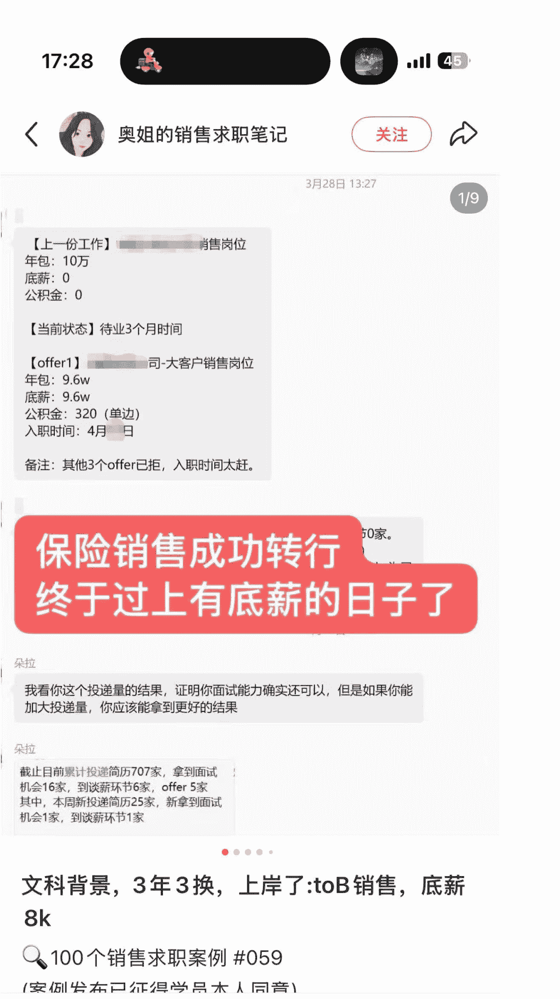
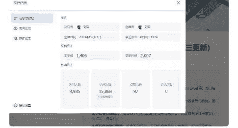
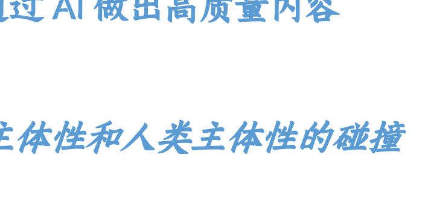
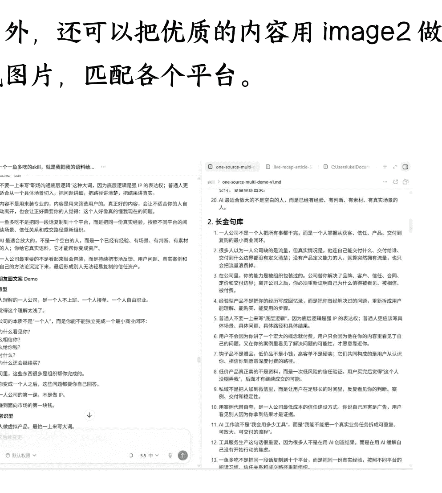
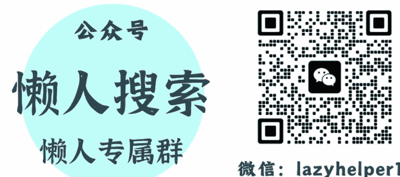

# 17000 字！分享 AI 时代如何成为一人公司！内含实操 SOP

**260525 副业 SC 精华**

公众号懒人搜索，[懒人专属群](https://www.laorensearch.com)独享
懒人微信：lazyhelperl

![img/95c1cb8c1c55060a565c400a96c9c21f_0_0.png]

这篇文章不会对一人公司唱赞歌，也不会完全否定一人公司的价值，而是一次作为一人公司自我复盘，到底如何一步一步成为一人公司？以及一些一人公司需要掌握的能力模型。

因为这篇文章字数有点过长，为了大家的阅读体验，我提前给大家做一下文章概述：

首先是一人公司需要修练的能力模型，在职场要学会借假修真，以及为什么要做自己的虚拟产品，虚拟产品和 1000 个铁杆粉丝的关系；
第二：一人公司的虚拟产品体系，钩子品→经验型虚拟产品→利润品如何搭建；
第三：一人公司如何搭建自己的 AI 工作流，如何原创自己的提示词和 skill；

# 第四：一人公司如何搭建自己的内容系统
（如何打造代表作，如何做出高质量内容）

## 第五：一人公司如何更好地与 AI 协作

# 01 先培养赚到第一块钱的能力

**我认为很多人对于一人公司的理解就是辞职，然后去大理或者巴厘岛，去做自媒体，再去分享自己在大理、巴厘岛当作一人公司的经验，这其实并不是真正意义上的一人公司，缺乏自己的业务，还是传统的自媒体逻辑。**

**而我认为，如果想要做一人公司，并不是说你一定要辞职，而是先尝试做副业，先保证你有稳定收入的情况下，去探索其他的可能性，当你有这个意识后，你的思维就活了，因为你开始去寻找职场之外的机会，开始独立面向市场。**

**到这个阶段，大多数人开始去盘点自己，市场会为我什么能力买单？到底会为我支付什么价格？你的大脑会倒逼你去盘点你的技能，去盘点你有什么可以直接变现的技能。**

**这里我需要再强调一点，所谓的副业，不是说你去兼职，纯粹通过时间换钱，比如外卖骑手、滴滴什么的，因为这些兼职并不能给你带来增量，反而会占用你大多数的思考时间，投入产出比过低。**

你需要做的副业，至少是一笔投资，让你的时间变得越来越值钱，让你在一个想深耕的领域越来越专业，甚至日后可以解放你的时间，至少这个空间是富有想象力的。

所以，很多人大概会遇到，前期没有很高的价格为你的能力买单，因为你没有经验，这个时候你就需要做的是【事上练】，以及不要浪费每一次可以积累经验的机会。

很重要！！！！简单的讲，只要这件事对你有帮助，能够让你尽快积累经验，就不要眼高手低，不要挑活儿，而是要直接去干，积累经验。

举一个我自己的例子：

我一开始的一个副业是求职辅导，但是一开始我没有经验，甚至不知道整个求职咨询的流程，我的一个咨询其实是免费的，我并没有收费，但是我的收获很大，因为对方是一个大厂人，面对职业困境，所以，我从我的角度去给他一些建议，这就是所谓的事上练。前期你没有案例，你就需要去积累案例，积累鲜活的认知，接触具体的人和具体的问题，这样你才能变得专业。

而当我有了第一个咨询的经验，我也有了很多人可以写的小红书选题，也在小红书拿到了很多流量，所以经过这次“看似免费”，但是我收获了经验和选题，这对于我来说是很大的收获。

无论做一人公司还是做副业，千万要放下功利心，要有万物皆为我所用的心态。

## 赚到第一块钱，要有定义产品/服务的能力

不同的服务和不同的产品，定价应该不同，要有明确的价值/价格感知，并且要有明确的边界，比如一小时什么价格，两个小时什么价格，超过规定的时间什么价格。

在这里，要强调下，一定要确保好边界。
比如服务内容边界，你做什么不做什么，不能什么都做，否则很容易成为客户的 24 小时保姆；还有一个边界很重要，那就是【价格边界】。

怎么加价、改稿几次免费、之后如何收费，一定要说清楚。

之前有一个做课件的朋友跟我分享，他接了一个定制稿，虽然定制了一个课件收了上千元，但是整体性价比不高，因为就是没有去制定明确的服务边界，交完初稿就一直改，非常的 kill time。

所以，在接定制之前，最好提前在用户付费之前，把价格边界说清楚，比如前两次免费修改，后面改一次收多少钱。很多人其实不能一次性把需求说清楚，导致你不得不地返工返工，当你约定了次数限制后，其实就可以一定程度上，让彼此的沟通效率变高。

另外，还要有不同的产品，丰富你的产品线，小红书有一个职场博主叫小咩学姐，小咩学姐的账号定位是外企求职，但是她的产品线很丰富，不仅有陪跑、lvl 咨询，还有针对进入外企大场各个能力项的专题课，拓宽了产品线，也方便消费者更多的选择。

所以，如何拓宽一人公司的收入，要么你提高客单价（这个方法对于大多数人来讲是不可行的，因为他们的能力并不够一次性让客户支付很高的价格），要么拓宽你的产品线，显然拓宽产品线这条路非常适合新手一人公司。

### 素人一人公司新手，一定要有自己的虚拟产品

再拿我举例：

我在行业里默默无闻，没有人会为你支付很高的单价，因为需要很高的信任成本，所以一人公司或者做副业的前期，一定要降低消费者对你的信任成本。

我是怎么做的呢？双管齐下：

#### 第一，经营好你的小红书

小红书是一个不错的平台，对于素人很友好，也非常有利于普通人去打造个人 IP，特别是你想表达你在某个领域的专业见解，小红书非常合适，当时我的做法就是经营好小红书，在小红书分享干货，我很快就收到了咨询、商单等。

#### 第二，创造自己的产品

一定要有自己的虚拟产品，真的很重要，因为我刚刚讲过了，因为信任是一个积累的过程。用户不可能一次性就要给你支付几百上千甚至上万的费用，那么怎么办呢？

通过虚拟产品去积累自己别人对你的信任。

这里的虚拟产品最好是通过专栏的形式去体现，在海外叫做 Newsletter，Newsletter 这种形式很流行，其实就是付费版公众号，而且长文是能够很强的积累信任力。

假如你是某个垂直领域的专家，你就可以把过往的方法论去沉淀下来，然后用付费专栏的形式去吸引消费者。

# 每个一人公司都应该有自己的 19.9 虚拟产品

我自己有很多虚拟产品，也有专栏产品，一个是《小红书创作指北》，1800 订阅者，一个是《小红书虚拟产品指南》891 订阅者。

这两个专栏的定价很便宜，分别是 19.9 和 69.9，第一个专栏，我的初衷并不是赚钱，而是想要交个朋友，当时我在小红书领域有了一定的认知，所以选择了小报童作为载体，宣传的策略是知识付费的酱香拿铁，第一天就有 134 个人订阅。

最终每个月基本都有 100 个人订阅，他们为什么订阅？我也问过一些读者，他们告诉我，其实是因为我之前就一直在公域发，他们注意到了。所以就订阅了我的专栏，所以还是要在公域表达。

另外，这也是我原始的基础私域流量积累，因为我没有个人公众号，但是小报童有一个好处是你可以让别人加你微信，所以我就建了读者群，这个群的好处是从一开始的弱链接，变成了强链接，并且也成为了一个虚拟产品的卖点。

很多人买完这个专栏的理由不同，有一部分原因是因为我的内容，另一部分就是因为社群，他们想加入社群，而想加入我的社群，就一定要买专栏。

到现在为止，我已经有 4 个读者群，并且 3 个群已经满员，也就是我已经有了将近 2000 人给我付费过，而做到这一切我只用了 2 年。

积累私域流量是一个常规动作，假如你想做 IP，成为一人公司，一定要有足够多的私域流量。所以我会让读者加我微信，这个动作看似枯燥，其实背后有很大的机会。

首先，传统的付费专栏逻辑，你和读者之间的触达频次只有一次，也就是说当你每次发新文章的时候，读者才能想起你，然而专栏文章并不是每天都能发，因为你要保证质量，不可能做到日更，所以读者很容易把你忘记。

但是，当读者加你微信后，你和读者的接触频次就变得很高，而且你也可以去争夺读者的注意力，首先是社群，你可以创建一个高质量的社群，每天去讨论行业信息和相互沟通，为读者创造价值。

其次是朋友圈，读者加你微信后，都会去看你朋友圈，那么对于朋友圈的运营也要重视起来。

当你成为一人公司或者要打算成为一人公司，一定要把表达放到一个很重要的位置，因为在互联网上，表达即存在，千万不能闷着，当然朋友圈的表达并不是你一直发广告，因为没有人喜欢看广告，也不要成为一个单纯的干货输出器，最好的策略其实就是没有方法论，主要是你要打开自己，要让自己变得立体。

你也可以分享一些行业认知，行业干货，也可以分享一些生活的感悟，同时你还可以去分享一些你的人生观、价值观等等；

一人公司朋友圈的本质其实就是广播站，你要持续出现，也要让别人关注到你。

## 虚拟产品是 1000 个铁杆粉丝的信任阶梯

凯文凯利说过一个观点，你要尽快去积累的自己 1000 个铁杆粉丝，但是这个粉丝不是小红书、抖音、公众号的那些粉丝量，这不是 1000 个铁杆粉丝。

真正的铁杆粉丝是能够响应你的号召，并且是能够给你付费的，而我做的两个专栏其实就是帮我筛选 1000 个铁杆粉丝的过程，因为我和他们之间缺少信任，而我通过非常低的专栏价格，但是超级高的内容品质，去让他们成为我的 1000 个铁杆粉丝，同时成立了读者群，去持续的内容影响他们。

决小额付费，社群 + 朋友圈 + 高客单产品，解决“大额付费”。

所以，虚拟产品的真正作用，不是赚那 19.9，是把人推上信任阶梯的下一级。

总结下：

对于在行业里没有足够流量的素人，但是有足够丰富内容、行业知识、阅历的人，其实就要通过内容获客，并且尽快拥有自己的虚拟产品，这个虚拟产品是你积累 1000 个铁杆粉丝的必经之路。

你必须要在在这个虚拟产品，去秀肌肉，让别人知道你是有内容的，同时要经营好你的用户，不要和你的付费用户【弱连接】，一定要加到用户微信，因为当你加了用户微信后，触点就会变多，你可以在社群触达、在朋友圈触达、私信触达，当触达后一定阶段后，其实就可以让他为你支付更多费用，成为的【铁杆粉丝】。

除此之外，对于刚起阶段的一人公司，不要一上来就高客单，理由很简单，你还是资质不够，一人公司有一人公司的打法，那就是拓宽你的虚拟产品体系，不要 all in 去做一个虚拟产品，而是要广积粮，缓称王。

想象一下，当你的朋友圈拥有了 3000 多为你付费过、认可你内容的群体，这是很强大的力量，你日后做什么事都会很有底气。

![img/95c1cb8c1c55060a565c400a96c9c21f_11_0.png]

培养赚到第一块钱的能力之前，先学会【借假修真】

什么是借假修真？

"假"是职场里那些看起来无意义的事——写不完的周报、开不完的会、做不完的方案、伺候不完的甲方。

"真"是这些事背后，真正属于你的能力——项目推进力、向上管理力、危机处理力、对人性的洞察力。

在职场久了，很容易有一种意义感的丧失，感觉做什么都没有意义，认为一切都是给老板打工，虽然很多工作都是无意义的，无价值的 dirty work。

但是，这其实是你成为一人公司的必经之路，并不是说有了 AI 之后，你就天下无敌了，AI 是个乘数，不是加数，你本来是 1，用上 AI 变成 10，你本来是 0，用上 AI 还是 0。

AI 会无情放大你的认知水位，一个不懂商业的人用 AI，只会更高效地做无用功；一个不懂用户的人用 AI，只会更快地写出没人看的内容。

这也是为什么要在职场里学会【借假修真】，因为职场是你不需要承担任何风险，并且能修炼你真本身的道场，你可以用别人的钱、别人的资源、别人承担的风险，来试错、来成长、来把所有该踩的坑都踩一遍。
做方案教你怎么规划和推进项目，处理危机教你怎么应对突发状况，跨部门协作教你怎么和各种人打交道，预算管理教你怎么控制成本……

另外，其实职场还能帮你修炼关于对人性的理解，因为一人公司你要面对很多人，客户、同行、消费者、甚至你的黑粉，技能可以学，但对人性的洞察只能在职场这种高密度博弈场里磨出来。

一人公司之后，你会发现 90% 的问题不是技术问题，是人的问题，客户嘴上说要 A，心里想要 B，最后买单的理由是 C，合作方表面热情，背后已经在比价。

这些洞察，PPT 课程教不会，商学院也教不会，只能在职场的勾心斗角、向上管理、跨部门撕扯中体悟出来。

![img/95c1cb8c1c55060a565c400a96c9c21f_13_0.png]

# 02 一人公司如何打造自己的虚拟产品体系

一人公司一定要有自己的虚拟产品，否则你很难积累你的 1000 个铁杆粉丝，之前讲过，在素人阶段一定要有自己的虚拟产品，因为一开始不会有人对你支付很高的溢价，需要很高的信任成本，但是你有虚拟产品，其实就可以帮你积累信任成本。

那么，一人公司该如何打造自己的虚拟产品体系？

### 钩子品

钩子品其实就是让对你感兴趣的用户有一个加你的理由，这里的钩子品不一定收费，你的目的是让用户对你感兴趣，也是屯私域的一个过程，同时也是你了解你的用户的一个途径。

但是，当你选择钩子品或者做钩子品的时候，可以定期更新，不要一个钩子品吃到老，同时也不要糊弄用户，去给一些不想看的案例。

那么什么样的钩子品，用户会比较买单的呢？

首先是知识库，知识库目前是一种比较新颖流行的承载知识的工具，包括在小红书也有很多商家，直接靠卖知识库年入百万，同时知识库也能帮你吸引潜在的用户。

**最重要的是，知识库本身就是一个拥有自传播能力且生命力很强的虚拟产品**，你可以在知识库里放任何你认为对用户有用的东西，以及你的联系方式，和加上你联系方式还会获得什么资料的钩子。

因为知识库可以自己传播，比如用户觉得你的知识库有价值，就会分享给其他人，其他人看知识库有你的联系方式，就会加你。

**这就是一个裂变传播的逻辑**，这也是知识库的优势，如果是 PDF 就没有这类的优势。因为 PDF 对于用户来讲是相对比较沉重的产品，除非这个 PDF 干货很足，否则很难被传播，并且 PDF 也没有办法更新，很容易过时。

知识库的价值是给了你”可以重复触达用户的权利”，但是用户领走一个 PDF 后，你们的关系就结束了，而用户加入一个知识库后，你每更新一次，就会触达用户一次。

**同时**，我认为很多内容都可以做一个飞书文档版本，因为飞书文档版本传播能力强，匹配各个平台的传播规则，可以帮你去引流。

我以前为了配合宣传我的专栏，就做了一个免费的小红书知识库，这个知识库的组成也很简单，就是把我认为好的内容放上去，每周宣传一次，我发现就有人把我的知识库放到了 twitter 上，并且加到了我的微信，通过知识库引流到私域转化付费用户也有几百位。

这就是知识库的优势，不仅可以自传播，也可以去主动筛选目标客群，因为不是你的目标用户根本关注不到知识库。

这也是我建议大家做的事情，假如你这个行业/领域知识更新迭代很快，就去做一个知识库，并且现在有了 AI，聚合信息很方便，重要的就是坚持、坚持、再坚持。

![img/95c1cb8c1c55060a565c400a96c9c21f_16_0.png]
![img/95c1cb8c1c55060a565c400a96c9c21f_16_1.png]

## AI 帮你去钩子品

钩子品也可以通过 AI 工具去做，AI 工具也不用太复杂，甚至不用去 vibe coding，直接用已经成熟的工具就可以，刚刚讲过知识库和 PDF 是用户接受度比较广的虚拟产品类型，而基本 99% 的钩子品，都是由图片和文字组成，而图片和文字，目前 AI 大模型基本都可以做。

我举个例子，比如你是独立的营养师或者健身教练，再或者是做亲子教育的，你就可以通过用 AI 整理策展海外优质的信息，做成钩子品，特别是 youtube 上有很多优质的各个垂直场景的专家在分享内容，而且很多博主的单个视频时长都在 2-3 个小时，信息量极大。

也有很多博主通过搬运并解读海外 youtube 博主的视频，让自己的账号涨粉，最后通过接商单、带货、卖虚拟产品变现，比如 huberman、Dankoe、naval 等。

这其实就是最简单的商业模式——你能提供其他人无法提供的知识/内容，且这些内容是你的用户所需要的。

比如，你是做健康饮食/减脂赛道的，就可以把海外 youtube 关于健康饮食/减脂相关的内容借助 AI 做成一个 PDF/知识库，打造成钩子品。

但是，这里要注意，钩子品一定要和你后续的高客单有一定的承接，而非最终成为沉默用户。

### 低定价的经验型虚拟产品

低定价的经验型虚拟产品其实就是钩子品的进阶品，它的宗旨是一定要让用户付出成本，当然定价也不用太高，19.9-69.9 都可以，对标是一杯咖啡钱/一杯星巴克/两杯咖啡钱，核心是不要让用户去做过多的购买决策。

这类虚拟产品的核心价值，就是秀肌肉，让用户知道你的靠谱，同时也是一个积累信任的产品，低定价的经验型虚拟产品也有两种方式，一种是持续更新，一种是买断，持续更新有点像国外的 newsletter，包括 DANKOE、Tustin Welsh 都有自己的 newsletter，都是持续更新的。

另一种买断型，其实更像是你要把一个问题说明白、把一个主题说透，小红书有一个商家，做了一个虚拟产品，就是把他做 TO B 的经验写成了一个指南，在小红书卖了 4000 多单。

低定价的经验型虚拟产品，本质上其实就是引流品，也是你筛选 1000 个铁杆粉丝的必经之路，因为如今单纯从公域获高客单，真的太难了，信任成本太高了。

而低定价的经验型虚拟产品其实就是一个曲线救国的策略，你首先先让用户信任你，最后在持续触达，最后转化用户。

所以，低定价的经验型虚拟产品在内容上，不能糊弄，而是要有深度、至少要让用户觉得你和其他人不一样，你是真正的用心在交付，我的专栏每篇文章的字数大概都在 3000-5000 字，并且我还建立了社群，每次更新的时候都会同步到社群，提高了触达率。

建立社群的这个动作很重要，因为不建立社群，用户很难去打开这个专栏，而建立社群，本身就是一个服务的意外感，让用户觉得值，积累【好感积分】

![img/95c1cb8c1c55060a565c400a96c9c21f_20_0.png]

### 利润品

**利润品**就是你的高客单，对于一人公司常见的高客单包括，IVI 陪跑，高客单社群，TO B 的企业相关业务等等，一旦到利润品，很多人就退堂鼓，认为自己的能力不能做高客单，也不知道该如何去做高客单的服务内容定制，不知道到底提供什么，最简单且最有效的方法就是去调研你的同行。

**方法也很简单**，你只需要去扮演一个非常想要付费的用户就可以，人家就会告诉你他们的服务是什么、高客单产品是什么，以及你要去提问，比如服务期限多久呀，有没有答疑呀等等，这样你就有了完整的高客单产品体系，同行就是最好的老师。

**另外**，高客单一定是重交付的，情绪价值和服务细节一定要到位，特别是现在有了 AI 后，可以去创造很多服务体验，比如很多一人公司都会有一个高客单的业务，那## 就是咨询业务，但是大多数一人公司的咨询业务都是缺乏语料留存和再利用的。咨询完就结束了，只给用户提供回放、录音和文字转录，但是你只要多想一层就明白，你提供的文字转录其实对用户的价值不大，因为它不智能，纯转录稿会有很多口水话在里面，核心信息都被稀释了。

而有了 AI 后，完全可以对内容进行二次整理，比如你可以让 AI 就你们的咨询文字稿，整理成一份详细可读性强的咨询报告，以及提供一些后续可以执行的模板，交给客户。虽然客户可能也用不到，但是对你的好感度一定是增加的，而这些语料也可以帮你提高咨询水平，打磨你的能力。

以前我做直播的时候，都会提供给我的听众回放和逐字稿，但是现在因为 image2 的生图能力特别强，所以我会让 image2 帮我生成一份阅读材料，都是我直播的精华，这就是 AI 时代下服务的升级。

---

# 章节 01 | ChatGPT Image 2: AI 图像生成与虚拟产品创业完整指南

ChatGPT 的 Image 2（图像生成功能）已经成为 AI 图像生成领域非常强大的工具之一。
最大特点是：不需要复杂提示词，只需要用自然语言描述需求，就能生成高质量图像。

**关键观点：**
Image 2 最大的优势，是能精准理解自然语言指令，把文字内容转成高质量视觉表达。

**核心能力总览**

- **文字转图片**：一句话生成精准配图
- **长文本转封面图**：快速生成高质感封面
- **PDF 转 PPT 配图**：内容转化，精准匹配
- **板书与手写笔记生成**：还原真实，清晰美观

**适用场景**

- 班会主题 PPT
- 教学课件
- 工作汇报
- 培训材料
- 小红书封面图

**一句话总结：**用自然语言，就能把复杂信息快速变成可传播、可展示、可交付的视觉内容。

---

## 章节 01 | ChatGPT Image 2 的核心能力

ChatGPT 的 Image 2 已经成为 AI 图像生成领域最强大的工具之一；
最大特点是不需要复杂提示词，只需自然语言描述需求，就能生成高质量图像。

**关键观点：**Image 2 在生图领域最大的优势，是能精准理解自然语言指令，减少复杂提示词负担。

---

# 章节 01 | ChatGPT Image 2: AI 图像生成与虚拟产品创业完整指南

ChatGPT 的 Image 2（图像生成功能）已经成为 AI 图像生成领域非常强大的工具之一。
最大特点是：不需要复杂提示词，只需要用自然语言描述需求，就能生成高质量图像。

**关键观点：**
Image 2 最大的优势，是能精准理解自然语言指令，把文字内容转成高质量视觉表达。

**核心能力总览**

- **文字转图片**：一句话生成精准配图
- **长文本转封面图**：快速生成高质感封面
- **PDF 转 PPT 配图**：内容转化，精准匹配
- **板书与手写笔记生成**：还原真实，清晰美观

**适用场景**

- 班会主题 PPT
- 教学课件
- 工作汇报
- 培训材料
- 小红书封面图

**一句话总结：**用自然语言，就能把复杂信息快速变成可传播、可展示、可交付的视觉内容。

---

## 章节 01 | ChatGPT Image 2 的核心能力

ChatGPT 的 Image 2 已经成为 AI 图像生成领域最强大的工具之一；
最大特点是不需要复杂提示词，只需自然语言描述需求，就能生成高质量图像。

**关键观点：**Image 2 在生图领域最大的优势，是能精准理解自然语言指令，减少复杂提示词负担。

---

# 03 要用生产资料的视角去看你周围的一切

打工人其实最缺的就是生产资料，所以只能用时间帮你赚钱，时间就是你的生产资料，但是当你用生产资料的视角去看你周围的一切，万物都是你的生产资料。

比如你的经历、你的过往、你的身份、你的车子、房子、AI 对你的影响等等，都是你的生产资料。我举个例子，很多人都说想做自媒体/做 IP，没有素材，素材就是你自己。比如你是在外企，你是不是可以拍一拍外企的日常，别人没有，只有你有的东西，在互联网上表达出来就是你的优势。

再比如，你是数字游民，这个身份标签就是你的生产资料，你可以分享你是如何选择城市、办公地点、旅途过程中都会用什么东西，把你关于数字游民的一切都放在互联网上，中间适当的去穿插几个广告位，变现就是水到渠成。

还有一种策略，那就是快速形成身份转变，然后把经验分享出来，比如你之前失眠很严重，你实践了某个大 V 或者书本中的知识点，失眠症状有所缓解，这就是【验证他人经验，并化为已用】的身份转变。

特别是 YouTube 上有很多优质的深度内容，各个领域都有自己的 KOL、专家，提供了不同阶段的方法论，比如我前几天还看了关于室内设计的分享，那我就可以把这些经验化为已用，摇身一变家居美学博主。

---

# 04 一人公司最需要掌握的 AI 技能

### 不要学 AI，而是用 AI

我认为想要搭建一个真正对业务有帮助的 AI 工作流，首先要有一个意识，那就是一定要用 AI，而非学 AI。AI 的价值一定是依附于生产才有效，AI 时代日新月异，如果只是单纯的去学 AI，而非用 AI，就容易陷入一种工具囤积症，会有一种不安感——学不完，根本学完，而且不会踏实，最重要的是你脱离了主线任务，不断地去打副本，最终学了太多，什么也用不上。

每个人大脑的带宽是有限的，他记不住太多东西，所以要用 AI，带着问题去找工具，工具服务于生产，这样做会聚焦你的精力。

学习本身就是一种逃避，你不敢面对真实的战场，因为学 AI 是没有市场反馈的，就像你学了很多如何用 AI 高效写小红书笔记的技巧，但是你没有真正的去用 AI 写的笔记发在小红书上，没有反馈，就没有进步，就没有办法真正理解如何用 AI 写好内容。

而当你用 AI 的时候，就发现不用学那么多了，基础的内容工作者，只需要掌握 Claude 和 NotebookLM 就可以了。

因为 NotebookLM 的价值是它出色的知识库功能和对 YouTube 的完美联动，可以帮你找选题，以及快速的了解一个行业或者一个领域的知识。

而 Claude 不仅代码能力特别强，而且他的内容能力也很厉害，无论是写朋友圈、文案，小红书笔记还是公众号文章，Claude 的表现都不错，它很懂人类的语言，没有所谓的 AI 味。

那么，有什么标准呢？你学 AI 一定要为生产服务，在你考虑要不要学某个 AI 工具的时候，先从这个角度出发。比如你的主要工作就是在做内容，那么你就不用学 Claude Code，而是应该要去深入研究 Image 2 和 Nano Banana Pro，因为这两个大模型能够让你更加高效的作图。

---

## 如何搭建适合自己的 AI 工作流？
核心：拆分具体场景，让 AI 分步骤介入
先规划内容流程，再让 AI 介入

**错误做法**

- ~~写整篇笔记~~
- ~~想标题~~
- ~~写钩子~~
- ~~写正文~~
- ~~提炼金句~~
- ~~配标签~~
- ~~想配图~~

**正确做法**

- ✅确定主题
- 📝生成标题
- 🔗设计钩子
- ✍️撰写正文
- 💎提炼金句
- 🏷️生成标签
- 🖼️配图建议

**没有上下文隔离**

- 😟结果容易平庸
- 🗑️修改麻烦，浪费 token

**输出更可控**

- ⏰修改更高效

当你**要写小红书笔记的时候**，一般的工作流程是找选题、写正文、写标题、做封面图，而你搭的 AI 工作流就可以围绕着这几部分展开。

比如我的 AI 工作流：首先用 POE 里的 Claude 大模型做了标题智能体和选题智能体。
- **标题智能体**，这个智能体只是帮我写标题。
- **选题智能体**，帮我去找叙事角度。
- **做图**我用 Image 2，Image 2 的出图质量很高，且中文表现出色，也是我力荐周围朋友要用的 AI 大模型。

---

# 05 一人公司如何搭建自己的内容系统

### 一人公司不要日更 100 条

最近日更 100 条这个话题很有热度，互联网上关于是否要日更 100 条正反双方都有讨论，其实假如你真正成为一人公司，或者想成为一人公司，你根本不需要日更 100 条。

**理由很简单，因为日更 100 条会烧光你自己。**你的真正主线任务，是打磨你的产品/服务，并把他们售卖给真正需求的人，这是你的重点。

而当你日更 100 条的时候，你的全部注意力都放在去完成这个日更的任务；你没有时间去思考，没有精力去打磨你的商业模式和产品，而且还很累。当然，日更 100 条可能是口号，但是日更 10 条对于一人公司也是很难实现的。

同时，当你执着你日更的时候，你的思考时间是 0。
**内容的质量，从来不取决于“写的时间”，而是想的时间。**一条真正有价值的内容，它背后可能是 3 天的观察、沉淀，2 周的思考发酵，1 个突然的顿悟，最终才催生出这条内容，这些都不是写的时间，而是活的时间。

举个例子，我每次一篇万字的长文，其实都不是一气呵成，会碰到很多卡点，比如逻辑、案例、方法论的沉淀，当我遇到卡点的时候，并不是要潦草的写一些口水话或者废话试图糊弄过去，而是脱离当下的创作环境，但是继续保持对问题的思考。
而是带着问题去散步，环境是人的反应器，很多时候你一出门，问题就解决了。

那么，假如你要抱着日更 100 条的心态去做内容呢？其实你的整个人都会变得很浮躁，你的时间分配就变成了 90%在生产内容，10%在找素材，0%在思考。
你变成了一台内容机器，同时你输入的东西也越来越薄，3 个月后你大概率就会开始空转，内容也变得枯燥乏味，最后你的内容大概率都是你吃了什么、干了什么等毫无营养的鸡毛蒜皮小事。

一人公司做内容其实要有自己的信条，每条内容都应该很值钱，融合了你的思考、经验、审美。
所以，一人公司不要日更 100 条，而是要做好内容。

站在用户角度去思考，用户真正付费的原因是因为你展现了在某个领域过硬的专业实力，同时发表了有观点、有深度、有启发的内容，而不是因为你更新的多，用户才会买单。

分享一个案例，美国有一个非常著名的商业专栏，叫做 Lenny's Newsletter，他的 Newsletter 付费订阅人数超过百万，他的写作方式和模式很值得学习。

首先，他的代表作是他离开 Airbnb 的时候把他 7 年的工作经验进行了一个总结，因为有很强的业务实操细节，和洞见，这篇文章一炮而红，所以 Lenny 的这个方式也很值得学习，因为我们或多或少都会在职场工作多年，或者对某一个领域/行业有自己的见解，比如育儿经验，装修经验，考研上岸经验、职场 Landing 成功经验、减脂经验等等。你就可以把存在你脑海里的东西输出出来。

其次，Lenny 的内容创作态度和日更 100 条截然相反，他对内容有严苛的要求，他认为互联网上 99% 的内容其实都不够好，想要脱颖而出，最核心的优势就是投入更多的时间。
他平均每篇文章要花费大约 10 个小时，而有些重磅文章（比如通过大量访谈提炼的指南）甚至会耗费 100 个小时以上。

另外，他的写作风格也很实用主义。

**他的核心原则：**
- **高信噪比**：直接给出信息，不要废话
- **可操作**：读者能实际使用的建议
- **简洁**：能用更少的词就不要用更多

在撰写一篇关于“如何找到产品市场契合度（PMF）”的文章时，他没有写长篇大论的引言。相反，他一上来就直接给读者展示了一张包含大约 30 家公司达到 PMF 所需时间的长图表，紧接着列出了实现 PMF 的 4 个具体步骤。他把所有的创始人名言和详细的幕后故事都放在了文章的后半部分，供那些想深入了解的人继续阅读。

**Lenny 的案例其实说的很明白，想要有自己的代表作，想要写出优质的作品，一定要花时间的，这是必要投入，且没有捷径。**

---

## 一人公司内容矩阵
尽快打造自己的代表作

一人公司到底怎么搭建自己的内容体系？
做好内容？

这个课题很宏大，这里只分享一些我的经验和方法，首先是你要打造你的代表作。
代表作就是你经历、认知、专业的全部兑现，它定义了"你是谁、你懂什么、你能解决什么"。它可能首发只有几千阅读，但会在接下来的 3-5 年里，源源不断地给你带来客户、合作、邀请。
它是能够给你带来超线性的回报的，那么该怎么找到自己的代表作呢？

首先，它的字数一定很长，你的代表作字数大概率不会是几百字或者是 3-5000 字，因为字数少是没有足够增量的干货密度，也很难和其他文章拉开差距。
所以我建议你至少要花很长的篇幅，8000 字往上，去把你想表达的说清楚，在写这篇文章的时候你不可能一气呵成的，会有很多卡点，需要自己解决，比如你想写一篇你减脂成功的心得，一定是要有一些减脂的底层原理和最新研究成果，这些内容都得靠你查资料、调研完成，所以一篇优质的文章/代表作，不是写出来的，而是磨出来的。

同时，当你真正意义上完成了一篇长文，你就会发现你自己也成长，因为在你不断查漏补缺的过程中，也会学到了很多。
我以前写过一篇文章，是《普通人如何 24 小时构建自己的生意》，这篇文章是我的代表作，为了写好这篇文章，我不仅调研了很多国内的案例，还系统学习了 Justin Welsh、Dankoe 等海外一人公司的方法论，对我的启发很大。

那么怎么找到你的代表作？

### 把过去的自己封装起来

把过去的自己封装起来的意思是，把你过去在某个领域拿到的结果，以及如何拿到的结果写成一篇复盘经验。举个例子比如你做了 6 年的 B 端大客户销售经验，你就把你 6 年来的心酸血泪以及你学习到的经验，直接写出来；再比如你过去 3 年一直都深耕一个项目，有自己大量的实操细节和感悟，这些都是把你的过去封装起来。

另外，很多人说没有写作功底，虽然自己有很多经验，但是说不出来，怎么办？
在 AI 时代，这些都很好解决，因为我们擅长写的是命题作文，很多人的卡点是不知道如何下笔。## 道写大纲，不知道怎么写框架，而这些都可以交给 AI 解决。

你可以先和 AI 聊，把你想表达的内容都发给 AI，让它根据你的经验，去给你一些思路，以及框架，最后你只需要去写命题作文就可以了。

我的每一篇长文都是这样写出来的，先去看自己有没有足够丰富的只属于我的知识，再去看自己有没有足够多的案例，尽管我的大脑很混乱，但是我可以和 AI 沟通清楚。

先定框架，再定每一个章节应该写什么，最后再每一章都击破。

# 你“不小心”积累的独特数据/经验

你服务过的 100 个客户数据、你做过的 50 次实验记录、你跟踪了 3 年的某个指标——这些别人没有的一手素材，整理出来就是护城河级别的代表作。

# 你踩过的最深的坑

你做这件事最痛的那次失败、最蠢的那次决策、最后悔的那段弯路——把它完整地写出来，包括当时的想法、数据、情绪、复盘。

失败案例的代表作价值，往往高于成功案例。因为成功可能是运气，但失败里的教训是普世的。读者看成功会羡慕，看失败会信任。

## 案例复盘类文章

案例复盘类文章其实也可以打造代表作，而且对后续高客单的转化非常友好，因为案例代表结果，并且没有人喜欢看纯理论文章，所以如果你有案例，或者有了自己的代表作，你就可以围绕着这个代表作进行创作。

另外，你要随时积累自己的案例，有案例的留存意识，因为案例也是你专业能力的证明。

## 一人公司一定要做好这几类内容

刚刚提到的代表作，其实对于一人公司来讲，并不能保持稳定输出，它是你的信任资产，除了代表作外，你还需要去保持一定的更新频率，保持在场。代表作是“压舱石”，但真正让人每天记住你、信任你、购买你的，是日常的各种内容。

### 案例内容

讲过你做过什么，帮谁解决了问题。

比如，客户的故事，你是怎么帮客户拿到结果的，举个例子，你是职场博主，帮别人改简历，和对方做了电话沟通，帮他梳理了经历，然后可以做一个转述，今天和一位毕业3年的同学沟通，他的职业经历挺有代表性的，我分享下...类似这样的短内容。

文科背景，3年3换，上岸了:toB销售，底薪8k
🔍100个销售求职案例 #059
(案例发布已征得学员本人同意)

待业半年，50天上岸 toB 销售岗：底薪 5k→11k
🔍100个销售求职案例 #063
（案例发布已征得学员本人同意）

还有，假如你在经营自己的专栏或者有自己的社交媒体，会收到很多私信提问，这些都是真实的用户需求，你就可以把典型的用户提问转化为你的内容素材。

因为很多人一开始是没有人给你付费的，所以你可以去做自媒体收集问题，这个形式也叫 AMA，你去小红书搜 AMA，看看他们怎么去引导用户提问，直接进行对标就可以。

## AMA | 关于中医健康养生，有问必答👀

哈喽大家好，我是李博士👀北京中医药大学博士毕业，一名不秃头的三甲医院中医科医生，关于中医养生相关任何事有问必答！欢迎大家来提问🙋‍♂️

### 公众号懒人搜索、懒人专属群分享

**Kaykaykay**
Hi 我是小红书战投 Kayden
我們支持年轻有理想的创业者（最近投资了很多95后&00后!）实现自己的梦想，我们是 Founder-friendly的长期财务投资人，条款简单、决策迅速、打钱贼快。希望能打造属于小红书的 Red Mafia。
欢迎年轻的创业者找我来聊！

Ask Me Anything!
有问必答

有问必答 Ask Me Anything
Hi 我是小红书投资 Kayden
我們支持年轻有理想的创业者（最近投资了很多95后&00后!）实现自己的梦想，我们是 Founder-

说点什么...

762

496

295

### 观点内容

观点内容是传播穿透力最强的内容，而且产出压力不大，比如刚刚我的观点是一人公司不需要日更100条，你提出了观点后，再提出你的论据，这样别人才能信服你，而非单纯去说一个没有论据的“观点”。

## 矩阵内容

很多人认为自己没有内容，没有选题，不知道怎么写什么，其实本质上是没有聚焦在专注自己的业务进行选题挖掘；很多人纠结定位问题，不知道怎么定位，这里有一个大前提我觉得你需要考虑。

当你想去深耕一个领域，想做一类人群生意的时候，你是否能有足够多的选题去支撑你的定位？这个很重要，因为对于一人公司，没有营销预算，内容就是你的市场部。

当你的定位清晰了，你就需要去做学会去矩阵内容，矩阵内容并不复杂，而是围绕一个定位设计 5 到 7 类长期栏目。

如果你定位“新手班主任控班”，内容矩阵可以是：场景痛点、方法拆解、案例复盘、模板展示、误区提醒、工具推荐。你可以写开学第一天最容易乱在哪里，家长群第一句话怎么发，学生不服管怎么办，立规矩三步法，班干部选择标准，主题班会流程，家长通知模板，期末评语句式。

如果你定位“外企会议英语”，内容矩阵可以是：错误表达纠正、场景句型、心理建设、真实案例、工具清单、职场文化。你可以写开场、接话、反驳、总结、推进、确认，也可以写听不懂时如何不慌，如何表达不确定，为什么外国同事这样说，背后是什么沟通习惯。

如果你定位“装修避坑”，内容矩阵可以是：预算、流程、材料、合同、沟通、验收、案例。每个矩阵下面，都能持续长出几十条内容。

这就是定位的好处：它不是限制你，而是给你一个稳定的内容生产系统。一人公司不要做“今天我想说什么”的内容，而要做“我的目标用户今天可能卡在哪里”的内容。

矩阵内容很重要，因为这是你的专业力体现，而且做好矩阵内容，要有关键词布局的意识，因为真正有付费意愿的客户，很多都是搜索来的，带着问题来的客户往往更容易成交。

另外，分享一个方法，当你不知道怎么做内容的时候，就去看你这个赛道的头部账号，去看他们怎么做内容选题的，会对你帮助很大，同行是最好的老师。

## 成长类内容

这类内容往往会忽略，什么是成长类内容？

成长类内容其实就是你学会了一个技能/一个工具，把学习的过程分享出来，这类内容也叫灯塔类内容，因为很多人需要的并不是单纯的干货，他们也需要灯塔，同时成长类内容也叫做 learn in public;

特别是在 AI 领域特别需要这类内容，因为 AI 领域的内容更新的很快，比如去年流行工作流，今年流行 skill, claude code, 每次更新都代表知识的更迭，对于博主来讲就是机会。

比如小红书有一位博主叫张咋啦，她就分享她是如何学习 AI 的，如何通过各类 AI 工具去创造内容，不仅有干货，还接地气。

我的粉丝可能是小红书上最好学的26万人
张昨啦
04-22
443

活动干货总结：如何打造AI native的组织
上周末在湾区办了个活动，叫“如何打造AI-native的组织”，来了大约50人，包括创业者、大厂管理者、创业公司员工、一人公司等等，都是在组织内部有非常激进的AI-native相关实践的。其中15人在现场投屏演示了自己公司内部AI-native的办公方式，干货非常多，给我带来很多新的认知。
以下是我印象最深的takeaways:

Demo Day
我如何与Agents共事
10-20位实践者投屏展示
真实的人机协作界面与工作流
欢迎大家报名参与旁听或演示
04.24周五 北京时间13:00-15:00
飞书会议

活动干货总结：如何打造AI native的组织
张昨啦
04-21
761

线上Demo Day：来演示你与agents的协作方式
张昨啦
04-17
755

Frontend Slides入驻Anygen
让HTML可共享、可编辑
AnyGen里做Frontend Slides的特点
你只要点一下就可以直接编辑

快速清理浏览器的tabs
就让关Tab变得像消消乐一样的爽

Frontend slides的小白好版已上线
张昨啦
04-16
3866

做了个插件，让浏览器tabs变得上瘾
张昨啦
3622

DIFFUSION OF INNOVATIONS
FIFTH EDITION

### 公众号懒人搜索、懒人专属群分享

**17:26**
发私信
笔记 标记
研讨会：如何打造AI-native组织

Hosted by Zara Zhang

Saturday, April 11

2:00 PM - 5:00 PM

Register to See Address

Los Altos, California

Registration

Approval Required

Your registration is subject to host approval.

Welcome! To join the event, please register below.

Request to Join

About Event

最近在思考如何打造AI-native的组织，以及Agent在办公场景下的应用。邀请大家来展示自己团队内的使用场景和洞察。

小规模分享交流，人数限制在30人以内。预计报名人数较多，请大家认真填写~

湾区线下研讨会：如何打造AI native组织

张咋啦 04-02

307

Zara Zhang @zarazhangrui · 2d

My single biggest pain point right now: AI-induced attention deficit

I have 5 Claude Code sessions running

10 Terminal tabs open

50 browser tabs open

100 X articles in my bookmarks

When there are multiple AIs working for you, you're constantly task switching

When you're waiting for AI to output, you're constantly distracted

Because what used to be hard is now so easy, you always wanna do more, more

Because of the speed of the AI news cycle, you feel a constant need to be on this app

Add all this up and the result: you live in a constant state of distraction & delirium. Focus & deep work is harder than ever

If anyone has figured this out pls teach me how

506 202 2K 194K

Zara Zhang @zarazhangrui · 1d

感觉自己的context window快不够用了。。

张咋啦 03-30

1549

我的工作流是这样的

用AI实现视频长剪短！自动提取高光片段

张咋啦 04-03

1504

不仅记录待办 还能把待办直接办了
它直接就看大家的日历帮你约了

做了个飞书CLI skill，让会议todo变成done！

张咋啦 03-31

4354

你不需要吸引很多人 只需要吸引到正确的人

但这个完全不是对立的

Builder和influencer的交集 才是最大杠杆

张咋啦 03-27

534

做了个skill 把代码库变成「编程课」

53 / 65

### 硬广内容

你一定要让别人知道你是在销售什么，这类内容一定要发，否则你积累的粉丝是无效的，但是发好硬广内容最好要给自己一个理由，比如之前我做了一个智能体，解决了小红书笔记的 AI 味问题，我就拿这个为由头，在朋友圈宣传了一下，大概意思是你如果想要获得我的智能体、专属提示词和小红书笔记没有 AI 味的方法论，要订阅我的专栏，我都写在专栏里了，这个方法，当天就帮我带来了 50 个新增订阅。

**luke | 刘哲**
过去一周，新增订阅量超 100 人
明天涨价
对小红书感兴趣的可以订阅
订阅可以获得知识库和全年将近 300 期的一人公司、创作者经济海外优质内容转译

小红书创作指北
1360 读者，65 内容
认认真真输出小红书创作经验，尽全力帮助小红书创作者少走弯路

2025年5月20日 21:10 👤 🗑️ ...

❤️ 👤 👤 👤 👤 👤 👤 👤

**luke | 刘哲** 2025年5月20日 21:13
新进群的小伙伴，等我整理好会发群里，目前已经更新 18 期

**杨果粒²大象导旅...** 2025年5月20日 21:32
我订阅啦，还没拉群，不过暂时压根也没时间看群😂

**嗯（晚上十点睡觉）** 2025年5月20日 23:19
😁已买

发表评论: 😊 🖼️

### 公众号懒人搜索、懒人专属群分享
详情

**luke | 刘哲**
因为我建了一个小红书知识库
公开免费的，每次我去里面看资料或者补充的时候，不管多晚都能看到有人此刻在线
有时候觉得，这也很美好。
马上即将1w人看过这个知识库了，小标杆

2024年8月18日 01:03

**秉烛**
去哪找呀😍

2024年8月18日 01:08

**陳嘉玲**
老师能发给我一份吗？🤔

2024年8月18日 01:15

发表评论:

### 公众号懒人搜索、懒人专属群分享

详情

luke | 刘哲
这可能是我做的最后一个专栏
小红书虚拟产品专栏，如果你对小红书虚拟产品感兴趣，这个专栏是必入的
(过去48小时，新增订阅200人)

我有足够多的实操经验，并且这个专栏和我之前专栏质量一样稳定
无论是视角、内容都是全新的

定价69.9元，两杯咖啡钱，买过我专栏的同学都知道，我都是超值交付的
这个专栏同样超值交付，比如除了专栏内容外，300个海外一人公司+数字产品案例，还有我的全套智能体，都可以给你用

目前专栏已经更新了10篇.....基本上已经很超值了

2025年6月9日 11:34

如何通过AI做出高质量内容

AI的主体性和人类主体性的碰撞

首先聊聊我是怎么用AI写长文的，长文并不能用AI一键直出，因为AI一旦开始输出大量的文字，就会有AI味，风格偏移，**但是也不能在你写内容的过程中去使用AI，因为你大概率会感觉到很别扭，AI的主体性和人类的主体性在进行高度的碰撞。**

因为当你确定了内容框架和大纲后，你让AI去介入你的内容，其实很难完全匹配，比如AI可能提出一个观点，你觉得特别好，想融入进去，发现特别特别的难，很容易驴唇不对马嘴。

所以，你在如何找到一个AI主体性和你创作的主体性平衡之间浪费了很多时间，但是发现并不好。

**那么怎么办呢？**

我的策略是先自己按着自己的思路去创作，一定要完成一版初稿，当你完成初稿后再把单独的每一个章节，去让AI给你审稿，提供修改意见，每次我都是这么做的，AI可以快速透视你的内容表达逻辑、结构、金句，以及可以从听众的角度，告诉你你的文章有哪些表达可以修改；

我这样做的目的是为了保证我创作的主体性，同时当AI作为审稿的角色，它能看到你看不到的地方，并给你很专业的修改意见，这样做的好处在于你可以不断提高自己的原创能力，放大你的写作/思考能力，而非去替代你。

我认为这个 sense 很重要，有些手艺是不能外包给 AI 的。

# 高转化内容的底色是内容模型

如果想要快速/高效地去产出一些没有 AI 味且能在公域拿到流量/客资的内容，比如小红书商品笔记，日常的公众号文章等等，你需要做的是找到高转化的内容模型。

核心是找到高质量对标内容，并让 AI 去帮你提炼内容模型，然后结合你自己的关键词去进行仿写，这是我一直都在用的 AI 内容工作流。

那么，该怎么找到高转化内容呢？

高转化内容一般要关注 3 个指标，第一个是评论区，评论区有明显的客资信号这类内容值得你关注，比如说怎么买？怎么联系？这些内容值得你去关注。第二是高转发，比如微信公众号文章最底部都有转发的次数，可以关注下假如这个公众号作者每次都转发，突然某一篇文章转发破万，那这就是你要找的优质内容。第三个则是小红书的置顶笔记。

假如你有对标的博主，就去看这个博主的置顶笔记，一般博主都会把高转化的置顶笔记放在上面。

这里我要强调下，寻找高转化内容这件事，是需要长期坚持且不能借助 AI，需要你自己日积月累的寻找，因为 AI 能帮你去做整理，帮你去收集资料，但是代替不了你的审美和品味，而审美和品味恰恰是最需要呵护和培养的品质。

# 一人公司如何对内容进行一鱼多吃

一鱼多吃的本质，是对已有内容的再利用，特别是现在 AI 技术已经十分成熟了，更加可以高效的一鱼多吃，分享下我的内容是怎么做一鱼多吃。

### 第一点，你要有原始语料的积累

以前没有 AI 的时候，很容易浪费自己的语料，比如有人约你一次咨询，你没有留存，这就是浪费了自己语料的表现。现在此时此刻都要积累自己的语料，每次咨询/直播或者有意义的交谈，都可以进行录音，并转成文字稿。

我自己还特意买了一个飞书的录音豆，随时都可以录音，而且还可以生成飞书文档，很方便。

### 第二点，用 AI 重新组织你的语料

当你的语料足够多了，就可以用 AI 去重新组织你的语料，这里要记住一点，AI 拥有对信息的重新组织权，一鱼多吃的本质是你可以就你的语料，生成匹配各个场景的内容。

我做了一个一鱼多吃 skill,这个 skill 的作用就是一鱼多吃，当我把我的录音稿发给 claude code 调用这个 skill,就可以把我的原始录音稿，变成一篇公众号长文+26 条朋友圈文案+观点库+金句库，还可以帮我生成社群长文版的内容，非常方便。

另外，还可以把优质的内容用 image2 做成图片，匹配各个平台。

### 第三点，飞书 CLI+claude code 一鱼多吃

这是我的最新实践，我建议假如你是一人公司，一定要用上 claude code 和飞书 CLI 的联动，当你安装上飞书 CLI 之后，你就可以用 claude code 在终端控制飞书了。

这样做的优势是可以当你已经在飞书积累过大量的原创内容后，你就可以让 claude code 对你飞书里的内容进行再利用。

举一个例子，之前在飞书搭建了一个小红书虚拟案例库，这个案例库的优势是有 4w 字关于各个赛道的虚拟产品的独家解读，但是之前并没有机会进行再次利用。

但是现在 claude code 可以去读取飞书里的内容，我就直接让 calude code 根据我整理的案例和总结去做了一个一人公司虚拟产品选品指南方法论以及定位方法论，并且对我这个案例库的内容进行再利用，涌现出很多我都没有想到的观点。

所以，我建议一人公司一定要去使用飞书，因为你可以通过各个 agent 在终端去使用飞书，同时还可以沉淀你的资料，性价比很高。

## 公众号懒人搜索，懒人专属群分享

### 刘哲的飞书 CLI

#### 互联网大厂通关指南 - 飞书文档

互联网大厂通关指南

约 58,000 字，10 章 + 前言 + 终章，已完整导入飞书文档。

一本帮你从“不知道门在哪”到“进去之后怎么走”的实战手册。

### 前言：欢迎来到真实世界

如果你是一位顶尖学校的毕业生，手握教科书上所有的营销理论，怀揣着对“创意改变世界”的执念，准备在互联网大厂一展拳脚……那么，欢迎来到真实世界。

真实世界的第一课，可能是在你第一次被拒后，被老板劈头盖脸地质问：“你做的这些，和我们的业务增长有什么关系？”你精心准备的消费者洞察和创意概念，在 ROI、DAU 和 GMV 这些冰冷的指标面前，显得不堪一击。

你还会发现，你以为为做的案例，在这里还不如一段在“内”的公司”的实习经历重要。大厂之间存在一条无形的鄙视链——一个刚从字节出来的人，可能比在其他大厂下了三年的你，在市场上更受欢迎。

### 你可管理

硅谷王川 (@Svwang1) 16 个月推文精华已整理完成！

共 1150 条推文，精选 775 条中文内容，按 7 大主题分类：

- 投资与财富（247 条）
- 认知与思维模型（242 条）
- 健康与长寿（103 条）
- 个人成长与执行（65 条）
- 社会与权力（58 条）
- AI 与科技（92 条）
- 全球化与信息（28 条）

查看完整文档：硅谷王川推文精华整理（2025.01-2026.05）

### 硅谷王川 (@Svwang1) 推文精华整理

#### 总结一下

这篇文章大概梳理了一人公司的产品端、内容端、以及如何借助 AI 更加高效的协作，但是我建议你收藏这篇文章，因为我后续可能会把最新的内容同步到这篇文章；

同时！！！

假如你觉得这篇对你有价值，可以转发！欢迎转发！感谢转发！！！

让这篇文章发挥它最大的价值。

在这篇文章我还提到了一些内容，没有展开，比如如何去原创自己的提示词，如何

**找优质信息源，可以点击下面的链接！！！**

[我实践出来的内容创作提示词方法论，1.1w 字全盘托出｜附常用提示词](https://mp.weixin.qq.com/s/8000)

**8000 字全盘托出！小红书知识库类虚拟产品如何找到优质海外信息源！**

### 分割线

看完这篇 SOP，你觉得你懂了。但 90% 的人一到实操就会卡在第一步。

工具和教程只是最低级的壁垒，真正的壁垒是“立刻动手”和“圈层信息差”。

如果你想看全网最新的变现玩法，并且和一群执行力极强的极客一起下场拿结果，欢迎围观我的核心私域：【懒人专属群】。

我们不聊虚的，只做商业闭环的拆解与 AI 效率的压榨。系统内已沉淀 1000+ 跑通的套利实战局。

👉 查阅圈子完整数字资产与上车门槛：
https://lazyso.com/insider/

认同价值、准备好下场干活的，扫码加我微信（lazyhelper1）

备注：【实操上车】，不闲聊