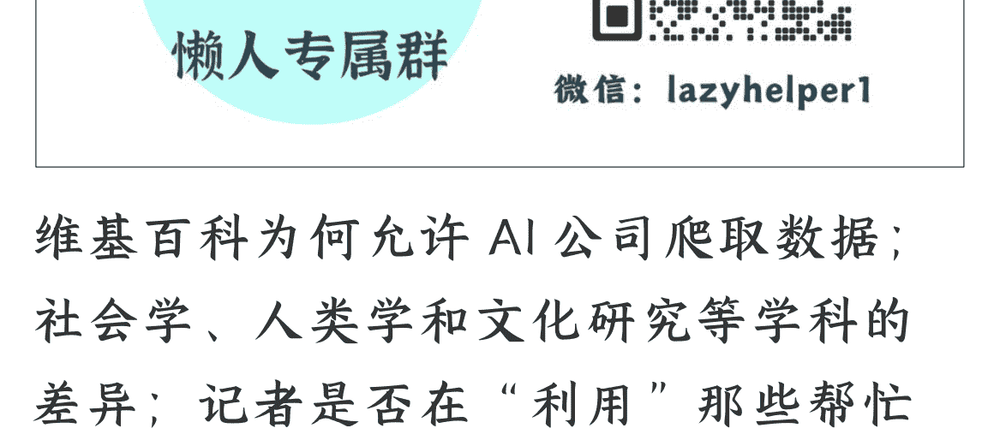
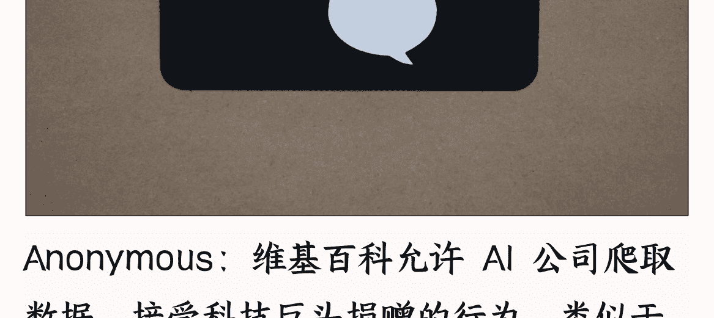

# (931) 你问我答

**260526 新闻实验室**  
整理：公众号懒人搜索，[懒人专属群](https://t.cn/xxxx)精选  
懒人微信：lazyhelperl  

维基百科为何允许 AI 公司爬取数据；社会学、人类学和文化研究等学科的差异；记者是否在“利用”那些帮忙联络采访资源的人……  

**Anonymous：**维基百科允许 AI 公司爬取数据、接受科技巨头捐赠的行为，类似于把志愿者的劳动给贱卖了，这也会削弱编辑者的贡献积极性。维基贡献者基于 CC 4.0 协议授权对所创建的内容商业使用，但我当初参与编辑的初衷不是服务于 AI 训练——尤其在 AI 加剧世界寡头垄断的当下——我甚至很希望撤回自己当初的贡献和授权。方老师怎么看？

答：感谢你提供自己的视角！我一直很关注 AI 和维基百科的关系，曾在 921 期通讯里面写了维基百科禁止 AI 参与编辑的事情，之前还在《明报》专栏里面写过一篇《AI 是维基百科身上的“吸血鬼”？》，讲的就是 AI 爬取维基百科数据的事情。

我在文章中提到，从 2024 年年初开始，随着各种大语言模型的爆发，来自 AI 的访问请求呈指数级增长，这给维基百科的带宽等基础设施带来了巨大的成本负担。一个最典型的例子，就是美国前总统吉米·卡特去世之后，维基百科的带宽资源占用达到了一个前所未有的水平，而其中大部分耗费资源的流量实际上都不是来自人类，而是来自爬虫。

AI 爬虫给维基百科带来沉重负担还有一个原因：与人类用户的访问模式不同，爬虫倾向于访问维基百科上不太受欢迎的页面。维基百科的系统通常会将经常被查看的页面缓存在离用户较近的数据中心，以提高访问速度和降低成本。然而，由于 AI 爬虫不断请求冷门页面，这些请求必须从维基百科的核心数据中心提供服务，这导致了更高的成本。维基媒体基金会的数据显示，至少 65% 的资源消耗型流量来自爬虫，尽管爬虫产生的页面浏览量仅占总量的 35%。

## 应对计划与无奈现实

维基媒体基金会给出的应对计划是：  
- 建立能够识别流量来源的系统，至少能够将 50% 的自动化流量追溯到已知的开发者。  
- 同时，基金会计划改进其 API，以便更有效地提供维基百科的内容，并加强对内容使用的控制。通过 API，可以更容易地关闭对违规开发者的访问权限，而不是直接阻止他们访问网站。

我能理解你不希望自己贡献的内容被 AI 公司爬取。但是，站在维基百科的角度来说，想要拒绝 AI 是一件非常难的事情：在理念上，维基百科的理念是希望传播知识，让人人都能免费获取知识，如果说 AI 将越来越成为人们获取知识的渠道，那么维基百科似乎没有理由不参与其中；在操作上，以 AI 公司的流氓程度和手中的资源，想要拒绝被爬取基本是一件不可能完成的事情。

所以，就算维基百科的理念和 AI 寡头们的气质非常不对付，它也没有更好的选择。这是一个让人难过的现实，它也再次说明：AI 时代是一个资源和权力更集中、更垄断的年代。维基百科是属于 Web 年代的、近乎乌托邦的产品，它能否在残酷的 AI 时代存活，可能都要打上一个问号。

**lx：**方老师好：）我最近听到一期很有意思的播客，里面讨论了社会学和人类学的差别。节目中提到，社会学在分析问题时似乎更“单刀直入”，也更常从社会结构、制度和群体关系等角度切入；而人类学则更重视文化意义、日常实践，以及研究者长期的田野观察和参与。我很想请教方老师：您会如何理解社会学和人类学之间的差别与相通之处？它们在提出问题、分析材料和解释社会现象时，最核心的不同在哪里？另外，我自己目前做的是 cultural studies。相比社会学或人类学，文化研究有时给我的感觉更像是一个大杂烩，它可以吸收很多理论和方法，但也因此让我有点困惑，不太确定它自身的学科位置在哪里。所以也想进一步请教方老师：在学习这些文科这几个学科时，我们应该如何建立一个比较清晰的知识地图？  
ps :podcast 名称 **芭樂人類學@左岸【人類學好朋友】**各位在等的大場面來了——大是大非的社會學家 vs. 混水摸魚的人類學家？！

答：首先感谢推荐这期播客！你所描述的这些感受我也觉得颇有同感。不过，我既不是社会学的学者，也不是人类学的学者，还不是文化研究的学者，所以我可能并无资格对这些学科做出鸟瞰式的评价。

我只想提供一个理解各学科差别的视角，那就是看它们各自的发展历程。例如，社会学有其奠基人，有诞生于 19 世纪的时代背景，有以芝加哥学派为代表的大学建制化历程，当然也有其下分支领域各自的多元发展。而人类学，当然有其殖民主义的印记，亦有后来关注全球化等新的发展。

你提到的“知识地图”是一个侧重相互关系的概念，但更重要的可能是理解每个学科的来时路。文化研究也是一样：伯明翰学派、雷蒙·威廉斯、斯图亚特·霍尔，这些奠基者决定了一个学科的精神底色。理解他们为什么出现、他们是因为不满于什么而提出了新的路径，在很大程度上就能把握这个学科的内核。

> **Anonymous**：对于临近毕业的海外文科博士来说，如果很难在读博国找到教职且不想回大陆院校，在香港找教职当下仍然算是相对好的选择吗？能否请方老师分析在香港院校工作的利弊呢？

答：香港院校最大的弊端，也许是“卷”吧。招聘时很卷，评 tenure 的时候也很卷。  
比起内地高校，香港高校一个很明显的“利”是和国际学术体系接轨。但如果是文科，这样的“利”其实也会带来一种弊端，那就是会延续（乃至放大）国际学术界里面的西方中心主义。如果你的研究取向完全是欧美式的，那么很好；但如果你有比较强的本土关怀和对西方中心的反思，那就会逐渐产生不适。  
不过这些都是次要的。诚恳地说，如果能拿到香港的教职，就先落袋为安。

> **Anonymous**: 方老师，我今年申博失败了，总结原因可能是学术成果有欠缺。尤其是在激烈的竞争下，我们总要有更强的背景才能更抗打。于是我准备再 gap 一年再申一年，并在这一年持续投会议和写文章，可是学术生产周期真的好长啊，回报是那么不可见，家人给我的压力也很大，他们似乎觉得我下次也一定会失败...希望我能放下安心去找工作。方老师您有什么建议吗？

**答**: 申博失败也许是命运给你的善意提醒——看看别的路吧！学术之外，还有好多可能性，好多美丽的风景。常看“你问我答”系列的朋友应该知道，在读博这件事上，我是坚定的劝退派。除非你有强烈的学术理想，否则这条路真的是性价比很低。即便你有强烈的学术理想，进入学术体制之后也可能会失望，说不定，反倒是做个独立学者更能实现理想——以上建议，来自一个在学术体制内摸爬滚打 13 年（从读博开始计算）的人。  
如果读完以上两段并且仔细思考之后，你依然觉得读博、做学术是人生必须的选择。那就继续吧！

> **Anonymous**: 方老师，您好，我正面临 30 岁的职业抉择焦虑，设想过很多条道路，为了达到工作“有意义”和养得起自己的平衡。比如去企业攒点钱再去自由撰稿，或者尽可能进入国际 NGO，但我没有留学经验，身边人认为以我的农村背景,

### 这条路比登天还难。作为农村小孩，我很迷茫，不知道怎么走才是正确的道路，且也不知道哪条路才走得通。

答：这和“农村背景”应该关系不大——毕竟，你已经 30 岁了。决定你是否走得通这条路的不是你人生前 18 年生活的地方，而是你过去五年与未来五年能做的事情。不知道“去企业攒点钱”这件事是否已经有所进展？这应该是开启门槛最低的。自由撰稿这件事情，也可以在业余时间慢慢去做，门槛也不高。  
国际 NGO 是相对来说门槛较高的，但主要原因是坑位太少，而不是对人的能力要求太高。你需要先进入这个体系，才能逐渐获得机会。比较现实的路径，确实是留学读一个相关专业。等你攒了一些钱，其实也不难做到。  
当然，你没有提供很多的细节，我也无法给出更具体的建议。只是从“农村背景是否可以做自由撰稿或进入国际 NGO"这一点来说，我的回答是：完全可以。加油！

> **Anonymous**：方老师您好，我是一名记者。在工作过程中，我常常需要拜托中间人（如一些组织干事、官员等）帮忙联络采访资源。这些中间人并不直接出现在报道中，因此我总觉得在很功利地“利用”他们。毕竟帮完忙就散，我对他们也没有什么价值可贡献。  
**请教方老师，您遇到这类情况时，一般会怎样处理呢？是否有更得体的方式来“求人办事”**？

答：我很理解这种心情，因为我刚做记者的时候也会有类似的想法。甚至，这样的感觉还会延伸到受访者身上——他们付出了时间和精力接受采访，虽然出现在了报道当中，但这也无法让他们升职加薪。这，是不是也是一种“利用”呢？  
后来和更多人交流，逐渐想清楚了这件事情。其中的一个大原则就是：愿意在采访报道当中帮你的人，绝大多数情况下都是自己做出了知情同意的决定。他们愿意帮忙，自然有他们的理由，我们不必越俎代庖地替他们判断“值”还是“不值”。在大部分情况下，无论是亲自受访还是充当中间人，他们最大的驱动力其实可以总结为：为了公共利益。我很深的感受是：其实许多人都很关心公共，今天依然如是。尽管由于时代环境的变化，很多人选择不直接参与公共事务，但是，当有机会为其他直接参与的人默默助一臂之力的时候，大部分都会选择支持。  
从这个意义上来说，把报道做好，让自己的报道有利于公共利益，就是对这些帮忙的人最好的、最得体的回报。

### 分割线  

在这个 AI 能替你写代码、写文章的时代，基础技能正在迅速贬值。绝大多数人正被淹没在海量的免费垃圾信息里，陷入低效的体力内卷。  
当“努力”不再是壁垒，人与人之间唯一的护城河，只剩下“信息过滤”的效率与“认知系统”的维度。  

如果你认同这种“重塑认知防线”的极客主义，欢迎围观我的个人情报智库：【懒人专属群】。  
如果你认同这种“重塑认知防线”的极客主义，欢迎围观我的个人情报智库：【懒人专属群】。

[https://lazyso.com/insider/](https://lazyso.com/insider/)  

认同信息过滤价值、想省下每天 3 小时无效阅读时间的读者，扫码加我微信（lazyhelper1）  
