## MCN 项目负责人到一人公司：我用 AI 重构整条业务工作流

260601 副业SC 精华

公众号懒人搜索，懒人专属群独享  
懒人微信：lazyhelper1

## Part1：自我介绍

哈喽，生财的星友们，大家好，我是河林。

介绍下我的情况：

- 98 年，base 杭州；
- 6 年大厂电商经验，在头部达人团队负责过整个直播项目操盘，也曾经在头部 MCN 担任项目负责人，管理 8 人的业务团队；
- 担任过视频号直播航海项目的教练；今年 3 月起转型一人公司，主要业务是通过顾问式陪跑，服务经历了从 0 到 1 的直播项目，实现从 1 到 100 的业务增量。

我目前通过 AI 拿到的成果有：

- 用 AI 工作流赋能一人公司业务，同时多个项目，实现单小时咨询费用 1000 起，陪跑客户单月客单价 5 位数以上；

- 付费学员人数 500+，搭建一个 2400+ 人持续订阅的 AI 知识库；
- 运营自己的个人公众号自媒体，月均输出 15 篇内容以上；
- 每月稳定线下课交付 AI 赋能直播业务方法论，已持续赋能 300+ 品牌商家；

身边很多还在职场的同事、朋友，都好奇：

你现在怎么有这么多时间？为什么效率能这么高？为什么能一边交付业务的同时，还能保持自媒体的持续更新？感觉你现在非常高能量！

我的答案是，因为我有一支永远在线的"AI 业务专家天团"，我和它们持续磨合、彼此精进，所以能实现 1 个人顶 1 个团队的高效产出。

这篇文章我会讲清楚：

- 用好 AI 的底层心态认知
- 我的一人公司操作系统全览&实操示例
- 从 0 到 10 进阶为 AI 高手的邪修速通法

今天这一篇，也是受到 @七天 的邀请，想和大家分享我自己从 MCN 负责人跨越到一人公司，实现高效工作的整条业务工作流，希望对大家有所帮助，也希望和一些志同道合的小伙伴彼此交流，一起进步成长。

之前在生财发布过的文章：

9000 字复盘 3 年头部视频号达播实操：百万 GMV 大场经验复盘

5000 字保姆级测评手册：搭建个人 AI 知识库，它是我最佳的第二大脑（秘塔 AI+get 笔记）

## Part2：思路和心态扫盲

### （1）让 AI 产出高质量结果的底层逻辑

想要用 AI 赋能自己的项目、生活、副业，首先要了解，如何得到更好的 AI 结果，AI 产出结果的质量和什么相关。

那么首先就要牢记这个公式：

AI 产出的结果 = 大模型 × 提示词 × 语料 × 工作流

- 大模型：大模型是否有领先优势。
- 提示词：prompt 的质量和水平。
- 语料：是否提供了优质的上下文语料。
- 工作流 / workflow：AI 是如何介入到你的工作环节的，它的上游来源和下游输出怎么衔接。

公式里四个变量，大多数人只盯着提示词——因为它最容易抄、最容易得到。

但随着大模型能力拉平，真正能拉开差距的，是你独家的优质语料和能跑通的工作流。

意识不到这个公式的价值的人，对 AI 的用法，只停留在浅表层，停留在对话窗口、提示词环节；并没有真正的发挥出来 AI 的潜力。

### （2）业务逻辑的权重，永远高于 AI 的技术水平。

业务的人学 AI，比懂 AI 的人学业务快得多，结果也更大。

AI 弥补不了在一件事情的专业判断上的差距，所以我们做任何项目，用好 AI 的同时，也不能忽视对业务底层逻辑的理解。

不要追工具和技法，要去追实际的业务场景。

找到自己工作里那个最让自己心累的重复动作，先把这一个环节用 AI 跑通，比看 100 篇 AI 工具评测都有用。

我们不需要成为 AI 专家，不需要特意去研究那些花里胡哨的工作流。

当我们对自己业务理解得越细，越知道哪个环节是真痛点、哪个动作是真重复、哪一步是真值得自动化。

### （3）AI 不是万能的，但不用 AI 是对自己时间的浪费。

AI 不是万能的，但不用 AI 是对自己时间的浪费。

那么哪些事情值得交给 AI？

我自己的判断标准是：凡是发现要重复 3 次以上、并且需要动脑分析的事情，就值得让 AI 或 Agent 接管。

对个体而言，用 AI 的真正价值在于：

- 执行类项目：放权 AI 去托管执行的，把自己的精力投入到高质量决策上。
- 策划类项目：自己和 AI 两人双足式的思考，先让 AI 来执行第一轮策划，确保从一个不差的基础水准开始，再基于自己的业务逻辑去挑战 AI 的逻辑是否牢靠，如此反复，让最终的策划产出水平更高。

AI 的高执行力在倒逼我的思考和决策水平也相应提高——这才是真正的提效。

接下来，我会分享我的 AI 实操方法：

提前预告，我的所有分享不涉及龙虾工作流、不需要有任何代码基础，文科生也看得懂，因为我也是文科生。

## Part3：从 MCN 项目负责人转型 OPC，助力我提效的 Agent 团队

### 我的 一人公司 Agent 团队一览

首先介绍一下我的 Agent 团队清单

我在 Claude 上的 Projects 里，会搭建两类，一类是【Agent】，一类是【项目】。

- 项目：基于某个项目的知识库本身。
- Agent：封装一个技能 skill 的 Agent。

而其中，我把我的 Agent 团伙分为 3 类：业务专家、生活助理、内容创作类；一共搭建了 15+ 个常用 Agent。

#### 河林的生产力 Agent 矩阵

| Agent 类型 | Agent 名 | 核心功能 |
|-----------|----------|---------|
| 业务专家 | 独立市场分析师 | 帮助我分析项目和商业模式、做项目策略 |
| | 直播间塑品专家 | 用来专项提升我的直播间塑品话术水平，帮我产出直播间塑品文案 |
| | 直播间策划专家 | 视频号直播间策划专家，为我输出方案定制和发展规划 |
| | 直播预约短视频专家编导 | 帮我根据我的直播需要，专项创作直播预约的引流短视频 |
| | 视频号投放参谋长 | 根据我的直播间数据情况，为我搭建视频号投放计划 |
| | 直播间拆解专家 | 我提供直播间话术文稿，帮我拆解整个直播间的话术、节奏、排品 |
| | 会议纪要总结专家 | 总结播客文稿/音频节目/会议录音 |
| 生活助理 | 健康顾问 | 做我的营养、饮食、健身教练 |
| 内容创作 | Agent 创作专家 | 从元提示词的角度，帮我根据我的需求撰写提示词 /skill/Agent |
| | 公众号爆款标题 Agent | 帮我撰写具有公众号爆文属性的公众号标题 |
| | 人格化文案锻造师 | 把文案写得更有人感和用户视角 |
| | ……其他大大小小的 Agent | |

当然，除了这些成熟 Agent 以外，平时我还会从生财收集了各类不同场景的提示词库，用来各方面的提效和任务；在不同场景，拿出来解决不同问题。

接下来我依次为大家介绍一下我做项目、做一人公司的几个为我高频提效的 3 大场景；

- 场景一（业务执行层）：日常做项目要的"专家级判断"，过去靠请咨询，现在靠 Agent 团队随叫随到；
- 场景二（产品交付层）：过去攒下的所有素材资料，被 AI 重新打包成可对外付费的知识库 + 社群；
- 场景三（创作输入层）：个人 Obsidian 笔记库被 AI 重构成可调用的语料库，写作不再从白纸开始；

这 3 层串起来，就是一个一人公司能跑得起来的最小可运转操作系统：

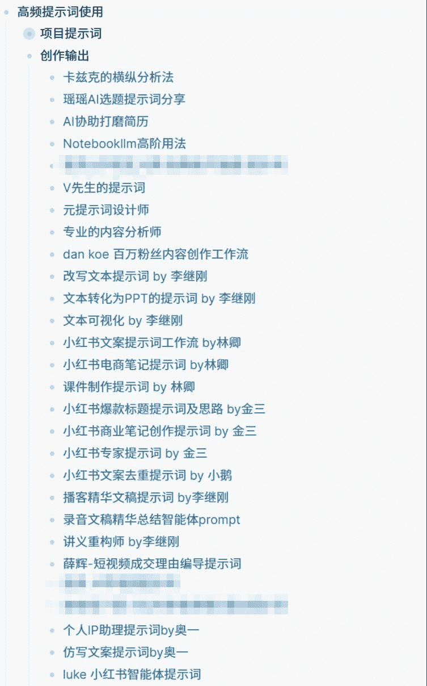

专家天团出判断 → 知识库变产品 → 笔记库供创作 → 任务管家护执行

也正是这一套业务闭环，成为了我作为 OPC/超级个体的底气。

### 场景一：请一个业务专家天团，帮自己干活

作为项目操盘手，做一整个项目的时候，是涉及多个业务环节的，以我在做的陪跑项目为例，就会涉及到比如：

直播话术塑品/市场情况分析/直播策划/投放策划/内容输出创作……

每一个领域都需要一个能给我专业意见的"参谋"。

我作为一个人，再全能，也不可能面面俱到，在每一个方面都发挥到顶尖专家级的水平，也非常耗费精力；

而且如果我想在每一个方面都去精进、提升，靠自己慢慢学，至少是几百个小时的时间投入；如果花钱请咨询/教练，单次付费几千到几万。

这是传统时代的做法，但是现在 AI 时代，情况就完全不同。

我可以把我过去几年攒下的方法论、案例、笔记，分门别类地喂给不同的 Agent，做出一支永远在线、随叫随到的业务专家天团。

每一个 Agent 都是一位喂饱了我个性化业务语料的"专家顾问"：

- 直播间塑品专家：帮我根据我的产品信息+直播背景，产出可上播的塑品话术；
- 直播间拆解专家：丢一段竞品的直播录屏文稿，结构化拆解出对标直播间的打法，总结可复用的方法论；
- 视频号投放参谋长：丢我的直播预算和目标过去，给我推荐分时段、分计划的投放方案；

业务专家 Agent = 业务方法论 × 优质语料 × 提示词框架 × 我的真实业务场景

Agent 不是拿来"陪聊"的，是拿来在我每一个具体决策环节，给我提供一个高于平均水平的业务参谋意见。

我同时操盘多个项目的时候，再也不会因为"某一个领域我不熟"而被卡住——这才是一人公司能跑得开、跑得快的底气。

#### 实操展示：直播拆解 Agent

看到一场好的直播，要拆解一下的时候，我就直接用到直播间拆解专家 Agent，帮我工作。

Agent 一次执行，能帮我实现以下 5 个模块的功能：

- 模块一：直播货盘总览
- 模块二：排品策略与节奏拆解
- 模块三：主推品话术整理
- 模块四：可复用话术框架
- 模块五：综合策略点评（亮点与不足）

可以看看这两份实际拆解报告案例：

同等水平深度的拆解，过去要资深运营花一整天才能产出出来；

现在我 20 分钟就能拿到一份可直接复用、质量远远高出的报告。

这就是我们作为 AI 加持下的超级个体/OPC，做服务交付的底气。

#### 实操展示：塑品话术 Agent & 直播预约短视频 Agent

我的直播塑品话术 Agent，我用它撰写直播间主推品的话术卖点。

我把我需要的产品信息给到之后，能让它在 10 分钟的时间里直接产出 90 分以上的直播话术。

写完直接就能拿给主播去用，比运营吭哧吭哧写一两个小时的效果要强 N 倍；

示例一：某品牌 南瓜茶 · 直播间塑品话术

🎬🎬 完整话术脚本

一、拉人（约 30 秒 | 聚人气+留住人）

来来来，所有今天刷到我直播间的姐妹，先别划走——

你平时是不是总觉得早上起来脸肿肿的？熬夜加班第二天整个人看起来胖了一圈？又或者你明明不胖，但看起来就是不清爽、不利落？

今天这个品，就是帮你解决这个问题的。

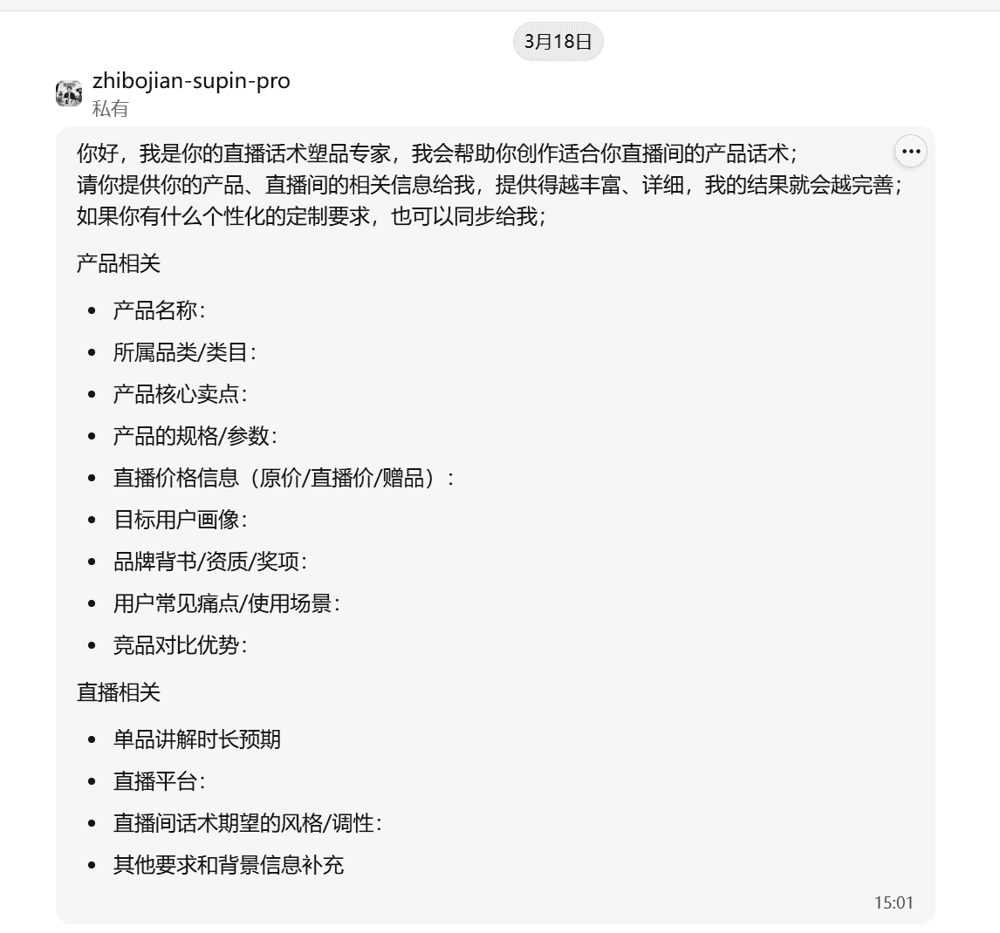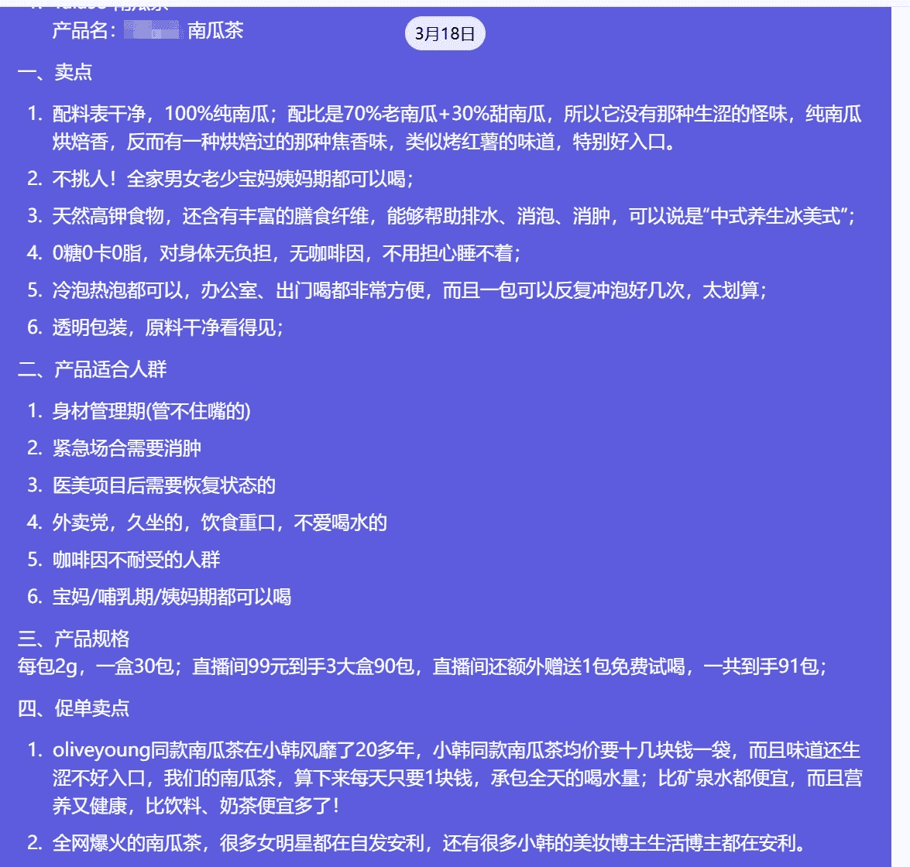

而且我先说一个炸裂的价格——算下来一天只要一块钱，比你楼下买瓶矿泉水还便宜。

等一下我会告诉你为什么这个东西全网都在疯抢，先点个关注停一停，听我花两分钟把它讲清楚，不适合你你再走，但你听完大概率要抢。

二、塑品（约 2 分 30 秒 | 核心价值塑造）

🔹🔹 第一层：场景带入——"你有没有过这种时刻？"

姐妹们，我先不说产品，我先问你几个问题——

你有没有过这种经历：第二天有重要场合，拍照、见客户、约会，结果前一晚吃了顿火锅，或者加班到很晚，第二天早上一照镜子，脸肿得跟馒头一样？

【停顿 1 秒】

还有，久坐办公室一整天，外卖吃得又咸又油，下午腿就开始发沉发胀？

或者你就是不爱喝白水，觉得没味儿，一天下来根本喝不够水，但奶茶饮料你又怕胖？

你把这些问题打在公屏上，有一条算一条，我看看今天在座的姐妹有多少中招的。

🔹🔹 第二层：产品引入——"我找到了一个特别好的解决方案"

好，我今天拿出来的这个东西，就是——xxx 南瓜茶。

【动作提示：拿起产品展示，特写透明包装】

你先看这个包装，全透明的，里面什么东西看得一清二楚，就是纯纯的南瓜颗粒，没有任何乱七八糟的添加。

翻过来看配料表——只有一个词：南瓜。

没有糖，没有香精，没有代糖，没有防腐剂，100% 纯南瓜，配料表干净到让你心安。

🔹🔹 第三层：卖点深度拆解

第一个卖点，也是我最想让你知道的——这个配比太讲究了。

它是 70% 老南瓜+30% 甜南瓜的黄金配比。老南瓜营养足，甜南瓜调口感。所以你泡出来喝，不是那种生涩的菜味，而是带一种烘焙过的焦香，有点像什么呢？就像冬天街边烤红薯飘过来的那个香气。特别好入口，完全不需要硬着头皮喝。

很多姐妹之前喝过小韩的南瓜茶，跟我说味道涩涩的不好喝，坚持不下来。这款你可以先喝一包试试，口感的差距是很明显的。

【动作提示：现场冲泡展示，闻香、试喝】

第二个，它的营养价值真的值得好好说一下。

南瓜本身就是天然的高钾食物，同时还含有丰富的膳食纤维。高钾帮助身体排水、膳食纤维帮你增加饱腹感。所以现在很多姐妹管它叫**"中式养生冰美式"**——提神不靠咖啡因，轻盈不靠饿肚子。

【语气提示：加重、放慢】

而且它是 0 糖、0 卡、0 脂、无咖啡因。这意味着什么？

意味着它不挑人。身材管理期可以放心喝；姨妈期、哺乳期的姐妹，也完全没问题；家里老人小孩也能喝；晚上喝也不用担心睡不着——因为没有咖啡因。

你找不到第二个适用人群这么广的日常饮品了。

第三个，方便到离谱。

冷泡热泡都行。早上到办公室，往杯子里丢一包，倒上热水，你的养生茶就有了；夏天在家，直接冷水泡，冰箱里冰一下，就是一杯天然南瓜冰饮。

关键是——一包可以反复冲泡好几次，从早喝到晚，承包你一整天的喝水量。比你一天点一杯奶茶、买一杯咖啡省太多了。

三、互动（穿插在塑品与开价之间，约 20 秒）

来，姐妹们，听到这里觉得想试试的，公屏上给我扣**"南瓜"**两个字，我看看有多少人有需求。

尤其是那种——久坐办公室的、外卖党的、日常容易肿的、不爱喝白水的——你扣个 1，等一下我讲价格你一定会觉得太香了。

我看到了哈，人还不少，那我价格直接给你们安排上。

四、开价（约 50 秒 | 价格锚定+价值对比）

这个南瓜茶呢，你如果去搜小韩 oliveyoung 同款的南瓜茶——一袋要十几块钱，而且还是那种生涩口感，不好坚持。在小韩这个茶火了 20 多年了，很多女明星、美妆博主、生活博主都在自发安利，这不是我们花钱请的，是真的火。

那我们直播间今天什么价？

【语气提示：先停顿，制造悬念】

99 元，三大盒，一共 90 包。而且直播间我再额外送你 1 包免费试喝，到手 91 包。

你算一下：91 包，99 元——一包一块零几分钱。

【语气提示：加重语气、放慢速度】

一天一包才一块钱。比矿泉水便宜。你每天少喝一杯奶茶省下来的钱，可以喝三个月的南瓜茶。

而且你喝的是纯南瓜、0 添加、高钾高纤维的天然养生饮品，不是糖水不是色素水。这个账怎么算你都不亏。

五、逼单（约 40 秒 | 打消顾虑+制造紧迫）

我知道有些姐妹可能还在犹豫——"我怕我喝不习惯怎么办？"

所以我们额外送了一包试喝，你收到货先泡这一包，觉得口感 OK 你再开整盒。怎么样？完全没有风险。

【语气提示：真诚、放慢】

姐妹们，我说句掏心窝子的话。这个东西不是药，它也不是什么神奇的减肥茶——它就是一杯干净的纯南瓜冲饮。但你想，你每天要喝水吧？与其喝没味道的白水坚持不下去，不如换成一杯有焦香味的南瓜茶，好喝的同时顺便还把钾和膳食纤维补了。

这不是花钱，这是把你本来就要花的喝水钱，花得更值了。

99 块三大盒 91 包，我今天就上这一轮，库存有限。

想要的姐妹——直接拍，现在就拍。

3、2、1，上链接！

📊📊 话术结构总览

🔍🔍 启发性建议——帮你进一步优化话术

以下问题如果你能补充回答，我可以帮你把话术打磨得更有杀伤力：

🔍🔍 1. 原料溯源与工艺

你们的南瓜是哪里的产地？用的什么烘焙工艺（低温烘焙/冻干/其他）？产地和工艺的故事在直播间能极大增强"干净天然"这个卖点的可信度，比如"XX 产地日照 2000

19 /

38

小时的老南瓜”就比单说“100%纯南瓜”更有画面感。

### 2. 用户真实反馈/回购数据

有没有印象深刻的用户好评截图、回购数据，或者你自己喝了多久的真实体验？“我自己喝了X个月”“回购率XX%”这类真实数据在塑品和逼单环节是转化率最高的信任素材。

### 3. 具体的明星/博主安利素材

你提到很多女明星和博主在自发安利——能否具体到是谁？（如果是公开场合的真实推荐，可以在话术中提及。）有具体人名的背书远比“很多人推荐”更有冲击力。

### 4. 使用体验的“啊哈时刻”

喝完之后有没有什么用户反馈特别集中的体验？比如“第二天早上照镜子脸明显清爽了”“泡出来颜色特别好看，很出片”等。一个具体的体验细节，比十句笼统的描述都管用。

### 5. 与白水/咖啡/其他代餐茶的替代场景延展

这款产品在送礼场景（比如送给久坐办公室的闺蜜、送给养生的妈妈）有没有实际案例？“送礼”是一个高转化附加场景，尤其是三盒装的规格天然适合送人。

### 6. 品牌资质与检测报告

有没有SGS检测报告、食品安全认证或其他权威第三方检测数据？尤其是0糖、0卡、0脂的宣称，如果有检测报告背书，在直播间可以直接怼镜头展示，信任感瞬间拉满。

### 7. 售后与物流细节

发货时效是多久？是否有运费险？这些信息在逼单环节能有效降低用户最后一步的犹豫——“今天拍，明天发”“不满意直接退，有运费险”，都是临门一脚的助推器。

### 8. 竞品差异化的更多细节

除了口感更好、价格更低之外，和韩国同类南瓜茶相比，在原料品质、加工方式、包装设计上还有没有其他差异点？“人无我有”的独特差异是直播间最有力的记忆锚点。

💡 使用建议：以上话术为基础框架版本，你可以将补充信息反馈给我，我会在对应模块进行定向升级。同时建议主播在实际开播前做1—2次口播练习，根据自己的语速和节奏微调句式长度。

### 示例二：某品牌南瓜茶直播间预约话术

同样的，我也在用Agent产出我的直播预约短视频的文案，量大管饱，质量好。

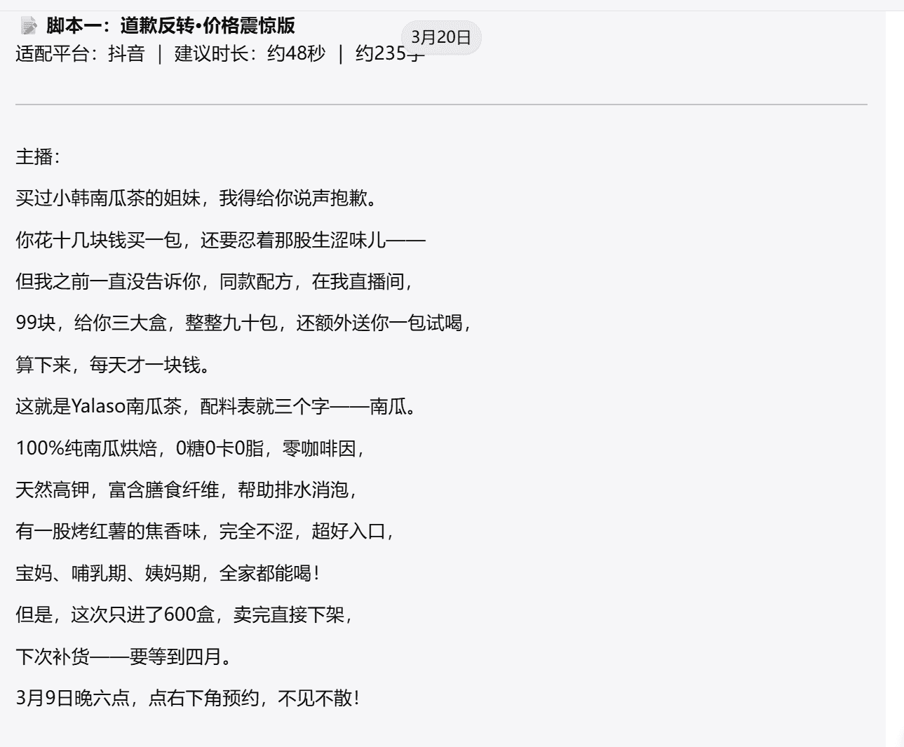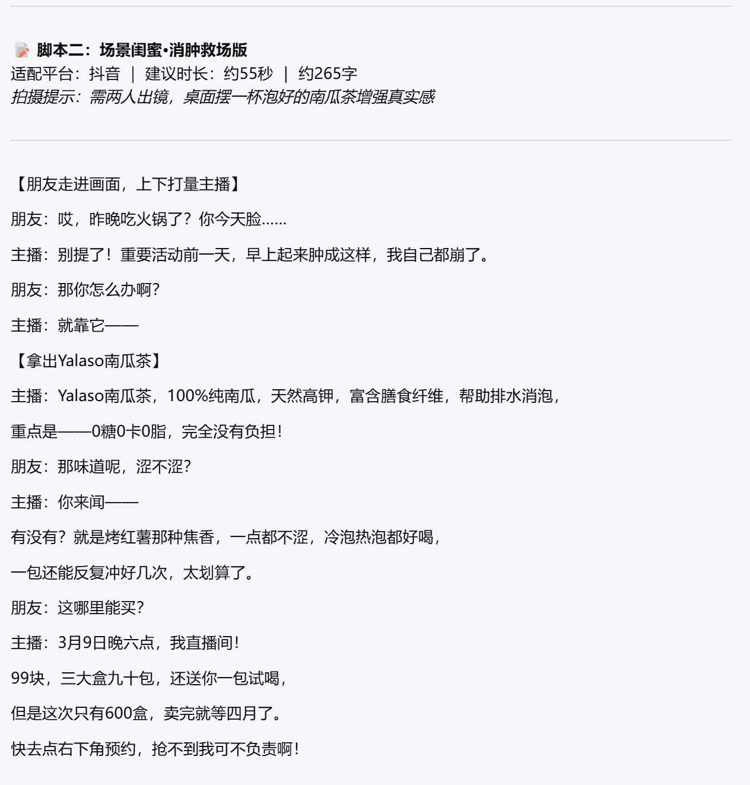

## 实操展示：制作IP内容策划方案

Claude用来做IP内容策划、写脚本，真的是我的顶级军师，用了就再也离不开。

我的做法是：

不直接简单重复提问，而是在Claude的Projects里先上传这个项目的所有关键语料信息。

包括这个项目的背景、盈利模式、产品信息、IP本人之前发布的内容、IP本人的价值观/职业经历/语言风格等等。

基于知识库输出后的内容，不仅极大程度上避免了幻觉和胡说八道的情况，而且更贴近IP本人，有的时候比本人还更懂自己。

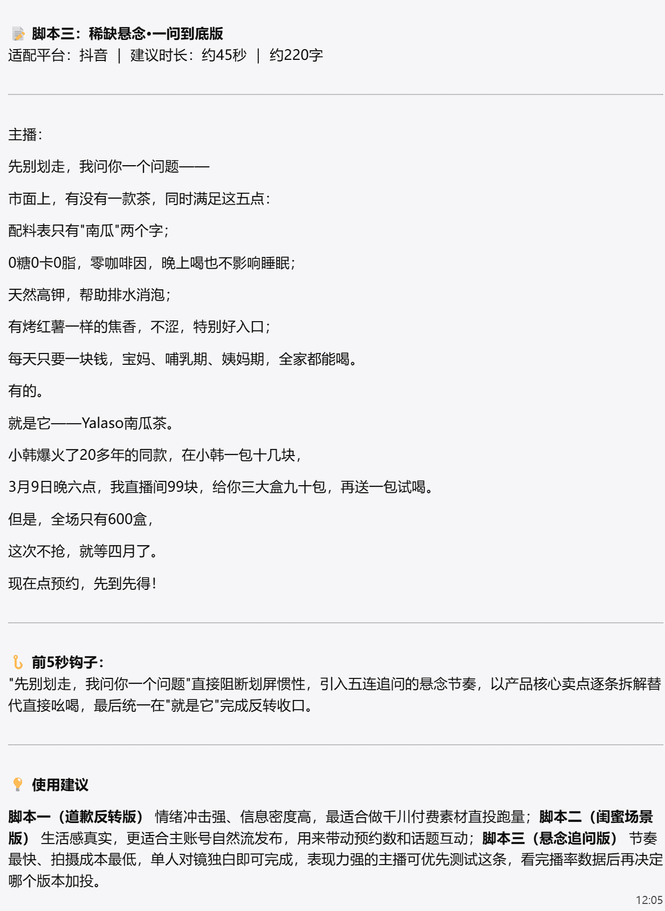

用这种方式投喂、训练自己的Projects和Agent之后，Claude不仅能帮我做账号运营规划和策略规划，还能直接出Excel格式的选题表；还能根据项目策略直接出内容脚本；并且连做PPT的功夫都省了，一键美化成可以直接提报给客户的方案，一键生成团队能直接使用的SOP表格。

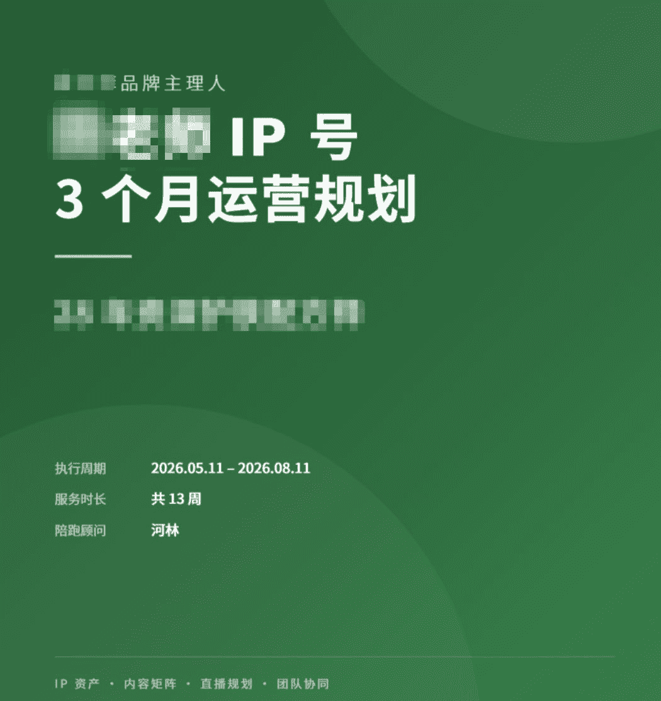

我自己给我们的IP出内容，1天能出20篇稿子，Claude的初稿能达到75—85分的水平，我再通过人为筛选，一篇一篇精修后，就能直接出品拍摄，而且在我们的账号上数据表现都不差。

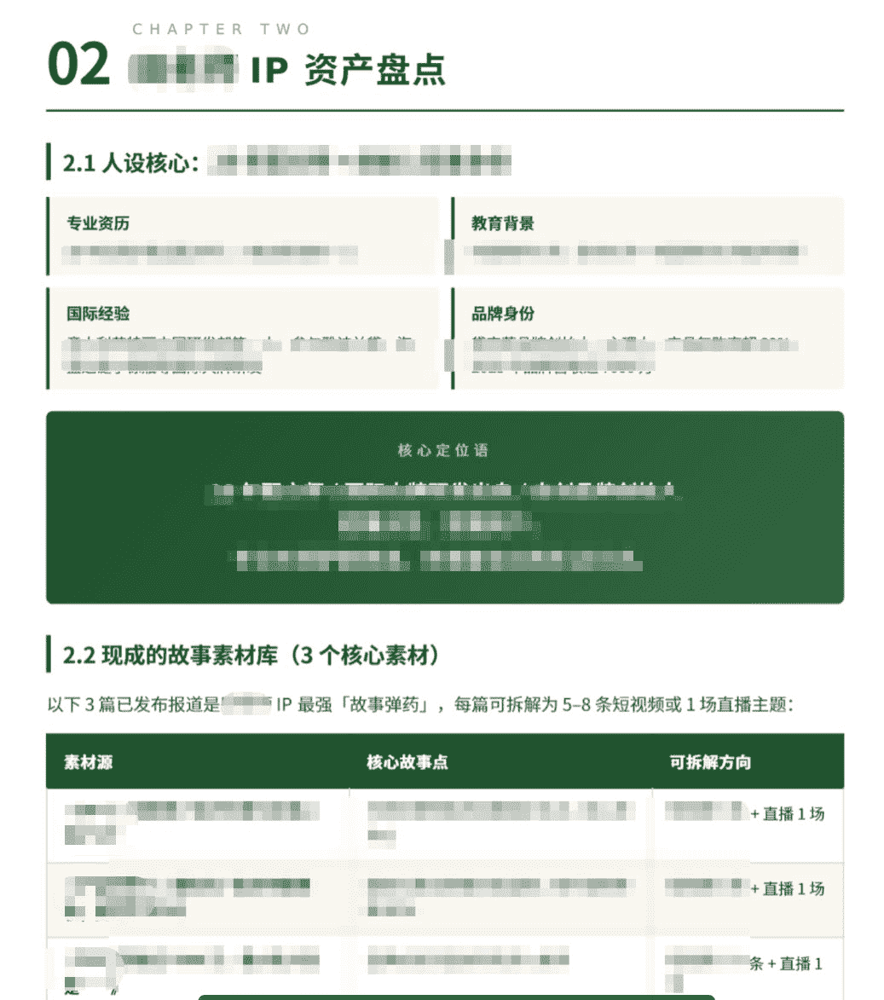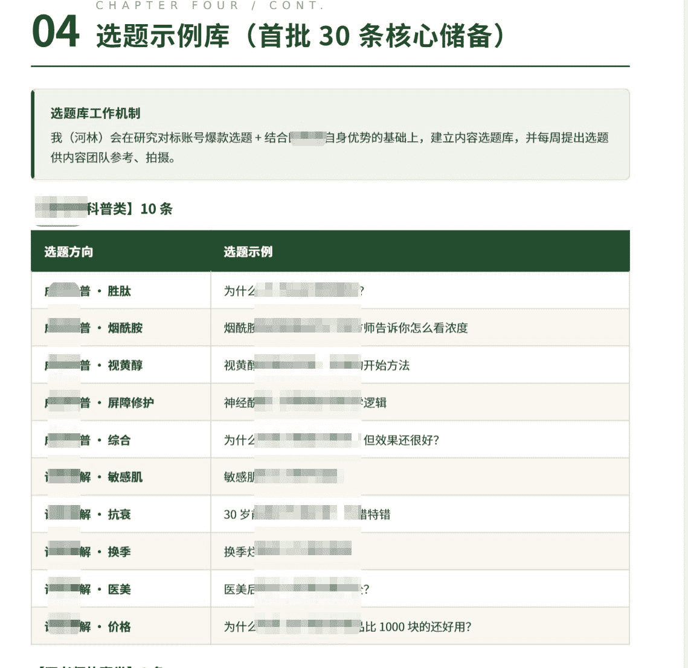

## 场景二：搭建AI知识库+知识付费社群

我从做运营的第一年起，就开始有意识地积累工作文档、文章、资料。

3年下来，飞书知识库里攒了几百份精品文档、几十份研究报告、上千条剪藏笔记。

有了AI知识库工具之后，它就有了多重作用：

- 内容输出库：把知识库本身作为一个内容工厂的输出源头，去撰写内容；
- 业务大脑：把知识库作为行业领域知识大脑，来辅助我的决策；
- 产品交付：把知识库本身作为一个交付产品，服务给自己的知识付费客户。

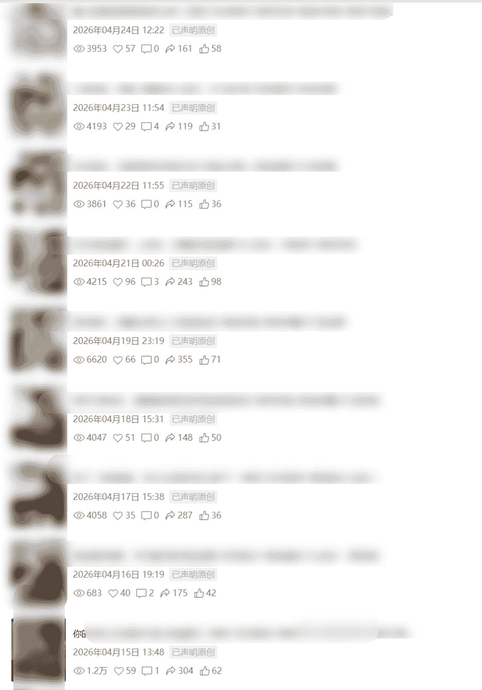

我目前主力运营的知识库「视频号直播知识库2026 AI版」，把它直接部署在ima知识库，在ima已有2400+人订阅，配套的陪伴社群，持续服务200+视频号电商玩家。

我搭建的知识库产品，可以作为知识付费产品×社群服务交付的一大助力，也是交付的权益。

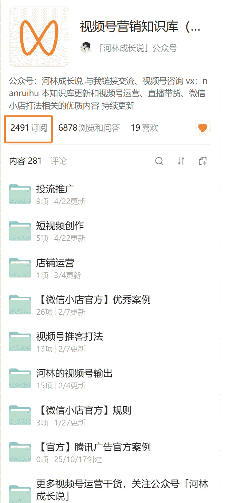

## 场景三：重构个人知识管理体系，搭建自己的内容工厂

我是Obsidian重度用户，本地知识库里有500+篇笔记，主要是我在各个领域摘录的输入文章。

我本身就有Obsidian的上手熟练度，用它来做我的内容库管理非常丝滑。

有了Claude Code之后，我之前的Obsidian笔记库就更加如虎添翼。

所以我用Claude Code×Obsidian把我传统的知识管理体系全部重构了一遍，我的做法是：

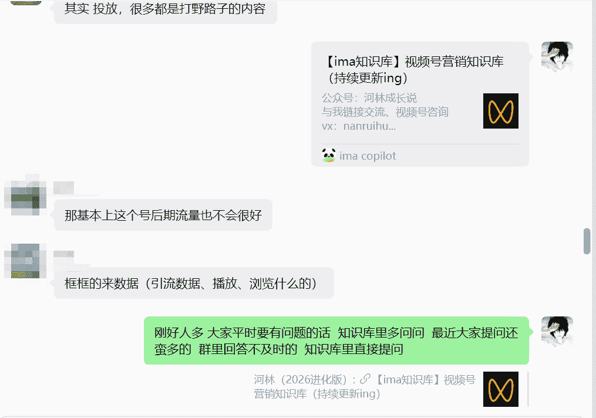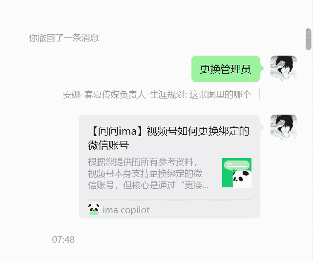

第一步：用Claude Code对所有的本地知识库做加工、精修。

首先用Claude Code×Cola×Obsidian，对我原有的笔记知识库做了一次彻底的重构，整个过程不到半小时。

我的步骤如下，大家可以复制我这段本地知识库修改话术，给自己的Claude Code/Cola/Codex/Hermes Agent：

### 本地知识库重塑思路（发给AI）

我现在要重新整理我的这份本地知识库，把它作为一个Obsidian知识库，和我的Claude Code联动，服务于我的「内容创作」。

我的整理思路和步骤如下，你先浏览整个本地知识库的内容，判断一下这个思路是否正确？

然后和我交流你的想法，经我确认后，再按我们达成共识的步骤操作。

1. 自动给所有笔记打上多维关键词标签；
2. 删除空笔记和无效草稿；
3. 根据整个知识库的笔记内容主题，自动提取出8个最高价值的、高频出现的核心主题概念词；
4. 为每个概念词生成“概念索引卡”，建立笔记之间的双向链接；
5. 输出整个知识库的结构总结报告给我。

最终按照这个步骤走下来，我得到的，不是一个“整齐的笔记库”，而是一个可以被AI高效调用的、结构化的个人语料库。

第二步：快速搭建多个本地知识库。

一个知识库成型之后，就可以同样的方法继续复制。

先把自己在各个领域的输出、输入、项目文件下载到本地，整理到一起。

然后再用同样的方法对每个知识库的结构进行打磨、优化。

于是，我基于Obsidian×Claude Code，搭建了一整套我的本地自运转的内容工厂体系：

- 内容输出库
- 内容输入库
- 个人方法论武器库
- 业务项目知识库

第三步：打磨每个知识库之间的claude.md，并且确立各个知识库间的引用逻辑。

打造完几个知识库之后，我会再让Claude为每个知识库建立规则，梳理好每个本地知识库的claude.md文件，在相关联的知识库里设置好互相引用的规则。

让我的多个知识库在遇到问题的时候，能根据具体的场景，相互引用，有机组合。

第四步：用本地知识库解决业务问题。

知识库已经打磨好之后，剩下的就是在需要的时候，调用本地知识库解决问题即可。

有任何问题直接用Claude Code提问，效率翻倍，而且都基于自己的本地私人语料库，能完美理解自己的需求，应用自己认可的工作方法进行创作，摩擦成本和试错成本降低很多。

我的整体本地知识库就更加可用，我以后每一次写文章，都不再是从一张白纸开始，任何创作的“冷启动成本”被打掉了90%。

我的笔记库，也终于从一个“知识囤积仓库”，变成了一个充分认识我、理解我、有足够多优质语料的内容创作工厂，对我的内容输出×业务创造助力很多。

## Part 4：AI小白从0到1蜕变为AI高手的速通邪修法

这一部分，除了技术和操作上的事情，我想分享一下让我的AI能力、业务能力飞速提升的内在心法。

掌握并且内化这几个邪修心法，根本不需要再吃AI的苦，也不需要苦哈哈地做信息仓鼠，不断囤积各种看不完的、花里胡哨的教程。

反而能一切以我为主、让AI为我所用，成为任我们驱使的工具，来为我们创造业务价值。

这才是我们使用AI的终极目标。

邪修法的胜利，就在于不靠打怪升级，直接一路通关。

### 邪修法一：AI时代的万能作弊法

AI时代的万能作弊法=批量采集优质语料×AI逆向底层方法论×AI创作。

这是我自己摸出来的最大邪修心法。

原理是：整个世界就是一个语料库，我们的万能作弊法就是采集→逆向→复刻。

采集自己需要的优质语料，用AI分析逆向出底层逻辑、拆解内核、复刻出方法论，再用AI去基于提取出来的方法论，去完成所需要的任务，这就是当下时代的炼金术。

底层原理在于，大模型发展到现在，提示词之间的效果差异越来越小，已经逐渐被大模型本身的底层能力抹平。

比起囤积“提示词”和所谓的“skill”，更重要的是建立属于自己的独家“优质语料库”。

和其他人的竞争力、信息差，也都来源于自己的独家优质语料库。

这件事不能交给别人，也不能全部交给AI，因为语料的筛选和选择是一个纯主观的事情，本身就需要高品味，本身就是壁垒。

一份语料库的价值，正在于“它是你按你的业务直觉挑出来的”。

自有的、稀缺的、个性化的优质语料，结合AI去做知识管理和批量产出分析，是能给我接下来带来非线性、爆发式增长的稀缺杠杆。

### 邪修法二：创作一个元提示词Agent，让AI帮你写Agent

大多数人卡在“搭Agent”这一步，是因为——自己手写系统提示词太慢、太累、效果不稳定。

试错一个新Agent，光是琢磨提示词框架就要花几个小时；上线之后还经常发现表现不及预期，又要回头改，改完又跑偏。

所以真正的邪修法是：不要自己写Agent，让AI帮你写Agent。

具体做法分两步：

第一步：先搭一个“元提示词Agent”——也就是Agent的Agent。

它的唯一职责，就是帮你写其他Agent的系统提示词。

它的输入是：

- 你想要这个Agent解决什么业务问题；
- 用户是谁、典型使用场景是什么；
- 你期望它输出的格式是什么；
- 你能提供哪些语料、SOP、参考案例。

它的输出就是：一份结构清晰、可以直接复制到Coze/Claude Project/GPTs里使用的完整系统提示词。

我的【河林的Agent】Agent创作专家，就是这一类。我现在搭一个新Agent，从需求到上线，平均不超过15分钟。

第二步：用元提示词Agent批量产出专项Agent。

有了元提示词Agent之后，做新Agent这件事就从“创作”变成了“配置”。

我每发现一个新的高频场景，就和元提示词Agent对话5—10分钟，把需求讲清楚，它给我吐一份系统提示词，我复制到对应的容器里，一个新Agent就上岗了。

这就是为什么我能在Claude Project里同时养着十几个Agent——不是我特别勤奋，是我把“做Agent”这件事本身也AI化了。

用Agent造一个能帮我解决问题的Agent。

有了这套机制，“搭Agent”就不再是门槛。

## 怎么用上自己的Agent？

各大AI厂商基本都推出了自己的Agent工具，大家对号入座，用自己喜欢的方法和功能就行。

国内AI工具：

- 豆包Agent
- Coze Agent+接入飞书
- 微信端：腾讯元器、小微智能体小程序
- Monica

国外大模型：

- POE
- Gemini：Gem
- GPT：GPTs
- Claude：Project
- Claude Code：Skill

### 邪修法三：AI时代解决任何问题的SOP

AI时代，遇到任何从未解决过的问题，哪怕你不知道这件事情到底怎么做，哪怕一窍不通，依然都有一套能够碾压级速通的标准SOP。

这是我总结的操作步骤，供大家参考。

6. 去GitHub、即刻、公众号、小红书搜索是否已经有人发布过解决该问题的插件、skill；
7. 如果有，就下载下来，优先用别人已经打造好的工具，别重复造轮子、浪费算力和精力；看一下提示词，满不满足自己的需要，根据自己的需求，做进一步优化；可以再用上一个环节做出来的元提示词Agent优化、升级一遍（这一步并非必要，有些提示词本身很好的情况下我就不会再画蛇添足）。
8. 如果没有，那么就把所有人遇到这个问题的解决方法和思路描述出来，用自己的元提示词Agent，帮助自己原创、手搓一个这样的skill/Agent；
9. 对自己这个解决问题的Agent提问，我需要提供什么样的语料和信息，能让你更好地解决这个问题？然后它会给我们一份语料清单诉求。
10. 按照它列出来的列表，搜集优质语料、信息来搭建知识库。
   - 优先使用主流采集工具：影刀/RPA/八爪鱼/飞书多维表格字段捷径，等等……
   - 没有匹配的工具，再去找万能的淘宝、闲鱼：付费找人按自己的需求采集；
11. 把提取出来的语料喂给自己的Agent，让这个Agent把已有的语料内化，完善自己解决问题的方法，甚至可以开发出多个细分Agent，按照我们的需求解决自己的问题。

这一套方法屡试不爽，从原则上来讲几乎没有攻克不了的问题；而且能大大压缩我们学习新事物、接触新业务的成本，之前要花一个月时间才摸到门道的事情，现在毫不夸张地说，3小时就能搞清楚。

这就是AI时代给我们带来的真正生产力。

### 邪修法四：真正的邪修，是心态上的邪修，邪修才是终极的正修

AI时代最大的“心态作弊”：偷懒不可耻，作弊才是正修。

真正的邪修，不是技术上的什么黑科技，而是在AI应用心态上的邪修。

AI时代，我们应该有的精神和心态是：

万物皆可用AI工作流重塑，AI是炼丹术和金手指，用好AI，就能找到世间万物的作弊代码，之前卡住的关卡、之前遇到的卡点，不妨都用AI帮我们破解一下，你会发现这个世界变得完全不一样。

不要思考“AI能做什么”，因为AI能做的太多了，只有少数事情是AI做不了的；不如直接列出来哪些事情不能交给AI做，其他的事情就全部是可以用AI做的。

用排除法反而容易得多，把AI做不了的事情列出来，剩下的事情都可以用AI高度重塑，打碎重做一遍。

克服自己的“好学生”心态，偷懒无罪，作弊无罪，用AI替代自己原先重复的工作，就会尝到越来越多的甜头。

真正的爽感，来自于突破过去的自己的上限。

## Part 5：尾声

对我而言，AI不是工具，而是我搭建一人公司操作系统的基础设施。

非常感谢生财里大家一直以来的分享，对我的AI帮助和OPC转型，都提供了很大帮助。

希望今天的分享对生财的圈友有帮助，大家一起生财有术，拥抱AI。

篇幅所限，这一篇里很多部分没法详细展开。

如果这一篇里哪些部分说得不够详细，圈友们希望我展开讲一讲的，可以评论区多一些反馈，我在后续更新出来。

————分割线————

看完这篇SOP，你觉得你懂了。但90%的人一到实操就会卡在第一步。

工具和教程只是最低级的壁垒，真正的壁垒是“立刻动手”和“圈层信息差”。

如果你想看全网最新的变现玩法，并且和一群执行力极强的极客一起下场拿结果，欢迎围观我的核心私域：【懒人专属群】。

我们不聊虚的，只做商业闭环的拆解与 AI 效率的压榨。系统内已沉淀 1000+ 跑通的套利实战局。

👉👉 查阅圈子完整数字资产与上车门槛：

https://lazyso.com/insider/

认同价值、准备好下场干活的，扫码加我微信（lazyhelper1）

备注：【实操上车】，不闲聊

