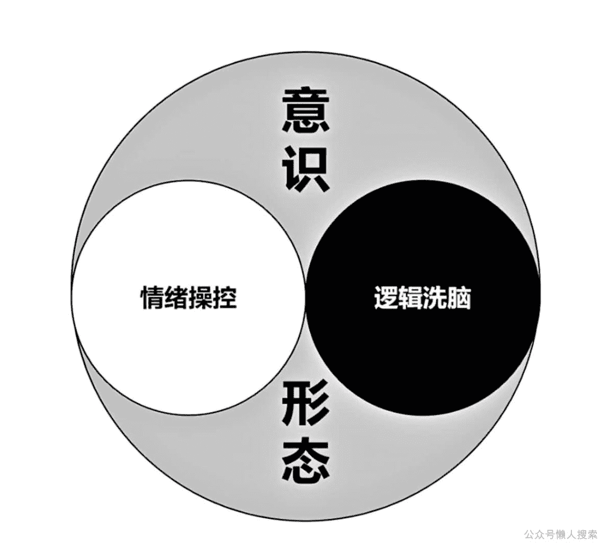

公众号懒人搜索，懒人专属群分享

 1 / 34  

 

入魔邪法：天魔操控下界的三件套...  

260601 第三只眼观  

整理：公众号懒人搜索，懒人专属群精选  

懒人微信：lazyhelper1  

 

三件套如下图，本篇1万多字把这图搞明白。  

如果你都会三件套搞攻击了，岂会内耗？  

最起码要内耗转化成外耗呀，先自利再谈利他..  

情绪操控  

逻辑洗脑  

为什么画成圆？  

1、能清晰简化。  

平常你看到这仨词，单拿出来都认识，但思维肯定是乱套的，单独解释一大堆越看越懵，放一起不知道咋玩。  

  

思想需要体系化，再多的豆子只要有篮子就好办了。  

这图就是“阴阳鱼”对吧？  

佛道就是做简化的，图难于其易嘛！  

按照图示一下子就找准关系定位了，里面一阴一阳旋转出外面的大圆，你立马就知道玩法了。  

必须是转起来的哟，不转就没效果..  

2、此圆就是心盘。  

之前画的所有模型，全都是转圈圈的对吧？  

佛道思维主打一个——转！  

  

只有转起来，认知才能转变、转化、乃至翻转开智。  

啥叫心盘？就是你的心、我的心、所有人的心都会是这样，一切法唯心所现！  

当然此图是魔法转圈啊，魔法也是法，也是唯心所现啊..  

啥叫唯心所现？你的心盘就是一部大电影，里面上演的是“佛魔攻防机制”的电影。  

当你把心中的电影搞明白，再扩展到一切世间法，诸如政治、经济、商业、文化、思想、宗教、人际关系等等，这些都是外部电影。而内外电影都是同一个编剧和导演，戏路一共就那么多都是一样的，只是场景和演员的形式不同罢了。  

诸如天界、下界、六道轮回啥的，都是你心的轮转显现，你心里显现出什么道，你在外部就会怎么办事，要学会当编导！  

用庄子话说就是——内圣外王！大白话就是里面搞清楚了，外面自然就通路了..  

3、魔就是磨。  

天界咋操控下界？  

肯定弄个盘面把人圈起来，然后再研磨和榨汁啊..  

要不操控下界干嘛？闲的吗？  

在北魏之前没有“魔”字，原本就是“磨”字。  

上面的图带感点看成——磨盘！  

通俗说就是把人们的思想给逮住了、锁起来、跑不出去，剩下就任凭宰割了呀，磨呀磨来维持天界权力呀、商业资本收割你啥的。  

反之，磨盘一旦不转了，那天界就崩塌了！  

例如：为啥一线小鬼最能刁难人？  

因为虽然权力不大，但维持权力需要折腾人，不干活的人必须折腾人才能“凸显价值”啊。  

三件套搞清楚了，回头再看《经史子集》就通畅多了..  

可不要小瞧魔法哟，虚拟磨盘的束缚性才强呢，思想控制要远远>物理控制！  

真在现实里弄个笼子锁你，那可未必能关得住，因为你必然会反抗。但在魔法世界里锁住人，不夸张的说可能锁一辈子都出不来，所以思想统治才是最关键的嘛..  

4、漏洞支点。  

为啥圆圈能转呢？  

为啥天魔能锁人呢？  

为啥佛魔能对攻呢？  

这一切都基于人的认知漏洞——我！  

在《破除情绪》那篇详细讲过，这个“我”其实是个错觉，压根就没有“我”存在着，但我们却认为是真的，把错觉幻以为真就产生了思想认知上的Bug...  

这篇再进一步剖析出深层漏洞！  

魔——利用Bug、攻击、支配和操控你。  

佛——修补Bug、防守、让你获得解脱。  

给这个电影起个名字，就叫做《正邪大电影》啦！  

1）正，不是正确的意思，说自己最正确本就是邪魔外道。  

之前讲中文说过，正和足是一个字，都代表圆满的意思。  

带感点说呢，正就是修炼一个“圆形防护罩”出来，就把防御值拉满了，邪魔外道就无处攻击你。  

2）邪，就是斜了、歪了、扭曲了、虚假了等等。  

把你的“防御圆”给搞扭曲，就好比把鸡蛋打碎，这才能产生漏洞，天魔才能迷惑、拿捏、利用乃至消磨你！  

好了，开始正文..  

## 一、里应外合！  

魔法想要施展起来，必须要里应外合才行，而这个内奸叛徒就是“我”这一错觉认知！  

天魔视角什么场景呢？  

1、人们的“我”就是漏洞、内奸、内应、叛徒，没这个家伙跟你打配合，就不会有入魔邪法三件套了。  

2、基于上面一点，魔要让人们“自愿”被支配利用，都是顺势而为，强扭的瓜不甜。  

要不然为啥叫魔法呢？  

因为让人们迷迷糊糊的“自愿”被磨啊，拿木仓逼着你那叫土匪，一点技术含量都没有..  

为啥说容易锁一辈子出不来？  

因为在磨盘里的人还会很“享受”呢..  

当然，这听起来很颠覆..  

啊？被天魔支配利用，还是自愿？享受？  

对头！  

例如：人们是不是主动去庙子跪拜？主动送钱给方丈？  

好家伙方丈实在都不知道咋花了，只好养一群异性吧..  

佛陀早都说了，不要以音色求我，皆为外道邪法，大白话就是不要搞封建迷信，是帮我们破除迷信的，这个“迷信”一词正是出自佛经呀！  

但人们听吗？  

不夸张的说，佛陀如果还活着，根本就阻拦不住这行为，信不信这群人会网暴佛陀？  

是不是自愿？很享受不？  

例如：  

散户是不是主动当“散财童子”呀？  

是不是主动进入“磨盘”啊？  

投资应该低买高卖，但散户们都是高买低卖，是不是点击交易时候，以为自己很理性，其实是情绪驱动的？  

这种假理性正是源自于逻辑洗脑和情绪操控，各种散户大神传奇啊、各种信息透漏给你啊，各种曲线技术活分析啊，不看还好看了就上当，尤其做短线几乎必输..  

再放大视角的话，从组织到磨盘略略略一直到“教人赚钱”的老师，这是一条链，大家默默暗合，各自分工消磨小动物。  

入魔邪法就是为了拉你的“我”进来玩，不怕你暂时赢，就怕你不玩！  

例如：  

各种饭圈啊、品牌营销啊啥的..  

这些不举例了，总之都是自发自愿的。  

哎哟，咋这么邪门呢？  

在《破除情绪》那篇讲述了“我”这一漏洞，上一篇讲了“我”是变傻的根源。  

只要有“我”这个错觉，人必然是变傻的..  

这篇更深一层剖析：这个“我”的漏洞在于，必须在外部寻求出一个“主宰”出来，由此来掌控和支配自己，由此反复填充出“我”的存在感！  

简单说就俩字——认主！  

初步有了“内奸叛徒”的感觉了吧？  

所以佛陀特重要的三个字——无主宰！  

字数越少事越大，这才是命门所在，但一般都当成耳旁风了..  

换成佛家另外一个词叫做——认贼作父！  

内部先有个贼叫“我”，不仅在内部一顿祸害我们，在我们内部消磨损耗。然后“我”还要再去外面认贼作父，认定谁是爹或主人。例如大殖子认美爹马爹啥的，主人就能利用和支配仆人，这都是自愿的呀..  

要不为啥叫《思想殖民》呢？  

为啥叫“养殖”小动物呢？殖就是弄个“磨盘”往那一放，里面就开始自发的繁殖了呀！  

司马迁叫货殖嘛，方丈打开庙门就来“货”了呀，一群人自己就往磨盘里钻了，快磨我快磨我略略略..  

为啥会有上面的漏洞呢？这块得好好掰扯一下，不了解漏洞机制就会有术无道。  

使用即存在，存在即思维，而“我”这一错觉正是建立在“主体性”思维的基础上！  

举个最简单例子来说吧..  

例如：  

我们在说话时候，就必须要有个人称，比如就要说“我今天怎么样”或者“他今天怎么样”对吧，或者对于物品，你会说“这张桌子怎么样”是吧，要不然你就说不出话来。  

其中的我、你、他、桌子，这些都是假名。  

啥意思呢？  

假名就是为了沟通方便而假装出来的主体概念，这在《破除情绪》那篇已经详细讲过了。  

而当我们一直这么讲话，用老子话说就是我们一直这样“非常名”着，我们就产生了对于“独立主体”的习惯依赖！  

这也是解读《道德经》呀，只不过换了个入魔角度，回头与道家模型啪一配套，就明白老子啥意思了..  

我们一直活在这种语言习惯里，不要小瞧语言的作用呀，这玩意一直熏习我们第八识的“种子”呢！  

要不然《破除情绪》里的“小妙招”要反着来？  

当熏习久了，就跟油烟机上面一层黏糊糊的油污似的，这个油污就渗透进我们的思维认知，思维就认定必须有一个独立存在的主体！  

然后呢？这个固化思维就始终在背后作用着你的思想运行，而我们根本就觉察不到！  

我们思维一动就要主体、主体、主体这样子，当处于现象之中时候，就是在日常生活当中的时候，就潜在默认会有一个“主宰”存在，没这玩意的话，意识思想就没着没落的，这个Bug简单说就是认主！  

例如禅宗说“动念即乖，开口便错”对吧？  

只要我们开口交流，必然就有主体性，然后一步步的潜在加深，最后就形成了势力！  

要不为啥佛家有个大势至菩萨呢？  

讲的就是这股子巨大的惯性力，是它推动着我们，你怎么也绕不开这股力。  

啥叫潜在？  

就是我们压根察觉不到我们会累积出这个Bug，如果不靠大脑逻辑反推，我们压根意识不到我们一直在“认主”这样子..  

但是呢？它的表现我们能感受到，即所谓——依赖性和孤独感！  

例如：  

动不动就空虚了，动不动就要找人生意义了，这都是依赖性的表现，背后的Bug就是认主。把空虚和找意义换成大白话，不就是“谁来支配我”的意思嘛..  

暂停总结一下：  

1、在我们内部，构建出一个“我”的错觉认知，当做内部主宰。  

2、在我们外部，也就是生活日常当中，这个“我”又要主动在外部“求”一个主宰去依赖。  

这两个“贼”就把我们的思维意识给拴住了，然后门户大开，防护罩就破防了呀..  

谁拴的谁破的？正是我们自己，魔能支配和消磨我们，人家只是钻了这个空子，并不是强行给你造个漏洞，然后安排你，那得多累啊..  

所以魔也叫作——他化！因为是我们自身的漏洞，他化出了魔界和其技术活。  

总之呢？  

我们必须不断抓取一个“主”出来，诸如名利、爱情、偶像、宗教、意识形态，或者比如随着主人仇恨一个特定对象啥的，由此来证明“我”的实在感。  

反之“主”一旦消失了，我们的“我”立马就空虚，难受得不要不要的..  

例如：  

宗教主、皇帝、老板、资本家、乃至娶个小仙女回家当祖宗啥的，这都是人们自己制造出来，都是自己“舔”出来的啊，这些“主宰”压根没有强行奴役一说。  

佛陀要跟我们挑明这个，人心不死，道心不生，对不？不过这确实很难，且得修炼呢..  

对于上面的漏洞成因，再换成第七识的逻辑来讲一遍。  

在《破除情绪》那篇讲了，第七识就像总经理、审核员、会计员啥的，这本身有漏洞吗？  

没有呀！人家就在那嘟嘟嘟嘟搞审计，就跟机器一样运行，这能有什么漏洞？  

漏洞在哪？在于我们第七识一旦工作，就先登录了一个叫“我”的账户！  

重点：这个账户不是你的真身，它只是个虚拟账户..  

就好比啥呢？就跟互联网各个网站似的，它们不让你“游客”视角随便看，必须让你注册一个账户，而当你注册完了，他们才能通过账户“信息”收割你和管理你。  

比如注册完了之后，就会有一个“我是XX网站会员”的概念，这就是“认主”了呀。  

内部化：  

当登录这个“账号”久了，就会产生出“我”的想法、“我”的地位、“我”的身体、“我的”面子之类的..  

外部化：  

当这个虚拟身份无所依寻（无执）的时候，它的主宰感就弱化了，人就感到不安空虚，此时就会向外寻找一个更强大的“主”作为依附。  

比如一个权威、领袖、偶像啥的，主给“我”意义，我把自己交给你。  

比如一个思想形态，主给“我”真理，我就全然信奉。  

比如金钱、权力、认可等，拜这些为“主”之后，就能获得暂时的安全感和归属感。  

所以佛陀要破斥这些嘛..  

破斥主宰、权力、偶像、真理、名、利、权、情等等！  

如果当我们以“游客”身份去浏览，绝不注册一个“我”的账户，这时候就恭喜你。  

你产生了——平等性智！  

啥叫平等？不是说人人地位都一样，财富也一样啥的，怎么可能一样，这是弱智想法..  

而是一旦以“游客”身份浏览，立马就能看到各大“网站”如何拿捏“账户”们了呀，由此“平视”的视角，就可以洞穿出“主仆”的游戏规则原理。  

例如：从小就被教育当螺丝钉，难道是天然的吗？  

老板、资本家啥的咋来的？  

人家从来不干活的，都是小动物在干活啊，创造出各种产品啊、厂房啊、技术啊，乃至资本都是小动物创造的，之前敲的《货币篇》说过啊，钱都是小动物自己贷款造出来的。  

然后小动物再用“自己所造”来支配自己，还争着抢着体现自身“价值”呢..  

人家只是钻了这个空子，正如天魔啥活不干，但是永居天界爽歪歪，比小动物的地位高多了，所以叫  

——他化自在天！  

如果用马克思话说呢？就叫做——异化！  

本来没有阶级啊、主仆啊、奴隶主和资本家啥的，这都是一点点异化出来的。  

要是从头捋异化，就是上面说的“语言的主体性障碍”开始的，即老子说的“非常名”开始的，有名万物之母嘛。  

例如：庄子为啥说君子之交谈如水，小人之交甘若醴？  

因为人们有“认主”这个漏洞，黏糊到一起之后，必然会黏糊出“主仆”的游戏规则，进行互相伤害..  

啥叫淡如水？不是说不交往了，而是交往中不要有依赖性，谁也别异化谁，这样就不会产生“磨盘”咔咔磨人榨汁了呀！  

人既要磨自己+又磨别人=社会运行的基本形态。  

所以要学着“不依赖黏糊”才行..  

例如：成本100的包1万元卖给女人，是不是还要求着买？打个8折还得排队疯抢不是？  

俗话说的中魔了..  

正如那句话，奴隶是自愿被奴役的，品牌传播就是奴隶主“异化”奴隶啊，但奴隶们认主才会很享受的。  

结合上文重点：  

这个“我”的漏洞在于，必须在外部寻求出一个“主宰”出来，由此来掌控和支配自己，由此反复填充出“我”的存在感！  

当然，有的人肯定会寻思了，权力资本啥的出现，这是一场唯物的客观规律才对呀？  

人家马克思讲唯物，并不是说物质决定一切，而是要通过物质一侧来进行实践，老马并不是唯物主义者，相反正是扬弃了唯物唯心，应该叫做实践主义！  

算了，不扯这个了，太枯燥..  

例如：  

小花、小牛、小强、小刘啥的一堆娃娃，同一个起点一起办事，久而久之必然分出主仆关系。  

那个能做主的，偷偷在异化小伙伴呢，三件套不断攻击小伙伴，久而久之他就成为长老、资本家啥的..  

例如：  

小胡子弄一堆纳C敢死队，人家还主动送死呢，这不是什么物质规律的事呀，是小胡子给人们构建出一个“我相众生相”而支配人们，这叫做意识形态大磨盘。  

再总结一下：因为第七识“注册账号”的认知错觉，所以认贼作父。  

在个体上，这个贼就是“我”这一错觉。  

在群体上，这个贼就是“主”这一存在。  

所以人们特别惧怕无我、无主..  

然后呢？  

当你给他们一套完整的“逻辑体系”（不是真讲逻辑呀，而是某种邪见逻辑）或极端的“情绪共鸣”（如仇恨、狂热）时，人们的“我”会感到前所未有的充实、满足和确定！  

这就是大磨盘开转了哟，爱的魔力转圈圈开始了..  

转起来啥感觉呢？  

“我终于知道我是谁了”  

“我终于有方向了”  

“我终于不用再面对虚无的自己了”  

就自愿的交出（求出）了主宰权和主动权了呀..  

“快来有人主宰我、引领我、支配我呀，我要难受死了”  

这是被动受害吗？不是！  

这是“我”这个叛徒和“魔”的一场交易合作..  

正是“我”的里应外合，才能产生出宗教、商业、政治、情感等诸多支配和收割行为！  

然后魔一看，哎哟还有这好事？那必须得研究“爱的魔力转圈圈”技术活了..  

## 二、磨转三件套  

找到感觉：  

这都是人们的“我”求着转、求着上套，不转就难受..  

天下本无事，庸人自“磨”之。  

这个视角非常关键，看完文章啥也记不住呢，这个视角要有。视角直接决定思想脉络，所以才叫思想观！  

1、意识形态。  

这不是方法啊，这是结果！是通过一阴一阳两个手段，最后“磨转”出一个封闭的、自治的、排他的思想形态。  

再啰嗦一遍，思想枷锁要远远>物理枷锁..  

也就是说，在观人识人的时候，每个人背后必定有着意识形态，而且极其顽固！  

看人表面说啥，或者有啥行为，那都是表相罢了，  

要穿透表相看到背后的形态。  

例如：为啥说处对象要三观契合？  

说白了就是“磨盘”一致，俩人就能吃到一个“槽子”里了。  

你吃你的，她吃她的，好家伙轻则分手，重则天天干架..  

意识形态满足“我”的实在感，许许多个“我”联合起来找存在感，就是所谓“我们”了呀。  

而一旦磨盘滚动出了“我们”之后，这个意识形态就会给人们带来巨大的确定性和归属感！  

然后呢？基于这种群体归属感，这时候“我们”就  

——自动化磨转！  

因为势能起来了呀，自转起来拦都拦不住，就跟上图驴拉磨似的..  

例如：  

公知和大殖子们，一旦“西方文明先进”的意识形态势能起来了，他们自己就会“独立思考”了呀，甭管事实上已然证明西方不文明，他们也会千

公众号懒人搜索，懒人专属群分享

19 / 34

千方百计地“原地扣饼”出来个自治理由呀。

比如指着大批流浪汉，说这是文明制度的象征，好家伙特邪门对吧...

为啥有这种脑回路呢？因为他们的“我”已经和“西方意识形态”绑定了！

跟你处对象一样，会玩意识形态磨转后，你无论说啥都是正确的...

打比方来说呢？

意识形态就是打造出某种“有色”的认知形态，为“城堡里的人”提供一个观察世界的有色眼镜。

意识形态就像是迷雾一样，或者像水流旋涡一样，弥漫在人们的周围，让人们沉浸和裹挟在里面出不来。

为啥能自动化？

一旦裹挟在迷雾和城堡里，必然会互相传染的，不传下去的话“我”就老难受了...

有一个邪恶套路最擅长这个——传X！

嗯...其实社会啊文化啊就是一场巨大的传X，成功人士必备技能...

只不过分好的和坏的，好的迷雾让人们和谐共处，坏的迷雾让人们互相攻击。

然后呢？在迷雾里面的认知，会把复杂的现象给模糊化、简单化。

---

公众号懒人搜索，懒人专属群分享

20 / 34

例如：问你“文化”是啥啊？

你肯定答不上来，找谁也回答不了，因为它是一种“迷雾”啊，本身存在就是基于模模糊糊不清晰。

例如：

因为自由民主，所以文明先进。

因为上帝是神，所以信上帝得永生。

也别总说西方，东方也一样..

因为自古以来，所以这就是对的！

这些有清晰的逻辑性嘛？要是让迷雾里的人坐下来冷静分析，说啥自古以来？啥叫自由？啥叫民主？啥叫神？

这些玩意他们压根说不明白，压根不知道逻辑是啥，但他们却把这些当做真实的常识...

如果你真的去和他们探讨逻辑性，他们会抓狂的，进一步就是人身攻击你！

就跟上文举的“网暴佛祖”的例子似的...

为啥？

因为他们压根不需要逻辑和真相，需要的只是“我”和“我们”的抱团存在感和归属感，由此彰显出某种——群体优越性！

“我们和你们可不一样，你们是基本盘”

“我们是好的，你们是坏的”

---

公众号懒人搜索，懒人专属群分享

21 / 34

“我们炒股的都是高认知，你们炒房的都是弱智”

好家伙，在“迷雾”vs“迷雾”里互殴呢.

要不为啥会有“文化自信”这词？

不要小瞧“迷雾之自信”啊，这玩意势能老大了！

所以呢？意识形态可不是“强迫思考”出来的，而是在人们思考之前，就已经预先埋伏了可思考的范围，以及“常识”的标准，请君入磨。

然后呢？

迷雾中的人，因为要“享受”这种迷雾，所以就要进行——埋单！

啥意思？例如说公知其实还行，因为不是傻，而是坏。大佬文集圈这玩意就跟1万包包，从源头到女人手里，中间有一系列“批发商”似的...

宗教场、舆论场、商场啥的，都是被人卖了替人数钱模式啊，这些行为和现象背后，都是意识形态在驱动着！

要不咋说文人最坏呢？

文人≠文化人，前者是靠“迷雾”混饭吃的，就跟魔术师做法似的；而后者是以文化之，是把“迷雾”给吹散掉，佛陀老子都属于文化人...

那魔术师咋做法呢？是不是得两只手晃动？

2、逻辑洗脑。

---

公众号懒人搜索，懒人专属群分享

22 / 34

从上面意识形态的结果来看，逻辑洗脑是真的讲逻辑吗？绝对不能！

好家伙真讲逻辑性就完蛋了，迷雾不就吹散了..

换个角度来说，因为人们的“我”不需要逻辑性，它本身就是个错觉啊，对错误的东西讲真逻辑？它只需要实在感、优越感、归属感罢了。

所以呢？

1）必须讲邪见逻辑。

邪见就是扭曲的、错误的、颠倒的等等。

所以叫入魔邪法嘛，你玩正（圆满知见）的怎么能行呢？

为啥佛道难学？因为人们有“我”这个“账号”挡着，圆满知见咋进入“后台”呢？

“我”的自尊心被打击了.

“我”的思想被驳斥了..

“我”的信心都不在了..

所以佛陀只能通过“痛苦”来找个机会渗透，痛苦是个好老师和好契机，因为痛苦会让人们憎恨自己！

当憎恨自己，或者悔恨的时候，人自然就有“消号”的需求，这时候才能进入后台破除“我”这个虚拟账号呀。

---

公众号懒人搜索，懒人专属群分享

23 / 34

而且呢？邪见逻辑往往都要以“故事”的形式讲出来！

诸如成功人士啊、大佬啊啥的，都是讲故事的高手，绝不是讲逻辑的高手。

因为“故事”等于潜行灌输“这是事实”的感觉。

是事实嘛？其实并不是，而是比如把一些特例事物串起来，组合成一个谬误逻辑，而且要极其简化的，搞复杂了听不懂，而且一个个“我”也不想听..

下面举一些讲邪见的例子带带感。

例如：小的们，你们吃谁的喝谁的？要为谁卖命啊？

这玩意不能细抠，细抠的话呢，老大的东西都是抢你们的，或直接或间接，再给你们喝点汤，这还咋往下忽悠？所以必须要简化逻辑嘛..

例如：只有努力工作，你才能体现出价值，所以996是福报。

这属于预设前提，将价值和996等同在一起。

讲“邪见”也是个技术活哟！

这玩意通俗说，就好比引导形成“两头堵”或“一根筋”的思维。

当然具体细活非常多，总之要找到把人们“堵”里面的感觉，有心法就有套路，都是为了引导陷入“迷雾”之中对吧？

---

公众号懒人搜索，懒人专属群分享

24 / 34

例如：公知为了给资本主义站台，就开始洗脑了呀。

说自由主义市场之所以是完美的，因为它通过价格机制自由调节，那为什么会出现危机呢？是因为政府的干预破坏了市场。

是不是两头堵了？

要不然政府就一边去，让邪恶资本可劲收割。

要不然只要政府加入，那么一切的锅都是你的..

小动物会怎么反应呢？

因为有“我”这个漏洞啊，只要产生危机了，这个“我”就难受了，它压根不会分析到底咋回事，因为它很“自我”的呀。

就跟周星驰《西游降魔》里的场景，唐僧在那讲道理，妇女反复说“你死没死过老公”啊？

然后小动物一听到上面的逻辑洗脑，立马就判定政府不对，此时难受劲就转化成怒气值了呀..

这些怒气值连成“片”呢？

就逐步升级到意识形态了呀，在迷雾中裹挟和沉浸了，此时你再想渗透一下思考，那基本是不可能的事了，迷雾有自转势能嘛。

例如：拿循环论证来堵人，通俗说就是先画靶子再射箭。

---

公众号懒人搜索，懒人专属群分享

25 / 34

小胡子说，因为我们是天选之民，所以我们必然战无不胜。

那你把这逻辑反过来看呢？因为战无不胜，所以是天选之民。

然后人们就在里面享受小胡子“爱的魔力转圈圈”了呀，觉得无比对劲..

例如：不在乎大国崛起，只在乎小民尊严，是不是两头堵？

潜在逻辑就是，你必须要选择一头。

那有没有第三种选择？人家压根不会跟你讨论，利用舆论势能淹死你。

而且你一旦讨论必然中招！

还是因为小动物的“我”只在乎“存在感”啊，它的漏洞是必须“认主”啊，个体集体必须认一头。

你跟这个Bug对话，说国民是一体的，谁也不是谁的主，这要辩证看，那么“认主”的漏洞会听你说？

所以为啥叫邪法？

这玩意由小动物“我”这个“内奸”在里应外合，所以很难破解的！道高一尺魔高一丈嘛..

例如：

再来个最简单的，就是直接给“我们”贴上实在的优越感，这玩意百试百灵。

说真正有良知的人，必然会看清某某真相..

---

公众号懒人搜索，懒人专属群分享

26 / 34

这个逻辑洗脑看似简单，简单到近乎没啥逻辑，但它的力道在于，它不是攻击论点啥的，而是直接攻击人格。

例如：老板的简单洗脑可就多了..

我对你要求这么高，是因为我对你有更高的期待。

好员工不计较加班费，他们只看重成长。

你放弃了这个项目，你是放弃了你的职业生涯。

公司就两种人，共存共亡的战士，还有精致的利己主义者。

还有最出名的“强者从不抱怨环境”好家伙..

为啥总会中招呢，因为“我”在做内应啊，老板说的所有话其实都是他要怎么样，只不过给一个个“我”套上了。

所以讲邪法也是技术活嘛，不用思考啪一下就来个话术，玩的也是“应机施法”啊，不能死板教条照猫画虎呀，打断施法立马就能换个套路，这也老难了.

2）要让人们觉得是自己“独立思考”的结果。

所以逻辑洗脑的时候，就得多讲“你会如何如何”和“我们要怎样怎样”这样子..

第一人称和第二人称必须多多用，反反复复用，这样搞代入之后，人们渐

---

公众号懒人搜索，懒人专属群分享

27 / 34

渐地就会把“错误灌输”当做“我”思考的结果了呀。

为啥？因为接收错误逻辑的那个家伙，不是人们的大脑，而是人们的“我”呀，这个“内奸”在那做内应呢。

其一，只要不断强调“内奸”出来，认知自然就逐渐瘫痪了，智商就被“叛徒”偷走了呀。

其二，人们需要的也不是真正的思考，而是“我会思考”这个优越感..

所以必须得让人们感觉骄傲、惭愧之类，要形成落差感。

总结一下：

逻辑洗脑之所以奏效，关键就是预设了“笼子”给你，而一个个“我”最喜欢认主，思维上必须要有一个主体性和出口，而无论怎么选出口都会中招.

但是来了！有人肯定疑问：这玩意一直这么洗脑能行吗？不得吐啊？吐了还能进套子吗？

所以必须配套情绪操控啊.

这就来到人类感知上的Bug——单线程和交替性！

3、情绪操控。

首先吧，情绪操控是很累的，但是不得不玩。

---

公众号懒人搜索，懒人专属群分享

28 / 34

你以为小胡子愿意办各种大型演出吗？成功人士愿意出来演说吗？每次演讲到口吐白沫是很累的.

诸如成功人士搞传X，为啥要弄本《我的自传》啥的，因为这也属于演出啊，省时省力了啊，都要有设计的..

那为啥累还干？笨寻思啊，逻辑洗脑直接被“消化吸收”最好，犯得着再搞花活吗？

但是上面说了，一个劲洗就吐了呀..

这就跟吃饭似的，必须得“运动”一下才能有助于吸收！所以没事就得“演出拉练”一下嘛..

1）单线程。

我们的第六识，通俗说就是意识，它的分别审思功能只能攀缘一条道，所以只能聚焦于一个“境”上。

举例来说吧..

你的注意力在视觉上，那么你的触觉就“丢”了呀，小偷就是这么明目张胆偷东西的。

你注意力放在味觉上，你的视觉就暂时放下了。

同理：逻辑洗脑的战场在第六识，兵力是第七识派出来的。

不是你派出兵啊，是人们的一个个“我”就是你的兵，在《孙子兵法》中说要“善动敌者”嘛。

---

公众号懒人搜索，懒人专属群分享

29 / 34

单线程就是，意识要不然注意在情绪上，要不然注意在逻辑上！

那么基于这个Bug，上面一旦要“吐”了，是不是就可以“切换”一下？

这就来到了入魔邪法的——交替性攻击。

2）交替性。

人们第七识里面的“我”都出来了，这就是兵对吧？

第六识就是个磨盘那个平面，要让这些兵出来进去出来进去的，要交替起来，不能停下来，要做“运动”嘛。

出来——就是情绪了。

这时候注意力就从逻辑洗脑上“脱掉衣服”了呀，光着膀子出来情绪发泄。

所以情绪是一种“原始”功能嘛，是处于认知瘫痪状态，就是赤身裸体的状态，恐惧、贪婪、仇恨、爱的渴望等等..

啥叫原始？公众号大佬文集圈就是压根不用学，不用你灌输，只需要刺激出来即可，小猫小狗也都会的。

进去——就是逻辑洗脑了。逻辑洗脑就是情绪的“合法外衣”啊！赤身裸体发泄够了，或者在外面受挫了，情绪宣泄不出来了，那就要穿上衣服缓一缓了对吧？

---

公众号懒人搜索，懒人专属群分享

30 / 34

此时交替一下，用逻辑洗脑马上给一个安慰，再编出个故事“两头堵”一下啊，就跟给炮弹似的，然后“我们”才能继续“一根筋”搞情绪啊..

情绪操控——这是“我”和“我们”最直接的原始感受，把这玩意点着了，人们才能在感性上感到“我”真实的活着，所以必须得单一化极端化，比如就玩仇恨。因为单一简化才能引发群体共振，才能达到强烈的情绪，越强烈就越能裹挟住。

逻辑洗脑——这是“我”骄傲的思考，是“我们”的归属感和优越感，一套套自治的邪见逻辑让一个个“我”感觉到是正确的、高明的。

一旦不交替攻击呢？

单独情绪操控——会疯！

单独逻辑洗脑——会懵！

所以这俩要互相切换，基于单线程的Bug交替“切断”一个换另外一个，来回切反反复复切。

当疯和懵“爱的圈圈”混在一起了呢？

就互相混合成“合理性”了..

就好比啥呢？俩手在你面前晃，千万不能停，你就被“迷雾”了，停了就不叫魔法了.

又如打网球似的，来回抽打就“互相给力”而存在了。

又如建城堡一样，钢筋插一下，水泥灌一下，钢筋水泥就逐渐把人们固化在里面。

最终要的效果呢？人们就像傻分不清楚了，进入“迷雾”沉浸状态了.

此时：

情绪=就是逻辑，逻辑=就是情绪。

意识形态=我，我=意识形态。

就融为一体了，产生了封闭滚动的系统，就是大磨盘“爱的魔力转圈圈”了呀。

一旦封闭起来之后，就很难出来了！

其一，因为“我”这个叛徒最需要的就是这种归属实在感，认主就要维持住依赖性呀。

其二，因为“我们”会自转自存，形成巨大的势能。

不夸张的说，中招一次，可能一辈子都出不来.

为啥？因为但凡帮助跳出来的东西，一律会被“我”和“我们”判定为“敌人”了！

例如信教的、偶像狂热崇拜的、公知大殖子啥的，宁可粉身碎骨和东多西藏，舔着脸也要坚持到底，因为一旦“正见”一下的话，花那么大精力成本折腾出来的“我”不就没了？那哪能受得了.

4、外部敌人。

---

公众号懒人搜索，懒人专属群分享

32 / 34

大磨盘转起来之后，为了一直增加驱动力，就必须要不断树立外部敌人。

树立外部敌人=无形鞭子！

实在没办法了，弄个“外星人”也可以.

然后拿鞭子一直抽磨盘，驴就又自转起来了。

这第4点非常关键.

例如：一个个“青年导师”能混饭吃，必须得弄个无形鞭子啊，这玩意必须能随便抽不犯事，而且诸多导师们还得能共振，这才能产生巨大的意识形态势能啊，势能越大裹挟进来的“青年学生”就越多！

例如敌人就是——儒家！

其实呢？根据上面所述，这帮子人无论老师还是学生，坐下来讨论一下，估计没有一个人真的了解孔子和儒家，有的可能最多知道《论语》俩字..

所以说意识形态是“迷雾”嘛，必须模模糊糊的包裹着、沉浸着。

就好比狗群似的，真把大门打开就不叫了.

门里面就需要不断地讲故事，很夸张的那种，再不停代入感受，这么交替玩下去，青年学生们就会把“你死过老公吗”和儒家联系起来，引导这一切的就是所谓“导师”了呀。

---

公众号懒人搜索，懒人专属群分享

33 / 34

总之呢？你想要磨谁，想要把谁拉入磨盘，树立无形外部敌人这一招就是一条贯穿始终的暗线。

处对象啊、职场啊、商业收割啊、操控舆论啊等等，干啥都好使..

上面是魔的攻击框架，佛怎么守呢？

逻辑洗脑对应——思维修。

情绪操控对应——断烦恼。

意识形态对应——无为法。

所以说，魔王是最精通佛法的嘛，反过来也一样..

而这一切都基于“我”这个漏洞，所以研究“我”非常关键。

平常悟“无我”是在干嘛？其实就是在内心上演佛魔对攻《大电影》呢，让心盘得转起来..

修行和参禅不是在那发呆，求一片死寂的和平，更不是逃避内心的战场。而是主动的博弈，通过体验自心的天界下界轮回，造牢笼又如何去破解牢笼，在动态清醒的搏杀中，提炼出能观万法不摇不动的觉性。

---

公众号懒人搜索，懒人专属群分享

34 / 34

————分割线————

在这个 AI 能替你写代码、写文章的时代，基础技能正在迅速贬值。绝大多数人正被淹没在海量的免费垃圾信息里，陷入低效的体力内卷。

当“努力”不再是壁垒，人与人之间唯一的护城河，只剩下“信息过滤”的效率与“认知系统”的维度。

圈子已稳定运行 7 年。我们每天利用 Python 爬虫与大模型算力，过滤全网最顶级的政经内参和搞钱风向标，做你最冷酷的“外部大脑”。

如果你认同这种“重塑认知防线”的极客主义，欢迎围观我的个人情报智库：【懒人专属群】。

https://lazyso.com/insider/

认同信息过滤价值、想省下每天 3 小时无效阅读时间的读者，扫码加我微信（lazyhelper1）

