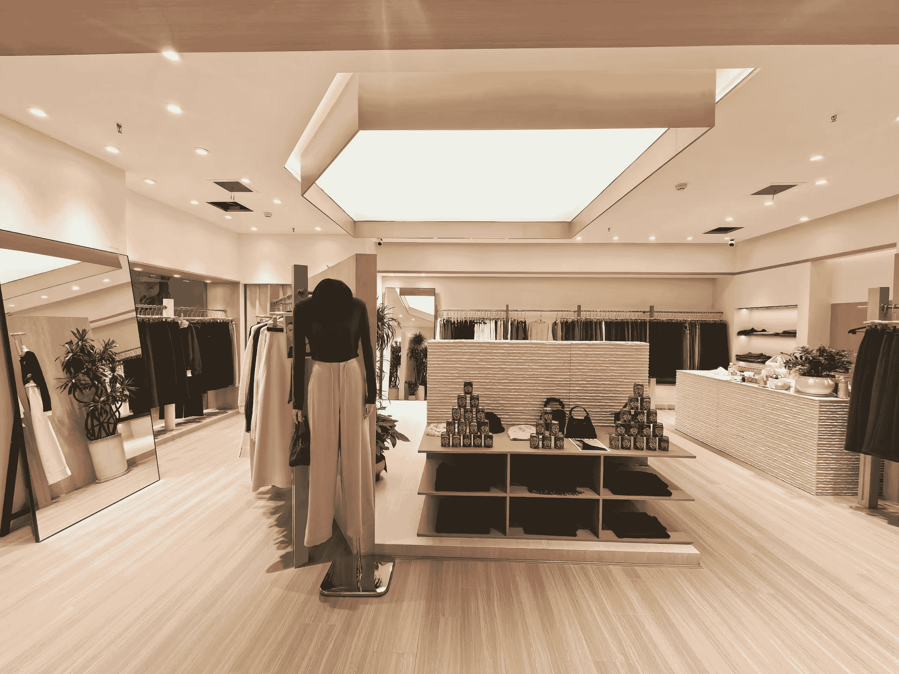
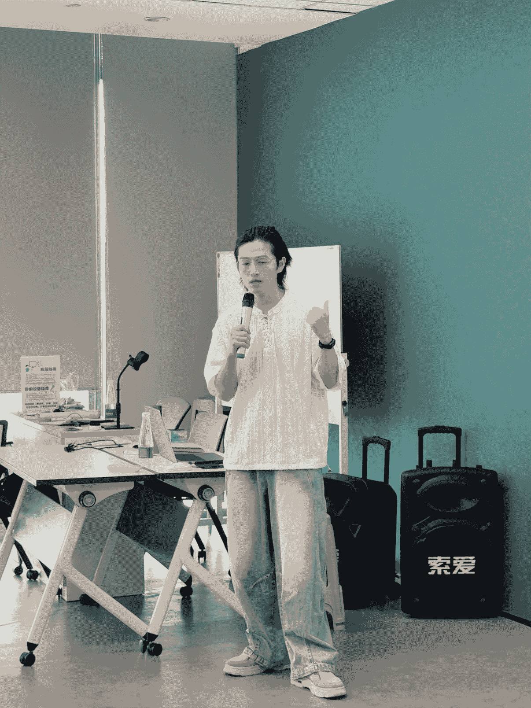
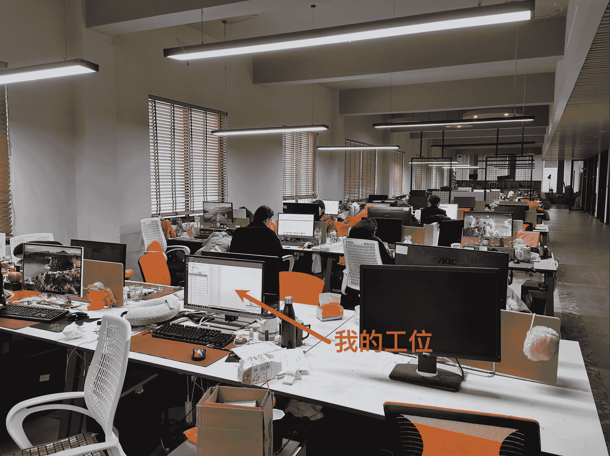
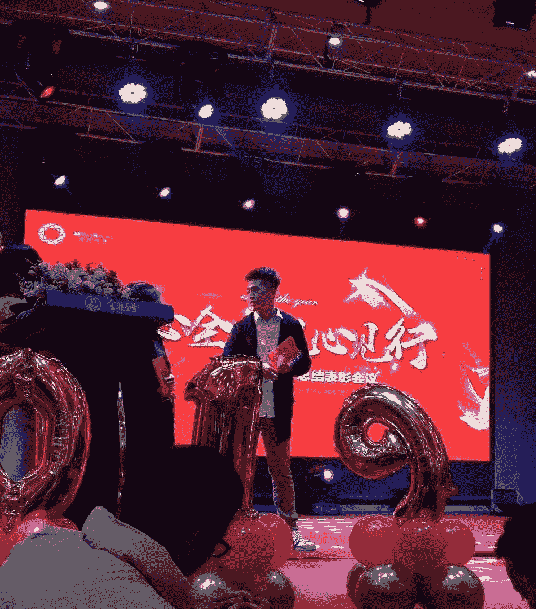
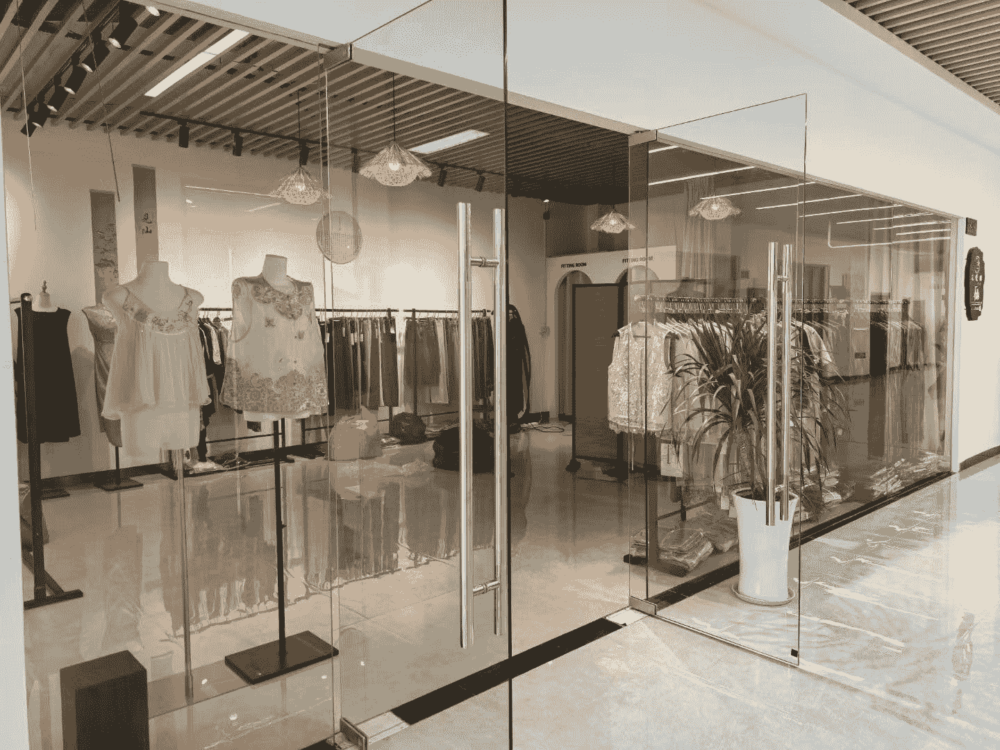

# 10 年连续创业者再入局企业 AI 服务：老板思维下的商业模式、产品矩阵和 ToB 设计逻辑全拆解

260603 副业SC 精华

公众号懒人搜索，懒人专属群独享

懒人微信：lazyhelper1

大家好，我是早早，10 年连续创业者，连续探索跨行业、跨赛道多项目，拿结果的胜率能达到 90%+。

目前主营业务是女裤批发，有自己的 2 家实体批发档口和一家 2400m²工厂，现在也在研究和落地企业 AI 服务这一块的业务。

前段时间，我在生财有术杭州联合办公空间做了一场两个多小时的线下分享，主题是「老板思维下的企业 AI 服务设计逻辑」。这篇文章是我把现场分享的内容重新整理了一下，加了一点没讲完的补充，分享给生财圈友。

我不是来讲 AI 技术的，主要是想基于我做生意这十年踩过的坑、攒下来的几个底层判断和一些思维方式，重点跟大家聊一聊关于“老板思维”和“商业模式”这两块的内容，基于多行业老板身份的视角来聊聊企业 AI 服务该如何去设计，希望能够对一些 OPC 或者还在创业前期迷茫的朋友有所启发。

## 一、先聊聊我看到的三个普遍问题

分享会一开场，我就问了在场所有人一个问题：「现在在做企业 AI 服务、客单价 1 万以下的，举个手。」

现场举手的还是有一些的。我自己接触下来，做这件事的个人创业者，普遍有三个挺扎心的问题：

- 第一，客单价偏低。大多数人做的服务，客单价集中在几百到几千，要凑到 5 万营收，得做好几十到一百多单。一个人一个月做 100 单是什么体验？如果交付还重，要么是接不过来，要么你基本上是没有自己时间了。

- 第二，交付过重。个人创业者很多是纯「OPC」状态——既是负责人，又是技术，既要管销售，还要管售后，啥都自己干。一旦老客户维护和新客户对接撞在一起，就只能眼睁睁看着一头掉。一旦售后维护和销售对接时间冲突了，基本上就是焦头烂额。

- 第三，方向迷茫。有的圈友可能是想做但还不知道能做什么，有的很多朋友做了大半年，自己都说不清楚：「我这个产品到底解决了企业的什么真实需求？」、「垂直行业企业到底有什么真实的业务场景？」

说实话，这三个问题的坑我自己也踩过的，也不是别人独有的。但它们其实不是 AI 的问题，是「生意结构」的问题，是对行业和企业理解的问题。而生意结构的问题，得用老板思维去解决，不是再多学几个 AI 工具就能解决。

所以这次分享，我把整个内容拆成了 4 块：老板思维 → 商业模式 → 广义 ToB → 产品矩阵。产品我特地放在最后，因为在我看来，产品只是商业模式中的一个小环节，可替代性太高了。然后因为线下分享时间有限，所以也没办法全部展开来讲，这几天整理了下那天的逐字稿和 ppt，在文字分享里，我调整了下框架。考虑到生财里也有了一些很不错的帖子分享关于企业 AI 服务的一些内容，那我就基于企业 AI 服务场景下，重点来聊一下关于老板思维和商业模式的思考。

## 二、老板思维：你做的是项目，还是生意？

### 2.1 三种思维层级，先对号入座

先讲一组对比，大家可以自行对照一下：

| 思维层级 | 典型状态 |
|---------|---------|
| 员工思维 | 单点螺丝钉。只对自己负责的那个环节负责，不操心整个体系。 |
| 早期创业者思维 | 习惯榨干自己。所有事都自己干，把执行当成核心，把"忙"当成进度。 |
| 老板思维 | 核心是整合资源——外部资源、内部员工、流程、SOP，都是资源。以终为始做规划，特别在乎投资回报率。 |

这三种思维最关键的一个区别，是「以终为始」。老板会先想清楚一年后这个生意长什么样，再倒推现在该做什么；早期创业者经常是埋头做着做着，才发现自己跑偏了或者陷进去了。

### 2.2 我的转折点：从"全能独狼老板"到"整合者老板"

还是结合自己的案例来说，跟大部分人不同的是，我属于从小开始就只打算做老板的，从没想过自己要去上班打工。2014 年进入大学后我就开始创业了，2015 年做无货源店群和 SEO 快排系统，2016 年做第一批直播的主播，2017 年大三的时候成立了第一家自己的公司做网页和软件开发定制（但是我本科是学工商管理和法学双专业的）。每一次创业我基本都能拿到不错的结果，但我又是一个强兴趣驱动和好奇心驱动的人，非常注重体验与过程，也很享受“打江山”的过程。当我发现我对手里的事情并没有那么感兴趣了，我会选择要么就交给别人，要么就果断结束掉了，自己的感受很重要。

2018 年刚刚大学毕业，进了一家童装公司做运营，虽然名义上是上班，但我从一开始就把它当成自己的事业在做，加上公司确实给了我极大的权限，所以也更像是一次内部创业。

那时候我做了几件很多人可能都不太会做的事：

- 主动申请轮岗——客服、运营、发货、售后、美工、拍摄......每个岗位轮 2-3 周。我图的就是把服装电商公司的全链路看完一遍，建立老板视角。
- 虽然待遇一般，单休，但我基本不休息，除了哪天想睡懒觉休息个半天，其余时间都待在公司琢磨事情，也没有加班工资，但是我自己享受这个过程。
- 做到了二级类目的 TOP3，作为运营当然也是有点飘了。

2021 年我辞职出来回归自己的主线路继续独立创业，做天猫、做跨境虾皮、做直播，结果接连失败。这次的滑铁卢，让我更加清晰了一个认知：

生意的成功绝不是完全依赖个人能力，它还涉及到很多复杂的因素：资源、团队协作、产品、资金，甚至包括出了问题谁来兜底，总之是一个很复杂的构成。

而我那时候，也犯了很多运营出身的人都会犯的错——拿到一点结果，就觉得自己很了不起了。

那我之前为什么习惯单打独斗呢？说实话，根本原因就一句话——我总觉得这个事情只有我自己能做好。

不是没有团队意识，也不是不愿意雇人，是放不开心态。雇了人也总忍不住自己冲上去干，因为总觉得别人做出来的不如我做得好。不知道有些朋友看到这里会不会有一样的感受。

21 年经历了失败之后，我也就开始真正敢于放手了。后面再做项目，会强迫自己结果导向、优化过程，让合伙人和员工自主去跑，我更偏向于做决策和验收。从「我自己做所有事」变成「我搭好系统，让别人自主工作，我来对结果负责」。

这个心态上的转变，其实比技能上的提升要难得多。所以老板思维迭代的关键，不是"有没有老板思维"，而是愿不愿意把"亲自下场"当成阶段性的过程，而不是把它当成自己的本职。也就是我们必须要深刻的认识，并不是说老板就不干活了，反而在前期，老板更应该冲在一线。但是我们必须要清楚，在什么阶段我们干什么事情，什么时候冲锋陷阵，什么时候该放手。如果永远冲在一线，陷入到一次又一次的交付和执行当中，那和打工的螺丝钉又有什么区别？

### 2.3 老板思维自查的三个标准

分享会上我留了三个问题给大家，这里也整理出来给大家参照一下：

1. 你的项目，离开你一个月，能不能正常运行？比如我自己，4 月份基本一个月都不在档口和工厂，业务正常跑。类似能做到这一点，就说明你已经有点老板的样子了。

2. 你上周做的最多的工作，是决策性的，还是执行性的？如果你上周一直在干"具体活"、干执行，那你本质上是在给自己打工，给员工打工，给客户打工，时薪甚至可能比员工还低。

3. 你有没有思考过，半年到一年后，你的项目会是什么形态？有的人项目做了半年、做了一年，手里做的事情就几乎没变过，一直在埋头执行，没有自我迭代、没有拓展团队、没有商业模式的优化，可能到最后都不知道怎么才能把手里的活交出去，甚至可能这个事情一开始就没办法交出去。

这三个问题没有标准答案，关键是你愿不愿意诚实地问自己，知不知道自己到底想要什么？

### 2.4 降本是过程，扩张才是目的

很多做企业 AI 服务或者工具的朋友，喜欢拿"AI 降本增效"做主打卖点。但这里其实有一个常被忽略的视角。

降本只是过程，不是目的。对一家企业来说，几乎没有哪个老板的最终诉求只是"省点钱"——大部分老板，本质上都想做增长、想做扩张。尽管 AI 的介入，确实能够立竿见影的看到成本降低，这是实打实能省下来的钱，但是光靠省钱是发不了财的，光靠省钱也是做不大的。降本最多算是中间手段，扩张才是真正的目的和结果。

这个视角差异，往往会直接决定你做的企业 AI 服务能卖什么价钱：

员工 / OPC 视角的典型卖点是"我帮你降本"、"我帮你提效"、"我帮你省人力"；而老板视角的典型卖点是"我帮你做大"、"我帮你拓客"、"我帮你扩张"。

这里还藏着一个更隐蔽的区别：OPC 普遍想"做得刚刚好"，老板普遍想"做大做强"。这是两种完全不同的世界观。

所以你卖一个面向"降本"的 AI 产品，老板可能愿意付几千块；但你卖一个面向"扩张"的方案，他可能愿意付几十万。同样的技术、同样的实现成本，话术和定位不一样，价格能差几十倍。

## 三、商业模式：找到成熟模式，去不够成熟的市场重做一遍

### 3.1 跳出"项目思维"，看"商业模式"

我接触下来，大部分创业者其实是「项目思维」——看到什么火做什么，看到什么赚钱跟着做什么。跟风做飞书多维表格、跟风做 Agent 部署、跟风做小红书虚拟资料等等。

这些动作只关注产品本身，项目本身，不关注模式，不关注需求，不关注市场。

但问题是：产品只是商业模式的一个环节。一个完整的商业模式，至少包括下面这九个要素——

| 要素 | 说明 |
|------|------|
| 客户与定位 | 服务谁 |
| 产品 | 交付什么 |
| 定价 | 怎么收费 |
| 渠道 | 如何获客 |
| 交付 | 如何履约 |
| 分工 | 谁来做 |
| 核心资源 | 重要资产 |
| 成本结构 | 所有的核心成本 |
| 合作伙伴 | 上下游与同行 |

同一个商业模式下，这九个要素里任意一个换掉，整门生意的结果就完全不一样。有的人经历了很多个项目，可能都还不会发掘客户需求、寻找客户痛点、针对性地设计产品，就是因为只盯着"产品"这一格在改，没在意整个模式。

大家可以结合这些要素，去思考一下你目前做的事情，你的项目和生意，看看哪一个要素是你忽略的，哪一个要素可以去优化和调整，可以思考一下，如果改变其中的个别要素会有什么变化？

### 3.2 选模式的核心公式

找到一个成熟且优质的商业模式，在一个不够成熟的市场里重新做一遍。

大家都普遍认可现在 AI 是一个颠覆时代、颠覆生产力的新东西。而在上一次发生这样的事情，是互联网。

回顾早期的第一代互联网元老人物和产品，几乎无一例外都是走的这条路、这个公式。

从美国黄页到中国黄页，从 eBay 到淘宝，从 ICQ 到 QQ，哪怕就是现在的抖音到 TIKTOK，拼多多到 TEMU，几乎都是同一套打法，这些例子太多了，大家应该也很熟悉。

而这个理论有一个非常经典的投资法则，是出自软银集团的孙正义，叫做【时光机理论】，原本的意思是指利用不同国家或行业间发展阶段的非平衡性，将发达国家或成熟市场已经验证成功的商业模式与技术，在发展中国家或新兴市场"降维打击"，通过时间差抢占先机获取收益。

我们不做模式的发明者，我们只做模式的搬运工，学习、借鉴，然后进行迁移、改造和落地。这一句话是我创业这些年，一直遵循的，真的是屡试不爽。

### 3.3 案例说明

还是拿实际的案例来进行一个对照，说一个我自己 2023 年的真实案例，帮你理解这个公式怎么落地。

| 真丝女装供应链案例 | 拆解 |
|------------------|------|
| 市场观察 | 2023 年我进湖州做真丝女装供应链。当时我去湖州本地的真丝市场考察，当时的市场还处于发展早期，刚刚将本地很多散户集中起来在园区内组织发展批发和供货市场。而且大部分商户的款式普遍无特色、基础，缺乏开发能力。 |
| 成熟模式 | 但在杭州、深圳等成熟批发市场，原创国风和真丝的供应链已经非常成熟了，款式设计也很时尚高级。 |
| 迁移动作 | 那么我再去做就很简单了——把杭州深圳那一套成熟的原创国风真丝供应链模式，迁移到湖州去做本地高客单批发。结合上自己积累的一些加工厂和上下游资源，很容易就切入了。 |
| 结果 | 结果是，我们积累的客户相对基本都比较优质，而且大家对我们的款式、风格、品质都很欣赏，基本上也是本地比较有代表性的商户了。 |

说白了，那段时间整个湖州真丝市场，做这种模式的就我们这一家。事情本身不复杂，但你得能同时看到「成熟模式」+「不成熟市场」+「我手上恰好有迁移资源」这三件事，需要一点跨行业、跨市场的视野，也需要你有大量的积累，要大量的接触优秀案例与优秀的商业模式。

左边 2 张图是我第一家店，当时还只有 20 平左右。右边这张是新开的第二家店，将近 50 平。

### 3.4 模式选择与设计的三个自查问题

1. 你参考的对标模式，是不是足够成熟、足够优质？
2. 你想去的目标市场，是不是确实还不够成熟？
3. 你有没有把这个模式落地、改造的资源？

第三点特别重要。很多人是有想法，但没资源。资源不够你就去积累资源、整合资源、去找合适的合伙人，不要硬上。要有自知之明。

### 3.5 用自己的优点打别人的弱点

额外聊一点我自己的一些常用打法，还是举例来说。我以前在学校是练长跑的，跑步这件事不知道大家了不了解，正面冲第一名的要顶风、要拼体力的，不一定划算。我那时候经常用「跟跑」战术——跟在前几名后面，省体力、不顶风，关键时刻再超越。但如果我确定在本组的对手内，都没有能干过我的，那么起跑的时候我就会选择冲到第一个，然后直接甩开后面的人，直到套圈，形成碾压的距离和优势，这也能给后面的人极大的心理压力。（当然，有些划水的我们就不讨论了）

读书的时候也是。我文化成绩还行不过还不至于排前几，但是我也不跟他们直接比。我跟成绩好的人比体育，跟体育好的人比成绩，跟文化+体育都好的人比兴趣爱好！反正不跟人正面较劲。听起来像偷懒，其实是一种很现实的策略：不去跟别人的长板硬碰，而是用自己的长板去打别人的短板。

放到做生意上是一样的。比如我现在做女裤批发，很多人也很好奇和纳闷，现在生意这么难做，为什么还要去碰实体？其实也就是上面那个道理，如果我直接去跟那些做了几十年女裤的老板比专业，肯定干不过人家。但我把商业模式设计、线上获客、多渠道运营，甚至 AI 技术等等这些我相对擅长的东西放进来，说得直接点就是降维打击了，他们反而会有点仰望我。我不需要在女裤上比他们专业，我只需要叠加一些我有但他们没有的优势就行了。

所以你现在做企业 AI 服务，也建议先想想自己的"长板"在哪——是某个行业的资源？某种产品设计能力？还是某个圈层的人脉？找到之后，再去找一个对方在这个长板上比较弱的赛道，重新设计你的产品和模式。这比正面去卷，便宜得多。

## 四、你真的理解什么是 ToB 吗？

### 4.1 几个常见 AI 项目的"暗坑"

针对于 ToB 这件事，我观察到大量创业者其实是有认知误区的。先说几个我看到的、比较常见、但其实暗坑很大的方向：

| 常见方向 | 核心暗坑 |
|---------|---------|

20 / 34 

飞书多维表格之类的提效项目

典型的重交付、低客单、低复购，本质就是一次性生意，做完一单跟客户基本就再无瓜葛。

AI Agent 安装调试

客单价做不高，也是一次性生意。最致命的是，随着大厂下场，门槛只会越来越低。

面向员工的 AI 技能培训

员工自己花钱提升打工效率本就是一件很反人性的事情。确实有一些愿意主动提升个人能力的，基本上预算也是有限的。就算公司报销，本质也只是「员工去消费、公司付账」的 To C 形式，面向的是个人，并没有达到 To B 的范围。

当然，并不是说这些不能做，每个人也都有自己的生态位，每个人都有自己的喜好与阶段。我这里举例主要是为了进行后面的对比和分析。

4.2 真正的 To B，是 To Business，不是 To Boss

这是我特别想跟各位圈友强调的一个点。

| 类型 | 判断标准 |
| --- | --- |
| To Boss | 你在卖一个东西给老板个人，老板本人用得爽不爽，决定一切。但本质是面向个人的，而且在很多场景下，老板是作为一个 C 端消费者在消费。 |
| To Business | 你在为整个组织提供能力，让组织能力更协作、更可复制、更可沉淀。 |

企业不是只有老板，也不是只有员工，企业是有多重元素构成的复杂组织。很多人可能没有很深刻的认识。

企业 = 老板 + 员工 + 流程 + 资产 + ......

企业是由这些核心要素组成的有机体。真正的企业 AI 服务，要面向"组织"，提升的是"组织能力"，而不是仅仅取悦老板个人或者帮员工偷懒。

这个判断，决定了你能做多大、做多久。

4.3 一个迁移成功的案例：企业 AI 内训陪跑

对于很多规上企业，自建内容团队、自建营销团队是必然的，比如做创始人 IP，很多企业是一定会自建团队来做这个事情的。因此也普遍有一种很成熟的模式叫「老板 + 助理」陪跑——老板带 1-2 个助理一起来培训，几万到十几万的客单价：

- 老板主要是提升认知，了解为什么要做这个事、需要什么样的人做这个事、工资开多少、工作如何安排、结果如何检验。
- 助理主要是提升技能，回去后如何落地、剪辑如何进行、编导如何进行、如何建立 SOP 等等。

这既满足了企业内部的人才培训需求，又满足了老板的认知提升需求，又能够让企业回去落地，还是一个高利润、有积累的生意。

那么我们就可以把它迁移到 AI 领域，做企业 AI 内训陪跑：

| 交付项 | 内容 |
| --- | --- |
| 客单价 | 6-10 万一单 |
| 周期 | 7-14 天 |
| 对老板 | 做认知培训——AI 的能力边界、应用场景、招什么样的人、怎么定薪资、怎么定考核标准、可以做什么事情 |
| 对助理 | 做技能培训——具体的 AI 工具怎么用、怎么落到岗位、怎么积累 SOP |
| 后续 | 做陪跑跟踪，让能力真的留在企业里 |

这件事的好处是交付相对轻、客单价高、有复利。而且能做到客户筛选，帮助很多本就有能力做好的企业做好，积累大量的成功案例。

它不是给老板个人爽一下，也不是给员工偷个懒，它是真的在帮一个组织把"AI 能力"长进去。

当然，很多人看到这里也会觉得，这些案例和模式他都知道。但是"知道"不代表你"理解"，能否理解背后的底层逻辑、设计方法、核心需求，能否理解 why，这也决定了你自己能不能灵活的运用到自己以后这么漫长的创业路上。

五、产品矩阵：引流品、利润品、明星品

5.1 别再做"单品创业者"了

如果想脱离"个人创业者"的枷锁，提升到更高层级，或者想放大自己的生意，那么只靠一个产品是绝对不行的。

原因很简单：单一产品做起来太吃力，过度依赖单个产品，抗风险能力极差。

一旦客户需求稍微变一下、平台规则一调整、对手出新品，基本上就会陷入很被动很难受的阶段。

正确的姿势是做产品矩阵——引流品、利润品、明星品，三件套。

5.2 引流品案例：服装财务 AI 助理

继续拿案例来跟大家解释。以我自己的行业为例，服装档口都有一个很小但很折磨人的痛点——对账。大部分档口使用的 ERP 是一套系统，收款是另一套银行系统，每天卖了多少、收了多少，必须有专门的财务人工核对。一个财务每个月成本大概在 8000-12000 元，工作内容相对而言是很枯燥的。

但是这件事用 AI 做太简单了，流程无非就是 2 个表格导出+清洗+核对+记录+汇报，但是完全可以做得很智能，也能节省很多时间。这样的一个场景，其实可以做成一个服装财务 AI 助理，而定价，我认为基本上就卡在了 0-99 元，差不多了。

问题来了——做这件事我亏吗？从成本上来讲，几乎是不亏的。现在开发成本这么低，无非就是一些 token 费用，这类工具还几乎不用维护，加上还有 cloudflare 之类的大善人，所以也没什么维护成本。但我们图的不是这 99 元，不是图这个产品就要挣很多钱。我们图的是用一个低门槛产品，让大量的服装老板愿意"试一下"，让他们感受到 AI 在业务场景里的能力，建立基本的信任。

很多创业者对于这个产品的定价，可能就会去对标人工成本，这样就跑偏了。一方面说明对具体垂直行业场景不够熟悉，一方面说明在产品矩阵设计这块还没有经验。

服装领域常用软件的订阅价格，基本就在几百元到几千元之间，那么这个价格段就是服装老板本对于软件的预期价格，如果超出了，那么在转化上会有极大的影响。而且，财务又是一个极其敏感的业务范围，老板天然就会很警惕，毕竟是涉及进到口袋里的钱的东西。

所以，在这种场景下，如果真去推这样一个产品，定价完全可以在 0-99 元，纯作为一个引流品。对于老板而言，定价低能极大降低决策门槛。一旦试用，我们就接触到了这个老板，后面就有机会做高客单的转化。

引流品的本质：超出客户预期的高质量，加上出乎意料的低价格。不是用来赚钱的，是用来把客户拉进来的。

5.3 产品矩阵的定位

| 产品层级 | 定位 |
| --- | --- |
| 引流品 | 不是用来赚钱的，是用来把客户拉进来，建立基本的信任。 |
| 利润品 | 高客单的培训、陪跑、AI 内训这类服务，是真正赚钱的部分。 |
| 明星品 | 比如面向企业的「AI 管理咨询」，定价几十万、上百万级。这种产品不一定非要卖出去，但一定要放在你的产品列表里——它的作用是告诉客户，你有能力做这件事，彰显自己的实力。 |

大家如果看到了文章这里，而且又是在做企业 AI 服务的，现在就可以去准备一个产品海报，定价往高了走，大单定高价，马上就发朋友圈，成不成交无所谓，关键是得有，让别人看见，把想象空间留给别人。

六、好产品的三个标准：高毛利、高复购、低退货

这三条是我基于运营视角，一直秉承的一个原则，有的人喜欢低价跑量、薄利多销，但是我还是更偏向于我这套原则。跟 AI 没关系，但放到 AI 服务上同样成立。

1. 高毛利——利润够高，才能支撑你的开支、消耗、测试、服务、产品优化等等。尽量不碰重研发、重投入、难回本的项目。个人创业者的试错成本是有限的，没本钱跟大厂玩消耗战。

2. 高复购——高频复购意味着客户终身价值，意味着你能不断在同一批客户身上加深信任。一次性生意天花板太低。

3. 低退货——这里说的退货是广义的理解，包括各种售后、维护、扯皮。重维护重售后的产品最消耗精力，会拖垮你的整盘生意。

这三条缺任何一条，都会影响生意的稳定性。关于选品还有涉及一些比如市场分析、竞品分析、定位等等的，我之前写过一篇帖子是拆解我自己做过的一次直播项目经历，有兴趣的朋友可以去看一下：从 0 到 1：抖音 DIY 手串类目 TOP 直播间的全面复盘

七、案例与需求分享

分享会现场，应许老师的建议，我也额外挤时间拆解了几个我接触下来的真实行业需求，给到大家做方向参考。这里也整理了一下放上来，希望对大家在自己的项目中有点用。

1. 保险：以港险为例，港险的销售有点类似于超级个体，独立性是比较强的。在他们的业务场景下，有这样的需求：

各家保险公司都会不定期的经常推出一些新的产品。那他们要及时的去官网等地方关注到这些产品的发布，并且去阅读和熟悉新产品。然后每个人有每个人的偏好，他们会按照自己的偏好去对不同公司的不同产品进行对比，进而挑选出自己想主推的，或者挑选出适合某个客户的。然后每个人又有每个人的销售风格，因此存在一个个人个性化的问题。再加上每一个客户都有客户不同的情况和不同的需求，所以他们在销售上既会遵循自己的销售策略，也要考虑到不同客户的不同需求。而这中间就会涉及到大量的重复的操作：比如保险条款阅读与分析、数据对比、PPT 制作、方案制作等等。

那在他们的场景下，概括起来本质就是：数据监控与采集、数据清洗与分析、销售策略个性化、客户方案个性化等。付费预期几千到几万不等，而且他们普通会有超级个体团队，会有组团需求。

2. 创始人 IP：以很多规上企业为例，尤其是涉及到多部门、渠道商之类的，他们会有企业级的内容营销需求：

传统的线上内容营销团队，需要编导、拍摄、剪辑、助理，而且服务对象有限。但是对于一定规模的企业来说，他们会需要矩阵化的做线上 IP 运营或者线上账号运营，除了老板本人出镜，还会涉及到高管、渠道商等等。在这个过程当中，会有大量的重复操作：个人采访、选题收集、企业事件整理、文案撰写、内容个性化设计、数据监控等等。

在他们的场景下，要么是传统的堆人策略，要么就是靠外部机构。而且现在市面上大部分的这种营销系统，都偏向于个人或者小团队使用。他们的需求其实是需要完整的企业级管理协作流程、RBAC 权限控制、多账号矩阵协作等等。付费预期基本都是几万到几十万不等，可以涉及到人员培训、AI 落地、AI 工具开发等等。

3. AI 硬件落地：现在有这样的销售 AI 工牌，大小跟传统工牌差不多，但是带了一块小屏幕，并且自带录音功能，后端能够对接大模型 API。有点类似于录音卡的销售垂直场景硬件。可以实现比如销售对话录音记录和分析、客户心理分析、实时销售策略推送、销售知识库对接等等，非常智能。类似的比如还有 AI 接待台、AI 前台等等垂直场景。对硬件有兴趣的，可以发散思考下。

这些都是我跟不同实体行业老板真实聊出来的有付费意愿的需求，是我接触到的真实内容，不是凭空想的。每一个方向都可以用前面的方法论重新拆一遍，找到自己的切入点。当然，也要想清楚自己想要什么和喜欢什么。

八、留 5 个自检问题

这次分享会偏底层思维一点，当然也结合了很多案例和分析方法，可能没办法第一时间运用上，但是我最后梳理的 5 个问题，应该能够立马可以拿去分析用。把这 5 个问题认真问自己一遍，无论是重新去审视自己现在手里的项目，还是未来开始一个新的生意，都可以用这些问题来思考一下。

1. 你接触过哪些行业、哪些资源？做企业 AI 服务，最简单的开局，就是从你已经混过的行业里切。不要只跟 AI 创业者打交道，一定要走出去，通过各种各样的渠道接触各行各业真实企业的老板。然后再应用选模式的那一句核心公式，以及对应的三个审查问题，来思考进军哪个行业，做什么模式。

2. 你想服务企业的什么"要素"？面向组织而不是面向个人，To B 是服务企业的组织能力。组织能力的核心有四个词——流程、协作、可复制、可沉淀。你的产品在帮企业提升什么？

3. 你有没有规划过你的产品矩阵？有意识的去规划自己的产品矩阵，按照三原则去设计自己的产品。哪怕你今天还没产品，也可以先设计一张「xxx 万 AI 管理咨询」的海报，发个朋友圈试试水。身份是自己给的。

4. 你的客单价，有升级路径吗？比如常见的路径是：工具 → 订阅 → 平台 → 咨询。没有升级路径的产品，天花板很低。

5. 你的生意，离开你能不能跑？回到第一段讲的老板思维三个自查标准。能不能跑，决定了你做的是项目，还是生意。

九、最后想说几句

分享会快结束的时候，有圈友问我：「我没有行业资源、没有人脉，普通人怎么切进企业 AI 服务？」

我当时的回答是：首先不要给自己定义为"普通人"。能有意识进入这个赛道，能大量学习和实践 AI 的应用，本身就已经超过 99% 的人了。

具体怎么开始？我的建议非常朴素：

第一步——根据自己的兴趣爱好选一个赛道，有精力的话也可以多选几个；

第二步——走出去，通过线上线下各种渠道，无论是展会、沙龙、交流群等等，一定要去大量地接触这个行业的真实老板；

第三步——在跟他们接触的过程中，积累对行业的认知和了解，积累他们的痛点和需求。

说到底，做企业 AI 服务的本质，也是"挖掘需求 + 满足需求"，无非是放到企业以及垂直行业的场景里了。

而想要挣 100 万，其实是个算账问题——1 万客单价 × 100 单 = 100 万。难的不是 100 万，难的是你能不能把客单价做到 1 万？能不能把"100 单"对应的客户流量和池子建起来？能不能尽可能保证转化率？有没有能力交付？

最后，分享会上我也给大家总结了 3 句话：

第一，想清楚自己的思维方式。老板思维是底层驱动力，以终为始的去思考和规划。

第二，模式设计比选产品重要。产品只是模式中的一个要素。

第三，理解 To B 定位。To Boss 还是 To Business，决定了你的天花板。

跟生财的很多圈友比，我自己肯定是算不上 AI 大佬的，不过现在的我算是站在传统服装生意里，但又具备 AI 思维的人。处于垂直行业与 AI 技术的交界点上。这次分享的所有判断，全部来自我做生意 10 年的真实经历，不一定完全对，但一定都是踩过坑、付过学费的。

如果对你有一点启发，我就觉得这次分享、这篇文章值了。

————分割线————

看完这篇 SOP，你觉得你懂了。但 90% 的人一到实操就会卡在第一步。

工具和教程只是最低级的壁垒，真正的壁垒是"立刻动手"和"圈层信息差"。

如果你想看全网最新的变现玩法，并且和一群执行力极强的极客一起下场拿结果，欢迎围观我的核心私域：【懒人专属群】。

我们不聊虚的，只做商业闭环的拆解与 AI 效率的压榨。系统内已沉淀 1000+ 跑通的套利实战局。

👉👉 查阅圈子完整数字资产与上车门槛： 

https://lazyso.com/insider/ 

认同价值、准备好下场干活的，扫码加我微信（lazyhelper1）

备注：【实操上车】，不闲聊

