## 入魔大法——洞悉“规”与“则”！

260604 第三只眼观

整理：公众号懒人搜索，懒人专属群精选

懒人微信：lazyhelper1

懒人备注：其实AI建议不要分享这篇文章，不是因为太深，而是这套理论是博主自创的，要是相信了这套世界观，会破坏一个人正常建立信任关系的能力。

小懒纠结了一下，还是交给大家自己分辨吧（虽然我懒得看），相信大家有自己理解世界的一套方式，不会轻易被带偏。

不懂规则表现为：

- 其一是感情用事和利益盲视；
- 其二是生活和生存傻傻分不清。

所以会有生存规则的说法，但没有生活规则一说，那得多难受啊……为啥？

因为生存就是一场“磨盘”啊，所以叫入魔大法，是互相消磨的游戏规则，暗线玩的是此消彼长。

而生活是一场“解套”啊，既不磨自己，也不磨别人，生活就会很自在了。所以生存能力很强的人，可未必生活幸福，这完全两码事……

研究研究入魔，把事分清，也能破除情绪困扰！

本篇用中文模型来聊规则！为啥？

下图一堆花里胡哨的关键词，组合在一起就叫规则，但这样就很散，对吧？

单个拿出来都明白是没用的，因为没有体系性，即通常说的碎片化思维。

而中文模型自成体系=结构+关系！

结构——是分成几个子模块，是静态（分）。

关系——是模块间相互作用，是动态（辩）。

合一起就是——分辨！

分辨并非知识，而是属于认知中的那1%。提升认知就是用1%去整合大家都知道的99%，而不是使劲抠99%，这玩意儿满地都是，但不会分辨整合，累死也是书呆子。

当上面两模型拆解：刀、见、贝、十、入、八。

不要把这些当成平时学的字，要当成运力模块，就跟写PPT呀、画思维导图啥的……每一子模块就对应着不同规则关键词，由此就能把规则成体系去看了，知道这个是干这个，那个是干那个，集合在一起产生整体作用。

## 一、先整体说一下规则是什么

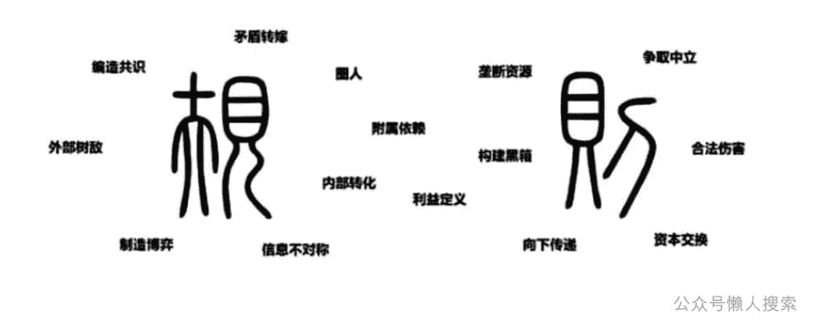

在星球回答过，从神农氏再到西周，思想认知都是围绕治水，从秦始皇开始是围绕治人，虽然水和人的对象不同，但底层都是一脉相承的。

水和人：

- 其一，要把人当水看。
- 其二，规则的本质是治力，治水力和治人力。

规和则：

规，就好比挖河床、建堤坝，把水或人圈进来。

则，就好比挖沟渠、引导水势流速等，让规能够稳定，规和则是相辅相成的！所以呢？

懂规则就要懂水性和水力。一个不成熟的人，要么是在河道里横冲直撞的洪水（感情用事，利益盲视，触碰堤坝），要么是一潭静止的死水（不懂水流规律，没有活力）。

而一个成熟的人，是知道如何在既定河床和沟渠中，顺势而行、借力打力。

那么对于人力来说：

### 1、规是圈人。

小时候圆规都用过呀，规不是圆啊，而是画圆的工具，画的过程就是圈。

当然圆规只是引申义啊，本义呢？就是能把很多力给圈在一起，再通过一定的方法，最后形成一个稳定形态就叫做规。例如：

规律、规划、规劝啥的，规X就是把X给搞稳定喽！同理：

把人力都圈在一起，很稳定的抱团取暖，就是俗话说的“圈子”了呀。而为了让圈子稳定，如同铁板一块，那就需要一些具体方法，对吧？例如编造共识、制造博弈、内部转化等等方法，这些方法往“规”字模型上一套即可，关系和结构自动归位，以后只需要记着这模型即可，现实应用时候关键词自动就跳出来了。

### 2、则是实现。

圈子抱团取暖要实现啥？

肯定是为了利益啊，而实现利益就必须通过“则”才行，利和则都有个“刀”旁嘛。例如利益定义、合法伤害、向下传递、更新换代啥的。

这需要通过“贝”和“刀”来实现，这些后面再细聊……

### 3、唯心所现。

这块是最内核的地方，不论讲什么最终都要回到“心法”上才行，这才能永远不忘且随心应变！

这里的心不同于西方唯心主义的心，此心是指作用关系，它并不在每个人的主观意识上，而在于人们的交互作用之中。

上图里的每一个关键词操作，可不是你主观上想咋办就咋办，你是最高长老也不行，不以你个人意志为转移，而是基于人与人交互的基本作用关系才行。

而所有的基本规律，都是人心呈现和编织出来的，所以“心”才是认知的最本源。认知是分层的如下：

- 内层领悟心法；
- 中层盘各种力，水力、人力、气力、天地之力啥的；
- 外层是表法，就是应用于各类社会现象。

慢慢就懂了，下面进入具体模块细聊……

## 二、规则的具体模型

上面说了规和则是相符形成，二者符契是因为下图红框。

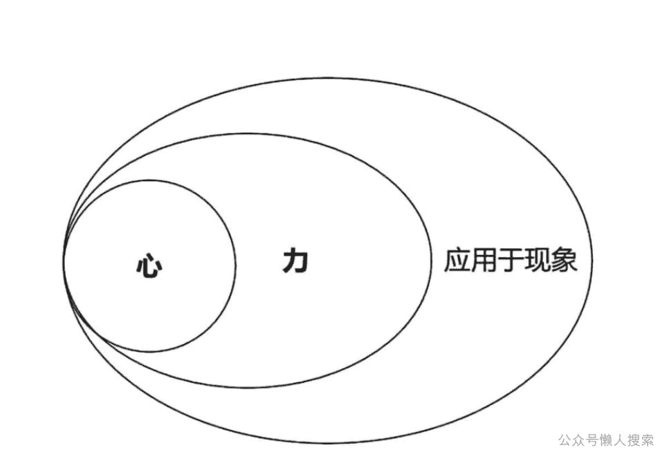

左侧是——见。右侧是——贝。

这俩造型一看就是一家人，但这俩字你肯定不认识……要想进入中文模型认知，就要把之前的所学统统丢掉，重新识字。这俩字都有一个核心模型——目。规则通过“目”而来，最后又要回到“目”中去！

### 1、目。

首先，目绝对不是眼睛啊……

下个定义：

目就是将诸多对向力收纳在一起，产生出的稳定形态。放在规则上，即俗话说的——眼界！它不是眼睛，而是眼睛收纳的界。啥意思呢？例如：

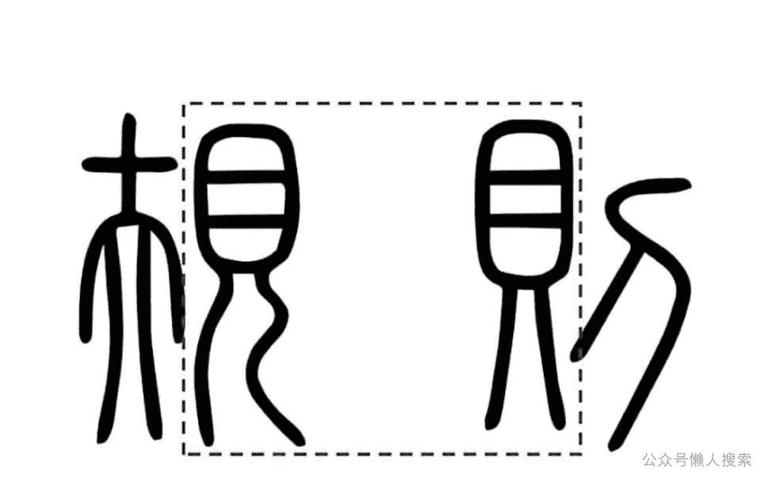
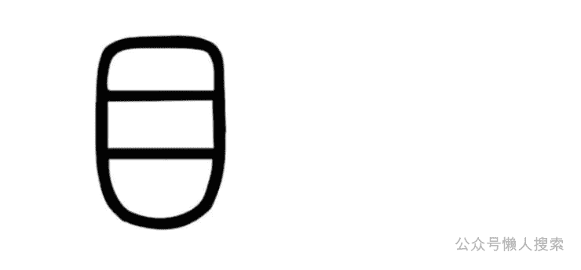

说你有什么“目的”呀？

不是说你眼睛往哪看，而是你要把什么给收纳且稳定。比如说你的目的是结婚，那就是把一个女子收纳进来，形成稳定。

能往视觉上引申，是因为眼睛是心的窗口，眼神和心理目的往往如影随形。例如：

说你看书时候要“一目十行”才行，那是你眼睛一下子看十行吗？蜜蜂复眼也做不到啊。而是你把这十行字收纳在一起，串起来形成稳定逻辑，这种看书叫观其大略，一本书一会儿就看完了。

例如：

信息会有目录、科目啥的，难道是书本的纸片长眼睛了？而是通过分类把诸多事物收纳在一起了，就形成了“目”的稳定形态。这个目字要是细说的话，从甲骨文、籀文、篆文演化来说，其中含义可老深了，模型越简单，事越大嘛，且得1万字打底吧……

这篇先简单说一下它是咋来的，有愿意深入研究的小伙伴，回头我再更深层解构它。

#### 1）第一步：

一切事物的存在都基于力，然后你把诸多力凑成一对对的，就呈现出下面这样子。

#### 2）第二步：

当你把一个个对向力对接之后，就呈现出下面的形态。

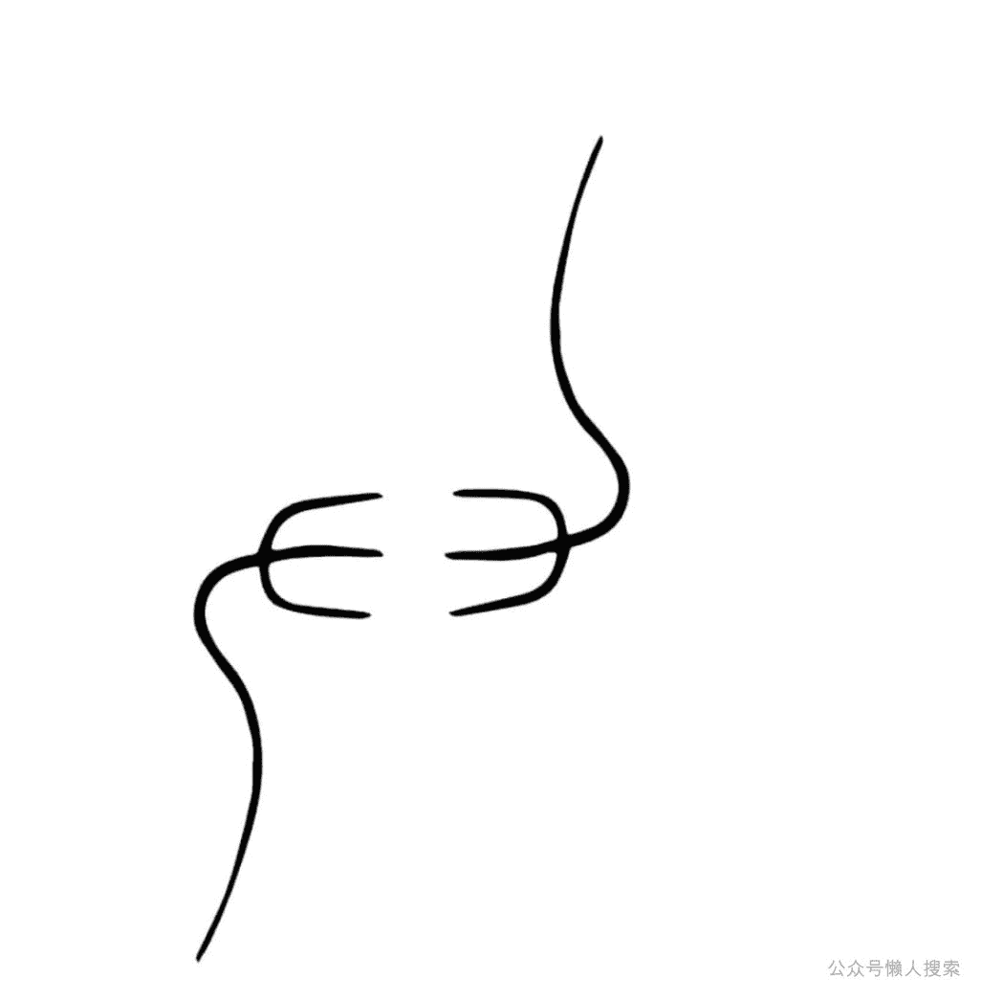

这个造型表达的是一种玄，大白话就是许多力（如人力）给拧到一块了。不过说“玄”可能有些人会晕，那就看图像即可，读图远远大于读字，敲字都是最Low的沟通方法了……

#### 3）第三步：

随着玄力拧紧，里面就产生力的聚合！聚合咋表现？

就是画个圆来表达，用老子话说就是“抟”起来了。简洁一点画出来即下面这样子：

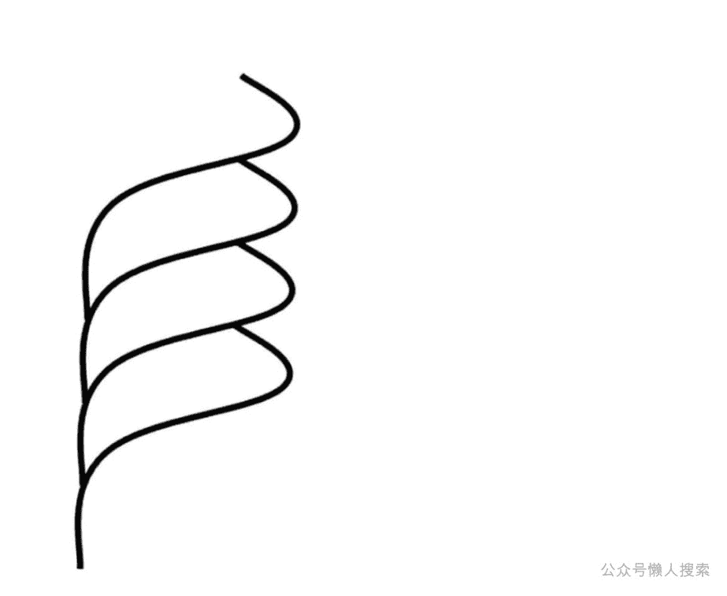

这个是金文啊，看着像画个眼睛似的，但绝对不是眼睛啊……到了小篆时候，里面的小圆圈就变成两横，代表着内有天地。所以当你“目”啥出玩意儿，就是目出一个“天地互动”场景了。例如你进入职场或者社会，你“目”它们就是把它们内部的互动场景尽收眼底。

强迫症犯了，后台有人说胡编解读，可逗了……例证：

把上面的造型竖过来，就是——耳！

笨寻思啊，难道耳朵是眼睛竖过来？

所以目绝对不是眼睛啊，耳目可通心，这都是基于心的作用，耳目并非是指视听器官。

所以这俩字的造型差不多，都是力的聚合作用。放到佛道修炼上，一个叫内视，一个叫观音。有点磨叽了呀，这么细抠得2万字，下面简洁点啊……

总之呢，上面讲“目”是为了带感！

啥感觉呢？

不要把人当做人，而是要当做力，即所谓人力，要穿透进去看力。这不是骂街啊，当人的时候就会掺杂诸多个人喜好和情绪，就会感情用事、不成熟。通俗说呢？

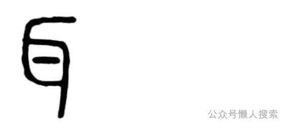

在职场和社会都属于生存，这里面压根就没有“朋友”一说，都是力的互相作用罢了。所以真的好朋友别一起合作干事，合作了就逐渐不是朋友了，那都是电影的理想桥段，但凡把你当力去用，那就不是真朋友了！

然后呢？

目集人力只是开始，通俗说就是“格局”的意思，下一步就是见。格局可不是撒钱啊、能办好事、有牌面啥的啊，这不是装出来的，而是跟眼界有关。人最重要的就是宏观认知能力，这才能产生战略思维。

### 2、见。

叫做jian或xian都可以啊。

目下面的那个“π”是啥？含义是——化！

化就是力量进进出出的，时刻在变化着、转化、消化着。带感点说呢？

这造型就跟一条绳波动似的，只有把力（如人力）都给“甩”起来才能利用。

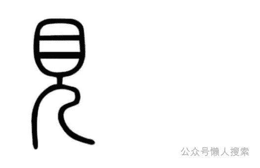

或者如同水流一样，要让水循环流动才行，死水一潭是没法利用的。目上π下，目是基于π：

- 其一，眼界是基于看清楚水力循环，如同看清楚绳子咋甩动的。
- 其二，眼界变现成规则，就要引导和掌控这场水力循环，如同抓紧绳子。

啥叫引导转化？

用现代话来说就叫——资本！

资本是个动作，可不是资料呀，它并不是个实物。例如：

钱不是资本，钱去做投资转化才叫资本。人不是资本，利用人去办事才能叫资本。说你有什么资本啊？并不是指你多少东西，而是看你转化能力！

这个“n”就是要具有动态思维能力，入规则、破规则、建规则都是靠转化能力。先看清圈子里原来咋转化，这时候就叫做jian；当你去操控转化，此时就叫做xian。唯心所现（xian）嘛，这与人的心智有关，心智上如何转，玩资本就会如何随心转。

还不带感的话呢？

上面不是讲科目、目录的例子嘛？见不是看具体内容，而是先吃掉目录！把原来的目录搞清楚，这就是jian。你再重组一个目录，这就是xian。

这不属于知识（99%），这属于认知（1%）。俗话说的业力能力、综合能力、整合能力、重组能力啥的……那怎么整合呢？

### 3、夫！

这个字一般都当成丈夫和语气助词用了……

先下定义：

夫就是把见（某个圈子内的水力机制）玩明白了，并且可以完全掌控了！例如：

夫，天地者……

就是把天地间的运行看清楚和掌握了，者就是其中的隐藏玄妙处。所以古人敢敲字时候说“夫XX”，那就是很有自信的表现，就好比俗话“手拿把掐”的意思。

咋手拿把掐呢？

上面是十，中间是入，下面是八。作用关系：上面模块基于下面来实现。

#### 1）入。

可不是钻的意思啊。

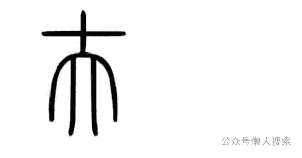

先下定义：入是基于“大而成形”才行，所以“入”约等于“大之内”的意思。例如：

说学习中文达到“入门”了，意思就是中文像个大储藏室一样，把你包住了，反过来就是入，没有包就没有入！

中文处处都是辩证法啊，这个思维非常关键啊。此处入有俩含义：其一，只有在“大之内”能圈的力才多，所以人必须要具有宏观视角，这才是最高级的认知能力。

也就是要想搞懂和掌控规则，圈子必须得够大，这就是“广交”的意义所在。

一般人交往都看重短平快的利益，俗话说的无利不起早，这样的目（眼界）就狭窄了。

广交的目的并不是在当下，不是说结交人力就必须得用上，而是基于大圈子才能够产生宏观视角，就好比把大脉络搞清楚，才能产生大用。

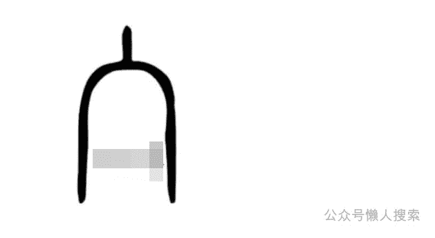

而且只有看的面大了，诸多规则的暗线才能透明，因为规则还有信息不对称和黑箱呢。

比如炒股票只看自己这个小圈，到网上刷信息看众生圈，到研究企业看微观运行圈，再到看组织政策的大圈，再到看历史更大的圈，再到看人性的魔力转圈，那面的诸多脉络就知道咋回事了呀。

### 其二：

搞圈子必须要越来越大，小圈子不变是稳不住的。生存圈和生活圈完全是两码事：

生存圈必须要逐步扩大，就好比企业必须要扩张一样，水流如果没有张力就是死水。生活圈是逐步缩小的，苟着啊，断舍离就很幸福，和生存就完全相反了。

人最怕的就是这俩事分不清楚，情绪和脑子就混乱一团！比如同事和朋友、伙伴和玩伴，这都是两码事……再比如老同学把你当力使，而你看他是你的青春，这么简单的事很多人就分不来，把自己搞得情绪上头。

#### 2）八。

不是8的意思啊，八是象数的数，8是数字的数……

先下定义：

八是外部结构上的对称平衡！这玩意应该到《一二三四五六七八九十》时候再讲，象数是事物发展的基本规律，这是“入局”和踩“阶梯”时候用的。

举例来说吧：

一个圈子能立住，可不是封闭的呀！把人力圈起来后水力循环，这股力量要在内外立得住才行。也就是说，当你圈出了内部人力转化，还需要有个对外的力打配套。

这就是“分”啊，只有分内外才能稳立，内外打配套就是“辩”了呀。咋分辨呢？此处“八”有四种含义：中立、博弈、树敌、转嫁。

- 其一，中立和博弈是一对。不是你主动去博弈，那是神经病……
- 而是要制造博弈，就好比制造棋子间的互杀。哪有人主动当棋子的，对不？
- 比如俄乌有事后，一群傻坏的专家催促大组织赶紧下场，哪有赶着入局当棋子的？谁先下场谁就输了。比如炒股票散户总亏，就是因为总想博弈一下，主动当充电棋子了。

中立并不是独立出来，关起小门啥也不管，这也不可能做到。

中立是一直保持——选择的机会！不是不选择，而是俗话说的事缓则圆，或者叫会抻着来。

例如大组织外交政策就是中立，只有一直如此，最后选择的机会才更大、更有利。所以股票做长线赢面才能大，利益都是“抻”出来的，短平快就很容易被收割。而中立是基于会观察或制造矛盾，这样才能制造出选择机会，俗话说的会鼓捣事……机会不是给的，是创造的！

圈子里的所有人本来就没啥东西，东西都是无中生有“鼓捣”出来的……就好比在《入魔邪法》里举的例子，小强、小牛、小花啥的起点一样，但最后就分化出主仆游戏了，这都是无中生有出来的。

但人总把“有点东西”当做实体，比如没背景、没关系啥的，这就把自己给锁死了！

- 其二，树敌和转嫁是一对。

当有个圈子之后，在转化手法上还要会内外转嫁。这玩意儿就有点像旁氏骗局似的，这俩都是要不断传才行……内部转化时候一定会产生矛盾，此时就要通过外部树敌来转嫁矛盾。这里面的心法重点在哪？

别看外部那个叫敌人，实则很大程度上是朋友关系，真正的敌人都是内部人力。比如古人讲“远交近攻”就是这个意思！外部叫——用。

内部叫——利。会用外部，才能在内部得利！

估计有点不好理解，这需要辩证反着看，与正常思维是颠倒的……例如：

大家伙一起入股办事，股东之间才是敌人，因为都想吃掉对方，不然就不合作了。而外部的企业看似敌人，实则是朋友，正是利用外部树敌才能在内部食利。

总之：

谁是自己人，谁才是敌人。和谁合作，就是要吃谁……没有这种心性，就掌控不了规则。

无论是企业、组织、国家啥的，最后吃的都是自己人。辩证去看不是员工吃老板，而是老板吃员工，但逻辑洗脑成反的，这就是马克思讲的“异化”嘛。

当然你有伟人的格局，那就另说……

#### 3）十。

和八同理，可不是10的意思啊……

先下定义：

十，是灌满、圆转、端正、平衡的意思。这个夫字是不挺牛？因为里有两个象数呢！要不为啥称呼老公叫“丈夫”呢？

就是能在圈子间内外倒腾，才能够立得住，而且还得有“十”才行。这个十通俗说可以当“维稳”来看，就是《入魔邪法》那篇敲的了……

具体去看那篇写的，这里简单说：

### 1）编造共识。

说白了圈子能够存在，玩的都是愚笨的人，人力就好比水力就要那么流动。无论是“见”还是“贝”模型，都是基于博傻才行……

如果这个世界没有愚人，那么就不会有“立规矩”这么一说了！

就好比股市规则能立住，必须要有傻子前赴后继地才行，因为傻才能被入魔呀，都基于“我”这一漏洞！

傻子动不动就急眼了，不玩了咋办？那是不是要稳住他们？

逻辑洗脑、情绪操控、意识形态，这个“磨盘”需要不停地转，不同时期话术不同。在《入魔邪法》那篇敲

20 / 31

了，不怕你赢，就怕你不玩，因为一旦大家伙都不玩了，就没有“资本”这个概念了。

俗话说的里子一套，面子一套，所谓面子就是这个共识了。划重点：

作为主角压根不信共识，但必须得让内外圈子里的大多数人要信。

### 2）构建黑箱

共识需要“排外”才行，所以黑箱不是单纯的内部忽悠，而是将信息不对称扩展到物理、情绪、习惯等等，由此产生内外部的隔离效应。

就跟农场主玩圈子似的，农场就是个圈子啊，绝对不能让各农场小动物私下互通有无！这是物理上的隔离。

然后还要有习惯上的，每个圈子要有自己的语言、审美、符号、行为规范啥的！比如视觉习惯上叫“符号战争”，旗子啊衣服上的Logo啊都是在打架圈人呢。就跟现在网络上明清互殴似的，什么汉服旗袍的，这就是圈人打架呢，符号战争背后就是共识战争，而共识战争背后就是博傻、圈人、搞收割呢。

这些东西本来没有，并非自然产生，这都是人为塑造出来的。再比如黑人见面碰拳头，白人见面贴个脸，这就是最典型的黑箱。所以有时候为啥衣着很重要，因为在表明共识，才能方便进一步入规。

总之呢？

只有通过“十”之后，才能产生所谓“正规”化！正是啥意思来着？

不是正确啊，正就是足，通俗说就是把人们脑子“灌浆”弄满了。例如：知足常乐。

不是知道满足就很乐呵，阿Q就能办……而是智慧灌满了就乐了，乐是生理层面的愉悦感。夫+见=规。

总结就是圈一堆人力，这玩意得筛选的，然后基于内部人力不停的引导转化，乃至于内外部矛盾转嫁转化，最后就灌满（十的另外含义）出一个稳定圈子了。

每个人都“洗”成这个圈子的缩小版，即代表“正规”的了，然后这个规划圈就稳稳立于各种大圈套小圈之中。

所以说，人无论到哪都必须先了解规，入哪个圈就要怎么“正规”起来，不正规就没法进去玩水了。

当然了，说更牛的是打破规则，但那是后话了，门都摸不清打破个啥，先立后破嘛。

### 4、贝

这与贝壳一毛钱关系没有啊，字典都是错的……

目需要π实现，同时也需要（几）来实现。

贝下面的“两个小短腿”符号可以看做几、立、其，这都是一家子符号。此模型表示——向下能立或向下生根！形象带感点说呢？

可以想象成水道、沟渠、肠子啥的。

这些“谷道”都要基于自上而下的水势才行！所以有三个含义：

1）更新换代。

例如主管变经理再带主管，这就是一条链。不能啥样呢？

经理永远是经理，主管永远是主管，这还不是钱的事……因为这样就死水一潭，万物都要以变化运动的形式才能存在呀！所以呢？

一个圈子之所以能立得住，必须要基于更新换代，就好比吃饭和拉屎似的，要有“肠子”不断向下传“东西”才行。

有东西叫传递，没东西叫传销。

教员：存地失人，人地皆失，存人失地，人地皆存。

只要有人在，那么自然就会产生资本，资本就是人力传导。更重要的呢？

不仅要自上而下，从下传导到最上层呢？

那就必须要趋离了，埋汰点说就是必须得“拉”出去了，要辩证去看嘛……所以一手扶持的小弟啊，或者带领的兄弟啊，最后必须得驱赶走！

铁打的硬盘，流水的弟弟。

联系上面的“八”模型里说的：谁是自己人，谁就是敌人。

有的人可能接受不了，上面说了呀，生存和生活完全是两码事，甭管咋地总之得知道有这么回事才行。

兔死狗烹鸟尽弓藏，这不叫冷血，这叫大磨盘基本规律。

2）成本向下层转嫁定律。

这个好理解了吧，图大于其细嘛，大圈也是基于小圈滚动出来的，独木不成林，所以出去刨食走到哪都得有个小老弟。

一个圈子和组织，最后吃的都是自己人，吃的都是最下层的劳动价值。这和生活不一样，生活是平等交流互助，生存就是向下吃，吃的不是外部市场也不是老板而是小老弟。

3）等级和阶级。

这俩完全不是一码事啊。

就好比玩游戏似的，1-99级的标准叫做阶级，所以叫进阶嘛。但有的玩家特别会操作转化，60级时候就能匹敌99级的战力，这就叫等级了。有时候要等级压制，有时候要阶级压制，不同情况办法不一样。等级一般玩的是人缘和道德，阶级玩的是强制力，虚的实的都得来着才行。

所以“贝”为啥能引申为“财”的意思？

不是因为贝壳是古代货币的一种形式，笨寻思最初货币形式多了，贝壳只是之一，那咋不画个粮食、鸡蛋啥的代表财富？

而是“贝”字是“向下能立”的意思，一切生存价值都是向下收割出来的。老子都说了呀，人之道损不足以奉有余，经济危机的本质就是不够吃了，不够吃和社会总财富多少是两码事……

所以无论在哪个圈子和组织吃口饭，表面上是上面给开钱，但其实都是下面给的，这个辩证法思维要有。

### 5、刀

作为辅助模型时候，可不能当成菜刀那个意思啊……

先下定义：

以前在《弱胜强》那篇讲过，刀是“力至”的意思！为啥刀口不横着？

因为力是向下的！

圈子向下生根需要力至，就是能够使链条不断向下发力，其一是要定义利益，其二是要垄断资本。

1）利益发力。

这需要通过——害！所以要利害辩证思维嘛。老子：勇于敢则杀，勇于不敢则活，此两者或利或害。啥玩意要反着看，甜瓜不能得利，大棒子才能得利！

比如一个人专门负责发奖金，一个人专门负责搞惩罚，最后大家都会依附在后者门下。上面“八”里面辩证换个角度说：对谁好=将谁变成敌人！

或者俗话说的斗米养恩担米养仇，所以生存圈不能对人太好，那是给自己挖坑树敌呢，最终的失败几乎都是因为自己人恩将仇报。

所以生存规则上要团结谁，刘备扔孩子都是面子活，里子活是如何合法的向下伤害。这才是维护利益的核心。

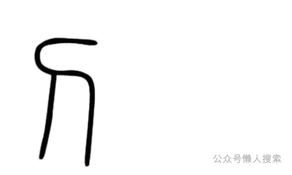

当然别死板教条，是基于“贝”的链条才能玩这一套，平常生活玩这个那不是神经病嘛……所以为啥叫入魔大法？

心性很重要，生存就是一场大磨盘，要尊重人性的基本规律。

2）垄断发力。

不是垄断资料啊，资源、资本、资料是三件事。

资本是无中生有的，只要你会转化即可，这属于“魔法”而不是“实力”啊，是指垄断转化方式。

例如大组织的政策，这就是一种资本垄断，并不是大组织把商人和百姓的钱物给拿回家，而是大家必须听从其引导转化，股市楼市的钱流向哪，企业家和市场说的不算，这就叫做“国家资本”了呀！

当然，有时候也玩被充公，这个不扯远……这个垄断发力，就是俗话讲的话语权，不是往下给东西，而是能够往下给话，话要比东西重要的多。

所以入魔时候得会挑话和递话，这玩意啥成本没有，完全看心智，小牛小花小强起点相同结局不同嘛。

所以呢？

则右侧的“刀”成就了“贝”的两条腿，合起来就是则！

最后呢？

规则其实就是软暴力！要不为啥算《入魔邪法》里面的？

因为魔的心性就是暴力驱使，没这个心性就没法入魔……而绝大多数人，既不能佛系，又不能魔性，两头堵就变成一根筋了，一根筋就开始情绪占主导了，那就容易被入磨盘了。

生活上难得糊涂，而生存上是一个纯粹的人，一个脱离了低级趣味的人。总之呢？

心怎么转，力就怎么转，外界的现象嵌套进力当中，就跟车轱辘似的。老子：三十辐共一毂，当其无，有车之用。毂，就是心，车轱辘的圆心空点。辐，就是力，画中文模型就在表达力。所有辐条力都朝向毂心，这就是无，是看不见的。辐条间的轮转、相互作用关系，这就是有，是看得见的。

把这俩事搞清楚了，就可以——用车。车，就是诸多现象，职场啊、圈子啊、社会啊、经济啊啥的。现象都是表面的，规则二字又不是为了社交圈造的字，规则可就多了去了。关键是把背后的力搞懂。

## AI 分析

### 《入魔大法——洞悉"规"与"则"》

#### 一、核心观点梳理

用汉字字形拆解（目、见、贝、刀、十、入、八）构建一套"规则模型"，核心结论是：

- 规则本质是软暴力，是圈人、博傻、向下收割的游戏
- 生存圈是磨盘，不以个人意志转移
- 懂规则的人：看清圈内水力机制 → 掌控转化 → 向下传递成本

#### 二、有一定道理的部分

生存圈和生活圈是两件事这个区分是真实且有用的。很多人在职场关系和私人关系之间边界模糊，确实容易两头受伤。

**"入规则才能破规则"** 的顺序意识是对的，先立后破这个方向没问题。

权力结构确实存在，组织内部的成本向下转移、话语权的本质是控制而非给予，这些观察有一定的社会学依据。

#### 三、明显的问题

1. **字源解释大量是自创的，不是真实考据**

文章最核心的"可信度支撑"——汉字字形分析——其实经不起推敲：

- 贝字确实和贝壳有关，贝壳本就是早期货币，文章说"字典都是错的"，这个说法本身才是有问题的
- 目、刀、八、十的解释是作者自己的映射，不是文字学
- 这种"我重新定义这个字，然后用新定义推导结论"的方法，本质上是用看起来有根据的形式包装主观判断，结论是预设好的

2. **把极端情况当做普遍规律**

"谁是自己人，谁才是敌人""和谁合作就是要吃谁""一个圈子靠博傻才能立住"——这些放在某些政治、资本博弈场景里有一定观察价值，但文章把它当成了所有社会关系的底层真相。

这是以偏概全。很多圈子的稳定靠的是真实的价值共创，不是博傻和收割。

3. **世界观容易把人引向偏执**

如果真的完全用这套框架看待所有关系：所有合作都是"吃"、所有朋友都是"力"、一切共识都是洗脑——实际上会破坏一个人正常建立信任关系的能力。

这套思维用于识别少数高风险情境（政治博弈、大型组织内斗）有参考价值，但作为日常认知框架是有害的。

4. **"1%认知"的自我定位是一个警示信号**

文章反复暗示：大多数人只有99%的知识，我给你的是那1%的认知。这种包装方式本身就是一种"博傻"结构——用稀缺感制造付费冲动。

#### 四、总结判断

这篇文章是三篇里质量最低的一篇。

前两篇（情绪/房价）借用了真实的心理学或经济学框架，哪怕有偏颇，内核是经得起推敲的。这篇的核心支撑——字源分析——是自创的，论证是循环的（先定义规则是收割，再用这个定义解释所有现象），结论是极端的。

建议：不分享，或者极重度加工后才分享。

直接转给群友有风险——不是内容太深，而是这套世界观如果被当真，会把人培养成一个把所有关系都当成博弈棋盘的人。这和你群的信息差、工具、副业定位也不搭。

————分割线————

在这个 AI 能替你写代码、写文章的时代，基础技能正在迅速贬值。绝大多数人正被淹没在海量的免费垃圾信息里，陷入低效的体力内卷。

当"努力"不再是壁垒，人与人之间唯一的护城河，只剩下"信息过滤"的效率与"认知系统"的维度。

如果你认同这种"重塑认知防线"的极客主义，欢迎围观我的个人情报智库：【懒人专属群】。

https://lazyso.com/insider/

认同信息过滤价值、想省下每天 3 小时无效阅读时间的读者，扫码加我微信（lazyhelper1）

