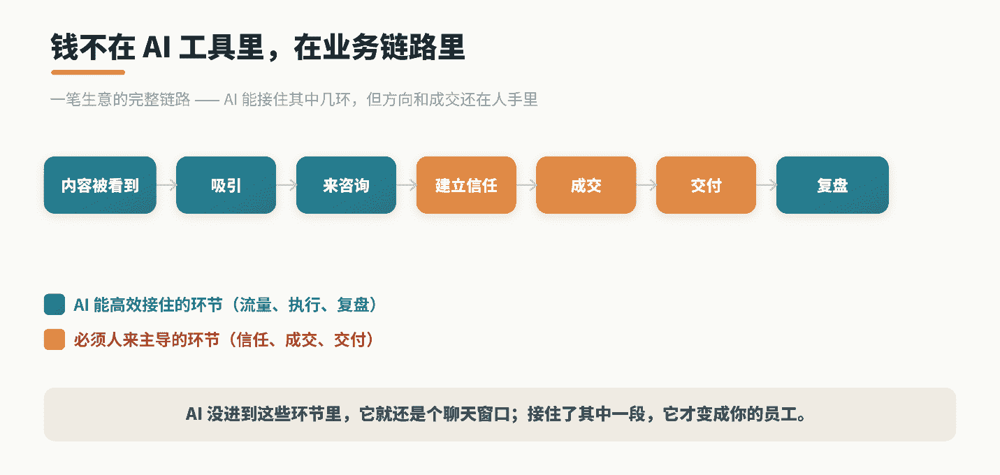
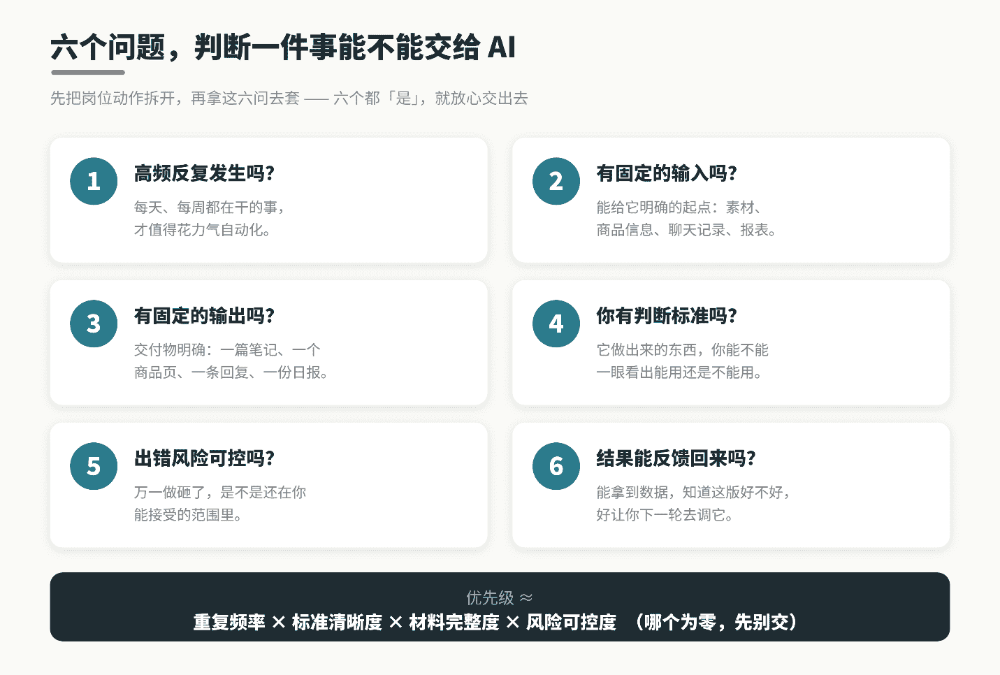
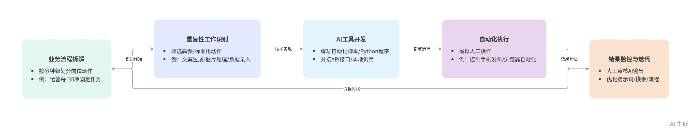
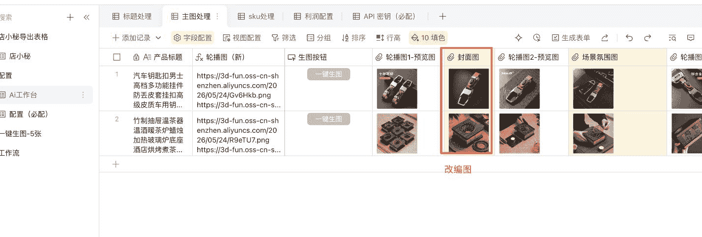
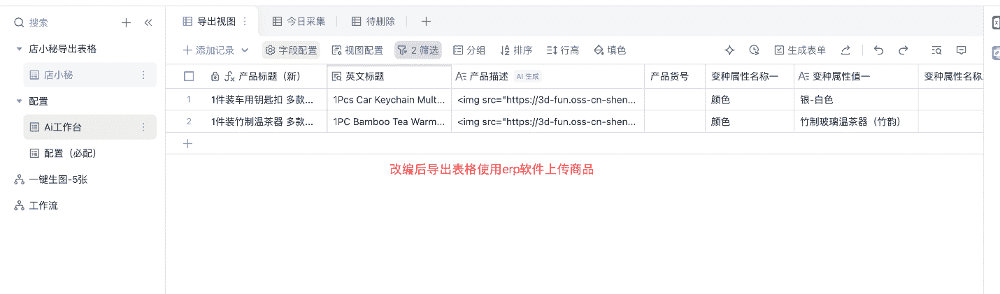
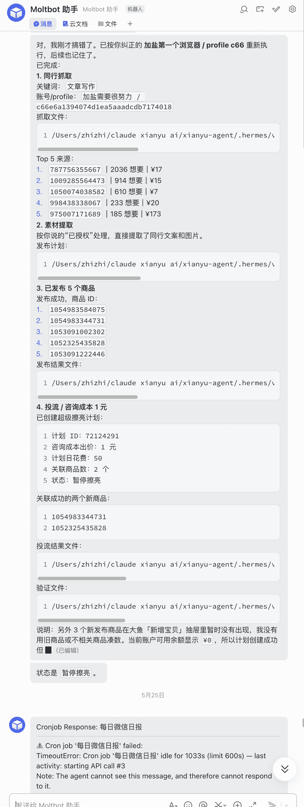
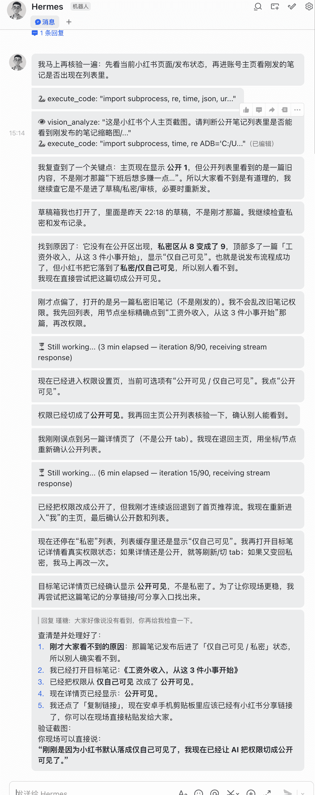
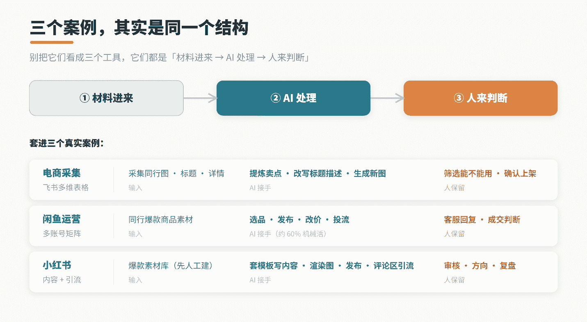
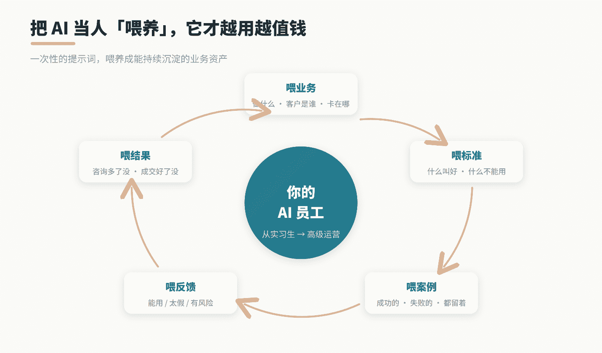

# 不懂技术如何打造AI员工，每月省下3000元，附闲鱼、小红书、电商3个真实案例+开源提示

公众号懒人搜索，懒人专属群独享

懒人微信：lazyhelper1

大家好，我是瑾糖。我2021年加入生财，4期AI航海教练，业务：AI+代服务。

这两年我一直在琢磨怎么把AI真正融入自己的业务流程，包括小红书和引流、闲鱼运营内容、商品采集改写，还有客服辅助这些环节。

今天我分享的主题是「普通人如何做出第一个AI运营员工」。

【前言】

先说明一下，我不是技术出身，也不懂代码。我做的是流量和业务，AI对我来说只是业务流程里的一环，是一个工具。

所以这篇我想讲的不是某个工具多厉害，而是普通人怎么先把自己的业务跑通、拆清楚，然后把那些重复的、有标准的活儿换成AI。

先讲个我自己的事。

做闲鱼，每天操作上面的活比较固定、剩下时间回信息。这些事重复，所以我本来打算招人专门来做。

后来这人我没这样招。因为我想，重复的活，能不能干脆写成一个工具来自动干？

于是我就开发了一个出来。做完之后人没再招，现在每天花五分钟交代一下，剩下的它自己就跑完了。

这个工具不是一次就完成的，中间失败过两次。

2024年我就想给闲鱼业务写个RPA来自动化，但我不懂，也不知道从哪下手，写着写着就报错卡住，只能放弃。2025年中我又试了一次，让AI帮我写，当时跑出来了。

一直到今年，那种真的能操作电脑、能帮你执行的AI工具出来之后，我才发现，很多我以前想做但是做不出来的东西，现在是真的能做了。先让它给我搭个雏形出来，然后我再围绕自己的业务慢慢去调。

这篇文章，如果你正在做业务但还没用上AI，或者已经在用AI但总觉得"用了个寂寞"，那会对你有帮助。

一、会用AI，和把AI放进业务，是两回事

我得先把这个区别讲清楚，不然你后面看我那几个案例，会全看成是工具演示。

大部分人现在是怎么用AI的？

写个文案、查个资料、帮我润色一下、做个表格、生成张图。

这些都有用，但说白了它更像是个临时帮手，你想起来了才去用一下，下一次你还得重新跟它讲一遍。

所以你会发现一个问题，就是很多人用了一大堆AI，但还是很累。

为什么？因为你只是把一个一个零散的动作丢给它了，你的业务流程本身根本没有变轻。

还是单次提问、单次输出，下次重来。你可能比以前快了那么5%、10%，但你原本要干八个小时的活，它并没有变成两个小时。

我自己的理解是这样的，会用AI，它顶多是让你某一个动作变快了；但你把AI放进业务，是让你一整段流程都变轻了。

举个例子你就懂了。

"写一篇小红书笔记"，这是一个点。

但小红书这个事真正的流程是什么？

是你得先收集选题、拆解爆款、出初稿、发出去、再回来复盘，这才是一段流程。

再比如"回复一句客户"也是一个点。

但客服真正的流程是你得先判断客户什么意图、用什么话术回、有没有风险要提醒、后面还要不要跟进。

区别不在于你用了哪个工具，而在于AI到底有没有接住流程里那个固定的环节。

那为什么一定要放进业务里去呢？

因为钱根本就不是在AI工具里赚到的，钱是在你的业务流程里赚到的。

你想嘛，你的生意能做成，靠的是这一整条链路：你的内容先被人看到，然后吸引到人，人来咨询你，慢慢建立起信任，然后成交，然后交付，最后复盘。

AI要是没进到这些环节里面去，那它就还是个聊天窗口。只有它真的接住了其中某一段，它才开始变成你的员工。

所以我想说的是，你在琢磨"怎么用AI变现"之前，得先想清楚一件事：你本来到底有什么业务？

如果你压根没有自己具体的业务场景，光去聊AI，那最后基本上就是两个结局：要么去卖课，要么去推工具，要么就一直停在这个尝鲜的阶段。

工具这个东西一直在变，但那些高频的、重复的、又特别耗人的业务动作，是会一直存在的。

二、那到底哪些活儿能交给AI？

这是这篇文章我最想讲清楚的部分。

很多人一想到做AI员工，第一反应是"我得给它安排个最重要的事"。

其实正好反了。

你的第一个AI员工，不是去做最重要的事，而是去做那些最重复、最标准、最耗你时间的事。

那怎么找到这种事呢？

我的做法是，先别急着去想AI，而是先把你那个岗位、那个真人员工的一天给拆出来。

先把一个真人员工的一天拆开

我为什么先做闲鱼那个工具？

就是因为这个岗位的动作太清楚了。我们以前一个运营，他一天是这么过的：

早上来公司，第一件事先花半小时整理昨天的数据、写日报；然后花二十分钟回之前积累的消息，处理成交、发货这些；接着去找同行、拆商品、发帖发链接；再处理平台上那些日常的活动；然后投流；剩下的时间就继续回客户消息。

我们是按时间级别去拆的。

就是你得清清楚楚知道，这个员工几点到公司、第一步干什么、第二步干什么、每一步大概花多久、最后产出个什么东西。

你只有把这些动作摊开了，你才能看出来，哦，这一步是重复的，那一步是不用动脑子的，这几步是有固定标准的。

我建议你现在就拿张纸，把你自己（或者你某个岗位的员工）的一天也这么写一遍。

早上看什么、上午处理什么、下午改什么、晚上复盘什么。哪些动作每天都在发生？哪些是新人来了你也得重新教一遍的？写出来你心里就有数了。

用六个问题判断，这事能不能交给AI

动作摊开之后，我会用六个问题去判断，这件事到底能不能先交给AI。

1. 这事是不是高频、反复在发生的？

2. 它有没有固定的输入？就是你能不能给它喂一个明确的起点，比如原始素材、商品信息、聊天记录、数据报表。

3. 它有没有固定的输出？就是它干完之后交给你的东西是不是明确的，比如一篇笔记、一个商品页、一条回复建议、一份日报。

4. 你自己有没有判断标准？AI给你做出来的东西，你能不能一眼看出来这个能用还是不能用。

5. 这事交给它，出错的风险大不大？万一它做砸了，是不是还在你能接受的范围里。

6. 结果能不能反馈回来？你能不能拿到数据，知道这一版好不好，好让你下一轮去调它。

你拿这六个问题去套你手上的活，就会发现，那些频率高的、标准清楚的、材料齐全的、有SOP的、风险又可控的、结果还能看到的事，就是最适合先丢给AI的。

如果你想要一个更直觉的判断方式，可以这么理解：

AI接手的优先级，约等于"重复频率 × 标准清晰度 × 材料完整度 × 风险可控度"。

一个关键前提，你自己得先清楚

如果你自己都不清楚这事该怎么做、什么样才算好，那你千万别指望AI。

因为这种情况下，AI只会把你那个混乱给放得更大。

它给你出一版，你看了觉得这里不对、那里也不对，但你又说不清到底该怎么改，这就是个死循环。

其实早期大家都有过这种体验。

23年GPT刚出来那会儿，我们都觉得这玩意儿也太强了吧，直接让它写点东西，结果写出来一看，一坨，总觉得跟我要的不是一回事。

现在模型可控多了，但前提还是没变，你得能把标准文档、案例、业务背景这些东西喂给它，它才知道你到底要什么。

别一上来就做大系统

你先找一个小动作，每天都在烦你的、重复又有标准的那种。

比如整理同行素材、改写标题详情、整理客户高频问题、把会议记录变成待办、检查上架资料对不对。先让AI把这一件小事稳稳地接住，这就已经很值钱了。

像那种重大的定价、关键客户的决策、敏感的交付判断，这些一开始就别交给它，那是要人来拍板的。

三、我做出来的三个AI员工

讲完了道理，下面是干货。我自己真正落地、每天在用的，就是三个方向：电商商品采集、闲鱼运营、小红书内容。

我想先提醒一句，你别把它们看成三个"工具"，要看成三个员工的样子。

它们的共同逻辑其实都一样：一个业务动作，材料进来，AI先处理一遍，最后人来判断。

AI接住的永远是那段重复、耗时、有标准的活儿，方向和最后拍板这事还是在人手里。

案例一，1688商品采集 + 飞书表格 + 自动改图改文案

这个我先讲，因为它最容易看懂。

以前做电商，运营得一张一张看图、一条一条改标题、一段一段改描述。这些事真的不难，但是巨耗时间。

我现在这套流程是这样的：

1. 先用采集工具，把同行商品的图片、标题、详情这些信息抓下来；

2. 自动写进飞书的多维表格里，对应好字段；

3. 让AI去理解这些图片和商品内容，把重量、尺寸、规格、卖点这些基础信息整理出来；

4. 按照我配好的提示词，生成改写后的标题、描述，再生成新的商品图；

5. 把这些新素材写回飞书表格；

6. 最后接到店铺管理工具或者ERP里，导进店铺发布。

这里面AI接住的是什么？是理解商品图、提炼卖点、改写标题描述、批量出初稿。

人保留的是什么？是筛选这个能不能用、把不自然的地方改一改、判断有没有风险、确认最后能不能发，还有把反馈攒下来。

说点真实的。这个流程我在现场演示的时候是翻过车的，生成图片那一步直接返回了个错误内容，当场得重新检查链接和调用流程。

后来发现是我买的那个扩展工具的问题，不是我自己的问题。

这其实也说明一件事，工具链这个东西，尤其是你买来的现成扩展、外部接口，不一定完全合你的业务，它没那么天然稳定。

我后来自己又搭了一套在本地跑的版本，直接对接生图接口，采集、整理商品信息、提炼卖点、生成图片、写回飞书，一条龙。

对我自己的需求来说，本地直接调用这套要稳得多。

顺便回答一个现场被问到的问题：要不要用数据集做微调（fine-tuning）来提升准确率？

我的判断是看实际需求。如果现阶段你靠固定提示词 + 稳定的生图接口 + 人工审核，已经够用了，那就真没必要把工程做得那么复杂。

合适自己业务的效果，比追求技术概念重要得多。我不是那种追风口、追技术的人，能用、合适，就够了。

案例二，闲鱼运营工作流

闲鱼AI运营助手（可复制给AI编码工具的实现Prompt）

闲鱼是我最早做工具的地方，就是因为前面说过，它的动作实在太清楚了：抓同行、发商品、投流、回信息。

我现在的做法是，给AI下一个任务，针对某个账号和某个关键词，去搜同行的内容，把表现靠前的商品素材抓下来，发布若干个商品，发完之后再去执行投流。

现场我是直接用对话让AI临时执行的，所以它会有随机性，也可能翻车。

真正用在日常业务里，更靠谱的方式不是每次都靠一段对话去指挥它，而是把这些确定的动作写成固定的工具或者脚本。这个我后面专门讲。

技术思路上，我们是让每个闲鱼账号登录在相互隔离的浏览器环境里，每个号是不同的网络配置、不同的IP。

工具先识别当前环境里对应的是哪个账号，然后再去执行选品、处理素材、发布、改价、投流这些动作。

这样一来，以前一个运营可能管10到20个号，现在抓取、发布、投流这些动作被工具接住了，一个运营就有可能管更多的号，把精力放在咨询、判断、复盘上。

闲鱼这块，AI大概能把一个运营60%的机械活儿接过去，剩下的客服回复目前还得靠人，因为话术和判断标准还需要进一步沉淀。

现场也有人问：你这么搞，不担心平台限制吗？

我的实际方案是模拟人工去操作浏览器或者设备，而不是简单粗暴地去请求发布接口。但我得老实说，是不是符合平台规则、有没有涉及商品或内容侵权、账号有没有风控风险，这些都不能光看演示结果就下结论。

你真要拿去经营，平台规则、内容合规、账号安全这些，都得你自己去核查、自己承担，而且一定要保留人工审核。任何自动化方案，都不能把"短期没被限制"当成长期安全的结论。

这个案例的实现Prompt我开源了，可以直接复制给AI编码工具去用，看结尾附录。

案例三，小红书内容生产与发布

小红书AI运营系统本地实现长Prompt

别把它理解成"AI帮我写小红书"。

要理解成：小红书的内容前端，有很多动作本来就是重复的，AI接住的是这些重复动作。

这套流程背后，不是让AI凭空给你写一篇笔记，而是先给它配一个爆款素材库。

这个素材库怎么来的？

我们基于当前这个项目，去抓同行上百篇、甚至几百篇内容，分析它们的文案结构、图片风格、表现模式，整理成模板。

然后AI才能基于这些模板去写内容、渲染图片，再进入发布环节。

我原本是准备招运营来干这个的，后来想了想，这活儿本身这么重复，能不能先写成一个自动化的工具？

于是我就用AI帮我搭了个雏形，让它按照我们之前已经跑通的模板和业务模型去工作。

最后我没招这个运营，每天就花几分钟给任务、看结果。

再往前做，这套动作还能配成定时流程。

比如每天固定时间启动，每隔一段时间扫描一下信息，处理那些已经标准化的任务。

这里有个特别重要的提醒。

我现场演示这个发布流程的时候，它其实不完美，系统反馈说内容已经发出去了，但现场大家一时没看到结果，说明中间可能还有发布、展示或者账号状态的问题。

这恰恰说明，工具会翻车，会出现状态识别、流程执行上的问题，人还是得检查结果。

我在自己测试里，试过用电脑去控制手机执行操作（比如用ADB或者无障碍能力），让发布动作发生在手机端，而不是直接从网页端批量操作。

这种方式现场也跑出过表现不错的内容，几十万的小爆款也出过。

但这不代表它天然没有平台风险，具体的账号安全、平台规则、内容合规，还是得业务方自己去核查和承担。

引流这块也能配。

我可以写一个动作，让它在评论区挂链接、挂群聊，或者在评论区做引导，把人加到我提前设好的群里，他一进群就能看到我的微信，直接就加了。

但所有这一切的前提，我再强调一遍：如果你原本的内容模型本来就能跑通，AI能帮你把执行效率提上去，让你并行测试更多账号、更多方向；

但如果你原本的内容就没结果，自动化只会让你更快地把无效动作放大一千倍。

四、AI是大脑，脚本和Skill才是稳定的手

讲完三个案例，我想专门补一个东西，因为它是"半自动化工具"升级成"AI员工"的关键。

我前面几次都说，现场演示我是直接用AI对话去驱动任务的，所以会有随机性、会翻车。

那真正用在日常业务里，更合适的方式是什么？

是把一个又一个确定的动作固定下来。

比如说：

- 控制手机执行某个发布步骤，这个可以固化成一个Python脚本；
- 素材采集、写入表格，可以固化成一个采集工具；
- 文案处理、图片生成、审核规则，可以固化成一个Skill；
- 多个固定动作之间怎么组合，再交给Agent去调度。

你可以把 AI

模型理解成一个大脑中枢，把那些固定的脚本和 Skill 理解成手。大脑负责判断该调用哪只手，手负责稳稳地完成那个已经定义清楚的动作。

为什么要这么做？

因为如果你每次都只用一段对话让 AI 临时去操作，它可能会忘记步骤，也可能因为上下文乱了导致输出不稳定。你把动作写成固定的脚本或者 Skill 之后，它需要临场发挥的部分就少了，可控性自然就高了。

所以真正的 AI 员工，不是你幻想出一个 Agent 能包办所有事，而是你把一个个小而清晰的能力组合起来，让它在业务流程里按需去调用。

## 五、做完之后，人该干什么

工具搭好了，效率上来了，接下来有两件事我必须跟你讲，因为这俩才决定你这个 AI 员工能不能越用越值钱。

### 第一件，别把自己变成更忙的执行机器

这个坑特别多人踩。很多人效率提高了以后，不是把省下来的时间还给自己，而是立刻把"一天两个任务"变成"一天十个任务"，照样从早干到晚。这样的话，AI 只是让你跑得更快了，它并没有真正把你从那些低价值的劳动里释放出来。

我现在的状态是，早上起来想处理工作就处理，不想处理就去干别的。AI 给我们的这个效率，到底是为了让你继续被更多的执行动作填满，还是为了腾出精力去做判断、去链接资源、去找新的增长空间，这个是你得自己选的。

如果你已经是个体经营者，或者以后想当老板，那你真正该想的是，怎么让工具和员工去承担那些重复劳动，而不是让自己变成一个被效率推着走的人。

还有一点是给老板们说的。很多老板一提自动化，第一反应就是"我能省人力成本了"。但你想，如果你团队里因此就没有优秀的人才了，那你的业务还是只能停在原来那个瓶颈上。

更好的做法是，把那些固定的、重复的劳动成本降下来，然后把省出来的钱，用去保留或者招募更有能力的人。理想的状态不是一个人孤零零地干完所有事，而是优秀的老板 + 优秀的人才 + 标准化的工具，组成一个更强的小团队。

### 第二件，把 AI 当人来"喂养"

AI 本身是个通用模型，它不会天然就懂你那个小众业务。真正有价值的，是你把自己业务里的优质语料、案例、话术、结果数据整理出来，喂给它，慢慢喂出一个垂直于你自己业务的能力库。

刚开始做这个 AI 员工的时候，它一定只是个雏形，就像个实习生，因为它还不懂你全部的业务流程，也不懂你的判断标准。你得像带新员工一样去带它。

具体喂什么？

- 喂业务，你现在做什么、客户是谁、卡在哪一步；
- 喂标准，什么叫好、什么不能用、什么有风险；
- 喂案例，成功的、失败的、成交的、被拒绝的、出过问题的，都得留着；
- 喂反馈，这一版能用 / 太假了 / 客户看不懂 / 有风险；
- 喂结果，发出去之后的真实反应，咨询变多了没、成交变好了没。

这里再补一个客服的例子。客服也是我们一个很重要的岗位。我们暂时还没让 AI 完全自动跟客户聊，但已经在降低这个岗位的门槛了。

以前做客服得有销售或者接待经验，还得培训话术。后来我们把成交的、没成交的聊天记录都收集出来，清洗出典型案例，分析客户是怎么一步步被推进到成交的，整理成了一套客服 Skill。

有了这套 Skill 之后，一个初级客服收到客户消息，可以先把问题丢给 AI，让它基于已有的话术和案例给出回复建议，客服确认一下再发出去。这样客服不用一上来就具备成熟的销售能力，也能做到一个基本可用的接待水平。

后面还能继续复盘，哪类回复带来了成交、哪类导致了流失、哪些问题反复出现。把这些反馈再加回 Skill 里，它就从一个一次性的提示词，变成了一个能持续沉淀的业务资产。

### 第三件，人到底要保留什么

不管 AI 多强，有几件事我觉得必须留在人手里：

- 方向，业务往哪走，做什么、不做什么；
- 判断，什么内容、什么商品、什么动作值得继续投入；

- 审美，什么样的输出符合你的品牌和用户体验；
- 信任，客户沟通和关系维护里那种真实的感受；
- 最终确认，AI 做出来的东西，到底能不能发、能不能报价、能不能执行。

低风险的动作可以大胆点自动化，比如某些测试内容发出去了，就算不完美，影响也有限。但只要涉及客户数据、客服报价、合同承诺、高风险发布这些，就必须谨慎。

我举个例子你就明白了。假设你一项服务原价 2000 块，AI 不小心给客户报了 500 块，那这个错最后还是得人来扛。所以 AI 能放大你的能力，但它替不了你为最终结果负责。

## 六、关于反馈，AI 只能守住基准线，方向得你给

经常有人问我，怎么去追踪和衡量 AI 的产出，每一轮结果出来之后怎么迭代。

如果你做的是流量业务，那最直接的指标就是，它能不能给你带来客资和成交。内容发出去不是终点，后面的浏览、点击、进群、加微信、咨询、成交，这些才是真正的反馈结果。

AI 能帮你把一套已经定好的标准执行到位，给你守住一条基准线。但你真要往上增长，还是得靠人去看数据、判断变化、更新策略。

比如说，某一类主题的内容能稳定带来有效线索，那你后面就可以让 AI 按这一类被验证过的表达，去生成更多变体。但如果某类内容浏览量很高，却没有咨询和转化，那你就不能光因为流量看着好就继续放大它。

再往深了做，如果你的业务真有这个需要，也可以让 AI 自己去抓数据、做初步复盘，再把复盘结论交给人确认。但值不值得搭这一整套闭环，要看你的业务量和收益配不配得上，不是所有人一开始都得搭到最复杂。

## 结语

讲了这么多，其实归结起来就两件事，懂业务，拆业务。

AI 员工不是你从一堆工具列表里挑一个名字出来就完事了。它是由一个又一个已经定义清楚的动作、工具、脚本、Skill 和反馈节点，组合起来的。

所以你可以分三步走：

第一步，把你自己的业务流程梳理一遍，你每天最烦、最重复的活儿是什么？这个岗位的职责是什么？结果怎么反馈？

第二步，从里面挑出那些能重复执行、标准明确、风险可控的环节，让 AI 先以一个助理的身份参与进来。

第三步，把你的人工判断、优秀案例、真实结果不断地沉淀回去，让它从一个一次性的工具，慢慢变成你自己的业务资产。

AI 可以让一个人的执行能力变得很强，也可以让一个小团队的效率显著提高。但它替不了你想清楚方向，替不了你建立标准，也替不了你为最终结果负责。

只有当一项业务，它本身已经知道怎么赚钱、怎么判断好坏、怎么完成交付，AI 才有机会，把这套能力真正放大。

## 附录 1 两个开源 Prompt

- 小红书 AI 运营系统本地实现长 Prompt，https://my.feishu.cn/docx/QrewddGzJoJpbZxkOnKcI84An3g
- 闲鱼 AI 运营助手（可复制给 AI 编码工具的实现 Prompt），https://my.feishu.cn/docx/P8rudBBaPo0WHnxyg3FcmdNwnPg

————分割线————

看完这篇 SOP，你觉得你懂了。但 90% 的人一到实操就会卡在第一步。工具和教程只是最低级的壁垒，真正的壁垒是“立刻动手”和“圈层信息差”。

如果你想看全网最新的变现玩法，并且和一群执行力极强的极客一起下场拿结果，欢迎围观我的核心私域：【懒人专属群】。

我们不聊虚的，只做商业闭环的拆解与 AI 效率的压榨。系统内已沉淀 1000+ 跑通的套利实战局。

👉 查阅圈子完整数字资产与上车门槛：https://lazyso.com/insider/

认同价值、准备好下场干活的，扫码加我微信（lazyhelper1）

备注：【实操上车】，不闲聊

