# 加入 SC 不到一年，我的视频号图书带货：23 天 5 万佣金的复盘

260608 副业 SC 精华

公众号懒人搜索，懒人专属群独享

懒人微信：lazyhelper1

30 秒摘要：

- AI 把单条图书带货视频成本降到 1 元左右，15 分钟出片，降本同时效率大幅提升；
- 文案是核心，画面效果次之——现在 GPT-Image-2 生成的画面够用了，但钩子和逐字稿需要好好打磨；
- 健康图书遇到大爆款别急着发新内容，先把现有流量吃够（可以发其他账号），因为新作品违规可能会连带橱窗受到影响。

大家好，我是自在，25 年 9 月经吴泽承学长推荐加入生财。先说一下背景，主业是程序员，有 10 多年的软件开发经验，2023 年开始做跨境电商副业，图书带货是 2026 年 3 月参加 AI 视频图书带货（视频号）航海才正式入局。航海期间赚了 500+ 的佣金，后面因为主业和跨境的事情就没做了。视频剪辑还是挺费时间的，但我知道图书带货是可以赚到钱的。

所以这篇文章不是那种“我发现了一个暴富项目”的爽文。准确地说，它是我从跨境电商、程序员视角，重新跑了一遍视频号图书带货之后的一份粗糙复盘。完全没做过的纯小白，文末有一段“不会代码也能跑”的低配方案，可以先用那个跑通验证（强烈建议观看 3 月航海视频教程，对于小白入局足够了，不要被视频带货全套流程所吓退了，动手操作起来，没想象中的难）。

数据周期不长，2026 年 5 月 9 日到 5 月 31 日，共 23 天。但这 23 天足够让我看清楚一件事：视频号图书带货这条赛道还能做。而且最近跟圈友的交流中，发现全职的平均收入有 1—2 万。在 23 天时间内，我主要是通过 AI 把带货视频制作自动化了；但赚钱的核心不在工具自动化，而是素材跟平台合规要求（目前合规这块我也在摸索中）。

【图 1：视频号后台 23 天总览数据截图，能看到播放、订单、GMV、佣金的数据】

| 指标 | 数据 |
|---|---|
| 数据周期 | 23 天（2026 年 5 月 9 日—5 月 31 日） |
| 总播放 | 900 万上下 |
| 总订单 | 1390 单，日均 60 单 |
| 总 GMV | 118265 元 |
| 总佣金 | 50042 元 |
| 客单价 | 85.1 元 |
| 发布视频 | 40 条 |
| 单条成本 | 不到 1 元 |
| 单条耗时 | 15 分钟左右 |

50042 块佣金背后，剔除时间成本，API 成本差不多 30 元左右。

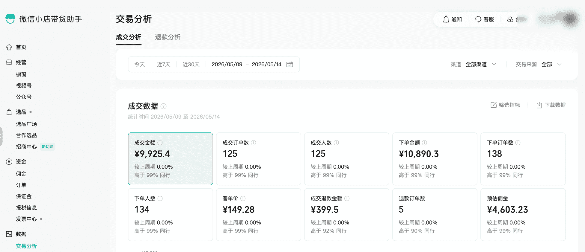
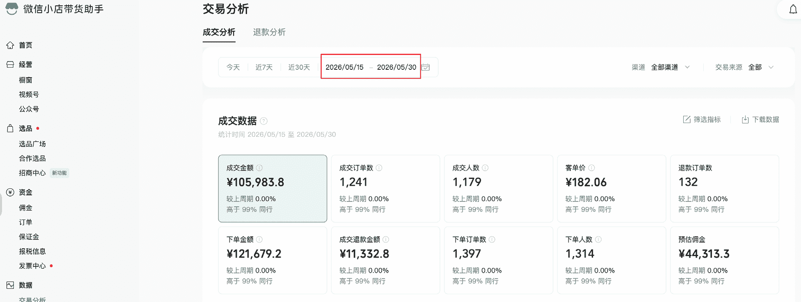
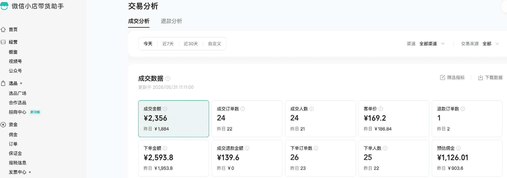
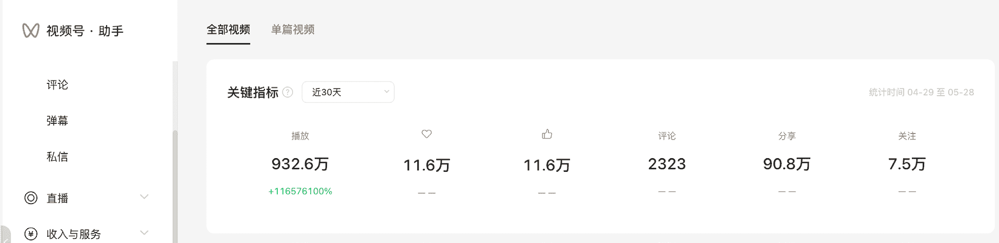

因为做过跨境或国内电商的人都知道，很多项目看起来毛利很高，但算上仓储、物流、广告、售后，最后剩不了多少。图书这个品类有点特殊，目前我的售后率稳定在 1%—2%，达人不用碰售后，书商处理发货、物流、客服等问题，所以对于达人来说就是净利润。

## 一、为什么从跨境跳到视频号，又为什么是健康图书

跨境电商这几年越来越卷——海外仓要囤货，物流也在涨，东南亚一些平台的佣金涨到了 20%+，算上广告费，利润越来越薄。我同期的很多个卖家要么转型为公司性质，要么倒闭了。对个人玩家来说，跨境已经不是“轻资产”赛道，更像一个需要团队、现金流的小型贸易公司。

毛利率（广告投放基本停了）：由早期的 40%+ 跌至现在 15% 左右。

我从 2025 年下半年开始想：有没有一个赛道能把跨境电商的“选品+转化漏斗”思维用在其他行业上，且不需要囤货、垫资、协调物流的轻资产模式？发现带货确实不错——零库存、零物流、20 天提现（跨境通常 40—60 天），起步只需要模仿竞品就行。

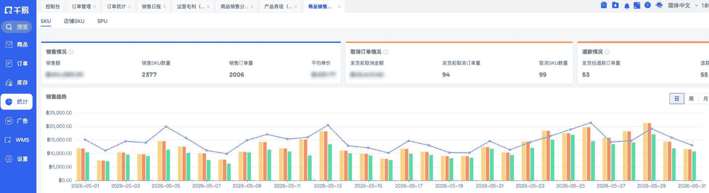

至于为什么是图书，加入生财半年多的时间，参加了一些航海，我喜欢看圈友在日志中分享的数据，发现图书对新手友好，而且容易拿到正反馈。我发前三条视频时就拿到佣金了，也陆陆续续看了很多生财关于视频号的精华帖，但传统带货方案最重的环节是真人录原始视频+数字人+剪辑，瓶颈是单人产能——我觉得 AI 应该可以进行提效。

为什么进一步聚焦老年人+健康图书这个细分赛道呢？参加完视频号航海之后发现几件事情：

1. 视频号没有比价文化，老年用户被视频打动后，直接就买了，没有比价就没有价格战。我之前电商从 50% 的毛利打到 10% 几的毛利，对于价格战深恶痛绝；
2. 卖科普书相当于让用户把花在保健品的钱挪到了“科学养生”上，几十块钱买本《科学养生书籍》比 6900 买一堆胶囊强得多，而且对于子女也希望借用科学养生改变中老年人的思维，所以还有个好处是子女的嘴替；
3. 55+ 岁这代人退休金稳定、房贷还完、子女独立，购买力被低估而且抗周期；
4. 跨境最怕的汇率、关税、政策这些大变量，对于老年人买健康养生书籍几乎没影响。

把这 4 点叠起来，老年人+健康图书+视频号是个高价值组合：高购买力、不比价、抗周期，还带点正向社会价值。

## 二、AI 流水线：每一步在解什么问题

按传统模式，一个号一天发 2 条，十几个号矩阵一天 20 多条，每条要写文案、字幕、配音、背景音乐、加封面，单条 20 分钟也要烧 6—8 小时。这套方案的瓶颈是单人产能——除非你有很强的剪辑能力，不然很难执行下去。

本质上，视频号这套链路除选品后面就是流水线操作。所以我花了一周时间用 Claude Code 搭了一套工作流，以下是工具前期的规划过程：

> /plan 我在做 AI 图书带货视频创作，目前完整工作流大概是这样：抖音采集 → 逐字稿生成 → AI 改写 → TTS 配音 → 模板化混剪 → 字幕对齐 → Hyperframes 成片。这条链路现在是用几个软件零散凑起来的：浏览抖音热门视频、Excel 记录选题、找三方工具生成逐字稿、ChatGPT 改写、剪映剪辑，特别是剪辑时完全是手工重复操作。提取抖音标题、播放数据、博主信息，粘贴到 Excel 中、来回切窗口的时间，加起来比真正写内容的时间还长。
>
> 我想把这条链路做成一个 Web 网页，让一条视频从抖音链接到成片在同一个界面里完成。所有中间产物（逐字稿、改写候选、音频、字幕、素材生成、视频成片）都挂在同一个任务下持久化，状态可见、可改、可重跑。第一版只有一个成功标准：我能在这个工具里，从粘贴一段抖音分享链接，到导出一条带字幕的竖版成片，全程不切换其他软件。

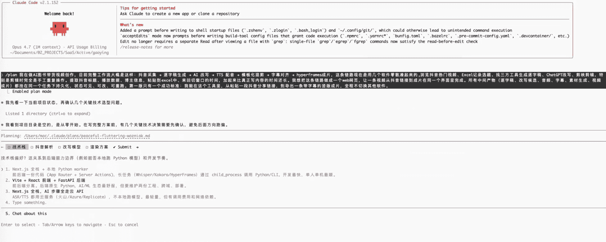
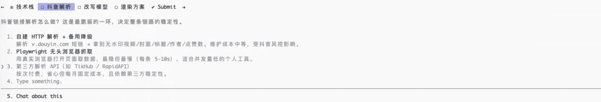
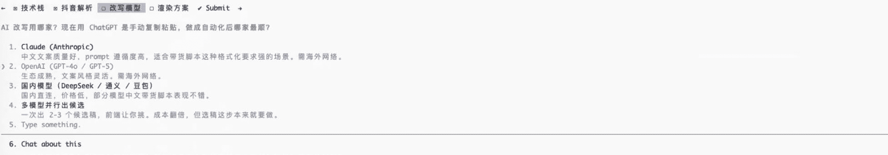
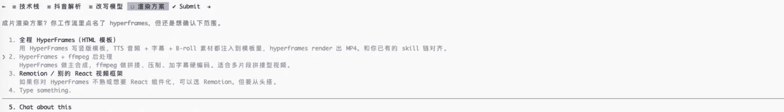
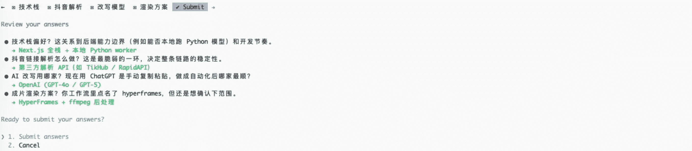
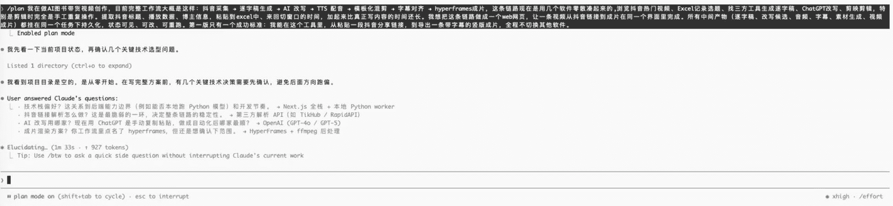
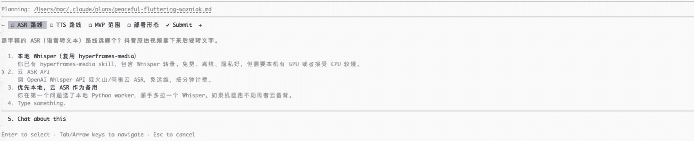
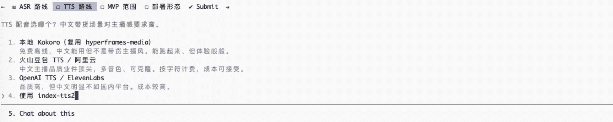
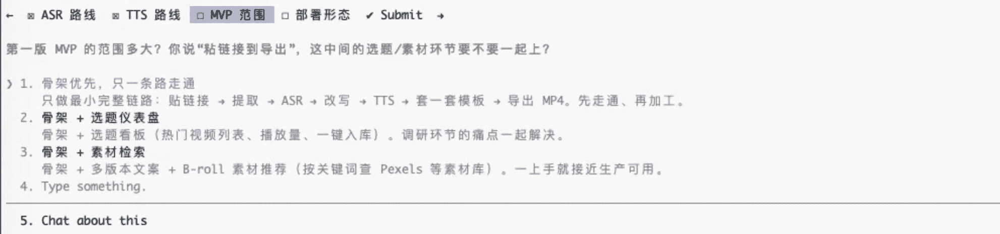
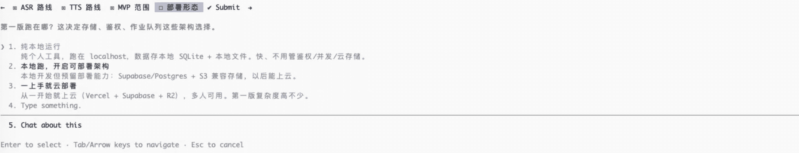
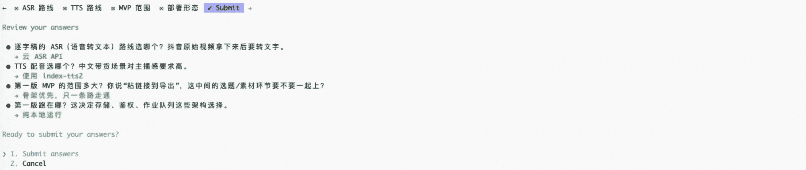

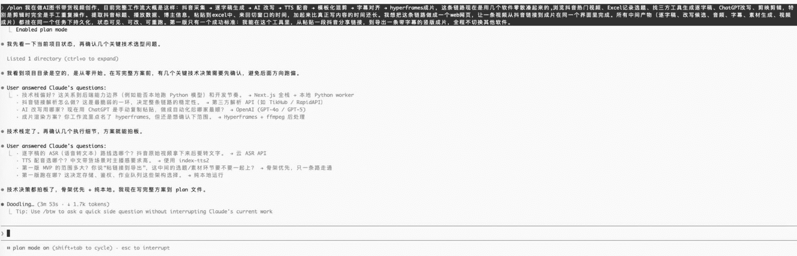
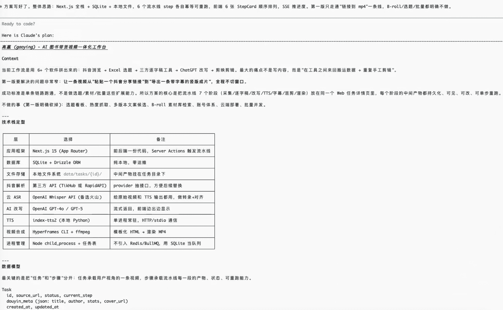
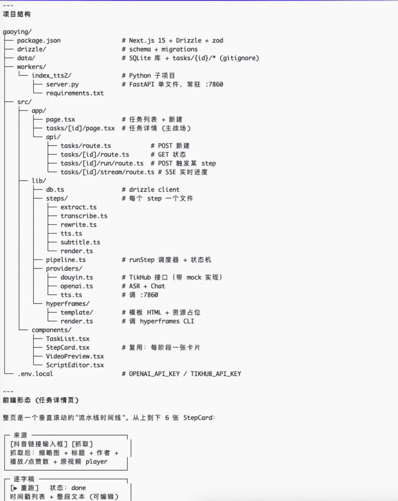

后续的步骤就是基于设计稿来回调整，直至达成期望的效果。由于整个项目内容很多，就不一一列举了。

接下来演示一下最终的工具交互效果：

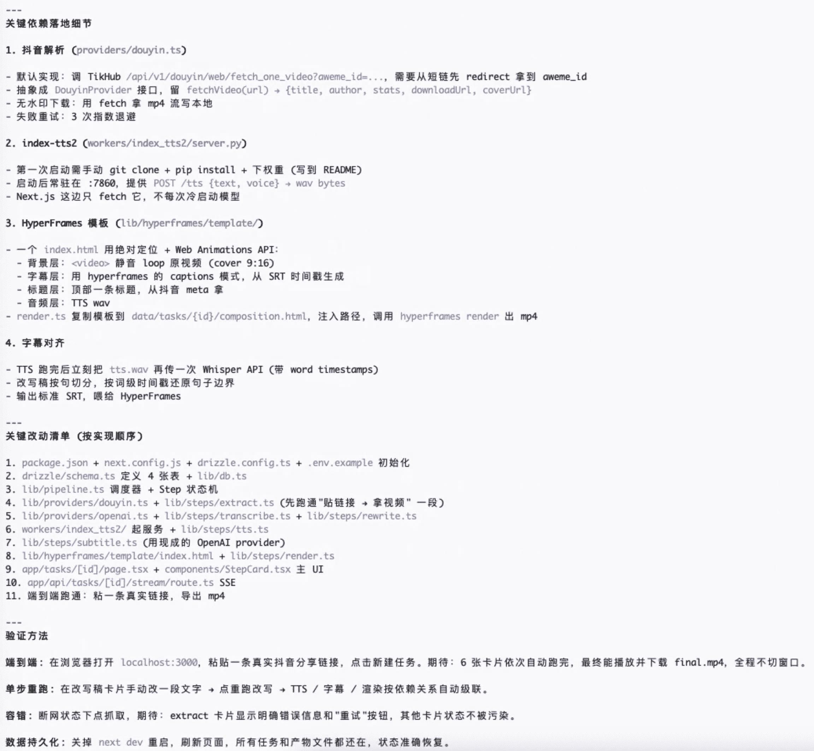
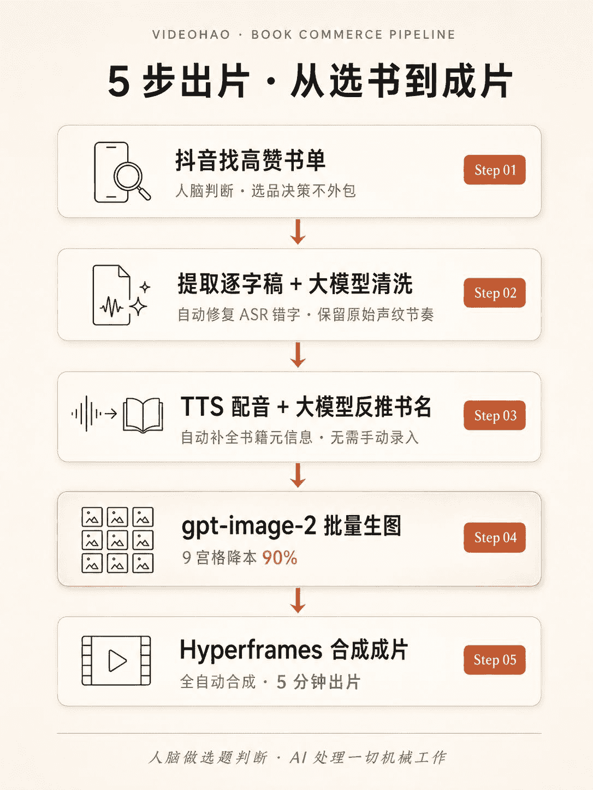

除了第 1 步选题需要人脑判断，剩下整条链路 AI 自动跑。下面展开每一步实现思路以及碰到的问题。

### 第 1 步：抖音找高赞书单视频

整条链路唯一需要靠人脑的环节。我暂时没在视频号找选题，而是在抖音找。抖音内容供给比视频号大一个量级，而且抖音的质量相对高一些，先在抖音验证再迁移到视频号，确定性会更高。筛选维度三个：点赞 1 万以上、图书带货类、评论里有人有购买意向。第三条最重要——用户追问书名等于给用户种草成功了。

### 第 2 步：提取+清洗逐字稿

抖音接口提取的原始 ASR 错字非常多，特别是人名、书名、数字，还有专属于博主的一些点赞、收藏引导文案。让大模型改错别字、重新断句，把“这本书”这种含糊代词替换为具体书名。

医疗类内容里，“嘌呤”会被识别成“飘铃”，“胰岛素”会被识别成“衣岛素”。把所有的文字丢给大模型，相对修复会更准确点；没有上下文的情况下，模型可能会修得不准确。还有一个点是需要将数字十、百、千、万这种改成中文，因为我目前使用的 Index-TTS2 在识别数字时容易念成个位数，就很尴尬。

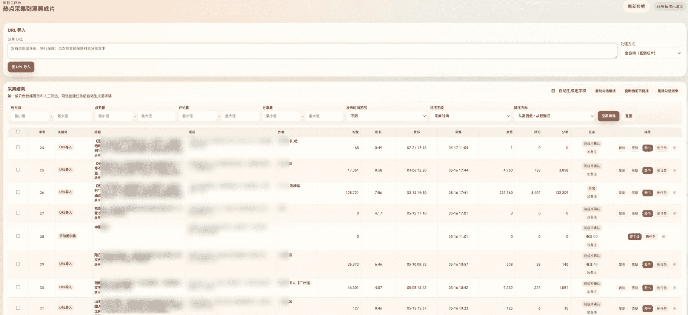

### 第 3 步：TTS 合成音频+反推书籍信息

用 Index-TTS2 语音克隆。语音克隆这块建议找现成的 API 接口处理，我目前用下来 Index-TTS2 比较靠谱，千问、MiniMax 也用过，但感觉人物情感还是差点意思。如果大家没有显卡，也建议调用第三方 API。我自己在腾讯云部署过 Index-TTS2 模型，生成速度很慢，且综合下来成本也不便宜。

还有个问题是，一般的配音模型会有上下限制，例如限制单次提交 1000 字以内，此时可以进行切分再提交，最后将多段音频在本地合成。（具体的提示词在文章底部有提供。）

停顿控制：

- ，（逗号）停顿 0.3 秒
- 。（句号）停顿 0.8 秒
- ！？（感叹号/问号）停顿 0.8—1.0 秒
- ——（破折号）停顿 0.6—0.8 秒
- ……（省略号）停顿 0.8—1.0 秒
- ；：（分号/冒号）停顿 0.4—0.5 秒
- “ ”（双引号）前后各停顿 0.1—0.2 秒

同时让大模型根据逐字稿反推真实书名、国籍、作者名（为了让系统全自动化处理，不用人工介入填写书籍信息）。如果书籍名无法识别，必须人工复核——因为后续成片再返工太费时了。这里推荐使用 DeepSeek-V4-Flash，成本低且准确。我用了 GPT 系列的一些模型，要么无法识别，要么成本较高。目前我的综合成本在 0.002 元左右。

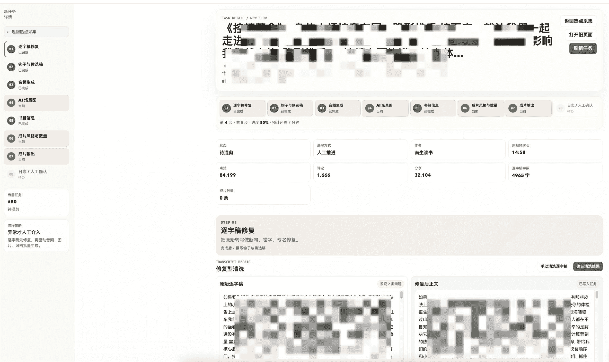

### 第 4 步：GPT-Image-2 批量生图

把逐字稿按句切片，每句生成一张对应画面。比如“肌肉、骨骼、血管、大脑、肠道，看起来是五个不同的身体系统，但它们其实共同决定了一个人到了中老年以后，是越活越……”，就让模型生成这种意境图。一条 10 分钟的视频大概 64 张图。这一步把传统剪辑里找画面素材、音画同步这几个步骤解决了。

还有个省钱的小妙招：一次图片生成请求可以生成 9 宫格照片，在系统自动切割，这样成本可降低 90%。我现在 63 张照片成本在 0.5 元以内。（具体提示词在下面有补充。）

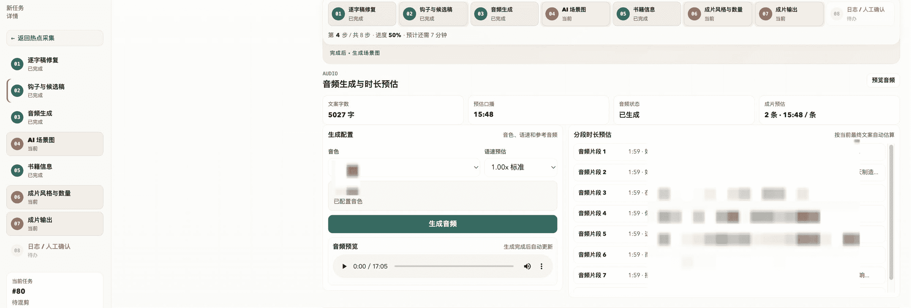

这一步最大的坑是医疗安全问题：即使段落里讲糖尿病、癌症、肾衰竭，也不能让模型生成病房、病理图等画面，要全部转译为“日常生活方式隐喻”——比如“糖尿病晚期”画成“老人独自在厨房手抖打翻东西”，而不是生成“医院 ICU 监护仪”的画面。健康赛道很容易在这步被提醒甚至限流（目前我在规避违规词这块还需要提升，欢迎圈友在评论区指点一下）。

### 第 5 步：Hyperframes 合成成片

前 4 步素材质量决定第 5 步产出。整条链路最早跑通用了 3 天，后续两天一直在调提示词、模型参数、图片风格、字幕样式。在下面的成片中可以一次性生成多种风格的成片，可以在做矩阵号时节约大量时间，例如视频声明可以自动填充书名/作者信息、健康声明，来适配更多场景。

Hyperframes 的好处是跟整套方案无缝衔接，不用人工导入剪映进行二次处理，也不用调用大模型生成视频，降本增效神器。对于图书带货这个场景来说也够用了。这步反倒没有碰到啥坑，主要是不断让 AI 调试画面效果，例如下面的这种案例：

单条视频总成本：API 调用合计 6—8 毛，不到 1 元。从拿链接到出成片大约 15 分钟以内（人工只需要审核一下，不用太多干预）。核心提示词（清洗、改写、书名识别、生图、生视频）我放在文末附件里，有需要的圈友可以参考。

注：视频中有些瑕疵，例如口播的语气、停顿等等，暂时还未优化，但不影响出单。这种水平的视频依旧可以带货，所以大家不要把视频制作想得太难、太完美。

## 三、视频做得快，不代表能出单

我刚把视频生成跑通时，还挺兴奋的。以前一条视频要剪半个多小时，现在 15 分钟就能出片（出片期间还可以干选品等其他事情）。理论上，一天可以做无数条视频。那是不是只要把产能拉满，订单就能源源不断地来了？

后来发现，不是这么回事。视频做得快，只是解决了“能不能持续发”的问题。它没有解决“会不会爆”，更没有解决“用户会不会买”。我最近看了很多新账号，播放、转发数据都很高，但是万播单量只有不到 0.5，这里应该存在一些选品、素材问题。

我这 23 天其实只发了 40 条，不到 2 条/天，但拿到了 1390 单。所以视频数量不是最关键的因素，素材有没有打动人，并成功引导用户下单才最为关键。

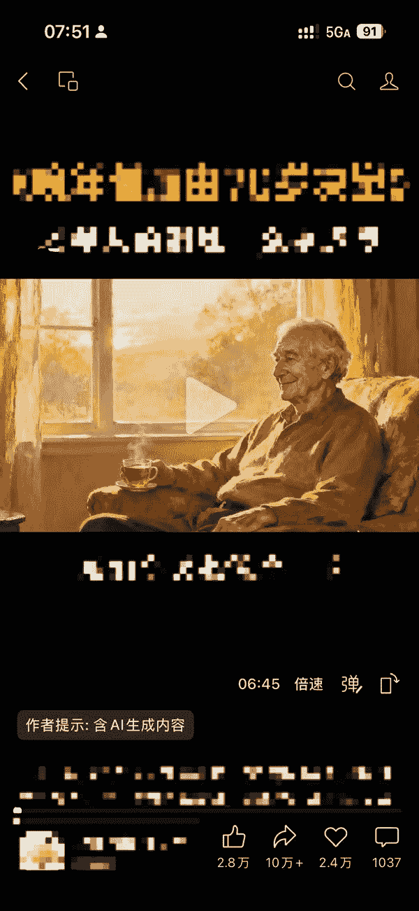

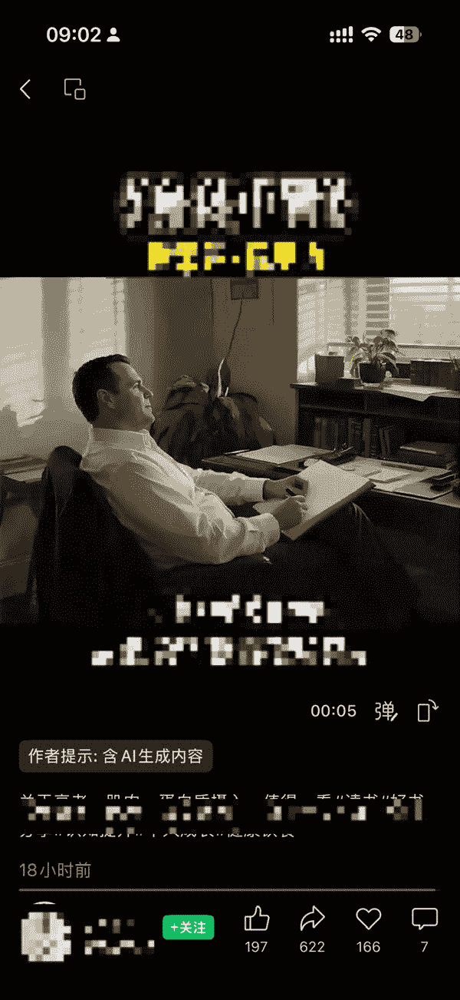

《晚年健康由 70 岁决定》

《身体重置》

这两篇最大的区别，不是播放量，而是成交链路完整度。

第一篇播放很高，说明“老人健康、70 岁以后怎么生活”这个话题是有流量的。但它的问题是，视频里讲的是《晚年健康由 70 岁决定》，评论和搜索里又出现《抗老生活》，橱窗商品也不能一眼看出哪本是视频同款。用户就算有兴趣，点进去也要自己判断买哪本，这一步就流失了大部分用户。

而且第一篇逐字稿更像科普节目，把很多具体建议直接讲完了，比如每天走多少步、洗澡不要锁门、不要乱停药。用户听完以后觉得“我知道了”，但不会觉得“我必须买这本书”。

第二篇虽然播放量低，但它更像一个完整的带货故事。它先制造焦虑：50 岁后发胖、没力气、肌肉流失；再给希望：不是老了只能认命，肌肉还有机会找回来；最后把书包装成一套完整方案。用户看完以后会觉得，这本书可能对自己或父母有用，所以更容易下单。

17 / 47

所以第一篇不是选题差，而是内容不像卖书的，后续的成交链路也不顺畅。

第一篇缺的是：书名统一、视频同款识别、橱窗置顶承接爆款流量、评论区引导用户购买、结尾留购买理由。

第二篇完成好的地方是：痛点明确 → 购买理由明确 → 书籍价值明确 → 用户知道为什么要买。

有些“养生知识”、“情绪疗愈”的视频看起来播放、转发、点赞高，评论也多，但用户只是觉得“讲得不错”，并没有想买书的冲动。还有些视频播放没那么夸张，但评论区一直有人问书名、怎么购买、适不适合爸妈看，后面这种，才是我更想要的素材。

这里还有第二个坑。

播放起来了，也不等于订单会起来。我有条视频播放起来后，当时还挺开心，结果后台迟迟没有出单。我第一反应是文案不行，是不是钩子太弱了。后来我自己按用户路径走了一遍，才发现问题特别低级。视频里讲的是 A 书，但橱窗第一屏放的是 B 书。用户点进主页以后，第一眼没看到视频里那本书，他就走了。年龄 50+ 这个群体，他们本身对手机的操作流程就不太熟悉，很少有人会在橱窗找目标书，直到下单完成。

18 / 47

经过这件事之后，每条视频发完，我都会自己走一遍路径：从视频点头像，进主页，看橱窗爆款是否在第一屏置顶，评论区有没有补下单引导（这里主要是针对没有挂车的操作）。

顺带说一句，我这 23 天 80% 的订单来自橱窗，其他渠道合计只占 20%。现在就算有挂车权限，我也会发几篇不带挂车的视频，想看看推荐流量是否有差别。

所以新号没挂车权限，也不是完全不能做。你只是要把「刷视频 - 直接下单」这条短路径，换成「刷视频，点头像，进橱窗，下单」这条长路径。长路径当然更麻烦，转化也会低一些，但只要橱窗设置好、评论区、主页引导清楚，还是能出单的。这也是我后来做新号时，没有焦虑挂车权限的原因（因为我看很多人把精力全花在了千粉、10 条原创上，而没有专注于带货本身）。

工具解决产能，素材解决播放，引导解决订单。这三件事要分开看。

## 四、人群：50+ 女性是家庭健康的“代理人”

【图 2：视频号后台人群画像截图，能看到购买人群的性别和年龄分布】

19 / 47

我的购买人群里，女性 65.3%，粉丝年龄 50+ 占 72%，40+ 占 94%。

做电商久了会有一个习惯，不会只看“这个产品好不好”，还会下意识想，这个人买回去到底是想解决什么问题。

50+ 女性买健康书，很多时候不是买一本书回去自己慢慢消遣。她可能是想给父母看看，想跟老伴聊聊最近的血糖、睡眠等健康指标，也可能是觉得这段内容有用，顺手转到家族群里。她就是家里那个最操心健康的人。所以她付的那几十块钱，买的不只是一本书，更像是给一家人买一份安心。这也是为什么我后来写文案时，不太追网感、追梗、追快剪反转。这个人群她们更在意的是长寿、睡眠、血糖、防摔、父母健康等很实际的内容。你讲得可信一点，清楚一点，具体一点，反而更容易打到她们。

## 五、新手 7 天最小闭环

讲到这里我估计有人会问：道理我都听懂了，第一天我应该干什么？

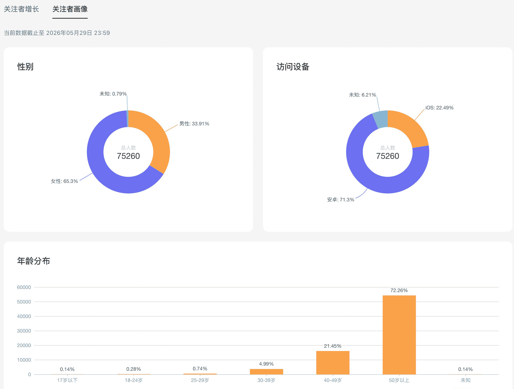

20 / 47

我给新手的建议是按 7 天闭环跑，不要一上来就铺 10 个号。

第一天先把基础搭好，定赛道（例如 50+ 健康）、选 1-2 本主推书、橱窗第 1 位放视频同款书、主页简介改成“xxxxxx 视频同款 → 在👇👇👇👇下面【商品】购买”，具体可以参考 26 年 3 月 AI 图书视频航海教程。

接下来三天是测素材，去抖音找爆款带货视频，这三天的目标不是出单，是测哪个素材有播放、转发等。

第四天该盯数据了。找出完播率最高、商品点击率最高的视频，这是后续放大的种子视频。再接下来两天，基于种子视频的钩子让 AI 改写出 5-10 条变体（注意是改写不是复制），分布到不同时间段发。

第七天复盘。如果 7 天总订单 ≥ 5 单可以继续第二周；如果 0 单，先别加号、先回头看评论引导、橱窗承接是不是没做好。

新手最常犯的错：第一周还没测够数据就着急换书。请把第一本书测够 10 条视频再判断，不然你永远不知道是书的问题、逐字稿的问题、还是承接的问题。

数据参考线（基于我的数据，欢迎大家分享更多数据进行核对）：无购物车情况下万播放订单 1.25-1.50 单算正常；商品点击率接近 7.5% 算不错；早上 6-10 点贡献了我 52.4% 的订单。

21 / 47

复盘四句口诀：播放低看开头 3 秒；播放高点击低看钩子；点击高订单低看商品橱窗；订单高播放低保留定时复发。

## 六、复盘：做对的、做错的、踩过的坑

【做对的一件事】把视频工作流先搭出来（这里因人而异，因为我很讨厌手工剪辑这活，所以一开始就做了工具，但是对于大部分人来说应该先做手搓视频入局）。

如果按手工剪辑模式，我可能撑不下去。任何一个我做超过 3 次还在手动重复的耗时动作，都必须想办法 AI 化或脚本化。

【做错的一件事】爆款流量起来时别急着趁热上新。健康类图书是高违规风险品类，稍不留神就踩到了疗效承诺、极限词、医学暗示。我刚跑出第一条爆款时下意识就想“既然这条爆了，赶紧再发几条把这波流量吃透”。结果新发的几条里有一条没把控好医学暗示，账号被警告并掉了一次橱窗权限——那段时间爆款视频还在跑，但用户进来看不到橱窗，订单直接归零。（这种情况可以把相同素材放到其他账号上分发）

复盘之后才想明白：爆款视频本身是稀缺资源，它带来的流量和订单是确定性最高的事情。最优策略不是“乘胜追击”，而是让爆款先跑完它的生命周期。一条新视频违规可能让整个橱窗被限制，连爆款带来的流量都吃不到了。跨境里爆品出单后立刻追加预算是常规打法，但视频号里新内容的合规风险会反向波及到已有爆款的订

22 / 47

单情况——这跟电商的直觉是反的，需要引起注意。

补一个新手容易忽视的隐藏机制：视频号播放量到 10 万+ 会触发平台人工审核（这点我是从圈友夏俊虎《理发师到 500 万 GMV》一文里学到的）。这意味着你爆款一旦冲到 10w+，平台会人工审一遍——这时候你新发的视频如果踩了医学/极限词的雷，会连带平台重新审视已爆视频。所以爆款来临时踩刹车是这个赛道的机制问题。爆款出现后先盯数据、调橱窗排序、补评论引导、联系商家上套装，这会大幅拉升转化率 + 客单价；新视频该发也发，但必须先过一遍合规检查，如果拿不准就压着不发或者换号发。

【坑 1：单品依赖】

主爆品贡献了 80% 的 GMV，看到这数字我有点慌——因为选品、素材、人群、价格带都对；危险是同一本书推久了后期转化数据会下降，库存经常断货。TOP1 GMV 占比超过 80%，必须立刻孵化第二爆品，每天留 2-3 条视频测品，哪怕短期没单也得测。

【坑 2：没及时联系书商做套装、定向高佣】

这点挺遗憾的。爆款已经跑了几轮，前期我都默认挂书商的标准链接、吃公开佣金。后来才反应过来——爆款视频是你跟书商谈条件的最大筹码，可以做两件事：第一是问书商这本书有没有 2 本/3 本套

23 / 47

装（书商连夜给我上了 300+ 的 sku，客单价大幅提升），一旦换成套装，单本几十元能拉到套装 150-300+，同样的播放量 GMV 直接翻倍（这也是我客单价能稳定在 85.1 的原因——后期产品只要出单，我就会联系书商上套装，把客单价做高点）；第二是申请定向高佣，正常账号可以拿到公开 30%-40%，数据好的能到 45%+。这两步是图书赛道最被新手忽视的杠杆，我估算如果第一轮就这么做，5 万佣金能做到 6-7 万。爆了第一条视频就去联系书商，不要等。

【还想测的方向】图书是高客单 + 高佣金 + 低售后率的组合，非常适合上微付费。低客单产品（百货、美食）的微付费是“撬动自然流”逻辑，几百块预算撬几千 GMV；而图书可以直接用“投产逻辑”——100 块客单两单回本，跑正 ROI 就持续追投，本质是拿钱生钱。我目前 23 天数据全部是自然流跑出来的，下一步会叠加微付费做对照测试。

## 七、给想入局的朋友几句话

如果你在 AI 带货的所有品类里只能选一个开始，我会推荐图书。这条赛道集合了几个高价值特征：高客单（单本 70-100、套装能拉到 150-300+）、高佣金（30%-50%）、极低售后率（1-2%）、达人不碰售后、无明显淡旺季、SKU 链接稳定可长期跑、AI 适配度最高。这些条件加起来意味着，这是一条不用费力博爆款、靠勤奋就能持续赚钱的路。其他大多

24 / 47

数品类至少缺其中两项：服装售后率 30%+、美食客单 10-20 元、三农半年淡季、护肤功效违规高发。

更关键的判断是这一层。我特别认同圈友亦恒讲过的一句话：

用户买的从来不是产品本身，是“成为更好的自己”的解决方案。

这句话放到图书赛道里，我越做越有感觉。50+ 女性买健康书，很多时候不是为了证明自己「读过一本书」。她可能只是想多懂一点，回家能跟父母说两句，能提醒老伴少熬夜，能在自己身体开始走下坡路之前，先做点准备。那几十块钱，买的是书，也是一个“我在为家里人操心了”的感觉。

童书也一样。家长买的是“我没有在孩子教育上偷懒”。

经管书也是一样。很多人买的不是知识点本身，而是“我还在进步，我没有被时代落下”。

理解了这一层，AI 工作流里的提示词和文案模板，就不能只围绕“产品有什么卖点”来写，而是要围绕“用户买完会变成什么样的人”来写。

我跑得最爆的几本书，整条逐字稿讲的根本不是书的内容，而是“老了之后你该怎么活”。这才是用户真正在买的东西。

25 / 47

聊过的朋友里，10 个有 7 个第一反应是：“能不能给我看下你那套 AI 自动化的代码”。我理解这个反应，因为我自己也是程序员，很容易先关心工具。但做完这一轮之后，我反而觉得，工具不是关键因素。不会写代码也能跑。腾讯元宝、豆包、剪映这一套低配版，就够你先验证了。具体步骤我放在文末附件里。

还有一个必须说的真话。内容策略上，我现在还在「第一抄」阶段。这是借生财圈友夏俊虎《理发师到 500 万 GMV》里的「三抄」框架来说的。我的爆款逐字稿基本都是从抖音找来的，我还没有原创爆款能力。但我把「抄」这个动作的工具杠杆做得比较极致：一条被验证过的爆款，15 分钟内可以复刻成视频号成片。这听起来不高级，但对新手很务实。先别急着原创，先把作业抄好。等沉淀过 100 条素材的体感，做过 3-5 个赛道的对标分析，才有资格谈「超越对标」那一步。我离那一步还远，目前依然是个认真抄作业的玩家。

货源和售后也不用愁。选品广场直接挂书商的书，书商发货、兜底，达人完全不用碰售后，我现在售后率稳定在 1-2%。后台联系书商申请定向高佣，正常账号都能谈到 30%-40%，数据好的话 45%+，再

26 / 47

叠加套装链接拉客单价，整体杠杆倍数很大。

最后真正决定能不能赚到钱的，还是两件 AI 替不了的事。

一是一天刷 30-50 条抖音带货视频，判断爆款的选品能力。

二是 7 天没结果，依然每天稳定出 5-10 条视频的执行力。我发现在航海期间能坚持发很多条视频的圈友基本都能拿到结果。

AI 工作流解决产能，但不会替你打造爆款。

有电商背景的朋友，最大的资产是「看懂用户、转化漏斗、数据」这套思维，原封不动搬过来就行。纯新手的路会难一些，但也走得通。先用低配版跑一本书，连续 7 天看数据，比看 100 篇方法论都管用。

所以别一上来问能不能月入多少。先问自己能不能连续 7 天，把一个账号、一本书、一条转化链路认真跑完。

AI 只是把剪辑那个最累的环节干掉了。如果冲着「AI 一键生成、躺着赚钱」来，大概率会失望。

27 / 47

最近听一位圈友说了一句话我很认同，「执行力是高级认知」。晚上 11 点看到一个爆款能立马爬起来剪一条发出去，这是判断你能不能跑通这条路最朴素的标准。

我下一步两个方向：孵化第二爆品把 TOP1 GMV 占比从 80% 压到 60% 以下；把选品、原创文案环节也半自动化，用大模型按人群画像给抖音候选视频打分。这套打法还在持续优化，有重大发现我会再写一篇。

希望这篇能帮一些刚入场的朋友少走弯路。也欢迎做这个赛道、或者像我一样从跨境、软件开发跨过来的朋友交流、共勉。

## 八、新手最常问的 6 个问题

1. 我没有任何号，能起步吗？

能。自己实名注册一个新号即可，先自己注册 2 个号同时跑通验证，再考虑加号。新号 200-300 基础播放正常。

补一张播放量阶段诊断表（借鉴自生财圈友夏俊虎），新手对照自己账号判断状态：

| 阶段 | 单条播放量 | 状态 + 动作 |
|------|------------|-------------|
| 0 | 个位数到几十 | 账号违规，先查原因 |
| 1 | 100-400 | 正常状态，继续优化文案 |
| 2 | 500-1000 | 进入推荐池，平台开始扶持 |
| 3 | 1000-1w | 多条达到，可考虑加号矩阵 |
| 4 | 1w-10w | 出单阶段，几百到几千佣金 |
| 5 | 10w+ | 大爆款，触发平台人工审核，注意合规 |

2. 前期需要投入多少钱？

低配版（不写代码）几乎零成本，剪映免费 + 豆包基础额度够用。走 API 工作流单条 1 元以内：

- 我自己 23 天发 40 条，单号 API 成本 30 元左右
- 如果你做矩阵每天 10-20 条，月成本 300-600 元

29 / 47

真正的成本不是钱，是时间：你愿意每天花 2-3 小时刷抖音找选题、看数据吗？

3. 每天需要投入多少时间？

跑通后单号每天 1-2 小时（选题 + 出片 + 发布 + 看数据）；矩阵 5-10 个号需要 4-6 小时。起步第一周更多一些，要熟悉每一个工具。

4. 怎么和书商谈定向高佣？

选品中心 - 每本书都标了对接客服。挂车跑出几单数据后，主动联系客服说“我是 XX 号在带 XX 书，能否申请定向佣金”，数据好的能谈到 45%+。

5. 我视频号没有粉丝，能起号吗？

能。我跑了几个号都是新号流量高（由于我的样本少，不能断定这是机制还是运气问题），第一条内容好就能进流量池。我这 23 天数据就是从零粉新号跑出来的。老号如果本来就不是健康/书单赛道，也能正常跑，我有个大爆款就是从宝宝视频转向健康书单赛道的。

6. 我新号还没开挂车权限，是不是只能等？

不是。我这 23 天 80% 订单来自橱窗，其他渠道（含挂车）合计只占 20%——新号没开挂车权限期间，把引导做好同样能出单。等千粉再挂车。具体做法：在视频结尾和评论区明确引导“主页橱窗下单”，把“刷视频→下单”短路径换成“刷视频→进橱窗→下单”长路径。

30 / 47

补充一个 2026 年的利好：视频号挂车政策明显放开——挂车素材的考核大幅降低、1000+ 粉的号单日可挂车数量从 2 条提升到 5+ 条。也就是说挂车权限的价值在涨，“纯橱窗模式”是新手的过渡阶段，等你千粉后第一时间挂车。

希望对你有帮助。

## 九、最后留几个我自己也没想清楚的问题

这里留几个我自己也没答案的方向，希望听听各位圈友前辈指导：

1. 视频号的“老粉权重”机制究竟怎么算？我观察到老号有时候反而起量更慢，但说不清是数据样本太小还是结构性规律。

2. 健康赛道单素材“反复能爆”的周期到底是多久？同素材我发了 3 轮还能起量，不知道第 4 轮第 5 轮会不会失效，以及素材洗完后对转化率会有什么影响。

3. 矩阵号超过 10 个之后，小 V 猫发布视频是否会被关联？我目前还在 3 个号阶段，没法验证。

4. 健康赛道基于官方的合规内容调整了提示词还是容易被提醒，有什么好的解决办法吗？

如果有圈友在这些方向有数据或经验，欢迎评论区交流。

31 / 47

## 十、感谢

最后想感谢一下生财，也特别感谢吃不胖圈友。从 3 月份开始，他一直在指导我怎么做视频号，从选品、内容、合规、账号节奏到资源对接，给了我非常多具体的帮助。很多地方如果没有他的提醒，我可能要多踩很多坑。

这篇文章里我也借了回声老师的视频号带货实操、亦恒老师“成为更好的自己”的洞察（让我看懂用户买的是什么）、夏俊虎老师的“三抄”框架和流量诊断表（让我看清自己当前还在“第一抄”的位置），他们的分享是这篇文章重要的几个起点。从航海里学方法、从精华帖偷判断力、从圈友身上看正反馈，这篇是我的一份小小回报。

## 十一、相关阅读

- 回声老师《生财项目升级迭代，我从月佣几千到月入 4-5 万的视频号带货实操分享》
- 亦恒老师《「成为更好的自己」金句来源》
- 夏俊虎老师《从理发师到视频号图书 500 万 GMV——我的三年实战复盘》
- 26 年 3 月《AI 视频图书带货（视频号）航海》——我入局的起点，新手强烈建议跟一遍

十二、附件

（提示词主要在自动化工具上使用，如果是手工处理，可以微调一下，仅供参考）

### A. 逐字稿清洗（修复 ASR 错字 + 去除营销噪声）

输入：抖音原视频提取出来的原始 ASR 文本
输出：可读的纯正文，保留事实，删除栏目口号和水印

**System：**

你是逐字稿修复清洗助手。你需要在保留事实和原文顺序的前提下，删除非正文噪声，修复乱码和明显 ASR 同音错词。你必须同时遵守视频号内容安全要求，避免输出任何低俗、暴力、虚假夸大、医疗承诺、导流诱导或误导性表达。输出必须是清洗后的纯正文。

**User：**

请对下面的逐字稿做修复型清洗。

**你可以做的事：**

1. 删除明显属于原博主的栏目口号、作者自称、互动引导、导流主页、平台水印、往期节目提示等非正文钩子。
2. 删除跨平台搬运水印，例如“优优独播剧场——YoYo Television Series Exclusive”“谢谢观看”。
3. 删除明显重复拼接的段落，只保留一次。
4. 对乱码符号（例如 ೦）和明显 ASR 同音错词做上下文推测修复，例如“轻运”应结合语境修成“清运”，“飘铃/飘龄”应结合尿酸语境修成“嘌呤”。
5. 适度补充必要标点，让正文可读。
6. 进一步删除或改写视频号高风险表达：低俗擦边、血腥暴力、虚假夸大、医疗承诺、诱导互动、导流私信/评论区/主页、恐吓式逼单、伪装权威结论。

**严禁做的事：**

1. 不要改写观点、人物、时间、数字、案例和核心事实。
2. 不要概括、扩写、重排正文结构。
3. 不要输出标题、解释、Markdown、修改说明。

如果不确定某个词该怎么修，就保留原词，不要编造新信息。

主题关键词：{keyword}
原视频标题：{title}
原作者标识：{author}

请基于下面的原始逐字稿，返回修复清洗后的正文：

{transcript}

**关键经验：** 医疗类、养生类内容里的 ASR 错字最难修，比如「嘌呤」会被识别成「飘铃/飘龄」、「胰岛素」会被识别成「衣岛素」。一定要把“主题关键词”传进去，让模型有上下文判断依据。

### B. 口播文案改写（轻量改写、保留爆点、过查重）

输入：清洗后的正文
输出：和原稿不完全相同、但保留爆点和节奏的改写版本

**System：**

你是短视频中文口播改写助手。

1. 只改写正文主体，不改写系统提供的固定开头、中段、结尾钩子。
2. 保留原文事实、人物、时间线和核心观点，不要杜撰新事实。
3. 删除原博主的自我介绍、栏目名、引导关注、导流主页、感谢支持等痕迹。
4. 行文要更口语化、紧凑、有推进感和悬念感，但不要空洞重复。
5. 输出纯正文，不要标题、分点、小标题、解释说明、括号备注。
6. 不要出现“作为 AI”“我无法”之类无关措辞。

**User：**

请把下面这段已经清洗过的逐字稿主体改写成一版更适合中文短视频口播的正文。只输出改写后的正文主体，不要输出标题、说明、分点、额外注释。

主题关键词：{keyword}
原视频标题：{title}
原作者标识：{author}
补充要求：{rewrite_notes}

待改写正文：

{cleaned_transcript}

**关键经验：** 温度建议设 0.7。这套改写不追求“原创度 100%”，追求的是“和原稿不完全一致 + 保留原稿爆点”。如果你换成更激进的提示词试图让 AI 完全重写，反而会损失原稿验证过的钩子。

### C. 轻量去重微调（爆款文案二次发布前用）

如果你想把同一篇爆款文案再发一遍（同号或矩阵号），需要做轻量微调避免被判搬运。

**System：**

你是中文短视频逐字稿轻量去重助手。你只做非常克制的微调，目标是保留原文案效果，而不是重写。输出必须是微调后的纯正文。

**User：**

请基于“已清洗正文”做轻量去重微调。

目标：让文本和原稿不完全一致，但尽可能保留原文爆点、节奏、观点和表达力度。

**允许做的事：**

1. 微调少量连接词、语气词和重复口头禅。
2. 极少量同义替换，但不能改弱情绪和冲突。
3. 轻微调整标点和短句停顿，让口播更自然。
4. 删除非常轻微的重复词，但不能删关键句。

**严禁做的事：**

1. 不要概括、扩写、重排段落或改变论证顺序。
2. 不要改动人物、书名、作者名、数字、时间、案例、因果关系。
3. 不要加入新的事实、标题、解释、Markdown 或修改说明。
4. 不要把表达改得更保守、更平淡，爆点和情绪强度要尽量保留。
5. 总字数必须和已清洗正文接近，建议差异控制在 8% 以内。

主题关键词：{keyword}
原视频标题：{title}
原作者标识：{author}
必须原样保留的词：{protected_terms}

原始逐字稿：

{transcript}

已清洗正文：

{cleaned_transcript}

**关键经验：** 去重微调的成功率不到 100%，建议同一爆款文案在同一账号上两次发布间隔至少 3-5 天。

### D. 书名 + 作者识别（从逐字稿反推真实书籍）

输入：原视频标题、描述、清洗后正文
输出：JSON 格式的书名和作者，便于自动化挂车

**System：**

你是中文图书短视频的信息抽取助手。

你的任务是从原视频标题、描述、逐字稿或清洗文案中识别被讲解/带货的书籍名和作者名。

只抽取文本中能支持的信息，不能根据主题猜书，不能编造作者。

书籍名只保留书名本体，不带书名号《》，不带“经典解读/深度解读/必读”等营销词。

作者名保留国别或地区前缀和中文译名，格式优先使用全角方括号，例如［美］彼得·阿提亚。

如果文本只出现作者但没有国别，作者名只输出作者中文名。

如果无法可靠识别某字段，输出空字符串。

严格输出 JSON：

{"book_title":"","book_author":"","confidence":0.0,"evidence":""}。

confidence 是 0 到 1 的数字；evidence 用一句中文说明依据。禁止 markdown、解释、代码围栏。

**User：**

现有书名：{existing_title}
现有作者：{existing_author}
主题关键词：{keyword}
原视频标题：{source_title}
原视频描述：{source_description}

逐字稿/文案（前 2600 字）：

{script_text}

请识别书籍名和作者名，作者名需要基于书名去联网搜索。

**关键经验：** 温度设 0.05，强约束 JSON 输出。confidence < 0.6 的结果建议人工复核，成片后再审查书名、作者名太费时间。这里推荐使用 deepseek-v4-flash，成本低，识别准。

### E. 配图生成（gpt-image-2 / 可灵 / 豆包 通用）

输入：清洗后的逐字稿分段 brief，每 9 段为一组
输出：一张 3x3 九宫格总图，每个格子是一张可独立裁切的候选图

**System：**

你是中文短视频口播的视觉分镜导演，负责把逐字稿内容转译成安全、统一、适合公开视频平台发布的意境图。

你的任务不是生成单张插图，而是生成一张 3x3 九宫格总图。九宫格会被后续程序裁切成 9 张独立候选图，所以每个格子都必须是独立完整的画面。

**硬性要求：**

- 整张图必须是 3 行 3 列，共 9 个独立分镜。
- 每个格子只能表达一个核心画面，不要堆满元素。
- 9 个格子必须按从左到右、从上到下的顺序，对应用户提供的 9 段 brief。
- 格子之间只允许极细、低存在感的深色分隔线。
- 不要生成大白边、宽边框、相册拼贴、漫画分镜框、UI 界面或海报排版。
- 图片里禁止出现任何可读文字、字幕、标题、书名、品牌、水印、二维码、按钮、弹窗、账号名。
- 人物可以出现，但避免正脸特写、网红脸、夸张表情和拥挤群像。
- 优先用场景、背影、动作、光线、物件隐喻表达段落情绪。

**统一风格硬约束：**

本任务可能会生成多张九宫格总图，用来裁出 18/27/36/45/54/63 张候选图。所有九宫格总图必须保持同一套视觉风格，像同一支短片的连续分镜。不能每张图换画风，不能每个格子换画风。

**安全表达硬约束：**

即使逐字稿出现身体、睡眠、衰老、疾病、癌症、糖尿病、肾衰竭、女性健康、激素、疼痛、手术、药物等词，也不要画医疗病理、身体异常、器官、伤口、病床、手术室、监护仪、注射器或惊悚画面。必须转译为明亮、干净、健康的日常生活方式隐喻，例如阅读、窗光、运动、厨房、水杯、植物、书桌、散步、家庭日常、自然光中的人物背影。

**整体基调：**

积极、明亮、干净、健康、舒适、有电影感，适合公开视频号/抖音/小红书发布。

只生成图片，不要解释，不要输出文字说明。

**User：**

为中文短视频口播生成一张 3x3 九宫格概念图。

最终用途：

这张九宫格会被裁切成 9 张独立候选图，用于同一条短视频的连续分镜。

画幅要求：

- 整张九宫格总图：{grid_aspect_ratio}
- 每个格子内部画幅：{cell_aspect_ratio}
- 每个格子的主体必须放在中央安全区，方便后续裁切和成片排版。

主题方向：

图书启发、认知成长、人生感悟、关系洞察、命运转折。

统一视觉风格：

{style_bible}

风格要求：

- 明亮电影感，真实摄影或高级插画风
- 光线自然，画面干净，低信息密度
- 色彩统一，镜头语言统一，人物气质统一
- 像同一支短片的连续分镜，而不是 9 张不相关的图

内容来源限制：

只参考逐字稿正文和下面的 9 段 brief，不引用原视频标题、账号、作者或来源信息。

整条视频主题：{book_title}
书籍作者：{book_author}
当前九宫格批次：第 {grid_index}/{grid_total} 组

九格画面 brief：

1. {cell_1_text}
2. {cell_2_text}
3. {cell_3_text}
4. {cell_4_text}
5. {cell_5_text}
6. {cell_6_text}
7. {cell_7_text}
8. {cell_8_text}
9. {cell_9_text}

请直接生成九宫格总图。不要在图片里放任何文字。不要输出解释。

**参数填写建议：**

{grid_aspect_ratio} = 16:9 横版画布
{cell_aspect_ratio} = 16:9 横版构图

当前项目里的两种模式可以这样处理：

- 选择 9:16 竖屏素材：后处理从每个 16:9 格子中心裁成 9:16。
- 选择 16:9 横版素材：后处理保留每个 16:9 格子。

**style_bible 默认值：**

- 固定美术方向：明亮电影感真实摄影，安静、克制、有知识短视频质感。
- 固定色彩：暖白、浅木色、柔和灰蓝、低饱和绿色，少量温暖阳光点缀。
- 固定光线：窗边自然光、清晨或傍晚柔光，阴影干净，整体曝光偏明亮。
- 固定镜头：35mm/50mm 人文镜头语言，主体明确，背景简洁。
- 人物气质：普通成年人，安静、理性、克制，优先背影、侧影、手部动作和生活场景。
- 所有图片必须共享同一套色彩、光线、镜头、人物气质、材质和时代感。

**关键经验：**

1. 风格一致性比单图美感更重要。一条视频 63 张图必须像同一支短片的连续分镜，不能每张换画风。
2. 医疗安全是健康赛道的红线。即使段落里讲糖尿病、癌症、肾衰竭，也要转译为日常生活方式隐喻，避免医院、病房、手术、器官、伤口、监护仪等画面。
3. temperature 用模型默认值即可。生图本身随机性已经很高，不需要额外增加随机性。

### F. TTS 段落切分（让长文案适配 TTS 接口）

很多 TTS 接口对单次输入有时长限制（一般 24-30 秒）。需要把长文案切成多段后并发合成。

**System：**

你是中文短视频配音文案拆段助手。

你的唯一任务是把给定文案按原顺序拆成多个适合 TTS 的自然段。

严禁改写、增删、概括、润色或重排内容。

输出必须是严格 JSON：{"segments": ["...", "..."]}。

每段尽量控制在 24 到 28 秒内，绝不能故意合并成长段。

如果原文本来很短，也至少返回一个 segment。

不要输出 markdown，不要输出解释。

**User：**

主题关键词：{keyword}
原视频标题：{title}
原作者标识：{author}
目标单段时长：26 秒以内

请基于下面这段候选稿（最终配音文案）拆段：

{script_text}

**关键经验：** 切分后并发合成可以把 90 秒文案的 TTS 时间从 25 秒压到 5 秒以内。如果你不做并发，用单接口顺序请求也可以。

### G. 低配版工作流（不会代码也能跑）

如果你不想自己写代码、不想搭服务器，可以用这套全工具组合，完全能实现 100% 的能力，单条视频可能会接近零成本，时间从 15 分钟变成 40 分钟，链路一样能跑通：

| 步骤 | 工具 | 说明 |
|---|---|---|
| 1. 提逐字稿 | 腾讯元宝 / 大家可自行搜索抖音逐字稿提取工具，本文不提供相关链接，避免违规推荐 | 把视频号分享给元宝，让他一字不漏提取逐字稿；抖音需要使用专门的工具处理 |
| 2. 清洗+改写 | 文心一言 / 豆包 | 把上面的提示词 A、B 复制进去，喂逐字稿 |
| 3. TTS 配音 | 剪映 AI 配音 | 直接选一个中年男性声线，免费 |
| 4. 配图 | 豆包生图 / 即梦 | 把提示词 E 复制进去，每段单独生图，约 63 张 |
| 5. 书名识别 | 豆包对话、自行搜索 | 把逐字稿前 2000 字粘进去，让它识别书名 |
| 6. 合成 | 剪映 | 图片 + 音频 + 字幕一拖一拼，半小时学会 |

整套流程不写一行代码，月成本零（剪映免费 + 豆包基础免费额度足够）。如果你想跑通验证赛道是否适合自己，先用这套低配版跑 7 天，验证完再决定要不要做自动化工具。

我自己刚入场的第一周也是用低配版跑的，真正决定能不能赚到钱的，从来不是工具组合多牛逼，是你对赛道、文案、人群的判断力。

————分割线————

看完这篇 SOP，你觉得你懂了。但 90% 的人一到实操就会卡在第一步。

工具和教程只是最低级的壁垒，真正的壁垒是“立刻动手”和“圈层信息差”。

如果你想看全网最新的变现玩法，并且和一群执行力极强的极客一起下场拿结果，欢迎围观我的核心私域：【懒人专属群】。

我们不聊虚的，只做商业闭环的拆解与 AI 效率的压榨。系统内已沉淀 1000+ 跑通的套利实战局。

👉👉 查阅圈子完整数字资产与上车门槛：https://lazyso.com/insider/

认同价值、准备好下场干活的，扫码加我微信（lazyhelper1），备注：【实操上车】，不闲聊

