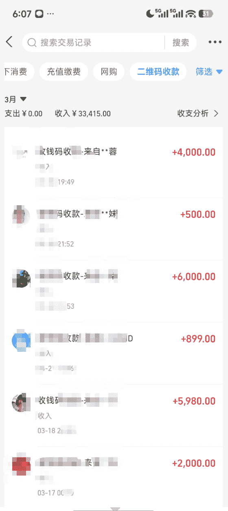
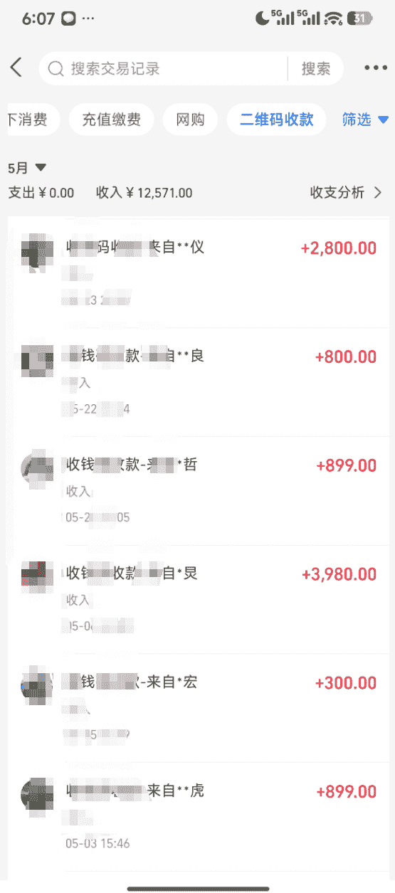
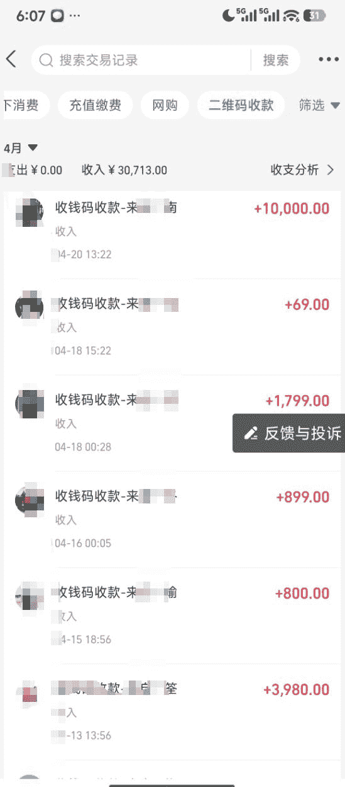
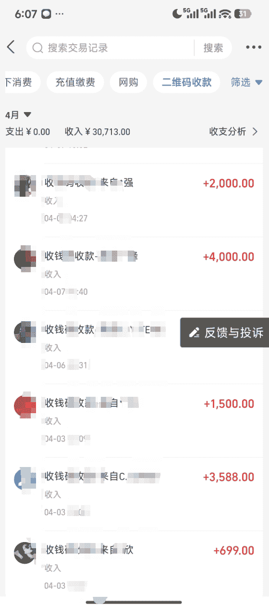
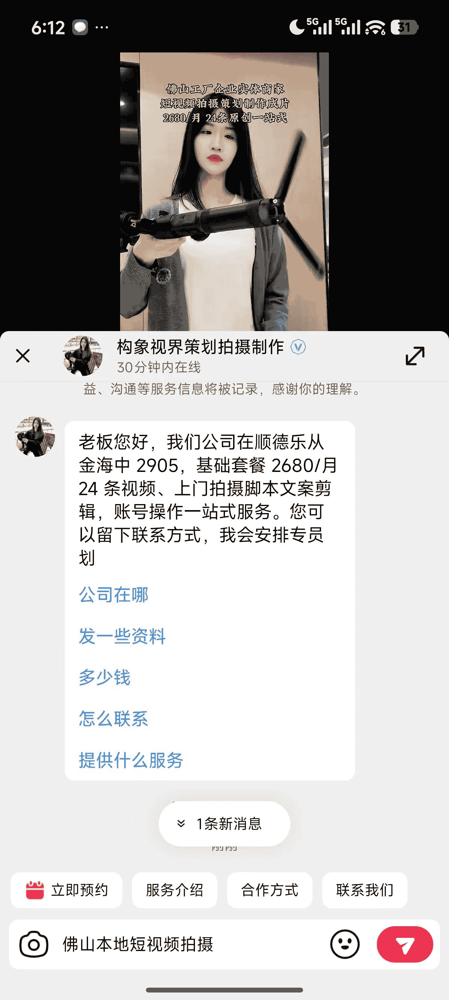
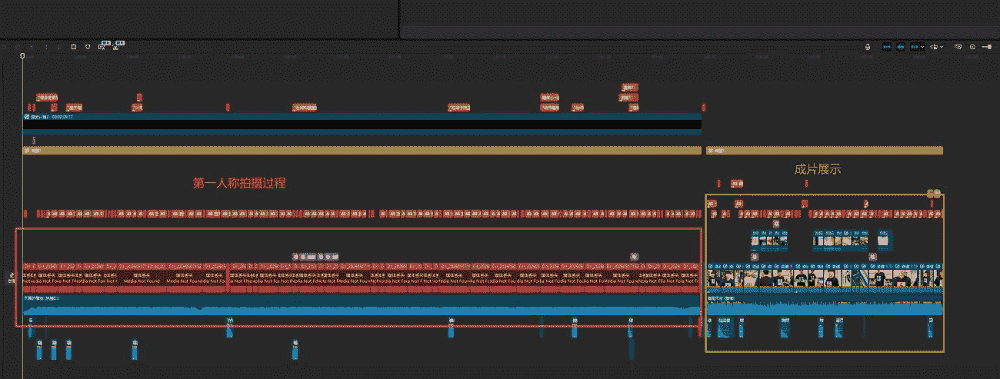
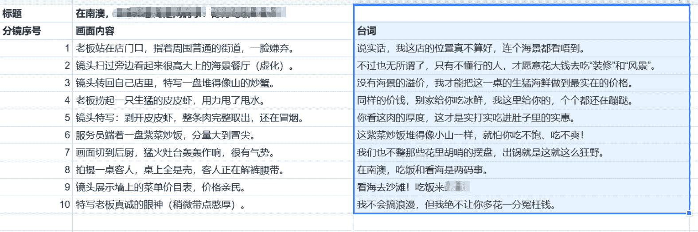
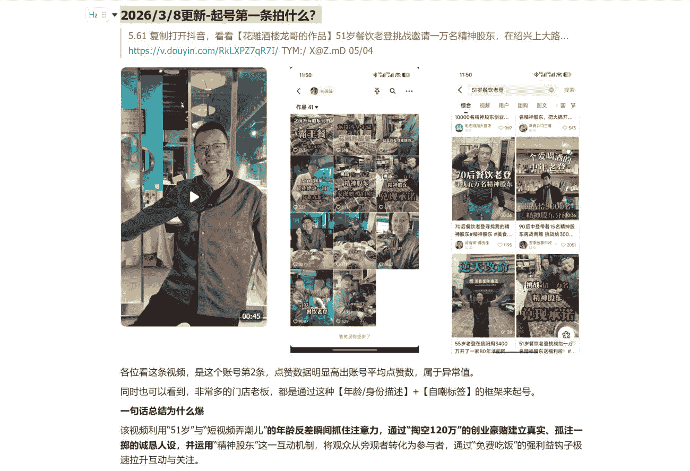
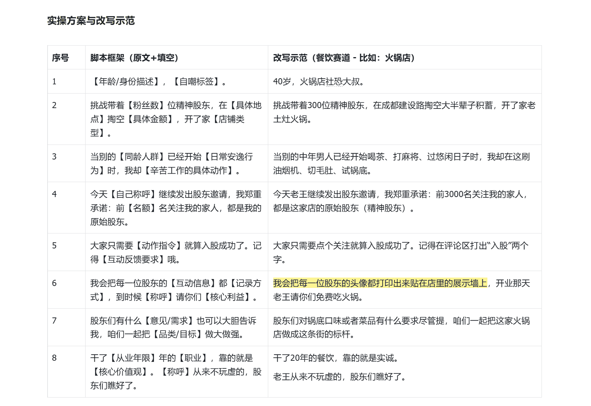
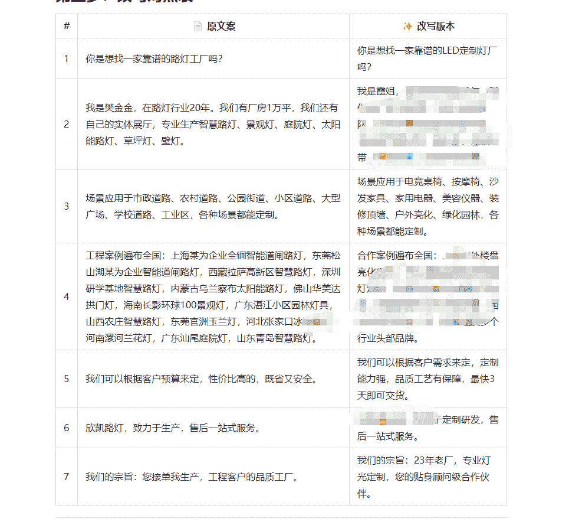

## 同城实体商家代运营，第二个月营收6w，我是如何做到的

260610 副业SC 精华

公众号懒人搜索，懒人专属群独享

懒人微信：lazyhelper1

圈友们好，我是Logan（圈名洛更），目前坐标广佛交界的金沙洲。

好久没有写帖子了，上一篇精华帖还是好几年前。这中间兜兜转转换了2-3个项目，但说实话，从来没有一个项目像"同城实体商家代运营"这样，给我的确定性这么高。虽然它不是什么风口上的新项目，但确实对新人极其友好。

我是自己一个人单打独斗，一部二手苹果15 Pro Max，一台二手Action 5，从今年2月份开始切入这个项目：

- 2月份（起步期）：收入是12,659元；
- 3月份（小高潮）：收入是56,025元。

下面是部分收入截图。

今天想写这篇长文，就是想把我这个"从来没有做过代运营的人"，是如何快速拿到结果的实战经验，毫无保留地分享出来。

不过在开篇我也想交个底：这个项目我个人认为，同城代运营本质上是"信息差 + 强执行力 + 苦力活"。

虽然赚钱的确定性较高，但以我目前的单人打法来看，天花板比较低。

不建议圈友们看完脑子一热直接跟进，还是要结合自己的实际情况做选择（具体原因，我会在文末详细复盘）。

但是如果你体力好、执行力强，不想承担亏损的风险，想一个月赚1-3w，那我觉得这个项目是一个不错的选项。

## 一、为什么决定做同城实体商家代运营

起因是，年初我在刷抖音的时候无意之间看到了一种【第一人称视角】的记录给实体商家拍摄引流视频的内容。

就如下面这种。

非常简单粗暴：脖子上加一个Action运动相机，用"第一人称视角"记录他是怎么帮本地实体商家拍摄短视频引流的。

这种形式的视频的重点在于，让实体商家反应过来，原来拍出"高质量"的引流短视频，居然这么简单？

不需要自己有经验，不需要有镜头感、不需要想文案背台词，就能有很不错的引流效果。甚至都不需要给他看后端效果，只要是视频质量给人感觉很高即可。可以说是打破了大部分实体经营者的固有认知。

刚好我有一个朋友也是做代运营，测试了一下这种形式的内容。

结果视频刚发出去，立马就拿到了客资，并且迅速产生了转化。

对于做项目的人来说，这是一个极其宝贵的"正反馈"——它证明了需求真实存在，且变现路径极短。

其实在那个阶段，我正处于选项目的分岔路口，手头在纠结到底是做YouTube还是做小红书。

但当我又刷到了几个同样内容形式的代运营博主，流量都非常高，评论区的互动也都充满了需求，我意识到：同城代运营这个项目的"确定性"要高得多。

既然确定性高，那就开始落地。

## 二、如何获客？让本地商家主动来找你并愿意付费？

如何靠"第一人称视角"的拍摄过程+成片，让商家主动找上门的？

很多人做代运营，获客靠的是苦哈哈地去扫街。

也有用很粗暴的信息流广告去付费获客，这种方式比较适合体量大的团队稳定收入。但是缺点是比较难获取客户的信任，后端转化成本超级高。而且定价更低。

但我用的获客方式，就是复制第一人称视角记录+末尾展示成片的视频结构，通过做账号，用内容吸引同城商家主动找上门。

看完我内容的商家，本身就是具备信任，认可你的业务能力，所以加过来基本不用再介绍基础信息，直接说合作方案和价格即可。能接受就直接合作。

具体怎么做？

我会用第一人称视角的镜头，把我帮实体商家拍摄引流短视频的完整过程记录下来，然后剪辑成一条快节奏的实操短视频，末尾再衔接上精剪好的成片，发到我自己的自媒体账号上。

这条视频发出去，目的只有一个：给同城的老板们造梦。

我要让同城的老板刷到这条视频时，脑子里立马产生一种强烈的代入感："哎？原来这么简单！哪怕我是个什么都不懂的小白，只要找这小伙子来拍，我也能搞出这么好的效果！"

为什么这招管用？老板们为什么心甘情愿花钱？

在跑通这个项目的过程中，我深刻洞察到了当下实体商家的"三大痛点"，这也是我们在26年做代运营能赚钱的底层逻辑：

1. **能力困境（不会做，也怕做）**：绝大多数实体店老板对互联网是有极强畏难情绪的。他们骨子里觉得自己搞不定短视频，觉得门槛很高。既然自己做不好，试错成本又高，他们天然就倾向于"花钱买结果"，把专业的事外包出去。

2. **环境倒逼（生意难做，急需破局）**：尤其是今年，很多老板的自然客流都在下滑，生意确实不太好做。大家都在迫切寻找新的流量突破口，这就给短视频代运营腾出了巨大的市场空间。

3. **同行内卷的"焦虑感"**：这是促使老板掏钱最快的原因。当一个老板看到同一条街上的餐饮同行、竞争对手都在拍短视频、搞团购时，那种"跟不上时代节奏"的焦虑感是极其折磨人的。为了不被时代淘汰，为了不输给隔壁老王，他们非常乐意花这笔钱，买一张本地流量的船票。

## 三、搞钱模式：怎么向老板收费？交付什么内容？

流量引过来之后，怎么转化？

针对不同预算、不同地域和不同认知的老板，我设计了三套阶梯式的合作模式，基本能把有意向的客户全部承接住：

### 模式一：一站式全包代运营

- **收费标准**：5980-6980元 / 10~15条视频（珠三角地区目前的定价，不含差旅费）。
- **交付内容**：我们负责账号策划、脚本定制、上门拍摄、后期精细化剪辑。基本上10-15条就是一天之内全部拍摄完毕。从早拍到晚，差不多30分钟完成一条的拍摄。
- **老板配合**：老板只需要出个人（负责出镜），以及提供场地和道具（比如餐饮店老板，只需要炒几个招牌菜摆一桌）。
- **实操心得**：这个模式老板最省心。对于实体店老板来说，这点菜品成本几乎可以忽略不计，他们极其乐意花钱买一个"不用自己动脑子"的现成结果。

### 模式二：纯脚本定制（突破地域限制，主打轻交付）

- **收费标准**：1000元左右 / 10条定制脚本。如下图就是算一条。
- **适用场景**：很多外地老板看了我的视频找过来，但不在珠三角，我们没办法上门拍摄，这时候就推"脚本定制"。
- **交付流程（SOP）**：我们会发给老板一份"深度调研问卷"。让老板把自己的创业经历、个人背景、门店特色、招牌产品、服务售后等信息填好。我们回收信息后，提炼卖点，为他量身定制10条可以直接照着念的脚本。老板自己拿手机拍就行。这个模式极轻，总用时半个小时不到，利润率高。

### 模式三：实操课程培训

- **适用场景**：有些老板认知很高，他们明白做账号是一个长期的事，如果每个月都交5000块代运营费，长期看成本太高。他们更倾向于自己掌握这项技能，或者培养自己的店员来做。也有一些年轻的创业者，看到了这个项目的机会，也会想要学习你的整个SOP，学完之后，他们自己也可以去服务所在地附近的商家。
- **交付内容**：针对这类老板，我们直接卖课程/陪跑。从怎么找对标、怎么写脚本，到怎么拍摄、怎么剪辑，全流程教给他们。
- **实操心得**：这个模式承接了那些"嫌代运营贵，但又极度渴望流量"的老板。

### 重点说一下：如何搞定账号策划，选题和脚本（附两套爆款打法）

很多朋友可能会好奇：我作为一个从来没有干过短视频代运营的新人，到底是怎么搞定账号策划、选题和脚本定制的？一个人怎么可能忙得过来？

说实话：短视频拍摄的整个基础流程，花一天时间就能摸个大概。

真正拉开差距的，是你的"气场"和"找捷径的能力"。

4. **拍摄心法：胆子要大，装出导演的气场**

在拍摄现场，最重要的一点就是：哪怕你从来没拍过，你也要装作身经百战、极其熟练的样子。

你收了钱，你就是现场的导演。你要敢于去指挥老板，按照你的设想去摆动作、去说话；你要敢于去纠正他的语速节奏，调动他的情绪，甚至拉大他的肢体幅度。千万不要唯唯诺诺，你越敢指挥，老板越觉得你专业。只要情绪和表现力到位了，整体拍出来的效果绝对不会差。

5. **脚本生产线一：AI结构化投喂（量产利器）**

至于最让人头疼的选题和脚本，其实我们现在基本不靠自己死憋，而是用AI来生成。

具体怎么做？去搜集一些行业内公认的爆款逻辑（比如薛辉的8大爆款元素），或者拆解出标准的短视频结构（开头痛点钩子+中间成交理由/价值塑造+结尾行动引导）。

把这些结构写成一套"能够产出分镜头"的AI提示词。每次接单，我们把老板填好的那份深度调研问卷直接喂给AI，配合这套提示词，AI就能在几秒钟内，给我们产出10多套60分左右的定制脚本，然后再手动润色一下，把一些明显AI味浓的语言改掉。

6. **脚本生产线二：像素级拆解"低粉爆款"（百试不爽）**

这是我们最核心、也最有效的一套方案。

不要去抄那些几百万粉丝大V的视频，没用。我们要去各大平台大量搜集同赛道（比如餐饮）的"低粉爆款"视频。

什么是低粉爆款？就是一个账号只有几百个粉丝，但偏偏有一条视频点赞破了1万！这种视频，剥离了粉丝滤镜，纯靠内容打穿了算法，这就是我们要找的优质对标。

下面就是我个人的爆款脚本库。我把日常看到好的对标拆解之后整理到里面。不仅丰富了我自己的素材和网感，也可以作为一个我的虚拟产品进行售卖（最近因为类目问题被小红书把链接下架了，呜呜呜，有知道怎么解决的朋友可以评论区告知一下，感谢！）

找到之后怎么做？

- 第一步：把原视频文案逐字扒下来。
- 第二步：把它的底层逻辑框架"抽离"出来（比如它是怎么制造反差的，怎么抛诱饵的）。
- 第三步：把我们要服务的客户信息"填空"套进去。

这就是一条天然自带爆款基因的脚本文案。只要你让老板按照对标视频的节奏，尽可能1:1地还原拍出来，效果不会差。

下图的数据就是我们给一个餐饮老板纯新号起号的案例。

这套打法，我们百试不爽。

## 四、做代运营的一些成长和心得

### 4.1 认知破局：很多人想做代运营，却始终没想清楚的一个点

进入这个行业以来，有不少想做代运营的人，顺着我的获客账号，来找我交流，他们其实很想切入同城代运营这个赛道，但心里始终有一个点绕不过去，把自己死死卡住了："万一我收了钱，帮人拍了，但拍不出效果怎么办？"

其实，有这种顾虑，是因为很多人根本没想清楚几千元/10条这个维度的代运营到底在赚什么钱。

在这里，我给大家同步一下我的核心看法：

7. **卖的是"专业苦力活"，不是"起死回生的魔法"**

收老板5000块钱到底应该交付什么？我们最重要的能力，是利用跑通的"爆款脚本框架"，帮实体商家把他们的产品、服务、门店特色，以最符合短视频逻辑的方式呈现出来。本质上，这套打法是在出卖专业的苦力活。必须明白：视频最终的数据呈现，是多种因素结合的，绝不是我们一去拍就一定能爆。商家本身的产品力、服务质量，占了极大的比重。如果一家店产品做得一团糟、服务极差，请个代运营就能把生意做起来？这是极其不现实的。所以，不要把"店没救活"、"起号不成功"的锅全背在自己身上。

8. **永远不要被"播放量"绑架**

大部分老板一上来就会问："你们保不保播放量？"很多新人在这里就虚了，不敢接话。

我的回答非常干脆："不保，而且你也不应该去追求播放量。"

为什么？因为你做的是同城实体店（比如一家餐馆），你根本不需要一条视频跑出大几百万的播放量。你只需要有一万、甚至大几千的播放量，让门店周围3~5公里的精准客户看到，知道这里有家店，愿意来尝一尝你的饭菜，这就足够了！有些人为了交差，给餐饮老板拍泛娱乐话题，流量确实很大。但你可以教老板去点开评论区看看：假设这家店在江苏，评论区全是河南、西藏、青海、广东的IP。这种流量除了把账号权重提高一点，对于实际的门店营收有任何意义吗？毫无意义。

所以，想做代运营，首先要建立这个认知，然后在开拍前把这个理念灌输给老板。

我们要的是"精准的同城到店客流"，而不是"虚荣的泛流量"。只有认可这个理念的老板，我们才给他做；如果他非要追求几百万播放量的虚假繁荣，那对不起，这单不接。

### 4.2 交付心法：守住"服务边界"，千万别把自己干成老板的贴身保姆

在做这个项目的过程中，我还有一个非常深刻的认知。很多同行做代运营，最后把自己累得半死还没赚到钱，往往是因为踩了一个大坑：没有守住自己的"服务边界"。

我们的业务是有明确范围的（比如只做短视频策划、拍摄和剪辑）。

但在实际接触中，很多老板会提出业务范围之外的要求。比如："你们短视频做得挺好，直播会不会做呀？能不能顺手帮我播两场？"或者"我这个账号资质认证搞不明白，你能不能帮我弄一下？"

很多想赚钱的新人，生怕拒绝了老板就会丢单，脑子一热就答应了："行行行，我都包了。"

但这其实是一种极其吃力不讨好的行为。为什么？

9. **破坏了"标准"**：代运营想要赚钱，核心是把服务变得可复制、可标准化。你今天帮A老板搞直播，明天帮B老板弄资质，你的服务就变成了"非标定制"。一旦非标，你就无法批量复制，产能就会被死死卡住。

10. **陷入"保姆陷阱"**：你以为多做点事能让老板更满意，但实际上，这会无限拉高老板的预期。最后你会发现自己给自己增加了无数的麻烦，变成了一个全天候的贴身保姆，24小时被老板的消息轰炸。

这种委曲求全赚来的钱，毫无意义。

想要在这个赛道长久地做下去，就必须学会"克制"。把视线和精力死死聚焦在我们的核心业务（短视频爆款产出）上，把这一个动作做深、做透。真正的把核心业务的价值展现出来，去吸引那些真正认可我们专业价值的客户，而不是去讨好那些想花一份钱买十份劳动力的老板。

## 五、问题和展望

### 5.1 为什么我说这个模式"天花板比较低"？（不是说代运营赛道，而是说以拍剪作为核心赢利点这个模式）

看到这里，大家应该能明白我的整个业务闭环了。

确实有一些顺着我自媒体账号加过来的朋友听我说完，立刻表示："这项目还不错，一个月有个几万的收入，还没有什么成本，就算累点也没事啊，我马上就去干！"

但在文章的最后，我必须给大家泼一盆冷水，填上我在前言里挖的那个坑：为什么我说这个项目，以我目前的单人打法，天花板是很低的？

3月份我做到了56,025元的单月收入，这确实是个小高潮，但我也深刻体会到了这个模式的极限。核心原因有两个：

11. **产能上限：本质上，这是一门纯体力活**

即使我们的脚本和选题已经有了标准的AI产出模式，但"线下拍摄"这个环节是始终绕不开的。

我们去门店拍摄，强度非常大，不是去拍一条就走，而是一天从早拍到晚，一口气拍出10条以上的素材。这种高强度的连轴转，对体力的消耗是巨大的。拍完一家必须得休息，不然身体根本受不了。

所以，如果纯靠自己去"拍+剪"，一个人一个月撑死也就只能服务几个、十来个客户，你的时间精力就是你收入的天花板。

板。3 月份的 5 万多，基本就是我一个人能肝出来的极限了。

## 12. 扩张瓶颈：依赖“综合型人才”，招人难

既然一个人干累，那招人扩大规模不行吗？

很难。同城代运营不像做电商，电商可以把 SOP 拆得非常碎，哪怕招个小白，让他每天按部就班地点鼠标就行。

但线下拍摄是一个“强沟通+强技能”的非标工作。你想招一个能替代你去拍摄的人，他必须同时具备以下素质：

- 性格外向：能跟素未谋面的老板一见面就“自来熟”。
- 胆子大、有气场：敢在现场指挥老板。
- 硬技能过关：懂拍摄、懂剪辑。
- 有网感：知道什么样的镜头语言在抖音上能火。

同时具备这四点的人，在招聘市场上是个“六边形战士”，极难遇到。

就算遇到了，人家大概率也自己单干了，凭什么拿死工资给你打工？

## 13. 未来的破局点：向轻资产与培训转型

当然，这个赛道也有同行做得非常大、非常赚钱的。他们的破局点在哪里？我觉得，在于调整产品交付的比例。

他们把“代运营（重交付）”作为引流和打造案例的手段，把真正的利润大头放在了“课程培训（轻交付）”上。一个月开一场线下课，招个二三十个同城老板，一人收 5000 块，一场课就是十几万的利润，而且极其轻松。

我现在的情况是，重交付的代运营占比太大，课程占比太少。这也是我接下来需要去优化和转型的方向。有相关经验的朋友欢迎来交流一下。

### 5.2 破局与进化：从“出卖体力”到“售卖系统”

既然纯代运营的模式天花板这么明显，那接下来的路该怎么走？

前段时间，我用了亦仁老大的“杠杆提示词”去向 AI 咨询了一下我的业务瓶颈。

AI 给出的方向让我醍醐灌顶：“停止出卖体力，去售卖系统。”

这个观点我极其认可。结合我这几个月的实操，我终于想明白了一件事：我们真正应该帮实体商家做的，不是“几条精美的短视频”，而是一套“低成本的矩阵获客系统”。

## 14. 痛点：为什么精细化代运营“续费率”低？

我们现在收老板几千块钱，精细化地帮他拍 10 条视频。这种模式最大的隐患在于：老板对这 10 条视频的期望值极高。一旦这个月的数据效果不稳定（没有出爆款），他就会觉得“没效果”，下个月立马就会停掉我们的服务。这就导致我们永远在不断地找新客户，极其疲惫。

## 15. 解法：用“矩阵+混剪”以量取胜

什么是售卖系统？就是帮实体商家把他自己，以及店里所有员工的抖音账号全部矩阵化运作起来。

我们不再去死磕单条视频的极致脚本，而是通过“混剪”的方式，把门店的菜品、服务、环境素材进行海量裂变。

虽然这种视频的单条质量，肯定不如我们精细化定制的脚本高，但是架不住量大！

## 16. 大力出奇迹进行轰炸

假设在极端情况下，这些混剪视频一条都不爆，全都是最基础的流量。

但如果你一个月能帮这个矩阵发两三百条视频呢？每条哪怕只有 500 的基础播放量，300 条 × 500 播放 = 150,000 的同城曝光量！

对于一家只能辐射周边 3—5 公里的实体店来说，这十几万的精准曝光是极其恐怖的。

## 17. 终极护城河：建立商家的“流量依赖”

这种模式一旦跑通，实体商家是绝对离不开你的。

因为对他来说，付出的金钱和时间成本极低，却能在门店周围几公里内维持巨大的声量。这种海量铺开的曝光一旦停掉，他店里的客流立马就会肉眼可见地下滑。

从“追求单条爆款的偶然性”变成“维持同城声量的基础设施”，商家就会形成长期的路径依赖，我们的服务也就从“一锤子买卖”变成了“稳定续费的长期管道”。

## 六、结语

可能有人会问：现在做短视频代运营的人这么多，赛道是不是已经卷成红海了？

我的结论是：这个赛道依然可以做，而且有着巨大的机会。

核心原因只有一个：这个行业不存在“赢家通吃”。

你看传统的广告营销行业，很容易跑出像“华与华”这样全国通吃的头部巨头。但是同城实体代运营不一样，现在做的这种交付模式，必须要有本地的内容团队、拍摄团队去上门服务。

这就注定了它是一门“地头蛇生意”。

- 如果你在小县城，你把当地的餐饮、娱乐商家服务好，做个舒舒服服的小地头蛇，收益就很不错了。
- 如果你在佛山、东莞、甚至北上广深这样的一二线城市，市场盘子极大，你只要肯去跑、肯去做，总能切下一块蛋糕，根本不存在说竞争激烈到活不下去的情况。

只要线下实体店还在开，只要老板们还有获客焦虑，本地代运营就永远有饭吃。

而想要把这个“地头蛇生意”的天花板彻底做高，跳出纯体力活的泥潭，也就是我未来要重点践行的两个方向：

- 提升“轻交付”占比：把跑通的 SOP 包装成课程，赚培训和咨询的钱。
- 售卖“矩阵系统”：帮商家做低成本的员工账号矩阵，做海量混剪分发与裂变，建立商家的流量依赖。

这个项目没有一夜暴富的魔法，只有“信息差 + 强执行力 + 不断迭代的商业认知”。

它非常适合那些目前没有好项目、不怕吃苦、想要快速拿到正反馈的新人作为跳板。

如果能吃下这份苦，并且有极强的执行力，相信我，正反馈来的比你想象的更快。

最后，欢迎同样在深耕代运营赛道的圈友来交流交流。

同时也求助一下，未来我想开课，有经验的小伙伴可以一起搞搞事情。

我知道的我会知无不言，大家一起探讨破局点，少走弯路。

另外，我的大本营在广佛交界处的金沙洲。如果有圈友刚好路过这边，随时欢迎来找我喝杯茶，聊聊搞钱，交个朋友！

感谢大家的耐心阅读，我是 Logan（圈名洛更），一起生财。

————分割线————

看完这篇 SOP，你觉得你懂了。但 90% 的人一到实操就会卡在第一步。

工具和教程只是最低级的壁垒，真正的壁垒是“立刻动手”和“圈层信息差”。

如果你想看全网最新的变现玩法，并且和一群执行力极强的极客一起下场拿结果，欢迎围观我的核心私域：【懒人专属群】。

我们不聊虚的，只做商业闭环的拆解与 AI 效率的压榨。系统内已沉淀 1000+ 跑通的套利实战局。

👉 查阅圈子完整数字资产与上车门槛：

https://lazyso.com/insider/

认同价值、准备好下场干活的，扫码加我微信（lazyhelper1）

备注：【实操上车】，不闲聊

