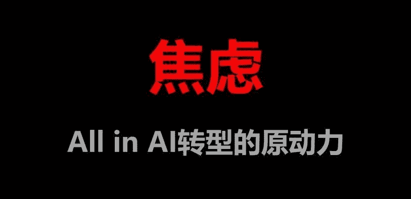
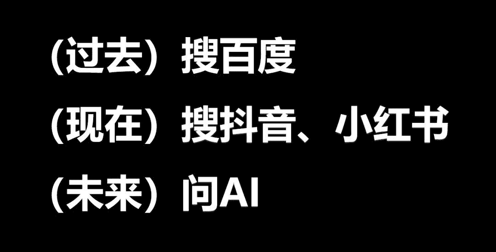
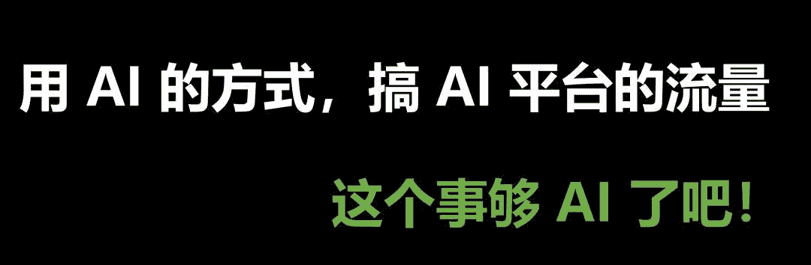
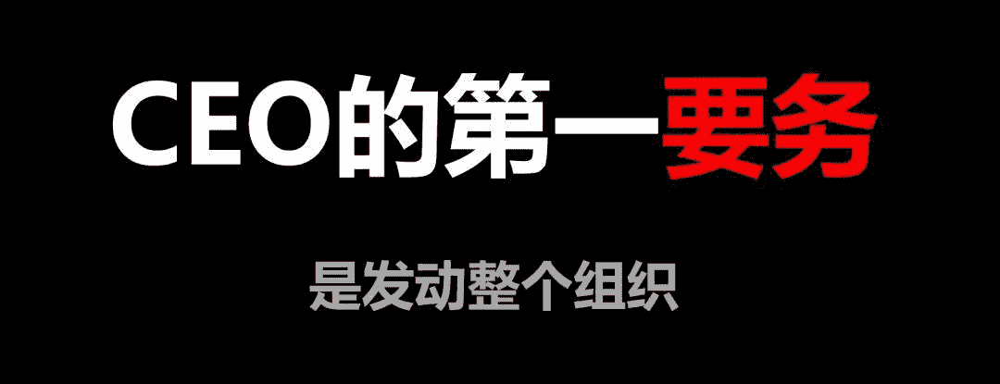
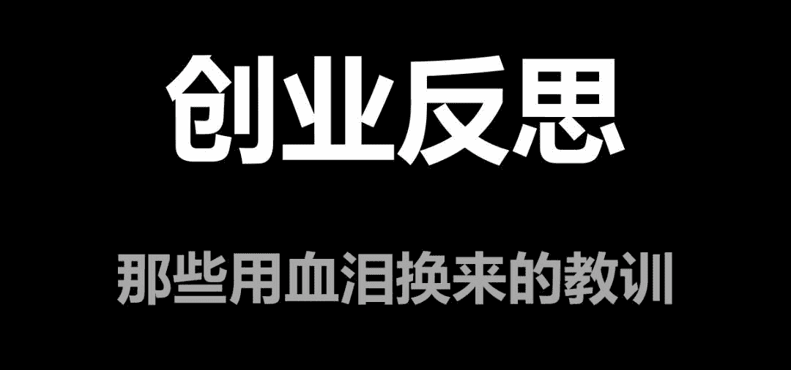
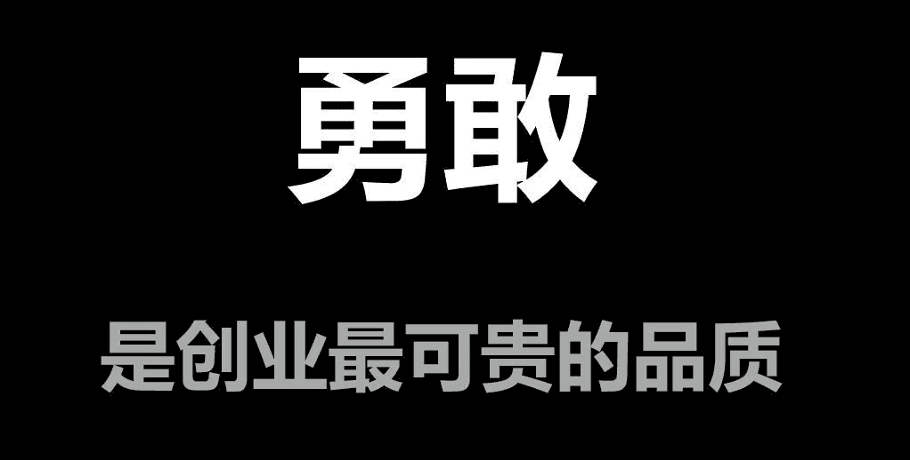

# 波波：AI 时代创业转型经验分享 ^_^

260610 副业 SC 精华

整理：公众号懒人搜索，懒人专属群精选

懒人微信：lazyhelper1

关键词：生态、直播、赛道、焦虑、流量、创业者、分享、算法、复盘、验证、机会、移动互联网、连续创业者、数据平台、战略方向、公司复盘、创业周期、生意模式

大家好，我是一个连续创业者，波波。

在过去的两三年中，大家是否也和我一样，感受到过焦虑？而我的焦虑主要来自于原来擅长的业务开始出现下滑，怎么调整，发现都不太对。具体的情况我给大家来讲一讲啊。

首先就是在 24 年底，我们公司复盘会上，一个一个项目组的负责人在台上去分享 24 年的成果，以及 25 年展望未来。我看着大面上持续下滑的业绩，各项目组面对竞争加剧、利润变薄的情况，给出来的解决方案竟然是明年继续卷。虽然说大家表达了战斗意识、不怕挫折的精神，但这个情况有一点逻辑不通，不能彻底解决我们的问题。

作为一个理工男，我当时特别的焦虑，越听越难受，越听越难受，最后呼吸也困难，血压也高，马上就去了医院。第二天会，我都没有参与，是我的合伙人帮我完成的。出了这么大的反应，可想而知，我当时的焦虑程度已经非常之高。

为了缓解焦虑，转过年来，随着过年在家歇了一段时间啊，逐渐心情上有缓和。在 25 年我就开始着手探索各种结合 AI 的生意啊，因为我分析这个内卷主要是几个方面带来的：

- 一个是说我们原来的老行业，流量生态，因为它一直在变化，原有模式流量见顶，开始下行。
- 还有就是层出不穷的这些 AI 能力，在逐渐地把我们的投放能力替代，那我们拍摄短视频素材的能力，也在被 AI 视频替代。

于是乎我选择，打不过就加入。波波在以前的几次创业周期里边，我都是选择这样的方式，我的业务受到哪一个生态的冲击，我就拥抱这个新的、上升的、成长的生态。

思考清楚以后就在 AI 生态里面去研究生意模式。我们探索了多种模式以后，最终发现，老业务 + AI。往往刚开始想转型 AI 的团队，都会选择这样一条路：把自己原来一个很擅长的业务，做了很多年的业务，用 AI 提效，期待 AI 能给它带来增量。

但实际上我在做的过程中发现越来越不对味，就算我通过 AI 提效了老业务，80% 以上都能够交给 AI 来做，但依然解决不了转型的问题，因为老业务本身就在下滑当中。提效的增量是很有限的。

那于是乎呢，我们就从另一个角度去看这个问题，不如用 AI 的方式，在新的、即将到来的 AI 生态里边，去整合我们过去的这些所谓的落后的生产力。就是把老业务通通打包成落后生产力，把它消化了，把它化成水，重新组织成我们在 AI 生态下的一个公司的各个组织部分。

波波主要经营的就是流量业务。这个业务形态正在发生着迁移。举个例子啊，过去我们在互联网上去用、去找信息，我们通过搜索框，有百度，有淘宝这样的电商平台，还有各种各样的搜索框，然后去找我们的信息，找我们的生活服务、衣食住行。

那现阶段呢？其实这些年啊，我们有短视频平台，我们有推荐算法，实际上信息也开始来找人了，因为它能够定向到人的需求。通过算法，通过人的看视频的兴趣标签，好的内容也能够定向地去寻找一些有需求的人。

从现在展望下未来，因为 AI 的生态正在快速发展，很多大模型啊，它不再是人去搜索信息，也不是信息去找人。它是人与 AI 交互的方式，在获取信息。未来一个更大的流量入口，就是人与 AI 进行交互，AI 去寻找、筛选信息，最终提炼后回答给人。

依照我的判断，终流量会演化成这样的一个生态，那我应直接面向这个生态去布局。经过拿一些客户去 AI 平台里尝试获客，我们验证了这个想法。我们可以去帮助客户获取 AI 生态流量，同时我们还要用 AI 的方式去做。

## AI 的三要素

就是算法、算力和数据。我看到现在很多 AI 原生公司，国际上的一些很厉害的 AI 公司，包括国内的很厉害的公司，他们的盈利方式都从过去的收广告费、收服务费、收 License 的费用，变成了收 Token 的费用、做存储的费用，其实就是在算法、算力和数据上挣钱。

所以说我也把我以前广告生意收服务费、收代运营费、收视频拍摄费、收投流费的模式，往算法、算力和数据上去演化。

方向一旦确立，我们就需要尽早地去卡一个生态位。因为我们都知道 AI 生态最终会越长越大，而且速度很快。如果我已经想清楚了，那就应该尽早地去卡一个位置。

只要卡住了，如果 AI 生态最终比现在大 10 倍，那我也会跟着翻 10 倍。那如果是 100 倍、1000 倍、1 万倍，那我卡住生态后，也会随之而翻 100 倍、1000 倍、1 万倍。这是面对一个巨大时代浪潮，每个人都有的机会。这个杠杆儿可比我们纯去努力要性感得多。

想清楚了该做什么，确定了战略目标，我公司的发展节奏就快速地从防守变到进攻。原来很长一段时间我们很保守，因为没有想清楚未来的发展在哪里，在很多地方都是省钱的思维，能少用人力就少用人力，我们能节省成本就节省成本，只是因为看不到增量，只能是通过控成本来守住利润，保持公司的存活。

这次，我看到了未来生态的一个巨大红利机会，立马用两到三个月的时间，进行了打法的转变。把之前那些保守的思想逐渐地抛到脑后，面向未来生态的一个生态位开始发起进攻。

我做了一条短视频，我说我们公司的战略方向已经确定，我们要积极地去备战，去卡这个生态位。这时候的状态和我 24 年年底的状态已经截然不同了。一个是很焦虑、被动防守，现在就是要进攻，发起冲锋。整个这个过程，我从调整自己，用了半年的时间。随之而来的一个问题就是，我还要影响身边的人，影响我的同事，影响我的公司。

作为一个 CEO，我得把大家发动起来。这里我做了一些更实际的行动，首先就是刚才提到的我做了短视频，个人 IP。之后我又尝试了直播。基于短视频打下的一个小基础，我们涨了几千粉丝，我就开始直播。

因为我这个直播间呢，其实早期有公司内部的同事会看。他能看到我在聊业务、聊思想的时候的一个状态，包括很多时候我甚至坐在工位上进行直播，我身边同事在加班，大家能够感受我的状态，还有直播间里用户的需求，让大家看到这一波机会是真真正正存在的。

同时呢，我们通过直播间，去尝试售卖我们全新理念的产品，这里面包括工具，包括一些资料课程，来验证我们的商业模式是不是市场所接受。数据也验证了我的想法。

在做了几场直播以后，直播间就可以有几千人场观，高的时候在线也能有几百人，有时候直播间也能卖个几万的销售额。这个事情对我们有极大的振奋。

拿到了这一波正向反馈以后，于是乎我在 9—10 月份，开始进一步地动员全公司。在这里边我给全公司讲清楚了战略方向，以及近期打法，确立了季度目标。

同时呢，为了鼓励大家拥抱生态，拥抱用 AI 的方式去解决问题，我们直接发了现金激励，来带动大家突破挑战，同时也体现我作为公司一号位 CEO 的信心。我对这个事情看清了，拿出足够奖励，让大家感受到这股力量。

在一系列的动作之后呢，我们公司成功完成了 AI 的转型。之后我发现，之前我所产生的很长一段时间的焦虑，其实它不是坏事，而是驱动我转型的一个核心动力。

后面有遇到一些人也在说，他们在焦虑的过程中，面临转型，一直没有下决心去做这个转型的决定，或者尝试了几次，没有突破。我们不妨去看下，那些还没有去行动或者突破的人，在基本盘还不错、收入、公司运转都还不错的情况下，挺难做到彻底转型的。

转型不成功，可能就是焦虑程度不够。一旦你的老业务出现比较大的波动，你的焦虑程度达到的时候，其实你是有足够动力去推动这次转型的。

所以大家也不用太担心，没有人是能够被事情给逼死的，到了关键时刻，一定会找到出路。

可以预见啊，我们虽然现阶段找到了新的方向，我们整个公司也冲到了这个赛道上，去向前冲。在这里边我们一定也意识到，同样，好的赛道一定也会被跟我们类似的、相当优秀的创业者，甚至是更厉害的一些神级选手看中。因为赛道又大又好，肯定有人也看到了，也把这个作为了一个 All in 的方向。

我们在向前冲的时候，你看我们把精力、把资源都放到这个赛道上，也必将面临有可能失败的风险。

其实波波这里边我想给大家分享的就是，因为我是一个连续创业者，我也创业了十几年，在这个过程中也经历过几次周期，比如说从移动互联网那一次，就是 PC 时代转到移动互联网，包括后面又来的直播电商生态，包括疫情这几年，遇到过一些失败。有几次比较大的投入没有打赢的经验，我们也将会在这次创业中去避免。这里也给大家分享下。

有一次我们在做探索性项目的时候，没有亲力亲为，而是做了甩手掌柜，损失非常大。我们这样的小公司，就在一个项目上损失了几千万，是非常惨痛的教训了。

当时因为我们有第一增长曲线，在找第二增长曲线，没有重视。总结起来就是，当面对一个比较好的赛道、比较好的方向，不能找人代劳，要亲自上，才有可能成功。

还有一次，就是之前我们也做过一个平台，当时是以工具化的思维去考虑一件事，没有品牌化运作，没有形成规模效应、网络效应。当时其实是认知不够，不知道平台其实第一名是赢家通吃的。

这件事情我觉得在我这次再做创业的时候，它会成为我的一个非常宝贵的经验，这一把我们肯定是面向第一而去的。

再有一次，就是之前做游戏项目，第一阶段也是跑通了，收入还不错，但是我们当时没有重新地审视这个项目。它已经跑通了，已经开始盈利了，我们没有重新评估一下，是不是应该全公司战略 All in，把它做大、做好。

其实后来我们看到，就好多当时同时起步的一些游戏公司做得非常大。我们当时只是拿它作为一个赚钱的生意，没有加码，最后导致错失了巨大机会。

这三个主要的宝贵经验，在这次的创业过程中，我都会避免再犯。

首先，这次创业我是亲自带队，亲力亲为，就是 All in，冲在第一线，包括刚才我提到的我做短视频、做直播，以及盯产品、盯团队的状态。

平台策略这回我们是挑战第一、勇夺第一。同时，一旦我们跑出阶段性成果，我们也不会松懈，一定会持续加码，确保能卡住生态位，随着赛道的翻倍，我们也跟着翻倍。

既然赛道已经确定，又可以预见将会出现神级的对手。面向这种未知的挑战，我觉得作为创业者，其实最重要的品质，也是最有意思的一点，我觉得就是应该勇往直前。

勇气是一个创业者最宝贵的品质。只有勇往直前，才能抓住真正的机会。

最后把这句话送给大家，也同样送给我自己。谢谢大家。

————分割线————

如果你想看全网最新的变现玩法，并且和一群执行力极强的极客一起下场拿结果，欢迎围观我的核心私域：【懒人专属群】。

我们不聊虚的，只做商业闭环的拆解与 AI 效率的压榨。系统内已沉淀 1000+ 跑通的套利实战局。

👉 查阅圈子完整数字资产与上车门槛：

https://lazyso.com/insider/

认同价值、准备好下场干活的，扫码加我微信（lazyhelper1）

备注：【实操上车】，不闲聊

