# 做流量3年，转型AI写作第一个月利润2W：一个00后流量玩家的踩坑复盘贴

大家好，我是阿皓。

简单介绍一下自己：00年，一个潜水3年的生财圈友，大学期间开始接触互联网，算是一个比较典型的流量型玩家。

过去3年，一直在接触不同的项目，比如微商，头像表情包引流、小红书精准粉、私域后端转化，都拿到过一些不错的现金反馈。

今年4月，我正式开始做AI写作，一个半月利润2万。

这个项目让我开始认真思考一个问题：为什么我以前能抓到机会，也确实赚到过钱，但总是没把项目做深？

如果你也有过类似状态：

- 看了很多项目，也做过一些项目，但真正做深的很少
- 有正反馈的时候特别兴奋，一没反馈就焦虑
- 总觉得下一个项目更好，但回头看，好像又没沉淀下什么东西
- 很想找搭子、找团队、找氛围，但等着等着自己也停住了
- 赚过一些快钱，但项目一停，客户、话术、流程、团队能力都没有留下来

那这篇文章可能会对你有帮助。

这篇主要复盘一个普通人做项目很容易踩的坑：

一直用“狩猎者心态”做项目，只要现金流，不要资产。哪里有红利就冲哪里，哪里反馈快就做哪里，短期看很灵活，但长期看，确实赚了钱但却没留下资产。

废话不多说，这篇主要分为五个部分：

1. 我过去做过的几个项目（有我自己以前整理的流量玩法SOP，目前也能用）
2. 过去为什么没留下资产？
3. 做项目有两种人：一种叫“狩猎者”，一种叫“农耕者”
4. 这次做AI写作，我想做一个农耕者
5. 如果你也总想换项目，可以先问自己5个问题

## 一、我过去3年做过的几个项目

### 1. 头像表情包引流（23-25年 断断续续做）

**项目介绍**

在抖音、公众号、快手、小红书发布头像表情包，同一套素材4个平台分发。以下我拿自己其中一个账号举例，大家可以看一下。

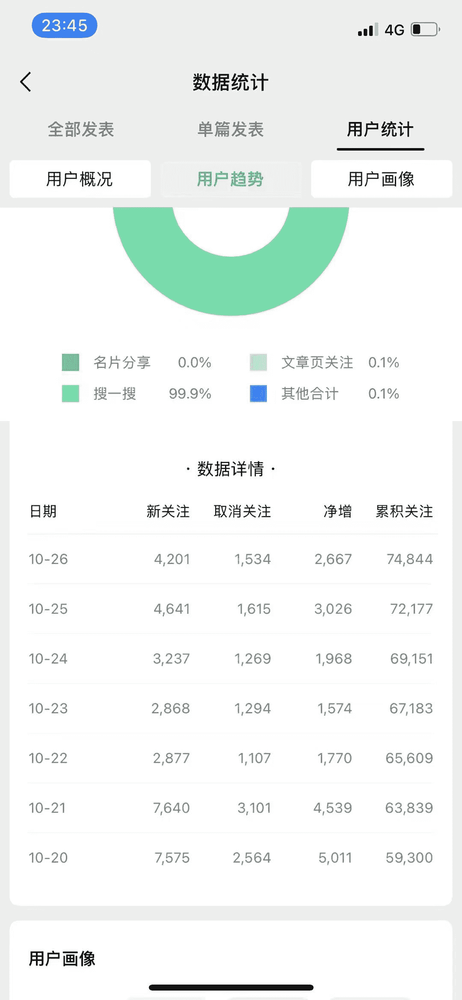

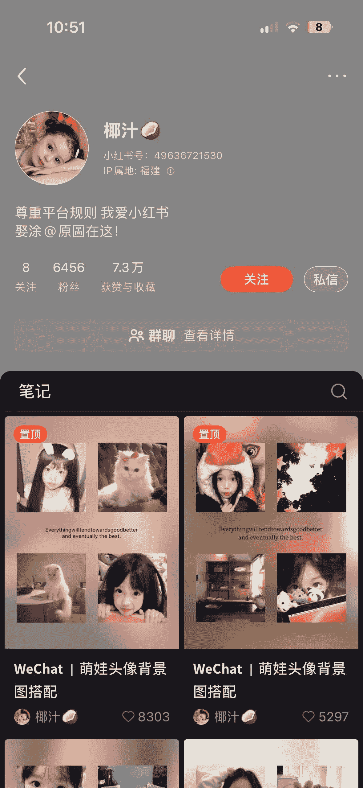

抖音表情包单账号数据👆 新公众号起号一个月数据👆 小红书同行账号👆

这个项目有三个变现方式：

当时我自己主要靠前两个：

1. 自己接粉到私域，后端打造好人设IP，卖产品（我接触过的：水晶、减肥、情趣、私护、塔罗等）
2. 直接卖粉给老板，一个粉丝加到微信1.2-2块钱左右
3. 流量主收益（当下公众号玩法），大家可以在生财看看公众号精华帖

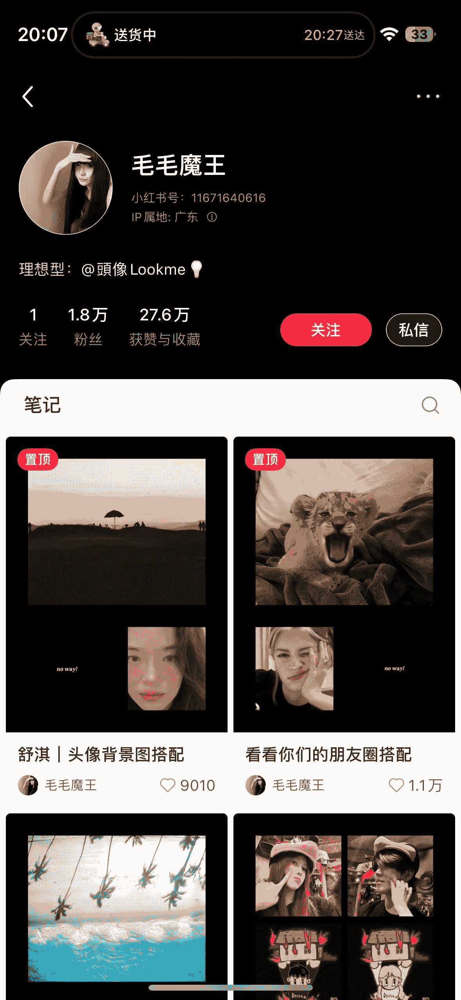

**具体怎么操作：**

1. 去微博或者小红书直接搬运好看的头像/表情包（这个比较看个人的审美能力）。因为我也找过线上运营，感受到每个人的审美差别是很大的，有些人找的图就很土气，有些人找的就很高级、好看。
2. 找到图后就去醒图搜索相关的模板，直接套好发布。

**怎么导流到微信？**

小红书、抖音、快手：引导粉丝去看主页，账号主页会挂公众号名字，关注公众号以后，提前到公众号后台设置好自动回复，自动回复里面挂微信二维码。

公众号就更简单了，直接在文章下面挂自己公众号的名片。

**项目总结：**

累计引流二三十万粉，但由于封号和自身原因，没有做下去。

是个好项目，能快速拿到结果，因为不是做内容，不需要专业能力，只要你的审美够好，能坚持每天重复机械性工作即可。

当时我自己也有留一部分粉到微信，尝试用这些粉做一些后端变现，比如减肥、占卜、水晶等。

但这种粉丝就是泛粉，是通过拿头像加到微信的，不是精准需求粉。所以在朋友圈一定要做好人设，不能像传统微商一样天天硬发广告，而是要做人设、做互动、做好生活感。

泛女粉变现减肥+占卜，大家对私域后端变现感兴趣的可以看看我写的这篇文档👆（自己简单写的一套方法论，希望给你们带来灵感）。

### 2. 小红书精准粉（24年 半年左右）

**项目选择：**

为什么还是选择做流量？是因为当时做表情包，正反馈和现金流来得太快了。后面也知识付费链接了蛮多做打粉的人，所以还是继续做打粉，只是从泛粉转为精准粉。

打过减肥、星座、塔罗、旅游等赛道，主要做减肥。

小红书减肥打法SOP，大家也可以看一下我自己总结的SOP（这套只是素人分享贴玩法，希望能给你们带来灵感）。

目前小红书对新号扶持力度很大，很多赛道都可以尝试一下，包括我目前在做的AI写作的品类，也能在小红书刷到。

**项目总结：**

那时候我是矩阵玩法，自己手上有几十台设备，每天就是测账号、发内容、看数据。最好的时候一个月10w+，因为这些都是高价值粉，能卖15-120块钱一个，像减肥一个粉当时能卖60-90。

这个项目正反馈也很快，只要账号和内容能跑，只要你愿意发，就能有客资。后面平台管控越来越严，流量变差，违规成本变高，账号消耗也越来越快，我就慢慢停掉了。

### 3. 私域后端（客服）转化

**项目介绍：**

以前累积的泛粉+购买精准粉转化（陆陆续续做减肥、塔罗、水晶）。

**选择理由：**

说白了，就是流量做烦了，很耗心力，每天机械重复性工作，做就有，不做就没有，后面还要看平台给不给玩。

**项目总结：**

刚做减肥精准粉转化的时候，加了40多个顾客，转化了15个左右，首单加复购累计变现1.5w+。

前面两个阶段，我都是在做前端流量，开始做转化以后我发现自己更喜欢做转化。用户来了以后怎么聊，怎么判断需求，怎么抓顾客痛点，怎么做朋友圈信任，怎么报价，怎么成交，这些东西都是一边做一边摸出来的。

但最终还是逃不过流量，没流量就没客服这个环节。当时因为我做的这几个赛道的精准流量不稳定，平台限制得很厉害，后面又开始断断续续看新项目、试新方向，做着做着又停下来了。

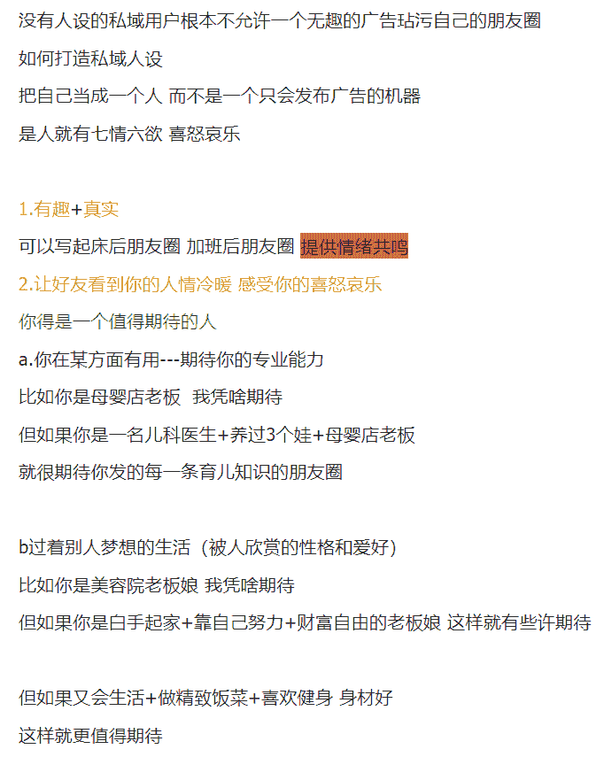

分享我做转化阶段，刷到一个视频做出的总结👆（对我自己很受用）。

我现在对自己转化还算有点信心，也是因为那段时间练出来的。很多人可能有流量，但不敢报价，或者报价以后接不住客户，最后ROI跑不出来。我自己在话术、报价、成交这块，会比较愿意琢磨。

## 二、过去为什么没留下资产？

如果只看经历，好像我确实赚了不少钱，但现在回头看，其实我根本没有留下“资产”。

表情包累计引流过二三十万粉，精准粉也打了几千个，但大部分都卖掉换了现金，没有沉淀到自己的私域。现金流很爽，但账号没了、粉丝没了，下一次还是要从0开始找机会。

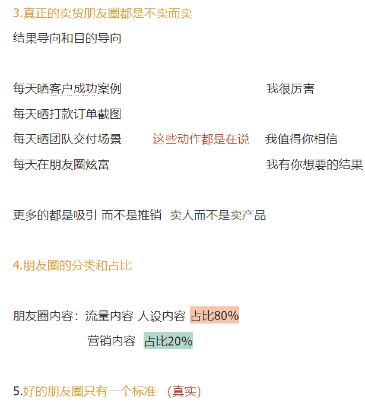

我过去没有留下资产，主要有四个原因：

1. **把现金流当成资产**

以前只要一个项目能赚钱，我就觉得它是好项目。但很多能力都只长在我脑子里——我知道怎么测流量、怎么报价成交、怎么聊客户，但这些东西没有写成话术库、没有整理成SOP，所以只要我不亲自做，别人就很难复制。

以前我总觉得自己缺的是人，现在想想，我缺的不只是人，更缺的是可以交给人的流程。

2. **一遇到平台管控，就想换项目**

平台规则变了、账号限制了、流量变差了，我第一反应往往不是解决，而是逃避。当时会给自己找一个看似合理的理由：这个项目不行了、平台不让做了。但现在回头看，很多时候不是项目真的不行，而是根本没有尝试去解决问题。

3. **太依赖即时正反馈**

只要项目有正反馈、有钱，我就能持续干。但一旦反馈变慢，就开始看新项目、看别人赚钱的项目，脑子里想法很多，落地动作很少。我以前觉得自己是懒，现在想想不完全是懒，更多是焦虑——越想越乱，越乱越不行动。

4. **总想等搭子、等氛围、等确定性**

看到别人情侣搭档、朋友组队做项目，我很羡慕，然后就会一直想：要找到合适的人才能开始。这个想法卡了我很久，但如果一直等，那其实就是在主动放弃赚钱的机会。

## 三、做项目有两种人：一种叫“狩猎者”，一种叫“农耕者”

我很喜欢“狩猎者”和“农耕者”这个比喻。很明显，以前我更像狩猎者，哪里有机会，就冲过去打一波。哪里反馈快，就先做哪里。短期看，好像很灵活，长期看，其实一直在从0开始。

我现在会这样区分：

| 狩猎者心态 | 农耕者心态 |
|------------|------------|
| 哪里有红利冲哪里 | 看好一个方向后持续深挖 |
| 赚到钱就想继续放大动作 | 赚到钱后先想沉淀资产 |
| 平台管控就换项目 | 先判断能不能换方法 |
| 靠正反馈驱动 | 靠流程和复盘驱动 |
| 项目长在自己脑子里 | 把经验写成SOP、案例库、话术库 |
| 一直从0开始 | 让经验可以复用、团队可以接手 |

狩猎者能力不是坏事，能看到机会、敢下场、敢测试，这些都很重要，很多人连机会都看不到，看到了也不敢行动。

但如果只有狩猎者能力，就非常的不稳定，赚一段，换一个，再赚一段，再换一个。几年下来，经历很多，但真正属于自己的资产很少。

农耕者不是不看机会，而是看到一个机会以后，愿意在里面持续投入。放到项目里，就是持续复盘流量、优化转化、打磨交付、沉淀SOP、积累客户和案例，把经验从脑子里拿出来，变成别人也能执行的东西。

以前我会觉得这样很慢，但现在我越来越觉得，慢就是快。

## 四、这次做AI写作，我想做一个农耕者

AI写作这个方向，我不是今年才看到的，早在24年就了解过这个项目，之前也在关注小鹅老师和瑾糖老师的分享，一直觉得这个方向有机会。后面就跟小鹅老师付费学习了，教学特别细，完全就是奶奶级别SOP，加上以前的经验，所以几天就跑通了0-1！毕竟现在是AI时代，很多写作、PPT、短视频文案脚本等等，本质上都能被AI提效，所以很看好这个项目。

到这里，可能会有人反驳，现在都进入人人AI时代了，真的还会有人去闲鱼找人帮自己写吗？

答案是：有！而且需求巨大！

**项目介绍：**

变现流程：闲鱼上链接+投流+引流到微信成交+老顾客复购。

我目前主要是在闲鱼获客，主打付费流。我是今年4月份才正式开始做，一个半月纯利润2w。而且我是一点专业能力都没有，在各个领域是完全不懂的那种，各种名词也看不懂，但还是能跑通0-1，完全靠AI分析顾客的需求、各种名词解释，最后再用AI写作交付给顾客。

**项目成绩：**

简单说一下我这一个半月的成绩吧，对比大佬们的成绩肯定完全不值一提，但希望能给到一些圈友激励！

我目前做的是PPT，一共做了3个账号，自己主要做前端流量+客服转化，交付是外包给写手（他们写）。

写手的成本一般都是按成交价格的15%-40%，价格只要写手接受就行。

5月数据👇

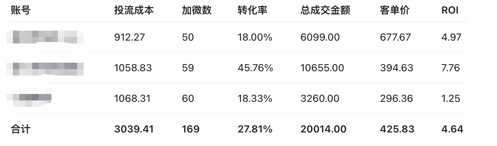

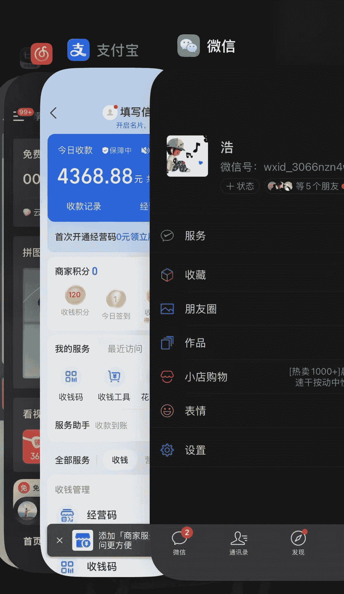

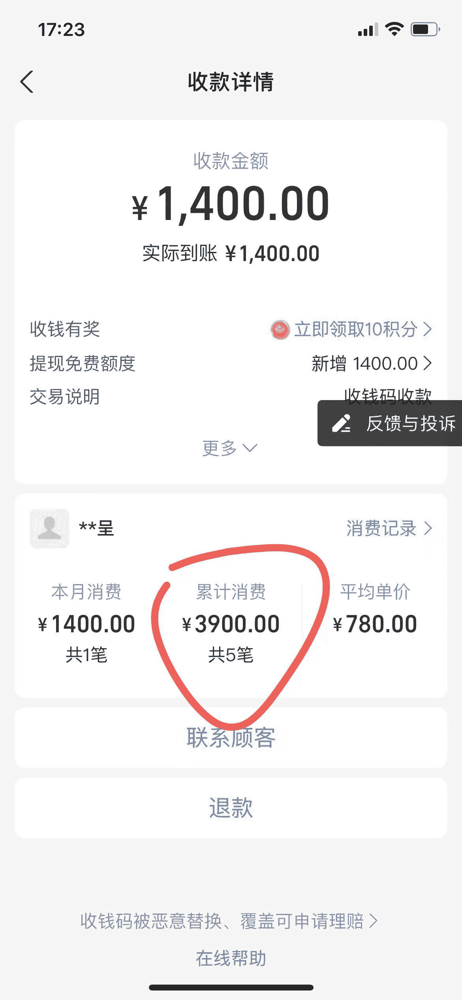

部分成交👆

**项目感受：**

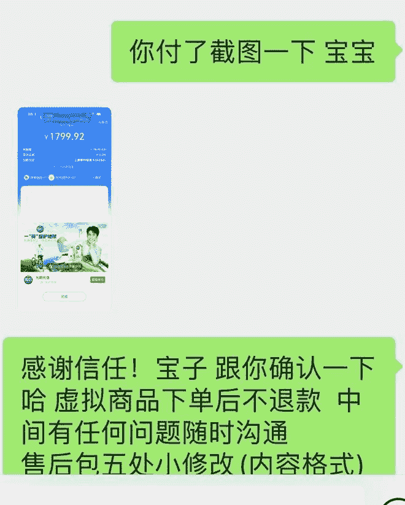

选赛道、选品类很重要！！（其实就是在选人群）。

选好赛道细分品类，敢报价，优化好话术，就能成交高客单。再把朋友圈IP打造好，复购也会很多。

一开始我不是直接做PPT的，我是选了3-5个品测试（剧本、PPT、短视频/分镜头脚本、口播文案）。

先说前端流量（仅代表我个人感受）：

- **剧本人群**：个人创业者、公司、学生作业。在闲鱼咨询后，大部分是不愿意直接加到微信的，就算加到微信，他们也很喜欢比价。市场价可能200-300一分钟，但他们预算只有几十块钱，很多同行也卷低价，导致无效的咨询特别多，且投流ROI跑不正。（当然，现在还有很多大佬做剧本，能一单上万）
- **短视频/分镜头脚本、口播文案人群**：学生作业、IP博主、公司。当时咨询不是特别多，所以我没办法一概而论，但我感受到的大部分人群也是预算不高，都是比价的，成交率也不高。

**目前遇到的问题：**

因为自身没有专业能力，所以一直很迷茫，不知道还能做什么品类。因为PPT品上限太低了，客单价不高。

最近起了一个新号又重新做这上面几个品类，咨询量挺多的，但没预算和比价的人群比较多，导致ROI跑不正。打算再放1000预算去测，实在不行就再观望一下其他的品。

个人建议：如果你们自身有专业能力，很建议来做闲鱼，真的有手就行，只要发了链接基本上2天内就有咨询。（比如程序员接Java，教师接课件，做过IP的接口播文案、短视频脚本等）

**回到正题**

我是25年11月份付费报名的，今年4月，我才正式开始做这个项目。为什么之前看到这项目迟迟没有开始？第一个原因是23-25年都在做流量的项目，第二个原因是停掉流量项目后，一直想等一个合适的人一起做。最终确实找到了一个朋友一起才开始做，十几天就跑通了0-1，拿到了现金流和正反馈。

但后来朋友因为自身原因停止合作了，我等了一段时间，越等越焦虑。这要是以前的我，可能就又卡住，回到等待+焦虑的死循环。

但这次我不想等了，我就自己开始做流量，也做客服转化，然后把交付外包给写手。

目前这个项目也还没有到什么很稳定、很大的阶段，只能说跑通了0-1。这个结果不算大，但对我来说很重要，因为它让我看到：只要有执行力，做起来，一定能拿到结果！

而且这次我不想再像以前那样，只是打一波流量，赚一波钱。我现在更想把它慢慢做成一个能深耕沉淀的项目。

比如流量怎么优化、客服怎么聊、写手怎么交付、质量怎么检查，这些东西我都想一点点写成SOP。

一开始肯定很粗糙，但粗糙也比没有强，先完成，再完美！

参加完超级航海AI大会的课程，后续又参加了瑾糖老师的AI线下生财聚会，感谢瑾糖老师的分享，也给了我很多业务上的建议。现在也会用Obsidian、Codex这些工具去整理流量数据、客户问题、话术和复盘，最后沉淀出流量SOP、转化SOP。不是为了显得高大上，而是我真的吃过这个亏——经验不沉淀，项目就永远长在自己脑子里；项目长在脑子里，就很难复制，后面想放大也很难把这些经验交给员工。这次我要做一个农耕者！

👇用Codex做了一个工作流，每天抓取投流后台数据，Codex根据投流SOP给出每个账号第二天的调整动作（大家简单看一下skill跑出来的结果就好了，这几天没好好弄）。

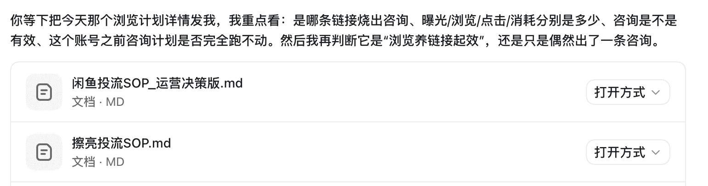

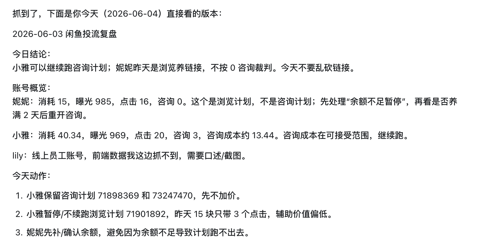

## 五、如果你也总想换项目，可以先问自己5个问题

这几年走下来，我发现普通人做项目，卡住的往往不是项目没红利了，而是其他项目看太多——反而不知道该不该继续做眼前这个。尤其是一个项目反馈一变慢，你又刚好刷到别人在做新东西，就很容易开始动摇：是不是该换项目了？

我现在会先问自己几个问题：

1. **这个项目是真的不行，还是只是进入了瓶颈期？**

很多项目刚开始都有红利期，反馈快，数据好。但任何项目往后做，都会遇到平台规则、流量成本、交付压力、团队协作这些问题。以前我会把这些问题理解成“项目不行了”，现在我会提醒自己：先别急着换，先判断这个问题能不能解决。

我自己就踩过这个坑：做表情包引流的时候，后期平台开始频繁封号，流量变差了，我第一反应是"这个项目不行了"，直接换。但现在回头看，那时候完全可以换分发策略、调整内容形式，甚至转去跑流量。

---

**23 / 27**

---

**量主——有些人在同一个模式里做了更久，也跑出了更好的数字，我当时逃的不是项目，是问题**

**2. 我是在找更好的机会，还是在缓解当前的焦虑？**

这个问题对我很扎心，我以前很多时候不是在理性找机会，而是在用“看新项目”缓解焦虑。看别人赚钱，看新玩法，找新机会，短期会让自己觉得好像还有希望，但如果没有落地动作，焦虑只会越来越重。

具体到我自己：小红书打粉做得不顺之后，我有很长一段时间每天都在刷视频、看别人分享赚钱的项目，脑子里想法很多，但真正的落地动作几乎是零。当时我以为自己在“找方向”，但其实只是在用“信息输入”这个动作，让自己觉得还在努力工作，说白了就是瞎忙活。AI 写作这个项目我 24 年就已经看到了，真正开始做是今年 4 月，这中间两年多，我干嘛去了？大部分时间就花在“焦虑地等”和“做/找所谓的好项目”里面。

**3. 我在这个项目里留下了什么？**

如果一个项目做了一个月，最后只剩下“我做过”，那其实很可惜，哪怕项目最后不做了，也应该留下些什么：比如一套 SOP，一套流量测试记录，一份客服话术，一批客户案例，一个交付流程，一份踩坑清单。

这些东西才是下一个项目的底层资产，如果这些都没有，那就算赚过钱，也只是短期现金流。

我自己的例子很典型：表情包那个项目，前后累计引流了二三十万粉，但大部分都是直接卖掉换现金，没有把用户沉淀到自己的私域；客服转化那段时间，我摸索出了一套成交话术，知道怎么聊、怎么报价，但这些东西全长在我脑子里，没有写成话术库，没有整理成 SOP。所以后来合作的朋友没办法快速上手，我自己也没法规模化，因为根本没有可以交给别人的东西。

**4. 我有没有先尝试换方法，而不是直接换项目？**

如果免费流不行，能不能测付费流？如果一个类目不行，能不能换品类？如果成交差，能不能优化话术？如果交付累，能不能外包给写手？

很多时候，真正该换的不是项目，而是方法。真正的成长，很多时候就在换方法里面。

我现在做 AI 写作就是这么过来的：一开始我做剧本，咨询很多但成交率很低，ROI 跑不正。以前的我可能直接放弃这个大方向，但这次我先问自己：是这个方向不行，还是这个品类不行？然后我换了 PPT 这个品类，结果咨询量、成交率都明显好转。项目没变，方向没变，就是换了一个品类，结果就不一样了。

**5. 如果继续做 3 个月，我最应该沉淀哪一套能力？**

不要一上来就想做大，先把问题简单化：接下来 3 个月，我要沉淀流量能力，还是转化能力？我要沉淀交付流程，还是团队协作？我要沉淀私域，还是案例库？

一个阶段只抓一两个核心能力，反而更容易推进。

我现在给自己定的方向很具体：这 3 个月，我只做两件事——第一，把投流 SOP 写出来，每天用工具抓取数据、根据数据调整动作，让这套流程可以复制；第二，把客服话术整理成 SOP，不再只靠感觉聊。交付那块我先外包给写手，不铺太多精力。以前我总想一口气把所有环节都做好，但每次都是什么都动了、什么都没深，这次我想先把最重要的两条线跑稳。

**六、写在最后**

我现在谈不上什么成功，还在 0-1 摸索阶段，但至少这次，我不想再只是打一波流量、赚一波快钱，然后什么都没留下。我想换一种做法：

- 先把一个小闭环跑稳定
- 先把流量和转化 SOP 写出来
- 先把交付流程跑顺
- 先把每天遇到的问题记录下来
- 先让项目不只长在我脑子里

如果你也有过类似的状态，希望这篇文章能给你一点启发。

不一定要认同我的做法，但可以问问自己：现在是在狩猎，还是在农耕？

本文很大的篇幅都在写我的个人经历，感谢大家耐心观看。

————分割线————

看完这篇 SOP，你觉得你懂了。但 90% 的人一到实操就会卡在第一步。

工具和教程只是最低级的壁垒，真正的壁垒是“立刻动手”和“圈层信息差”。

如果你想看全网最新的变现玩法，并且和一群执行力极强的极客一起下场拿结果，欢迎围观我的核心私域：【懒人专属群】。

我们不聊虚的，只做商业闭环的拆解与 AI 效率的压榨。系统内已沉淀 1000+ 跑通的套利实战局。

👉 查阅圈子完整数字资产与上车门槛：

https://lazyso.com/insider/

认同价值、准备好下场干活的，扫码加我微信（lazyhelper1）

备注：【实操上车】，不闲聊

