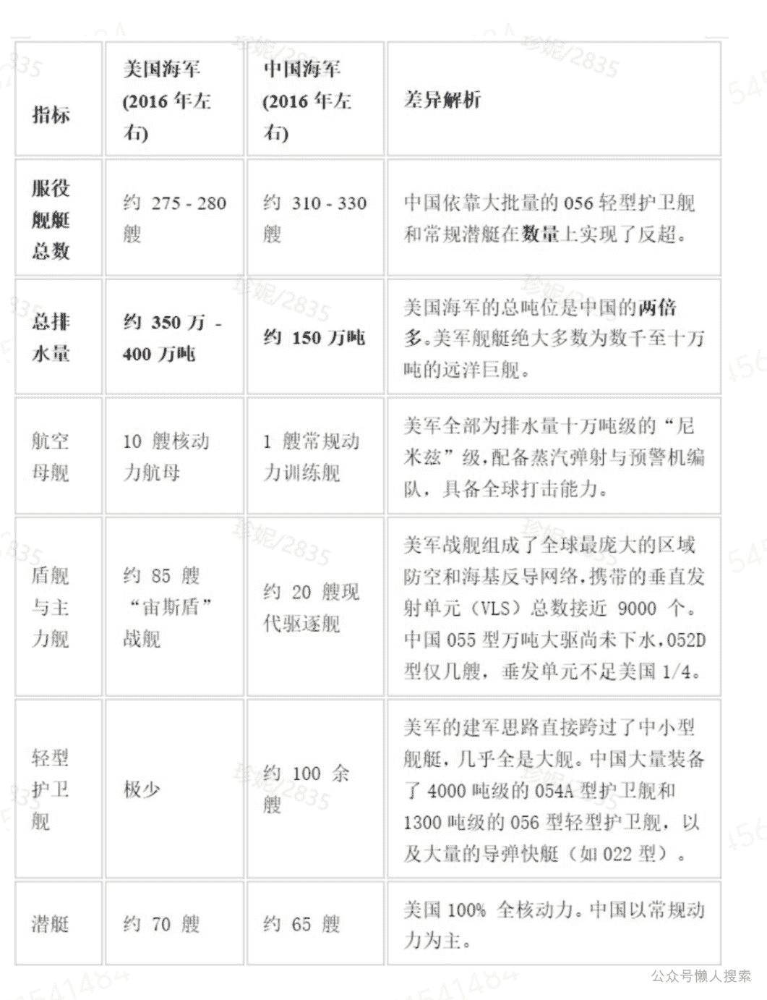

### 跨境投资监管收紧等政策解读

260611 珍大户

整理：公众号懒人搜索，懒人专属群精选  
懒人微信：lazyhelper1

事件时间线：

- 5月22号老虎证券、富途证券被查，
- 同一天，8部委发布严打非法跨境金融经营的文件，
- 6月1日发布《国务院关于对外投资的规定》。

我上周三写了个视频说这些事。因为视频是公开的且时间有限，有些观点还没法说太仔细，所以在圈子里存了一篇增补文章，把视频里不好讲的额外观点都做了增补，然后想着等视频发出来后同步发，然后就给忘了……昨天写完十五五的区域发展篇，里面写着规划里透露着各种“战时思维”、“底线思维”，突然又想起我要写的补充内容了，感觉似乎又互相之间有关联印证了。现在把补充文章发下面，最后是视频稿件原文。

### 补充说明一：曾经傻白甜过。

视频稿里，我粗略的把时代分成了三个阶段，（——2012）是第一阶段，以经济建设为中心，只想搞钱，对外纯真。（2013-2025）是第二阶段，开始主动防范，但主要集中在防范外界的直钩拳，不太过多理会外界其他事宜。（2025-）是第三阶段，突然发现老美不针对中国了，但这绝对不意味着太平。因为可能是老美在外圈扎锁套。如果放任不管的话，会对未来十年后影响很恶劣。所以政策变了，要想办法走出去了。

这种分法，其实是比较“戏说”的，是为了对流量让步，而做的一点演绎。实际上，任何转型都不是一夜之间突然，而是各种渐进，所以想要严格的划分时间截点的意义不大，但三段式的过渡确实是真的。

在2010年代直至之前，我国真的经历过一段非常纯真的年代，曾经真的相信外面有真善美、相信世界越来越文明，相信中国需要向“主流社会”接轨，让“主流社会”接纳。

记得去年11月高某苗刚上台前后，因为扬言XX有事就是XX有事，引起我国抗议。

我国大使在海外发言，引用了联合国宪章的帝国条款，意思是为了防止二战战败国再次反弹搞侵略，无需安理会事先授权即可对“敌国”采取强制行，对敌国的各种处置（如军事占领、审判战犯、索取赔偿）也是合法的。

日本外务省看到后立马就回复了，说敌国条款在1995年就被投票失效了。指的是，1995年，联合国50周年庆的时候，联合国大会的第50/52号决议，讨论废除敌国条款。当时155票赞成，0票反对，3票弃权（弃权国为朝鲜、古巴、利比亚），等于说我国也投了赞成票。

10年后的2005年，到联合国60周年庆的时候，当时举办了一次联合国世界首脑会议，又一次投票，说决定删除联合国宪章里的敌国条款，各国首脑（包括中国）都同意了删除。

所以大家想想，至少证明从1995年到2005年之间，中国对外竟然是相信真善美的。历史上受了几百年日本的骚扰了，近代史上就日本对中国的伤害最大，但即便如此，竟然还相信日本已经改正善良，对中国无害了···这个回头看，绝对是当时的战略误判，是真实存在的历史失误。

现在回看，不知道国家现在有没有想抽醒当年的自己。还算万幸的是，敌国条款尚没被删除。是因为删除必须启动《宪章》第108条的修宪程序，需要2/3成员国同意，并交由各个国家的国内宪法程序审批。这个任务几乎不可完成，导致条款尚在。

但因为经历过包括我国在内的所有国家投票删除，所以等于是一定会存在法理上的争议。就是主观意愿和程序出现了冲突，从主观意愿上，当年的投票代表对外态度的表态，已经成了一种存在的证明，虽然程序上没有真实推动删除完结，但这已经属于待解决的历史遗留问题。

所以当我们想要再度使用敌国条款的时候，国际舆论上会骂你，都投票通过了，怎么出尔反尔。所以最终会沦落到“到底是要面子还是要里子”的选择上。而最终比拼的，其实还是谁的拳头大。如果中国有一天真的势无可挡时，想援引敌国条款，其他国家也很难BB什么。

并且连《美日安保条例》都为此条款留了一道后门，说安保条约不影响对联合国宪章的权利和义务。也就是说，如果美国认为自己能赢，他就会以1995的决议为准，来BBB，然后再借机启动安保条例的共同防卫权。如果美国认为自己不能赢，那自然可以表态“认可联合国宪章不违反美日安保条例”。国际社会就是这么势力。

而国内开始逐渐意识到，所谓的国际文明不过是一种遮羞布，国际社会还是依然弱肉强食，其实也是纯真年代后期，遭遇了各种讲不通道理的遭遇。无论是第二阶段的扩充海军，还是现在第三阶段的想要走出去，都是不断认识加深而产生的结果。

### 补充二：现在也真的想助力中资走出去。

视频里我没写太多例证，因为时间有限，啰嗦太多了影响流量。但仅是《国务院关于对外投资的规定》里，就能看到一些细节：

第六条，国家健全海外综合服务体系，促进贸易投资一体化，完善公共平台与服务，统筹外事、法律、财税、金融、经贸、物流、出境入境、海关、贸促等领域服务资源，为投资者提供服务保障。

省级以上人民政府及其有关部门提升公共服务能力和水平，为投资者提供法律法规、政策措施、投资指南、知识产权、风险防范应对、权益保护等方面的公共产品和服务。

注意“省级以上人民政府及有关部门”要做啥啥事。这很明显是增设了KPI指标。类似的逻辑，之前讲防洪救灾制度时有提过，落到省级头上了，自然之后要考核的。所以条文不是说说而已。

### 补充三：走出的最大目标，是想有理由合理合法的“干涉他国”。

从法规20条到25条都在说这个。视频里说的比较详细了，就不补充了。

### 补充四：但也有约束。

看下面条款，感受一下，虽然想走出去，但其实是强监管的，并不是所有地方和领域都让你走。

法规第11条，意思是给对外的投资的地域和领域做红灯黄灯绿灯的判断。不想让你去的地方会画禁止线。推测大概率要对日本、印度做红灯提示的。

第十一条国务院投资主管部门···明确鼓励、限制、禁止的对外投资··  
第十五条国家健全境外投资安全审查制度……

第十八条国务院有关部门加强对外投资监测预警和风险评估，及时发布有关国家（地区）安全状况，提示投资风险，  
第二十七条投资者投资国家禁止的对外投资的，··处投资额5%以上10%以下的罚款

结合前面对老虎证券、富途证券的查处，因为它们是国内资金炒美股和港股的重要渠道，并且国内已经存在很多年了。要说违法，早就违法了。但是早不禁晚不禁，这个时间点是需要斟酌的。我的直觉判断，会觉得这个是针对美股，而不是针对港股。我隐约感觉国家似乎不太想让国内居民碰美股，但是还没到撕破脸明说的地步，所以暗中在增加阻拦。就是真到撕破脸的时候，就可以运用这次出台的《国务院关于对外投资的规定》第11条，直接把美国金融市场调成红灯地区，明确限制。现在没到那种程度，然而既然开始查老虎证券了，只能平仓不能开仓，所以等于是在暗搓搓的阻拦。

为什么说不是针对港股：因为国内资金，还是有合规路径进港股，但是没有合规途径直接买美股。买基金的话，走港股通通道的基金发行基本没有上限，多少资金都容的下，政策趋势是扩容的。而投资海外的QDII基金，直接受外汇局的配额上限管理。

为什么说有针对美股的感觉，这个我没有证据，只能说是一种直觉判断。比较相似的是2025年1月时，网上各种人民币要崩盘到8.3的调调，然后当时我记得国家出了什么政策？换汇要严查之类的？具体我记不清了。然后一堆人说，能赚钱的都限购，国家怎么可能想让你赚到钱。然而结果是25年开始人民币一路升值。真头铁的去换汇了基本一路损失，国家出措施的时间点真的是挽救人的。

所以如果说，真的是因为现在不想让大家碰美股呢？很多迹象似乎也有说得通的道理。（比如巨无霸等要上市，很抽干流动性；比如美联储开始转性有加息预期了，加息会让股市承压；比如外面一堆大佬们说危机要来的舆论）

### 补充五：也是真的缺钱。

视频里说出台《国务院关于对外投资的规定》不是因为国家缺钱。但国家现在还是缺钱（税）的，只是上面法规的目的是监管境外投资，没有直接奔着税的意思。而直接影响税源的，一个是十五五规划里呈现出来要搞资本利得税的意味。二是，CRS涉税信息互换后，每年海外资产的增值要申报，要缴税。

这个趋势不可避免，因为现在全球经济增速下滑，各国财政没有谁家敢说宽裕的，所以全球同步加税（严防跨国避税），算是一种历史大趋势，只能说这事躲不掉。另外CRS交换的数据越来越多，不仅仅是全球同步为了税，国内还有更多的考虑。

这就像是日本现在出口竞争力大幅下降，进口却比较刚性，所以贸易收支越来越恶化，最近一年多日元都贬值的厉害。我看有人说日本有庞大的海外资产，在海外的公司还是有竞争力的（这我就不知道真假了），但这些企业赚的钱不会流回日本，所以也没法支援日元汇率的稳定。所以《国务院关于对外投资的规定》可能在建立一种法理，能够以后强行监管海外资产，然后再收税的话，最终达成一部分税源强制回流的效果，会对汇率稳定性形成一种补充。

### 以下视频原稿（有数据增补）

就在前几天，6月1日新规，所有境外投资都将受到监管。而在这之前5月22日宣布了对老虎证券、富途证券的巨额处罚。同天八部委联合印发了《综合整治非法跨境证券期货基金经营活动实施方案》，短短两周，手段密集发布，很多人非常恐慌，怕国家是缺钱了？是美联储要加息资本外流，怕人民币崩盘吗？近期举措背后的意义，绝不是这么肤浅。它涉及到海洋经济、资本过剩、企业走出去、CRS涉税信息互换等等一系列内容，我要带大家从近期的一片拼图开始，讲通背后所有的事情，让大家看懂国家战略的下一步，到底要干什么。

这一系列背后的国家战略，其实经历过2012年和2025两次重要转折。我们把视线拉回到2003年，国务院印发《全国海洋经济发展规划纲要》，海洋经济这个词，第一次露面。然而彼时的海洋经济，指的是渔业，交通运输，海洋资源等产业，经济属性为主。背后是我国长期以经济建设为核心，想着怎样富起来。彼时，我国海军发展也不温不火，在2012年之前，主要是在淘汰老旧舰艇，做常规的更新换代。

时间到了2012年，出现了第一次重大转折。4月，菲律宾军舰在黄岩岛悍然抓捕中国渔民并扣船，9月日本政府宣布购买钓鱼岛并国有化。叠加长期以来南海主权被各种非常侵占。很多事例都在反复提醒，你想安心赚钱，别人让吗。所以在2012年十八大报告中，我国提出“坚决维护国家海洋权益，建设海洋强国”。十九大报告表述更加精炼：“坚持陆海统筹，加快建设海洋强国。”海洋经济的概念迎来了重大转折点，融入进了更宏大的海洋强国框架之中。与此同时，海军迎来了快速发展期，2015年，海军交付吨位10万吨，052D驱逐舰、054A护卫舰密集下水，2017年交付20万吨，首艘国产航母山东舰、首艘055大驱南昌舰下水。2019年20万吨，首艘075两栖攻击舰下水。连续多年下水吨位全球第一。到2025年，我国海军交付总吨位超35万吨，全年接收了28艘新舰，平均不到两周就有一艘新舰。

伴随着海军的强大，我国再也没有遭遇如2016年南海对峙的事件。如果回顾历史，2016年南海对峙是冷战结束以来中美两国爆发的规模最大、最接近实战状态的海上军事对峙事件。当年我国三大舰队精锐尽出，拉出100多艘主力舰艇，但因为实力与美军差距巨大，所以还要依赖陆基的“东风-21D/26”反舰弹道导弹体系来弥补巨舰数量不足。

而2026年，我国海军吨位10年翻一倍，从数据上已经快要追上美军。美国海军仍然是全球唯一一支“400万吨级”海军，但不得不说，差距真没太大了，所以中美两国热战风险已经大幅降低。

注：下图为2026年中美海军核心指标对比

而随着中美贸易战打的有来有回，还经历了稀土制裁等互相卡脖子，我们看到，老美好像不太主动招惹中国了。很多网友乐观的喊到，老美服软了。但，这怎么可能呢。

2025年是重要的转折一年。这一年，除了老美跟中国的直接针锋相对在消退外，对其他地区的手段则是越来越多。干涉巴拿马，谋求吞并格陵兰和加拿大，搞委内瑞拉，把日韩台最核心的产业搬到美利坚，行动从来没有停止。如果说2012年之前是第一阶段，我国的战略是只想安心搞钱却发现求而不得，到了第二阶段，则是意识到要发展海军保卫自己的话，那么2025年之后，战略进入了第三阶段。就是当你发现，秦国开始不再虎视眈眈的对你赵国，而是一边跟你维稳，一边开始修理周边小国，这不是赵国安全的信号，而是危险。

但我们一直以来的互不干涉他国内政，这是基本原则，难道推翻吗？当美国说要格陵兰的时候，中国有什么理由来说不行呢，没有任何理由。所以在第三阶段，我国的战略再次出现重大调整。2025年7月1日，中央会议召开，讲了好长好长的海洋经济的规划，年底的中央经济会议再提海洋经济，两次中央会议，我看到的是图谋甚远的战略野心。原因很简单，在有充分民用需求做基础时，产业链才能规模化，每个环节，每个零部件才能的价格大幅下降，海军才能用有限的经费造出更多航母。海洋经济，意味着我国还要继续更快速扩建海军规模。

而随之问题又来了，我国奉行着不结盟政策，不会在海外修军事基地，海军暴增之后，用什么理由走出去呢？答案只能是，保护中国居民的海外利益。当特朗普想要买格陵兰的时候，如果格陵兰上有一座万达修的北极旅游广场呢？

我们再看这次《国务院关于对外投资规定》，第20条，国家依法为在其他国家投资的中国公民等···提供领事保护与协助，维护其正当权益。第23条，投资者在海外遭遇投资壁垒，国务院··可对等报复。第24条，任何国家，对中国搞禁止性歧视，中国政府···保护投资者及其对外投资的安全和正当权益，保护国家的海外利益不受威胁和侵害。第25条，外国组织违反市场原则，中断中国企业和个人的正常交易，国务院，会对对等报复。

这法规要干嘛，你看懂了吗，钓鱼钓上来鱼肚子里一张纸条，挖土挖出来一个石碑，纸条和石碑上面都写了一串字，保护中国居民海外利益不受侵犯，敢不服你动一动看看。这叫法理。法理已经准备好了，但依然需要中资出海相配合。

而早在去年，我就早早看透了这一切，我在多个会议解读中都写道，国内的资本极度过剩。大量资本无处可去，下场挤夫妻小店，甚至搞社区买菜，水果咖啡炸串、热卤捞面拌面，原来10来块钱一碗的兰州拉面打到了30多元一碗。资本过剩，需要走出去，同时，航母出海也需要理由。

所以啊，健林赶错了时代，如果他不是2015年想出海，而是在25年出海，开始宣布万达要在格林兰建北极圈旅游城，结局肯定完全不一样，不会像现在这么瘦。而政治素养最高的东哥，你看26年宣布进军欧洲。这才是高手。

我去年判断国家会鼓励中资走出去，在26年十五五规划里也能看到很多细节，这个可以看我写的解读。

讲到这，我知道肯定会有朋友问，不对啊，如果鼓励中资走出去，为什么还要收拾老虎证券富途证券这些呢。答案很简单，你看啊，我前面给大家讲的内容形成了一个逻辑闭环，就是，如果航母不走出去，那后面十年就要眼睁睁看着老美统一美洲欧洲中东，我们会被动。但没有海外利益做法理，又用什么理由让航母走出去呢。如果不鼓励海洋经济，来拉低产业链成本，又如何尽快拥有更多的航母呢。没有足够的航母做保障，如何走出去和保障海外利益呢。

如果航母不走出去，那后面十年就要眼睁睁看着老美统一美洲欧洲中东，我们会被动。但没有海外利益做法理，又用什么理由让航母走出去呢。如果不鼓励海洋经济，来拉低产业链成本，又如何尽快拥有更多的航母呢。没有足够的航母做保障，如何走出去和保障海外利益呢。一环一环，逻辑循环。

但在这条逻辑环中，还是有若干漏洞的，在大范围开展实操前，必须要把各项漏洞补足。一个漏洞是，你怎么知道走出去的不是资本外逃，甚至摇身变成了别的颜色呢？这就需要我国对海外投资有监管能力。我国当前的海外管辖能力非常弱，只能通过CRS国际税务信息互换来了解海外财产信息。但BUG在于，美国没有加入CRS。为什么？原因是，因为早在2010年，比CRS的提出还要早好几年时，就通过并实施FATCA肥咖条款。包括中国在内的全球各国银行、券商、信托已经长年向美国申报账户资产信息，相应的，美国却不需要向其他国家交换信息。所以，美国对海外资产的监

19 / 20

管理能力很强的。而我国能力很弱，很难监管到非CRS国家。

我们再看近期密集出台的多项举措，富途和老虎证券不在国内监管范围内，打掉。

新增一个法规，说你走出去就必须受监管，不管你去的地方有没有CRS。

你看，这恰恰就是在补漏洞。

除此之外还有很多实操层面的漏洞，我能看到，但讲的话太费时间。但至少我已经把总的大逻辑给大家讲清了。

近期的一系列动作，不是国家缺钱了、或是怕资本外流人民币汇率崩之类，而是国家战略即将进入到第三阶段，鼓励中资走出去的时代要开始了。

这不是属于谁的时代，而只取决于你跟不跟的上时代。

————分割线————

看完这篇SOP，你觉得你懂了。但90%的人一到实操就会卡在第一步。

工具和教程只是最低级的壁垒，真正的壁垒是“立刻动手”和“圈层信息差”。

20 / 20

如果你想看全网最新的变现玩法，并且和一群体执行力极强的极客一起下场拿结果，欢迎围观我的核心私域：【懒人专属群】。

我们不聊虚的，只做商业闭环的拆解与AI效率的压榨。系统内已沉淀1000+跑通的套利实战局。

👉 查阅圈子完整数字资产与上车门槛：

https://lazyso.com/insider/

认同价值、准备好下场干活的，扫码加我微信（lazyhelper1）

备注：【实操上车】，不闲聊

