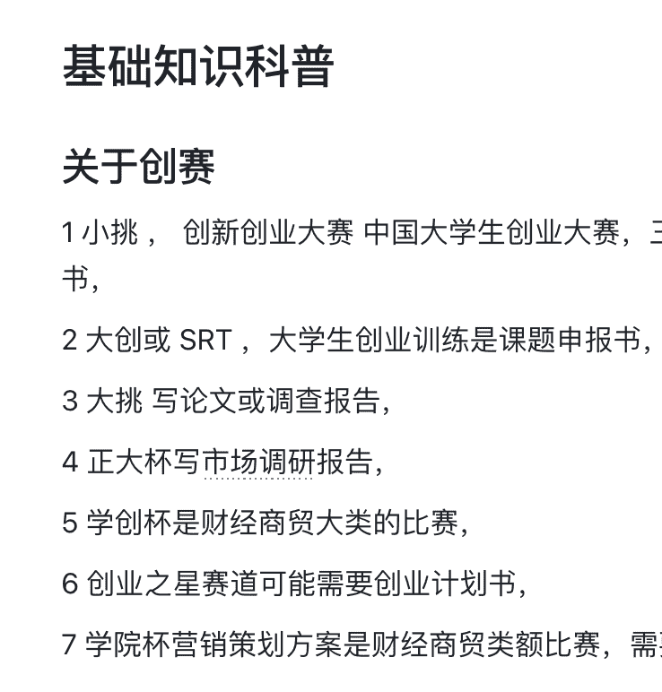
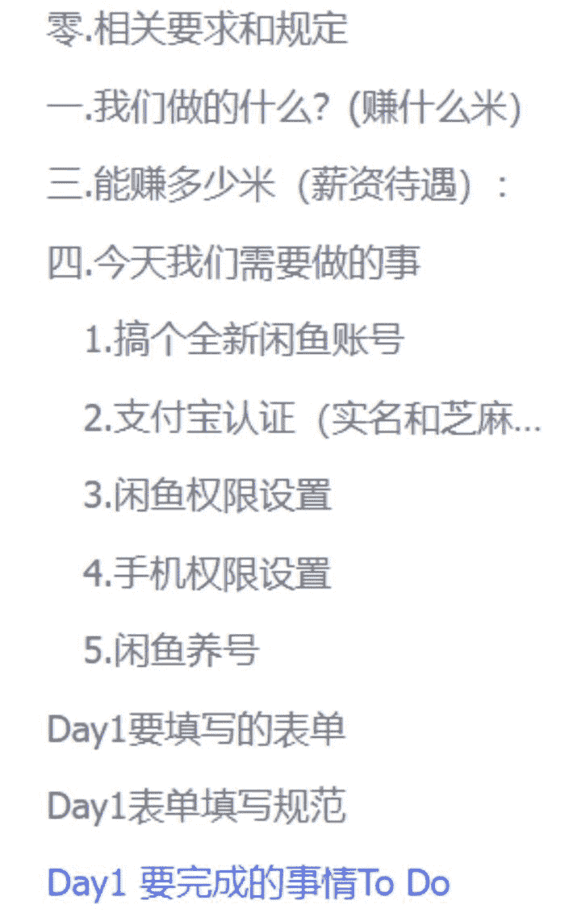
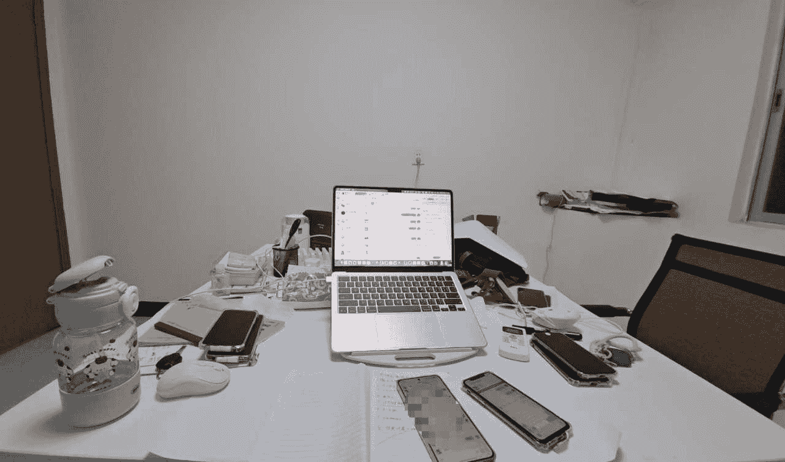
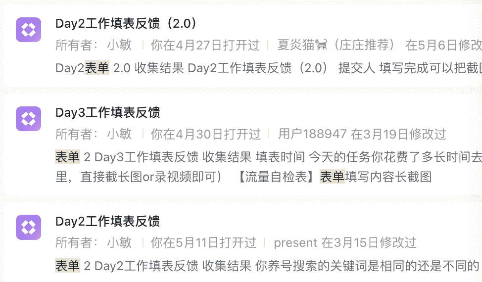
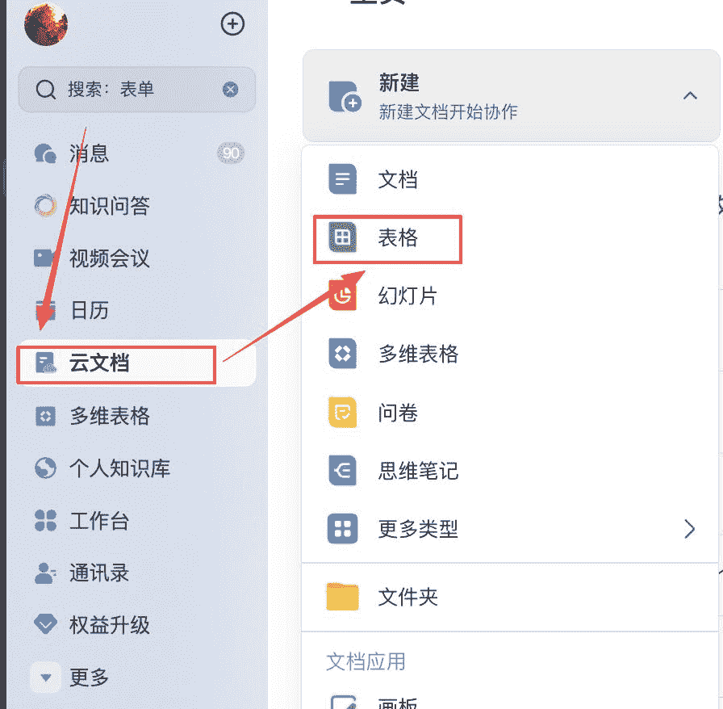

# 从个人到小工作室，我在搭建 SOP、招人、培训到管理的思考和心得

260609 副业 SC 精华

整理：公众号懒人搜索，懒人专属群精选

懒人微信：lazyhelper1

## 零、前言

大家好，我是小敏～05 年搞钱女孩，生财 2 年级同学，深耕 AI 写作业务 2 年多，存款 6 位数，跑通了个人到团队的 0-1，搭建团队工作室已经半年多。

想到最开始的时候，自己还是个人模式，当时陷在特别尴尬的境地，想放大却有各种担心，不知道做什么；不放大却不甘当下的成绩，并且整日被杂事困住，越发迷茫。

但是半年后的我，回望当时，发现大部分的问题我自己已经有了答案，于是整理出了这篇文章。

希望可以用我自己的一些经验，帮助到那些有想法但还没开始，或者搭建团队过程中有很多卡点的圈友，给你们一些思路和勇气！

本文导航如下：

- 零、前言
- 一、我为什么决定从一个人做，转向小团队
- 二、招人前最重要的准备：先把 SOP 写出来
- 三、到底是线上还是线下？如何选择模式
- 四、关于招人的一系列问题（节点、方式、筛选等）
- 五、人来了之后：岗位、薪资、培训和管理全都要看
- 六、思维和心态上也要从“个人”转变到“老板”

非常感谢糖总和芝芝姐的大力推荐，才让一直有发帖想法但默默潜水的我有了发文章的机会和勇气，给了我强大的推力。

也感谢小武老师在百忙之中帮我审稿，让我不断优化润色，以写出更好的文章。

也尤其感谢我来时路上所有帮助我的人——我的搞钱带路人波波、代写领航人鹅总、放大陪伴人糖总和芝芝姐，都给了我很多业务上的启发和帮助，感激不尽！！

## 一、我为什么决定从一个人做，转向小团队

我一开始也知道做工作室、做团队会更好，但真正要开始的时候，还是会害怕，还是会有很多担心。

不知道什么时候要招人，不知道自己的业务情况能不能招人，不知道怎么招人、培训、面试、管理，担心一招人自己的那些利润被压缩太多，担心一放大就乱掉。

但后来我发现，一个人做业务的天花板非常明显：我既要做流量，又要销售转化，还要监督交付、处理售后、发朋友圈、处理各种临时问题。所有事情都亲力亲为，最后只能越来越累。

我们这一行有一个曲线图，意思就是说，如果在开始的时候，一个人是可以赚到两三万的，但是如果你想持续赚更多钱，四五万，甚至 8-10 万，纯靠一个人很难实现，基本都要用上团队杠杆。

并且我也发现，长期做重复性的工作，让我有了特别强烈的抗拒和疲惫心理。很多时候客户来了我完全不想接待，白花花的收入全部流失了，我自己的转化率和做事积极主动性下降特别多。

还有就是，自己 80% 的时间都在做一样的事情，完全没有时间和精力再去思考战略和未来长期规划的事情，对我未来发展肯定是不好的。

个人和团队模式的区别是：

## 二、招人前最重要的准备：先把 SOP 写出来

好多小伙伴想开工作室，第一反应可能就是租场地、招员工、买设备。

但其实我觉得，最重要的应该是先把你的 SOP 全部整理出来，哪怕你现在还在跑 0-1，在这个过程中就可以着手为未来的 1-10 做准备。

要是没有 SOP，人来了都不知道该咋安排，都不知道要招什么人、做什么事情。SOP 是地基，是我们放大的前提，我们要先有这个，把自己的业务拆解到极致，才能有后面的其他。

SOP 最大的作用是，从只有我们能做，变成我们也能教会别人做，让他们为我们做。

### 1. SOP 要写到“小白也能上手”的程度

写 SOP 时，一定要假设对方就是完全都不懂的负基础状态。可以想想你刚开始做的时候，是不是什么名词都不懂，什么思维认知都没有，那我们就要给这类人写。

你写的 SOP 越详细、越细致，对小白越友好，你的培训沟通成本越低，因为该说的都已经在 SOP 里面说得特别清楚了，卡点啥的都提前预料到了，看完基本就能直接上手做了。

我觉得一个合格的 SOP，至少需要包含这些信息：

1. 名词解析（基础扫盲）。关于你这个行业，你觉得是常识的基础词汇，一定要让员工懂。可以把它放在最前面，做一个最基础且通俗易懂的科普。（比如，我的业务需要向小白科普，闲鱼是个什么平台、什么叫做数据、违禁词有什么、留学常见的词汇解析等等）

2. 业务流程整体概览。在做一切事情之前，如果有一个特别清晰的思维导图，或者流程概览，会让员工在最开始就有一个清晰的框架，不至于在后面讲各种细节的时候，不知道在干什么，不知道做的是哪一块。

示例图：我们第一天培训的内容

| 模块 | 应该写什么 | 目的 |
|---|---|---|
| 文字说明 | 步骤、标准、注意事项、常见错误 | 让员工知道做什么和做到什么程度 |
| 图片展示 | 按钮位置、页面截图、案例对比 | 减少理解偏差 |
| 视频演示 | 完整操作录屏、真实场景演示 | 让员工直接模仿执行 |

### 4. SOP 要足够细致到每一步，穷举情况

以招员工用闲鱼做流量为例。

如果你让员工上新产品，不能只说“去发产品”❌

你要写清楚：对标什么产品、标题怎么写、图片怎么选、地址怎么填、按钮在哪里、哪些词不能出现。✅

如果你想让员工回复咨询，也不能只写“及时回复客户”❌

你要写清楚：第一句话怎么说、第二句话怎么承接、客户不回复时怎么追、客户已读不回时怎么处理、客户问价格、问案例、问交付时分别怎么答。✅

你觉得很简单的事情，员工执行时经常会漏、会忘、会顺序混乱。越是基础动作，越要提前写清楚。

### 5. 根据不同对象或目的写 SOP

SOP 的话，我自己在做的就有 3 种：

- 一种是员工的学习手册，上手就直接看，不懂的自己回来搜索。
- 一种是我自己的培训 SOP，里面额外包含了一些培训流程和话术、要反馈的表单、数据表格链接等。
- 一种是我做知识付费的学员 SOP，可能就会针对性再修改，结合对方的业务等专用 SOP。

优秀 SOP 的判断标准：不是你觉得写得详细，而是一个新手看完后，能不能在你少量点拨下独立完成基础动作。

### 2. 怎么更快写完 SOP

不要等到要招人了才从零开始写。最好的方式，是平时做业务时就顺手沉淀，每天记录一点经验、话术、踩坑和注意事项。

如果想短时间内快速完成一份合格的 SOP，你可以这样做：

1. 先把大纲列出来，按业务流程拆成模块。化整为零，一部分一部分去完成，一天写完一部分，不要想着一次性全写完，压力会比较大。
2. 用语音输入工具口述流程，再整理成文字。强烈推荐 Typeless，有一个月的免费试用，也足够了，可以帮你去掉各种语气词，整理成更书面的语言。可以想到什么说什么，不用在意大纲和结构。
3. 让 AI 扮演业务高手，帮你补充你可能没想到或者没漏掉的一些细节。
4. 找完全不懂业务的人或者特别小白的人试读，看哪里看不懂。或者让 AI 扮演外行，反问你哪里不清楚、哪里需要补充。多问几遍，就知道有哪些需要不断去填充、去完善了。很好用，AI 最擅长的就是一直给你提供优化建议。
5. 让 AI 排版，混乱结构变清晰易懂、可视化。前期自己写，完全不需要担心重复、冗杂或者乱七八糟，直接让 AI 帮你去排版，也是特别高效的一件事情，图表什么的也完全可以。这里特别推荐 GPT 里面的 Codex，不需要什么特别的提示词，简单说下帮你排版整理，相信我，效果会特别惊艳。

## 三、到底是线上还是线下？如何选择模式

### 1. 什么时候可以线上转线下

线上和线下各自都有好处和坏处：

线上的管理和沟通难度大、流动性高，但是都是兼职的话，成本肯定更低一点。

线下的全职人力和场地成本高，但是可以极大提高我们沟通和做事的效率，稳定性相对更高一些。

大家可以结合自己业务特性、所在阶段去选择对应的模式。老板刚开始搭建团队的时候，比较建议先线上后线下，先兼职后全职。我自己就是这样的流程，线上跑通并且发现可以盈利了，就开始去测试线下，看看能不能进一步放大。

因为线下只要开始了，就一定要有最基础的成本投入，场地和人员什么的也没办法说解散就立马解散，很多成本都是固定支出，试错成本比较高，所以前期尽量先算清楚账。

所以可以先在线上测试一下，线上能够跑通，跑得很顺，并且可以盈利的话，那我们就可以再去测试线下，看下线下能否跑通，线下能否有更多利润可以赚。

### 2. 账号和设备要提前准备

我最开始想放大的时候，SOP 准备好后，思考到线下人员要负责的事情，就发现自己很多账号基建还没有做好。

我想让一个人管理 10 个账号，那就得先有 10 个手机，先有 10 个认证好的账号，先有对应独立的 IP，先有多个微信可以承接客户，所以我又花了两周左右的时间去把这些全部准备好。

大部分老板的业务基本都需要导流到微信，所以微信号尤其重要。而且在当下，微信其实封号越来越严重了，很脆弱，封号的原因也比较多（可能因为异地登录、频繁加好友、朋友圈内容等原因被限制或封号），所以大家就可以提前去注册好并进行养号。

建议提前储备：微信号、手机设备、电话卡、闲鱼号、小红书号、抖音号、账号实名信息、网络环境和基础素材库。

这些东西都有准备周期，越往后注册限制可能越多。能提前准备，就不要等业务爆了才临时补。

而且还有一个特别好的思路就是，我们需要设备，不一定全都自己去买。哪怕是买二手的，一台 iPhone X 都得好几百，一下子又花好几千做准备，成本确实有点高，而且说不定不会用太久，所以这时候，学会去“租”就是一个很聪明的方式。

万物皆可租。不管你是需要电脑、手机还是各种各样的账号，都可以通过租赁来解决，基本都是一天几块、十几块就能解决，这样又可以大大降低我们的成本，给了我们更多的试错空间。

租赁平台的话，尽量选择正规的大品牌或者渠道，比如转转、爱租机等等。这些租赁的大部分都需要支付宝的一个芝麻信用分，也可以提前把分数提上去。

### 3. 线下找场地的三个标准

其实线下开工作室，大家普遍都知道场地成本高，但如果用上一些小技巧，你就发现这一块也可以省不少钱。

而且这种找场地，跟我们自己去租房子一样，也要多看多对比，尽量找到预算内相对不错的。

刚开始打算测试小 MVP 的话，找场地真的不一定只看正式办公室，很多空间太大，而且只能半年或者一年以上起租的，以我们当前的人数和规模完全没必要。

场地渠道：常见的有闲鱼、小红书、大众点评、高德、朋友资源等。

邪修路子：

1. 直接租一个短租的住房，专门用来招人做业务测试，家里有空间也可以测试。只要能把工作和生活分开，且员工能接受，就可以先跑起来。

（不过，如果是租房住房这种类型的，要招人得有场地证明，可能得需要房东提供房产证和提前说明商用用途，所以也会有对应的局限，大家都可以测试沟通一下。）

2. 我还有个朋友，自己还在一个大学城跟他的实习生在一起工作，用了两个工位。

所以大家的租房思路可以多多打开，网上搜一搜各种场地等。

租场地之前，我们也要明确好自己的需求标准，以下是我自己当初找场地的标准：

我当时能接受的租金大概是每月 1500 元左右，核心要求是短租、离住处近、交通方便、附近吃饭方便。

| 标准 | 为什么重要 |
|---|---|
| 支持短租 | 方便用一两个月测试模式，发现不适合可以及时止损，很多都是可以和房东去谈的 |
| 交通便利，方便通勤 | 老板和员工都要频繁到场，距离太远会消耗大量时间 |
| 价格可控 | 成本一定要尽量控制好，一次性就租好几个月的，还得交押金，所以多方比价是正常的 |
| 吃饭方便 | 初期不要追求体面，重点看租金、交通、吃饭是否方便 |

最后，密集找了一周，加了好多个房东，还真让我找到了一个不错的：

月租 980，可以短租 2 个月，这里电商等各类租客也蛮多的。

在地铁站附近，交通很方便，周围大量商场和小吃，完美解决吃饭问题，采光通风都不错，有个大桌子正好可以让我和 1-2 个员工坐进去，而且房东还很好说话，有问题响应也比较积极。

给大家看下我的办公场地～（桌面有点乱哈哈，可以忽略一下）

## 四、关于招人的一系列问题（节点、方式、筛选等）

### 1. 什么时候该招人：不是缺人就招，而是判断和算账

#### 现有情况判断

招人不是看到别人招你也招，而是要先判断你现在的业务卡在哪里。

一般来说，有两种情况可以考虑招人：

- 情况一：你已经被重复事务拖垮

  如果你每天 80% 的时间都花在维持性工作上，比如回复、统计、发内容、盯交付，那你很难做出结构性增长。

- 情况二：现有模型已经跑通，想放大

  如果一个人能跑出结果，就可以测试更多账号、更多人手、更多流量入口，让模型从单点变成规模化。

这里对应的就是可以区分两类招人：

| 招人类型 | 目标 | 管理重点 |
|---|---|---|
| 解放时间型 | 把低价值、重复性事务交出去 | 动作做到位、反馈及时、减少老板消耗 |
| 增长放大型 | 通过更多账号或更多人手带来新增业绩 | 人效、转化率、成本回收周期 |

比如我当时完全不想再谈客户，甚至面对客户会有生理性抗拒。如果继续自己扛，收益可能就是零，但是我自己当时也特别纠结：我要是外包给销售，会不会他做的也很差，我还要给他钱，让我亏不少呀？

但是后面我想了想，如果我一直不去做出改变，不敢迈出这一步，我确定性的结果就是，因为我的抗拒，所有的客户都会白白浪费，利润为 0；但是如果交给销售，我可能会有个两千左右的兼职成本，但是我却有可能会赚到不少。可能赚很多，肯定好过确定性地不赚钱。

后来我把销售环节交出去，令我特别震撼的是，我赌对了，而且赚大发了。我这个销售能力真的太强了，短时间内销售成交特别高，我觉得都是我自己 70% 以上的业务水平。中间只需要我简单去回答下问题和处理客诉、对接写手之类的，一周竟然做了 2W 的 GMV，让我惊讶无比。

更让我深刻感受到的是，高风险高收益，敢于承担风险，敢于开始第一步，或许你真的会收获到意想不到的收获。现在我的这个销售已经跟着我做了四五个月了，业绩也是很稳，完全是我的左膀右臂，让我即使在出去玩的时候也能做到躺平，被动日入四位数。

所以可能，很多时候我们都知道一定要走这一步，我们也算到了这一步，那就勇敢去做吧，哪怕错了，哪怕亏了钱，但也都是特别无敌宝贵的经验。

### 具体算账决策

做业务一定要看数据。只有有了数据，才能判断下一步是继续加人、优化流程，还是砍掉某个环节。

| 数据类型 | 要看什么 | 能帮助你判断什么 |
|---|---|---|
| 流量数据 | 咨询量、引流量、账号表现 | 是否需要增加账号或优化前端动作 |
| 销售数据 | 成交单数、GMV、转化率 | 销售话术、跟进节奏是否有效 |
| 人效数据 | 单人带来的咨询、成交和利润 | 这个岗位是否值得继续扩招 |
| 成本数据 | 工资、房租、设备、渠道成本 | 利润是否真实，规模是否健康 |

先做一个小 MVP。比如先招少量人，跑通培训、执行、反馈和结算，再决定要不要继续扩大。

不要只看收入，要看利润；不要只看规模，要看人效；不要只看忙不忙，要看这个忙有没有带来增长。

### 2. 怎么开始招：招人渠道与招人方法

渠道蛮多的，兼职或者全职都可以去招，但是要注意不同平台的特性。以下是我自己和身边一些朋友实操下来的一些体感：

| 渠道 | 对应特征 |
|---|---|
| Boss 直聘 | 最大平台，但是兼职类岗位风控较严，尤其是会出现很多环境认证，发布前要谨慎（一定要尽量用本地执照在当地招聘，异地很容易出现问题） |
| 58 同城、鱼泡招聘等 | 审核相对没那么敏感，但仍要注意违禁词（58 同城有时候也会触发环境审核，相对比较简单） |
| 朋友圈 | 微信列表里人多的话，可以发一些朋友圈，分组多次触达，或许就有长期关注你的人愿意来尝试 |
| 圈子资源 | 多去看一下，认识的人或圈子那里，朋友的朋友能否帮忙介绍一些 |
| 买粉或渠道对接 | 要核算单人成本和实际留存 |

这个也是比较简单，先做小 MVP，不要一上来铺太大。

招人一定会有流动性，尤其是兼职。不要期待 100 个人里能留下很多人。

以我的经验，线上兼职引流了 200 人，最后留下三四十人，长期坚持做的大概 10 人左右。兼职本来就流动性强，前期要靠数量筛选。不同渠道

来人的质量也不一样，要具体情况具体分析。

# 3. 从低门槛岗位开始筛人

有一个很好的招人思路和方法：

从既有的兼职人员中慢慢过渡，通过长期合作来判断一个人的能力。当我后续有新的岗位或要求时，会优先从这些人中筛选。

也就是说，大家在招人的时候可以循序渐进。比如我们可以先招流量端处理简单事务的员工，给到的薪资相对较低。在长期的合作过程中，我们可以观察哪些人更有潜力，从而给他们更多新的机会。

以我自己为例：

我最初招了很多线上兼职的流量员工，让他们负责最基础的流量动作。合作一个月后，我发现其中有一两个人的表现特别突出，无论是做事态度还是执行能力都非常强。

于是我就尝试跟他们合作一些新的机会，比如做销售、财务助理、日常助理等，因为之前长期合作信任度很高，彼此配合起来协调度更高，沟通成本更是大大降低，比完全从 0 到 1 开始培养要好很多。

而且，如果你以后更换了项目或平台，这些积累下来的兼职人员都会是你的一笔财富。

## 五、人来了之后：岗位、薪资、培训和管理全都要看

小团队不需要一开始就有复杂组织架构，但至少要把岗位职责分清楚。否则员工不知道自己该对什么结果负责，老板也不知道该检查什么。

大部分的业务其实都离不开这三者：流量、转化和交付。对应到我这边的就是：

| 岗位 | 核心职责 | 每日反馈 |
|---|---|---|
| 流量端 | 平台上新、回复咨询、引导到微信 | 上新数量、咨询数量、引流数量、账号状态 |
| 销售端 | 接待客户、谈单转化、跟进成交 | 咨询人数、成交单数、GMV、交付记录 |
| 助理端 | 朋友圈素材、客户统计、杂事处理 | 任务清单完成情况、素材整理结果 |

流量端重点看基础动作有没有做到位。

销售端必须看转化和成交。

助理端的价值是解放老板时间，不一定直接产生业绩。

### 1. 薪资怎么定：简单岗位给稳定，销售岗位给激励

定薪资时，不要只看“我愿意给多少钱”，还要看岗位是否能被量化、是否需要强主动性、是否直接创造收入。

#### 1. 简单重复岗位：固定底薪为主

比如闲鱼回复咨询，这类工作更多是及时性和标准化。员工只要按 SOP 做到及时回复，就可以给固定底薪。

这个东西就是很简单，没有什么技术含量，也没有太多可以规定的 KPI 指标，就是来了就回复，正常就是会有流失率，设定太复杂的薪资结构反而会给你增加负担。

如果觉得不行，对方态度不积极，那就可以及时换人。

#### 2. 销售岗位：底薪 + 提成 + 奖励

销售直接影响成交，必须有提成，否则很难让对方主动对结果负责。赚得多就拿得多，这样的设置才有意义，可以激发员工主动赚钱的欲望。

底薪这种，可以平衡一下。一方面是可以压一下成本，让对方知道跟着你做有很多的成长空间。这种没有固定标准，影响因素也比较多，可以结合你的业务模式或者利润空间设置好；另一方面是有一个最低限制，再怎么样，也得让对方有生存空间，不能太资本。

前期担心可以先设置试用期，起薪低一点。等对方熟悉业务、业绩稳定、承担更多工作后，再逐步涨薪。这既能控制前期成本，也能给员工看到成长空间。

#### 3. 低薪岗位要降低操作难度

如果兼职底薪只有几百元，就不要期待对方投入很高的脑力。你要做的是把 SOP 拆得足够细，让他尽量少动脑、多执行。

薪资越低，流程越要简单；流程越复杂，流失率越高。

### 2. 培训怎么做：不要一次性塞满，要让员工真的学会

员工培训不是把 SOP 发给他就结束了。你要确认他真的理解了，并且能执行出来。

#### 1. 用费曼学习法检查理解

不要只问“看懂了吗”。可以让员工给你讲一遍，或者演示一遍完整操作。只要他讲不出来、演示不顺，就说明还没真正掌握。

#### 2. 把长 SOP 拆成小模块

如果 SOP 很长，新人一次性看完也记不住。培训时要化整为零，先学第一部分，熟练后再学第二部分。

新人前期一定要慢，不要急着把所有内容塞给他。一次教太多，最后就是每件事都做不好。

#### 3. 换形式，让培训更容易吸收

- 用问卷或表单做小考试，让他知道重点在哪里。
- 线下直接演示，线上用腾讯会议录屏或屏幕共享。
- 重要规则让他手写一遍，比如违禁词、风控词。
- 讲清楚背后的原理，而不是只让他死记硬背。

培训的目标：不是让员工“看过”，而是让员工能稳定做对。只要能达成这个目标，文字、视频、表单、考试、演示都可以用。

### 3. 管理怎么做：用表单和抽查替代时刻盯人

小团队老板最容易犯的错，是招了人之后还一直盯着人。这样手上好像轻松了，心理上却更累。

管理的关键不是时时刻刻盯着，而是把标准、反馈和检查机制搭起来。

#### 1. 每个动作都要有标准

员工每天做什么、做到什么程度算合格、需要提交什么证明，都要写清楚。

比如我就要求流量端每天提交：

签到记录、上新截图、咨询回复截图、引流数据、异常账号反馈。

#### 2. 用表单做日常反馈

把每天要反馈的内容做成表单，员工完成后直接提交。我们老板通过表单就能够看到执行进度和数据变化，不需要一个个私聊追问，效率特别高。

这里推荐飞书里面“文档”里的“问卷”功能，填写完还能自动生成表格数据。

#### 3. 用抽查处理质量问题

不需要每天盯着每个细节，但要不定期抽查。如果发现偷工减料、重复犯错、态度敷衍，就要及时处理。

如果是能力问题，可以讲一次、给一次机会；如果同一个问题反复出现，就属于态度问题，要果断换人。

管理提醒：你花钱招人，是为了释放自己的时间和注意力。

如果招了人之后，你反而把全部心理能量都放在盯人上，就背离了招人的初衷，所以不用一直盯着和担心，偶尔抽查就好，更高效。

### 4. 怎么留人：让员工看到成长、赚钱和被重视

留人不是只靠工资，也不是靠画大饼。小团队想留住人，可以从三个角度入手。

| 留人方式 | 具体做法 |
|---|---|
| 成长机会 | 让员工学到新技能，从基础岗位逐步接触更高价值岗位 |
| 赚钱机会 | 表现好就涨薪、给提成、给奖励，让他看到希望 |
| 情绪价值 | 偶尔发红包、送小礼物、及时肯定，让他感觉被看见 |
| 适度画饼 |  |

小礼物和红包不一定要贵，关键是多频少量，让员工感受到你把他放在心上。

## 六、思维和心态上也要从“个人”转变到“老板”

### 1. 累了就要休息，不要把休息误判成放弃

最开始我们个人模式的时候，累的点可能是做流量、做销售、做交付，但是我们做了团队之后，我们感到累的部分，就变成了搭团队、管人、培训和分钱等等。

没有不累，只是累的点不一样了，就是会突然不想做。我自己就有无数种这种时刻：遇到客诉的时候、员工做事太拖沓的时候、流量又遇到卡点、账号又被封的时候，好多个不想干的念头，甚至一度想要放弃直接躺平。

在后面静下心来，我会发现我只是太累了，需要休息，而不是遇到问题想要放弃。

当你愿意给自己放一个小小的假，好好休息休息，你会发现过了几天自己又会是能量满满的状态。作为创作者，我们更应该学会休息、学会恢复，这样才能更高效地专注工作。

### 2. 千万不要给自己设限，抛掉限制去做事

我一开始做代写这个业务的时候，也会有很多顾虑。我会担心我完全没有做流量的经验，完全不懂闲鱼，我可能学历也不是很高，我也没有什么背景资源，我真的可以做好吗？

但是如果我把这些全都抛弃，而是专注于解决问题，专注于把每个业务点做深、做细，我就发现我想要的结果又自然会来到了。

所以不需要给自己设限，不需要觉得自己没有什么，而是专注自己有什么，可以做什么。

### 3. 不确定的增长，好过确定性的停滞

测试可能只需要花几千块钱，但不测试，你可能一直停留在个人作坊阶段。

如果测试跑通，就能证明这条路可行，再慢慢放大；如果一直不做，那就是确定性的停滞。

就像我前面说我招销售的部分，不招我没钱，招了我大概率就可以赚钱，而且我早晚要迈出这一步去做。

### 4. 接受波动与不确定性

一个比较重要的点，就是要接受业务的波动性和不稳定性，不管是兼职还是全职。

在前期不熟练的情况下，由于对自己需求理解不深、经验不足，我们需要去试错、去尝试、去和新人磨合，并见识各种各样的人。

在这个过程中，我们可能会面临：平台规则的变化、行业的动荡、人员的流动等等，都是有可能会发生的。

这些因素都会导致我们在“招人放大”这块不断反复。有的时候，我们自己跑通了 0 到 1，招人后 1 到 10 也已经做起来了，但中间可能又会出问题，比如人员流失或其他原因，导致我们又回到了 0 到 1 的阶段。

这些其实都是很正常的，都是我们必然会经历的，我们只需要勇敢地重启，勇敢地从零开始。这种“从零开始”并不是完完全全的归零，而是在不断的重启和迭代中做大做强。

我们要明白：业务的发展是有波动的，不是一条特别稳定的直线。有波动、有各种风险和不确定性都是正常的。我们要学会接受现状，并在对应的阶段去调用对应的能力。

### 5. 小团队招人，先筛选，不要过度培养

很多人的做事态度和习惯，是长期形成的。你可以教方法，但很难改变一个人的基础态度。

如果对方不听指令、敷衍、反复犯同样错误，不要内耗，直接换人。

### 6. 不要对新人有“厌蠢心理”

我们招的大多是基础岗位。如果对方什么都懂、能力很强，可能也不会来做低薪重复工作。

老板要允许新人第一次做得慢、做得不够好。容错不是纵容，而是区分能力问题和态度问题。不然每个人进来，每个人刚开始做得不行，你都直接砍掉，都直接自己上手做，自己会特别累。

而且招的大部分人，我们都应该只要求对方做到 60 分。我们靠自己搭建体系和各种流程标准，让对方达到这个标准，超出标准更好，正常这样我们也就接受，后续让他不断提高熟练度。

### 7. 核心追求是利润，不要盲目追求规模

刚开始招人时，没必要一下子拉很多人。人越多，租金、工资、沟通、管理和试错成本都会上升。

在数据没算清楚之前，规模越大，不一定赚得越多，反而可能让利润下降。可以很快把人砍掉，但一定要慢慢加人。

## 最后总结

小白搭建个人工作室，不要一开始追求正规、庞大和完美。

先把 SOP 写细，先招少量人跑 MVP。

能赚钱、能交付、能少依赖自己，才是真正值得放大的工作室模型。

---

如果你想看全网最新的变现玩法，并且和一群执行力极强的极客一起下场拿结果，欢迎围观我的核心私域：【懒人专属群】。

我们不聊虚的，只做商业闭环的拆解与 AI 效率的压榨。系统内已沉淀 1000+ 跑通的套利实战局。

👉 查阅圈子完整数字资产与上车门槛：

https://lazyso.com/insider/

认同价值、准备好下场干活的，扫码加我微信（lazyhelper1）。

备注：【实操上车】，不闲聊。

