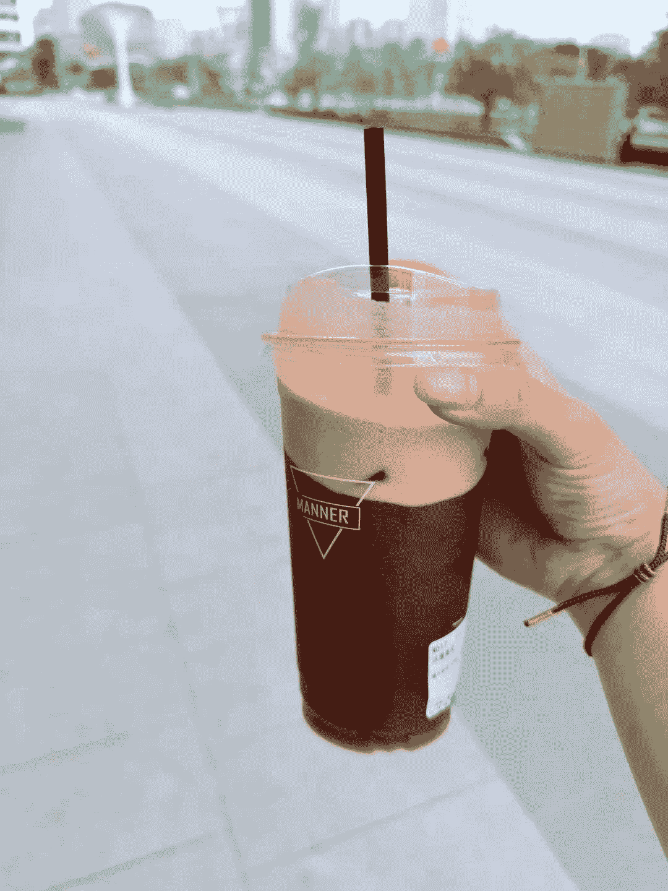
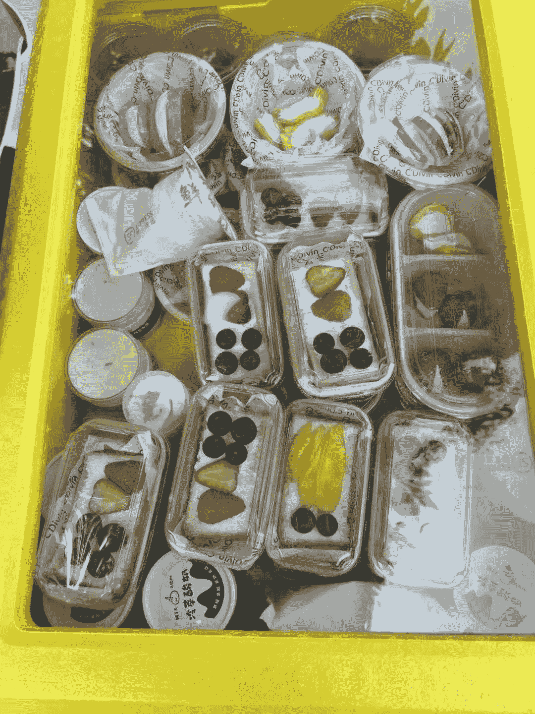
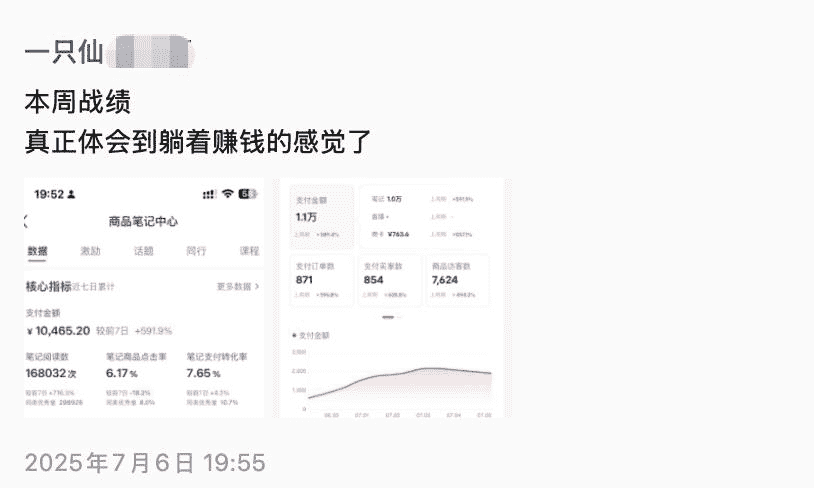
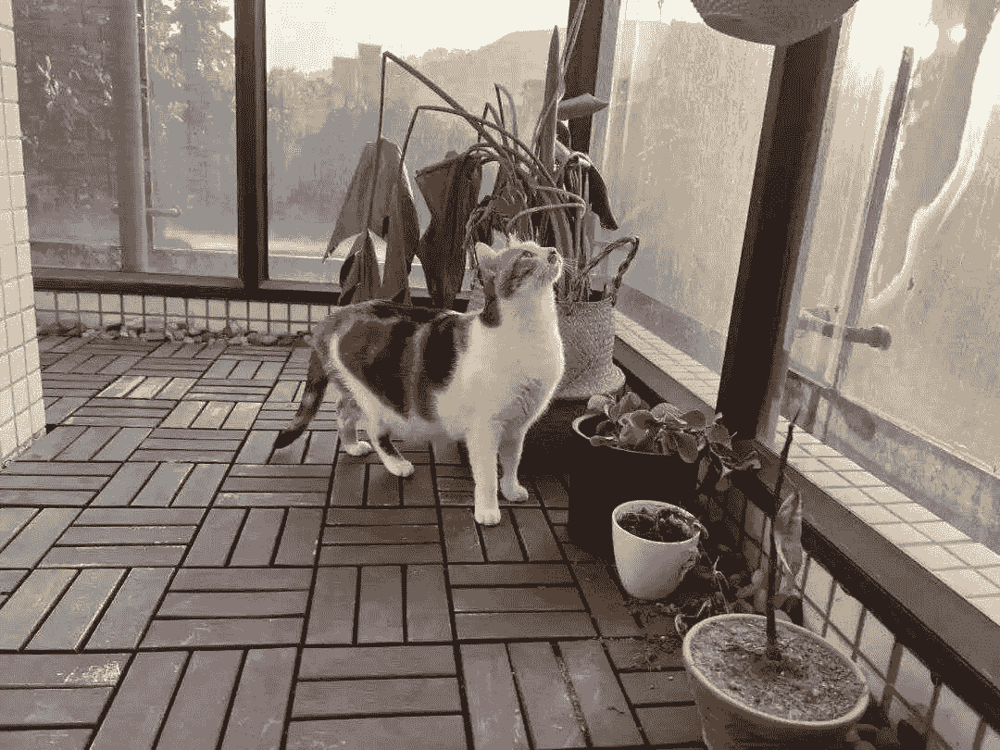
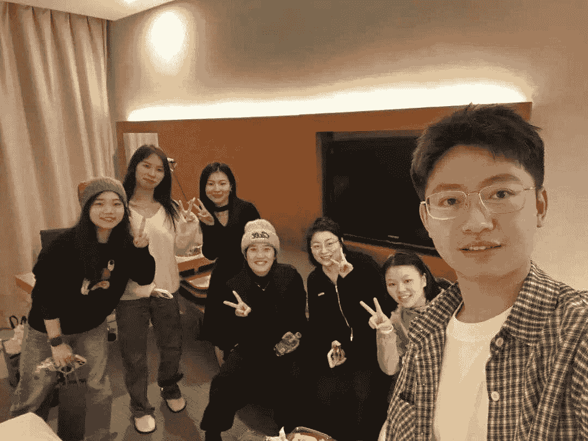
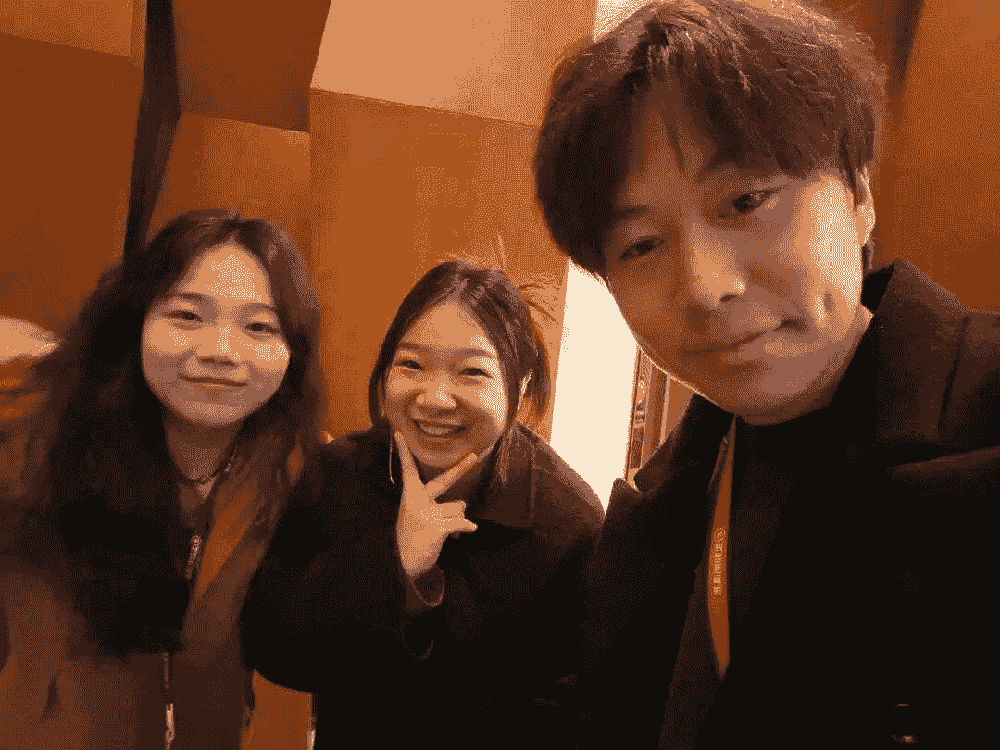
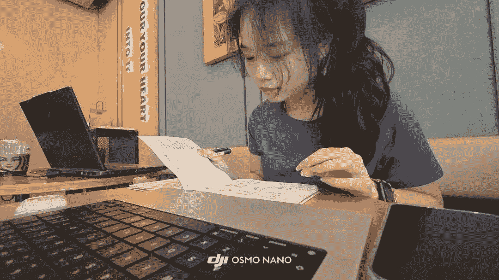

# 每天只工作**2**小时，月收入最高是上班时的**10**倍，她用**2**年成为一人公司

260609 副业SC精华

整理：公众号懒人搜索，懒人专属群精选

懒人微信：lazyhelper1

前言：第一次认识一只仙，是在去年8月。

当时听说她在小红书电商里跑出了成绩，我邀请她来生财做了一场分享。

# 01｜现在的生活状态：每天工作四五个小时，但这不是偷懒，而是我想要的生活

七天：你现在一天大概是怎么安排的？

一只仙：我先说一下我今天的状态吧。今天我是7点起床，7点半去跑步，因为我周日一般会跑一个长距离。我今年想跑半马，所以我让Claude给我做了一个跑步课表，一开始是从3公里开始跑，到今天已经要跑9公里了，下周就是10公里，每周的长距离都会加1公里。

跑完之后，我一般会去Manner点一杯我最喜欢的冰橙美式，喝完之后听歌走路回家，那一刻我就会觉得自己是全世界最幸福的人。

健身房附近也有咖啡店，所以很多时候就是早上先过去工作，到了健身时间就去健身，健完身再继续回咖啡店。在工作之前，我现在基本上都会先安排一个小时看书。大概就是这样的流程。说实话，现在真的是我理想的生活状态了。

我理想的生活状态，绝对不是只赚钱。我觉得我当不了那种大老板，一个很重要的原因就是，我自己会觉得生活更重要。对我来说，比较理想的工作和生活，就是像现在这样，有一些可控的点在一点点往前推进，比如阅读、运动，还有一些小事项。这些事情都是在可控的状态下往前走，剩下的时间我再去安排赚钱。赚钱是最基本的保障，但它绝对不是我唯一追求的事情。

# 02｜从前司离开：我不是突然辞职，而是想了快两年

七天：你刚才提到时间自由。那你能不能回头讲讲，你之前工作的时候是什么状态？你是怎么一步一步从职场走到现在的？

一只仙：我进入那家公司其实不是一件很容易的事情。因为我是双非学校毕业的，也没有特别突出的成绩。我面试比别人多很多轮，我面了6轮才进去。对我来说，那真的是一个很难得的机会，也是一个还挺光鲜亮丽的工作。但是进去之后，第一年我就知道，我在这里待不久了。

虽然我的岗位是互联网相关岗位，但它本质上是一个传统行业下面的互联网IT部门，所以管理方式还是传统行业的管理方式。比如不能穿拖鞋、不能穿短裤，这些只是表面的。还有很多领导的各种要求，比如说弹性上班，但实际上又要开早会。很多点都让我觉得，我自己的个性不太能在这里待很久，但我还是坚持了3年。

这3年里，我也一直在涨薪。但我会看到一个问题：我的导师在这里工作了10年，

我们的工资全部透明，他的工资也就比我多5000块钱。我就会想，如果我5年后的成长，只是比现在多5000块钱，那对我来说真的没有太大吸引力。所以我每天睁开眼睛，都会觉得自己做的工作很没有意义。

我会觉得，我在这么大好的青春里，把时间浪费在这里，真的太可惜了。而且我越工作，越发现自己眼里的光没了。

因为我以前是一个好奇心很强的人，对任何事情都有想去了解的欲望。但在那份工作里，我慢慢发现，我好像把这种好奇心丢掉了。那一刻我就觉得不对了。这个辞职的决定，我想了快两年。

# 03｜裸辞之前，我先问了自己两个问题

七天：你当时是裸辞吗？你怎么判断自己可以辞？

一只仙：我是裸辞。但我其实不太建议大家现在这么做，特别是在现在这个环境下。我当时之所以敢，是因为我想清楚了两个问题。

第一，我有一定存款，这个存款可以支持我在一到两年没有任何收入的情况下生活。

所以我先算了一笔账，我能坚持多久。

第二，我是裸辞，不是已经拿到了副业结果再把它放大。所以我必须做好心理准备：我进入这家公司、拿到那份工资，其实是有幸运成分的。

那如果我裸辞去尝试各种副业，最后失败了，要重新进入职场，我能不能接受自己去面试一家一个月四五千块钱的公司，从头开始？

我很认真地思考了这个结果，最后发现我可以接受。而且如果我去尝试了，哪怕失败，我也不后悔。这两个事情想清楚之后，我就提离职了。

# 04｜我一直想要的是“睡后收入”，但刚开始连朋友都怕我被骗

七天：你当时离职后的期待是什么？是先赚钱，还是已经想要某种更长期的状态？

一只仙：这里有一个小插入点。我当时看过《纳瓦尔宝典》，里面讲到杠杆。其实“用杠杆”这个词当时还不是我的想法，我当时的想法更简单：我要有睡后收入。就是我希望在睡觉的时候，也可以有东西帮我赚钱。这样我的时间性价比才是最高的。

甚至在辞职之后的半年时间里，我跟朋友去旅游，还在跟他说这件事。他都怕我被骗了。因为我当时跟他推生财的时候，就说里面有很多方式看起来可以实现睡后收入，他就很担心我被骗。

其实如果你是一个一直在公司打工的人，真的很难相信这件事。所以后来我做小红书店铺的时候，哪怕我真的实现了，我心里还是会有一种很不配得感。

# 05｜你的第一个项目是做什么？

七天：你是怎么找到自己的第一个项目的呢？

一只仙：我在一个做跨境社群的人那里听到了生财有术，后面我抱着试一试的心态，就加入了。在辞职之前给自己安排了辞职后的一个月旅行。在那一个月旅行过程中，我其实已经打开了生财这个巨大的信息海洋。我当时真的跟朋友说，天呐，我都不想旅游了，我想赶紧把里面所有东西都学过来。

但没办法，我当时已经定了一个月旅行，所以只能一边旅行，一边去咖啡店看文章。那时候我刚好看到做AI代写业务的小鹅的一篇文章。我觉得她那篇文章写得非常真诚，而且她也是经过家里的变故之后，跳出原来的状态。我觉得我们的经历有相似之处，所以我就加了她。

加了她之后，我开始接触到AI代写这件事。当时我一边旅游，一边找咖啡店做代写。就在这种状态下，我把学费赚回来了。差不多旅游结束的时候，我也开始想，我接下来到底要做什么。

# 06｜AI代写给我的价值，不只是赚钱，而是让我第一次真正学会怎么用AI

七天：你当时做AI代写的时候，AI的应用多吗？还是更多在前端谈单确认需求？

一只仙：我做过写手，也做过流量。在做写手的时候，那是我人生第一次真正正式接触AI。在此之前，我们公司其实也已经开始探索ChatGPT了，但大家基本上想不到它的使用场景。那时候大家会做一些发散，我也很积极参与，想看看它到底能应用在什么地方。

AI代写，是我第一次真正知道AI可以用于实际场景，尤其是写作。我当时接的单五花八门，有中药学的，有名校学生的，有党相关材料的，也有公司职员的。什么都有。我自认为自己写作其实一般，没什么天赋。但在接这些单的过程中，我一直在学习AI的使用方式，比如提示词里面要怎么设定角色、背景、任务，包括怎么给它喂资料。

那时候我也接触了很多AI工具，像Kimi、GPT，还有国内的一些平台，我基本都用过。对AI的了解，就是在做代写的过程中越来越深入的。

# 07｜闲鱼第三天爆流量，但我发现：这不是我要的自由

七天：那你后来是怎么从AI代写走到闲鱼的？

一只仙：旅游结束之后，我报了一个流量课，在闲鱼获客做AI代写。很惊喜的是，做了第三天之后流量就开始爆了。我本来要接很多代写单，突然流量进来，我就发现自己写不过来了。闲鱼有一个很费精力的地方，就是如果信息进来之后你没有第一时间回复，客户就会流失。

所以我会一直很紧张那个闲鱼消息，不敢睡觉。每天睡醒第一件事，也是打开消息。那三天我饭都没怎么吃。因为我要谈单，又要写单，流量又很大。

我算了一下，如果那三天的收入能持续下去，它跟我之前上班的日薪已经差不多了。但我又认真想了一下：这三天的状态，跟我上班的状态有什么区别？其实没有区别。都是在用我大量的精力和时间去赚钱。

我就觉得，这不是我要的。就算它能赚钱，但这跟我去打工有什么区别呢？没有任何区别。所以我就知道，这个项目不适合我长期做。

# 08｜我判断一个项目能不能长期做，标准很简单：它能不能让我每天只工作四小时

七天：所以你当时其实不是因为项目累就放弃，而是会判断它是否符合你的目标？

一只仙：是的。我当时从来没有想过要重回职场。其实在小红书之前的某个阶段，有过一点点这个想法，但那是后面的事情。闲鱼这个项目让我学到的就是，有些事情能赚钱，但不代表它适合你长期做。我当时的判断标准很简单：如果这个项目需要我持续投入大量精力，没办法实现我原本想要的状态，那它就不是一个长期项目。

因为我辞职最重要的目标，就是我当时跟我弟说的：我要每天工作**4**个小时，然后其余时间爱干嘛就干嘛。

只要这个目标我觉得无法实现，我就不会把它当作长期可以做的事情。

# 09｜做干噎酸奶，不是因为它多高级，而是因为我需要现金流

七天：我看到你后来还去做了干噎酸奶摆摊。当时我看到那个案例的时候，其实会觉得它跟闲鱼有点像，都是需要动手的项目。那你当时是不是已经得出了一个结论：凡是特别重人力的事情，都不值得长期做？为什么后来还是去尝试了？

一只仙：是的，其实那个时候，我已经在做酸奶项目之前，尝试过很多东西了，包括油管。但当时我的油管一直没有收入，所以我开始有一种很现实的焦虑：我必须要有现金流进来了。因为那时候已经辞职一年了。虽然我还有一定存款，但我是那种会提前焦虑的人。我不可能等到钱彻底见底的时候，再把自己逼到一个完全没有选择的状态里。

所以我当时的目标已经变成：我要先让现金流回来。那个阶段我同时做了两件事情。

第一件事情，我开始想找一个兼职，甚至是很轻松的一份工作都可以。当时我就去面试了一个AI的兼职，后来面过了。

那个兼职其实一天真正去上课的时间也就一个小时，加上通勤可能两个小时，剩余时间全是空的。第二件事情，就是我同时还在做油管。所以那个阶段其实是：AI兼职+油管同步进行，但我依然还有很多空余时间。

于是我就在想，我剩余的这些时间，必须得保证我的资金链不断掉。刚好有一天，我在听播客。

姜思达提到自己很喜欢吃希腊酸奶，我就去小红书搜了一下。发现了“干噎酸奶”这个项目。而且更关键的是，我发现我所在的地方没人卖。我当时一下子就兴奋了。因为我看到别人卖得很好，但我这个地方没人做。我就立刻开始算账：一瓶成本多少？前期投入多少？我能不能接受？卖多少钱？利润空间怎么样？我记得特别清楚，我那天下午把账算完之后，晚上就开始买各种东西了。

那个阶段，我的目标已经跟以前不一样了。以前我会想什么长期、什么睡后收入，但那时候我最现实的目标是：先让现金流回来。就开始做干噎酸奶。我当时其实并不知道它天花板这么低。因为我看到别人卖得很好，还在收徒、卖教程，我就会觉得这个项目后路很长。

所以我一开始真的没意识到它会这么累。但很神奇的是，我在做的过程中虽然累，可是我又挺快乐的。

# 10｜第一次摆摊，我做了20罐酸奶，只卖出去2罐

七天：你第一次正式摆摊，卖得怎么样？

一只仙：很惨。我第一次大概做了20罐，最后只卖出去2罐。

而且我是从早上摆到下午，中间换了好几个地点。那个时候其实还是挺受挫的。因为你会开始怀疑：是不是小红书上那些东西都是骗人的？是不是根本没那么好卖？我也会怀疑。但有一个很关键的点支撑着我继续往下走。就是我在开始这个项目之前，我先问过自己一句话：“如果这个项目最后完全失败了，所有成本都打水漂了，你能不能接受？”我的答案是：可以。

所以后来哪怕遇到了这么多挫折，我还是会觉得：大不了就是成本没了呗。我一开始就预想过了。我开始重新思考：问题到底出在哪？我发现，很多人根本不知道“干噎酸奶”是什么东西。而且它又不便宜，一小罐十几二十块，别人会觉得：这到底是啥？为什么这么贵？我就意识到：他们的决策成本太高了。于是我开始想：我能不能把这个决策成本降低？

我原来一罐酸奶大概150克，卖15到20块钱。但问题是，它很小，而且大家不知道那是什么东西。所以后来我开始做一种很便宜的小组合。比如：一颗草莓，中间加一点点干噎酸奶，卖两块钱。或者水果杯里加一点酸奶，也是两块钱。其实我是有利润的。但更重要的是，我发现：两块钱对别人来说，决策成本太低了。他们会愿意先买。

买完之后，发现“诶，这东西挺好吃”，然后再回来买我真正的大罐。后来慢慢就开始有很多复购的人。再后来，我开始同步发小红书。因为小红书本身其实已经教育过市场了。

很多人知道干噎酸奶是什么，所以他们看到之后，会直接加我微信。整个成交链路就变得特别丝滑：“什么时候送？”“送到哪里？”“我要几罐？”直接成交。

# 11｜一边摆摊，一边骑共享单车送货

七天：后来你那个项目其实已经开始跑通了，对吧？

一只仙：对，后面其实真的卖爆了。但问题是，我只有一个人。我不仅要研发新口味，要自己做，还在同步做AI兼职。我还得自己配送。为了让大家体验感更好，我当时甚至没有自己的车。我每天骑共享单车送货。现在回想起来真的很拼，特别是夏天的时候，广州很热。还有下雨的时候。

但那个阶段，我特别快乐。因为我太久没有得到正反馈了。

之前做油管的时候，我一直没有赚到钱。但做干噎酸奶的时候，我第一次发现：“原来我只要稍微动动脑子，就可以马上看到正反馈。”

而且别人会夸我做得好吃。你要知道，我是一个从零开始学这个东西的人。当别人说“你这个很好吃”的时候，我会有特别强的成就感。

我还发现：小红书引流真的很快。这些事情叠加在一起，给了我特别大的正反馈。

## 18｜摆摊的时候，我第一次开始思考“产品”

七天：干噎酸奶后面为什么没有继续做下去？

一只仙：我当时在万达附近摆摊，那个阶段刚好是中美贸易比较激烈的时候，我旁边有一个做跨境的小姐姐，她也来摆摊。

她卖手串。她当时跟我吐槽，说特朗普把她害惨了，所以现在也只能出来摆摊。但我当时特别羡慕她。我意识到：她卖的是手串，我卖的是干噎酸奶，这两个东西本质差别太大了。我的酸奶今天卖不出去，后天可能就坏了，我只能自己吃或者扔掉。但她的手串今天卖不出去，明天还能卖，后天还能卖。

那个时候，我第一次真正开始思考“产品”这件事情。那个时候，我已经开始有很多客户排单了。很多人下单之后，要等到下周才能拿到。但我只有一个冰箱，只有一个人。

我开始思考：如果我要赚更多钱，我是不是得换设备？是不是得招人？我朋友跟我说了一句话。他说：“很简单，你算笔账。你招一个人，一个月给他5000，你自己还剩多少钱？”我一算，发现真的剩不多。

这个项目本质上就是个苦力活。我卖15块钱一罐，但成本就七八块了，还没算物流、人力、配送这些。于是我突然意识到：这个项目虽然跑通了，但它不是一个值得我长期做大的事情。所以我后来决定停掉干噎酸奶，开始正式转向小红书电商。

## 19｜第一个小红书品爆单，一半是运气，一半是坚持

七天：如果让你复盘，你的小红书这个品从0到1是怎么做起来的？

一只仙：如果说从0到1，我觉得最重要的不是一开始就做对，而是先选一个品，然后不要轻易放弃，持续去试。我最开始其实也是小白，没有很宏大的目标，也不知道这个品最后能卖到什么程度。那时候我选了好几个品，最后选中了现在这个，然后就决定认真做下去。

我之前在生财分享了做的是玩具赛道。一开始我做的事情其实很朴素，就是模仿、测试、再测试。我会去找对标同行，模仿他们的素材、封面、拍法，甚至几乎拍到一模一样。但很现实的是：别人爆了，我没爆。

当时我有两个主要对标，他们的素材我都完整模仿过，但都没跑出来。所以后来我慢慢意识到，模仿可以帮助入门，但不能保证结果。真正让我跑出来的，是我没有停在“模仿失败”这一步，而是继续去尝试新的素材、新的场景。

我当时还没有把“小红书”当成一件特别重

的事业来做，我那段时间还在健身，平时骑车去上课、去路上，产品都会随身带着，想到什么就顺手拍。第一个爆的素材，其实就是在我去健身的路上，看到一个我觉得挺好看的风景，顺手拍了一条。现在回头看我会觉得那个素材也挺普通的，但它就是爆了。

现在复盘，我会觉得那个节点一半是运气，一半也是因为我一直没放弃测试。前面试了那么多没结果，如果我停了，就不会等到那个“顺手一拍”的爆点。

## 20｜接住爆款流量，靠把负反馈变成正反馈

七天：那爆了之后，你是怎么接住这一波流量的？

一只仙：爆了之后并不是就稳了，反而很快就遇到了第一个大问题：负反馈。这个品有一个特点，就是负反馈比较高。大概爆了 10 天左右，就开始断崖式下跌。差评、退货、用户发帖吐槽，这些都会影响后面的流量。

当时我也不是立刻就知道怎么解决。其实从 7 月中旬到 8 月下旬，中间低迷了一个多月，并不短。会有差评、退货、发帖子骂我。因为供应商偶尔会发错货，或者产品质量会有问题。

这个事情其实对我打击也挺大的。因为我会开始想：“我卖了一个垃圾东西给别人，我是不是有点对不起别人？”但这个阶段对我很重要，因为我没有因为流量掉了、反馈差了就停掉，而是继续边做边优化。

一方面，我去找方法。后来小茗姐提醒我去看生财航海的直播内容，我才意识到有一些具体动作是可以降低负反馈的。学到之后，我就开始调整，负反馈确实慢慢降下来了。

另一方面，我在这个过程中没有停止测试新素材、新文案。我当时有个很重要的认知被点醒了：负反馈虽然不好看，但它也在帮你筛选更精准的人群。只要产品和表达继续优化，流量虽然变少了，但人群会更准，转化反而可能变高。

这个认知对我帮助很大。因为很多人一看到数据往下掉就慌了，但我当时会觉得，这个阶段不是结束，而是在“校准人群”。

## 21｜熬过负反馈，把单日营收做到 2W

七天：所以你后面第二次起来，靠的是什么？

一只仙：靠的是两件事叠加：解决负反馈，加上持续原创素材。

当我把产品负评价问题优化之后，流量迎来了第二次拉升，而且这次比第一次更高。第一次高点大概是一天 13000，第二次最高做到一天 22000。这个阶段我已经不再只是模仿了，而是开始形成自己的素材风格。

我会自己去设计场景、拍封面、想标题，开始真正站在用户心理去想：他们会被什么场景吸引？会被什么表达打动？他们为什么会点进来、为什么会下单？

这个阶段我其实做得很投入，而且是乐在其中的。我不是机械地发内容，而是在玩一种“理解用户”的游戏。这个过程让我越来越知道，什么样的画面、什么样的情绪、什么样的表达，对这个产品的人群是有吸引力的。

所以从 0 到 1 真正完成的那个标志，不只是某条笔记爆了，而是你开始从“模仿别人怎么做”，走到“我知道这群人为什么会买”。

## 22｜客服和投流，帮我保住底线和上限

七天：除了内容和流量，你觉得还有什么关键动作？

一只仙：我觉得还有两个特别关键。

第一个是客服。这个真的被很多人低估了。因为我的产品当时供应链也出过问题，比如发错货、质量不稳定，这些都是真实存在的。但我当时是自己做客服，我会非常真诚地跟客户沟通，比如告诉对方这是供应商调试新品时发错了，这单直接送你，我再补发一个新的。很多原本是差评、吐槽，最后因为沟通方式变成了好评。

我印象特别深的是，有客户一开始发帖骂产品，后来我跟他认真沟通、处理问题、退款补发之后，他反而觉得我这个人特别真诚，最后把原来的差评删掉，重新发了一个夸我的好评。这件事情对我触动很大。

我第一次感受到，原来生意不是只有“卖出去”这么简单，很多原本糟糕的事情，是可以通过沟通变成好事情的。

第二个是投流认知。我一开始其实投得很保守，可能一天就 300 块预算，没有真正放开。后来有人提醒我，如果 ROI 是正的，就不要自己把预算卡死，应该尽量让系统去跑。这个认知对我来说很重要，因为它让我从“我怕花钱”变成“我要看模型是不是成立”。

只要模型是正的，投流就不是风险，而是放大器。

## 23｜小红书从 0 到 1 万单的核心秘诀

七天：如果总结成一句话，你觉得你的小红书从 0 到 1 万单，最核心靠的是什么？

一只仙：我觉得最核心的，不是我比别人聪明，而是我没有那么容易中途放弃。因为从结果上看，好像是“选中了品”“拍到了一条爆款”“解决了负反馈”“做到了第二波增长”，但其实每个节点前面都有一段很容易放弃的时间。模仿没结果的时候可以放弃。爆了又掉的时候可以放弃。负反馈很多的时候可以放弃。供应链出问题的时候也可以放弃。

所以如果一定要说小红书从 0 到 1 是怎么做的，我会说：先选一个值得做的品，前期大量模仿和测试，在测试里等到第一个有效素材，爆了之后解决负反馈，持续做原创、理解用户心理，再用客服和投流把结果接住。

整个过程里，真正让我走出来的，不是某一个技巧，而是我愿意一直做下去。

## 24｜敢把价格拉高，是因为我已经成了头部

七天：你后面是不是把客单价越做越高了？而且你还敢卖得比同行贵，这个是怎么做到的？

一只仙：对，我是故意把价格往上拉的。最开始我的客单价只有十几块，后来慢慢拉到二十多。这里面我做了两个动作。

第一个是做组合 SKU。因为我这个产品本身款式就很多，我把不同款组合在一起，用户会觉得“这样买更划算”，所以更愿意下单。

第二个是不断上新款。那个阶段我已经做到头部了，所以我敢涨价。同行可能不太敢，但我会觉得，我的产品、素材、整体感觉都在变得更好，那它就值得更高的价格。

但我其实也不是所有款都直接涨，当时最狠的一招，是“最低价引流”。就是我会故意把店里最便宜的那个 SKU，定得比同行还低一点；但其他大部分款，反而都比同行贵。

我的逻辑很简单。用户在小红书看到笔记以后，第一眼会先看价格。只要她看到那个最低价，觉得“这个还能接受”，她就愿意先点进来。

可一旦点进商品页之后，她关注的重点就不只是价格了。她会开始看哪个更好看，哪个更适合自己，哪个更有感觉。所以最后真正成交的，往往不是那个最低价款，而是别的更贵的款。

这个逻辑我一开始也不是百分百确定，但我试了之后发现，真的成立。

## 25｜写出爆款笔记这件事，本质上是在理解人

七天：你写笔记的时候，会怎么从人群洞察推到具体内容？比如你判断这个品主要是卖给大学生的，你会从哪里开始想？还有，你后来为什么会越来越多地去做原创素材？

一只仙：我后来慢慢发现，我写笔记不是先从产品出发，而是先从“这个人最近正在经历什么”出发。

如果我觉得这个品主要面向大学生，那我第一步不会先想“我要怎么把它卖出去”，而是先去想这个群体最近在过什么生活。

她们最近是不是快考试了？是不是在备考？是不是在学习里有很多困惑？是不是有一些焦虑、压力，或者某种很具体的小烦恼？

如果我感觉她最近正在经历考试，那我就会从考试这个场景切进去。如果我觉得她在学习过程中有某种痛点，那我就会从那个痛点切进去。包括我当时设置关键词，也是围绕她们的考试、学习、焦虑这些真实状态去做的。

我后来会一直问自己几个问题：“她最近被什么事情困住了？”“她最近会因为什么焦虑？”“她会在什么场景下，突然觉得这个东西对她有用？”我会先把这个人想清楚，再去想我的产品怎么进入她的生活。也是因为这样，我后来越来越喜欢做原创素材。

我发现，我真正感兴趣的，已经不只是卖货或者赚钱了，而是“理解人”。我会开始研究，为什么她会停下来？为什么她会点进来？为什么她最后会买？我会去想：“这个场景为什么会让她有感觉？”“这个标题为什么她会点？”“她到底是被什么情绪打中了？”

所以那个阶段我做的，就不只是拍产品了。我是在试着理解一个产品背后的人群心理。包括我会自己去搭场景、搭氛围、搭封面，因为我会觉得这件事情特别有意思。它很像你在跟一个看不见的人对话，你一直在猜，她到底会为什么心动。

写笔记，其实越来越不是技巧驱动，而是洞察驱动。你越理解她，你写出来的东西就越容易打动她。

## 26｜用 AI 把写笔记流程化

七天：你之前说，你后来半小时就能做一篇笔记，但一开始半天才能做一篇。这个变化是怎么发生的？

一只仙：因为我后来把整个事情流程化了。

最开始的时候，我做图全部靠 AI。AI 做图其实很慢。你要不断调整、去重、调颜色。其次，我前期文案全部手打。我不是复制同行改几个字。我是看完同行之后，重新自己打一遍。那个过程特别慢。但好处是：我会越来越理解这个产品背后的人群。

因为一个爆款文案，它一定打中了用户某个情绪。所以那个阶段虽然慢，但我其实是在学习：“这个产品，到底是在卖什么情绪？”后来我开始提效，先在备忘录里，把整个流程拆出来，开始流水线化。

同时我开始从 AI 图转向实拍。因为那个时候产品已经卖出去了，我可以直接拍真实素材。而且我还开始不再手搓文案。我会直接复制同行，再基于自己的爆款去做优化。

这些动作全部叠加之后，我效率就上来了。

但我觉得最关键的，其实是：专注。所以我那两个小时会特别专注。我后来第一次意识到：原来人在真正专注的时候，效率是可以高成这样的。

## 33｜卖了 10 万单以后，我知道了自己的天选之品

七天：那我们再讲选品。你现在的品已经卖了 10 万单了，会考虑选新的品吗？你觉得天选之品长什么样？

一只仙：这个品已经卖了 10 万单。说实话，我对它后面还有多高的增长空间，并没有特别大的信心。其实很有意思的是，在它卖到 1 万单的时候，我就已经没有太大信心了。那时候我还跟 GPT 聊过，我让它帮我判断这个品的天花板到底有多高。当时 GPT 跟我说可以到 10 万单。结果后来真的到了 10 万单。

但到了这个节点之后，我就会更明确地觉得：我必须去拓新的品。

在保持它继续出单的同时，去拓同类目的新品，也会开新的店铺，尝试不同类目。

你提到的天选之品，我现在选品不会只看能不能卖，而是先看有没有操作空间。第一个，是竞争对手不能太多。第二个，是我现在做不了利润太低的品。对我来说，利润太低的品性价比很低。

单件利润在 10 块钱以上，我就可以接受。只要它现在有 10 块钱利润，后面其实是可以通过组合款、SKU 组合这些方式，把客单价拉高的。

一开始你可能只赚 10 块钱，但如果你的品有很多 SKU，用户就不一定只买一个。她可能买一个也是买，买两个也有买两个的需求。所以只要有 10 块钱以上，我就觉得有操作空间。这个操作空间不只是投流，还包括你能不能做组合款，能不能提高客单价，能不能让用户有更多选择。

## 35｜我现在选品，主要靠小号刷数据，也会盯同行的新品动作

七天：那你现在选品的流程大概是什么样的？

一只仙：我现在主要还是靠刷我的小号。因为我的小号已经养得比较成熟了，打开之后基本全是电商数据。所以我会在刷的过程中看品。还有一个比较“邪门”的方式，就是复盘。我不是会复盘吗？在复盘的过程中，我会去看现在这个品类的同行都在卖什么。有时候这个同行在卖当前这个品的时候，他卖的另一个品突然爆了，那我就也可以去跟他那个品。

我的复盘不是只看我自己的数据。我还会看市场动态，看同行最近有什么动作。比如：他们最近销量有没有增长？他们有没有新的爆款封面？他们有没有尝试新的款式？供应商是不是又出了新的款？这些我都会看。

## 36｜很多同行卖了几千单、几万单之后关店，不是平台变了，而是人卡住了

七天：我最近翻你朋友圈，看到你说有好几个卖了几千单的同行关店了。你说你看他们关店之前，也挣扎过，尝试过一些其他品，也重复做过类似笔记，但是数据都没有起色。你觉得这是为什么？是小红书平台发生了变化，还是小红书电商本身就是一个概率游戏？

一只仙：这个事情我也挺感慨的。只是卖几千单的，其实有很多卖了几万单的，也没有再有新的起色。

跟平台变化当然有关系。但我觉得最重要的还是人。

因为同样的情况下，有些人原来的品卖不动了，去卖其他品，结果又爆起来了。所以你说完全是平台原因吗？好像也不是。

比如有的人卖了 1000 单之后，发现自己竞争不过这个品的同行，他就去尝试新的品。他不断测，最后真的又测爆了另一个品。

但另外一些人，之前明明已经卖过 1 万单、2 万单，但他会一直怼原来的这个品。

看到原来的品没数据了，他没有去尝试新的。或者说，他没有足够大的动力去尝试新的。这个对比让我觉得，还是跟人有关系。我在他们身上也看到了自己的影子。

其实去年我就已经知道，我应该去选新的品了。但我还是把更多精力和眼光放在了现在这个爆品上，不断在这个品上发力。

我很幸运的是，我又打出了新的爆款封面、爆款标题，所以这个品还能继续往前走。虽然速度没有以前快，但它还在一点点往前进。而他们没有。

他们其实比我更早进入了那个阶段：你必须放弃之前的辉煌，重新从零开始做新的产品，但这个阶段真的很难跨越。

## 37｜每天工作 2 小时，月收入是之前 10 倍，我觉得最重要的是这三件事

七天：你之前复盘的时候提到，你现在每天实际工作 2 小时，月收入是之前的 10 倍。那如果让你回头看，你觉得你做对了最重要的 3 件事情是什么？

一只仙：如果你说的是“真正工作的时间”，真的只有两个小时。甚至都不用。这个我一点没夸张。但我又会觉得，这句话其实是有点误导性的。因为前面的那些时间难道不算时间吗？

我前面所有的试错、复盘、折腾、焦虑、学习，那些难道不算时间吗？只是大家最后看到的，是你现在很轻松。但没有人会看到前面的那些过程。

第一件事，我觉得是你要有勇气去梦想。你要相信这件事情是可以实现的。勇气真的很重要。因为我看到太多人，就是因为迈不出这个坎，所以一直在原来的生活里打转，非常非常多。很多人不是没有能力，而是他连“我可以过另一种生活”这个念头都不敢真正相信。

第二个点，是不要怕过程中遇到的任何挫折。因为所有挫折，只要它不是致命的，它都是有作用的。你是可以迈过去的。而且你迈过去之后，下一件事情里，你一定会比上一次成长。

我最近看《反脆弱》特别有感慨。反脆弱的意思不是说你永远不犯错，不是说你是一个完美的人，而是你可以接受错误。你不会因为一点点错误，就被打回去。你是在不断受挫的过程中，不断成长，但你依然有向前试错的能力。

第三个点，是多去交流。我真的觉得生财给了我很大的帮助。

不管是过程中遇到的小茗姐、刀姐，还是后来通过小红书航海、航海家大会认识的朋友，他们在不同阶段都给了我很多启发。他们会让我知道，我正在经历的很多事情不是我一个人的问题，而是大家都会经历的共性问题。在做小红书电商之前，我其实是很孤军奋战的。

参加航海的过程中，会结识一些教练、志愿者，也会加一些人，其实平时也没怎么交流，只是互相默默看朋友圈，或者看对方的公众号文章。但你会知道：他也一直在做一些事情，我也一直在做一些事情。这个过程中，大家是会互相反哺的。

比如现在我做成了这个事情，而你还在努力的过程中，那我可能会给你一些鼓励。到下一个阶段，可能我遇到了挫折，而另一个小伙伴做成了某件事，他又会反过来鼓励我。这个过程我觉得特别有意义。

我虽然还是一个人在做项目，但又不是传统意义上的孤军奋战。因为我的心里，是有能量在支撑的。

## 38｜真正的大结果之前，其实是无数个“小结果”的反复练习

七天：我听你讲完之后，其实有很多之前我不知道的隐性知识。尤其是你更前面的那段经历，对我触动特别大。因为小红书爆单那个阶段，我们中间多少有一些交流，所以我知道你一直在进步。

但我后来发现，更重要的其实是前面那段：一个人在真正拿到所谓“大结果”之前，其实是在每一个小结果里面不断折腾、不断练习的。

一只仙：是这样的。你知道我刚加入生财的时候，看到的是什么吗？我看到的是：小鹅，一个大二学生；柠柠，一个 00 后；我第一次参加线下活动，就是柠柠主持的；还有虎牙，一个大学生已经赚了很多很多钱。那个时候对我冲击特别大。

我会觉得：“天呐，我是不是白活了？”为什么别人都这么厉害？为什么大家都已经这么早开始赚钱了？那个阶段我其实会很容易去对标别人。

但后来慢慢我会发现：每个人的节奏真的不一样。经历也完全不一样。我不能一直拿自己去对标这些人。因为对标到最后，对我没有任何好处。所以后来我只能让自己沉下来。接受自己是一个很慢很慢、一步一步进步的人。

## 39｜如果让我对过去两年的自己说一句话，我会说：你真棒

七天：那如果让你对过去这两年的自己说一句话，你最想说什么？简单直接一点。

一只仙：“你真棒。”哈哈哈哈，真的没了。

因为我现在回头看，会觉得好多事情像做梦一样。就是你会发现：原来自己是一个这么有勇气、这么不怕吃苦、也这么不怕受挫的人。

包括我中间做小红书电商的时候，其实一直没有结果嘛。那时候我妈一直让我去考公。她甚至还去算命。算命的人跟我说：

**“你不太适合创业，你创业不会成功，但是你考公很好。”**

哈哈哈哈，但你知道吗？在这种状态下，我居然还是坚持下来了。所以你说，我是不是很棒？我现在真的会觉得自己挺棒的。

—End—

————分割线————

看完这篇 SOP，你觉得你懂了。但 90% 的人一到实操就会卡在第一步。

工具和教程只是最低级的壁垒，真正的壁垒是“立刻动手”和“圈层信息差”。

如果你想看全网最新的变现玩法，并且和一群执行力极强的极客一起下场拿结果，欢迎围观我的核心私域：【懒人专属群】。

我们不聊虚的，只做商业闭环的拆解与 AI 效率的压榨。系统内已沉淀 1000+ 跑通的套利实战局。

👉 查阅圈子完整数字资产与上车门槛：

https://lazyso.com/insider/

认同价值、准备好下场干活的，扫码加我微信（lazyhelper1）

备注：【实操上车】，不闲聊

