公众号懒人搜索，懒人专属群分享

公司分析26：新王登基，如何斩断历史轮回

260615 安民分析付费文

整理：公众号懒人搜索，懒人专属群精选

懒人微信：lazyhelper1

1959年7月24日，苏联首都莫斯科的索科尔尼基公园举行了一场博览会开幕式，这个博览会被称为美国国家博览会，算是冷战时期美苏交锋下难得的公开交流。但是，活动现场很快变成了双方宣讲己方意识形态优越性的讲台。

苏联领导人赫鲁晓夫强调苏联的集体成就、工业能力和公民生存保障。时任美国副总统的尼克松则展示冰箱、洗衣机、吸尘器、电视机以及各种厨房电器。

这场即兴的语言交锋，就是著名的厨房辩论。双方辩手回家各自庆祝胜利。但32年后，苏联解体，并且到死都没有解决轻工业能力和消费品的质量与数量问题。消费品是困扰苏联终生的梦魇。

事实上，在厨房辩论后的几十年里，美国之所以能日拱一卒，逐渐掌控对立阵营人民的心智，不是靠船坚炮利，而是消费品开路，西式价值观就藏在西式消费品之中。如今，得益于发达国家持续的产业链转移，以及我国最强大的供应链和生产能力，中国有机会向世界输出自己的消费品和生活方式。

今天分析的这家科创板公司，是新智能家电消费品的领军角色，在某国民级新消费品占据出货量的头把交椅。经过一番拼杀后，巩固了自己的位置，正在推动行业的出清，争取打破内卷循环，通吃市场。

智能家电的智能，就是AI在家电行业的应用。有的人会想，这波牛市，消费品是没有表现的，这个的确如此。但是，这并不意味着智能家电未必就没有表现，比如美的集团就有不错的涨幅。我们之所以要研究这家公司，更为重要的是，要为下次的改变自己家庭命运做足充分的准备。就像我们前面讲的，前不久有投资人问我们，他刚买了某某股票，能不能改变命运？能不能应对未来的行情？我们回答，早两年您干什么去了？

就是从这时开始，我们的目光已经瞄向了下一次的关键性的人生战略投资，就是我们要坚决投资那个未来会有万倍增长空间的超大行业，对那个行业里的每一个标的，我们都尽量要进行深入研究。这家公司，也正是我们研究的标的之一。对这个行业的研究，对机器人的研究，我们已经准备一年多的时间了，未来还会继续深入研究。而且前面我们研究的某个标的，今年二季度最低到最高都已经翻番有余。它表明研究还是起作用的，的确是能创造价值。

再讲一遍，我们研究的这类公司，不是为现在做准备的，而是为未来打响牛市发令枪做足充分的准备。作为散户投资者，我们要通过这类投资来改变命运。

2024年2月1日，我们劝大家砸锅卖铁买股票，那时我们持有很多的股票。但是到现在为止，我们持有不少的现金，当然也还有部分的股票。今年下半年，我们将以找顶为主，然后尽量多地持有现金，手中的股票，越涨越抛。做这个工作，就是为了下一个发令枪的时刻。

我们将结合公司2025年年报和2026年一季报，为大家深度分析这家公司。文章分为七个部分，包括公司业务分析、各财务环节对公司利润的影响、影响公司业绩的因素和排序、公司存在的必然性、公司的经营策略、公司的业绩含金量、公司的市场定位七个部分。因为图表数据较多，建议用电脑版微信阅读。

（免责声明：本文是公司分析，仅为开拓视野、引导思路，并非择时，亦非荐股，股市有风险，入市需谨慎。本文不构成任何投资建议或意见，不对投资者依据本文做出的任何投资或决策承担责任。请大家注意投资风险。）

# 一、公司业务分析

这家公司是石头科技，代码688169，是我国新智能家电的领军企业，核心产品是扫地机器人。公司最初作为小米生态链企业登场，为小米集团旗下的智能家庭品牌米家代工扫地机器人。经过几年的合作，石头科技逐步脱离小米的生态体系，以自有品牌经营，并于2020年上市。公司在2021年6月不复权价一度高达1494.99元，成为A股继茅台之后的第二只千元股，被称为“扫地茅”，而在2026年6月不复权价已跌落至最低的98.43元。因此，请大家不要只看代码无脑买入，一定要看基本面分析，包括我们的大势分析。做这类投资，一定要找到一个很好的投资发令枪时机。

## 1. 扫地机及配件（单位：万元）

扫地机及配件

收入超高速增长，增量43.25亿元；毛利中速增长，增量91,958.53万元。成本增速快于收入增速25.62个百分点，带动毛利率下降8.78个百分点，负面影响毛利133,214.79万元。

扫地机器人是公司的核心业务，该业务既包含扫地机器人，也包含扫地拖地一体机器人。其主流造型是圆形的扁盒子，可以识别室内环境，然后规划行进路线，一边前进，肚子下方的清洁机构一边清扫，过程全自动，不像吸尘器那样要手持打扫，也不用人为监督。

此业务2025年虽然收入增速近40%，但成本增速更快，超过65%。为了更准确地把握此项目的具体情况，我们统计了公司历年信息：

扫地机历年销量单价成本

下图的销量柱形图用主坐标轴，单价和单位成本的折线图共用副坐标轴。

## 2. 其他电器产品（单位：万元）

其他电器产品

收入超高速增长，增量24.37亿元；毛利超高速增长，增量99,557.71万元。收入增速快于成本增速26.68个百分点，带动毛利率上升5.46个百分点，正面影响毛利19,134.85万元，占其他电器产品业务毛利增量的19.22%。

此业务是公司除扫地机器人以外的所有产品的统称，是公司为了增收而拓展出来的其他产品线。最早是手持吸尘器，后来发展出手持洗地机、洗衣机、烘干机、洗烘一体设备、智能割草机等。

前文分析了，扫地机器人是单价降低、成本微涨导致毛利率下滑。相比之下，其他电器产品的毛利率表现从容很多，在收入超高速增长的同时，控制住了成本，带来了毛利率的增长。

其他电器历年销量单价成本

同样，下图的销量柱形图用主坐标轴，单价和单位成本的折线图共用副坐标轴。

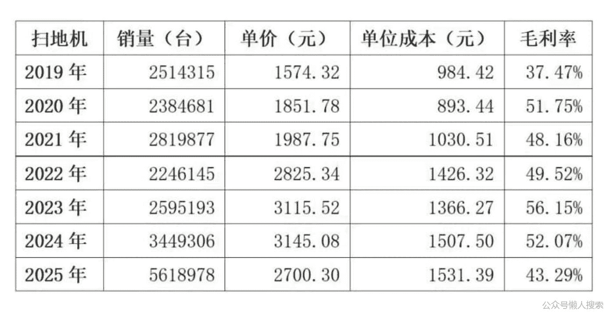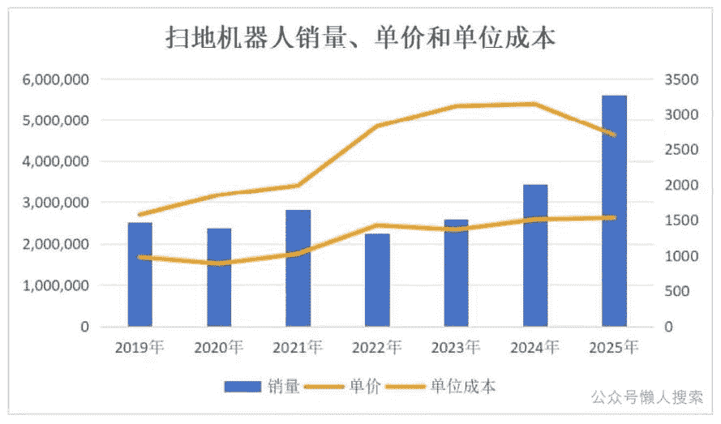

2025年此业务单价和毛利双双下降，所以毛利率能借此保持在历史中游水平。2021年到2023年的高毛利主要由高售价带来，因为早年流行戴森式无绳吸尘器，国内企业以价格优势实现了主流市场的国产替代，并完善了扫拖一体的手持洗地机，市场反响很好，所以国产货也有不错的毛利空间。后来大批同质化产品涌入，厂商不得不卷价格，好在供应链的成熟也使成本下降，所以终端产品的毛利还保持在合理范围。

当然，因为其他电器包括手持吸尘器、手持洗地机、洗衣机、烘干机、洗烘一体设备、智能割草机等等，产品种类比较多，故而这些数据只能从总体上看看，无法进行更深入的挖掘。

## 3. 主营业务（单位：万元）

主营业务

2025年，主营收入超高速增长，增量67.62亿元；毛利超高速增长，增量191,516.25万元。成本增速高于收入增速25.18个百分点，带动毛利率下滑7.98个百分点，负面影响毛利148,981.72万元。

结合前文，我们知道是公司的核心业务，即扫地机器人为了市场份额主动降价，导致公司整体的毛利承压。具体分析放在后面。

## 4. 其他业务（单位：万元）

其他业务

收入超高速下滑，减少1178万元；毛利扭亏为盈，增量1,305.32万元。收入下滑速度低于成本下滑速度19.02个百分点，带动毛利率增长51.13个百分点，正面影响毛利738.89万元，占其他业务毛利增量的56.61%。

其他业务占比较小，2025年扭亏为盈，大家看看就好。

## 5. 全部业务（单位：万元）

全部业务

2025年，全部业务收入超高速增长，增量67.5亿元；毛利超高速增长，增量192,821.58万元。成本增速高于收入增速24.45个百分点，带动毛利率下滑7.79个百分点，负面影响毛利145,623.82万元。

# 二、各财务环节对公司利润的影响

## 1. 费用环节的影响（单位：万元）

费用环节

2025年，费用环节一共减少营业利润246,554.89万元。经过这5个环节，公司2025年的营业利润同比减少53,733.33万元。

销售费用带来192,714.48万元负面影响，研发费用带来44,812.74万元负面影响。先不细讲，因为后面分析公司的业务、经营特点时需要具体分析。这里提一下公司的管理费用，造成了8,536.42万元负面影响，其中职工薪酬增长占大头，约6310万元。

## 2. 利得和损失的影响（单位：万元）

利得和损失

2025年，这6个环节共计减少营业利润10,559.33万元。经过这6个环节，公司营业利润同比减少了64,292.66万元。

资产减值损失造成了6,658.63万元负面影响，投资收益造成了3,912.73万元负面影响，这两者影响最大。公司的资产减值损失由两个部分组成，其中固定资产减值损失增加了3063万元，存货跌价损失及合同履约成本减值损失增加了3595万元，原因在于库存商品跌价损失增加。

## 3. 营业外收支、所得税费用和少数股东损益等（单位：万元）

营业外收支等

2025年，这4个环节共增加公司股东净利润2,968.53万元。经过这4个环节，公司2025年股东净利润减少61,324.13万元。

影响最大的是所得税费用，由2.9亿的当期所得税和2.07亿的递延所得税组成。

# 三、影响公司2025年业绩的因素及排序

影响公司2025年业绩的因素一共18个，其中正面影响因素8个，负面影响因素10个（单位：万元）：

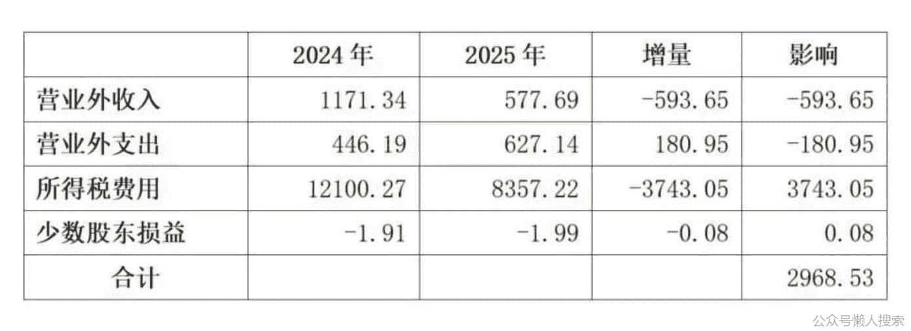

## 影响因素排序

2025年，公司的扫地机及配件增加毛利91,958.53万元，其他电器产品增加毛利99,557.71万元，其他业务增加毛利1,305.32万元。三项业务构成的全部业务共增加毛利192,821.56万元。

费用方面减少营业利润246,554.89万元，主要是销售费用和研发费用的增加。利得和损失共减少营业利润10,559.33万元；营业外收支、所得税费用及少数股东损益增加股东净利润2,968.53万元。终至全年股东净利润减少了61,324.13万元。少量因四舍五入产生的偏差为正常现象。

# 四、公司存在的必然性

## 1. 家庭消费的一条主线

虽然大家常说社会变化太快，但回顾社会历史，我常常会想，变的只是物质基础，而组成这个社会的人，就是人性，从来没变。

有一定生活经历的读者，尤其是城市居民，一定对中国社会的家庭消费热潮有印象。比如七十年代由自行车、手表、缝纫机和收音机组成的“三转一响”；八十年代的冰箱、电视、洗衣机；九十年代的BP机、电话和VCD；二十世纪头十年的手机和个人电脑；一零年代的智能手机、平板、智能穿戴设备、家用轿车等等。就是无论社会是匮乏还是富裕，都有一套公认的消费组合，这套组合是大量家庭经过实际生活检验后选定的最优解。

而对消费品的追求不仅在中国，发达国家同样如此。

比如开头讲到的厨房辩论，美国家庭同样喜欢电视、冰箱、洗衣机，只不过他们追求这些的时间是在上世纪50年代，早我们三十年。日本家庭一样，但早我们二十年。

我们紧抓“家庭耐用消费品”这个核心，把中外一连串社会现象级的消费热点梳理下来，能看到有一条不变的主线，就是家庭对生活品质的追求。

## 2. 个人享受和生活便利

生活品质的构成要素有两个，一是个人享受，收音机、电视、空调、VCD都是围绕此展开；二是生活便利，洗衣机、BP机、冰箱、吸尘器、家庭轿车等属于此类。

在这两大要素中，随着时代演进，个人享受类消费品的变化已经趋缓。十年前，甚至十五年前，普通家庭的享受类消费品就是手机、平板、电脑、电视、空调，到现在仍是这样，并没有多出什么公认的流行新品类，也就是大家的享受方式在这十五年里没怎么变。十年前的所谓VR元年、AR元年，包括前几年苹果搞的MR设备Vision Pro，都短暂地形成过风潮，有望成为家庭或个人享受类消费品的新宠，但技术和生态都不成熟，慢慢地，就被放下了。

而以扫地机器人为代表的生活便利类消费品，演进还是比较明显的，并且有了另一个发展趋势，就是其属性从生活便利向个人享受靠拢。

因为扫地机器人和吸尘器不一样，它不需要人的操作与监督，只需要用户出门时开机即可。机器人会自动清扫房间，再加上自动倒尘盒、自动洗拖布、自动上下水等功能，人可能半个月才需要动手清理一次，等于是它解放了人。

让人的生活变简单，这是传统的生活便利消费品的意义，但如果把人完全解放出来，无事一身轻，其性质就变成了个人享受，因为你不用受累，还有了更多的自由时间。类似的家电还有洗碗机，但它的安装比较受空间和管道限制，所以铺得不是很开。

捋一下思路，传统的个人享受型消费品发展缓慢，而生活便利型消费品还在持续进步，因为它们以“完全解放人”为指导思想，能让人懒下来。这就是为什么新家电风靡如此迅速，因为它兼具便利和享受两重价值。

便利和享受是两大不可逆转的趋势，它和社会发展阶段直接相关。不同时代、不同社会阶段，人的生活态度就是会有变化。

过去的空调厂商一直面临一个问题，就是老一辈人夏天要么不买空调，要么买了但舍不得开。一开始大家以为是老年人消费观念保守，于是商家把空调价格打下来了，又大力研发节能技术，把电耗也打下来了，但效果没有那么好。每年夏天都有老人不开空调患热射病的新闻。

不开空调，舍不得电费只是部分原因，实际上还有两个原因：一是空调是相对新鲜的事物，老年人不好接受，相比之下，电扇和电视这类出现早的事物就容易被接受；二是老人经历过物质匮乏的年代，所以对享受比较警惕，尤其是花钱换享受，会认为开空调太奢侈。在这里，开空调不是经济问题，而是一个价值观问题。除非特殊情况，比如家里来了客，或者孙子孙女放暑假来住，否则是能不用就不用，除非空调的电费真和电扇一样便宜。

我们是六七十年代生人，既吃过苦，又深刻体验过国家飞速发展的历史时期，处在两头中间，所以两头都懂。

公众号懒人搜索，懒人专属群分享

空调在老年人群中不受宠的原因很清楚，就是费用、接受新事物的意愿，以及消费观。这三大要素就是影响享受型消费的核心，在现在的年轻人身上很好解决。

年轻人对新事物的接受度更高，毕竟他们是在物质高度丰富的年代成长起来的，受过的教育更好，所以这一点不是问题。

老一代人终究都要老去。中国人平均寿命79岁，现在是“40后”大规模完成人生谢幕的历史周期。2030年，1950年生人就会大规模完成人生谢幕。80后现在走上最好的人生舞台，中国人的消费习惯，将会由80后、90后和00后塑造。

年轻人不像我们小时候那样，把家务劳动当作必修课。他们对于家务的态度是很厌烦的，别说亲自扫地拖地了，就是用吸尘器都未必愿意。他们最能接受的就是扫地机器人，每天出门上班前打开，回来时家里已经打扫好了。这种生活态度遍及一两代人，所以不爱做家务也不会有什么社会压力，因为都不爱做。所以，扫地机器人用户年轻化就很自然。

当影响享受型消费的三大阻碍被削平后，扫地机器人面对的就是极高的新家庭需求。

2025年我国结婚登记676.3万对，而2025年的扫地机器人销量是多少呢？各渠道零售量合计为673万台，也就是说几乎每个新家庭都会拥有一台扫地机器人。当然，这肯定不是严谨算法，但我们根据这个粗略的数据，再结合一点身边的见闻，至少能发现，新家庭中购买扫地机器人的比例是很高的。还有一点，年轻消费者也不一定是新婚夫妇，独身买房的不婚年轻人，往往经济条件也不错，家中备一个扫地机器人也很常见，甚至是年轻人买给父母使用。这就有点类似于一代人有一代人的“三转一响”。

类似扫地机器人的家电，除了洗碗机，还有一类，是公司正在做的洗衣、烘衣机。尤其是烘衣机的功能，可烘干、可蒸汽除皱，这就省下晾衣和熨衣的工序，一样是解放人的时间。

## 3. 新家电的存在理由

### （1）软硬件结合能力

普通人提到家电时，下意识会想到传统几巨头。

常理来说，家电已经被箍成了一个铁桶江山。因为巨头太多，它们掌管了几乎所有的家电品类，理论上它们会凭借着资金、渠道、品牌力优势永远赢下去。但为什么以扫地机器人为代表的新家电会让新势力家电做大呢？

因为智能家电的底层逻辑变了，从一个硬件设备，变成了软硬合并的复合系统。常规家电是为完成某一件固定工作而生的专用工具，所有设计、零件、技术、专利，全都围绕可量化的核心指标展开。我们买传统家电，就是买它本职工作做得好不好，比如买冰箱和空调就看制冷能力和节能水平，买吸尘器就看它的吸力。

而买扫地机器人，我们无法以少数指标衡量其竞争力，因为它除了续航时间这样的基础指标，还有吸力、风道、滚刷设计、拖地系统、边角清洁等清洁指标，还有导航方式、避障能力这样的软件指标。除指标以外，还要考虑自动洗拖布、自动清洁尘盒、自动补水排脏水等省人力的基站功能。

对于家电巨头而言，家电是满足生活需求的工具，一切以基础功能优先，底层永远是硬件和参数指标。而且它们拥有数百条产品线、几千款产品，家底太大，此时维护整体基本盘的稳定远比琢磨某个爆款容易。我们知道，现在的新家电都不是巨头先拿出概念，而是巨头看到爆款后，再跟随模仿。

而现代社会，爆款家电的一大基础要求，就是软硬结合，你必须有软件支持。巨头做了几十年家电，硬件优先的思维惯性改不掉，招来的软件工程师在设备开发中也得先听硬件工程师的，甚至有的巨头放弃开发部分智能家电，把产品外包给其他ODM做，自己只贴牌。也就是说，巨头的软硬结合能力天然是偏弱势的。

现在的扫地机器人分为四大能力，分别为感知、规划、清扫、自动化。感知是通过红外传感器、3D结构光、陀螺仪、摄像头、激光雷达等部件感知自身状态并识别周围环境；规划是在识别环境后，通过内置算法生成清扫方案，先扫哪，后扫哪，哪里有障碍物要避开，哪里有放在地上的衣物不能碰，哪里需要再扫一遍；清扫是产品最基本的清洁能力，要求的是风道设计、滚刷材质等等；自动化则是扫地机器人能在多大程度上不需要人的参与，比如遥控操作、自动倒灰、自动清洗等。

四大能力中，只有清扫能力完全依靠硬件素质，其他三个能力都需要软硬结合。尤其是感知和规划，结合了感知环境、定位建图、障碍识别、路径规划、运动控制，很像早期的智能驾驶解决方案。这套从早期智能驾驶下放而来的技术，放在几千块的智能小家电上，有点技术溢出的味道，但只有这种技术溢出，才能带来更省心的体验，也是产品的重要竞争力。它实际上是从AI应用的根基上生发出来的枝丫，并且最终将走向完全的智能化。

更重要的是，感知规划这类软件技术和传统家电跨度太大，所以家电巨头不能发挥已有的技术和人才储备优势，一样要从零开始找团队攻关。

我们十多年前用过iRobot，这是全球很早做扫地机器人的公司，也是最早的扫地机器人领导者。早期技术不成熟，机器人只有清扫能力还过得去，但因为缺乏感知和规划能力，只能在屋里随机乱撞，扫到哪里全看运气，这就是软硬件能力不足的表现。而现在的iRobot已经被它的中国代工厂收购了，因为它的技术演进缓慢，产品没有竞争力。

所以，明明扫地机器人是国外兴起，但为什么我们要在开头说中国会以扫地机器人向世界输出自己的生活方式？因为外国的产品，是硬件为主，而软硬结合，是从中国开始的。这是使用体验上的代差，使用体验的进化带来生活方式的进化。

巨头的迟缓行动和基因里的硬件主导路线，对于智能电器生产商而言，是生存的机会。扫地机器人是典型的软硬结合设备，少了任何一方，体验就不好。

### （2）渠道变化

巨头们多年来搭建的线下渠道本来是其优势，新势力没有时间和资金短期内搭出相似规模的线下渠道。

但是扫地机器人作为新家电，且用户年轻化，缺乏线下购买的习惯。2025年扫地机器人的线上销量已经达到546.4万台，全国各零售渠道销量673万台，线上占比81.19%。主要渠道竞争已经转到线上了。

除此之外，公司还有其他优势，我们放在后面讲。

# 五、公司的经营策略

## 1. 公司上市前与上市后的产品战略调整

这里要先讲一下公司早期的经历，因为它有关公司后面的上市逻辑和后续发展的必然选择。

公司给小米集团旗下的米家品牌做代工起家。米家是小米集团的智能家庭品牌，涵盖智能家居、日用百货、厨房电器等全品类硬件。再说透一点儿，就是冰箱、空调、接线板、泡脚桶、保温杯、按摩仪、电动牙刷等等。您能想到现代生活的一切硬件用品，基本都能在米家找到。

雷军在10年前就定下方针，要求米家学习Costco这样的仓储式会员超市，也就是说，产品覆盖人们的生活方方面面，但尽可能精简品类。比如空调，只卖最受欢迎的几款，不像普通家电城卖十几个品牌、上百款产品。这么做的好处是，小米可以聚焦少数精品，对供应链有更强的议价权，同时降低库存、物流、售后的复杂性，一切都为了控制成本和费用。最终的成果就是米家的产品一定不会贵，而且质量也还可以。

当然，小米不可能有精力研发、生产几千种不同的硬件，所以它的做法是深挖中国供应链，找到有能力研产所需产品的公司和工厂，参股后让它们代工，再要求代工厂以关联交易的方式，低毛利率卖给小米，最后通过小米的渠道卖给消费者。

石头科技绑定小米生态链时，身份是ODM。所谓ODM，就是自己有研发、设计、制造成品的能力，生产后把产品卖给品牌方，由品牌方贴自己的品牌卖出。业内知名的企业有华勤技术、龙旗科技等，做手机、平板之类的电子消费品。而大家更熟悉的富士康、伟创力、比亚迪电子等代工企业则是OEM，它们一般按照客户的设计直接生产产品，只挣加工费。

所以在过去，石头科技研产扫地机器人，把产品关联交易给小米，再经过小米包装贴牌后卖出去。大多数用户不知道石头科技在其中的贡献，或者说大家本来就是为了小米的牌子才买的。

对石头科技而言，做ODM其实不是不能接受，因为小米前前后后累计给石头科技投资了约1亿元，并且作为大客户，小米的订单稳健，回款利索，很容易就解决初创企业的生存问题。而除此之外，就没有什么优势了。因为前文说了，米家的硬性要求是低毛利，所以给米家供货的ODM厂不可能有高毛利率。

我们看一下公司上市前的业务毛利率：

上市前毛利率

此时公司的扫地机器人业务，不仅毛利率不高，而且还在走低。这种程度的毛利率是腾不出空间给公司做深度研发的，但独立后，情形就豁然开朗了：

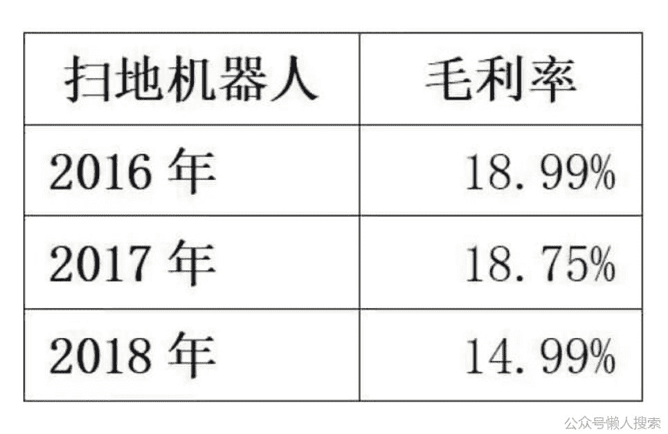

上市后扫地机毛利率

2019年是上市前夕，此时公司自力更生的战略做得不错，已经有59.41%的收入和82.69%的毛利靠自有品牌实现。可以看到，一脱离小米，扫地机器人的毛利率就上去了。前文是单一的扫地机器人业务，而公司总体的毛利率表现如下：

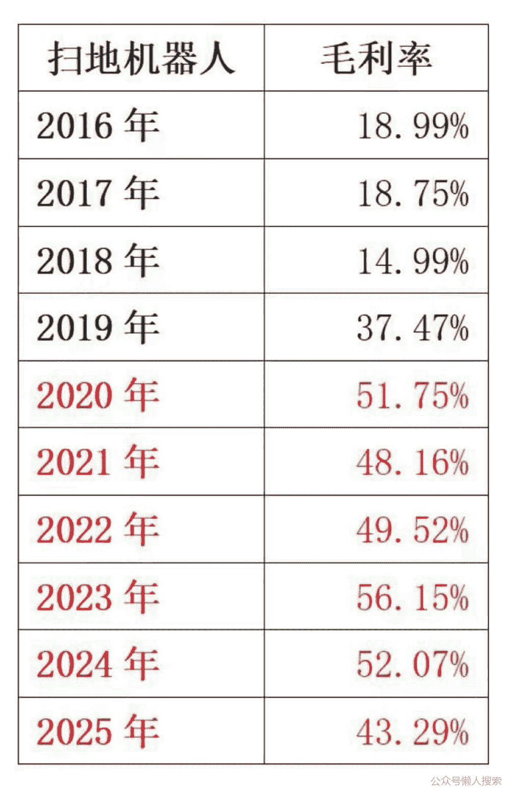

总体毛利率

毛利率提升了一个档次。

关于毛利率空间的重要性，大家看这张图，这是公司上市后一直到现在的股价走势，不复权：

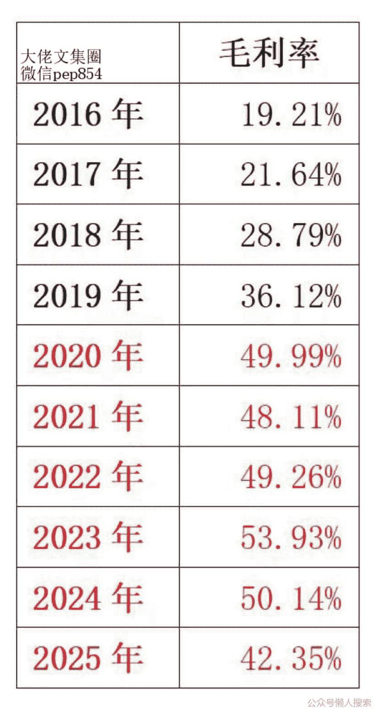

石头科技股价走势

在上市后的1年3个月里，公司处于急涨状态，从最低的315.11元到最高的1494.99元，涨幅374.43%。

定性上讲，是因为智能硬件、消费升级等几个标签，再加上疫情期间，扫地机器人的居家特性使公司踩中了宅经济的风口，所以资本对公司有强烈的兴趣。而从定量角度看，当时公司有个利好是明牌。就是脱离小米体系后必然大涨的毛利率。

毛利空间大，留给研发的余地就大。下面是历年的研发费用金额和占营收比例（单位：万元）：

研发费用

很明显，过去公司营收和毛利率都低时，研发费用占营收比例较高，因为那是硬从牙缝里挤出来的，不研发不行，但研发投入绝对金额比较一般，也就一个多亿。而上市后，随着毛利率提升，研发占比较高且比较稳定，2025年的投入金额已达到14.2亿元。

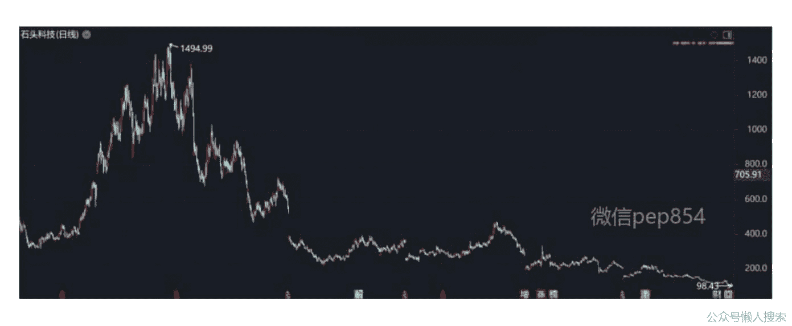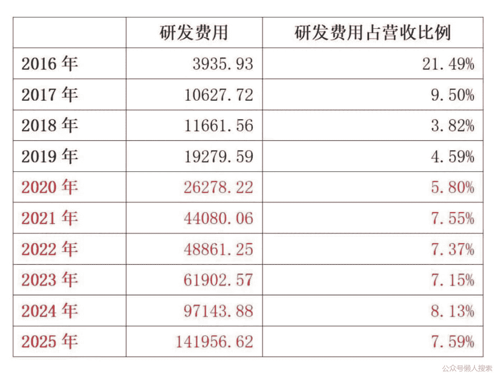

公司的专利情况如下（单位：项）：

专利情况

对早期的石头科技而言，想把公司做大，要么继续深化代工厂的身份，把代工规模做大，要么做自有品牌。在代工领域，ODM上限比不过OEM，虽然OEM毛利低，只挣加工费，但大的OEM公司，知名度、影响力远大于ODM，因为OEM的核心竞争力是规模、良率、工程实现能力，而不是某一种产品。比如富士康能生产手机，但它还能生产平板、笔记本电脑，所以OEM的收入来源会更广，更多大厂会拿着设计图找OEM合作。

而另一方面，真正伟大的产品，只会出自自有品牌，比如华为的Mate XT，那款三折叠手机，只可能是华为自己研发的，不可能是找某家手机ODM厂，买他们的现成产品。ODM受制于毛利率，它可以有研发设计投入，但空间不可能太高，只能生产通用型、中庸型产品，供客户挑选。

所以如果石头科技想真正拔高天花板，要么像富士康那样坚持OEM，坚持卷良率、卷效率；要么做自有品牌，长期投入，提升产品竞争力。

而以CEO昌敬为代表的石头科技高层基本都是微软、百度等巨头出来的技术人员，他们的目标还是做产品，所以石头科技离开了小米ODM的舒适圈，一定要独立做品牌。

## 2. 销售费用的意义

前文提到了石头科技给米家做代工时的低毛利率。通常情况下，毛利低了，不仅挤压研发费用，还会挤压销售费用。所以米家的产品，销售预算不可能高，因为它没空间。但事实是米家产品营销效果却很好，原因在于米家天然拥有小米公司的超高话题度，并且手机是现代人接入世界的窗口，可以作为小米生态链的起点。两者相加，米家产品不缺流量，花很少的钱，获得很高的公众注意力。

而石头科技脱离了米家生态后，就要自己花钱去争流量了。销售费用就是这么花的。下面是公司历年的销售费用率：

销售费用率

占比越来越高，超过四分之一的营收用来营销了。要衡量这个比例的销售费用是个什么概念，需要我们树立一个正确的营销观念。

对于硬核科技公司而言，最重要的当然是核心技术，比如华为的手机芯片是中国本土高制程芯片的独苗，大疆的无人机体验最好，所以大家愿意为华为和大疆买单。

但对家电行业而言，它的特点是技术上限比较低，技术感知的区分度不强。也就是说客户用你和用别人的差别不会太大。那么客户凭什么选你不选别人呢？这个时候需要三点：一是价格，二是知名度，三是体量。我们前面分析业务时讲了，公司在打价格战，这是竞争力的第一点。而第二点知名度怎么打，就是靠销售费用，做小家电的，销售费用不可能省。

当然，销售费用不止有推广支出，它还包括售后、平台服务费、仓储费、销售人员工资等等。但对小家电而言，让大家知道你永远是第一位，所以销售费用的最大头支出仍然是广告和市场推广费。2025年石头科技的广告和推广费占销售费用的66.59%，另一小家电上市公司科沃斯占比为79.84%。

下面是石头科技和科沃斯的销售费用占总营收比率：

石头科技与科沃斯销售费用率对比

销售费用都是大头，科沃斯还要更高些，但营销费用的使用效率其实是石头科技更高，我们把石头科技和科沃斯的几个数据综合起来看（单位：万元）：

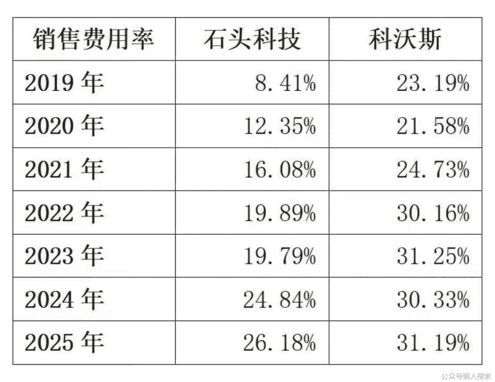

石头科技与科沃斯综合数据对比

营收方面石头科技追得很快，扫地机器人的占有率靠着价格战已经远远甩开科沃斯，但归母净利润却差了科沃斯3.95亿，主要原因是科沃斯的研发费用比石头科技少了4.39亿，而且科沃斯保了毛利，整体毛利率为48.82%，石头科技则为42.38%。6.44%的毛利率差对于一百八九十亿的营收而言有超过12亿的影响。

销售费用的另一大作用就是帮助石头科技抢下了最大的扫地机器人海外市场。2025年公司的扫地机器人在全球市场占有率为27%，全球第一。下面是历年的境外营收占比和毛利率，以及境内毛利率：

境外营收占比与毛利率

公司在境外的收入占比更高，且长年维持更高的毛利率。公司以国外养国内的策略还是明显且成功的，类似例子可以参考比亚迪，今年的重要战略任务就是汽车出海。国内太卷了，它的出口车毛利都相当高。

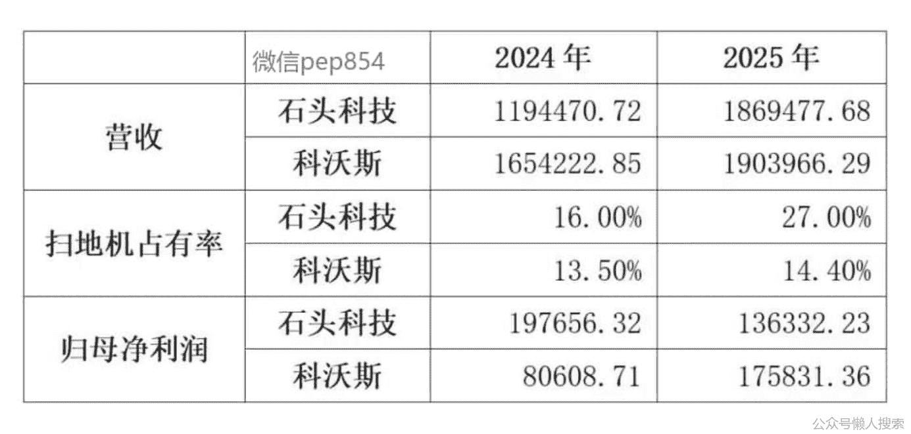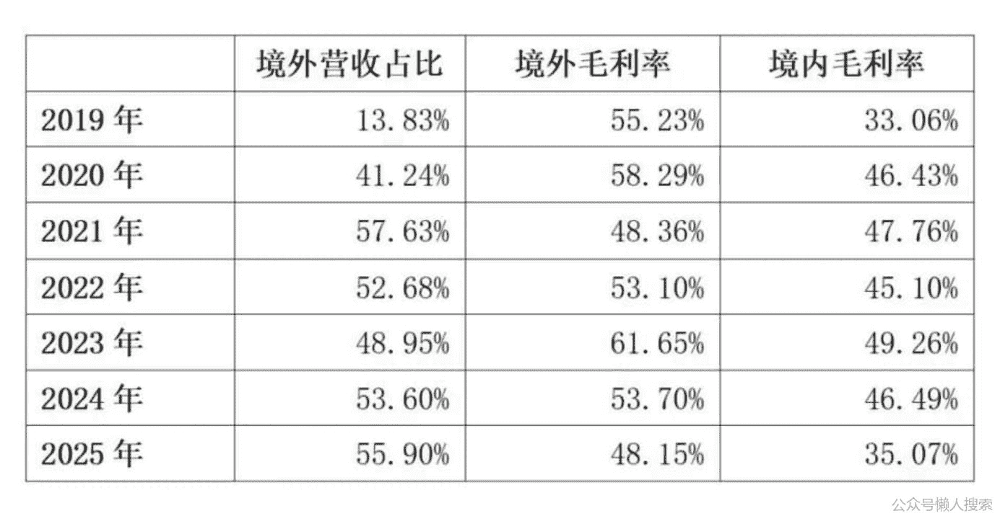

总结一下，公司的销售费用率高，但相对于竞争对手，销售费用的使用效率也比较高。不仅拿下了海外高毛利市场，又结合价格战策略成为了扫地机器人领域的全球第一。

有了全球第一的销售份额，就达成了家电销售竞争的第三个要素，体量。

体量就是市占率，它既是营销的重要成果，又反过来促进营销的效率。因为马太效应，强者愈强，体量越大，越容易占领客户心智，体量本身就是一种广告。这也是公司不惜打价格战也要在扫地机器人领域拿下断层第一的原因。

这就接上了前文的分析，公司为什么在众多家电巨头的红海市场里仍拥有一席之地？因为石头科技能在细分市场通过产品力和强势营销占据用户心智，在扫地机器人这一块，巨头是弱势方，石头科技反而是强势方，在局部战场形成了以多打少，从而实现以弱胜强的翻盘。整体少打多，局部多打少，这是经典的军事思维。伊阙之战秦国打韩魏联军是如此，萨尔浒之战后金打明军也是如此。

当然，公司在2025年迅猛的价格战，必然涉及一个问题：这么做是否健康，是否影响了公司的发展质量？这是我们接下来要讲的。

# 六、公司的业绩含金量

我们按逻辑逐步分析。

## 1. 产品的产销量和库存量

先看扫地机器人的生产、销售、库存量变化（单位：台）：

扫地机产销量库存

年报有说明，因为存在产品的内部领用测试和外部寄样等情况，所以产量、销量、库存量的关系并不完全对应。后面其他电器产品的数据也是如此。

扫地机器人的基数大，但也有70%以上的扩产和60%以上的销量增长，产量增速大于销量增速10.04个百分点，导致库存量提升69.4%。再看公司历年的产销比与库销比（单位：台）：

扫地机历年产销比库销比

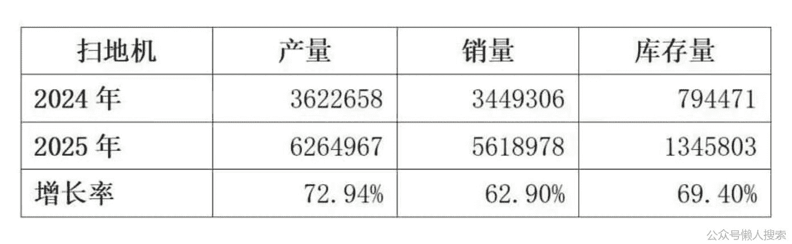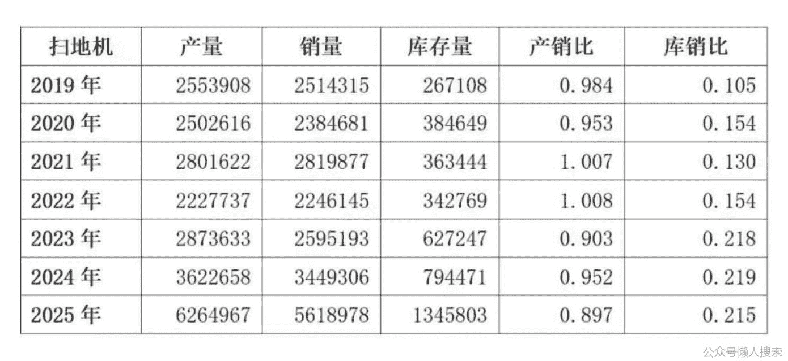

产销比处于历史低位，库销比处于历史上偏高位。属于销量不太跟得上产量，库存量相对也偏高。问题出在销售量上。

公司扫地机器人的产量、销量、库存量在大基数下超高速增长，产量增速最快，销量稍有脱节，两者之差尚在可接受范围内，产、销、库存量的增长速度并未失衡。

再看其他电器产品的生产、销售、库存量变化（单位：台）：

其他电器产销量库存

其他电器产品的基数较小，产销量的增长率均高于250%。由于销量增长率与产量增长率接近，使得库存量增长率显著小于产销量增长率。再看公司历年的其他电器产品产销比与库销比（单位：台）：

其他电器历年产销比库销比

产销比处于历史上偏低位，库销比也处于历史上偏低位。同样是销量稍慢。

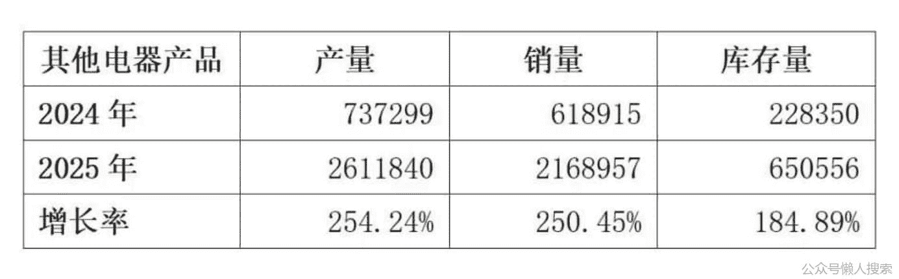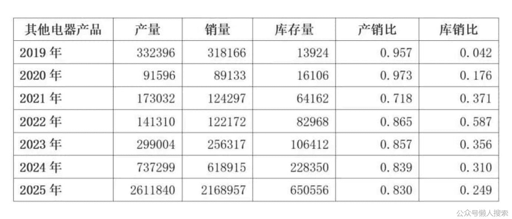

总体而言，公司正处于超高速扩产增销期。两项业务的销量都没有跟上产量，公司解释为海外备货。但从两项业务的产量、销量、库存量变化比例来看，需要进一步分析。目前能确定的是，至少这三期增长率并没有失衡。

因为2025年，公司产品从大体上看，基本跟上了历史上的产销和库存节奏。但事情没有完，我们要更仔细看业绩的含金量。

## 2. 存货问题

下面是公司历年的存货金额，以及“库存商品”占存货的比例（单位：万元）：

存货金额

存货金额连年增长，但2024年增长了5.62亿，2025年增长了11.65亿，这两年尤其快。库存商品占存货比例常年在90%左右，2025年已达97%，属于极高水平。

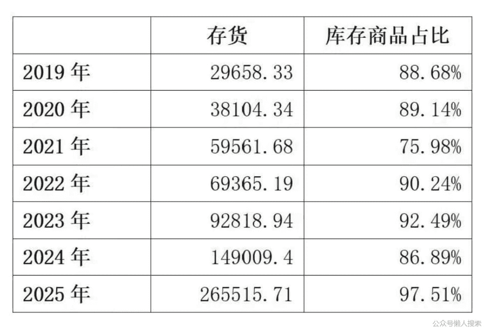

看到2024年和2025年的存货大涨，我们有理由把它和2024年、2025年石头科技在扫地机器人行业取得的成功联系在一起：公司2024年市场份额22.3%，首次拿下全球第一，正式把美国老牌扫地机器人霸主iRobot拉下王座；2025年全球市场份额提升至27.0%，继续第一。此时iRobot 2025年前三季度销量已经掉出前五。

下面是存货周转率，数值越高代表卖货速度越快，存货管理效率高。这类比率指标我们会拿公司和同为清洁小家电的重要公司科沃斯作比对。

存货周转率

这个存货周转率不算特别优秀，但相比自己的历史水平来说尚可。一旦相比同类型企业科沃斯，则明显占优。

公司在2024、2025两年拿下了全球销冠，自己的存货也连续跳级。虽然存货周转率可表示其健康程度，但还是让人不得不警惕：公司的出货量又有多少含金量？

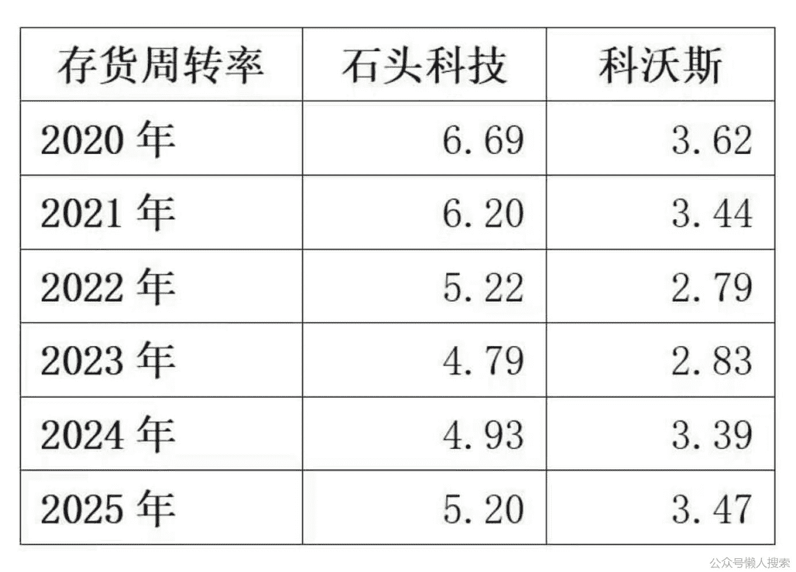

## 3. 销量的含金量

“出货量”指的是厂商把商品卖给下游渠道的销量，但渠道手里的货可能卖得出去，也可能卖不出去。真正卖到消费者手里的数量，是“零售量”，这个数据含金量最高，但最难统计，所以各类机构只会统计“出货量”。出货量长期受到统计，所以具备实用性，受到业内认可，但特殊情况下，出货量会掩盖一些问题。

比如厂商要求渠道商多多进货，以做大厂商的营收和市场占有率。但渠道零售货物的速度未必有进货的速度快。这样一来就造成了渠道的货物积压。

但渠道商凭什么冒库存积压的风险帮厂商囤货呢？所以厂商也会通过优惠条件，或者合作威胁，促使渠道商合作。比如会给渠道商的进货价算得特别便宜，让渠道商有更大的降价空间；比如同意渠道商先进货，货款可以欠着或只付一部分，剩下的慢慢付；再比如进货返点，进货越多，返点越多。

根据厂商压货的常见手段，应收账款、销售收到的现金、合同负债等项目，都是窥探公司是否向渠道压货的佐证。厂商想让渠道多进货，就必然有相应的经济手段，所以我们虽然无法直接看到公司在渠道上是否压货，但通过下面这些佐证可以分析出来。

以下是公司的应收账款（单位：万元）：

应收账款

在2024年以前，应收账款最高只有3.28亿，2024年起陡然超过10亿，和公司2024、2025两年登顶全球销冠时间完全重合。说明公司给了渠道商很大的还款余地，这也符合厂商向渠道商压货时给的优惠条件。

再看应收账款占收入的比重，可以衡量公司的销售业绩中有多少是赊销。比重越低，赊销越少：

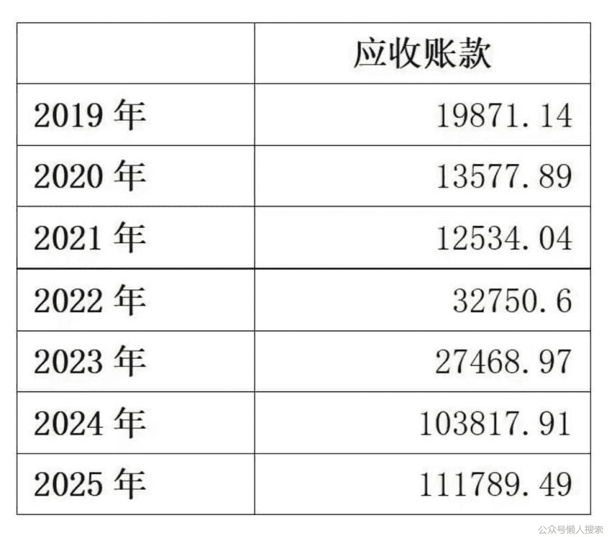

应收账款占收入比重

2025年的赊销跟公司往年相比，比重属于偏高水平，但其实也还可以。再看应收账款周转率：

应收账款周转率

一般地，应收账款周转率越高，代表应收账款回收速度越快。这里我们拿石头科技和科沃斯相比，不评价谁好谁坏，只是证明石头科技的回款速度不错。17.34次的周转率，表明应收账款占全年收入的5.98%，一年可以收回应收账款数字的17.34倍的现金。这个数据跟公司历史上比是比较低的，但仍然健康。

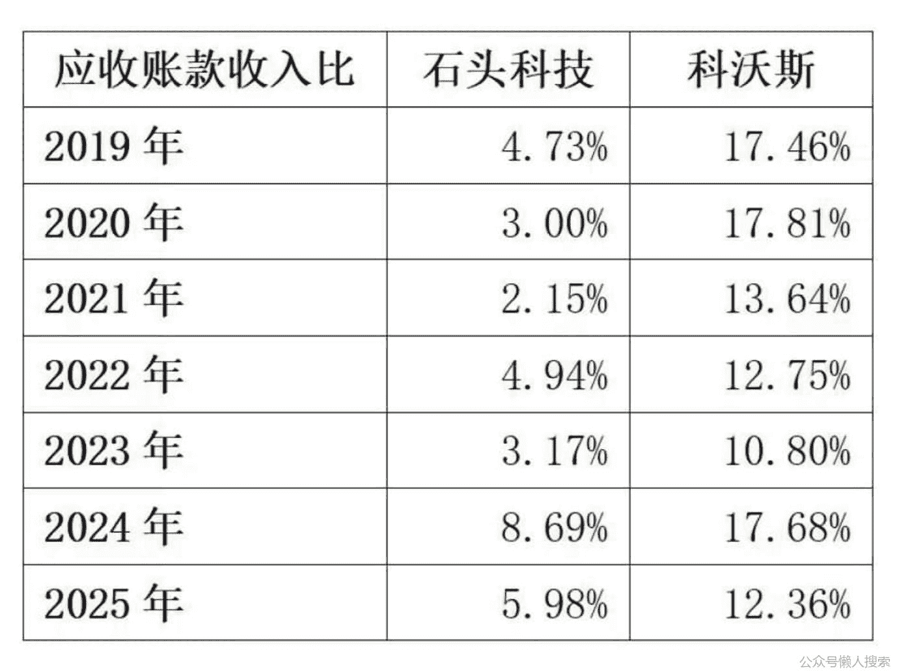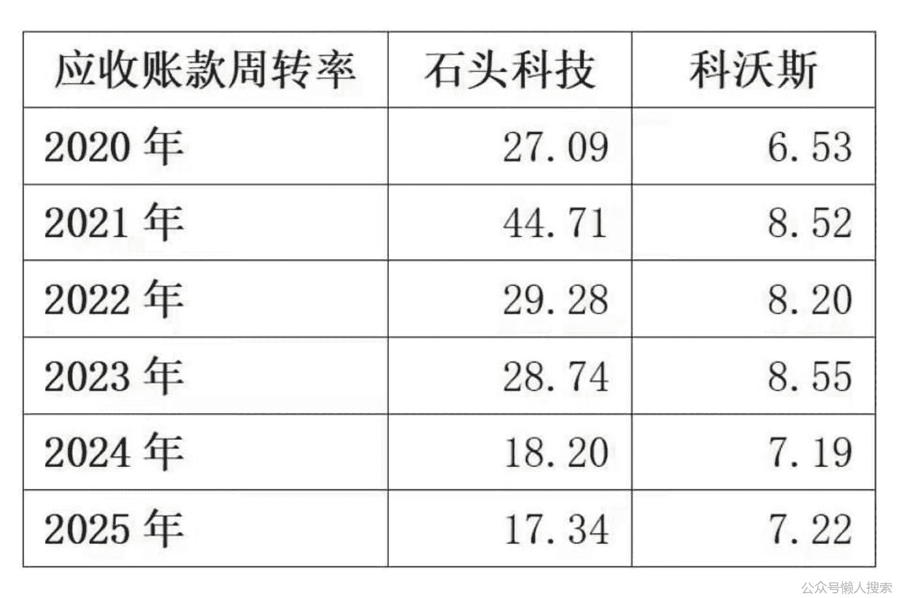

再看合同负债，合同负债代表渠道商给厂商先付钱后，厂商还欠着货没发。欠得多表示渠道商要得多，欠得少表示渠道商库存已经较多，也要不了太多货了。它能间接证明厂商的产品在渠道商受欢迎的程度（单位：万元）：

合同负债

2025年的合同负债只有2024年的53%，确实也下降了不少。下面是石头科技和科沃斯的销售收现比。数值越大，表示现金收入越健康，一般比值在1以上就比较健康了：

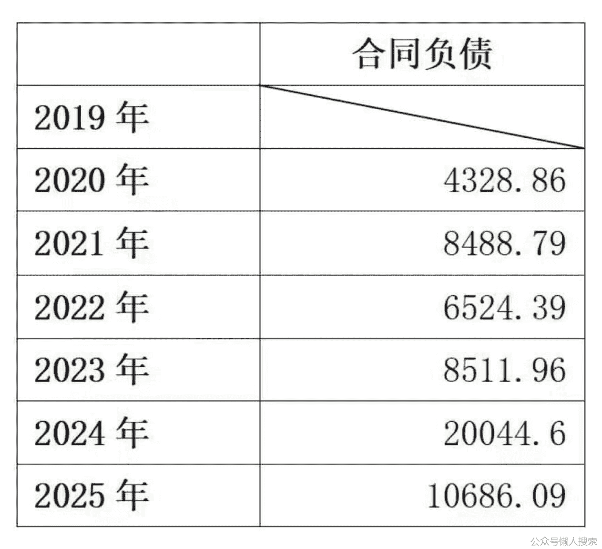

销售收现比

长期来看，两者表现都还可以，石头科技稍好。

## 4. 公司的业绩总结

由于极高的产量、销量、库存量增长速度，我们不得不警觉公司的增长质量。一个典型的怀疑是公司有没有向渠道商压货，以做大市场占有率和营收。但经过应收账款和相关现金的比率分析，我们发现压货的常见手段在公司身上并不明显，反倒是各项指标在清洁小家电领域，都保持得不错。

当然，要说压货，也许会有一点点，毕竟2025年的合同负债下降了47%，表明渠道商的需求回落，但也仅此而已了。公司一年营收187亿元，合同负债是1亿还是2亿，无伤大雅。

另一方面，毕竟是超高速扩张，公司不可能让产销比、库销比等指标保持得那么完美，但这是公司更进一步的必经之路，不冒险不行。

所以总结下来，公司在察觉到曾经的全球扫地机器人霸主iRobot的颓势后，在2024年首先发力，适当放宽了应收账款限制，一举把iRobot拉下马，成为了新王。2024年应收账款增速达到了378%。这个增速看着吓人，但再仔细看构成，这些应收账款几乎全部为一年内账期：

一年内应收账款占比

2024年，公司在保售价、保毛利的方针下，产销量和库存量做到了高速增长。2025年，公司开始打价格战，彻底地暴产能、暴销量，扫地机器人在大基数的基础上增长百分之六七十，其他电器更是几倍几倍地往上翻，但应收账款只上涨了不到八千万，而且仍然以一年内账期为主。从这个角度看，公司是利用旧王倒台的机会，大举扩张，巩固自己的新王地位，并且它的扩张，外面看粗枝大叶，往里看却条分缕析，粗中有细。

现在看来，公司最大的问题不是扩张太快，而是增收不增利。为什么增收不增利？

一是因为价格战，前面业务分析时有图表显示。

二是为了巩固市场占有率，必须迅速丰富产品线和新品种类，所以除了自己生产外，公司还选择低端产品ODM，也就是自己找厂商代工生产低端电器，然后贴石头科技的标去卖。但请ODM的成本肯定比自己厂生产贵，于是成本又因此升高，如下表（单位：万元）：

外购配件整机成本

外购配件、整机成本是营业成本的一部分，这块的成本一年内增加了13.11亿元，等于是为了市占率不得不花这个钱。

第三点，则是公司在销售和研发费用的持续高投入。这三点共同造就了公司增收不增利的境况。

这种情况何时能够扭转呢？核心还是需要内卷烈度降下来。怎么降？等市场中小体量清洁机器人出清得差不多了就行。那个时候，极有可能是我们投资介入的好时机。前文讲了，家电市场没什么太高的技术上限，体验区别也不太大，所以最好用的就是简单粗暴的肉搏，一是价格，二是知名度，三是体量。把小体量的竞争者逼死就好过了。

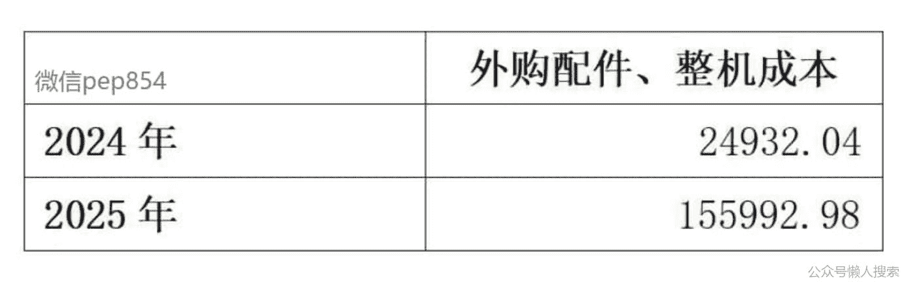

体量方面，石头科技细分市场份额已是世界第一；价格方面不惜降价、升本、请代工，也要把低端产品铺开抢低价市场；知名度方面也是一直在砸钱，并且知名度和份额、价格形成共振，一起增长。现在公司正在完美地按照这个剧本在走。

2025年全球前5大扫地机器人厂商占据了70.4%的份额。而前段时间，扫地机器人的第三名追觅，其创始人在社交平台疯狂炒作，称追觅要从机器人到芯片，从电动汽车到宇宙飞船，无所不做。他这么吹牛的目的在于拉地方国资给追觅投钱，为上市铺路。但计划没成行，该创始人在社交平台被禁言，各地国资与之切割。目前追觅据说仍然处于正常经营中，扫地机器人的主业不会受到影响。

讲这个是为什么呢？就是说追觅的老板心太大了，想上市，但看不上扫地机器人这块市场，眼下当着老三，但想跨行当老大，所以又是芯片又是汽车，没沉下心来经营。相比之下，企业经营还是要实际，有多大量，吃多少饭。而将来的竞争中，还会有企业犯下不同的错，有的因为上市规划铤而走险，有的则跟不下去了，力有不逮。石头科技2020年上市，属于先上岸的清洁小家电公司，这是它能稳扎稳打的底气。

但是，现在公司并没有走出来，这是2026年第一季度的全部业务毛利情况，一季报没有具体业务（单位：万元）：

2026年一季度全部业务毛利

毛利率进一步下降，第一季度净利率如下（单位：万元）：

一季度净利率

同样有所下降。从第一季度对比看，2026年公司依旧是增收不增利的一年。讲这个是为了大家能清楚，计划是计划，理想是理想，但过程是过程。这个时候不能盲目，还是要尊重规律。

## 5. 技术面分析

下图是清洁小家电881192周K线图。

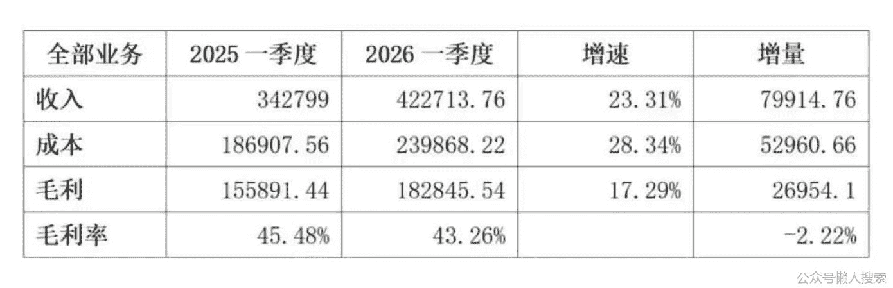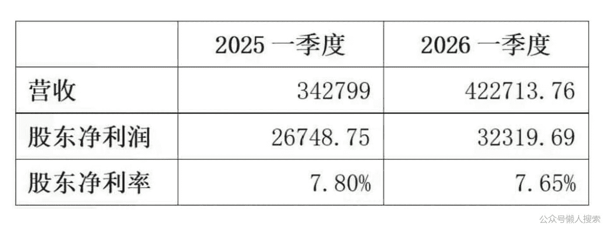

清洁小家电881192周K线图

第一点，看行业的整体走势是否是ABC大周期的调整。

第二点，如果走成ABC，C浪是可以跌破B浪起点的。

第三点，C浪内部可以走成3个浪，形成小abc，跟A浪内部类似。

第四点，C浪内部现在已经走出12345浪形态，它有可能是小a浪。最终怎么走，还是取决于清洁小家电公司的基本面和大盘走势。

下图是2025年9月18日以来，日K线上很典型的12345浪走势。

清洁小家电日K线12345浪走势

5浪的支撑，可以在周K线图中的两条横线附近，结合大盘走势寻找短线机会。

清洁小家电板块股票不多，只有7只。这里的两根支撑线，上面那条支撑线是2025年4月9日的442.26，前面还有个2024年8月19日的低点447.47，也在靠近支撑线，如果跌到附近，可以留意短线机会。但大家一定要记住，没有短线技术的可以选择不做。有短线技术的，也一定不要重仓，只能轻仓做短线。下面的支撑线是2024年2月5日的398.68点，那里是这两年来的牛市起点。

总之，从基本面和技术面相结合的角度看，在业绩短期内难以扭转时，最大的短线机会就是看股价是否跌到位，然后轻仓做一下，出来后一边等后面大盘调整，一边等公司股价调整和业务调整，等待基本面转折的时机。就是改变增收不增利的情况。然后看市场炒作是否会有一天炒到清洁机器人。一旦炒到，涨幅不会小。这个一定要跟踪。

# 七、公司的市场定位

## 1. 市盈率（单位：倍）

我们选择每年的高点价格、低点价格，对头年的每股收益、对当年的每股收益计算市盈率，参考送红股与转增的情况。

市盈率表格

公司的市盈率处于历史平均水平，受增收不增利的影响，作为制造业企业，市盈率并不低。这是由多个因素共同造成的，与其期待它突然净利润爆发，不如期待价格跌到位。

## 2. 市净率（单位：倍）

市净率

道理与市盈率一样。

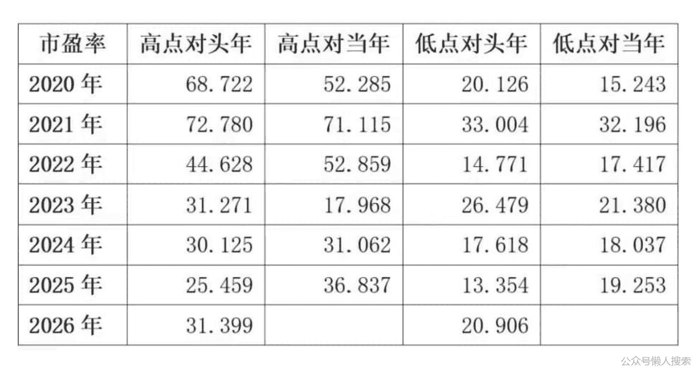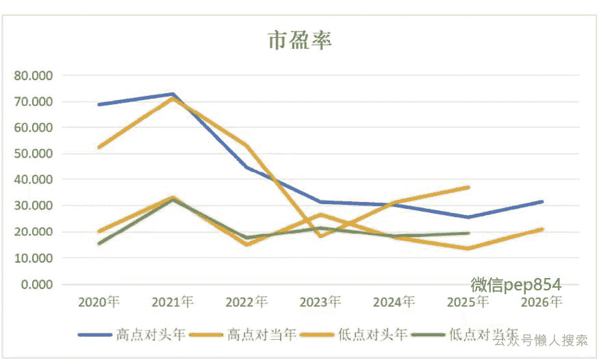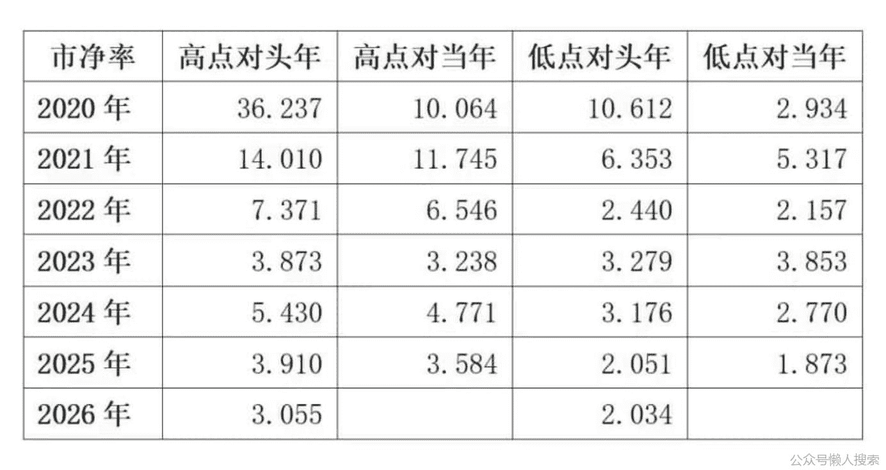

从市净率来看，数据并不高。

## 3. 市销率（单位：倍）

市销率表格

原理也跟市盈率类似。

市销率处于历史低位，但我们一直强调的是，公司最大的问题是净利润，所以市销率不起决定性作用。

# 总结

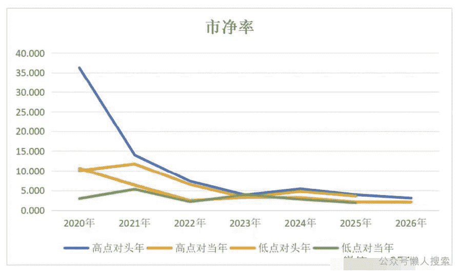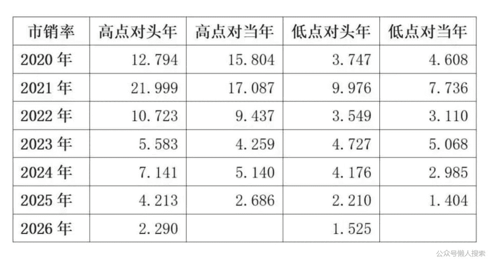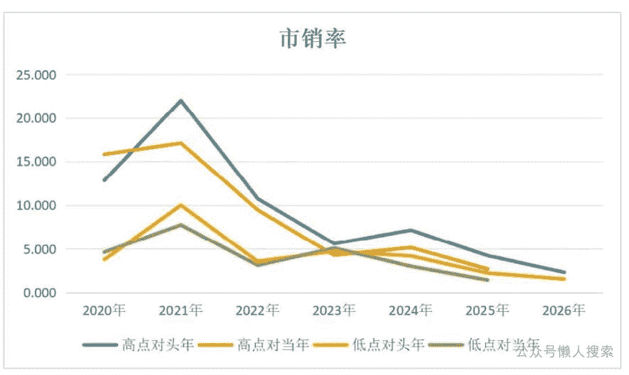

最后仍然强调一句，我们研究这家公司，主要是它是机器人行业最早进入千家万户的第一类产品。这类产品未来如何表现，市场会不会突然炒作机器人或与人形机器人进入千家万户高度相关的个股，这个要看风向哪边吹。当然，市场也有可能不炒作，可一旦炒作，我们自己心中就要有数。

另外，它也是消费概念，也是家电概念，历史上消费和家电是出牛股的地方，这个未来也不能小视。

当然，也与市场风向高度相关。操作这类股票一定要有极强的耐心，就是等待大底和风口。当技术性的短线机会来临时，只能轻仓做短线。个股和板块指数没有见大底，就不要轻易重仓操作。重仓只有三个条件全满足时才重仓：

- 一是指数和个股见大底；
- 二是风口来了；
- 三是公司和行业恢复性进入高成长周期。

（免责声明：本文是公司分析，仅为开拓视野、引导思路，并非择时，亦非荐股，股市有风险，入市需谨慎。本文不构成任何投资建议或意见，不对投资者依据本文做出的任何投资或决策承担责任。请大家注意投资风险。）

————分割线————

在这个AI能替你写代码、写文章的时代，基础技能正在迅速贬值。绝大多数人正被淹没在海量的免费垃圾信息里，陷入低效的体力内卷。

当“努力”不再是壁垒，人与人之间唯一的护城河，只剩下“信息过滤”的效率与“认知系统”的维度。

如果你认同这种“重塑认知防线”的极客主义，欢迎围观我的个人情报智库：【懒人专属群】。

如果你认同这种“重塑认知防线”的极客主义，欢迎围观我的个人情报智库：【懒人专属群】。

https://lazyso.com/insider/

认同信息过滤价值、想省下每天3小时无效阅读时间的读者，扫码加我微信（lazyhelper1）。

