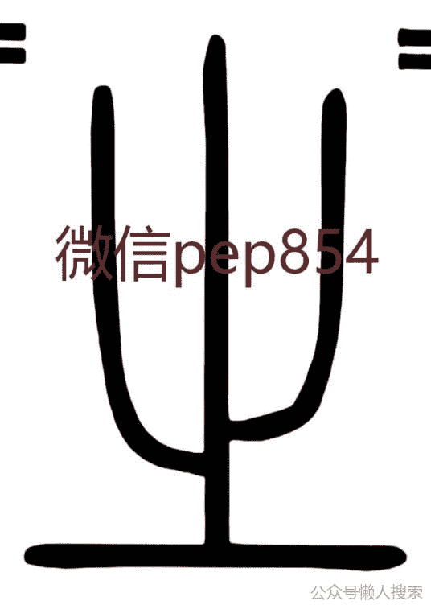
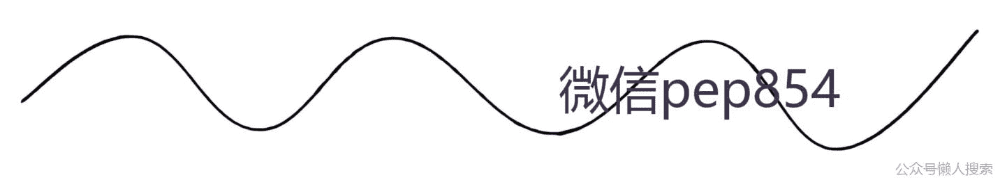
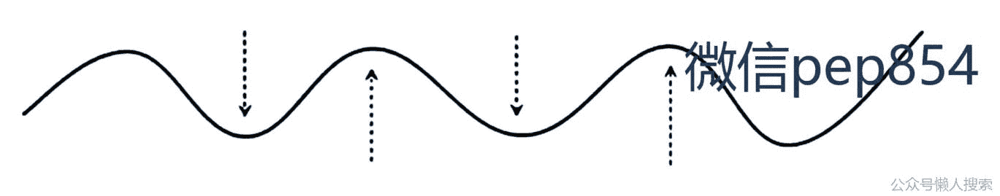

公众号懒人搜索，懒人专属群分享

三眼正解《道德经》之——天之道！

260611 第三只眼观付费

整理：公众号懒人搜索，懒人专属群精选

懒人微信：lazyhelper1

后台又得有人骂我了，越免费给人看越挨骂。

为啥骂我？因为看完我的东西，他觉得几十年白学了，学的全是错误知识！就好比舔西狗怒骂西史辩伪，因为自己这辈子白学了，那必须要骂你……

啥叫正解？就是市面上的解读全是错的！一点不夸张呀……

比如上《百家讲坛》讲老子的，还有你买的那些解读老子的书，讲的全是错的……

总之呢？告诉你正确知识，不用你感谢我，那不用骂我啊！你要骂，应该骂误导你的人呀……

这篇其实很简单，别一看“天之道”就觉得好神秘，这篇咔嚓几下讲完，预估3000字搞定。

别以为3000字讲得简单，这玩意“大师”们研究一辈子都不知道……

从哪讲呢？老子对天之道有几个描述：

- 天之道，其犹张弓与。
- 天之道，不争而善胜。
- 天之道，损有余而补不足。
- 天之道，利而不害。
- 功遂身退，天之道。

这篇就选第一句，因为这是天之道的最基本原理，剩下几个都是延伸到做人做事的。

来看看这句啊：

天之道，其犹张弓与。

嗯……这里面除了“天”字外，你肯定一个字也不认识。

先看错误翻译：说天之道就是自然规律，它不是和弯弓射箭所显示的道理一样吗？

高者抑之，下者举之。

说射箭时候高了就要压低一些，低了就把它抬高一些，这样才能射得准。拉得过满了就把它放松一些，拉得不足了就把它补充一些。

是不都这么翻译的？

错的啊，丢垃圾桶……

那什么是天之道呢？

这玩意要《中文力学模型大法》才直观！所有中文模型都是力，道家就是一部宇宙物理学，这玩意说800遍了都……

先来个图带带感啊：

这张图的运力过程，就是天之道！

回头分几篇详解一下《天干地支》是什么，但这必须要先知道《天之道》是个啥，这篇是铺垫了。

下面具体解读：首先，天之道不能翻译成“天的道”。

之的本义——运动表达！

这个字很重要啊，在《道德经》里出现200多处，这个字不认识，那还咋理解老子？

像《说文解字》是很低档次的，解释很多字都不对，现代人看的《字典》就更低档次了。

还有《尔雅》和《广雅》这种文字训诂学，解释的倒对，但还是不能把本义给说出来。

例如：之，止而切。

好家伙，这么解释谁能看明白？

画个图你咔嚓就明白，这玩意必须要《模型大法》才直接。

之，上面那俩弯曲的力，一个是少阳，一个是老阳，这俩力交替运动的显现过程，就叫做之。

这玩意看再多书，也不如点拨一下……

只干1%的活……

例如：你两脚走路就是之，你停住了就是止，所以脚指头才能写作“趾”嘛。

这不是瞎编吧？要不中文这么写干吗？

为啥古人不这么画模型呢？多直观？

不是古人不想，是古人受困于刻字材料，竹简啊、石头啊，能像我们用电脑这么方便吗？

等到了纸张随便用时候，人们又基本上不懂中文本义了……

所以：啥叫天之道？

就是天文运动的自导（導）过程，呈现出一种道的轨迹。

不是说有个“天的道”很牛逼……

咋呈现？就是上面那个星球运动轨迹图了呀，星球在“之运动”呢呀！

之，不能看成二维的，这是三维螺旋的，你走路也是三维的呀。

那这与“其犹张弓与”有啥关系？

下面是重点了，5个字=5个点拨，立马就通路。

略略略……

天之道，其犹张弓与。

天之道知道啥意思了，下面字一个个来啊。

### 1、其

就是π，圆周率的π，也写作元。

额。

肯定有人懵了，说这肯定是瞎联系，怎么还和数学搞上了……

这个“π”回头讲《天干地支》时候再细说，π是中国人发明的，中文就是亓。

π是啥？下个定义：无限逼近的区间过程！

例如：把正多边形画成圆，永远不可能画完，因为只能无限逼近。

3.1415926……啥的，这只是π的数学表达罢了，并不是π的本义。

例如：你家的凳子，就是个π啊，是凳子背后的力无限逼近平衡的过程。

先知道这么回事，需要结合后面才能理解。

### 2、犹

这个比较麻烦。

犭（犬），这和旺财一毛钱关系没有呀！

这篇简单讲啊，不然每一个模型都能敲1万字，先整体上明白老子讲啥，回头再慢慢细致抠。

画个图咔嚓知道犬是啥：

所有中文模型讲的都是“力”哟，千万不能当成“形”来看。

犬，就是事物前进时候，4个力当中有1个力是“空”的，这样力才能嘟嘟嘟交替运动。

问为啥4力1空，回头再解释，先记住即可，这涉及到象数了。

为啥引申为旺财呢？因为四足动物符合这种物理力学特征呀，道家看有形万物都是通过力来引申。

尤，就是犬的交替运动过程，整体视角去看。

所以：

天地不仁，以万物为刍狗，这里的“狗”绝对不是旺财，而是一种物理运动机制。

所以：犹，简单说就是一套工作原理。

啥玩意的工作原理呢？

### 3、张

这个模型更麻烦，暂且不用画太细致，整体上先知道正确意思即可。

张，就是螺旋运动逐渐延长了！

在物理力上，伸展只是个大范畴，张也是伸展的一种力。

例如：

你拉弓弦时候，不是拉这个动作叫张，而是弓弦螺旋伸展产生的运力，这才叫做张。

### 4、弓

弓，就是一直处于张力状态的轨迹！

把三维螺旋轨迹画成二维的：

为啥画成二维的？因为古人只能刻字啊……

现代人有电脑倒是好办了，用AI把《道德经》都画成四维模型，这样就更直观了，就是太麻烦了。

重点：

为啥能一直张力呢？因为一直在“与”啊。

### 5、与

顺着上面的画图逻辑：

与，就是张力运动的校准过程！

与的篆文：

说中文模型全都是表达“力”，没骗你吧？

要不这字这么写干吗？

这玩意多直观啊……

例如：

A与B咋咋地。

就是A和B进入同一股弓力，它俩就联系起来了。

例如：

与其咋咋地……

因为与运动和π运动是不可分割的啊！

与其A不如B，就是不按照A的力作与运动和其运动了，或者说否定了A的运行，换成B的运行了。

### 6、合起来

天之道，其犹张弓与。

翻译：

天文现象运动起来，就是在表达道，这个过程叫做天之道。

具体表达呢？

天体运行轨迹呈现出“弓”的轨迹。

而之所以呈现出弓轨，是因为天体在不断地“与”着！

为啥“与”运动呢？

这是因为天体有自力，自力与诸多外部太空星体的引力互动，才产生了与运动过程。

这个“与”过程是一直“张”的，即无限延长的，没有开头没有结束。

这一套运动过程，表现出的整体机制原理就是“犹”了呀。

那为啥能产生上面的一系列运动呢？

因为π！

万事万物都在无限逼近一个“绝对”的平衡态。

这个π的作用体现呢？

就是：高者抑之，下者举之。

啥叫高下？

可不是通常意义那个啊，那个是引申义。

画个图咔嚓让你明白：

黑虚线——高。

白虚线——下。

这个黑球无法达到绝对平衡，所以就高下运动了，这个过程就是π呢。

例如：

地球在弓行呢，是地球自身的运力分成高和下，而不是有个A星星比地球高。

就好比你拍球似的，皮球自己高下呢！

地球运动=在宇宙里自己拍自己……

好了讲完了。

当《道德经》回归到物理学本义，是不是就特简单了？

这才是“顺应天道自然”啊，都是从天象来的。

当然，上面是初步理解天之道，找到物理运力的感觉。

但是，老子可不是唯物主义啊，要远超唯物主义！

物——心——心物一元，这是有过程的，但也要先明白物理这一块，逐步才能升级到心物一元，那块才是老子真身。

啥叫一元？

物理即心理，心理即物理，皆为一一力！

例如总敲的唯识学，就是心物一元的啊，儒释道逐步都串在一起。

一定要以“力”来观察万物，这样就不用死记硬背，事物自动就呈现出规律了呀。

————分割线————

在这个AI能替你写代码、写文章的时代，基础技能正在迅速贬值。绝大多数人正被淹没在海量的免费垃圾信息里，陷入低效的体力内卷。

当“努力”不再是壁垒，人与人之间唯一的护城河，只剩下“信息过滤”的效率与“认知系统”的维度。

圈子已稳定运行7年。我们每天利用Python爬虫与大模型算力，过滤全网最顶级的政经内参和搞钱风向标，做你最冷酷的“外部大脑”。

如果你认同这种“重塑认知防线”的极客主义，欢迎围观我的个人情报智库：【懒人专属群】。

https://lazyso.com/insider/

认同信息过滤价值、想省下每天3小时无效阅读时间的读者，扫码加我微信（lazyhelper1）。

