# 大四学生做公众号一年变现**6万+**，深耕大学生赛道的我如何通过流量主、商单和私域变现，新人可参考 

260617 副业SC 精华 

整理：公众号懒人搜索，懒人专属群精选 

懒人微信：lazyhelper1 

## 一、前言

各位生财圈友大家好，我是余念，今年418刚加入生财的新人。 

目前大四在读，主要做的项目就是公众号流量主+私域变现，2025年一年通过公众号变现6万块，目前公众号已写出19篇10w爆款，前期出爆款的赛道主要是在大学生成长赛道这一块，后续我会详细说明为什么选这块，要怎么做。 

公众号流量主单日变现400+ 

2025年3个月公众号接广告收益 

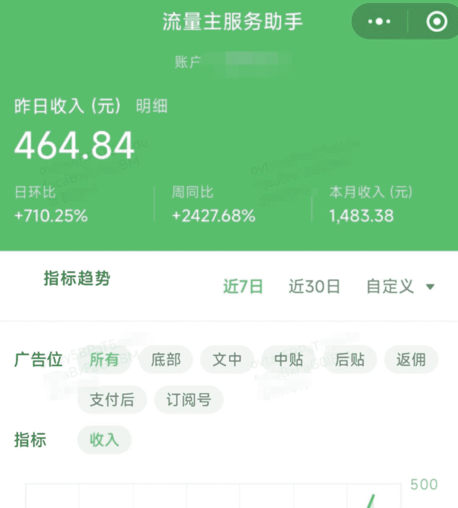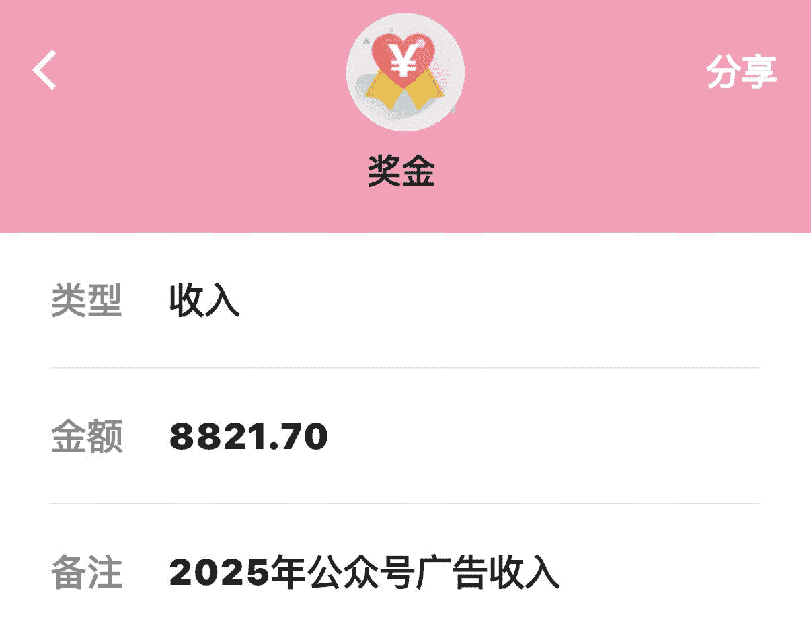

单号流量主收益 

带学员+分销部分收益 

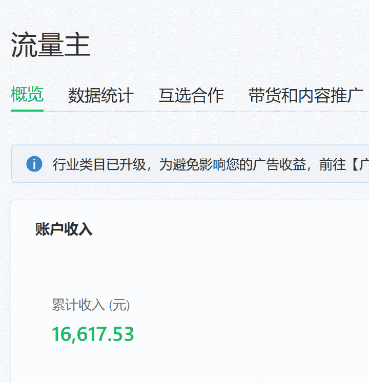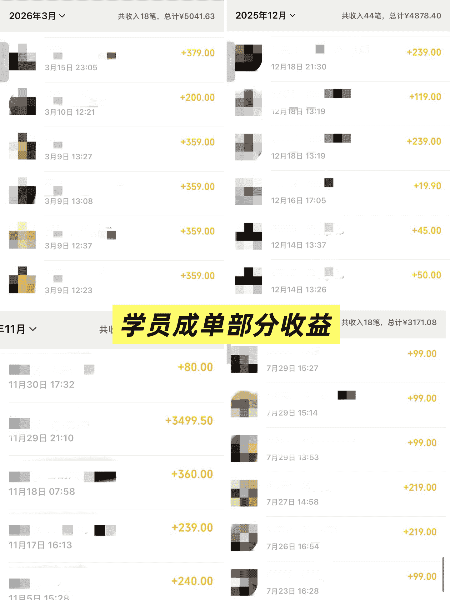

部分10w爆款文章 

2026年加入生财后看到了其他圈友分享的贴图号内容，然后开始做贴图号，一个月时间写了2篇10w+贴图爆款，其中有一篇仅用12小时就跑了25万阅读量，连续两天日入200+ 

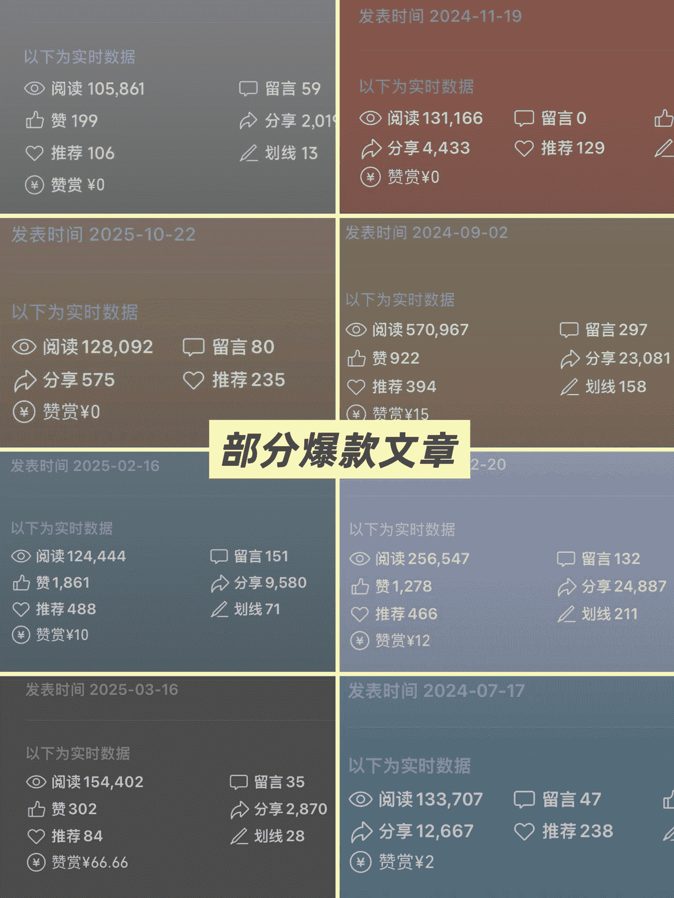

补充说明：本人做公众号大部分都是手搓，尤其是推文号，会适当借助AI，但为了保持手感一直坚持自己写。因为条件受限，没有矩阵号，手上做过最多的只有2个号。 

## 二、为什么选择做大学生赛道

我是在2022年底创立的第一个公众号，刚开始更新内容比较少，主要目的是为了自己的成长。 

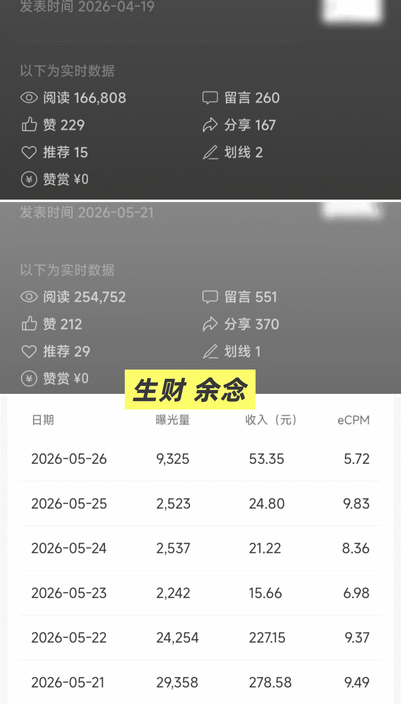

真正开始深耕公众号是到2024年7月份，主要做的是大学生成长赛道。 

其实刚开始对公众号运营一点也不懂，定位、赛道、写爆款一窍不通。 

正因为如此，我没有太多的选择，只能从自己身上能写的地方入手，那就是大学生身份。 

那会我刚读大三，经过2年的积累自己在大学里面有了一些成功的经验，比如打比赛拿国奖、一次性过四六级、找实习拿到大厂的面试等等。 

再加上我曾经在一个大学生成长平台发布了52篇文章，我有很多素材，所以就直接行动了。 

刚开始发的前几篇文章并不是那么顺心，只有两位数阅读。直到我写了一篇关于大学室友的文章，开始有了起色，给我增加了信心，后面那一篇文章成为了我的第一个10w爆款。 

我在高中的时候就喜欢刷公众号，那个时候【跑步的人】主要也是写大学生赛道的，看到他分享的经验对我非常有帮助，其实在我心里就埋下了一颗种子。 

当我自己去写的时候，我发现也会有人关注我给我点赞，甚至在评论区请教我一些问题，我也想通过文字的形式去给别人带来帮助，提高自己的影响力。 

因为我本身是双非学生，背景平平无奇，在做公众号的过程中多了很多成就感，而且还能补贴自己的生活，就很愿意继续去做。 

所以我选择继续去写大学生成长赛道，不断去帮助和吸引同龄人。 

当然，不得不说那个时候我吃到了大学生成长赛道一点小小的红利，24年下半年我开始写这个赛道的时候，做的人很少（现在已经泛滥了哈哈哈），所以没有太多的人跟我瓜分流量。 

因此很快就做起来了，三个月的时间粉丝就到了1万多。 

## 三、大学生赛道的趋势和机会

现在写大学生赛道的人越来越多，尤其是很多大学生号主都在做这个赛道，所以就出现了同质化的问题，但这完全不影响赛道本身的价值，依然值得去做。 

**1）受众群体大**

这个赛道一个很大的特点是，不仅是学生本人会看，会吸引到一群大学生家长这样的中年群体去关注我，且他们很愿意把文章转发给自己的孩子，双重的受众。 

而且在这个过程中会有一些惊喜，我之前写过关于四六级考试的文章，文末留言加好友可以领取资料（是免费的，主要是为了吸引一群人进入私域），有个家长在领完以后为了感谢我，给我发了188的红包。 

还有一次是一个大学生家长跟老师关系比较好，她一直在帮老师管理学生群，看到我写的文章以后加上我的好友，直接把我的公众号发到了800人的群里进行分享，当时涨了不少粉丝。 

而这些都是出乎意料的事情。 

**2）需求量大**

很多大学生是需要一个平台抱团取暖的，尤其是对于学校本身不好的学生来说，他们会很迷茫，刚入大学不知道怎么去做，完全像无头苍蝇一样。 

大学想要破局很重要的一点是打破信息差，但很多学生不知道怎么去打破，不知道怎么去了解。 

比如四六级怎么考，比赛怎么打，实习怎么找，转专业怎么转，宿舍关系不好怎么处理等等，特别特别多的痛点，而这些东⻄在学校里是不会详细教的。 

再加上普通的大学（如双非、大专）资源本身就不太好，有很多学生对自己学校不满意会逐渐丧失对大学生活的信心，这些都是可以写的痛点。 

每年都有新的大学生，大一到大四的内容都可以写，再细分一些可以做研究生赛道，所以这个赛道的流量是源源不断的，需求量也是很大很大。 

**3）起号速度快**

经过这两年的摸索和带学员，我发现这个赛道起号速度是很快的，我第一个号不到一个月开通流量主（当时是500粉丝才可开通），在今年年初的时候，我又注册了一个新号，半个多月就开通了流量主。 

**4）容易吸引同频人**

如果本身就是大学生身份深耕这个赛道，账号天然自带亲和力与信任感，私域里很容易汇聚一大批同龄同频的伙伴。 

大家处在相同的人生阶段，面临着相似的困惑、目标与期许，交流起来没有距离感。（这样也会更容易变现，具体怎么做我后面会详细说） 

**4）创作难度和成本低**

就像我上面说的，如果自己本身是大学生，写大学生赛道真的非常合适，哪怕你没有很多特别的经验都能去做。 

比如说室友不和、不知道怎么跟辅导员相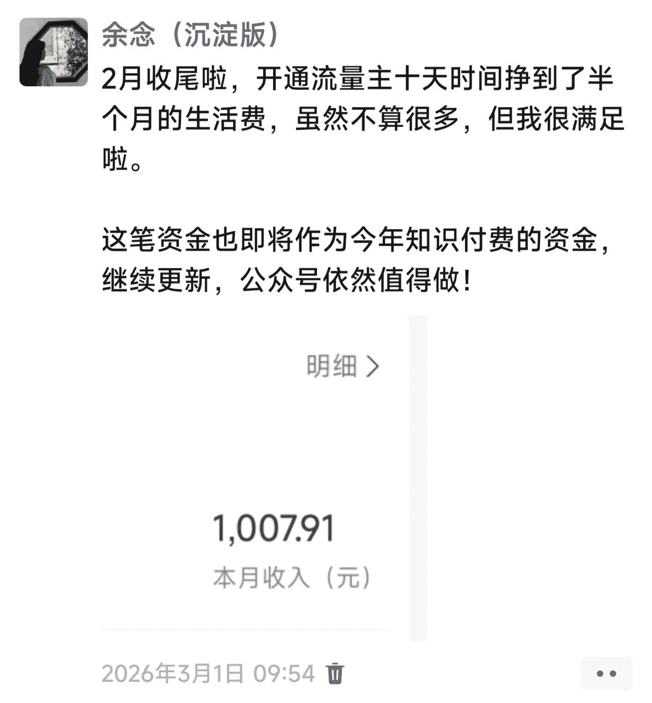处这些99%的人都经历过对吧，这些都是素材。 

你就可以完全把自己过往所有的经历当做素材去做，再结合一些爆款去写，就很容易做起来。 

而且写公众号要什么成本呢，大学生人人都有电脑，这是大学刚需呀，只要你没报课去跟着别人做，自己摸索真就是不需要任何成本。 

哪怕做失败了也只是浪费了时间，用原本打游戏追剧的时间去摸索公众号，既不耽误学业又能提升技能。 

**5）公众号长文更适合干货输出**

我之前也做过视频去聊大学的经验，但效果一般而且摸索成本高，不如文字表达简洁有逻辑，刚好公众号就贴合这一块。 

很多人会觉得现在没什么人看长文，但不是这样的，就像我最上面说的，做这个赛道吸引的不止是大学生，还有一群中年家长，而这群人真的会愿意去看长文。 

同时，不管是实习规划、备考攻略、竞赛解读，还是心态调节、职业选择，都需要完整的逻辑、详实的步骤、真实的经验拆解，而长文恰好能承载足够多的内容。 

我们可以把踩过的坑、总结的方法、梳理的干货系统性地记录下来，把零散的感悟整理成完整的经验体系。 

我的大号很久不写大学生了，到现在我还能看到别人给我之前的文章点赞，这就是沉淀的力量。 

## 四、怎么找好的选题

我写的19篇10万爆款文章里，大部分都是干货文（比如实习、大学生做自媒体、寒假可参加的比赛、入党等），但是干货里面夹杂着很多可以引起共鸣的板块，所以流量就很容易爆。 

这块就详细跟大家讲一讲我是怎么找选题的。 

**1）刷对标，看同行怎么写**

刷对标账号，是我日常找选题最基础也最高效的方式。 

空闲之余我会习惯性浏览同赛道公众号，重点盯着阅读量五万、十万级别的爆款文章，再进一步进入对方主页综合判断，筛选出真正值得参考的优质对标。 

什么样的账号才算好对标？我总结了几个判断标准： 

- 首先账号注册时间不长，属于近期起步的新号； 
- 其次更新稳定，能够持续产出爆款内容，说明其选题思路贴合当下用户喜好； 
- 最后文章逻辑清晰、行文结构完整，内容表达有章法。 

确定好对标账号和爆款文章后，需要把这些都归纳整理起来。 

很多大佬之前分享过，会用飞书表格搭建专业的选题库、素材库。 

但我日常有点懒，有时候会忘记整理，所以我就建立了适合懒人的素材库搭建。 

方法很简单就是用自己两个微信新建一个群聊，命名为「公众号写作」。 

平时刷到优质对标账号、高阅读爆款推文，直接转发进群留存即可。 

我不会刻意分类，建立这个素材库的核心就是去留存我刷过的账号。 

每当我陷入选题荒，就打开这个群聊翻看往期内容，查看对标账号近期的创作方向、热门话题，结合自身账号定位借鉴。 

刷对标的方式也很简单，就是在微信有个【公众号】，里面会有很多其他博主发的文章，在刷的时候可以给跟你同赛道的文章点赞，这样下次系统就会给你推荐更多类似赛道的账号。 

这里提一嘴，不要去刷那些官方的账号，比如【中国青年报】、【豆瓣】，这样的账号10万爆款很多，但对于我们这样的素人博主来说没有参考价值，一定要去看那些素人博主的账号。 

**2）挖掘自身日常灵感，先验证再动笔**

身为在校大学生写大学生这个赛道，我们本身就身处赛道核心场景，每天经历的琐事、收获、烦恼、成长，全都是天然的选题素材，这也是大学生号主独有的优势。 

日常可以挖掘的选题特别多： 

- 比如参加竞赛成功获奖，可以分享备赛流程、参赛经验、避坑技巧； 
- 和室友产生矛盾、磨合相处，就能围绕宿舍人际关系、校园相处之道展开创作； 
- 顺利通过面试拿到实习offer，也能整理面试心得、求职技巧、新人实习感悟。 

校园里的大小经历、情绪起伏、成长感悟，都是贴近读者的真实内容。 

不过仅凭自我灵感创作，很容易陷入"自嗨"误区，自己觉得有价值不重要，得让平台、用户验证出你写的是否有价值。 

所以想到灵感后，我会先去搜索：把核心关键词输入公众号搜索栏，查看同类型内容的数量、阅读数据。 

如果公众号同类内容偏少，就再去小红书、今日头条等平台继续检索。 

综合判断该话题的受众热度、讨论度，确认有成为爆款的潜力，再正式动笔创作，这样可以在一定程度上避免选题踩坑。 

**3）多平台联动借力，捕捉全网热门话题**

有时候公众号上实在刷不到好的选题了，我会去其他平台找，比如小红书、抖音等。 

不一定非要去看图文，视频的选题也可以，别人发视频火了，我们可以写一篇相似选题的文章去到公众号上，也有机会火。 

虽然每个平台的调性不同，但爆款的逻辑是相通的。 

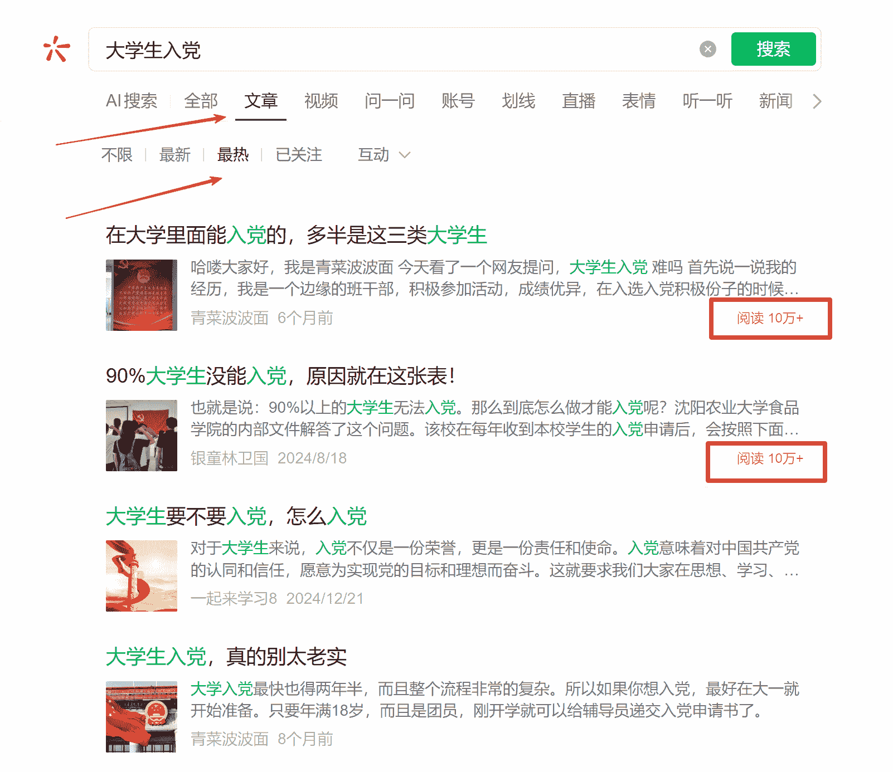

平时刷小红书、抖音看到一些火的内容，我会把标题关键词复制下来去公众号搜。 

如果平台内已有同类爆款，就证明这个方向受众需求旺盛，可以直接定为自己的选题。 

除了考试，像开学、毕业、实习秋招、考证季等节点，全平台都会集中出现对应话题，跨平台捕捉热点，能让我们的选题永远踩在用户需求的风口上。 

**4）深耕爆款评论区，打破同质化**

坦白来说，当下大学生赛道同质化问题确实很严重。 

入党攻略、热门竞赛、校园日常等常规选题，几乎被写遍了，单纯复刻内容很难脱颖而出。 

这个时候如果自己没有一些新颖的观点，那就可以去借助爆款的评论区挖掘观点。 

不管是公众号还是小红书的爆款图文、推文，高流量内容下方往往有成百上千条留言，里面藏着大量正文没有提及的细节、新思路、实用方法和真实痛点，这些都可以成为好的点子写到自己的文章里。 

## 五、频繁出爆款的逻辑

那么在赛道不断内卷，平台重新洗牌的情况下，我依旧能产生爆款的创作思路是什么？ 

其实很简单，融入自己真实的经历。 

我日常的创作，会先参考同赛道优质爆款，拆解对方的选题逻辑。 

但我从不会单纯照搬内容，一股脑输出干货，而是在文章里融入大量属于我个人的真实经历。 

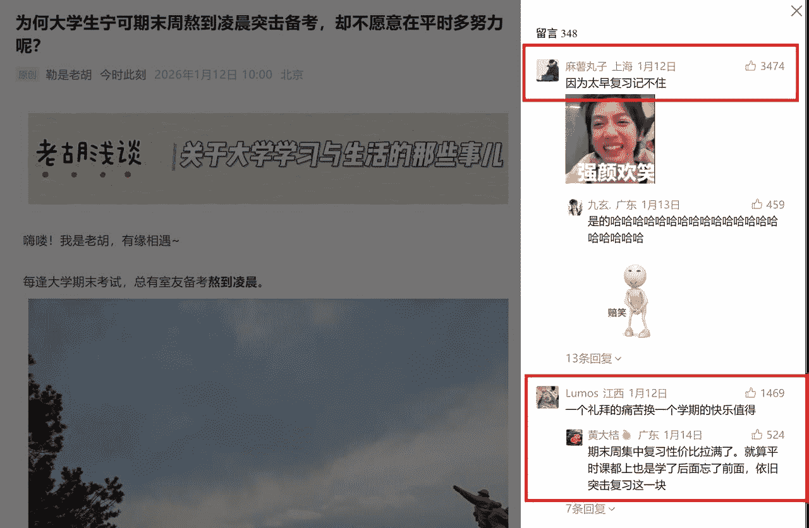

我的目标是打造个人IP，吸引同频的大学生走进私域，而想要做到这一点，单纯的干货分享远远不够。 

读者在文章里收获实用方法的同时，更能看到一个活生生、和他们站在同一起跑线的同龄人。 

我也曾和现在的他们一样，陷入学业迷茫、求职焦虑、不懂如何打破信息差；而如今一步步摸索、成长，活成了很多人心中期待的模样。 

这种身份的共鸣、成长轨迹的参照，就是我和其他账号拉开差距的关键。 

每个人的人生经历都是独一无二的，大家或许会有相似的校园困惑、成长烦恼，却不可能拥有完全一致的故事。 

这些独属于自己的见闻、踩过的坑、收获的成果、心路转变，都是别人复制不走的珍贵素材。 

在内容配比上，我习惯采用六分干货，四分人设的组合：六成内容输出可落地的经验、技巧、方法，保证文章的实用价值；四成内容融入个人故事与感悟，自然塑造个人形象。 

我从不会刻意夸大、包装自己的人设，也没必要这样去做。只是把自己过往最真实的经历和收获展现在了文字里，拉近与读者的距离，这样才能不断吸引到人去关注去到私域。 

真实经历，永远是大学生赛道的流量密码。哪怕有时候你整理的干货内容，在全面性、专业性上比不上同行，但一段走心的故事、一份真切的感悟，就能快速戳中读者内心，引发大范围共鸣。 

而共鸣，正是一篇文章能够成为爆款的核心驱动力。 

## 六、多条腿变现，实现收益翻倍

在我写第一个公众号的时候，前期完全是自⼰摸索，一个月时间我就开通了流量主，没过几天我就接到了出版社的广告合作邀约，紧接着第二个月我就接到了第一个广告，我的报价是500元。 

然后在2025年1月份的时候我又收到了来自kimi和密塔的合作邀约，Kimi的原创文章报价是1000元，密塔是1500元。 

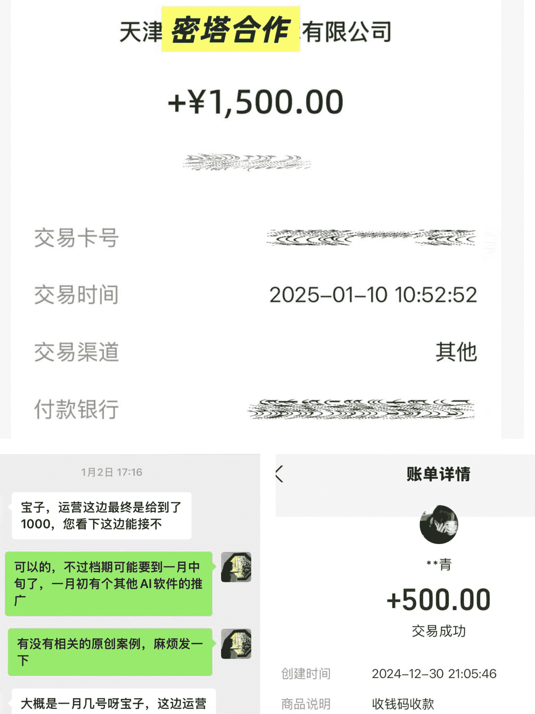

对于一个正在上大学的我来说，看到这样的收益真的很心动。大学生平时去做家教2个小时只有60块，在外面兼职1小时也只有10来块钱，而我每天花2个小时就可以赚几倍的钱，何乐而不为呢？ 

起初深耕公众号我只知道去赚流量主的钱，当时没有想过要去做私域，直到我遇到了嘻嘻姐（我的贵人，也是我加入生财的引路人），跟着她开始做起了私域。在这里也顺便对嘻嘻姐表达感谢，真的特别感谢她在我做IP上面的指导！ 

接下来跟大家详细说说我的变现路径和逻辑。 

**1）流量主变现**

做公众号想变现首当其冲当然是流量主了，目前我个人在流量主上的收益在2w+（两个号）。 

现在公众号流量主开通成本变低了，100粉丝就可以开通，比以前真的简单很多。 

做第一个号的时候开通流量主纯靠自然流量推荐，期间我也做过其他的号靠买粉、抽奖红包开通流量主，但最后账号都死了，所以没有再尝试这两个渠道涨粉。 

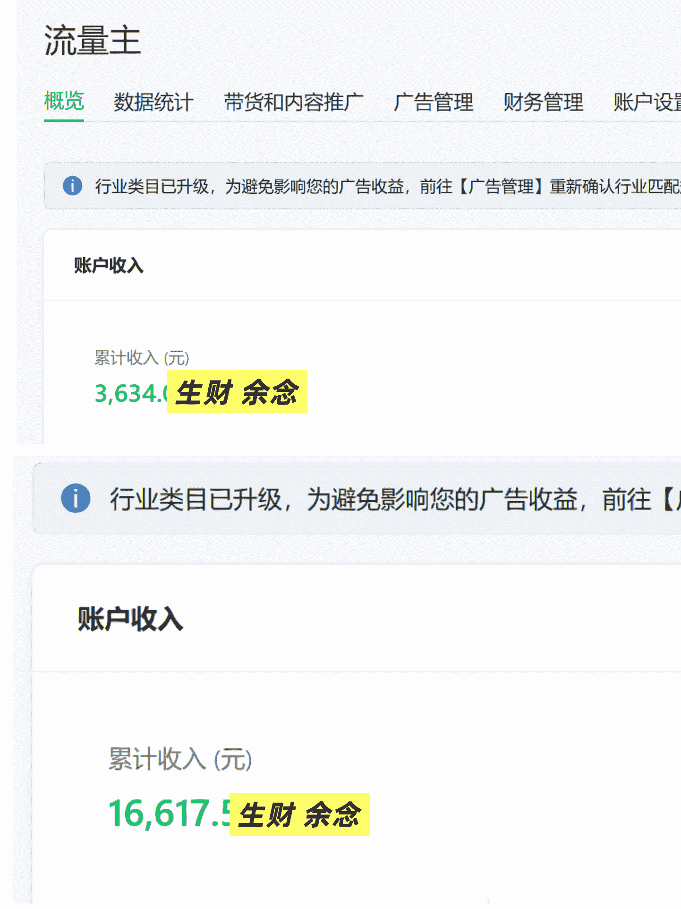

今年新开的号我利用图文起号涨粉，顺利成功开通流量主，且对账号流量没有影响。 

因为生财之前也有很多圈友分享过这个方法，跟贴图的玩法一样，我在这里就跟大家简单分享一下。 

考虑到我做的是大学生赛道，第一次尝试用这个方法起号不知道效果如何，也不确定前期发其他赛道的内容起号对我后面写推文是否有影响，所以我选择图文也发大学生赛道相关的。 

图文也是同样的，先去看看其他博主是怎么发的，拿关键词在微信里面搜，找到贴图，就不断去刷，重点看阅读量在1万以上的，就可以作为对标选题去用。 

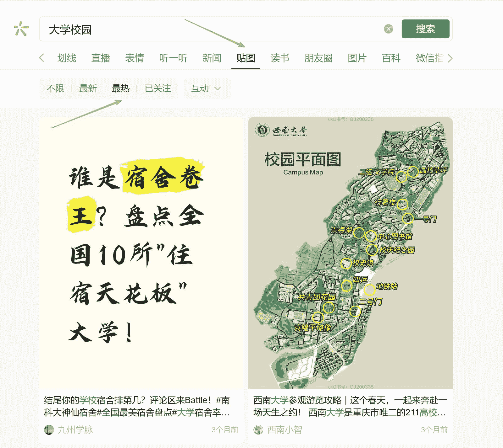

如果有自己的实拍图就可以用自己拍的，没有的话就去小红书搜，进行二创，找那种简单且方便改的图片。

像大学宿舍、大学食堂饭菜、大学图书馆这些图片都有，也可以去小红书评论区找别人拍的，这样就不容易被检测到侵权搬运。

我是每天发一篇，时间不固定，想起来就发。

图文起号就是会比推文容易涨粉，快开通流量主以后就转推文，继续更新大学生赛道的文章。

整体的收益还是比较可观的。

我写推文更新的频率尽量保持是一天一更新，实在没时间也要保证两天一更，千万不要断更太久。

### 2）接广告变现

去年公众号接广还能赚些钱，现在真的不建议大家随意接广，尤其是违规广告（副业兼职类、体育赛事类、医药类、明星八卦类、国学类等），超级容易限流和封号，我的大号当初限流就是因为一个月接了两篇广告，从那以后我再也没接过广告。

广告主要分为两种形式：

一个是代发，广告商提供稿子，按照博主的排版习惯对文章进行排版，不需要对稿子进行修改，硬推广。整篇文章都是广告。

另一种是原创，广告商那边提供广告文的要求，博主根据自己赛道的特点写一篇软广进行推送，完全是自己创作。软广的话不会整篇都在推销，只会在文末或者是适当的位置加上广告链接，读者看起来也容易接受。

跟大家分享一下我的接广经历作参考：

我接的第一条广告是代发，报价500元，那个时候我的粉丝就有好几千了，原创的报价是1500元。其实这个报价我自己心里是没底的，刚开始也不知道怎么报，就是看看别人的怎么报价进行参考。

后来认识嘻嘻姐之后，她对我的报价进行了指点。那会儿粉丝已经有了1万多，跟着她的经验，我把代发广告报价提升到了1200元，当时真的接了3个，合作方很爽快答应了，原创文章报价是2000元。

我会接广是会筛选的，不是所有的广告我都会接，比如我上面提到的一些违规广告，还有跟我赛道不贴合的我不会接，因为这样真的很影响账号，每次发广告数据都不好，且掉粉严重。

那为什么广告商能这么爽快答应呢？

首先是我的数据确实好，基本上一写都是大几千甚至上万的阅读量，这些就是提升报价的底气。

其次我的受众人群与他们的产品比较贴合，这样就很容易去成交。

我目前接的广告都没有走官方渠道，官方渠道的话就是互选广告合作，到时候会和流量主一起算，也会扣税。

私下收款有些是微信、支付宝直接转，有些是公司打到你的银行卡账户，这种的话就不会扣税。

### 3）私域变现

一年里发力最大的就是私域变现，也是打造IP很关键的一步。

跟嘻嘻姐交流以后，我开始做起了私域，从25年2月份开始做一直到现在，未来肯定还会继续做。

私域这部分流量主要就是来源于公众号，我会在文末简单介绍自己并放上自己的二维码。

之前流量很好的时候，每天都会加进来很多人，加进来的第一步就是给这群人打标签，方便后续管理。

有时候也会给这群好友分享一些我自己写的自媒体资料，让他们更好地了解我。

私域变现主要是两类：

一个是帮别人分销，因为我和嘻嘻姐深度绑定了，这块主要是分销她的产品。主要是那个时候自己也没有做产品的经验，就先练练手。

二是后来自己做产品，自己变现。

不管是分销别人的产品还是卖自己的产品，很重要的一点是和用户建立信任。有些人虽然有痛点（比如不知道怎么做公众号），但他对你不够信任，也很难变现。

当私域开始有人来了，那么做好运营是非常关键的，朋友圈就是一个主阵地。我从来没有跟自己的用户去一对一私发广告，我很讨厌别人给我发，所以我也会去避免，尤其是一个人在不了解自己的时候，还没有建立信任的时候，就很容易被别人列入黑名单。

在嘻嘻姐的指导下，我每天都会去更新朋友圈，朋友圈的内容主要分三类：

### 第一类：生活圈——展现真实的自己，拉近距离

核心是放下“卖家姿态”，做个有温度的普通人，不用刻意包装，不用追求完美，接地气就好。

比如发一发自己的日常、做的饭菜、出门的随手拍，或者吐槽一句日常小烦恼，让用户觉得“你和我一样，也是个普通人”，信任才会慢慢建立。

千万别觉得发生活内容没用，那些看似无关的生活碎片，正是打动用户的关键。

### 第二类：自我成长圈——展现你的价值，让客户认可你

私域的核心是“价值吸引”，客户愿意跟着你、相信你，本质是你能给客户提供价值。

比如发一发自己的学习日常、学到的新技能、做私域的心得感悟，或者分享一些行业小干货，让客户觉得你是在成长、有干货、靠谱，慢慢认可你的价值，才会愿意进一步信任你、支持你。

### 第三类：自媒体圈——围绕业务主线

这里的“自媒体圈”，不是硬推产品，而是适度露出你的业务、你的产品价值，结合前面的生活圈和成长圈，自然植入。

比如分享客户的反馈、自己做业务的小日常、产品的真实使用场景，不用夸大其词，不用逼单，让客户在了解你的同时，自然知道你的价值、你的产品，转化会水到渠成。

补充一个小技巧：发圈频率不用太高，每天3—5条就够，避免连续发广告，生活、成长、自媒体内容穿插发，节奏更舒服。

当然，因为有时候我没那么多灵感，所以给自己规定就是每天发2条，实在不知道发啥就写一条。

朋友圈就是别人了解自己第一步很关键的东西，有时候你发的产品可能没有什么人买，但只要你坚持发，一定会有人来的。

我前段时间还变现了一单公众号课程，那个学员去年就来问过课，但他那个时候就没买，一年以后他又来找我了，这种就是信任的积累。

私域运营和公众号更新一样，按时出摊，只有这样才能不断得到正反馈，变现也会更容易。

## 写在最后

这两年我不止做了大学生赛道，也做了其他赛道，但我最后开的新号还是重新回到大学生赛道上，因为我写公众号能坚持下去，一个很大的因素是自己感兴趣。

我看到别人做中老年赛道、漫画赛道收益也很心动，也摸索过，但最后都没坚持下来，因为那些赛道跟大学生赛道不一样，哪怕赚钱，也很难让我长期坚持下去。

其他赛道对我而言，只是单纯的“搞钱赛道”，没有热爱，没有共鸣，更没有表达的欲望。

我觉得这是一个很重要的事情，不管做什么赛道，想长期坚持一定要找个支撑点，除了赚钱之外的意义。

以上就是所有的分享，感谢各位圈友的阅读，我是余念，一起生财有术！

————分割线————

看完这篇SOP，你觉得你懂了。但90%的人一到实操就会卡在第一步。

工具和教程只是最低级的壁垒，真正的壁垒是“立刻动手”和“圈层信息差”。

如果你想看全网最新的变现玩法，并且和一群执行力极强的极客一起下场拿结果，欢迎围观我的核心私域：【懒人专属群】。

我们不聊虚的，只做商业闭环的拆解与AI效率的压榨。系统内已沉淀1000+跑通的套利实战局。

👉 查阅圈子完整数字资产与上车门槛：

https://lazyso.com/insider/

认同价值、准备好下场干活的，扫码加我微信（lazyhelper1）

备注：【实操上车】，不闲聊

