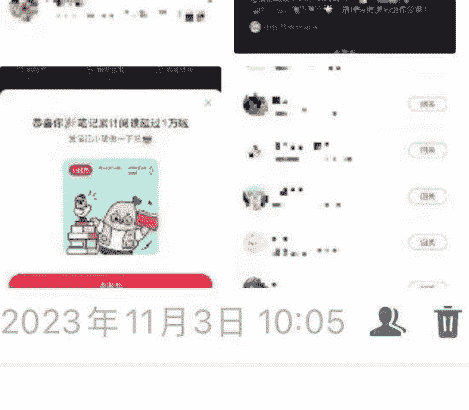
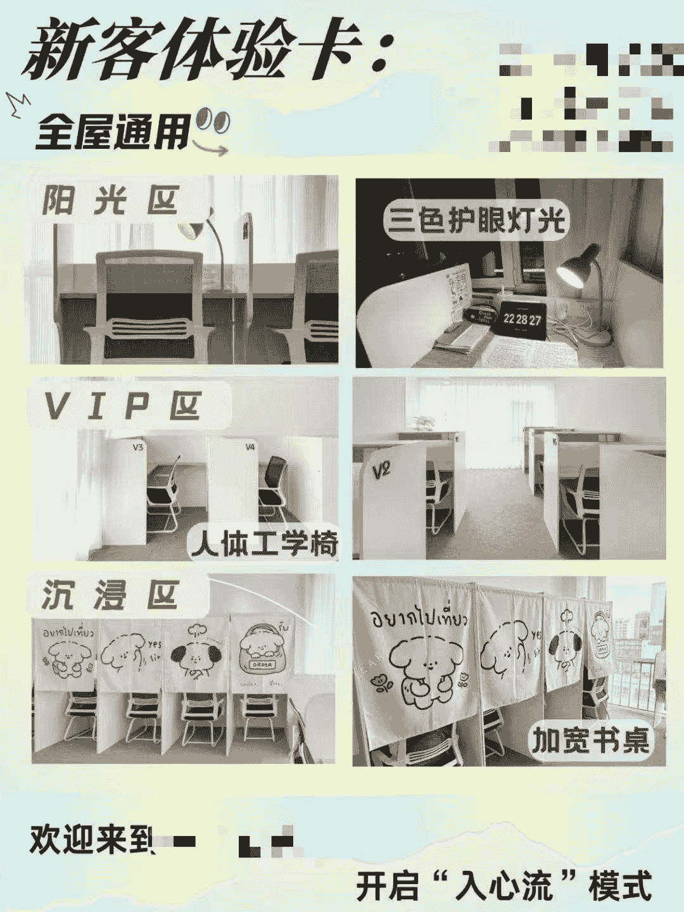
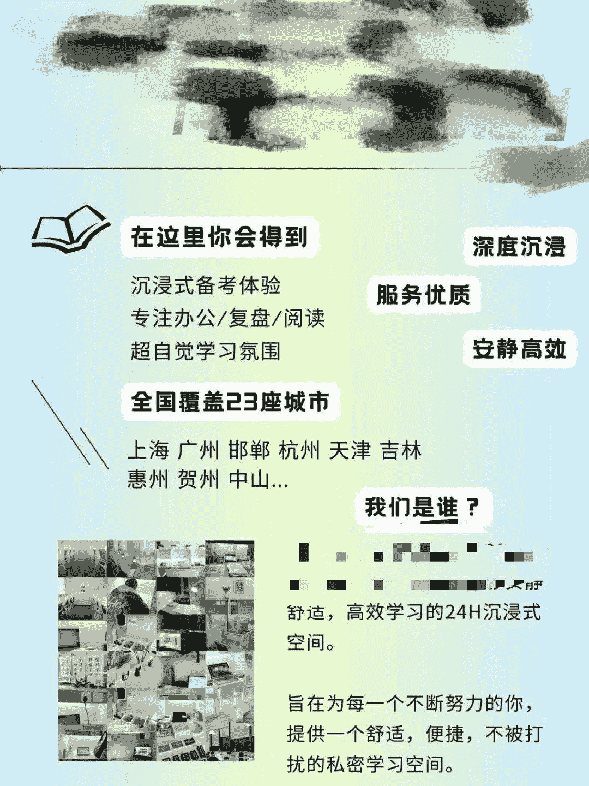
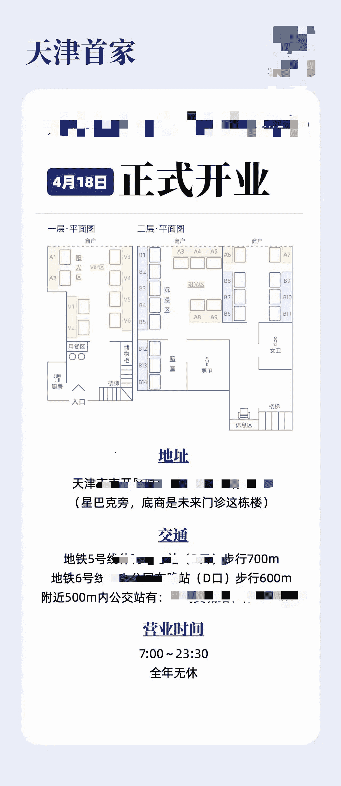
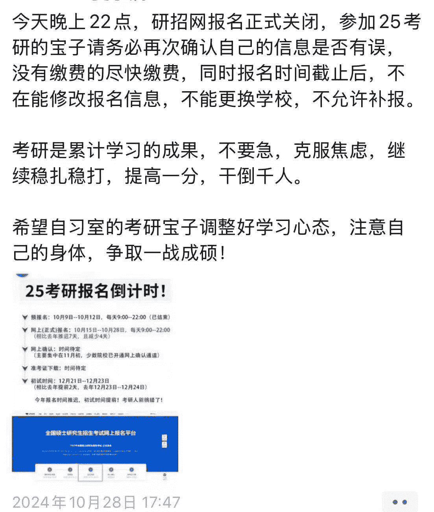
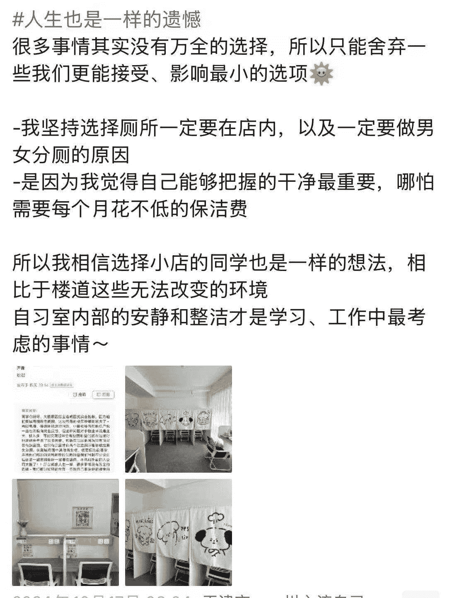
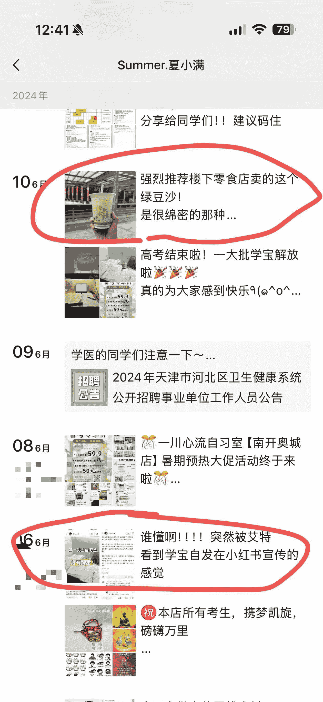
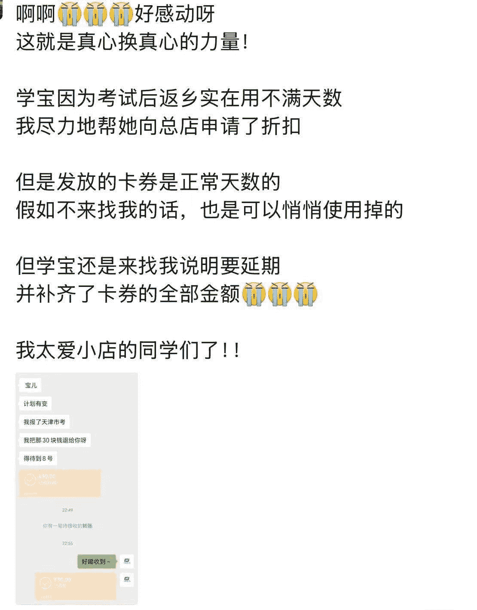
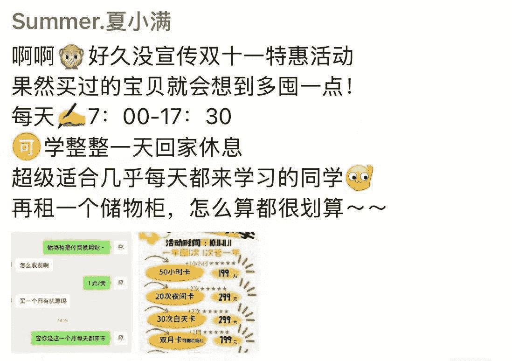
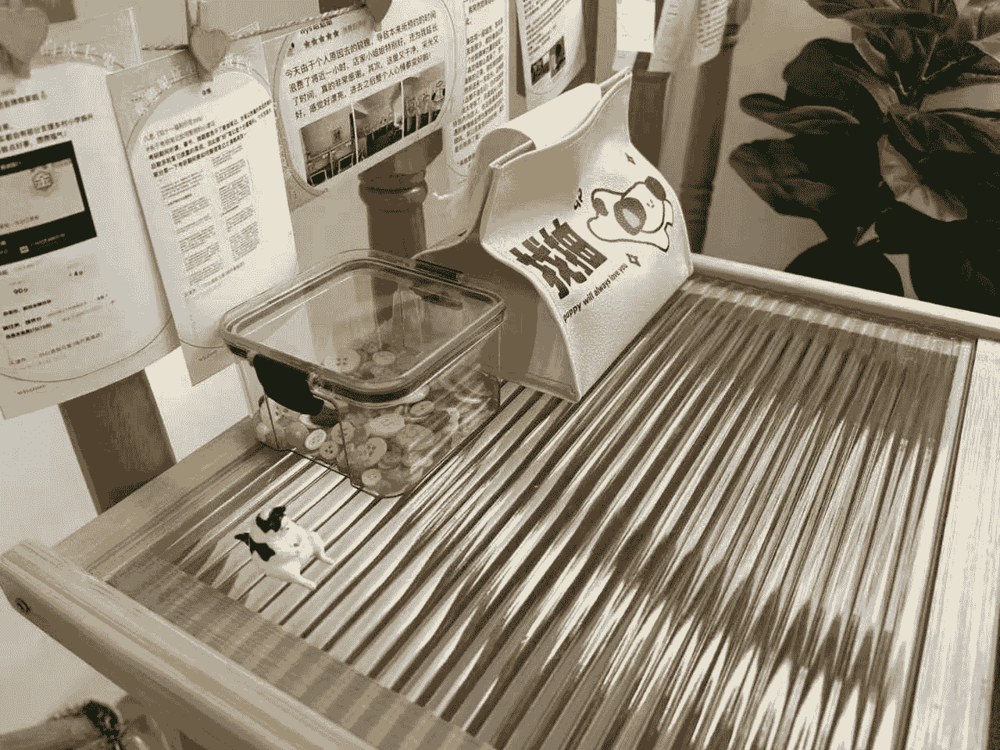

# 无人实体店获客难题，纯免费流量年 GMV15 万，全流程 AI 自动化复盘

260617 副业SC 精华

整理：公众号懒人搜索，懒人专属群精选

懒人微信：lazyhelper1

Hi，你好，我是九思summer。

本文主要讲了一个做内容流量的人，为什么去做线下店；做到了同行榜第二、金牌商家，却为什么还是停业；以及中间哪些流量、私域、AI 提效方法值得实体店老板参考。

2023 年底~2025 年初，我开了一家无人自习室。它不是一个很大的店，只有 30 个座位，但我在这一年里，确实把一个小型线下空间从 0 跑了起来。

这篇文章不只是写给想开自习室的人。如果你正在做实体店、本地生活项目，或者你会做一些公域流量，但还没有自己的后端产品来变现，这篇都会有参考价值。

我会主要分享两件事。

第一，我在实际运营实体店的时候踩了哪些坑？又有了哪些收获？

第二，实体店怎么用小红书、美团、大众点评这些线上流量低成本获客。

第三，实体店怎么用 AI 和流程化，把获客、客服、朋友圈营销、私域承接这些具体业务做得更省力。

我当时跑通的路径是：

公域内容引流 -> 私域沉淀 -> AI 客服承接 -> 朋友圈营销 -> 到店体验 -> 复购转化。

经营一年下来，年 GMV 超过 15w；开业刚 6 个月左右时，纯线上引流到店成交且沉淀到微信的就超过 700 人。

巅峰时期做到了本区域同行营业额排名第二名，美团金牌商家。

但在讲流量和 AI 之前，我想先把一句话放在前面：

实体店最重要的不是流量思维，而是在投入之前先算清楚收支。

流量可以帮你把人带来，但房租、客单价、复购周期、淡旺季、平台抽佣、人工和时间成本，才决定这个生意最后到底赚不赚钱。

所以这篇文章不是劝大家去开无人自习室。也是由于这个问题，我的店最后也已经关门了。

但我认为我当时做的比较好、可以分享给大家的是：一个小型线下店，怎么用免费流量、人性钩子和自动化流程，解决加微信难、建立信任难、高客单成交难这几个问题。

### 一、我为什么会去开一家无人自习室

我当初会选择做无人自助实体店，是因为我前面做过一段时间内容副业。最早做的是公众号流量主，后面又去做小红书博主。都做出过一些小成绩:

**九思 Summer.**

爆不完真的爆不完
合不完也真的合不完
2个号都一直在爆涨粉
12月已无档期

不算还没结算的单子
不到3周已收入1k+💰
甚至还接到了轻奢品牌的单子😎
小红书纯纯小白从0-1
这两个赛道算是跑通了✅
不断做事的过程中也不断的反思复盘 敲定了之后的计划
很开心自己接下来要迎接下一段挑战了😎
越来越理解搞钱其实不重要 否则很容易陷入看别人赚钱就焦虑的困境
不断挑战困难发现自己的解决能力和心态在慢慢变好的过程才最让人感到快乐

有些路 慢慢走 就很快

**九思 Summer.**

小红书新号第二篇就爆了 p1-p2
老号改了个内容也开始涨粉了 p3-p4
爆了之后以为是偶然 又坚持发了几天 发现每隔两篇左右都会小爆一下 总之平台在给我持续推流了
搞流量如此简单😁
视频号也小爆了一下 就是我手欠把红点点点掉了
没办法截图了
每个项目都做过一次 就会发现每个都一样
无非就是两个字：真诚、利他
要相信文字的力量是非常强大的 🌞

但是做到后面, 这两件事给我最大的感受是：

流量确实有价值，但如果你没有自己的后端产品，很多时候只能靠接广告和平台流量收益赚钱。

你花时间写一篇文章、发一条笔记、拍一个视频，它可能当时有流量，也可能接到一条广告。但那份时间投入，很多时候只是在服务那一单广告，并不能产生复利的效果。

作为一个小博主，广告费到自己手里，也不会特别大。

更重要的是，内容发完以后，它很难持续为我自己的东西产生收益。

所以我那时就在想，我需要找一个自己能卖的产品。这个产品最好满足几个条件。

- 因为我当时还在上班, 所以它不能太消耗我的时间精力。
- 它要有持续复购。
- 它要让我之前的流量思维在这个领域有差异化。
- 最好的是我发的帖子、视频，过一段时间还有人看到，还能继续给我带来客户,我还能重复卖这个产品。

后来我听到有人在做无人自习室这个项目，就开始认真研究它。

它吸引我的地方，就是它刚好像一个可以承接线上流量的后端产品。后来深入调研发现,因为他是本地生活类的项目,在当时的市场上,现有商家还没有形成非常成熟的流量思维,正好是我可以发挥用武之地的地方.

线上内容负责让顾客知道你。

而且自习室这种业态，本身有一个很适合内容获客的点：顾客会主动搜索。

她不是来逛街的，而是带着明确目的来学习、备考、办公、短暂停留。只要空间安静、位置方便、规则清楚，她就有可能复购。

所以我当时做的这个店，说白了就是一个自助学习空间。面积不算大，座位最多 30 个。最重要的不是它能给我赚大钱，而是我算准了它能作为一个最不消耗精力的副业来做，持续地赚点小钱。

主要用户也很明确。

一类是周围需要考试的学生，比如考研、考公、期末复习、上网课。

这些人都有一个共同点：她们不是来玩，也不是来拍照打卡，而是需要一个能坐下来专注做事的空间。

收入来源不是单一的。

有美团、大众点评这类平台带来的新客团购。

低价团购更像入口。

真正决定这个店能不能继续跑下去的，是后面能不能把用户沉淀到微信里，能不能让她复购，能不能让她从一次体验变成长期使用。

### 二、我踩过的至少价值10万的坑

但真的做起来以后，我很快发现，实体店的问题不只在流量，而在账算不算得过来。

哪怕我的流量做的再好, 可很多问题并不会自动消失。

流量能解决“有没有人知道你”的问题。

但它解决不了“这个生意账能不能算平”的问题。

如果房租太高、客单价上不去、复购周期不稳定，哪怕你每天都有新客，也可能只是让自己更忙。

第一个问题是选址。

开店之前，我会觉得只要找一个客流量不错的位置，哪怕房租贵一点，只要后面收费高一点，再靠自己努力运营，应该也能赚回来。

这就是我当时踩的第一个误区。

因为选址不是简单地选“人多的地方”。

它真正难的地方，是找到房租和流量之间的平衡。

尤其是在一个城市格局已经比较稳定的地方，好位置基本早就被占了。你想要人流，房租就上去；你想要便宜，位置和自然客流又会弱下来。

1. 我当时更优先考虑的是客流量。

因为我想着，客流量不差，房租贵一点也没关系，我可以把价格做高一点，把成本覆盖掉。

但后来我才发现，这个逻辑没有那么简单。

不是繁华地段的人就不会算账。

哪怕你的自习室环境、装修确实很好、位置也很好，也很少有人能长期承受很高的学习成本。

尤其是很多备考的人，本身就处在收入不稳定，甚至没有收入的阶段。

她可能愿意偶尔来体验，或者短期冲刺时买几次，但你让她每天花很高的价格来学习，消费能力并没有那么强。

所以你会发现，繁华地段可以让你收费稍微高一点点，但不代表你可以无限加价,不代表你可以无视同行的平均值。

但不同区域的房租可不是围绕着平均值变高的，繁华区域的房租往往是成倍增高。

2. 可如果你反过来选一个房租便宜的地方，客流量又可能跟不上。

人都不往那边去，房租便宜也不一定有用。

明明担负着房租成本，但由于位置偏僻、不方便，导致没有什么顾客。

所以你不能单纯靠“地段好、价格高”解决问题。

3. 同时，我在实际经营中发现，对于顾客来说，“自习室”不像其他娱乐场所，一定是离家越近、越方便，他们才会一直去。

那么周围的居民区的年龄层，比如是一个老旧小区、还是新小区，这些因素都会影响到附近居民的年龄，从而影响附近种子顾客的基数。

所以对于自习室的选址来说，这一点又把它圈死了一层。

线上流量做的再好，它最终吸引到店的也只能是附近3 公里之内的人，不可能像其他电商一样“以流量为天”。

第二个问题是淡旺季。

这也是我开店前低估的一点。

我当时上过相关的课，听过一种说法：如果位置选得好，靠近商场、办公区或者成熟社区，淡旺季不会特别明显。

但我自己实际经营下来，淡旺季还是很明显。

因为学习需求和娱乐需求不一样。

娱乐空间可能更稳定一点。人总会想吃饭、聚会、娱乐，哪怕不在考试季，也会有休闲需求。

但学习不是每个人每天都有的强需求。

很多人只有在备考、冲刺、上课、工作临时需要安静环境的时候，才会想到自习室。

考试结束后，需求就会明显下降。

寒暑假、考试季、工作日和周末，也都会影响到店人数。

第三个问题是复购周期。

我最开始会觉得，自习室是一个复购很强的生意。

因为学习不是一次性的，只要顾客觉得好，她就会一直来。

但时间久了我才发现，它其实是一个阶段性复购的生意。

比如一个人为了备考来你这里学习，她可能在考试前连续来一个月、两个月。

但等她考完试以后，她就不一定再回来了。

它不像是娱乐场所、饭店一样，他觉得好，之后还是有很多机会来。

她的需求结束了，你这个空间对她来说也就暂时结束了。

所以顾客今天加了微信，不代表今天就会买长期卡。

她可能观察一个月，也可能几个月后才真正下单。

也有可能买了一段时间，考试结束后就自然流失。

这样导致的结果就是，我所做的所有营销方案，在每年考试季结束后，都要重新洗牌、记忆清零。

第四个问题是个人时间。

新客第一次来，经常不知道怎么进门、怎么拿电梯卡、怎么使用店内设备。

这件事最消耗人的地方是：它看起来都是小事，但它会一直打断你。

你明明没有赚很多钱，却会一直被消息、问题、设备使用、门禁、电梯卡、退款、追款、评价这些事情牵着走。

到最后你会发现，自己连别的事情都很难专心做。

这和我一开始想象的“无人自助”差别很大。

还有一个很现实的问题是差评。

你会觉得自己已经做得很好了，店里环境也维护得不错，规则也写得很清楚。

但只要是线下店，就一定会遇到不满意的顾客。

有时候是她没有看说明。

这些都会变成差评风险。

而差评对本地生活平台的影响又很直接，因为很多新客真的会看评分和评价。

### 三、3 个月同行榜营业额第二名，我做了哪些有效的事

那为什么我的店铺又可以拿到同行榜营业额第二呢? 不是因为流量万能。

而是当收支已经被线下固定成本压得很紧时，你必须尽量降低获客成本、降低客服消耗、提高复购和转化。

所以这个生意看起来是“无人自助”，实际考验的是你有没有把获客、承接、使用说明、客服、复购提醒这些细节提前设计好。

如果没有流程，老板就会被一堆小事拖住。

如果有流程，AI 和工具才有发挥空间。

如果你已经在做一个无人自助型实体店，比如自习室、棋牌室、舞蹈房、共享茶室、健身私教小空间，真正值得拆开的，是怎么用 AI 和流程化，把老板每天被运营琐事消耗的时间降下来。

我当时做这个项目的时候，AI 还主要是文本工具。

如果现在让我重新做，我会更偏向用 Codex + 飞书，把小红书内容库、同行素材库、朋友圈运营库、客服手册和活动计划都串起来，让它们变成一个能持续复用的运营系统。

不是为了显得高级。是因为无人自助店这个生意，一开始就不适合靠老板每天硬扛。

你选择它作为副业，本来就是想少占用时间。如果最后每天都在想文案、回消息、解释门禁、催顾客加微信、补发活动，那它就已经偏离了“无人自助”的初衷。

这篇我就按我自己实际经营过的路径，讲清楚这套自动化获客和私域运营方法。

#### 01 线上获客: 免费流量平台怎么选

我的店大部分线上客源来自小红书。

这和我的店铺类型有关。

如果你的门店受众是女生、学生、年轻白领、精致小资型消费，小红书会非常适合。

比如自习室、拍照空间、手作店、轻食、烘焙、舞蹈房，这些都很容易被小红书用户提前搜索和收藏。

小红书用户有一个特点：她们不一定马上买，但很愿意先“种草”。只要你的首图、标题和场景感够强，她可能会先收藏，等真正有需求时再回来问地址、价格、营业时间。

抖音也能做，但它的逻辑更偏团购和即时消费。

如果你能设置低门槛团购价，抖音可以承担一部分到店引流。

视频号适合两类人。

- 一类是年龄稍大、消费能力更强的本地人群。
- 另一类是你已经加到微信里的熟客。视频号和朋友圈、微信群、私域关系更近，适合做复购提醒和信任加深。

快手我没有深耕过，所以这里不硬讲。

我的建议是，不要一上来就说我要全平台矩阵。

小店老板最缺的不是平台账号，是持续生产内容的精力。

你先判断自己的顾客最可能在哪个平台搜索你，然后把一个平台跑顺。等你知道什么内容能带来咨询，再去复制到其他平台。

开业前，我会优先做三种内容。

- 第一种是求助型。

比如让顾客参与选址、起店名、装修、采买、服务设计。

这类内容的好处是，它不是硬广告，用户更愿意评论。你还能从评论里提前看到大家在意什么。

- 第二种是创业型。

把自己开店的过程拍出来，更新装修进展、选品过程、踩坑记录。

但这里有一个小提醒：不要把“我多努力”当成卖点,要把能“为顾客提供什么”当作卖点。

用户在意的不是老板感不感动自己，而是这个店未来能不能让她舒服、方便、有安全感。

- 第三种是设想型。

比如你准备做什么活动、提供什么服务、空间会有什么特别设计。

这些内容能让还没开业的店先获得一点期待感。

当然，设想不代表画大饼。未来做不到的东西，不要写成承诺。可以写成“我正在考虑”“想听听大家意见”，给自己留出调整空间。

#### 02 小红书获客，我踩出来的三个要点

关于小红书怎么做才会爆，很多人会讲网感。但对新手老板来说，“网感”这个词太虚了。

我更愿意说一个朴素的方法：先学会模仿。

你去搜索自己行业相关关键词，把赞藏量高的笔记一篇篇看下来。

但不是看到高赞就抄。

我当时会先看评论区。

如果评论区全是同行在问怎么装修、怎么开店、成本多少，这种内容就算赞藏很高，也不一定能给你带来顾客。

真正值得学的，是评论区里有人问：

地址在哪？

这种笔记才更接近真实顾客兴趣。

找到值得学的笔记后，不要照搬内容。

你要模仿的是首图结构、标题角度、场景表达和用户情绪。

比如别人首图是“一个女生坐在窗边自习 + 大字标题”，你就不要突然自己设计一张复杂海报。新手最容易犯的错误，就是明明还没跑通平台审美，就开始自创。

标题可以高度参考。

还有一点，小红书里不要直接硬塞联系方式。

这很容易违规，也会让用户有戒备感。

我更建议在内容里把店铺场景、价格范围、适合人群讲清楚，让用户自然来问。

第三个要点，是一定要穿插真实的人设内容。

与线上电商不同的是，如果你的账号里全是广告，用户会觉得这是一个水军号，或者一个没有温度的商家号。

很多顾客问完价格以后没后续，不一定是她不感兴趣。

可能是她还没信任你。

她只是觉得这个地方看起来不错，但还没到“我愿意加你微信、去你店里”的程度。

所以我的账号里会穿插一些真实经营感的内容。

比如店铺清洁、顾客反馈、自己开店时的想法、一些轻微吐槽、空间改造过程。

这些内容不一定带来最高赞藏，但能让用户觉得这个店背后有一个真实的人。

对线下店来说，信任感有时候比单篇爆文更重要。

#### 03 如果现在重新做，我会用 Codex + 飞书搭一个小红书内容库

我当时用的是 Claude 这类文本 AI，因为它能读长文档，适合整理素材。

如果现在重新做，我会更倾向用 Codex + 飞书。

原因很简单：无人店获客不是写一篇文案，而是持续生产一批可发布、可复盘、可替换信息的内容。

飞书适合当内容库。

我会先建一个飞书多维表格。表里至少放这些字段：

平台

然后我会让 Codex 围绕行业关键词做第一轮素材收集。

示例提示词可以这样写：

Plain Text 假如你要为一家 xxxx 自习室做小红书宣传，请围绕“自习室”“考研自习室”“天津自习室”“安静学习空间”等关键词做素材整理。

请把赞藏量较高、评论区有真实顾客咨询的笔记，按标题、链接、首图结构、正文方向、点赞数、收藏数、评论数、评论区需求、可模仿点整理到飞书多维表格里。

注意不要照搬原文，不要提取联系方式，

 # 不要使用违规导流表达。

这一步的目的不是让 AI 判断哪篇一定会爆。它只是帮你把原来要手动复制、截图、整理的工作先做成表格。真正的判断还要人来做。比如这篇笔记的赞藏是不是同行贡献的？这些判断，AI 可以辅助，但不能替你拍板。

等内容库有了，我会再让 Codex 基于表格生成 30 篇本店可用的小红书文案。

提示词可以这样写：

Plain Text
请参考飞书表格中的爆款笔记结构，为 xxxx 自习室生成 30 篇小红书文案。
要求：
1\. 每篇都要替换成本店真实信息。
2\. 标题可以参考原笔记角度，但正文不能照搬。
3\. 文案里不要出现微信号、手机号等直接导流信息。
4\. 每篇标注适合搭配的首图类型。
5\. 每篇标注它对应的用户需求：价格、环境、安静、考研、短租、临时学习、长期卡。

这样做完，你大概可以用一天时间准备一个月的图文内容。

#### 04 图片怎么办？

有两种方式。

- 一种是参考同行首图结构，自己到店里一次性拍一批。比如门头、座位、窗边、桌面、灯光、饮水区、休息区、空调、储物柜、夜间环境。
- 另一种是把你已有的素材按场景分类，给每篇文案匹配图片。

我不建议完全用 AI 图替代真实店铺图。线下店卖的是具体空间，用户最在意的就是“我去了是不是长这样”。如果图片太假，咨询率也许会上来，但到店信任会掉。

发布这一步，我仍然建议人工上传。小红书电脑端可以定时发布，不算太麻烦。如果让 AI 直接自动发，很容易触碰平台风控，封号成本比省下的几分钟更高。

#### 05 视频内容也可以流程化

图文适合搜索。视频适合让用户快速感受空间。

我做视频素材时，也会先找同行爆款视频。但我不会只看文案。我会把 5 个左右的爆款视频下载下来，拆它们的镜头。

比如：
- 第一个镜头是不是门头？

拆完以后，我再去自己的店里模仿拍摄。不是模仿别人店铺，而要模仿镜头语言。一个片段 5 到 10 秒就够。如果你想做 2 分钟以内的视频，大概需要 12 到 24 个片段。实际拍的时候，我建议多拍一些，因为后面剪辑时经常会发现有些画面不够稳、有些角度不好看、有些信息重复。

我当时的做法比较朴素。把同行视频导入剪映，首尾相连成一个长视频，提取音频，生成字幕，再删掉原视频。然后把自己拍摄的店铺片段放进去，把字幕里的店铺信息改成自己的，再用字幕转语音，最后根据语音长度微调画面。这样可以快速产出几条结构类似、但素材是自己店铺的视频。

现在如果让我做，我会尝试把视频素材库也放进飞书或本地文件夹里，按镜头类型打标签。比如：
- 门头

后面每次要剪视频时，就不需要重新翻素材，可以直接让 Codex 帮你剪辑视频。

但这里我也想说清楚：AI 可以帮你拆镜头、写脚本、整理字幕、规划剪辑顺序，但真实空间的素材还是要你自己拍。线下店的内容，不要偷懒到连空间本身都不展示。用户要买的是到店体验，不是一个看起来很会写文案的账号。

### 四、美团和大众点评的装修

#### 提高点击率和转化率

我这一年经营下来发现，美团和大众点评的搜索流量非常可观。它不像小红书那样有明显的内容波动。只要店铺基础评价、团购、关键词和距离合适，每天都可能有新客从平台进来。

但美团和大众点评不是你把店铺开上去，就会自然转化。它更像一个本地搜索货架。用户已经有需求了，正在附近找一个可以立刻下单的地方。这个时候，她不会认真研究你的品牌故事，她只会快速判断几个问题：
- 这家店离我近不近？

所以美团店铺首页和详情页的装修，重点不是好看，而是让顾客少犹豫。

我当时会优先优化几个位置。

第一个是门店首图。首图不要放虚的海报，也不要只放 logo。自习室这种店，用户最想看的就是空间本身。她想知道座位长什么样，灯光亮不亮，桌子宽不宽，旁边会不会挤，整体是不是安静。所以首图最好直接放最能代表店铺体验的空间图，比如座位区、窗边座位、整体学习区。如果环境有优势，就把环境放前面。如果交通有优势，就在后面补一张“怎么到店”的图。

第二个是团购套餐。团购不要只写一个低价，要明显的标注出显眼的价格数字。低价能带来点击，但如果套餐说明不清楚，顾客还是会犹豫。我会把套餐分成几个清晰层级：
- 新客体验
- 长期套餐

新客体验负责降低第一次到店门槛。长期套餐负责承接已经认可环境的人。每个套餐都要写清楚适合谁、能用多久、怎么预约、到店后怎么使用。

这里还有一个我迭代出来的要点：最开始我的【新客体验卡】设置的是 9.9/3小时，但是经过一段时间的经营和优化，发现我的美团下单转化率迟迟升不上去。最后我对比同行发现了一个问题——很多同行都设置的是 1 元 2 小时。我更改后发现入店体验的新客果然大幅增多了。

所以就得出一个非常重要的结论是——实体店的新客体验和电商的引流品不同。想要后续有更进一步的促销转化，成交高客单，你不能把流量的入口设置的门槛太高。因为我对自己的店内环境有信心，所以最重要的是让他们先线下到店。当顾客付出了来到这里的时间成本，加上了微信，就增加了更多被你营销的概率。这比小红书投广还要重要的多，因为这些真实到店的顾客大部分是有真实使用需求的。

第三个是详情页顺序。我建议不要一上来就堆活动。用户点进来以后，最先要解决的是信任和使用问题。可以按这个顺序放：
- 店铺环境

我把我当时自己做的图放在下面供大家参考：

以下是美团上放的详情页的图片：

以下是开业时放的图，标注出清晰的地址、交通、路线、活动及店铺座位平面图：

尤其是无人自助店，一定要把“第一次到店怎么使用”写清楚。顾客越不确定，她越容易退出。

我甚至拍摄了一段从不同地铁口怎么走到店铺门口的视频，放在了美团上。

第四个是评价和问答。美团、大众点评上的评价，不只是给平台看的，也是给新客看的。如果顾客夸环境安静、桌子舒服、店主回复快、第一次来很顺利，这些内容其实就是最好的转化素材。我会把这些高频好评整理出来，反过来放到详情页、朋友圈、店内宣传里。

如果评论区经常有人问同一个问题，比如怎么进门、是否需要预约、能不能临时来、有没有插座、空调怎么样，那说明详情页没有讲清楚。你要做的不是一遍遍回复，而是把这些问题前置到详情页里。

第五个是差异化卖点。自习室之间看起来很像，所以不要只写“安静舒适环境好”。这种话大家都会写，用户没有感觉。你要写更具体的东西。比如：
- 离哪个地铁口近

越具体，用户越容易判断这家店是不是适合自己。

美团详情页做得好，解决的是点击率和下单转化。但对无人店来说，下单还不是终点。但无人店有一个很大的问题：

### 五、如何顺利加顾客微信

如果没有微信，后面就很难做复购、朋友圈活动、套餐解释、到店提醒和问题处理。你精心设计的新客体验卡，就真的变成了纯白嫖的卡券。

很多老板会直接给顾客发一句：“您好，可以加一下店长微信。”但对方为什么要加你？顾客没有理由，就会忽略这一句话。

我后来用的方法，是把“不得不加微信”的理由嵌进使用流程里。比如我的店，如果顾客想到店使用，需要拿到电梯卡。那我就在美团下单后的自动回复里写：“存放电梯卡的密码箱密码，添加店长微信获取。”这句话有效，是因为它不是单纯导流。它解决了顾客马上会遇到的具体问题。

这里有两个条件缺一不可。
- 顾客下单后，要第一时间引导添加微信。
- 话术里要有一个对方不得不通过你的理由。

不同店铺可以设计不同的理由。比如：
- 到店门禁密码

但不要为了加微信去制造麻烦。这个理由必须真的服务顾客，不然会让人反感。

我开业 6 个月左右时，店里只有 30 个座位，微信好友就已经有 700 多人了，并且全部是真实付费用户。所以这件事给我的感受很深。线下店的私域，不是靠一句“加我微信”做起来的，而是靠你把顾客路径里最需要帮助的那一步放到微信承接。

### 六、私域运营

#### 朋友圈不是客服号，要做“老板朋友圈”

顾客加上微信以后，新的问题来了。很多老板会发现，顾客第一时间就屏蔽了朋友圈。或者一开始没屏蔽，看了几天活动广告以后，也屏蔽了。

我的策略是，朋友圈首页和朋友圈内容一起改。顾客刚加上你时，最先看到的是昵称、背景图和简介。这三个位置不要浪费。

**01 我的简介**
当时类似这样：
Plain Text
👉 xxxx 店 👉 有问题先看手册 👉 👉 朋友圈不定期优惠

“朋友圈不定期优惠”这个信息很重要。它给了顾客一个暂时不屏蔽你的理由。她会想：那我先看看你到底发什么优惠。

**02 昵称**
昵称也可以用来提醒活动。比如做活动时，我会把昵称改成：
Plain Text
九思（xxx 活动在 pyq）

有些顾客可能早就屏蔽了你，但他再次打开聊天框时，仍然能从昵称里看到当前活动，从而点进朋友圈。

**03 背景图**
我设置成店铺营业时间和店长在线时间。这个细节很小，但对无人店很有用。很多顾客会默认无人自助店就是 24 小时客服在线。如果半夜发消息你没秒回，他可能就会烦，甚至给美团点评留下差评。自从我把在线时间写清楚以后，店铺几乎没有因为不及时回复产生矛盾。

**04 朋友圈内容**
我不建议做纯客服号，客服号很难做出差异化。我更建议做“老板朋友圈”。不是每天发鸡汤，而是让顾客知道，这个店背后有一个真实经营的人。

为什么后面我能每发一条朋友圈就成一单高客单的卡券呢？我觉得这三个方面的朋友圈持续地发是功不可没的，缺一不可。因为这三步是环环相扣的：干货分享（避免屏蔽）➡➡ 店铺更新（听取顾客意见）➡➡ 人设分享（和顾客打好关系）➡➡ 营销转化（由于前期的一系列信任促进转化）

具体我会把朋友圈内容分成三类穿插发。

- 第一类是干货分享。这一类的朋友圈最大的作用是——不让顾客屏蔽我们。让顾客觉得我们的朋友圈还是有价值的，有时候会想看看我们更新了哪些和学习有关的知识：

- 第二类是店铺更新和人设分享。店铺更新比如店面升级、日常清洁、服务调整、顾客反馈后的改进。这类内容要有现实场景，让顾客看到店是在持续维护的。

人设分享比如自己的开店故事、和行业有关的经历、日常吐槽、开店感悟、顾客暖心反馈。吐槽有时候比完美宣传更接地气。

还可以给自己的店铺上价值，一直夸自家的顾客善良、真诚等等，这样就算没和你接触过的顾客，看久了别人是这样和你相处的，也会对你的态度更友善，除此之外表扬自己的顾客很努力，也会给其他没有买卡的顾客造成心理焦虑：

- 第三类是营销内容。比如优惠活动、卡券介绍、套餐区别、福利截止日期。但营销内容不要只写“快来买”。你要站在顾客角度解释：为什么这个套餐适合你，什么情况下不建议买，什么时候活动结束。如果是活动营销，千万不要以自己的视角写，而是要以“为顾客着想”、“担心顾客错过”的角度去写，同时可以加上与顾客的聊天截图，以顾客的话语表达出我们活动的优惠：

这些朋友圈几乎都是秒发秒成单，而且都是 499～2000 元左右的高客单。

朋友圈还有一个很多人会忽略的位置：评论区。如果你发过比较长的朋友圈，就会发现正文很容易被折叠。我当时还会把正文里重要的部分，一句一句复制到评论区。这样顾客不点“展开”，也能看到重点。评论区像天然帮你标了重点，有时候比正文还显眼。

### 七、朋友圈自动化

#### 不要让 AI 每天瞎编，要先建自己的内容库

很多店长最头疼的是朋友圈文案。今天不知道发什么。明天也不知道发什么。日更一条都难，更别说一天三条。但朋友圈运营这件事，恰好又需要长期持续。顾客的消费习惯不是一条活动就能养成的。她可能今天加你，过一个月才买卡。甚至我遇到过 4 月份加我，12 月份才购买的顾客。

所以朋友圈不能全靠临时灵感。我的方法是建立内容库。

内容来源可以有几个地方。
- 小红书同行帖子里的文案。
- 美团、大众点评同行评论里的真实需求。
- 自己店铺里的常见问题。
- 顾客好评和反馈。
- 活动历史记录。
- 店铺价目表。
- 日常清洁、维护、升级照片。

当你把这些内容收集起来以后，再让 AI 做改写，就会比让它凭空写好很多。

我会先整理一份本店常用信息。比如地址、营业时间、价格、套餐、适合人群、门禁规则、退款规则、安静要求、使用手册链接。然后把同行文案和本店信息一起给 AI，让它改写成适合自己朋友圈的内容。

注意，这里不是直接复制同行。而是借对方的表达角度，换成自己的真实经营信息。朋友圈没有平台限流一说，内容重复压力没那么大。我觉得做到 3 个月内不明显重复，已经够用了。

节日活动也可以提前规划。比如让 AI 整理一份全年重要节日表，再把店铺价目表发给它，让它按节日和消费场景规划全年活动。

前些日子我又发现可以用 Codex 操作可画批量生产营销图海报，详情请见我的公众号文章：mp.weixin.qq.com

但这里依然需要人判断。AI 可以帮你排活动计划。但哪个活动会不会亏钱、顾客会不会觉得套路、套餐是否容易理解，这些必须老板自己算。

自动化成交的关键，是把购买路径做得足够简单。顾客看到朋友圈后，要立刻明白：
- 怎么买？

如果她还要来回问你半天，这条朋友圈就没有完成它该完成的工作。

### 八、微信客服自助化

在我近期的项目中，我用 AI coding 也成功解决了线上客服的问题，可以用 AI 辅助微信客服回复，并且也解决了 AI 思考过久导致的无法做到秒回的问题，如果你有需要，可以互相交流～

当时的我靠一本使用手册保护了自己的注意力。

无人自助店最消耗人的地方，不一定是获客。很多时候是客服。比如顾客到了门口，不知道怎么进。如果每个人都来问一遍，老板会很崩溃。雇一个客服是可以，但我明明做的就是无人自助的生意，还要浪费一个人工成本来当客服，得不偿失。

我后来最有效的方法，是用 Notion 做了一本店铺使用手册。里面记录顾客到店前、到店中、使用后可能遇到的大部分问题。比如：
- 如何到店

当我从美团把顾客加到微信后，就把这个手册链接设置成自动回复。一加上微信，就自动发送。我会告诉顾客：“这份手册包含到店的大部分问题，第一次来可以先看这里。”

一开始我也担心顾客不点。但实践下来，来无人自助型店铺的顾客，很多本身就比较不愿意麻烦别人。除了少数年龄偏大的顾客，大部分人其实愿意自己看说明。甚至有时候，她一开始不愿意点开，还是来问我。但如果我没有及时回复，她急着解决问题，最后还是会点开链接。等我之后再回复时，她往往会说：“已经解决了，谢谢。”

这件事让我意识到，顾客想要的不是你任何时候秒回。顾客真正生气的，是问题迟迟解决不了。如果你能让问题被快速解决，你是否秒回就没那么重要。

使用手册不是为了冷冰冰地把顾客推开。它是为了把 80% 重复问题提前回答掉，让你只处理真正特殊的情况。这对无人店老板太重要了。因为你的注意力也是成本。

### 九、线下空间里的宣传，也可以缩短信任建立时间

我后来发现一个现象：顾客从加微信到第一次购买高价卡，周期。

 

可能很长。

短则一个月。

长的话，甚至 4 月份加我，12 月份才买。

这中间当然有顾客自己时间安排的原因。

但还有一个原因是，信任建立需要时间。

朋友圈能建立信任，但朋友圈是按时间往下刷的。

顾客第一次加上你，很难一口气翻完几个月的内容。

我就在想，有没有办法把朋友圈里按时间排列的内容，横向铺到线下空间里？

后来我从教培机构的好评墙得到启发。

店里原来有便利贴打卡墙。

但很多真实好评和经营记录都在线上，便利贴展示不出来。

于是我开始把一些朋友圈内容、顾客反馈、店铺理念、服务说明打印出来，贴在店内顾客会停留的位置。

比如休息区、饮水区、餐饮区、常坐座位附近。

这些地方很适合做轻宣传。

因为顾客吃饭、接水、休息时，本来就会短暂停留。

你不用强迫她看。

她只是无聊时扫一眼，就能看到这个店以前做过什么、顾客怎么评价、老板为什么这样经营。

实践三个月后，我能明显感觉到首次到店就购买高价卡的人数有所增长。

新顾客和我聊天的态度也更友善，反馈更正向。

这不是因为墙上贴了几张纸就神奇转化。

而是它把原本分散在朋友圈里的信任证据，搬到了顾客正在体验的空间里。

她一边坐在店里，一边看到其他顾客的反馈，会更容易把“线上看到的宣传”和“线下正在体验的空间”连起来。

### 十、这套方法适合谁，不适合谁

如果你正在做无人自助型线下店，这套方法会比较适合你。

尤其是你的店具备几个特点：

- 顾客会提前在线上搜索

比如自习室、共享办公小空间、舞蹈房、共享茶室、棋牌室、轻运动空间、手作体验店，都可以参考。

但如果你的店完全依赖自然客流，顾客即买即走，几乎没有复购，也没有必要加微信，那这套方法的价值会低很多。

如果你的产品本身体验很差，也不适合先做自动化。

自动化只能放大已有体验。

店内环境不好、价格不清楚、服务不稳定、顾客第一次来就不舒服，那你发再多内容，也只是在更快地暴露问题。

还有一种情况也不适合：

老板不愿意整理真实素材，只想让 AI 每天自动编内容。

线下店不能这样做。

因为顾客最终会到现场。

她一到店，就能判断你图片是不是假的、文案是不是虚的、服务是不是对得上。

**AI**可以帮你整理、改写、规划、复用，但不能替代真实经营。

### 十一、如果现在回头去做，我会这样做

如果现在让我重新做一家无人自助店，我会按这个顺序搭自动化流程。

- 第 1 步，先建店铺信息底稿。

把地址、营业时间、价格、套餐、规则、服务、常见问题、门禁方式、客服时间全部整理成一个文档。

这份文档后面会变成所有 AI 改写的事实来源。

- 第 2 步，建小红书同行素材库。

用 Codex 帮我搜索关键词、整理爆款笔记、提取首图结构、记录评论区真实需求，再沉淀到飞书多维表格。

- 第 3 步，生成一个月图文内容。

让 Codex 基于素材库和店铺信息，生成 30 篇小红书文案，并标注每篇适合搭配什么图片。

- 第 4 步，一次性拍摄店铺素材。

按门头、座位、桌面、灯光、饮水区、休息区、安静氛围、好评墙等分类拍摄。

- 第 5 步，建视频镜头库。

拆同行视频，把镜头类型整理出来，再用自己的真实素材模仿拍摄。

- 第 6 步，设置美团自动回复和微信承接话术。

不要只说“加店长微信”，而是给出顾客马上需要的理由，比如门禁、手册、预约确认。

- 第 7 步，搭微信自动回复和使用手册。

把 80% 高频问题都写进手册，让 AI 能读懂、顾客自己能解决。

- 第 8 步，建朋友圈内容库。

按店铺更新、人设分享、营销活动三类整理内容，再配合全年节日活动表，提前准备朋友圈素材。

- 第 9 步，把线上信任证据搬到线下。

把好评、服务说明、经营理念、顾客反馈做成店内展示，让首次到店的顾客更快建立信任。

这个流程看起来很多。

但它真正的好处是，一旦搭起来，后面就能不断复用。

你不是每天从 0 想今天发什么。

你是在已有内容库里抽取、调整、发布、复盘。

这才是无人店更适合的运营方式。

### 十二、写在最后：我不推荐这个生意，但我很感谢这段经历

2024 年到 2025 年，我一直在默默经营这个小自习室。

复盘、修正问题，也一点点把从互联网上学到的东西用到真实店铺里。

这个店曾经凭借 30 个座位，在自习室品牌中做到营业额第二，也在天津做出了一点名气，拿到过金牌商家。

但最后，它还是停业了。

这不是一个适合被包装成**“普通人副业轻松赚钱”**的项目。

线下店有房租、有维护、有淡旺季、有顾客体验、有长期支出。

就算我的运营做得不错，也不一定代表最终收益值得继续。

但我仍然感谢它。

因为在 24 岁的时候，我用几万元的投入，得到了一段很难复制的真实经营经验。

我也更早明白了一件事：

AI 对小生意最有用的地方，不是帮你写几句漂亮文案。

而是帮你把那些每天重复、每周重复、每月重复的动作整理成流程。

该老板判断的地方，老板判断。

该工具重复执行的地方，交给工具。

该顾客自助解决的问题，提前写成手册。

该展示给顾客的信任证据，不要只藏在朋友圈里。

这套思路，比某个具体工具更重要。

————分割线———— 

看完这篇 SOP，你觉得你懂了。但 90% 的人一到实操就会卡在第一步。

工具和教程只是最低级的壁垒，真正的壁垒是“立刻动手”和“圈层信息差”。

如果你想看全网最新的变现玩法，并且和一群执行力极强的极客一起下场拿结果，欢迎围观我的核心私域：【懒人专属群】。

我们不聊虚的，只做商业闭环的拆解与 AI 效率的压榨。系统内已沉淀 1000+ 跑通的套利实战局。

👉 查阅圈子完整数字资产与上车门槛：

https://lazyso.com/insider/

认同价值、准备好下场干活的，扫码加我微信（lazyhelper1）

备注：【实操上车】，不闲聊

