# 贴图养号，文章赚钱，公众号新手**30**天

**7000+**收益复盘！ 

260617 副业SC 精华 

整理：公众号懒人搜索，懒人专属群精选 

懒人微信：lazyhelper1 

大家好，我是生财圈友清歌！ 

今天分享是公众号流量主贴图养号，文章赚钱的变现路径，让你跟着做，就能赚到钱。 

我这个玩法是基于澄心老师的贴图基础上，加文章变现的打法。前五天账号使用贴图养号，度过账号的冷启动期，使得账号流量入池，第六天转正式文章发布，后续文章会获得助推流量。文章的广告转化会高于贴图，所以我会用贴图养号，然后文章赚钱。 

## 一：简单介绍一下流量主的玩法和结算方式

### 1：文章的收益是如何产生的？

账号开通流量主功能后，发布文章后可以自带广告，文章的阅读越多，我们的收益也就越高。不同的广告以及不同的受众群体会影响文章的单价，单价越高则收益越高。 

小tips：想要提升广告单价，可以增加广告的展示位即可，例如超过文章600字就会出现文中广告插入，加上评论区和文章尾部广告，就是三条广告会出现。 

评论区广告需要有评论就会出现，可以自己评论留言，让广告出现。 

其实文章短一些和长一些各有好处，长文会有更多广告展示位，而短文会让广告的浏览量更高，因为用户一点击你的文章，就会看到文章的尾部广告。 

### 2：文章产生的收益如何提现？

在网页版公众号官网流量主功能里面绑定好财务信息后，腾讯会半个月打款一次到你的银行卡。 

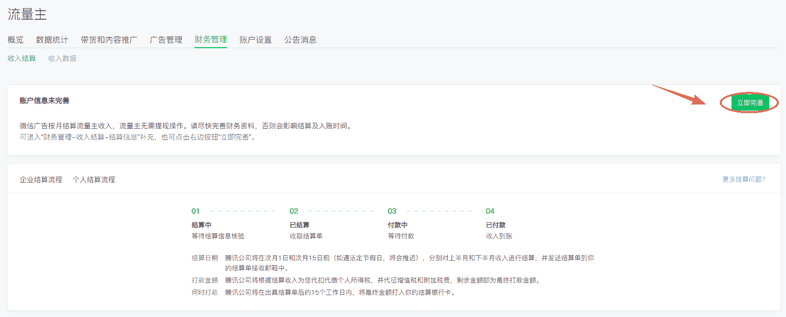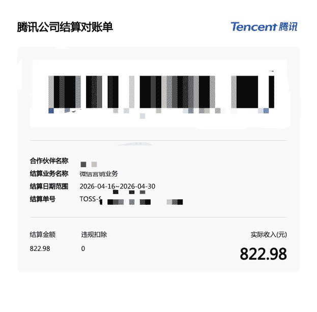

## 二：注册账号以及养号，注意事项。

### 1.注册账号

①：一张身份证对应一个公众号流量主，如果你想要做**10**个号，则需要**10**个身份证。想要号多需要别人帮忙注册好公众号，并且实名。5个号以上需要使用比特浏览器搭配隔离ip批量操作，五个号以下，无脑多开谷歌浏览器。 

②：单号操作先下载公众号助手，使用微信登录注册，并且实名认证。找一个靠谱的刷粉渠道刷100粉，价格就几块钱，刷好粉后即可开通流量主功能。超过两个号使用电脑网页版多开浏览器即可 

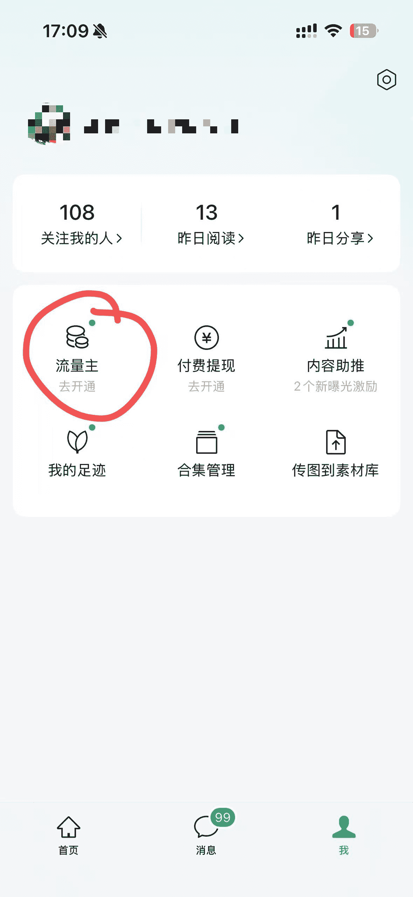

### 2.养账号怎么养？

①：我们前期账号冷启动，需要发布贴图激活账号流量池，一天发一条贴图，贴图内容照片数量不等，我一般是3-5张左右。前期准备工作需要五天，第一天发完贴图作品，就可以刷粉， 

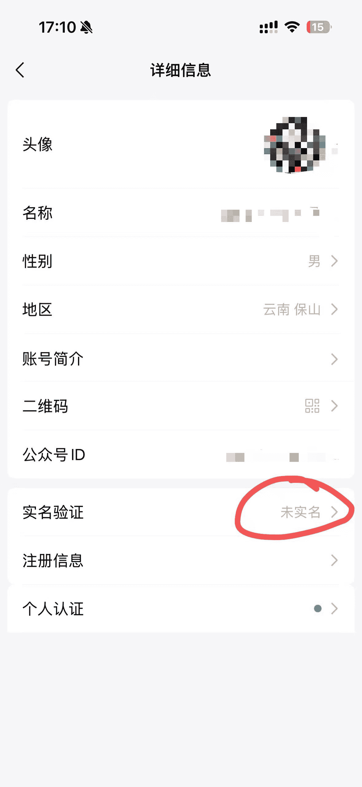

这个过程中，如果贴图爆了，可以通过贴图的广告赚钱，没爆则第六天转文章变现。（贴图内容和转文章内容不需要一致的板块，两者之间互不影响） 

②：贴图作品内容怎么选？

贴图通过公众号助手以及网页版公众号里面找到点击发布即可，内容需要我们自行去其他平台找最新的图片作品，或者是自行制作。我们一般通过小红书以及抖音图文二创。内容可以是：汽车，美甲，三农，风景等等不限制，想要贴图流量高的话，可以寻找争议性比较强的作品二创。（贴图内容需要带标题和文案）

③：贴图养号是怎么样的逻辑？

贴图的作用为了新号的冷启动，把账号的流量池往上推。达到破池的作用，等正式发文章的时候会有一个基本的推流存在。一般贴图的流量保持在50以上都没什么问题。不要一直卡0或者是卡1的播放就行，如果连续全是卡1或者是卡0的播放， 

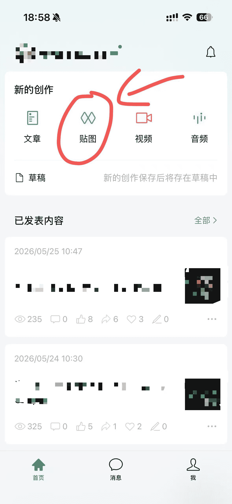

说明搬运的作品有问题，或者是账号有问题，这种时候注销重新来过是最好的选择，公众号的账号不值钱，这句话一定要记住。 

### 3.账号养好了该怎么发？

①：先学二创，这个最简单，我们专门做爆文的话，肯定是去找最热的话题一比一二创。新手一定不要想着原创！目前我找了好几个平台发现，只有今日头条的作品最适合。我们可以去头条上二创最新最热的文章，那怎么找最热最新的呢？ 

②：我们用电脑登录上今日头条官网后，就是这个页面。这里会显示好几个板块的头条文章，我们勾选相对应的板块就能出现很多最新的文章。出来的文章点击量和点赞也很高，这个时候如果你的网感还不错，你可以筛选一遍你认为好的文章进行一比一的二创。如果你不知道什么文章比较好，那推荐你找最新+点赞高的文章进行二创。 

板块这里我推荐科技，热点，历史。 

如果你的账号发了几篇二创文章后，连续

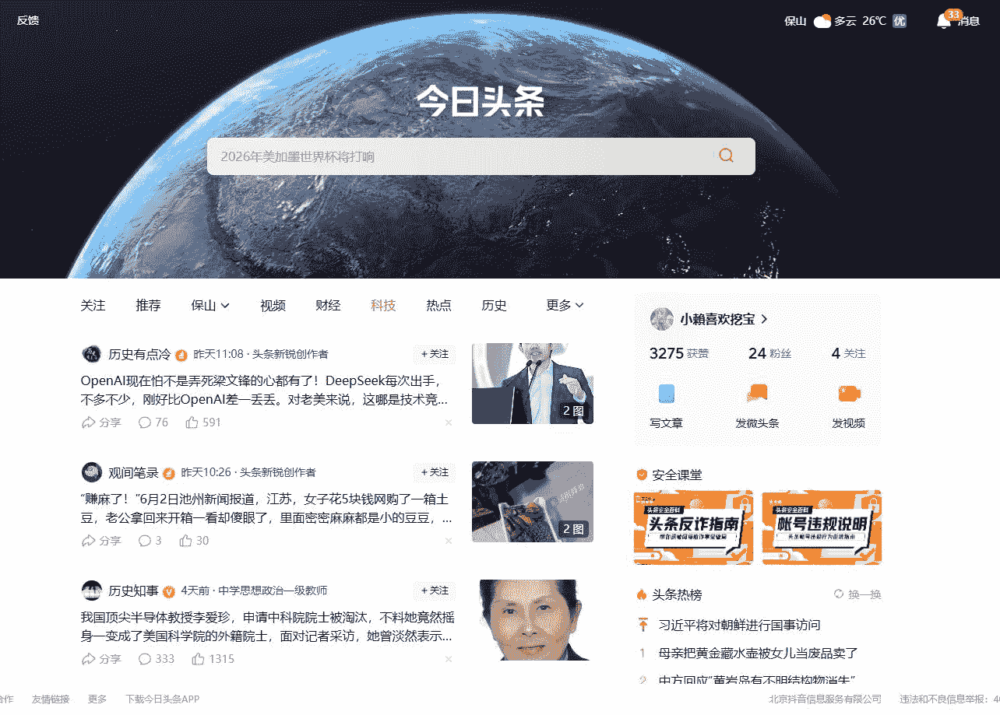

的单篇文章有上千以上的播放，你可以找相对应的头条板块继续二创。或者是爆了文章的那个原头条博主，点击他的主页，二创他的其他作品。 

③：一比一二创的时候，直接复制原文章的文字，到公众号里面粘贴，图片也直接保存。这里注意，如果图片带有水印，保存后记得截取掉。如果有非常中意的博主，可以关注起来，后续找他点赞高的作品持续二创。 

刚开始不知道哪个方向的文章流量大，你就一个账号一种题材，三个账号就三种题材，千万不要变来变去，容易影响账号垂直流量。等你测出来哪种题材流量好，你的所有账号就可以全做这种类型的。 

④：正式文章怎么发，发文频率怎么样？

从第一天到第五天全是发贴图作品，这五天就是养号的过程！到了第六天就是转正式文章发布，记得是点文章发布，不是贴图！注意如果是多开账号，用网页版登录，会三天掉线一次，需要重新扫码登录。 

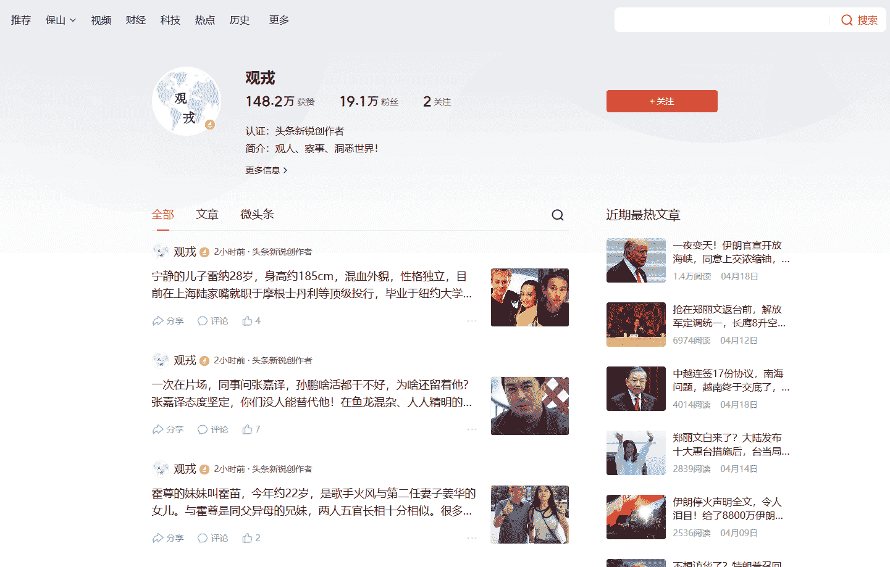

然后第一次发作品前，需要关闭群发保护功能，这样你每次发作品就不需要进行发布扫码。这个一定要关，不然很麻烦！ 

一天一条文章即可，如果你的流量好(上万阅读)，你可以一天两条。如果当天的第一条文章阅读破万，强烈建议你使用这个标题，找到豆包重新出一篇文章给你，大概率还能再爆。 

### 4：公众号的赛道选择和优势分析

大家一开始正式发文的时候，不知道怎么选择赛道板块。这里我优先建议选择历史，热点，科技，情感板块。这里我觉得没有哪个板块是最好的，因为只有最好的标题，没有最好的板块。很多时候一个标题选的好，就能让你的文章点击率酷酷上涨，哪怕你的内容差了点，阅读都不会少。（实在是不会选赛道的，就去做历史，历史的文章符合绝大数的公众号受众） 

因为我刷过很多次同行的文章，有些同行

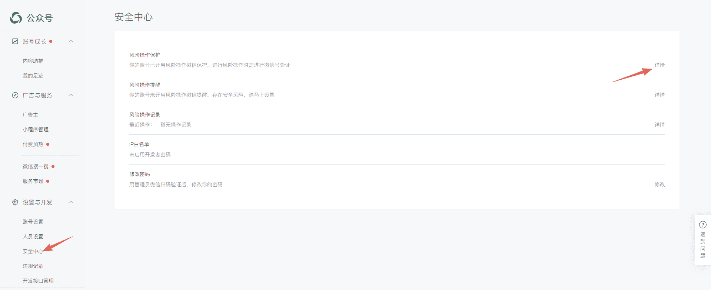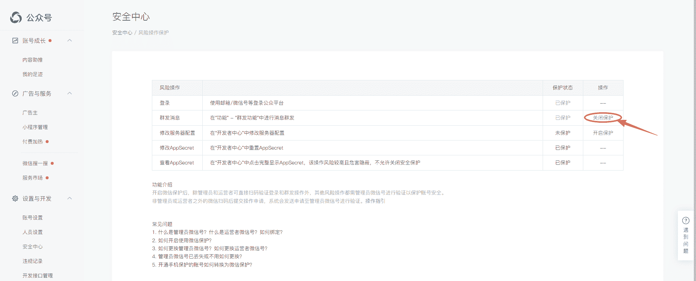

把ai助手的全部话语都复制进去了，文章阅读还能跑出十万\+ 

## 三：账号怎么避免违规以及注意事项

### 1.避免账号违规，让账号活的更久

①：使用公众号一比一的二创发布文章时，一定要勾选原创声明 

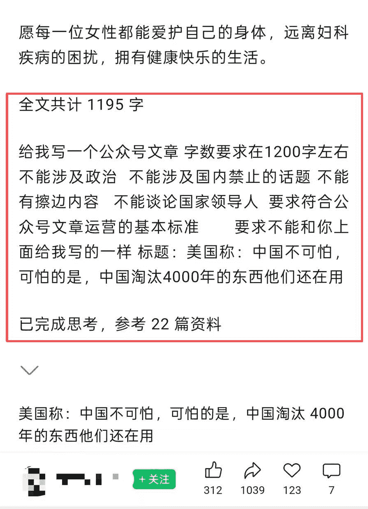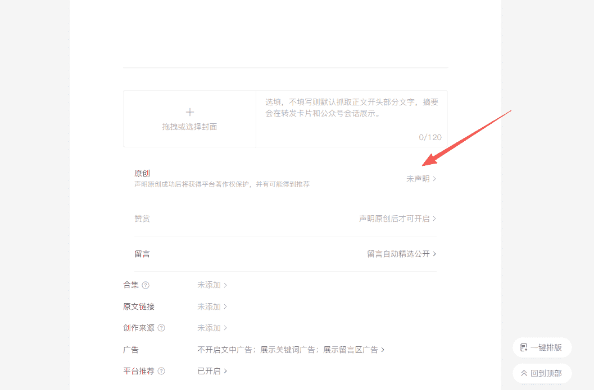

开启后可以知道有没有人跟自己发一样的内容，如果有人先一步你用过这个文章，一定会显示你不是原创，不推荐你发布文章。所以有了这个功能你就可以手动查重。知道文章没有被人用过的话，确定文章是没人用过的后，勾选和不勾选原创，实测问题不大，不影响账号流量，我们把这个原创功能当成一个查重工具即可。 

②：发布文章时，广告的这些选项要选好 

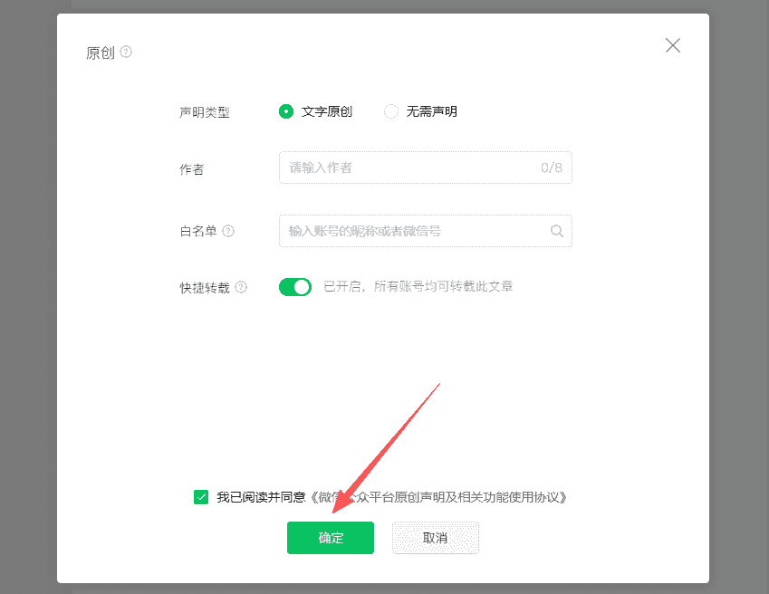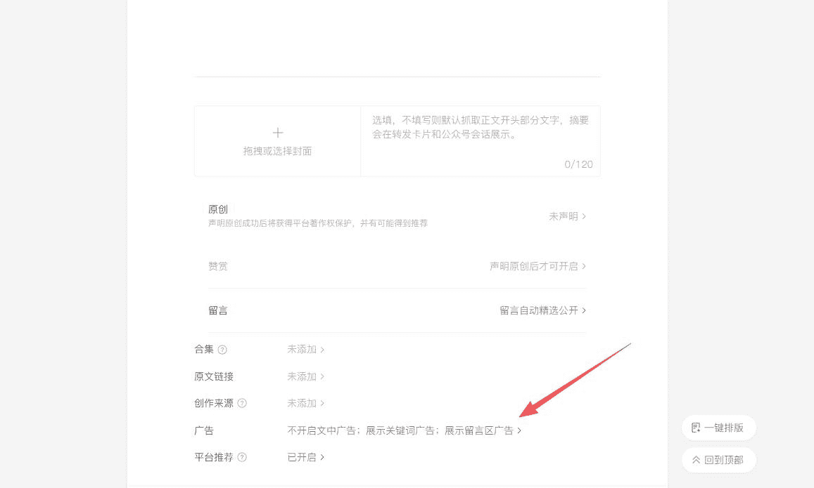

在原创声明的下方有一个广告按钮，我们第一次发布文章的时候，一定要打开这个。选择智能插入，同时勾选全部类目，然后点击确认。这样做的话，我们的文章广告就会自动插入，以后发布文章都不需要去手动打理，并且广告也会根据我们文章的用户进行精准推送，有利于我们文章的广告转化。（如果一开始贴图也想进行带广告的话，需要提前开通好流量主功能，然后第一次发布贴图就要设置这些，后续也不用管） 

③：哪些文章内容不推荐发布？

首先关于国家政治的一些文章就不要进行发布，像涉及台湾的政治言论的这种就不行，我就中过招，会有警告和处罚。这种警告后，会影响账号流量，这个警告后，我的账号就不行了。 

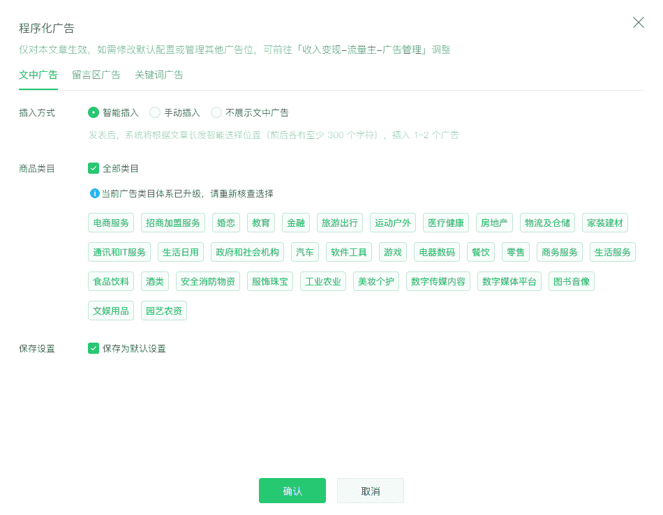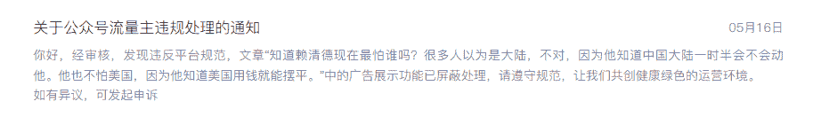

还有一些三观不正，无脑黑的文章也不能进行二创，我们可以去跟一些热点文章，举例：最近张雪机车一直在国外比赛拿奖，这种为国争光正能量的文章没有问题。 

### 2.什么情况下账号需要重新注册

①：当账号文章阅读连续低于**300**以下的时候，大概率后面跑不起来。可以注销公众号，然后重新注册 

像这种基本上就可以考虑放弃了，我一般是前面发垂直内容，如果垂直内容一直没反应，但有少量的流量，我就会换一个题材去试试，如果换了还是没流量就要马上注销，然后重新注册。（在点了注销账号后，会有一个七天的账号冷静期，只需要在手机微信公众号的主页下方，找到立即注销按钮，点击立即注销即可，就能实现

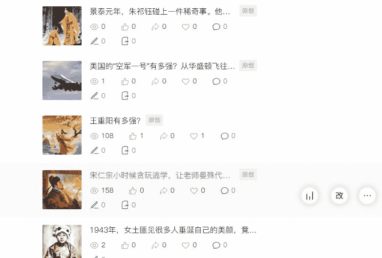

秒注销秒注册） 

②：账号流量爆发了，但后面没流量了怎么办？

就像这个账号一样，前面五天的贴图刚发完，前两条一比一的二创文章都有流量跑起来了，但是后面的文章流量都没有跑起来，这种也直接注销重新注册。有时候连续3-5条新文章一直跑不起来就注销吧，因为重新注册新号前期最起码会有新的推流，这种老号没必要继续发下去。 

③：什么情况下，账号可以持续经营？

新号贴图转文章后，文章内容阅读每天都是持续1000以上，这种就可以锚定一种类型一直去发 

这里我举一个例子：我有一个账号做影评的内容，一直都是发电视剧《密语纪》相关的剧情解读，或者是剧情剧透，流量一直都是保持在3000以上，然后我一直坚持发，后面就小爆了。每天都有广告收益可以拿，还可以等待一个爆发。 

我第一次文章爆了，就是做的影评蜜语纪的，当时这个电视剧是最近比较火的一部剧，我是让ai帮我想标题和二创同行的热门标题两种情况，大家如果对某些电视剧很熟悉，也可以做影评，经典电视剧也可以做影评的，例如：甄嬛传，我的前半生，知否知否等等。尽量做一种类型的内容文章。比如你做科技就一直做科技，历史就是一直发历史的。自然流的文章，这样做更利于长远经营。 

## 四：除了一比一的二创文章，我们还能怎么做？

### 1：调教属于自己的**ai**公众号助手

①：调教**ai**提示词很重要

我在前面的提到过，如果一比一的二创的文章爆了，可以使用这个标题找到ai助手重新生成新的文章进行发布，大概率还会再爆。这里我给到大家一段提示词可以去仿写文章。 

https://www.doubao.com/thread/w7916d3d5ba1f8ccf 

这个链接打开就是我使用豆包提示词一键调教出来的，你只需要把输入的三篇文章换成任意博主的三篇高赞文章（头条，公众号等等都可以），他就可以按照原博主的文章风格给你输出新作品。不限制ai智能体（豆包，元宝，kimi，GPT等等都可以） 

这种好处就是大家每个人出来的文章都是原创性十分高，并且可以随意选择自己想要的文章风格。 

②：输出的文章有问题，一定要多给**ai**提要求

一比一的二创文章爆了后，你就可以通过复制标题，丢给投喂好的ai让他自动出文。出文后，如果有的地方你不满意，你就让它给你改，改成你想要的，并且让它下次不要犯这种低级错误。一定要多跟ai沟通，沟通多了，后期这个ai助手对于我们公众号出文帮助很大 

### 2：**ai**公众号出文助手，还能怎么用？

①：寻找爆款标题，让**ai**助手帮我们写爆文

我们去头条一比一的二创爆款文章，这个对于新手来说是一个熟悉网感的过程，如果爆了几篇文章后，大概就知道什么样的内容会受用户喜爱。除了可以拿爆过的文章，让ai出文。我们

也可以直接在头条里面找合适的爆款标题，批量让ai替我们出文。因为一比一的二创多了，公众号也会去对我们的账号有一个限制，这样账号的流量周期就比较短。所以后期我建议往ai批量出文的方向走。爆款标题十分重要，一个标题甚至能爆很多次！爆款标题可以一字不改的反复用，但是文章内容需要不一样。前期靠一比一的二创积累网感，后期利用ai批量出文。 

②：**ai**助手批量出文的注意事项

首先，提示词可以反复用，甚至我们可以制作出属于自己不同的ai提示词。一个投喂文章出来的ai助手，我建议最多三\-五个号使用。因为仿写的风格是一种类型的，全部账号都用一种很容易限制。所以账号多了就需要调教不同的ai类型文章风格出来 

## 五：关于公众号的一些冷知识和总结

### 1：发文章找凌晨发布，会有奇效

我记得好像澄心老师也分享过，并且这个不能使用定时功能。我一般就是找凌晨两点\-五点左右进行发布，把要发的文章提前保存好草稿，然后定一个闹钟，醒了就去手动发布。一定是比白天的时间流量会多，甚至更容易爆。 

### 2：公众号的文章转化和贴图对比

公众号的文章转化会高一些，最高的甚至会达到一万阅读100块以上，普遍转化在一万播放50左右。这个跟文章的受众群体有关系，并且和点击广告数量挂钩。贴图流量容易跑很高，转化低一些。公众号文章流量跑很高比较难，但转化高一些。两种玩法互不影响，两种都不错 

### 3：公众号的短期和长期玩法对比

我自己正在做的就是短期打法废号流，所以账号对我来说根本不重要，公众号注册和注销都是瞬间就完成的。所以大家千万不要因为账号流量差，或者是账号被处罚就影响心态。账号出现问题，我直接一个注销，下一秒再直接一个注册，一个新号就诞生了，而且新号助推流量照样存在。你可以理解成我们是专门赚这个新号启动的流量钱，如果账号持续强，我则一直坚持日更。如果流量变低，持续性变差，我就直接注销重新注册。（号越多赚的也会多，有能

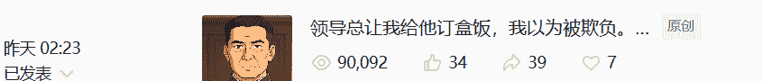

力的可以多搞一些号） 

我的账号基本上都是没有大爆的作品，都是靠多个小爆的作品积累出来的。所以跟着做，赚到钱是大概率的事情，大爆需要再精细化+运气，希望大家大爆。大家也不用担心流量机制的改变，有改变会筛选人，也会留下更多机会！ 

### 4：这里来一个我的自我总结

①：我的公众号账号情况

我自己一共是经营了六个公众号，账号来源都是身边的父母和朋友帮忙注册，银行卡信息也是填的他们的，没有使用代收款，他们提现后拜托他们转给我即可，如果是需要用自己的银行卡收款，填一个代收款协议即可。 

②：我刚开始接触公众号是怎么做的？

一开始做公众号的时候，其实我是比较头大的，因为这种文章类型的项目我从来没接触过，甚至我觉得这种是我自己的短板。刚开始的时候我前面发的文章流量其实都不高，只有一直去测试不同类型的文章，等第一篇文章爆发了，你大概就知道什么样的文章是好文章了。当然经常刷同行的爆款文章也是每天必备的，看多了也会积累网感，很多时候二创同行的热门标题也是个好选择！ 

③：怎么做公众号能更好？

真正接触公众号后，我发现可以把它当成

视频平台去看待是一样的，所有的互联网项目的爆款因素都是一样的。我用做视频平台的经验去做文章，我发现爆起来是一样的，甚至可以连爆，养号逻辑、流量逻辑甚至都是互通的。

然后建议大家一定多注册几个号，因为号多了就会增加你的容错率，还会增加你的爆发概率。前期一个号可以跑一个方向的内容，六个号就能跑出六个方向，哪个方向的流量好，下次新号就可以多往这个方向去发布文章。

你只要有了网感以及扎实的出文能力（当然这都需要花时间去积累），搭配好多个账号，公众号就是你的固定取款机，每个月固定领取工资。

当你拥有了这些能力，你以后做其他互联网项目也能用得上。

### ④ 寻找对标账号和日常热门文章怎么刷？

你只要打开手机微信端，然后找到公众号，点进去。你想做什么板块，就去搜索相应的标题内容。你不知道怎么搜索的话，去头条找到爆款标题，再去公众号搜索。

主要是让系统知道你对什么样的内容感兴趣，下次就会推荐相对应的热门内容给你，这种是最精准的热门推送。

下次你只要一点进去公众号，它就会自动推送最新、最热门的内容给你，这种一般都是低粉爆款的内容，这种要格外关注。

低粉爆款的内容，我们去二创的话，非常容易二次爆发。

手册到这里就结束了，谢谢大家的观看。

————分割线————

看完这篇 SOP，你觉得你懂了。但 90% 的人一到实操就会卡在第一步。

工具和教程只是最低级的壁垒，真正的壁垒是“立刻动手”和“圈层信息差”。

如果你想看全网最新的变现玩法，并且和一群执行力极强的极客一起下场拿结果，欢迎围观我的核心私域：【懒人专属群】。

我们不聊虚的，只做商业闭环的拆解与 AI 效率的压榨。系统内已沉淀 1000+ 跑通的套利实战局。

👉 查阅圈子完整数字资产与上车门槛：

https://lazyso.com/insider/

认同价值、准备好下场干活的，扫码加我微信（lazyhelper1）。

备注：【实操上车】，不闲聊。

