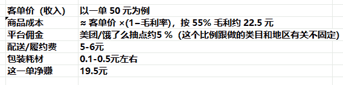
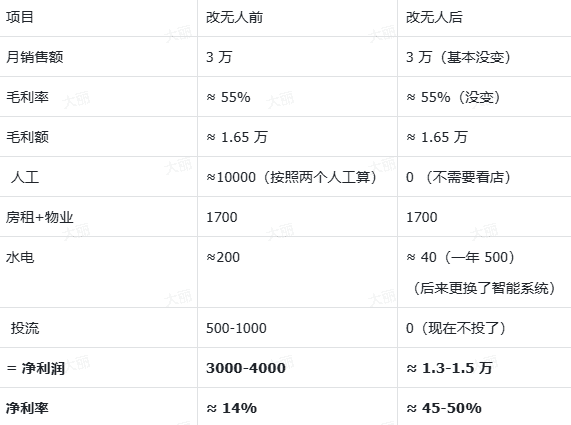

公众号懒人搜索，懒人专属群分享

做宠物用品无人超市，每周工作 **3** 小时，年营收做到近 **40** 万的复盘与心得

260618 副业SC 精华

整理：公众号懒人搜索，懒人专属群精选

懒人微信：lazyhelper1

不适合开店的人，把店开成了“不用看”的店：从传统宠物店到宠物用品无人超市，我把净利润从 15% 干到 50%。

大家好，我是鑫鑫，是名连续创业者。目前在工业品紧固件领域创业第 6 年，宠物用品无人超市创业第 4 年。今天我要讲的项目是我在加入生财之前做的副业，目前店铺也在正常运营中。2022 年我老婆大厂裁员，又赶上怀孕，我们就想自己搞点小生意，误打误撞进了宠物赛道，22 年开店，23 年改无人模式，到现在店铺运营了 4 年多。

这篇文章适合有本职工作想搞副业现金流的、宝妈、有开店梦想的、对无人零售/即时零售感兴趣但不知道怎么落地的人——这套东西我们是真金白银趟出来的，不是纸上谈兵。

我们的店铺是一家开在苏州、专做线上单的宠物用品无人超市，没店员、没收银。我老婆一周进行 1—2 次补货，平时让它自然流量运转（当然在前期刚开始做的时候，是有进行活动流量推广的）。目前专心在本职工作和 AI 赛道上，所以没有再对其进行更多时间的投入，这店就当个挂着不用管的现金流。

单量主动从巅峰 800 多单收缩到现在 200—300 单，但净利润反而更高（后面讲为什么）。如果有开店想法又不想大额投入的，可以多留意这篇内容。其实宠物用品赛道走通的话，在此店铺的基础上结合 AI 做电商也是很有优势的。

先说结论：

同一家店，同样的位置，同样卖宠物用品。改成无人模式之前，每天得有人在店里看守，月销 3 万左右，毛利 50%—60%，看着挺美，但扣掉我老婆的工资（自己的劳动力记得也不要忽略）、员工的工资、水电、推广，每个月净利润只剩 **3000—4000**，净利率 **15%** 左右。

改成无人售卖之后，每周加起来就几个小时补货，销售额没怎么变，净利率干到了接近 **50%**，人力还得到了解放。因为除了推广费、低廉的房租费，几乎没有成本了——电费一年才 500 块。当然房租这块，你也可以让其趋于零，使用家中闲置仓储空间、公寓写字楼的一个小房间等，都可以进行这个项目（当然如果是长期有人呆的地方，无人化这一步都可以省掉了）。

自从我们将模式改成无人化之后，我老婆从此不用去店里了，员工也不需要了，我们俩旅游的频次反而上升了。说实话，我们俩是待不住的人，根本不适合开店，结果把店开成了不用看的店，哈哈哈哈。

这篇帖子把整个过程复盘一遍：怎么入场的、踩了哪些坑、无人化是怎么被一次系统 bug “撞”出来的、这个模式背后的账怎么算，以及如果你想抄作业，最小启动清单长什么样。全是大实话。

（示意性图片）

### 一、为什么入场：并没有特别考察赛道，是被生活推进来的

我有本职工作，做得还行，是做螺丝紧固件工业品行业的。转折点是 22 年，我老婆碰上大厂裁员，整个部门被端了。加上没多久我老婆怀孕了，也没办法马上找工作了，所以就萌生了想让我老婆自己做点小生意的念头。

当然说到这里，感慨一下这个项目其实真的蛮适合宝妈人群的。还有，如果家中有行动方便又有一定认知的老人，也可以让其辅助我们做这个项目，给娃挣出每个月的生活费和第二份养老金是完全可以的。

那段时间其实我们想过很多生意方向，开西点面包房什么的都琢磨过。后来是因为疫情期间在家，我们自己养狗，喜欢给它做点健康狗零食，随手在群里发了发，发现居然有人也需要（这一块属于宠物自制零食项目，是可以单独做一个创业项目发展的，虽然我们后期没有延伸，如果有感兴趣的小伙伴也可以分享经验）。

宠物服务类我们很快排除了。调研下来，一只狗洗澡、剪指甲、吹毛平均要 1 小时，一个人累死一天 8 小时最多洗 10 只狗——这个生意的天花板是用体力封死的。所以我们瞄准了宠物用品方向。

也许有小伙伴觉得宠物用品价格已经非常透明，竞争激烈。是的没错，如果你是单纯地做宠物用品电商或者门市型宠物用品超市，确实很卷，但是如果做即时满足性生意，还是有市场空间的。外卖的即时送达，相较传统电商的快递物流时效性，还是很有优势的。

确定方向后我们去了趟深圳，了解了一些当时在深圳市场做得很不错的竞对品牌，又去参加了一些宠物行业展会，逛了几圈，了解了行业发展前景，回来后就开始找门面。（当时一些加盟商品牌还没有入驻到苏州的。如果你对这个项目感兴趣，看到这里的时候，你就可以打开手机搜索一下周边的宠物用品外卖店，看一下是否饱和。）

#### 供应商对接

有关供应商这一块，很多伙伴可能会担心。我一开始也是想着我要如何跟厂家合作，拿到很好的价格优势。但其实你实际操作下来完全不用担心：你一旦开了线上门店，供应商们的电话就纷至沓来了。

因为这个项目前期涉及到很多的产品 SKU，几百甚至上千个品。如果你每个都对接源头厂家，是非常费时费力的，而且由于前期在试品阶段，你的拿货数量很容易达不到厂家的要求，更别谈价格优势了。找品类丰富、有价格福利优势的本地大型批发商，是最适合起步上手的方法。后期有一些品的动销不错，再去找厂家资源也为时不晚，更能做到心中有数，手中不慌。

#### 选址思路

选址我们的思路是：好地段，差环境。

店在 3 楼，基本没有上门客流（此处说明一下，有的地段犄角旮旯里一楼位置也是不错的，我们是为了地方大，且有阁楼存储空间才选的 3 楼），月平均一天也就 4—5 个人上门——但没关系，我们做的本来就是线上单，线下单就当做惊喜好了。

第一家店房租 1.8 万（押金等一次性投入），物业费 2000 多，进货 3—5 万，甚至 1—2 万左右就可以搞定（这个可以根据你的场地大小、产品 SKU 的选择量而定）。当时想得很简单：成本就这么多，能赚就行；不赚钱大不了货低价给周边的人消化掉，损失个房租。把最坏的打算考虑到，觉得能接受就可以开干！

当时第一个月就做了 3 万多销售额，毛利 50% 左右。我当时就觉得，这是个好生意。

顺手说个开局就踩的坑：美团代运营。几乎啥也不干，啥都是你自己干，他让你干啥你干啥，最后发现有他们没他们一个样。第二个月我就不请代运营了。后面慢慢自己摸熟了运营，比想象中好很多。

还有一件当时觉得烦、现在看是最值钱的事：做私域。当时经营了一年多，沉淀了将近 3000 多个精准养宠顾客。短时间内回本，靠的不只是平台单，还有这批私域复购——到今天我做其他生意，这部分私域流量也起到了很大的帮助。

### 二、转折：美团平台亲自下场，周边同行从 **4** 家卷到 **20** 家

生意跑顺了之后，问题来了，而且是两个问题一起面对。

第一个是：人工的问题。

因为我在经营自己的紧固件公司，不可能一直管店，店主要是我老婆天天打理。我们选择的区域的特点是晚上单多、白天没几单，所以找了个朋友值晚班，住店里楼上（当时选的店是有小二楼的）。

两个人的配置——我老婆白天进货理货，朋友晚上派单发货——基础工资加配送提成（有的时候根据订单情况也会选择自行配送，部分骑手配送，但其实白天的订单不多）。算上水电、平台费、损耗、投流额每月 1000—1500 左右（有的人为了后期赚加盟费，投流就更高了），这些固定成本也不算低。（这部分是自费的投流费，平台每月也会有一些免费的流量活动可报名，效果还是不错的。）

第二个是：行业卷的问题。

真正的转折点是美团自营宠物用品店的出现。外卖平台官方亲自下场，那就是个信号弹。它出现之前我们周边是 4 家同行，它出现后犹如雨后春笋，一路卷到 20 多家。

这时候我们知道：必须做减法，不管怎么减都要减。

刚开始思路是错的。我们想减库存、减品类，从库存上减轻压力。后来跟我老婆反复验算发现，这样减下来的成本微乎其微，反而进货频次变高、运费变多，进货量小了单价还上去了，客户对产品的可选择性也少了，订单量自然少了，综合成本不降反升。

那段时间为了把账算清楚，我自己学编程写了个宏文件做进销存统计（当时 ERP 又繁琐又贵，也还没有 AI），统计哪个卖得最多，进货的时候有数据撑腰可以精准多囤，省下不少成本。这个习惯——用工具替代人力——现在回头看，就是后来无人化的伏笔。

减库存不行，减房租？附近调研一圈，发现我们这个位置已经是最合适也最便宜的了。

最后只剩一个方向：减人工。把人砍掉，工资省了，水电跟着降（没人后空调水电费就只剩电灯的电费了），一个月能省 5000—7000，如果算上两个人工就要 10000 了（万恶的资本家，哈哈哈哈）。利润一下就上去了。

但没员工看店怎么办？刚开始就是我自己上，每天下班去店里待着，很累很麻烦。

（示意性图片）

### 三、无人模式不是我设计的，是被一次 **bug**“撞”出来的

两件小事成了转机。

第一件：忘带钥匙。

店门原来是铁锁，我特别不喜欢，因为家里全是电子锁。有一次很着急去店里配货，但是发现没带钥匙就去店里了，结果在门外那个恨呐。第二天我就买了个磁吸电子锁装上——手机远程或者密码都能开门。当时只是图方便，没想那么多。

第二件：旅游路上的“突袭订单”。

有一次我们出去旅游，门店设了歇业保护。不知道是系统问题还是时间设错了，返程最后一天，订单一直进来。因为是自动接单，骑手到了门口就打电话。我们这才意识到店被迫“开业”了。

人在路上，货在店里，怎么办？我们做了个大胆的尝试：远程开门，让骑手自己进去拿。店里有监控，加骑手微信打视频，看着他拿，一会儿就搞定了。一路上就这么做成了好几单生意。

那一刻我们突然反应过来：这不就可以全自动了吗？根本不需要人看店。只要回去把货架上的货按顺序排整齐、标好货架号，让骑手自己进来拿就行了。

我们一回到店里就开始整改理货。所以说，还是要多出去走动走动、旅旅游，放松了灵感自然就来了！

无人系统的具体配置，比你想象的便宜得多：

- 磁吸密码电子锁，网上买的，支持手机远程开门；
- 店内监控，24 小时记录；
- 后来干脆在网上上一整套无人系统，2000 块钱以内搞定：骑手扫码进门，货架从 A 到 Z 编号，货架上的盒子从 1 到 100 编号，一个盒子一款产品，系统亮灯指引，骑手照着灯找货就行（这个系统如果放在现在使用，成本会更低）；
- 搭配上智能开关，手机远程也可以控制开关，电费一年 500 块（注意是一年不是一个月）。

流程上的演化：最早是门口挂牌子让骑手加微信 → 后来固定加几个熟悉骑手的微信（熟人取货快、事还少）→ 再到系统亮灯自助拣货。我们一般还是会全程看一眼视频，因为偶尔有骑手粗心漏拿。如果你做的品类少而单一，完全可以 24 小时纯自助，看都不用看。

很多人最关心的：不怕东西被偷吗？

说实话，这么多年，除了客户对着摄像头各种讨价还价，真没遇到过偷窃行为。我的理解是，防盗靠的不是技防，是人群筛选：愿意给宠物花钱买零食和粮食的人，人群整体素质还是很高的。骑手更没必要——24 小时监控、平台实名登记，投诉一下得不偿失。

当然这是宠物超市的特殊性，如果你做百货超市，可能真有人起歹念，这点要自己掂量。

订单从哪来：美团、淘宝闪购（以前的饿了么）、京东到家，再加上微信私域老客复购，四条腿走路。

人现在干什么：看看缺什么货补补货、拆拆物流包裹、摆放整齐，再买点水放门口给骑手。就这些。

单量方面，最早一个月 500—600 单，巅峰冲过 800 多单（这么多年就那一个月——24 年年初，我们提前判断过年快递停运是最好的窗口期，做足了备货准备，那个月忙得不行）。现在主动收缩到 200—300 单，但经营利润反而高了，后面会细说。

### 四、看透模式，不盲目卷低价

**20** 多家在卷，我们决定只赚钱，不赚吆喝。

现在周边 20 多家在竞争，很多家都在赔本赚吆喝。套路我们看太多了：低价冲数据 → 做个品牌拉加盟 → 倒闭 → 换个牌子再来一轮。基本三个月换一批商家。连美团自营后来都不做了——为什么？就是因为不赚钱。9.9 的猫砂卖得起劲，结果发现单子全是来薅猫砂的。

我们也交过这个学费。刚开始学人家 9.9 起送，搞了一两周发现连骑手配送费都覆盖不了，果断改回 48.8 起送——反正你随便买点也得这个数。

所以我们现在的打法是：不做付费活动，不卷低价，只做利润款和刚需款。推广在 20 多家混战里就是浪费钱，干脆不投。单量从 600 降到 200—300，但净利润反而更舒服。

记住一句话：我们开店的目的是赚钱。如果你是抱着圈钱做加盟的心态，那你先看看前期这么烧钱你扛不扛得住。

（我们现在精力慢慢往 AI 方向转了，这个店就当个不用管的现金流，在几乎不怎么打理的情况下，还是非常省心的。）

### 五、底层逻辑：为什么这个模式现在能跑通

复盘下来，我认为踩中了三个趋势：

第一：即时零售平台把“到家”的基础设施铺好了。

美团、淘宝闪购、京东到家，配送是平台的事，小店不再依赖路过的人流。这就是为什么“好地段、差环境”成立——你买的是地段的配送辐射范围，不是门口的人流量。

我们店在 3 楼，一个月就 4—5 个人上门，但线上能做 200—300 单——这事放十年前根本不可能。配送是平台的事，我买的是地段的辐射范围，不是门口人流。

第二：人工成本只会越来越贵，小生意请人越来越不划算。

我们砍掉人工，一个月省 5000—7000，真的是很大的一笔成本优化了。对于小店来说，人工就是利润的生死线。钱尽量不要花在可有可无的人工上，人是最贵的。

第三：智能硬件便宜到普通人随手可得。

电子锁几百块，整套无人系统一两千元左右（有更贵更好的，等生意好了可以更换）。十年前这套东西是资本玩的“无人零售风口”，现在是夫妻店标配价。

而我们能活下来、隔壁卷死一批又一批，核心差异说穿了就四个词：地段、私域、成本控制、选品。再加一个底色：我们从头到尾目的明确——赚钱，不做数据来圈钱。

### 六、最容易踩的坑：不算账

单独拎出来说，因为这是我见过死得最多的原因，我们自己也经历过。

有个阶段我们也稀里糊涂：没货了就进货，推广没钱了就充钱，电费到期就交，工资该发就发。后来一算，有的月份居然是亏的！从那以后每一笔都过账。我那个自己写的进销存宏，就是被这个逼出来的。

我们具体是怎么算账的？算账我们分三层，从一单，到一个月，再到拿账做决策依据。

第一层：一单进来，先算这一单到底赚不赚（这决定你起送价定多少）。

我们当时看到别的竞对 9.9 起送，单量起得特别快，所以我们也学人家 9.9 起送，搞了一两周，照这张表一算才发现：**9.9** 连货物成本 + 佣金 + 配送费都打不平，卖一单亏一单，全是来薅猫砂的。果断改回 48.8 起送——反正你随便买点也得这个数。

起送价不是拍脑袋定的，是用这张单笔账倒推出来的。

第二层：一个月结一次账，这张表才是真相。

这是改无人前后的对比，你一看就懂无人化到底改了哪几个数：

（此表格数值是 2023 年左右数据参考。）

看明白没有：毛利一分没多，我就砍了三样——人工、水电、投流，净利率从 **14%** 干到了接近 **50%**。这就是为什么我一直说：毛利率高不代表你赚钱，净利率才是命。

我们没多卖一分钱，只是把吃掉毛利的成本砍掉了。而最贵的那块成本，永远是人。

第三层：账不是用来记的，是用来做决策的。

算清楚之后，这几个决定就有数据撑腰了：

1. 选品：不看哪个卖得多。9.9 的猫砂走量但不赚钱，毛利款慢但实在。我当年写宏、现在丢给 AI，就是把这两个数拉出来排序，毛利低又压货的直接淘汰。
2. 要不要投流：在 20 多家混战的区域，这个比值算下来就是亏，所以我们干脆不投（这点要根据实际情况而定，不同的活动参加效果也会不同，有的一些免费流量活动也很香）。
3. 选址：一年赚 15 万，房租 8 万和 2 万，中间 6 万就是净利——选址省的每一块都是净利。
4. 该不该上无人工具：把“能砍掉的人工 + 水电”算出来，那一块约等于你净增的利润。我们就是这么算明白、决定一步到位改无人的。
5. 美团代运营：别交这个智商税，他干的事你自己都能干，只有自己才是对这个事情

公众号懒人搜索，懒人专属群分享

最上心的人，别想着当甩手掌柜，指望别人能包揽一切。

- **加盟**：不要被加盟商忽悠，这个生意根本不用加盟。它赚的已经是相对省心的钱了，你想更轻松不麻烦，几乎全程不用自己管，哪有这么好的事。你想着加盟别人省事，而别人想着是你的加盟费、货款费、运营费等。

- **9.9 起送引流**：连骑手费都不够，纯属给平台和羊毛党打工，而且长期下来你会越来越没有信心，觉得劳动毫无价值，进而丧失继续经营的动力。

- **一上来囤大货**：你根本不知道你那个地段区域什么品好卖，前期选品的时候要参考整体的市场情况，有一些知名度高的品牌即使没啥利润也要上架，因为基础的销量数据还是要有的。但是后期慢慢积累了一些客户，你就知道了你这个片区哪些品更受欢迎，甚至有些品是人无你有，你的客户粘性高，别人根本卖不动的品。

### 七、SOP：如果你想从 0-1 复制，照这个清单走

这是我第一次把流程整理成 SOP，按我们实际走过的路写的，你照搬前结合自己区域情况调整。

#### 第一步：调研（决定生死的一步，至少花 1-2 周）

- 画一个 5 公里辐射圈，数清楚里面有多少个小区；
- 摸清人群画像：高收入人群、打工族、还是带娃的老年人？人群一定要搞清楚，它决定你的选品和客单价；
- 数清楚 5 公里内有多少家大大小小做线上的同行，最大的是哪家、什么打法；
- 看小区入住率，入住率低的新区慎入。

#### 第二步：选址（好地段，差环境）

- 要的是地段的配送辐射能力，不是门口人流，所以 2 楼 3 楼、写字楼里、老破小商铺都可以；
- 房租往死里压。给你算笔账：一年赚 15 万，房租 8 万和房租 2 万，多出来的 6 万就是净利润；
- 必须是有正规门面/可注册地址的，不然平台入驻和后续成本会很高。

#### 第三步：首期投入（参考区间）

- 房租 + 押金：按当地行情，往低了找；
- 首批货：2-5 万足够，多 SKU、少库存，用宽度换试错空间；
- SKU 控制在 400-600 个（不同颜色也算一个 SKU），400 以上平台有流量扶持；
- 无人设备：电子锁 + 监控 + 无人系统，2000 块以内全搞定（放在现在购买成本会更低）；
- 智能定时灯，电费可以忽略不计。

#### 第四步：平台上架与起单期

- 美团、淘宝闪购、京东到家全都上，多平台分摊风险；
- 起送价别学人家 9.9，按"随便买一单的真实客单"定，宠物品类建议至少 30+ 起送，考虑到成本的同时，这样你每来一个订单都是开开心心的状态（而不是为薅羊毛来的客户犯愁）；
- 起单期可以适度做活动拿基础销量和评价，但设好止损线，数据起来就收；
- 自己运营，不要请代运营。

#### 第五步：转私域（决定你能活多久）

- 每一单都尽量想办法沉淀到私域，后期进一步加强信任感产生复购；
- 上门客送点小礼品，建立好感；
- 私域复购是你不投流也有单的底气，也是你以后做其他生意的资产。

#### 第六步：无人化改造

- 货架 A-Z 编号，盒子 1-100 编号，一盒一品；
- 电子锁远程开门，监控全覆盖；
- 前期加固定骑手微信、视频看着取，跑顺了再放开自助；
- 数据化：哪怕用 Excel，也要把销量、毛利、复购记清楚，照数据进货。

#### 第七步：每周维护（无人化后你的全部工作量）

- 补货、拆快递、理货架；
- 看数据、调选品，淘汰不动销的 SKU；
- 有的骑手会不太乐意无人取货的繁琐操作，将心比心，可以在店里放点水和零食香烟（写好自觉标语，可以防止他们一次性拿走）给辛苦的骑手，下次骑手会更自愿主动接单（刚开始会遇到有的骑手看到无人店铺会拒接，配送时间就会拉长）。

### 八、这个生意适合谁、不适合谁

#### 适合人群

有本职工作想做副业现金流的；夫妻搭档想干点实事的，有开店梦想奈何其他实体店类型投入太高的；愿意算账、愿意做长线生意的。技能门槛其实不高，会用 Excel 算账就够了，不需要会编程（我写宏是因为那时候没有 AI 工具，现在你让 AI 帮你做个简易进销存分分钟的事）。

#### 不适合人群

想躺赚的（前期理货、盯单一样都不轻松）；想加盟当甩手掌柜的；不算账凭感觉做事的；指望低价跑量做大做强拉融资的——这个生意的终局就是一台一个月安静给你赚几千到一两万的现金流机器，不是什么性感的创业故事。

最后，这套思路不一定非得做宠物用品。零食超市、成人用品超市等，逻辑完全通用——线上单 + 好地段差环境 + 无人化 + 私域。重新让我做一次，我认为依然有机会，宠物市场发展空间还在上升，关键是前期调研要做扎实。

一句话送给想入场的朋友：

开店容易，守店难。销售额是面子，净利润才是命。别为了做数据开店，要为了真正赚到钱而开店。

希望大家日进斗金～～

————分割线————

看完这篇 SOP，你觉得你懂了。但 90% 的人一到实操就会卡在第一步。

工具和教程只是最低级的壁垒，真正的壁垒是"立刻动手"和"圈层信息差"。

如果你想看全网最新的变现玩法，并且和一群执行力极强的极客一起下场拿结果，欢迎围观我的核心私域：【懒人专属群】。

我们不聊虚的，只做商业闭环的拆解与 AI 效率的压榨。系统内已沉淀 1000+ 跑通的套利实战局。

👉 查阅圈子完整数字资产与上车门槛：

https://lazyso.com/insider/

认同价值、准备好下场干活的，扫码加我微信（lazyhelper1）

备注：【实操上车】，不闲聊

