公众号懒人搜索，懒人专属群分享

新手公众号贴图进阶**：**如何从偶然有流量到稳定持续增长的保姆级实战手册

260618 副业SC 精华

整理：公众号懒人搜索，懒人专属群精选

懒人微信：lazyhelper1

你好，我是澄心。我是一家艺术培训机构（美术书法）主理人，加入生财5年的时间啦。

自从二月中旬开始尝试贴图号，做出了110W+浏览量的贴图之后，就一直在深耕贴图和公众号，自己也运营了10个公众号。

这是我的第一篇贴图入门精华帖，好多圈友都跟着帖子一起做，也都陆陆续续挣到了第一份收益。

从线下教培到线上贴图：一个美术老师的公众号流量主实战复盘（附20天4000元数据）

下边这些都是生财圈友来报喜的信息，希望可以帮助你增强信心。

也有很多新人圈友开始尝试做公众号贴图，自己摸索时遇到了以下的情况：

- 发出去2小时一直是0播放，不知道要怎么办？
- 不知道哪些内容能做，哪些内容会被限流？
- 明明你觉得自己内容不错，一直卡在100播放无法突破？
- 你尝试了很多的不同的领域，发现每一个都到不了1W+阅读，始终卡在1000左右？
- 不知道为什么，自己发的贴图总是被判低质量内容，从千播跌到个位数播放？

从上次发帖到现在，这一个半月的时间里，公众号发生了非常多的变化。

个人公众号开始不允许绑定其他人为运营者、好多以前好做的赛道开始审查严格、很多新号0播放、个位数播放。

每天都会有人来向我报喜，也会有人来向我吐槽账号又被平台限制了。

如果说，上一篇是一个入门手册，那么这一篇就是行动指南。

这一篇，主要针对以下几个问题来帮助你提高自己的账号生命力，减少违规限流：

1. 已经开始做了，但是一直没有流量，大概持续了一周至一个月（50播放量以下）。
2. 开始做的时候，流量很好。小爆之后，立刻就没有流量了，卡在了100到1000之间，始终无法突破。
3. 还没开始做，卡在了选赛道上，一直没有找到合适的赛道，始终无法开始。
4. 草草选了一个赛道，结果一直不温不火，不知道是应该继续深耕，还是要重新开始。
5. 想要重新开始，不知道是把内容全部删除还是把账号注销重新注册。

以上这些都是这段时间大家看了我的帖子动手实操，给我的反馈、希望能够解决的问题。

这些问题占据了新手起号所遇到的90%的问题。

如果你有以上的问题，那么继续往下读，我相信你是可以找到答案的。

注：本文中的大部分内容、结论为我和生财圈友吴泽承学长、张集慧慧哥指导和带领生财的伙伴一起探索、尝试得到的结果，其中用到的大家的数据，我会做标注。并非是我自己一人的成果，希望可以给后来做的伙伴一些好的方向性指引。

这篇文章的目录：

1. 关于起号的细节问题（怎样减少违规并多增加号）
2. 如何选择你可以做的赛道？（包含二创的方法）
3. 流量低、0播放、限流、违规的问题和解决办法
4. 如何持续地将贴图做下去并获得更多收益

## 一、关于起号的细节问题

起号是开始的第一步。

账号的名字、账号的数量都决定了你流量主收益的多少。

### 1-1、账号注册要注意哪些细节？

**注册账号**

首先，我们注册账号，记得去“公众号助手APP”里注册，不要在微信端的“作品”、“公众号”注册。

在微信端可以直接注册贴图号，但是注册的贴图号是没有流量主收益的，也就是无法开通流量主。

而且你在这里注册了，你登录手机端公众号助手的时候，就会提示你已经有账号了，无法登录。

那么你就要注销了微信端的贴图号，重新去公众号助手里注册。

### 1-2、公众号起名字

起名字的时候，有一些名字是不能起的。

比如：名字里带“院、所、影视、养生、地名”，这些都是不要起的。

有的名字会让你提供专业资质。

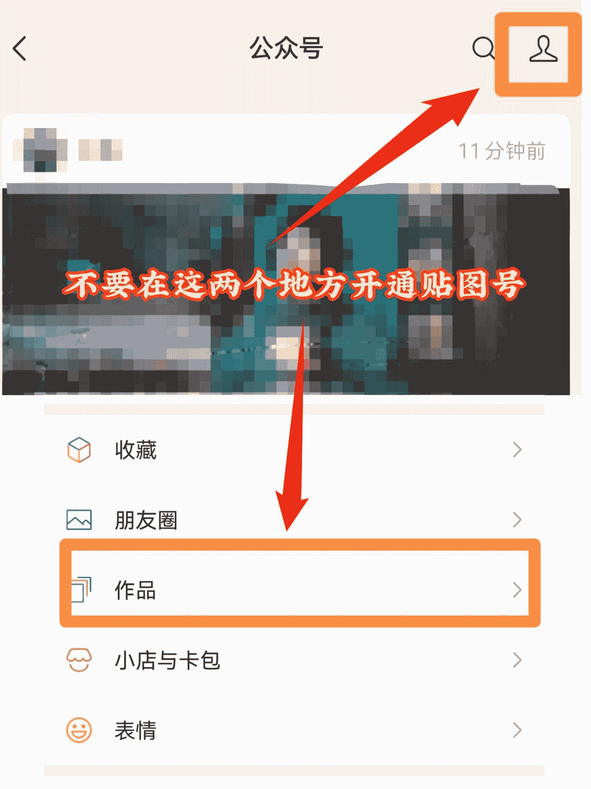

我之前起过一个叫“某某元气满满”，让我提供资质才可以注册通过。

有的如果你没有资质，就会给你限流。

所以起名字，要多考虑一些。可以起普通但是好听的名字。

原始名字还是比较重要的。

### 1-3、账号准备几个？怎么准备？

建议2个或者2个以上。

这里需要注意，一个身份证只能认证一个公众号。

你有5个微信，都是你自己的实名，那么你只能认证一个公众号。

别的微信你也可以开公众号，但是实名不了。

你也没有办法让别人实名。因为你的公众号和你的微信是绑定的。（后边会写解决办法）

5月13日出台的新规，5月13日之后注册的账号，不允许绑定多人运营了。也就是你的账号只能你自己使用。你没办法授权给别人了。

针对上边的这个问题，有以下三个解决办法。

**办法一：**

你的微信A开通了A公众号，并实名了你的身份。你可以把你的B微信实名，换成父母、家人的身份。（要当面换，会让你刷脸）。换好之后，用这个B微信去注册公众号，你就可以有B公众号了。

这样做最大的好处，就是你实名B公众号的时候，会很方便。不需要别人辅助你了。

这里有一个重要的细节：不要异地登录换。

指的是你用这个手机，远程登录家人的微信，让他发验证码给你登录。这样做会跳人脸识别，你就很麻烦了。还有封号的风险。

**办法二：**

就是多开软件。有的手机是可以多开的（比如oppo）。

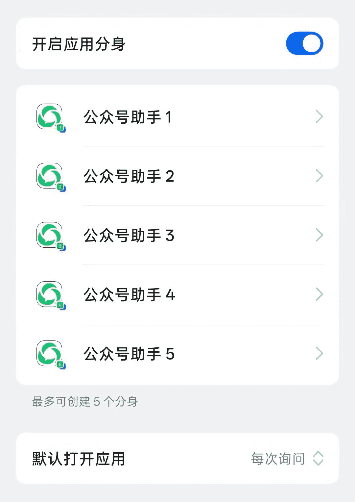

你用你的手机登录微信B，开通注册公众号助手2，并登陆；登录微信C，开通助手3，以此类推。

只要你不退出公众号助手登陆的账号，一般都没有问题。

发的时候你可以用流量发，这样你就不用害怕同一个wifi的问题了。

**办法三：**

你用网页版登录，可以多下载几个浏览器。

不同的浏览器，登录不同的号。你可以从网页上发。

谷歌浏览器可以多开。

这里你可以收藏“网页版公众号助手”，并写好你登录的是哪个微信。

因为你如果登录错了，来回切换，就会让你用原微信扫码。

还有一款浏览器是可以隔离IP的（比特浏览器）。

个人最推荐办法一。简单好操作，后期省了很多麻烦。

### 1-4、老号是否继续使用？

有很多人会选择用自己以前的老号。用了很多年了，有感情，也帮自己挣过钱，不想注销它。

可以用老号。

只要你的老号没有违规，有两个月以上没有再发新东西，和新号是一样的。

不需要你删内容，直接发就行。发贴图测试下，如果你新发的内容可以上一百，那么就完全可以用。

如果你过去的内容是个位数播放（低于50的都算），新发的内容也是个位数播放，那么你的账号一定是限流了。

注销了重新开就行。

选择“立即注销”当下就可以释放。

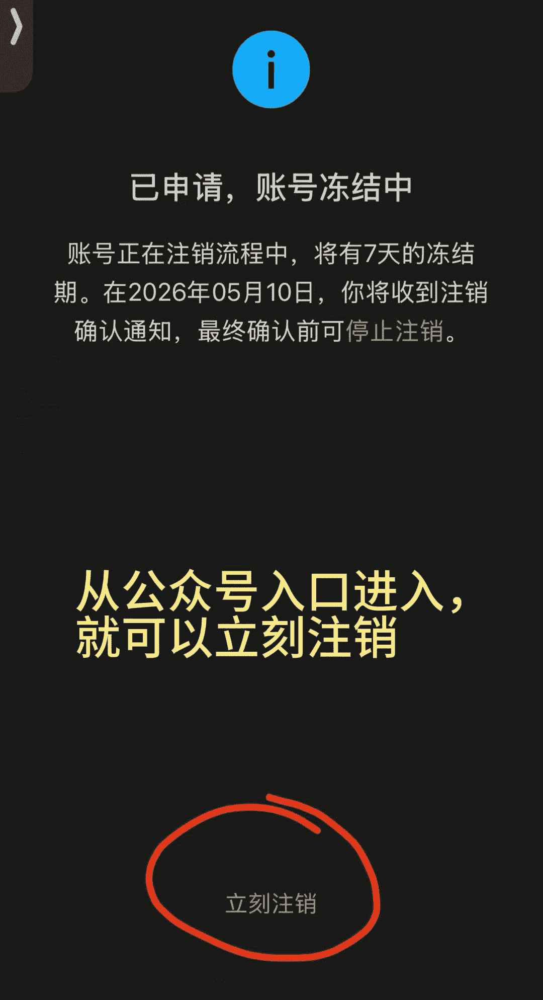

注册好账号之后，先想办法弄到100粉丝，就可以开始做了。

这里不用纠结，用最直接的办法。

## 二、如何选择你可以做的赛道？

### 1、新人的第一个赛道怎么选？

如果你是新人，你也许不知道自己应该从哪些赛道开始，那么我建议你先从给AI提问这几个问题开始。

从你会的、你有的、你熟悉的内容上去迈出第一步。

可以先想想你有的资源，问豆包、元宝、Deepseek几个问题：

我是谁谁谁，我对某某感兴趣，请帮我梳理一下我可以做的内容和核心关键词，供我筛选一下。

比如我提问的内容：

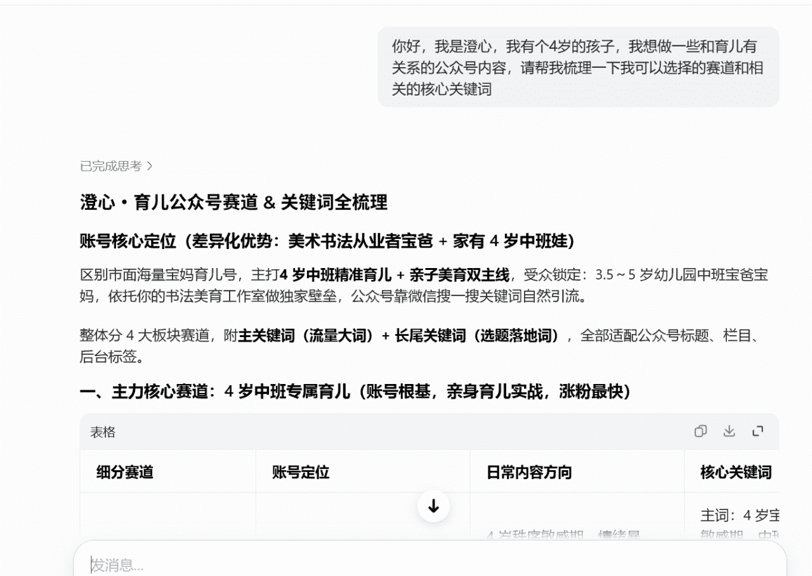

然后你根据AI给你的关键词，去小红书、抖音、公众号搜相关的关键词，找找看有没有你感兴趣的，就可以直接开始了。

当然你不一定要做育儿，你喜欢车、喜欢摄影、美食、或者你有AI的技术，那么你可以做的非常多。

最开始就是勇敢迈出第一步，发布第一个贴图开始。

后边我也写了很多你可以参考借鉴的方法。

不要被账号是否会打乱标签、垂不垂直的问题困扰住。

只要不是被封号，你有很多次重新开始的机会。

### 2、给你可以参考的赛道和做法

如果你没有自己特别想做的内容，那么也可以参考下边的这些具体的做法：

适合普通人的赛道有很多很多，这里主要分成两大类：

一个是爆款类方向赛道，一个是垂直类方向赛道。

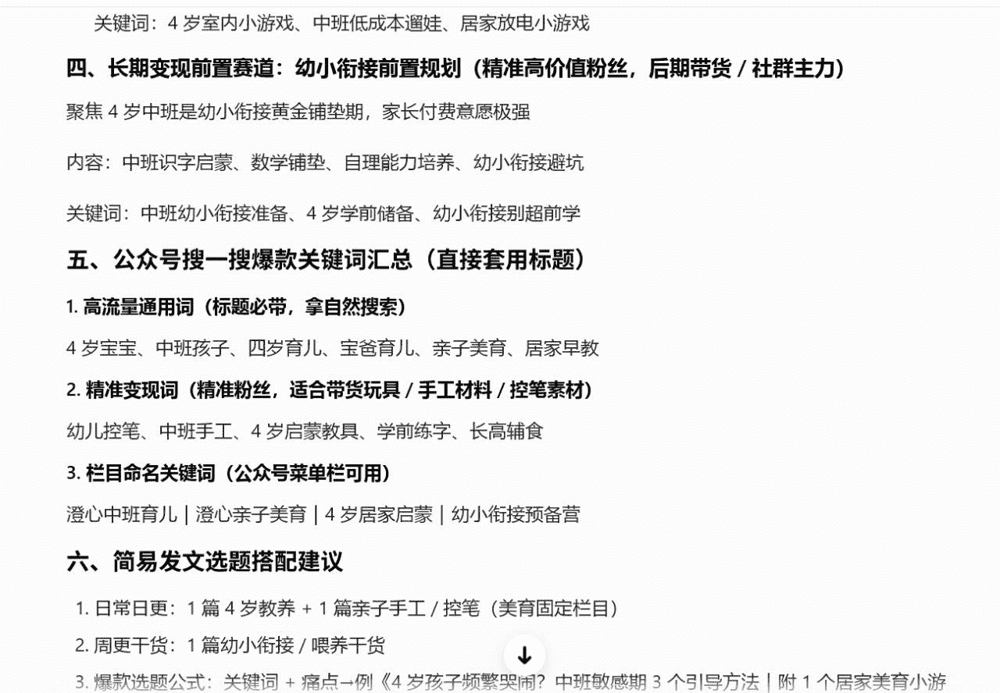

这两个赛道的逻辑是不一样的。

不过提高收益的方式是一样的，就是想办法提高评论的数量和停留时间。

**①、爆款类（吸引眼球）**

就是跟爆款，做爆款，懂得爆款的核心逻辑。

这种的优点，就是起号快，流量猛，收益高。

缺点：新手如果不懂核心的爆款逻辑，容易做歪了，没有流量。

尤其是爆了10W+的，第二天可能就个位数播放。让人心情很郁闷。

目前贴图属于跑马圈地阶段，需要的是量，正确的方法+量大，跑出10W+还是很容易的。

爆款是新手快速起号的不错选择。

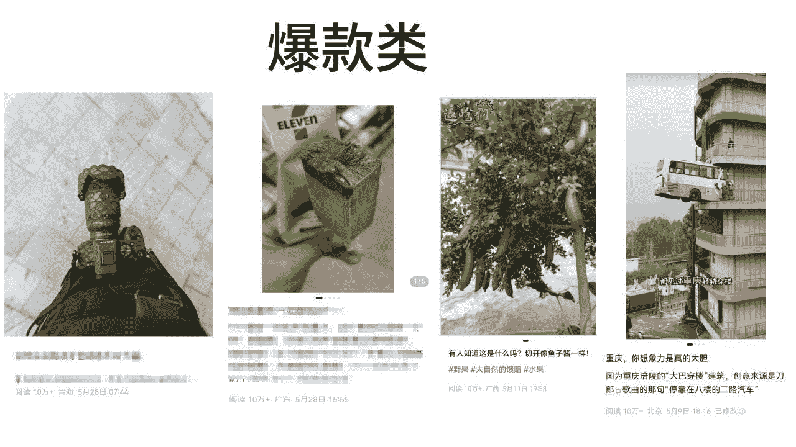

**②、垂直类（细分领域）**

就是你想做某个具体方向，比如：养生、成长、婚姻、学习日常或是某一个细分赛道等等。

优点：可以做的内容非常多，适合长期深耕，素材源源不断。

缺点：起号有一定的不确定性。因为你的账号未必就适合于你想做的内容，有可能你做的还不错，但是没有流量，容易产生自我怀疑。

方法就是你多用几个号尝试同一个方向（不要同一个内容发几个号，要换不同的形式内容发），有一个流量不错，你就专门拿这个号做垂直方向。

其余的号可以再重新探索相关领域的其他细分方向。

垂直方向可以引流、建立信任，还可以深耕长文（文章），做长文+贴图的联动。

以下是垂直方向的贴图，可以看到，文字内容偏多（800字以内）。

新手做这种，时间会长，而且不一定会有人看，容易产生自我怀疑。

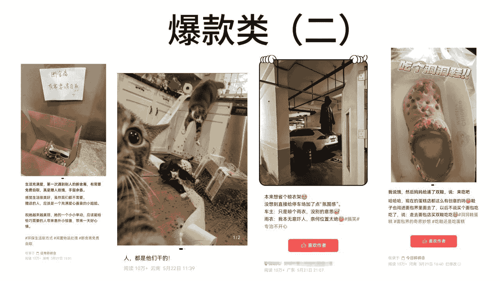

**小结：**

这两个方向并不是对立的，应该说是相辅相成的。

新手建议从爆款方向上去突破流量限制，多刷“服务号”的推荐，找到爆款的逻辑和感觉。

当你找到方向了，你就可以再往垂直上深耕。

这样对于起号阶段，你拿到正反馈会更快。

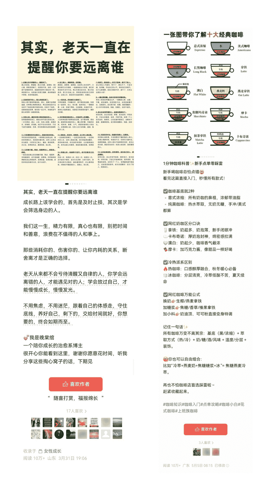

### 3、怎么找到爆款贴图内容呢？

1. 服务号上去刷，看到“贴图”，就往下拉，会有非常多。
2. 你找到一个爆款贴图，顺着“评论”继续往下滑，就能看到非常多类似方向的贴图。
3. 去“搜一搜”上去搜关键词，找到贴图的选项，就都是了。

那么接下来我们就详细拆解这两个不同方向内容的具体做法。

#### 1、爆款类赛道

也可以叫生活类赛道、奇葩赛道。

主要就是发生活中的各种各样的照片、内容、方向。

爆款类可以发的内容有很多，涵盖到生活中的方方面面。

可以参考：

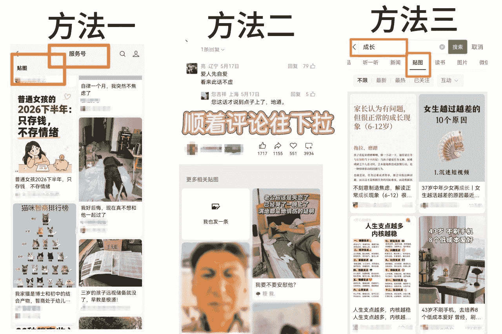

可以看下方的评论、留言，都非常的高。那么每一个的收益都不会低。

**接下来讲如何二创**

我们先说什么是二创：

就是你用别人的图，用AI分析之后，生成一个全新的图。

你只要保留原图的核心爆点，原图10W+，你到1-2W浏览量应该问题不大。

可以看一下生财圈友卢建国同学复刻的这个爆款，他当时连续发了10个同类型爆款，出了好几个1W以上浏览量的贴图。

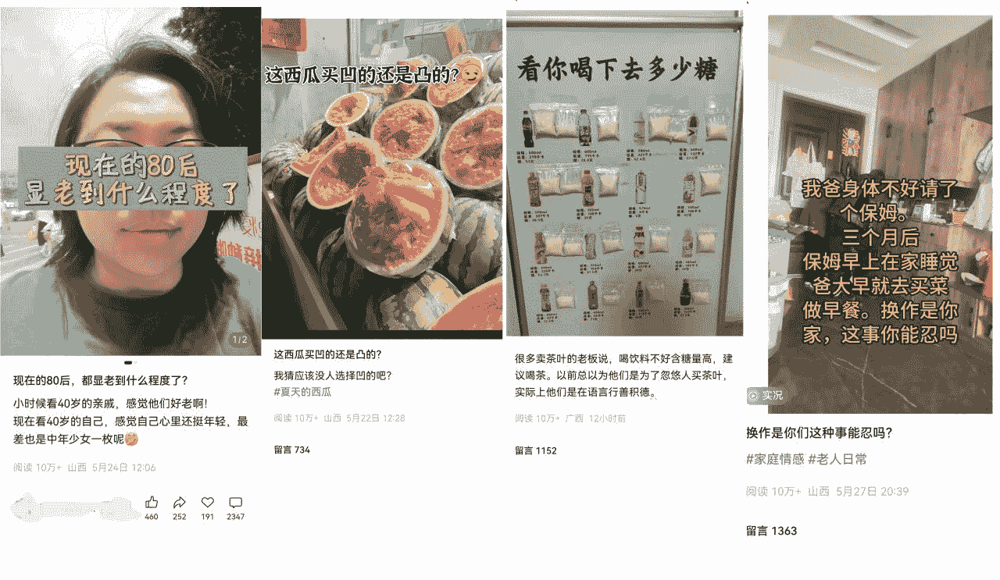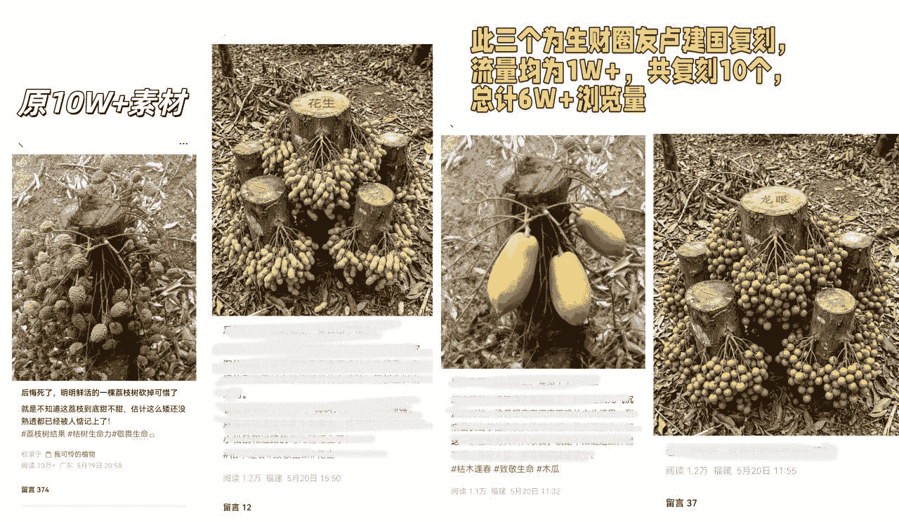

我们找到爆款，要先分析你能不能复刻出来，然后才是复刻。

这里教大家一个简单的复刻方法，只需要几个指令就可以了。

**⑴ 复刻的方法一：**

将你的原图发给豆包，然后把这个指令发给她：

帮我分析这张图片的构成因素，画面风格，拆解出来提示词

你二创出来的图片，和原图就会有很大区别。

你可以复制对标的“标题和内容”，去发就可以了。

标题和内容查重的几率不大。

不放心也可以把原标题内容发给豆包仿写（仿写的话，Deepseek做的更好一些）。

**⑵ 复刻的方法二：**

还有个更加简单的办法，你只需要直接变换背景、主体等。就可以生成一个新图了。如下：

更换主体内容，比如果实、树干、背景等。

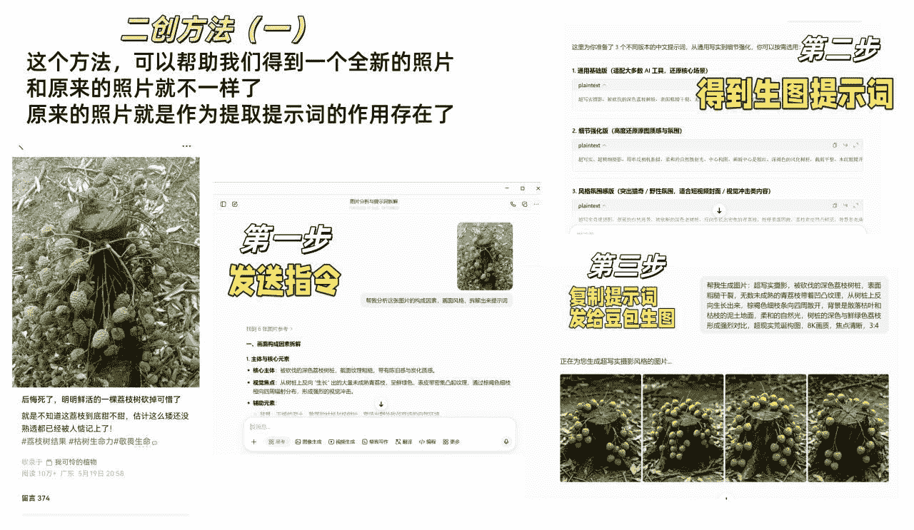

你得到的图片和原图也有很大的区别了。

这个也是可以发的。为了保险起见，你也可以把背景也换了，换成其他的森林。

这些都是比较简单的二创的方法，但是也足够用了。

你不需要非常厉害的AI工具，你要做的核心，是找到爆款逻辑，复刻。

**⑶ 需要注意的地方：**

新手做爆款类拆解和复刻的时候，不要做人物类型的！

其他的都可以做，比如：猫、植物、豪车、森林、生活中的环境、书桌等等。

因为人物我们太熟悉了，稍微有一些假就很容易被识别出来。

如果你的画面中不得不有人物，就把人放的远一些、或者用背影。

尽量去二创辨识度不那么高的场景。

生图的时候，千万不要追求完美！

有瑕疵有时候比完美还要流量高很多。

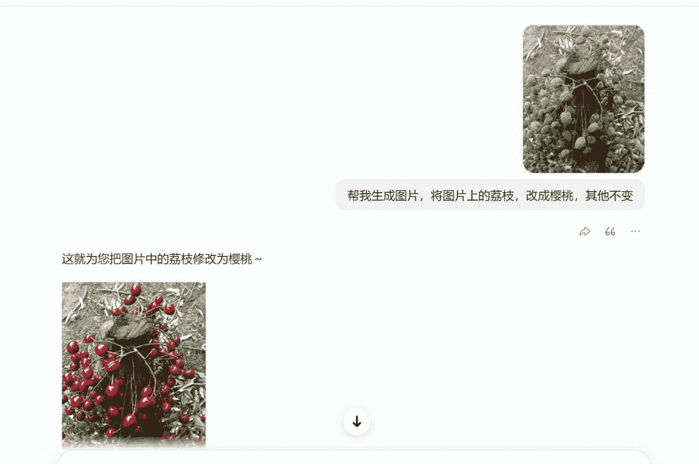

#### 2、垂直类赛道

垂直类赛道可以分为很多种类，这里主要介绍一些适合新人的大类，细分包含在其中。

列举了6个大类方向，可以根据自己的喜好，去选择。

**⑴ 美食赛道**

表面看是食物，实际是食物背后的话题、具体的场景，才是高流量的核心。

内容多，数据广，素材一抓一大把。

做法：自己稍微做做就可以二创。

包括你去下载别人的视频，截屏+抠图+二创，就可以做的很精美。

出图快，后期可以用ai批量出图。

和文章联动，一起做也是非常不错的方向。

这个是非常适合新人做的。

核心：并不是单纯的吃的，而是食物背后的内核。

要去模仿他们背后的话题，来引起评论。而不是只是展现美食。

你可以看到，他们的文字或者是图片上，都有故事。这个才是能够爆的核心点。

参考：

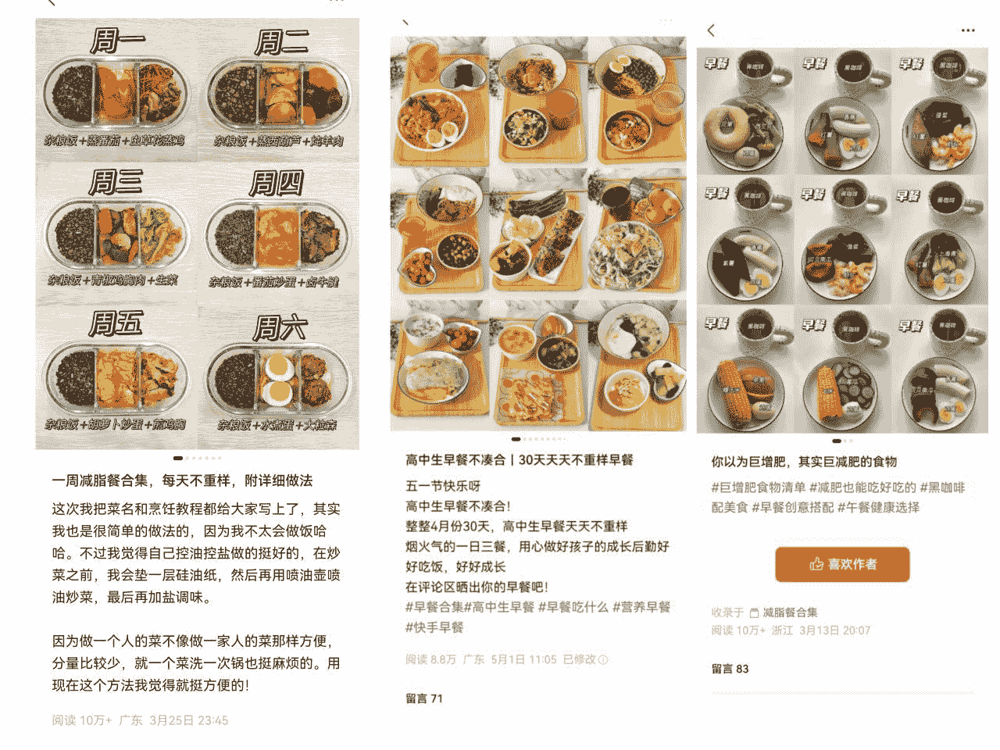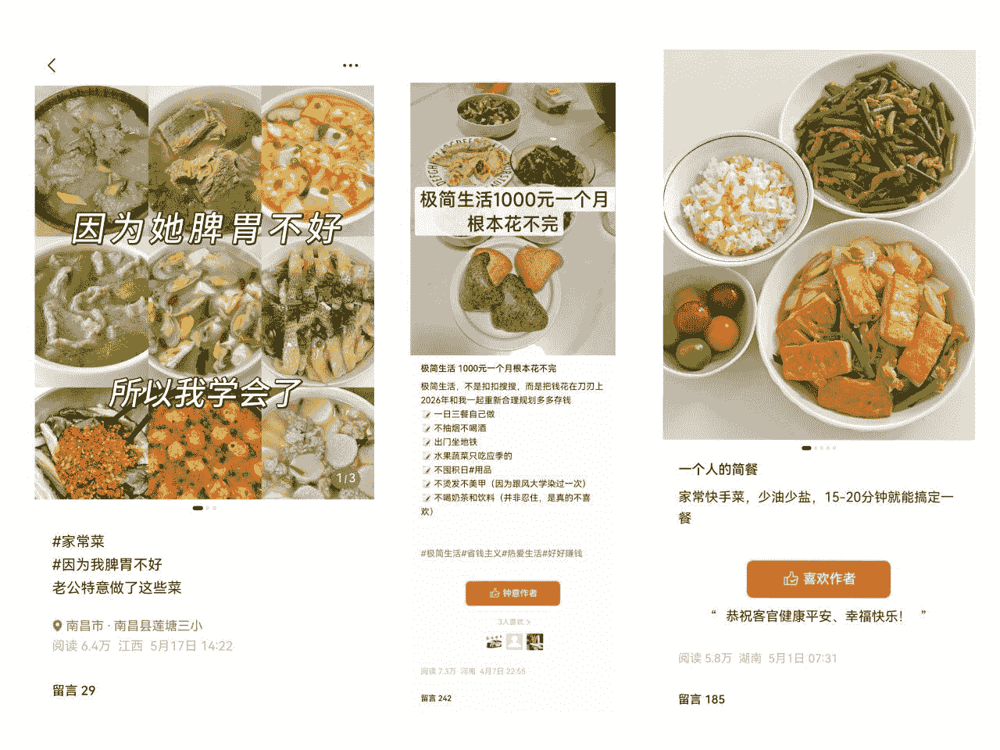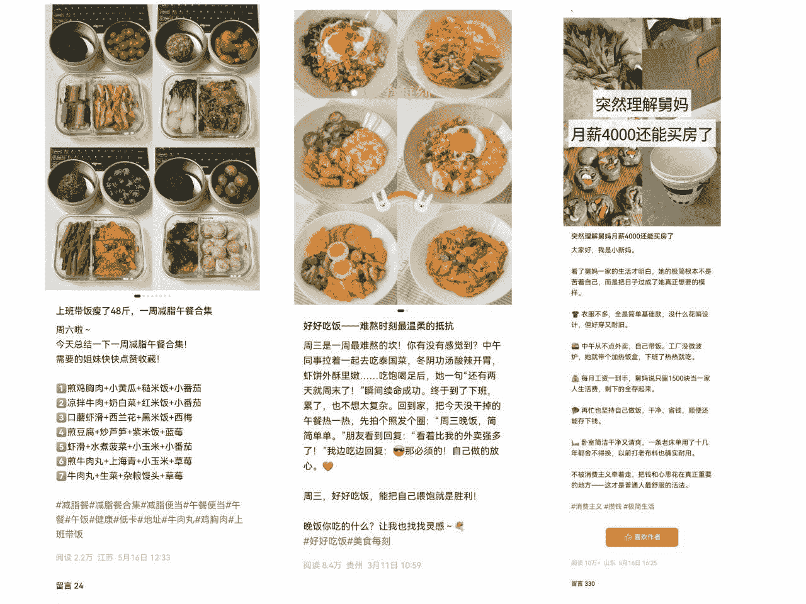

这里要注意一个点：

你用ai做出来的图也许很精美，但是阅读量很可能不高。

因为如果只是图片精美，并不能打动人。

还是要去挖掘能打动人的核心点。

**⑵ 文字赛道**

这不是一个具体的赛道，但是可以引申出很多具体的赛道。

比如手写药方，手写情书、成长类、名人名言、情感故事都可以。

还有很多大字报的内容，都是纯文字赛道。

这种的优点就是简单、好做，小红书、抖音一抓一大把，不愁素材。

你找到1W点赞以上的作品，直接提取文字，就可以自己二创了。

可以看这些参考：

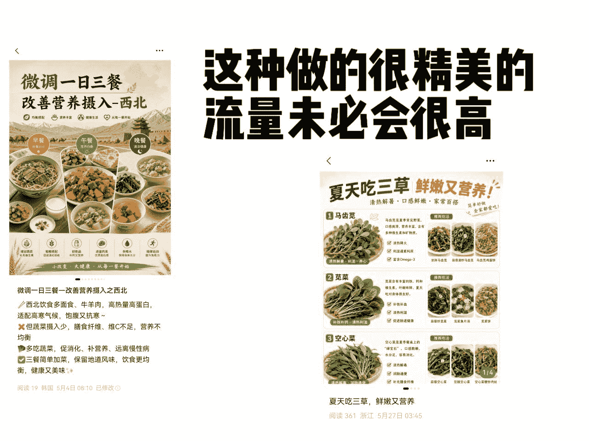

内容是流量高的核心，其次就是形式。不要做得太平淡。

手写体不需要你的字很好看，只要内容好，流量就容易爆。

至于具体的赛道，你可以先开始做，做着做着，你就找到了。

因为这些都是具体的赛道，而且很细分。

你只要找到爆款，就可以多复制，尝试同一内容不同形式和同一形式不同内容。

交叉验证，更容易找到适合自己账号的爆款。

**⑶ 怀旧赛道**

这个赛道比较典型的就是老照片、80-90年代的电视剧、电影、以前的建筑、房子。

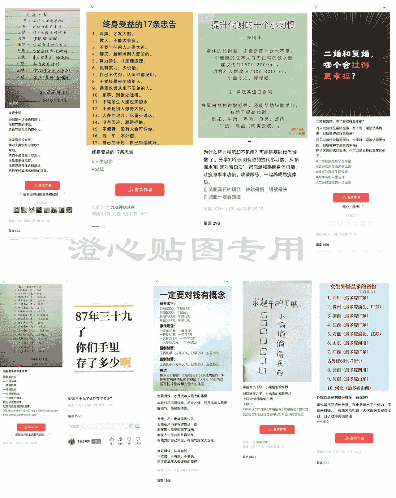

### 老物件赛道

老物件，都属于这个赛道。

优点是单价相对其他会高一些，如果你打开赞赏，还会收到赞赏（开赞赏会有一定的风险）。

照片都可以用 **AI** 生成，也可以去网上找怀旧照片，自己用 **AI** 修复，都不难。

参考：

这里分享两个生成的提示词，你可以根据你的画面去更改提示词，多试几次就出来了。

可以看到，我用的提示词里，专门提到了样貌。

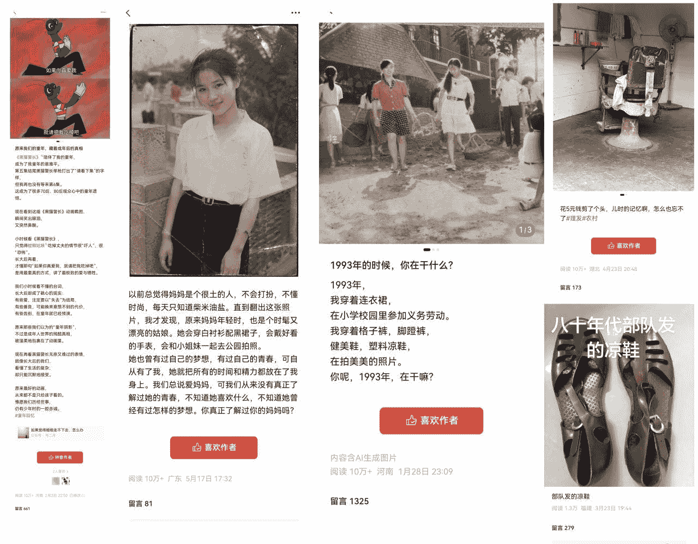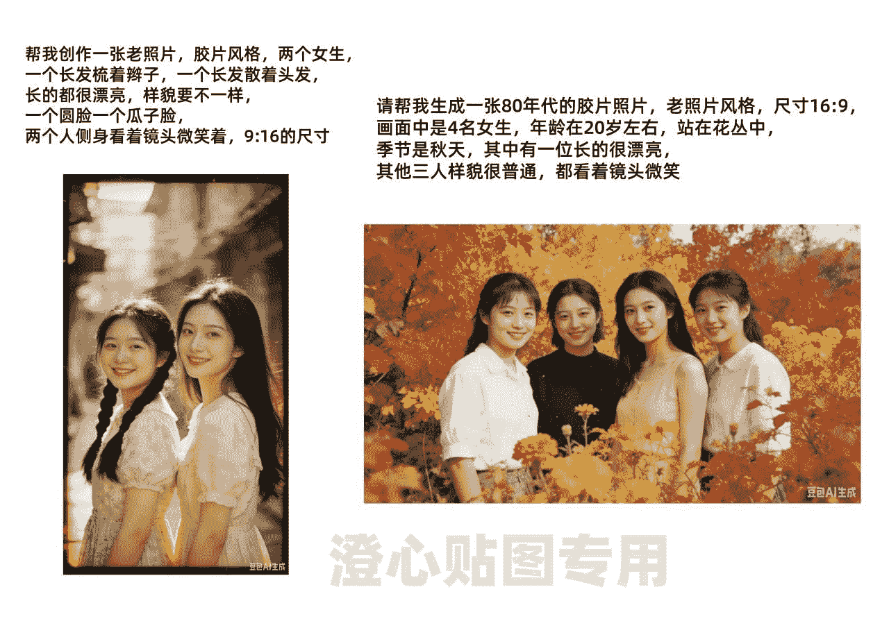

如果你不说样貌，那生出来的人都是一个长相的。

所以细节上可以稍稍注意一些。

风格上，还可以是胶片风格、怀旧风格、复古风格等等。多试几次，你就可以生出自己想要的了。

#### ⑷、对比类赛道

这个之所以称为一个赛道，是我看到了非常多的 **10W+** 包含在其中。

什么是对比类？这种天然带一些反差效果，容易引起吐槽、共鸣的评论。

对比类有很多，比如：
- 上班前 **VS** 上班后、
- 结婚前 **VS** 结婚后，
- 生娃前 **VS** 生娃后、
- 小时候 **VS** 现在、
- 化妆前 **VS** 化妆后
- 男朋友来我家 **VS** 我去男朋友家

类似的有非常多。

这其中的许多选题我都做过，很容易上10W+，我当时一天同时出了4篇10W+，可见流量之猛。

而且最大的好处是不容易违规（当然，纯搬运也容易被判低质重复）。

参考：

你只要深挖，可以找到好多好多素材。

制作方法：
制作也很容易，你找到两个不同的照片，组合一下就行。

你可以用AI生图二创，也可以去找现成的素材。

多看看参考，就知道怎么做了。

#### ⑸、摄影赛道

摄影类赛道其实就是人像摄影。这个赛道有一些难度，需要你会生图的提示词，生成一些和生活照片非常接近的AI图去发。

因为可以以假乱真，而且流量非常高，又称之为**“邪修赛道”**。

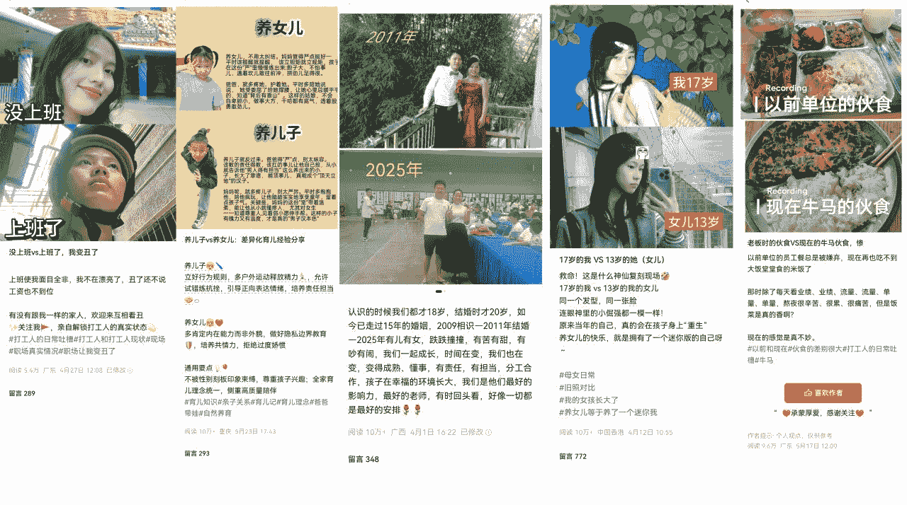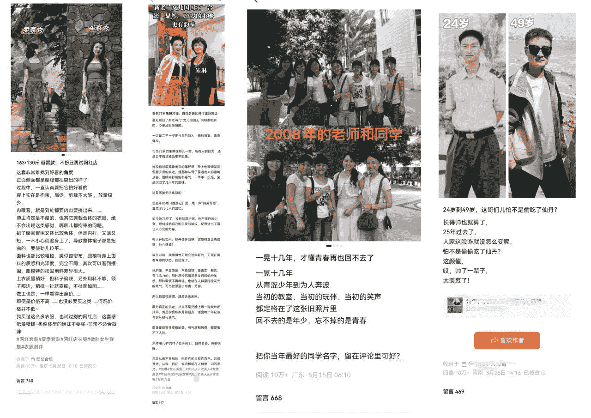

这个和老照片最大的区别，就是这个赛道吸引的是年轻人。

参考：

如果你刷服务号里的贴图，肯定会刷到一些这样的账号。

明明也没有什么惊人的内容，就是一些人像摄影的日常，为什么篇篇好几万浏览量？

好多时候只要发人的摄影，流量就是会很高。

做法：
你可以自己AI直接生图，也可以去买一些摄影素材拼接。

优点是起号快，很容易破万播放。

但是缺点也非常明显：爆了之后违规、限流，还有触发人脸识别的风险。

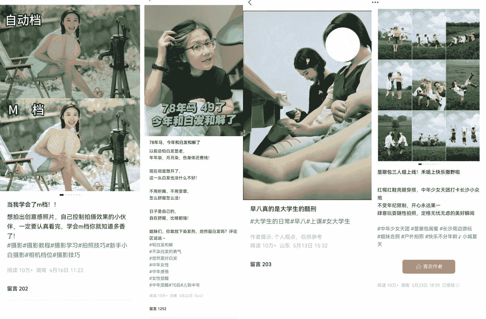

所以如果想要降低风险，有几个注意的点：
- 不要擦边（擦边是肯定违规的）。
- 流量爆的高了之后，第二天流量主收益到账，可以隐藏或者删掉相关内容。

### 3、有哪些是不适合新人的赛道？

有的赛道看起来流量不错，收益很香，但是新人往往不知道要怎么做才能避免违规。

建议先从安全的赛道开始做，下面这三个是新人容易违规的赛道。

如果你手上账号多，可以考虑尝试。号少的话，就尽量不要选。

#### ⑴、养生类

这个类目不适合新人。违规限流的重灾区。

因为内容里经常会涉及到脏腑和医疗效果，非常容易违规。

做得好的一般都是有资质的机构或医院，个人号不太多。

有时候个人号也需要上传了资质才行。

因为我给好多人诊断过账号，做的都是养生方法、养生食疗，很容易违规限流，每个流量在50以下。

所以新人谨慎做这个方向。

#### ⑵、兼职副业类

这个类目，流量一般不会很高，也是容易限流的。

你写你挣了多少钱，给别人推荐什么好做、能做相关的内容，都是危险的。

新号非常容易违规限流。

#### ⑶、娱乐八卦/明星、名人赛道

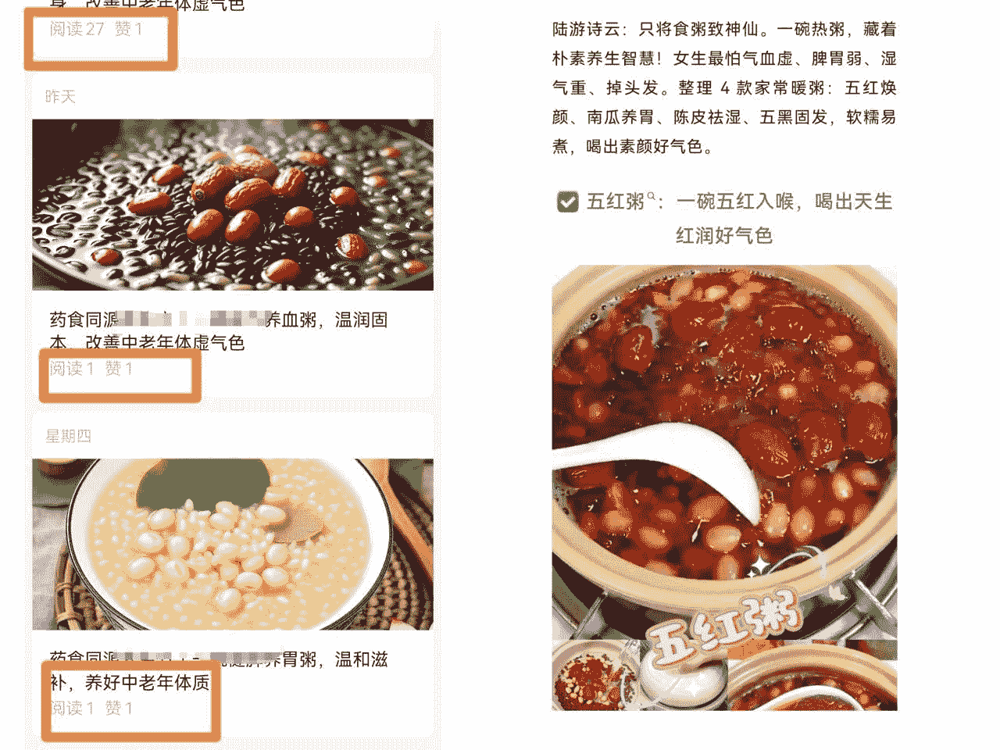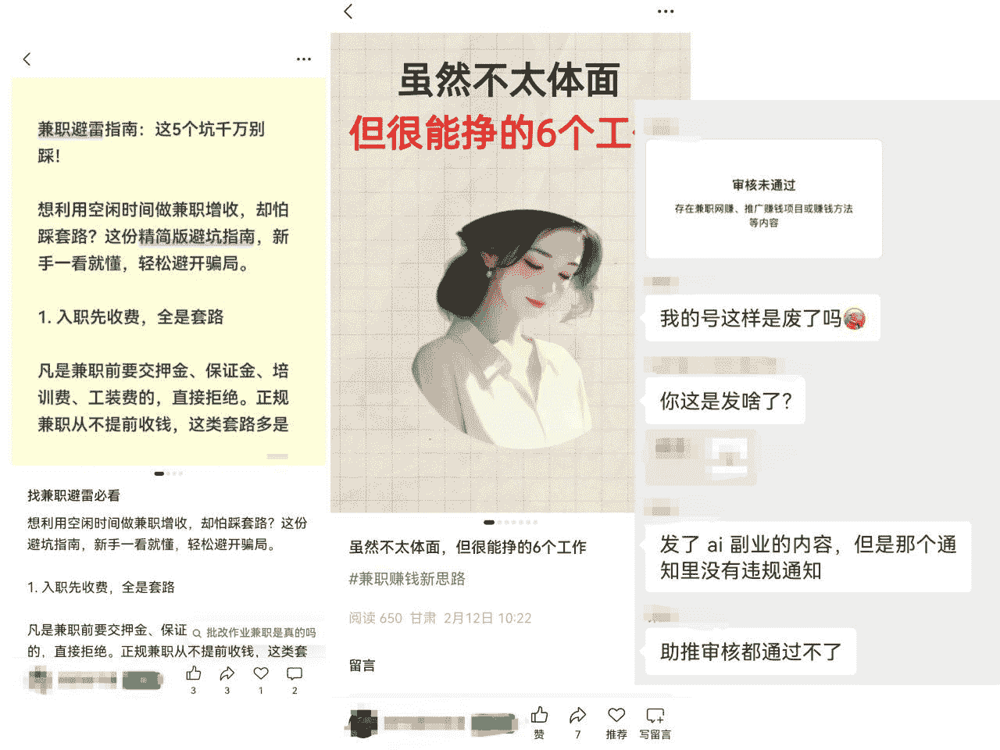

这个赛道看着可以写的内容非常多，但是新人很容易违规。

因为你的账号权重不高，你还用名人的肖像，就很容易被判低质内容。

这三个赛道都是不适合新人，尤其是不适合只有**1**个号的新人。

如果手上只有一个号的话，还是尽量选择前面发的那些安全的赛道。

起码可以避免你的号违规限流，导致你没号可做。

当然我还是更加建议你可以用上面那个方法多做几个号，起码做2~3个。

这样你就没有这些后顾之忧，你可以做的内容就非常多，收益也会更高一些。

## 三、流量低、0播放、限流、违规的问题和解决办法

关于流量低、**0**播放、违规、限流的问题，需要具体展开讲，因为每个人的账号情况不同。没有流量只有一个问题，就是违规。

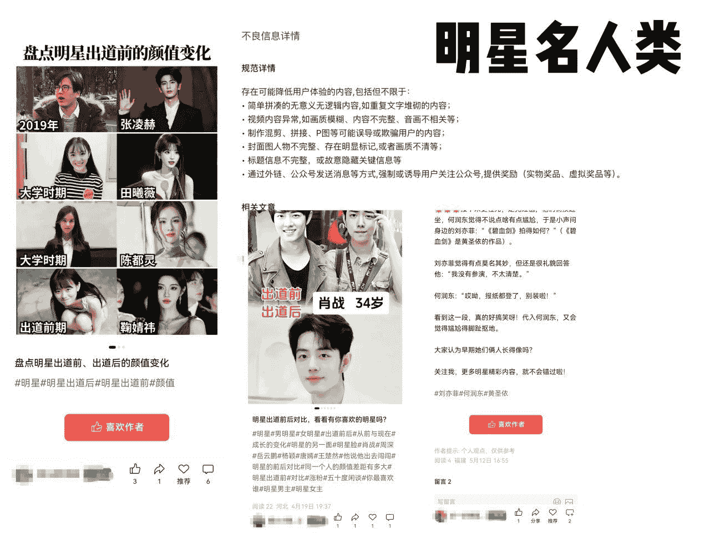

违规的方式无非就那几种。

直接截图别人的内容发、发布的内容擦边、涉及政治、封建迷信、医疗效果、过度营销/引流等等。

你一般会收到如下的通知：

收到通知之后，你的流量一般就是在100左右或者是个位数播放，甚至是0播放了。

分新号和老号两种情况：

**情况一：新号没有流量**

这个是很常见的，正常来说新号一般都没有流量。

你新号发的文章，可能最开始都是零播或者个位数播放。

新号发贴图的话，一般可以上100浏览量，运气好的话能上千。

如果你刚申请的新号，刚发就能上1000浏览量，那么你这个号很大概率属于天选之号，后边破百万的概率比较大。

但是如果你是复制粘贴、直接截图的别人的内容，那么你很大概率就是个位数播放。

不要和别人一模一样，很容易被判为低质量内容，慢慢就不推流了。

你可以用上面的方法二创，做一个新的出来。只要具备爆款元素就行了。

**情况二：老号没有流量**

好多人的号属于是那种老号，就是大概在一年以前申请的。

当时发表过文章，后来没有坚持做，号就一直放着没有用。

这种老号多半都是在冻结状态，你登录一下，就解冻了。

老号的话，如果以前流量还不错，没有给你判违规限流的话，解冻之后直接发，流量就会上百。

因为一个号两三个月不发任何东西，那么就和新号重启是一样，一般来说重启之后流量也会比较高。

还有一种情况，老号当初被限流，都是个位数播放或者是50播放以内。

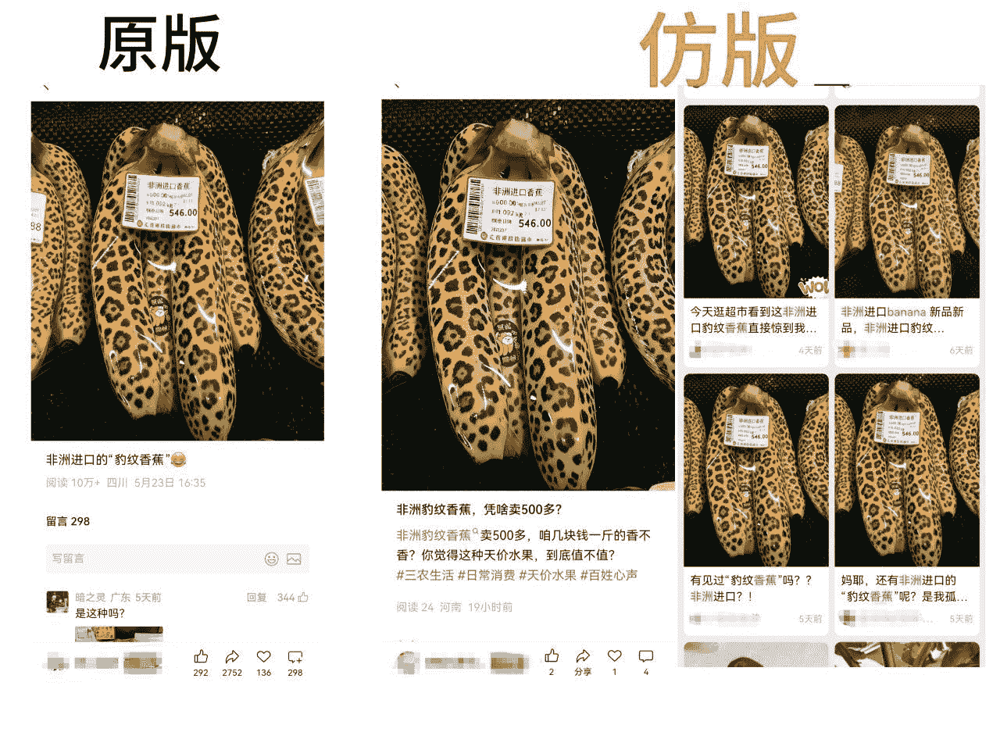

那这种号的话，后面发很大概率流量也不会高。直接注销了重新注册就行。上边有写立即注销的办法（1-4那里有写）。

老号被限流，能救回来的几率不大。

不过有时候文章限流，贴图没有限流，那么就还可以用。

你可以多测试几个，前3个小时没有流量也没事。一般3小时或者12个小时之后，还是不超过50浏览量，就果断注销就好了。

上述两种情况都是正常好处理的。

接下来就是你发布的内容涉嫌违规限流要怎么办。

没有流量只有一个原因，就是违规。

违规的方式无非就那几种。

直接截图别人的内容发、发布的内容擦边、

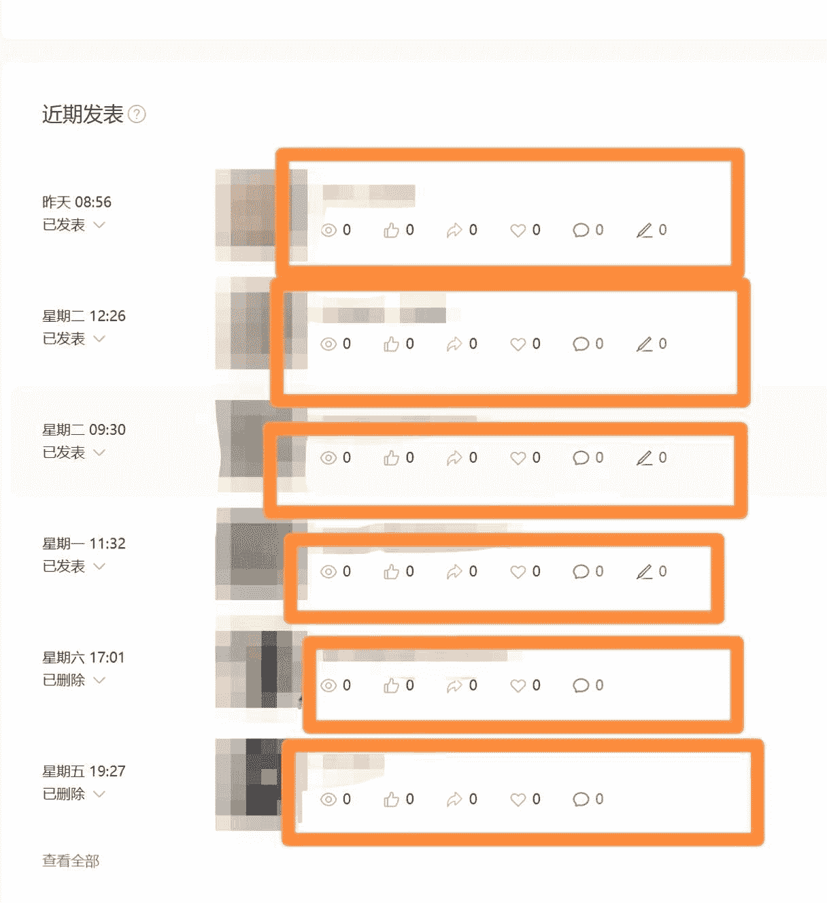

涉及政治、封建迷信、医疗效果、过度营销/引流等等。

你一般会收到如下的通知：

收到通知之后，你的流量一般就是在100左右或者是个位数播放，甚至是0播放了。

这里加入一个申诉的方法。

**情况三：突然没流量了（违规限流了）**

有的同学发，最开始流量还不错，基本上能上千，稳定在1000左右。

但是突然发了某一条之后就没有流量了。

这种情况我也看过好多，主要的原因是你发的某一个或者某几个内容违规了。

比如说发一些名人的，可能这个名人有一点点争议，或者是有肖像权的隐患。

还有就是有的内容不能发，涉及到政治、地理（国家地图）、政策解读、医疗效果、迷信色彩、转发送祝福、副业搞钱等，都会违规限流。

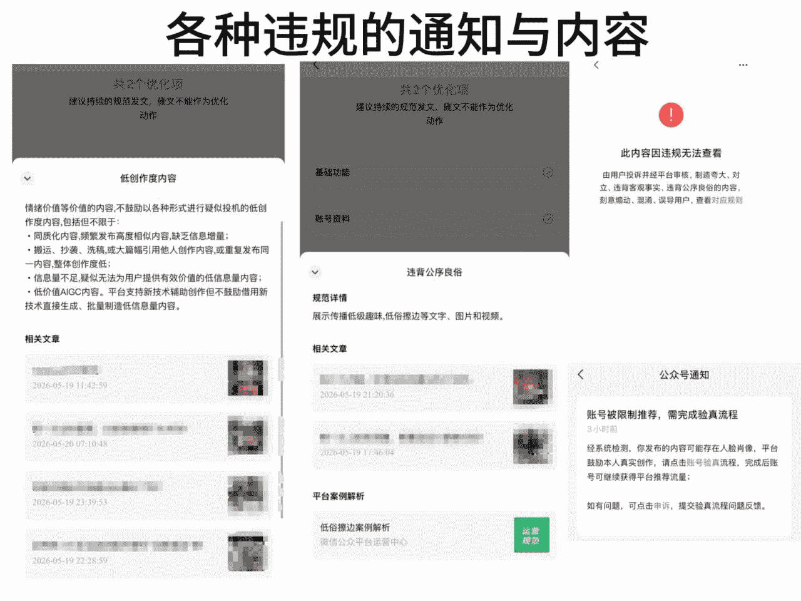

一般来说，限流也分普通限流和严重的限流。

普通限流就是每次发的都在100或者1000以内。这种的问题不大，你可以加加量，平时发3个，你可以发4-5个，如果可以冲破限流，你会迎来一波大流量。

严重限流就是每次发的都是个位数或者50以内。

这种的就把钱提出来，注销就好了（参考1-4立即注销方法）。

**情况四：出了爆款之后，断流了（触发人工审核）**

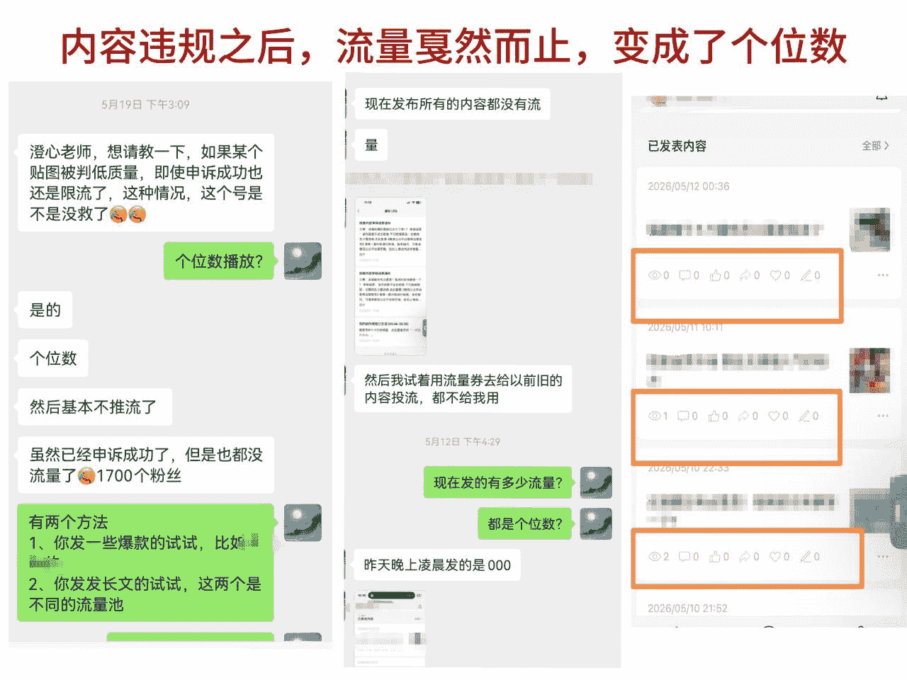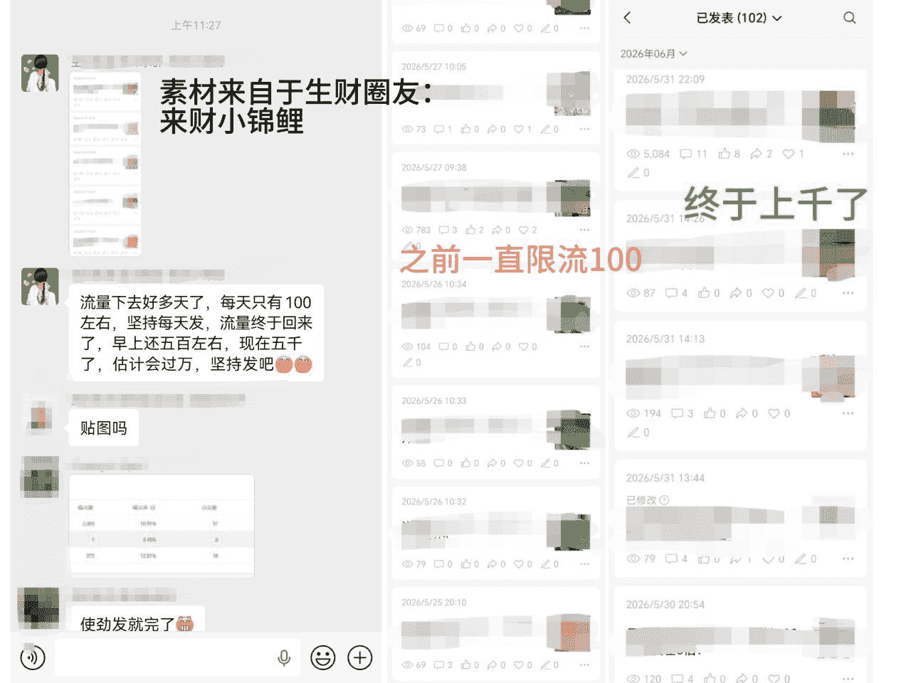

流量爆了之后，比如爆了10万+以上，第二天再发，就没有流量了，就是个位数播放。

这种属于非常正常的现象。

爆了之后，一般就触发人工审核了。你的内容如果是搬运、擦边、和别人相似度太高，就会判你违规限流。

1. 一般来说会收到违规通知，然后就限流了。这种的没办法，要么就是提出收益后，注销重开（估计要等一个月），要么就是把你违规的都删掉/隐藏掉，发一些合规的内容。

我自己测着，文章**+**贴图一起做，账号的生命周期更长的。

所以你也可以发一发长文。

2. 如果你没有收到违规通知，你的内容都是比较安全的，不会被限流的（一般垂直类比较安全一些），那么你就可以多发一些内容，想办法把流量拉起来就行了。

面对这种情况，你平时发3~4个，你可以加到5~6个。

有一个可以拉到**1W**流量的话，后边就都可以上万了（账号就彻底起来了）。

所以这里有一个温馨的小提示：

你粉丝够了100开通流量主之后，就尽快把你的财务状况弄好。

因为财务审核需要**2~3**天，之后你的结算还有半个月到一个月的周期。

这中间如果你财务不弄好的话，你的钱会往后拖得非常长时间才能到你的手上。

那么将来你如果想要注销账号重新开的话，也会耽误很长时间。

钱不多的话，你如果无所谓，那你这个钱不提，你可以当下注销。

如果你的账户上有个几百几千，那你肯定你是要把钱提出来，你才会去注销账号的。

还有就是，尽量多去弄几个号。起码2~3个。

一个号的话，你容易畏首畏尾，舍不得做这舍不得做那，又害怕违规。

号多了，有的号违规了你也就不那么害怕了。

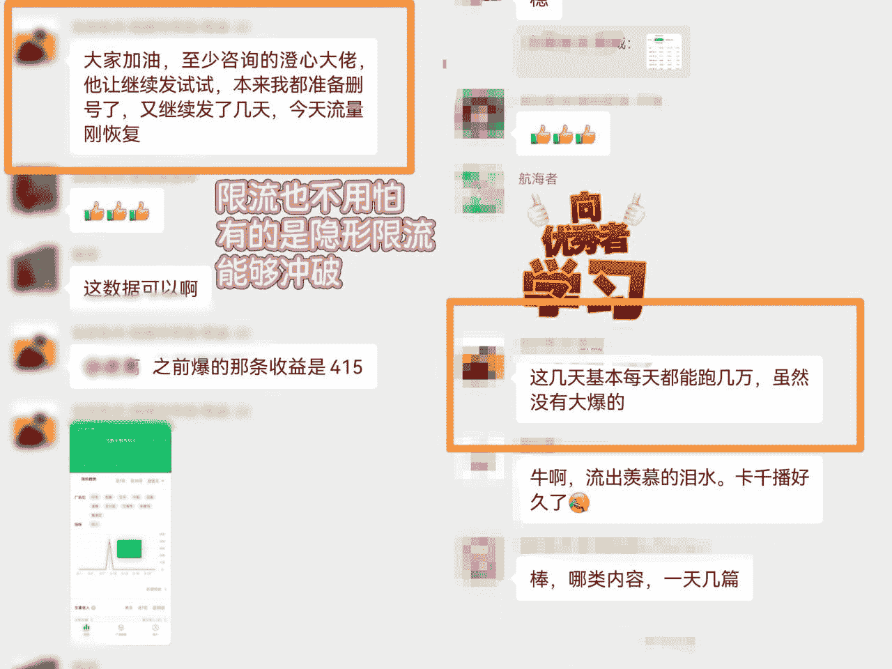

专注在内容上才是最重要的。

## 四、如何持续将贴图做下去并获得更多收益

### 01、开始你的第一个账号运营

从上一篇帖子《从线下教培到线上贴图：一个美术老师的公众号流量主实战复盘》发布之后，好多圈友跟着帖子一起做，注册了第一个公众号，发布了第一个贴图，挣到了第一个1块钱、10块钱。

下边这些都是生财圈友来报喜的。

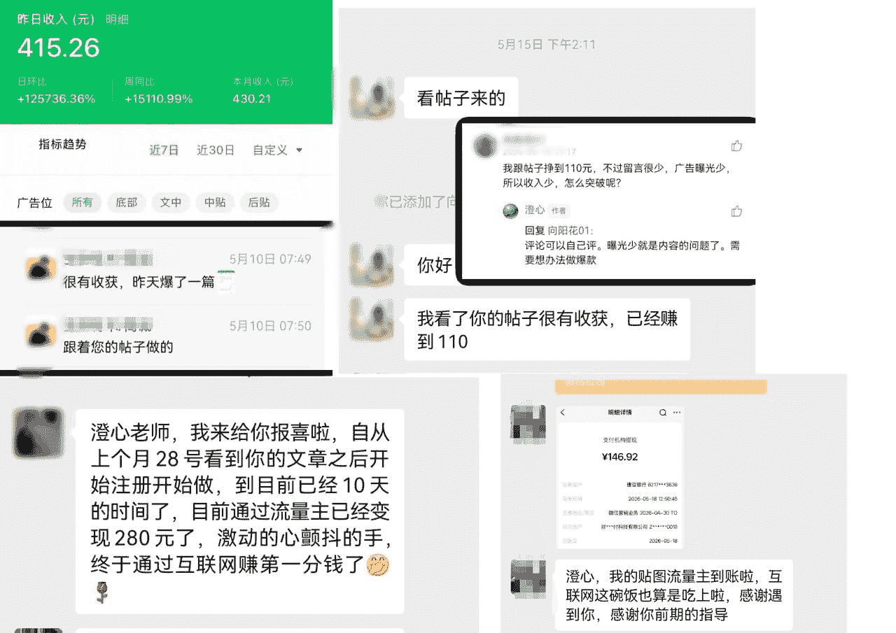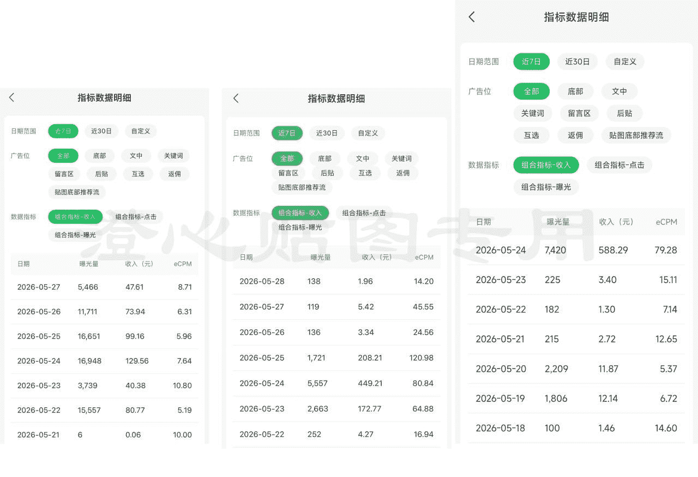

从我写完上一个帖子，有人开始跟着做，到现在一个半月左右的时间，我看到有人迅速开了三四个号，并带着身边的朋友一起做，自己挣了一些钱，带着朋友也一起挣钱了。

还有人误打误撞，从贴图尝试，做起了小说合集，也有了收益。

有人本来想做这个方向结果另外的方向流量爆了，挖掘了新方向。

看到了太多的人遇到了相同的问题，但是处理的方法和面对的心态却截然相反。

拿到的结果真的是天差地别。

### 02、增加账号，带着身边人一起做，有氛围更容易挣到钱。

账号的违规限流其实并不可怕。

新手最开始因为某些不注意，被打上低质量的标签也没有事。

最多限制你一段时间的流量，只要你坚持发，就会能够上到1000，后边就都恢复正常了。

如果我们想要扩大收益，最直观的方法，就是增加账号。根据前边写的内容，多增加几个账号。

有一位圈友，最开始的目标就是挣到100块钱就满足了。

后来她陆陆续续开通了很多个号，现在自己也做的风生水起，每天带着朋友一起做这个贴图项目。

还有带着家长一起做的、夫妻一起做的，每个月能够多增加一些收入，都非常的高兴。

如果你会做AI知识库、会自动化流程，那么你还可以自己写Skill，你的内容选题就源源不断了。

目前我们做的流量主收益，还只是这个项目的一个小部分玩法。

未来还可以开发贴图的垂直小号、IP号、贴图带货等其他的玩法。

微信生态是非常值得深耕的方向。

### 03、先从赚到1000元钱开始。

在写这篇帖子的时候，我无意间找到了巴菲特在7岁时奉为神作的《赚1000美元的1000种方法》那本书。

在书的开头，写了如何创业，写的非常棒，我把它摘抄下来，与你我共勉。

> 当年轻的古斯塔夫斯·斯威夫特成功售卖第一头小牛给科德角（地名）的渔民时，这为他创办世界最大的肉类包装企业奠定了基础。
>
> 赚钱的欲望是年轻的斯威夫特走向成功的动力。
>
> 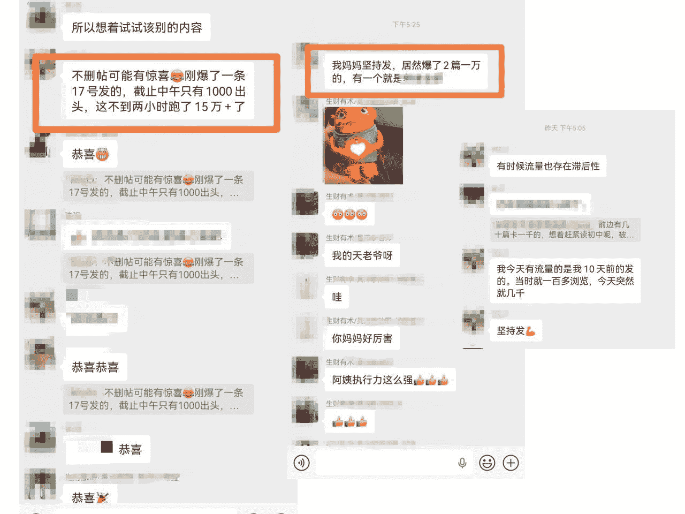
>
> 在巴恩斯特布尔（地名），他被认为是一个很有魄力的人。
>
> 毋庸置疑，当他想要赚钱时，不是浪费时间在许愿上，而是鼓起勇气在自家后院做起了牛肉加工生意。
>
> 毫无疑问，巴恩斯特布尔（地名）的其他年轻人也很想赚钱，当他们还在琢磨该怎么办时，斯威夫特就已经下定了决心。
>
> 这对他来说是一份工作，但并不轻松，因为可能会面临被加工过的牛肉没有及时卖出的困境。
>
> 当时的科德角（地名）是一个地广人稀的地方，他不得不步行数英里去推销牛肉。
>
> 但他并不在乎，因为他想要赚钱，他认为赚钱是一件有趣的事。他与当下的年轻人截然不同!
>
> 通常后者对玩乐更感兴趣，因为创业有太多限制，他们更愿意享受生活，将明天视为新的一天作为自己的哲学理念。
>
> 如果他们尽我所能去赚钱，相信他们也会变得很富有。
>
> 还有一些人为了赚钱而努力工作，却没有成功，原因是缺少目标。
>
> 他们就像拿着猎枪的猎人，频繁射击，却收获很少。
>
> 因此，除了愿意为成功而努力工作外，更重要的是要有一个明确、清晰的目标。
>
> 因为只有先学会爬才能走，所以建议你将目标定为**1000**美元。
>
> 你可能会说，为什么止步于1000美元?为什么不是10万美元呢?
>
> 虽然把眼光放高有好处，但也容易偏离轨道。
>
> 设定一个你能达到的目标，完成第一个目标后，再考虑下一个目标。
>
> 因为创业初期你会遇到许多挫折，如果你有一个触手可及的目标，将有助于你渡过创业挫折期。

————分割线————

看完这篇SOP，你觉得你懂了。但90%的人一到实操就会卡在第一步。

工具和教程只是最低级的壁垒，真正的壁垒是“立刻动手”和“圈层信息差”。

如果你想看全网最新的变现玩法，并且和一群执行力极强的极客一起下场拿结果，欢迎围观我的核心私域：【懒人专属群】。

我们不聊虚的，只做商业闭环的拆解与AI效率的压榨。系统内已沉淀1000+跑通的套利实战局。

👉 查阅圈子完整数字资产与上车门槛：

https://lazyso.com/insider/

认同价值、准备好下场干活的，扫码加我微信（lazyhelper1）

备注：【实操上车】，不闲聊

