# 用 **NotebookLM** 做原创课件：从 **0** 到月入 **6w**，我踩过的坑和跑通的路径

260618 副业SC 精华

整理：公众号懒人搜索，懒人专属群精选
懒人微信：lazyhelper1

哈喽大家好～我是额额额，上过 1 年班，深耕自由职业 10 年的普通创业者，目前专注深耕教育虚拟资料赛道。

这篇复盘主要讲我如何从高风险资料搬运，转向用 NotebookLM 和 AI 做原创小学语文课件，并通过小红书完成需求验证、内容引流、工具提效和轻协作交付。

目前我做的项目是用 NotebookLM 做 PPT 课件，之前卖过盗版资源，所以很早就知道老师端这个需求量巨大。现在项目大概 5w/月，私域用户沉淀 1 万左右。本文不讲空泛理论，只讲我自己踩过的坑、跑通的路径，以及普通人可以参考的实操拆解。

本篇文章用于解决下面 6 个问题。

## 一、为什么要从资料搬运转向 AI 原创课件？

## 二、怎么用小红书低成本验证赛道需求？

## 三、怎么用 Gemini + NotebookLM 做出可售卖课件？

## 四、批量起量时最容易踩哪些平台风控坑？

## 五、怎么用工具和兼职协作突破人效瓶颈？

## 六、怎么跑通从内容、流量、交付到变现的完整闭环？

## 一、项目起点：从“卖盗版”，到“被迫转型”

我深耕虚拟资料搬运赛道两年，一直以倒卖小学语文教辅资料、课件资源为主，前期确实快速赚到了第一桶金。

小学语文虚拟资料项目总结：从0 到100，3 个月团队快速盈利30w

但随着行业发展，这条灰色赛道的致命弊端越来越突出：平台审核规则持续收紧、侵权被投诉起诉风险极高、长期做盗版消耗心态、项目没有长期可持续性。权衡利弊后，我彻底停掉盗版业务，两年内不再触碰相关灰色项目。

真正让我重新入局，是一次很偶然的机会——参加航海，看到有人在用 NotebookLM 做课件。感谢生财这个平台

结合过往做虚拟资料的经验，我很清楚：中小学老师优质课件、公开课** PPT**，是长期刚性需求。于是我定下核心方向：用 AI 制作高品质小学语文课件，打磨成可直接售卖的成品，切入老师刚需市场。

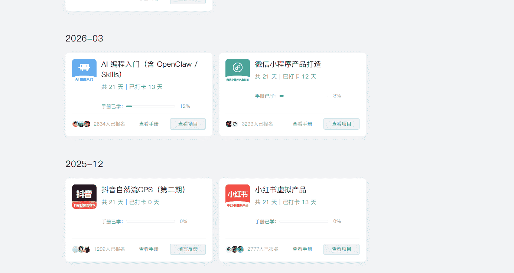

确定方向前，我做了低成本市场验证，全程依托小红书调研：

- 高频搜索核心关键词：小学语文公开课 PPT、语文精品课件、AI 教学课件；
- 重点观察三大核心指标：是否有博主长期稳定发文、评论区是否大量存在求资源、求课件的留言、同行是否有明确成交与变现痕迹；
- 结论：需求真实、流量稳定、付费意愿强，赛道完全可行。

## 二、从 0 到 1 打磨沉淀：耗时 1 个月，打磨可商业化课件标准

确认赛道可行后，我没有盲目批量发作品、急于变现，而是聚焦一个核心核心问题：如何做出老师愿意付费、适配真实教学场景的优质课件，前后耗时整整 1 个月打磨优化。

初期纯 AI 生成的成品，完全无法售卖，存在三大硬伤：

- 视觉粗糙：风格杂乱无统一调性，不符合当下小学课堂简约、清新、国风的审美；
- 内容残缺：仅简单拼凑课文内容，缺少完整教学逻辑；
- 场景脱节：没有课堂导入、生字讲解、朗读指导、课后练习等核心环节，无法直接用于日常备课、公开课、赛课。

我始终保持克制思路：不追求一步到位做到完美，只优先满足「老师愿意使用、愿意买单」的基础标准。同时采用半成品快速测试法：把未完全优化的 AI 课件成品，直接发布小红书测试市场反馈。测试结果远超预期：12 月 13 日发布测试笔记，12 月 15 日就实现首次成交，直接验证了 AI 课件的商业化价值。

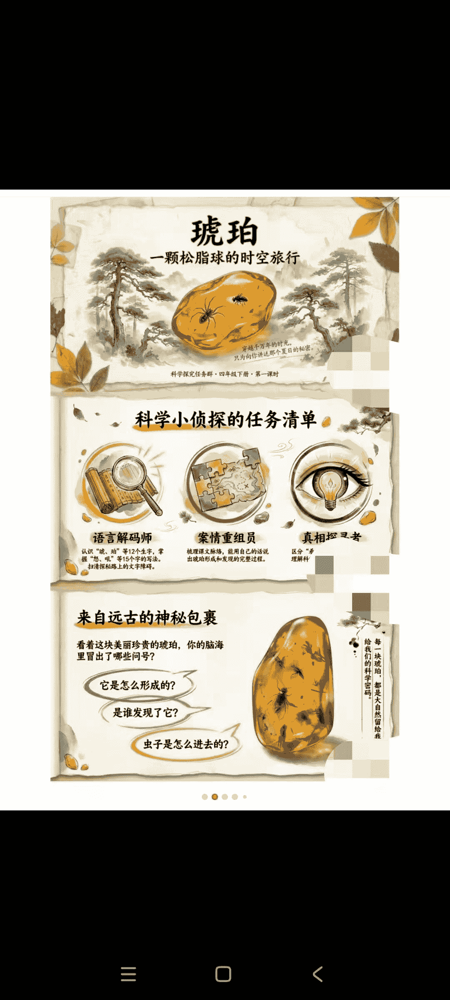

经过多轮迭代，我固化出一套高效、可复制的课件制作基础流程，全程 AI 主导、人工轻量优化：

- 内容生成：借助 Gemini 输入精准指令，定制对应课文课件内容，明确页数、教学板块、知识点范围；
- 排版生成：将梳理好的文字内容导入 NotebookLM，自动排版生成标准化 PDF 版本课件；
- 人工精修：原生 PDF 无法直接编辑，WPS 直接转 PPT 乱码严重，采用 AI 消除、截图替换、Canva 可画拆分排版等方式，修正格式错误、统一页面风格、补充教学细节，最终输出无错误、可自由编辑的成品 PPT。

整套流程依托 AI 大幅降低创作门槛，普通人无需专业设计、无需深厚语文教学功底，也能独立完成课件制作。

附详细步骤

第一步下载pdf 以后，先到咸鱼购买1 毛钱一天的wps 会员

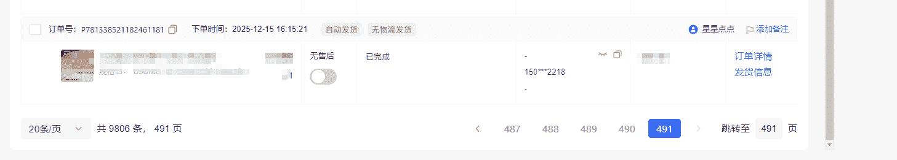

第二步直接打开pdf 文件转化为ppt 按我图示步骤

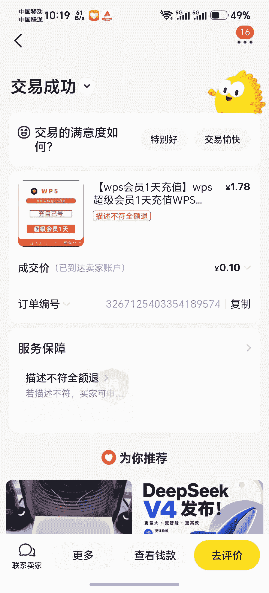

第三步wps 一键把pdf 转化为ppt 乱码的厉害用ai 消除截图替换一定要选中图片，不然ai 消除模块无法弹出

最后在附送一个NotebookLM 去水印工具 https://www.notebooklmwatermark.com/zh 可以转化ppt 前去水印

也有ai 做的本地可以运行批量去水印工具

为解决 PDF 转 PPT 乱码、格式错乱的问题，我又摸索出一套可画国际版拆分排版实操方法：

- 需要canva 可画国际版 https://www.canva.com/
- 点一下魔法Magic Layers（需要设置一下才能出现这个功能）就可以把一张图所有元素分离，基本没有乱码，就是需要一张张的图上传

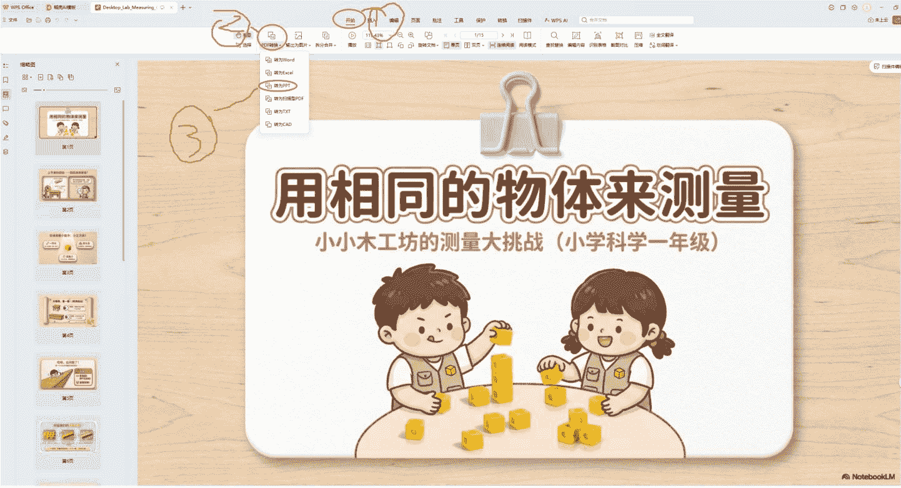

将账号语言设置为美国英语，解锁 Magic Layers 魔法图层功能操作流程：

这个功能附操作步骤1

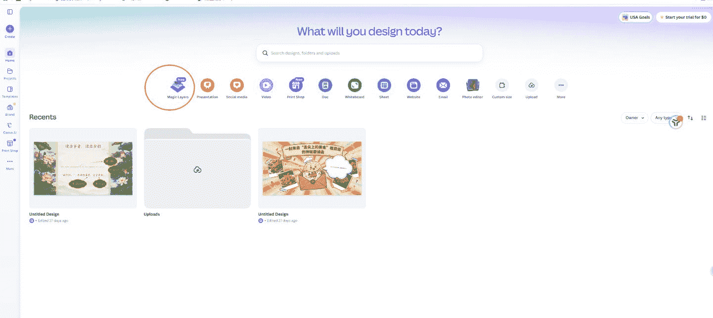

步骤2 选择美国英语

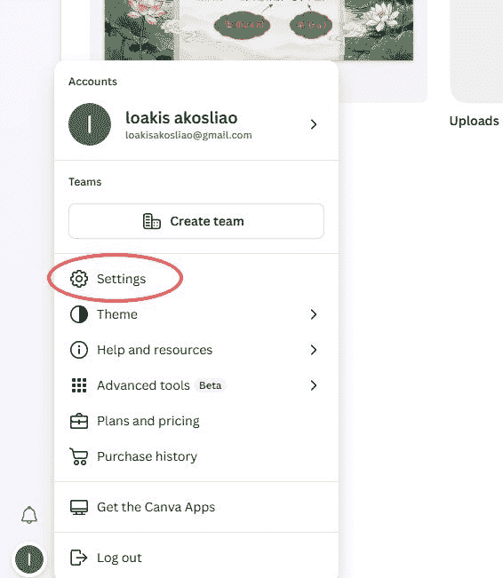

第三步

直接拖拽图片上传到可画国际版；

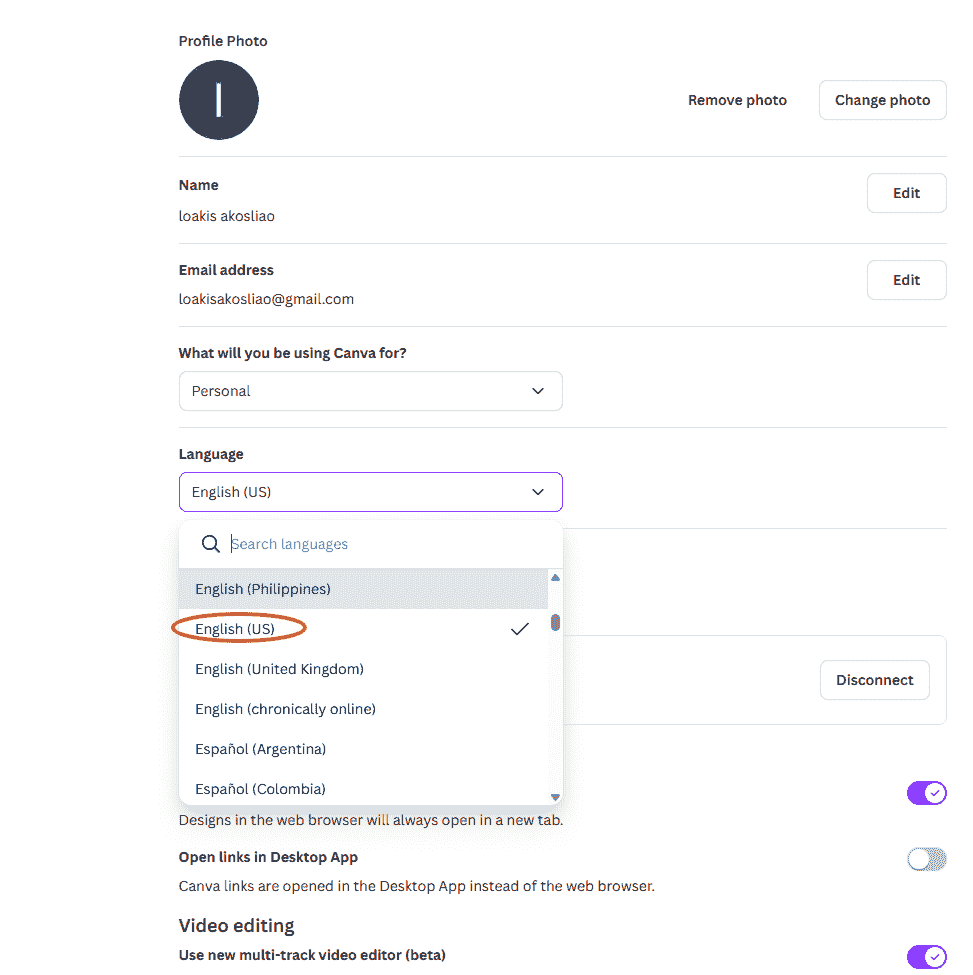

第四步 选择图片并且点open in editor 进入编辑器；

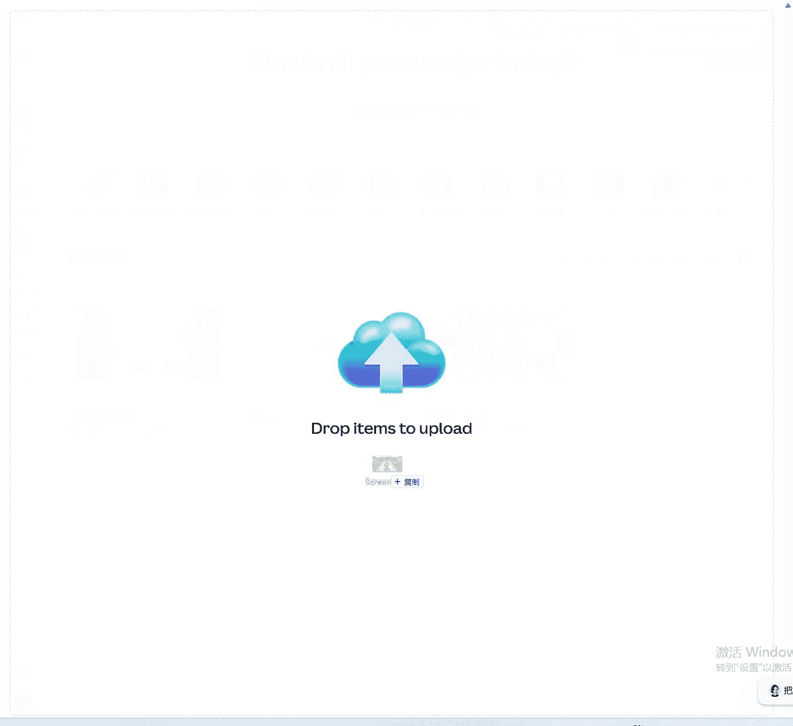

然后点魔法层，一键自动拆分页面所有元素；

拆分后元素分层完整、无乱码，再加动画即可

最后看效果，非常完美，然后一页一页的做。

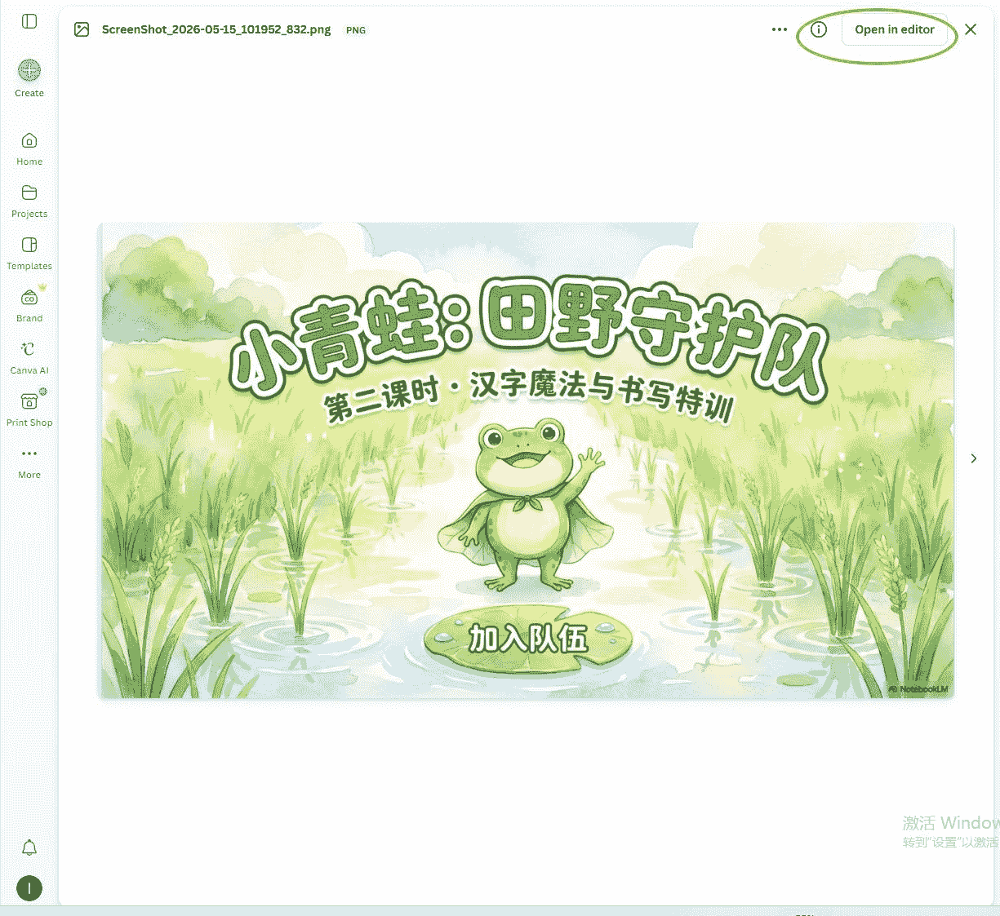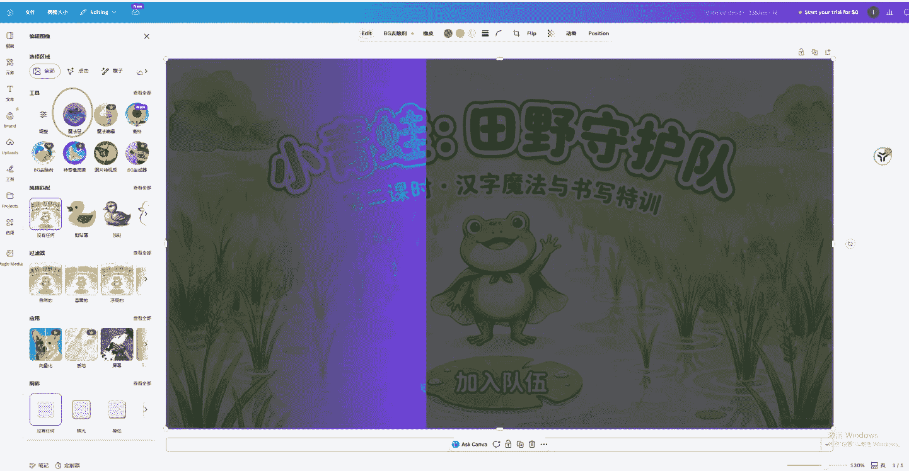

## 三、批量起量遇瓶颈：手动运营效率极低，陷入产能困境

课件制作流程跑通后，我开始规模化产出内容、持续发布小红书引流笔记，很快遇到第一个核心瓶颈：产能不足，完全做不过来。

小红书单条笔记完整制作发布流程：PPT 导出高清图片、稿定设计排序排版、撰写爆款标题、编辑种草文案、优化话题标签、账号发布。纯手动操作下，单条笔记至少耗时 10 分钟，单日极限只能发布10 条，完全无法实现流量量变积累。在 AI 流量时代，项目想要放大，必须依靠稳定量产，低效手动操作直接锁死了增长上限。

## 四、踩坑复盘：盲目批量捷径，触碰平台风控红线

为提升运营效率，我一度急于求成，尝试走捷径：开发小红书批量发帖工具，借助脚本机械化批量发布内容。

最终付出惨痛代价：账号直接限流封禁、全域流量清零，前期积累的账号权重全部作废。这次踩坑让我彻底摸清平台规则底线：平台允许借助工具提升效率，但严格禁止机械化机器人操作。

后续全面调整运营规则：放弃一切脚本、批量工具，全部改用真机手机手动发布，遵守平台原生运营逻辑。看似增加操作成本，但账号权重稳定、流量正常推荐，长期运营安全性大幅提升。

## 五、账号矩阵规模、收益账号基数 & 违规/低流量账号标准化处理

目前项目已经做了两个月10w+、旺季峰值 6w 的营收，并不是靠单个账号撑起来，而是依托小红书3 个关联账号流量堆出来的整体收益。

我们现阶段准备在开店铺做几个其他类目，目前已经测试初中语文，地理，生物，历史都有需求

但是矩阵放大扩张过程中，也经常遇到痛点：就是批量用ai 生成的标题内容，还是容易被小红书判定，因此提示词需要不断的换，就可以解决这个问题

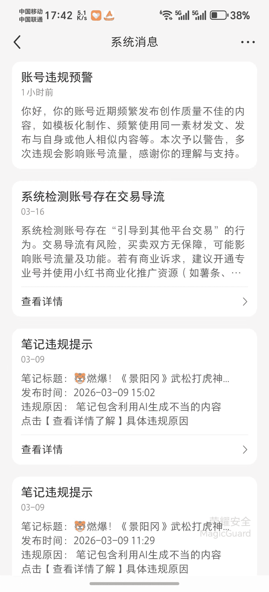

## 六、核心破局：自研轻量化工具，用工具重构效率体系

规避风控问题后，我深度拆解全流程，找到最耗费时间的两大环节：课件文件整理、小红书笔记图片排版输出。

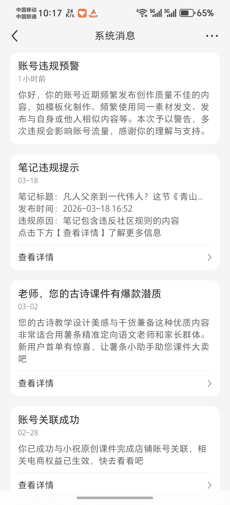

结合航海学到的开发思维，我拆解复杂问题，借助 AI 辅助降低开发门槛，利用 AI Studio+Python，自主开发轻量化自用工具，同时分享实用开源脚本，彻底解决重复机械工作：

- 小红书配图自动整理工具：一键完成 PPT 图片排序、裁切、排版，无需手动调整；
- NotebookLM 批量下载脚本：解决平台限制、单次下载繁琐问题，一键批量下载所有 PDF 课件文件，解放双手。

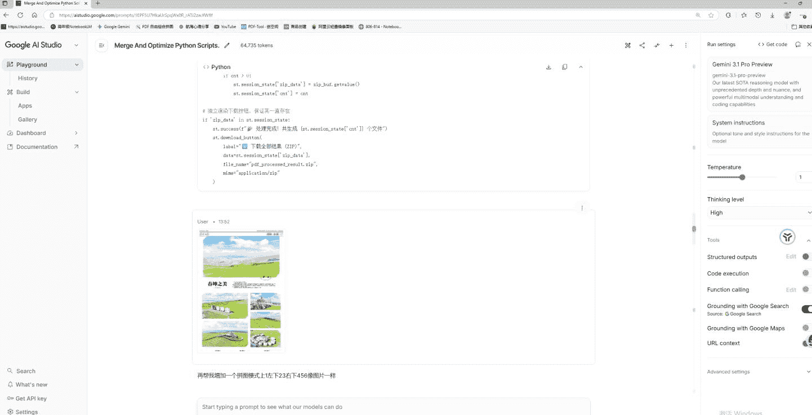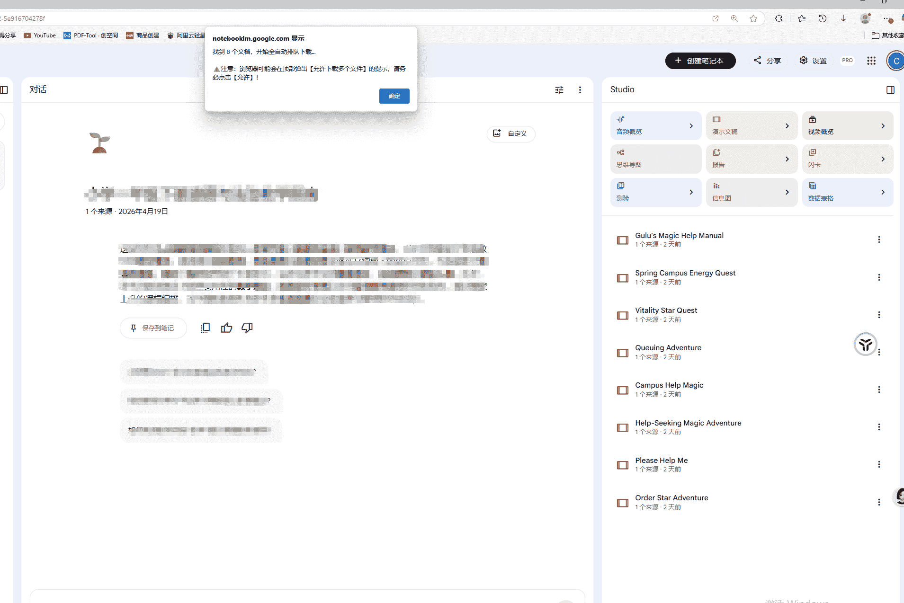

这里分享给圈友NotebookLM 一键下载pdf，很方便加一个书签然后把书签地址改这个代码就可以了，点一下就自动下载

javascript:(async function(){ /* 1. 寻找右侧面板中所有的“三个点(⋮)”按钮 */ let buttons = Array.from(document.querySelectorAll('button')); let moreButtons = buttons.filter(btn => { let rect = btn.getBoundingClientRect(); /* 筛选位于右侧列表的三个点按钮 */ return btn.innerHTML.includes('more_vert') && rect.left > window.innerWidth / 2 && rect.top > 100; }); if(moreButtons.length === 0) { alert('没有找到文档列表，请确认右侧面板已加载。'); return; } let count = 0; alert(`找到 ${moreButtons.length} 个文档，开始全自动排队下载...\n\n⚠️ 注意：浏览器可能会在顶部弹出【允许下载多个文件】的提示，请务必点击【允许】！`); /* 2. 使用循环，像机器人一样挨个点击 */ for(let i = 0; i < moreButtons.length; i++) { /* 点击当前的三个点 */ moreButtons[i].click(); /* 等待菜单弹出的动画时间 (0.5 秒) */ await new Promise(resolve => setTimeout(resolve, 500)); /* 寻找菜单里的“下载 PDF”按钮 */ let xpath = "//*[contains(text(), '下载 PDF')]"; let result = document.evaluate(xpath, document, null, XPathResult.ORDERED_NODE_SNAPSHOT_TYPE, null); let found = false; for (let j = 0; j < result.snapshotLength; j++) { let node = result.snapshotItem(j); if (node.innerText && node.innerText.includes('下载 PDF')) { node.click(); /* 触发下载 */ found = true; count++; break; } } if (!found) { console.log(`第 ${i+1} 个文档没有找到 PDF 下载选项。`); } /* 点击空白处收起菜单 */ document.body.click(); /* ⚠️ 关键：等待 10 秒再下载下一个，防止被浏览器当作恶意连击拦截 */ await new Promise(resolve => setTimeout(resolve, 1500)); } alert(`✅ 批量下载指令发送完毕！\n 共触发了 ${count} 个 PDF 下载。`);})();

✔在给一个可以直接用的小技巧小红书笔记标题和内容（实操）

比如标题，我现在基本用这种方式：

《中国美食》带你解锁舌尖上的汉字魔法！??(对应文件：232.pdf)今天分享编号232.pdf 课件，直接把教室变成“美味食堂”，带孩子们在诱人的香气中领略中国饮食文化！???? 第一站：舌尖上的生字精灵（导入识字）

欢迎来到美味小镇！想要进入食堂，先要捕获这些**“生字精灵”：津、溜、腐、酱、粥、蛋 。课件设计了“汉字魔法阵”，通过加一加、减一减、换偏旁**（如“火+暴=爆”、“草字头+姑=菇”）等多种魔法 ，让识字复习变得像点餐一样有趣！

?? 第二站：火候里的偏旁密码（部首解析）

为什么美食都离不开“火”？课件聚焦三大偏旁，破解烹饪秘密：火字旁（火）： 对应炒、烤、爆 。四点底（灬）： 对应煎、蒸、煮 。立刀旁（刂）： 对应切、剁 。

引导学生发现规律：带有这些偏旁的字，大多与火烧或烹饪方式有关 ！

?? 第三站：金牌点餐员挑战（朗读指导）

怎么读出美食的诱人感？课件提供了**“美食家读法”：红烧茄子、香煎豆腐：语调欢快，读出食物的色香味。水煮鱼、葱爆羊肉：读出烹饪时的热气腾腾！通过“点餐大PK”**，让孩子们在反复朗读中掌握各种美食的名称。

#中国美食公开课 #中国美食课文 #中国美食教学设计 #中国美食课件 #中国美食ppt #中国美食公开课课件 #中国美食教案 #中国美食ppt 课件 #小语公开课 #二年级语文下册

按这个模式输出pdf 内容字数500 字内

马上小红书标题和内容就给你写好了

## 七、突破人力瓶颈：流程拆分 + 私域资源复用，搭建轻协作体系

工具解决了效率问题，但新的核心卡点随之出现：**PDF** 转可编辑** PPT**、格式修正、细节美化人工成本极高。纯手动转换不仅耗时，且单人每日处理产能有限，一旦订单增多，交付效率跟不上，严重影响口碑与复购。

依托过往多年教育赛道积累，我手握**1 万**名精准一线教师私域微信资源，此前一直闲置，在这个项目中实现价值最大化。

我仅用一条朋友圈发布兼职招募：招聘课件整理兼职人员，快速筛选优质劳动力：

- 核心筛选条件：在职语文老师、空余时间充足、熟悉教学课件格式要求；
- 流程精细化拆分：我负责 AI 选题、内容生成、流量引流、客户成交、品控审核；兼职老师承接 PDF 转 PPT、格式修正、排版优化、细节纠错等重复性工作；
- 计件化结算模式：按量计费、标准统一、交付清晰，降低管理成本。

这一步完成了身份的核心转变：从亲自干活的执行者，变成统筹全局的调度者、操盘手，彻底摆脱个人时间限制。

✔发朋友圈招人

我只发了一句话：👉 “招兼职，帮忙整理课件”

然后老师就全部来私聊，起先我也不知道老师技术如何，所以价格我都是砍半处理，本来给老师是50一课的，我都给老师说第一单只有20，然后通过少量的钱就筛选了合格的老师了。后面课件也有标准了，直接给面试的老师发标准就行了。

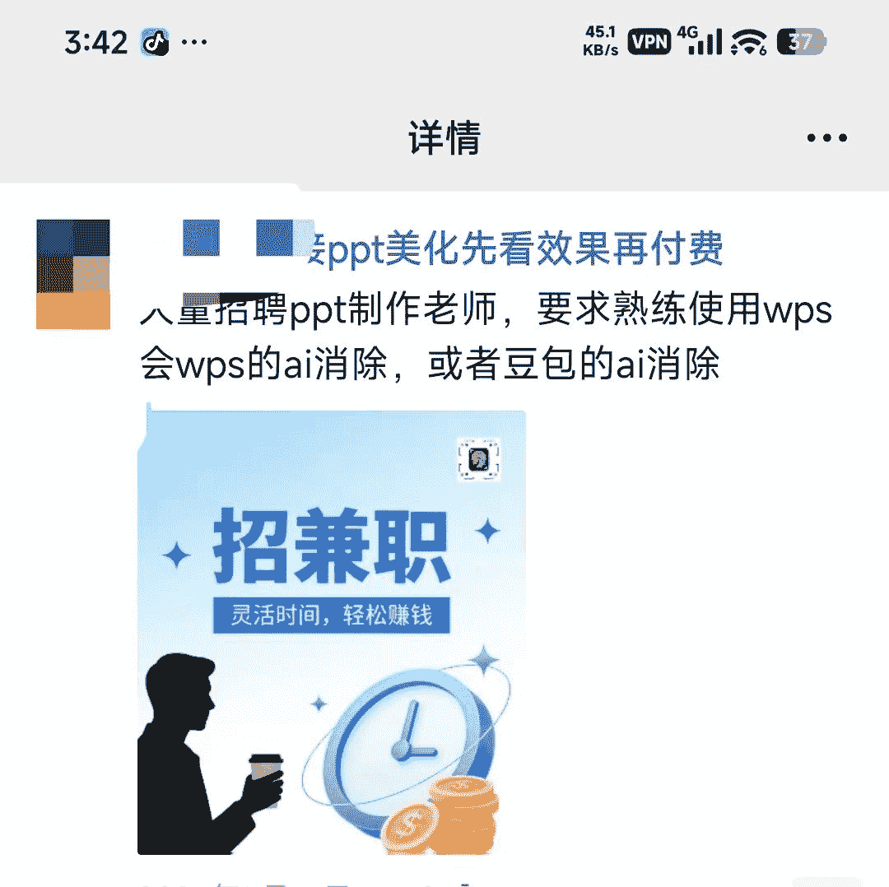

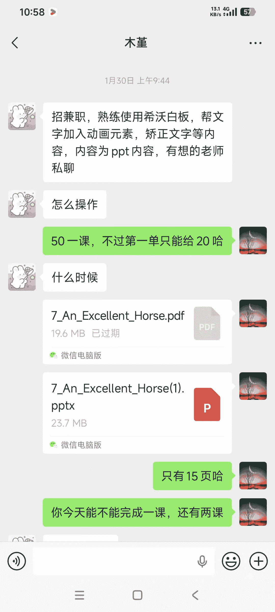

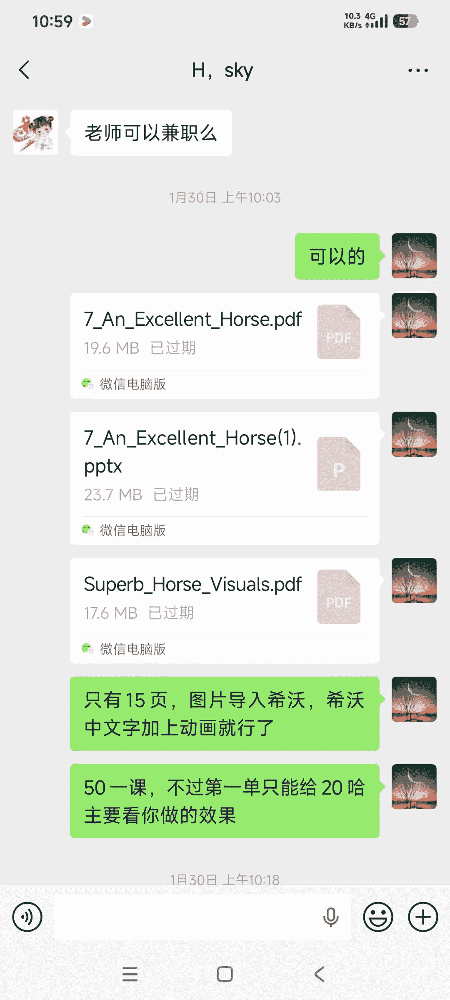

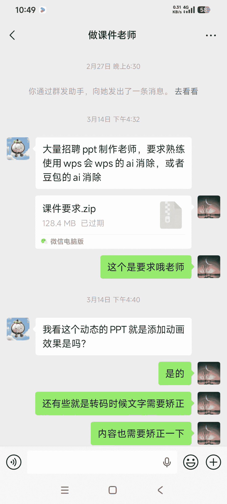

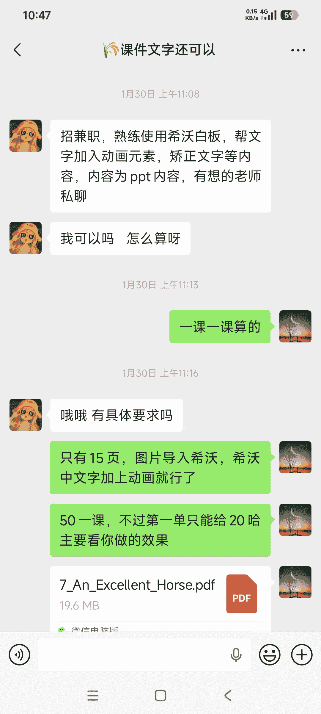

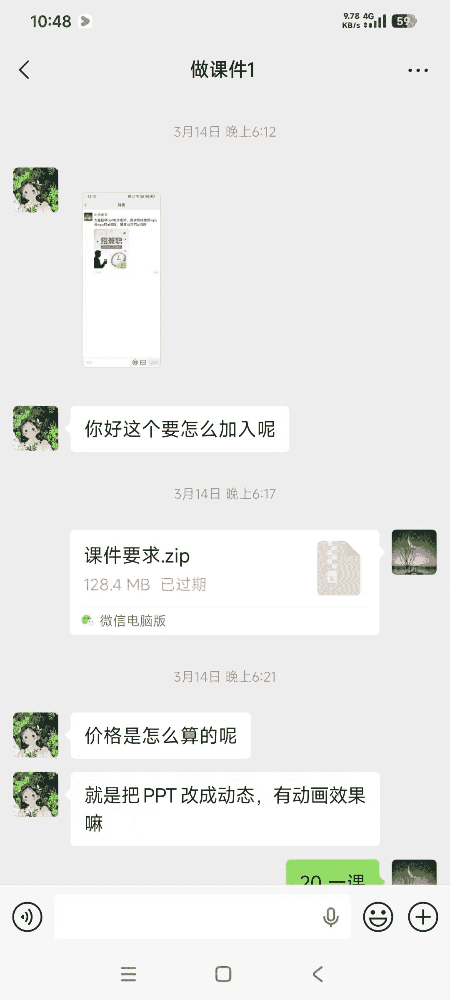

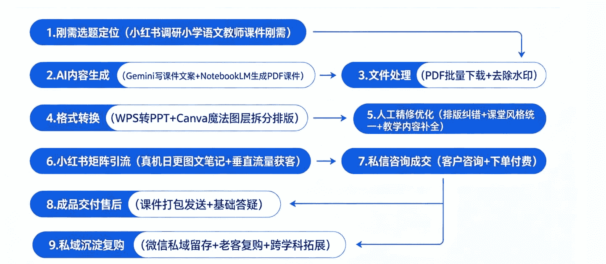

## 八、项目闭环成型：全链路跑通，实现稳定高营收

当AI内容生产、工具高效提效、小红书稳定引流、兼职人力协作四大模块全部打通后，完整商业系统正式成型：

- 内容端：AI批量生成，源源不断产出全新课件；
- 流量端：真机稳定日更，靠量变积累精准自然流量；
- 交付端：分工协作，批量处理订单，高效交付；
- 变现端：单品售卖 + 套餐组合，提升客单价与复购。

目前项目营收稳定：月度稳定盈利**3w+**，流量旺季峰值可达**6w**，轻资产、无囤货、无售后压力，合规长期可持续。

目前的收入主要靠小红书4个账号，淡旺季明显，现在收入如下图。

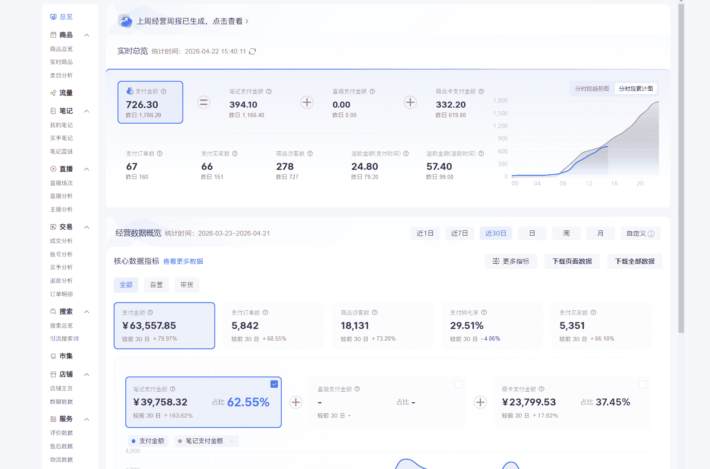

## 九、未来增长规划：补齐AI视频板块，打开第二增长曲线

现阶段项目仍有明确增长空间，唯一未打通的核心环节：AI短视频内容打造。后续我将系统学习AI视频制作，把AI赋能课件升级为动态演示视频、课堂片段预览、课件制作过程种草视频。

短视频相比图文，视觉冲击力更强、信任度更高，能够有效提升私信转化率，同时拉高客单价、拓展定制课件、全套备课资料等增值业务，进一步放大项目收益。

## 十、项目核心总结：普通人可复制的轻资产AI变现逻辑

现在小红书还可以开虚拟店，通过第三方就可以了，方法还是比较简单，给💰就行了。

这个AI语文课件项目，看似是售卖教学资料的小生意，底层拼的是一套完整的商业化逻辑，也是普通人零门槛复刻的核心关键：

1. 内容生产AI化：瞄准教师刚需细分赛道，用AI替代传统人工创作，降低内容产出门槛，批量量产优质内容，避开红海内卷。

2. 流量获取稳定化：放弃赌爆款的投机思维，深耕小红书垂直赛道，标准化内容输出，依靠长期日更、搜索流量沉淀，实现稳定精准引流。

3. 运营效率工具化：拒绝低效重复劳动，用轻量化工具、开源脚本、简易开发，解决排版、下载、整理等机械工作，大幅提升人效。

4. 落地模式系统化：合理拆分工作流程，依托私域资源轻量化外包，把低价值工作外包出去，个人聚焦流量、成交、品控等高价值环节。

5. 赛道选择长期化：主动放弃盗版灰色项目，深耕合规AI原创衍生内容，贴合政策与平台规则，项目可长期运营、持续放大、跨学科复制。

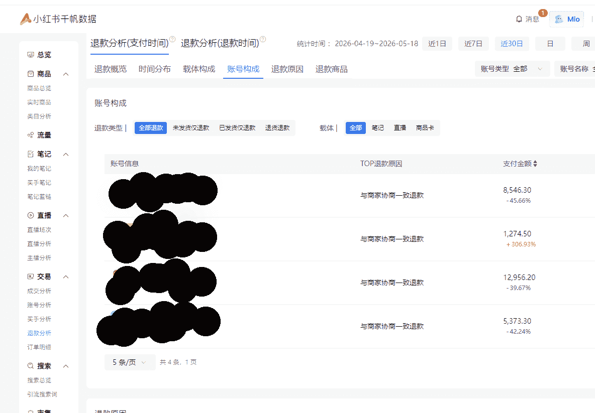

## 十一、核心感悟

我只是一个普通创业者，没有顶尖技术、没有超高认知、没有雄厚资源。我能拿到结果，核心只做对了一件事：锁定一个小而美的刚需细分项目，拆解全流程、打磨标准化、稳步落地、循序渐进放大。AI时代，普通人不需要全能，只要找准一个细分刚需，结合AI提效 + 工具赋能 + 轻协作模式，就能跑出属于自己的稳定变现项目。

————分割线————

看完这篇SOP，你觉得你懂了。但90%的人一到实操就会卡在第一步。

工具和教程只是最低级的壁垒，真正的壁垒是“立刻动手”和“圈层信息差”。

如果你想看全网最新的变现玩法，并且和一群执行力极强的极客一起下场拿结果，欢迎围观我的核心私域：【懒人专属群】。

我们不聊虚的，只做商业闭环的拆解与AI效率的压榨。系统内已沉淀1000+跑通的套利实战局。

👉 查阅圈子完整数字资产与上车门槛：

https://lazyso.com/insider/

认同价值、准备好下场干活的，扫码加我微信（lazyhelper1）

备注：【实操上车】，不闲聊

