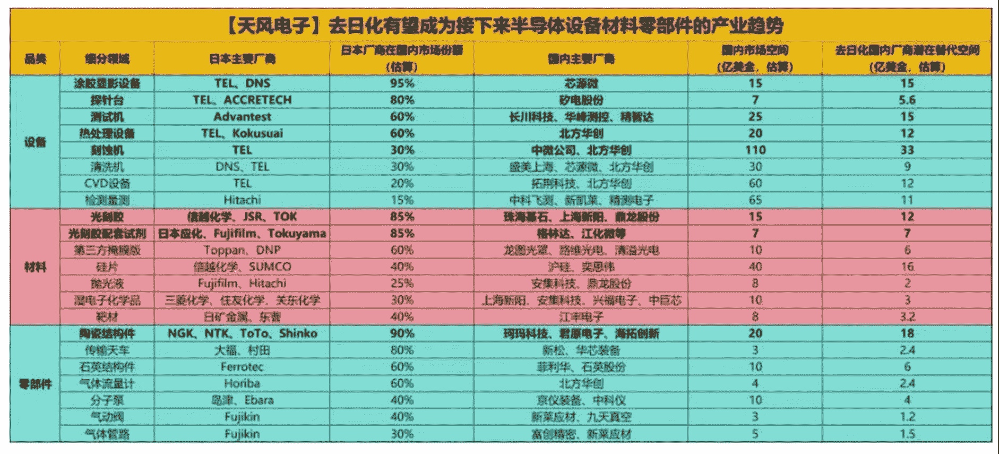

## 一些阶段性重要思考

260618 第四维的梦想付费文

整理：公众号懒人搜索，懒人专属群精选

讲 JAGJ 的时候，很多人不信。如今 500%+，逻辑开始逐渐普及了。

讲 DTGK 的时候，很多人同样不信。如今 200%+，逻辑开始天下知了。

讲市场不会切换到白酒消费的时候，依然有人是不信的。如今重新回流AI，是不是又都追回来了。

其实，这些现象背后的原因都很简单，就是没有形成一套完整的逻辑与技术思维。看不懂逻辑，就容易在最需要坚持的时候动摇。不懂技术，就容易在该介入的时候犹豫，在该持有的时候卖出，又在情绪最热的时候追回来。

如今，随着时间轴的推进，再作下个人阶段性思考。不构成任何推荐，也不作其它用途。逻辑巡礼系列，逻辑π 感兴趣可尽快阅读。全文 4100 字+，限时下架。

## 宏观：两大压制因素

今日份，依然从“宏观—行业—企业”的三维分析框架入手。前面讲过，短期宏观层面的主要压制因素有两个，其中之一就是美伊和谈迟迟未能明确落地。由于外界此前普遍预期相关限制将在6月逐步解除，全球在等待过程中其实一直在持续消耗库存。如果6月谈不拢，库存将会消耗殆尽。库存用完，叠加疯狂的补库需求，迎接的必然是原油疯狂涨价，进而影响全球通胀。

这里自然而然，会有个疑问，就是为什么一直在消耗原油库存，但是原油没有涨，反而还是跌的。这一点，其实可以从美国企业库销比切入进行观察。2026年3月，美国全部企业经季节调整后的库销比降至1.32，低于去年同期的1.38，也较2025年底持续回落。一方面确实反映终端需求仍然偏弱，商家因此不愿主动补库。但需求偏弱并不意味着库存可以无限下降，更不意味着补库需求永远不会出现。只要美伊协议继续延迟、原油供应预期迟迟无法改善，企业最终仍然需要恢复库存。因此，既然市场此前已经将6月视为潜在的政策解封窗口，那么相关问题最好也在本月得到解决，否则油价与通胀预期可能重新成为宏观交易中的主要扰动。

因此，目前美伊双方预计于6月19日在瑞士正式签署谅解备忘录，无疑是一个积极信号。这意味着，此前围绕谈判日期和协议能否落地的不确定性正在明显下降，也有助于稳定霍尔木兹海峡通航、伊朗原油供应以及全球能源价格预期。换句话说，如果协议能够如期签署，短期宏观层面的一项重要压力将得到解除。

另一个宏观压制因素，则来自美联储新任主席沃什。6月16日至17日的议息会议，将是沃什上任后首次主持FOMC会议。市场实际上已经充分定价本次维持利率不变，笔者也认为利率决议本身几乎不会出现任何意外。真正需要关注的，是沃什是否会在首次公开亮相中释放出美联储沟通框架正在发生变化的信号。

换句话说，这次会议真正需要注意的是，美联储今后准备如何与市场沟通。如果沃什弱化前瞻指引，降低点阵图在市场定价中的重要性，或者重新强调数据依赖、资产负债表与金融条件，那么市场过去所熟悉的政策预期形成机制就可能被重新改写。届时，受到影响的将不只是一次议息会议的解读，而是整个市场判断美联储反应函数、推演利率路径和定价全球资产的方式。

至于大家关心的缩表问题，根据笔者对沃什政策思路的理解，他大概率不会采取一刀切式的激进收缩，而更可能与美国财政部部长贝森特协同，以“手术刀式”的方式逐步推进改革。换句话说，沃什接下来真正要做的，未必是简单压缩美联储资产负债表的绝对规模，而是先从监管框架、银行资本约束和金融体系激励机制入手，再逐步调整美联储资产负债表的规模、结构与政策功能。

因此，后续真正值得关注的，可能并不是缩表规模本身，而是缩表将以何种方式推进、哪些资产会被优先调整，以及此前由美联储承担的部分流动性与金融中介功能，是否会逐步转移至财政部、商业银行和更广泛的市场化金融体系。整个过程更可能是一场渐进式、结构性的制度重塑，而不是一次性收紧。这样既能够降低资产负债表调整对市场流动性的冲击，也更符合沃什一贯强调的制度改革、市场纪律与减少美联储政策越界的方向。

讲到这里，其实已经可以得出一个相对明确的结论。宏观层面的两大影响因素，短期内大概率都不会朝着更坏的方向演化。当然，真正能够确认这一判断的时点，仍然要等到美伊协议正式签署，以及美联储沃什主持完首次议息会议之后。接下来一周，市场需要观察的，就是此前形成的这些积极预期，能否逐步得到验证并真正落地。如果接下来，以上两点都没有往好的方向发展，则是《6月行情展望》里讲的最悲观的情形。

## 技术面分类

这里，笔者从技术面进行分类佐证。如果大盘回踩不破4008附近，并向上有效且快速突破4075，此时，笔者会将仓位提升到7-8成仓附近，这里对应的底层逻辑就是两点都转好。如果大盘直接新低3927，笔者将依然维持低仓位，和原先保持一样仓位，这里对应的底层逻辑就是两点均未落实。如果在上述区间内震荡筑底，笔者会以同样3成仓资金做套，这里对应的底层逻辑就是两点都是有条件的达成。

## 行业与企业：AI 对冲偏紧货币

再来讲剩下的两个维度，也就是行业和企业。沃什曾明确提到，AI 有助于制造通缩。换句话说，无论沃什后续推动缩表，还是维持较长时间不降息，AI 所带来的生产率提升、成本下降与效率改善，都能够在一定程度上对冲偏紧货币环境对企业和经济的压力。

这也是为什么，不能简单地把沃什的政策取向理解为对AI产业趋势的单边利空。货币政策影响的是估值和流动性，也就是分母端。而AI改变的则是生产率、成本结构和企业盈利能力，也就是分子端。只要AI仍在持续提升效率、创造需求并推动企业盈利增长，那么即使分母端不再像过去那样宽松，分子端依然可以形成对冲。

讲到这里，按照笔者前面的推导逻辑，其实已经可以得出一个相对明确的结论。未来一段时间，更值得关注的，不是分母端还能给予多少估值扩张，而是分子端能否持续兑现。换句话说，接下来要更多从EPS的角度思考，关注收入、订单、价格、利润率和现金流是否真正改善，而不是继续主要依赖PE抬升来推动上涨。

那么，有哪些方向呢？

- **方向一：有色小金属矿产和材料涨价链**

第一个方向，就是AI最上游的有色小金属矿产和材料涨价链。经过前一阶段的调整，相关公司的估值已经得到较为充分的压缩，而供给约束和需求增长带来的涨价逻辑并未发生根本变化。只要后续价格继续上行，企业收入、利润率和盈利预期就有望持续改善，并进一步推动EPS上修。笔者关注的是，钨（六氟化钨）、铟（磷化铟）、锗、镓。

反过来讲，想参与这类行情，核心玩法也就变得非常简单。最好的方向，一定是估值尚未过度透支，同时价格仍在上涨、涨价斜率也在继续攀升的细分环节。

- **方向二：半导体设备和耗材**

第二个就是半导体设备和耗材，其实本质也都是涨价链，只是有的方向叠加了去日化，锐度更强。

海外链：比如MLCC上游材料介质陶瓷钛酸钡等，哪怕短期涨高了，笔者认为后续涨价持续性还是不错的。比如GCCL等。至于MLCC本身因为国内高容和超高容占比低的问题，因此笔者不会参与。然后，比如光模块这些，依然是产能为王。其实，对于光模块而言，年度降价斜率变缓，就是变相涨价了。然后现在卡脖子的是，谁有产能，谁就有业绩。笔者关注的是ZJXC和DSJM。进一步，更卡脖子的是EML激光，讲多很多次，就不再赘述。

国内链：比如半导体设备和材料方向，叠加去日化概念。笔者看好的是刻蚀机，BFHC、ZWGS等。硅片，LAW、HGCY等。测试机，CCKJ、JZD等。混合键合，分选机，TJKJ、JHT等。至于其余的，笔者认为要么是空间说的大，但是国产很难替代，要么是短期直接无法替代的，故事性比较强。

## 关于长线投资的正确理解

最后，还有不少逻辑π问，自己不懂技术，只想拿长线行不行。笔者再强调一次，这种思维本身就是错误的，是一种弱势思维。不懂技术，是需要解决的问题，而不是可以长期回避的问题。投资是一项严肃的事业，不是随便进来玩一玩，更不是买入之后什么都不管，就指望时间自动创造收益。

尤其是在大A的市场生态中，长期持有从来不等同于机械死拿。这里本身就是一个无法直接做空、筹码结构高度敏感的市场。一旦筹码拥挤度上升，边际流动性开始收紧，资金兑现就会迅速放大，股价也可能在很短时间内出现剧烈回撤。很多时候，企业长期逻辑没有立刻改变，但估值、筹码和交易结构已经先发生了变化。作为对比，看看上周美股半导体是如何表现的，大A又是如何跳水的。说实话，这种情况跟过笔者一个牛熊的逻辑π早已见怪不怪了。

所以，真正的长线投资，不是不研究技术、不观察筹码，也不是对回撤视而不见。恰恰相反，越是准备长期持有，越需要理解产业趋势、企业基本面、估值位置和市场结构，知道什么时候可以增加仓位，什么时候应该降低风险，什么时候只是正常波动，什么时候已经出现逻辑破坏。说到底，长线不是懒惰的借口，而是建立在持续研究、动态跟踪和严格风控基础上的结果。没有技术体系，也没有基本面判断，只靠一句“我拿长线”，就是对自己金钱的最大不尊重。

以JAGJ和DTGK为例，笔者都曾明确单独讲过。回过头来看，到现在又有多少人真正拿住了？讲到这里，其实讲PCB钻针耗材的时候，就应该联想到PCB设备。就如同笔者讲存储设备的时候，就要想到存储耗材一样。本质，其实也是量价齐升概念。台湾省、韩国、国内如今一直在扩产，预计26年设备投入550亿左右，27年或许会超1100亿。其中，PCB设备最核心的就是钻孔设备，德国schmoll一直在涨价，国内DZSK作为国产替代概念，已导入SNDL和SHKJ等厂家。然后是曝光设备，XQWZ也是一样的逻辑。至于其他环节，不再赘述。

以上讲了这么多，其实逻辑非常简单。按照笔者的思路，找到最紧缺的环节，不论是矿业、材料，还是设备，再锁定自己最看好的几家公司，根据技术选择介入时点，然后依据技术一直持有到该卖出的时候，仅此而已。如果实在拿不准，笔者自己的策略是不同概念分布持仓。

讲完国内，多讲一句，最近据说AMD拿到台积电额外产能了，也就是可以生产更多CPU，估计很快外资又要上调业绩预期了。感兴趣，可观察一下。

逻辑与技术，我们依然在路上！

————分割线————

在这个 AI 能替你写代码、写文章的时代，基础技能正在迅速贬值。绝大多数人正被淹没在海量的免费垃圾信息里，陷入低效的体力内卷。

当“努力”不再是壁垒，人与人之间唯一的护城河，只剩下“信息过滤”的效率与“认知系统”的维度。

圈子已稳定运行 7 年。我们每天利用 Python 爬虫与大模型算力，过滤全网最顶级的政经内参和搞钱风向标，做你最冷酷的“外部大脑”。

如果你认同这种“重塑认知防线”的极客主义，欢迎围观我的个人情报智库：【懒人专属群】。

https://lazyso.com/insider/

认同信息过滤价值、想省下每天 3 小时无效阅读时间的读者，扫码加我微信（lazyhelper1）

