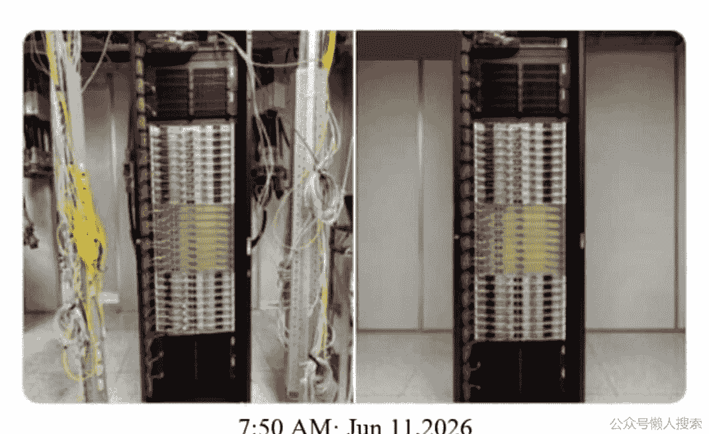

# 英伟达**Rubin**

**整理：公众号懒人搜索，懒人专属群精选**  
**懒人微信：lazyhelper1**

---

## 全球顶级云服务商现已部署NVIDIA Vera Rubin NVL72——全球最快AI平台

**哈桑·穆杰塔巴**  
Jun 17, 2026 at 07:00pm EDT

维拉·鲁宾时代已然来临，这款不仅是英伟达旗下、更是全球最快的AI平台，现已开始向顶级云服务商交付。

**Coreweave与甲骨文率先获得全球首批英伟达维拉·鲁宾NVL72系统进行验证，为智能体AI带来巨大飞跃**

英伟达维拉·鲁宾已进入量产阶段，但顶级AI云服务商已率先拿到首批系统进行测试与验证。英伟达上月还向主要AI公司交付了其首批维拉CPU。

> 相关报道：英伟达 Blackwell 横扫MLPerf 6.0所有基准测试，竞争对手望尘莫及，GB300系统性能较GB200提升高达60%。

甲骨文与Coreweave是首批部署英伟达维拉·鲁宾NVL72平台的云服务商。这些平台将与英伟达紧密协作进行测试，在前沿领域释放下一代AI性能。

甲骨文云基础设施执行副总裁Mahesh Thiagarajan率先分享了搭载72颗Rubin GPU与36颗Vera CPU的巨型NVL72机架照片。这些面向AI领域的顶级硬件组件（GPU与CPU），有望继Grace Blackwell之后成为NVIDIA的下一个重大成功案例——正如昨日公布的MLPerf 6.0测试结果所示，后者仍在持续刷新各项AI性能纪录。

> **Mahesh Thiagarajan @MThiagarajan**  
> “OCI持续推动AI基础设施的前沿发展。我们率先成为首批部署@nvidia Vera Rubin NVL72机架进行验证测试的云服务商之一，与NVIDIA紧密合作，以云规模为客户提供下一代加速计算能力。”

正如Jensen所言，AI是一个五层蛋糕，而Vera Rubin系统只是其中的一层。该系统由精密制造的基础设施提供支持，以驱动其电力、冷却、互连、网络等功能。此外还有软件栈，NVIDIA经过多年构建，已使其达到其他公司至今无法复制的采用水平或成功程度，这就是CUDA。而在AI领域，它被称为CUDA-X。

第二套系统安装在CoreWeave，由计算架构高级总监Jacob Yundt进行展示。CoreWeave展示了系统从卡车上卸下的完整视频，需要3到4个人才能将该设备运入设施，这足以说明单个机架的庞大，现在想象一下AI数据中心内数十万个这样的机架。

> **CoreWeave**  
> “我们是首家成功部署并验证@nvidia Vera Rubin NVL72的云服务商。不只是硬件，而是全栈体系：软件定义液冷系统（Valvey）、统一机架控制（Racky）、覆盖整个机群的CoreWeave任务控制中心。”

CoreWeave为其软件定义的液冷堆栈和统一机架控制分别取了一些有趣的名字——Valvey和Racky，据这家云服务商称，他们是首家成功启动并验证NVIDIA Vera Rubin NVL72平台的公司。

如前所述，NVIDIA的Vera Rubin平台开局即迎来高光时刻，其MoE训练速度仅需Blackwell四分之一的GPU，而推理的每token成本更降至十分之一。全面量产现已启动，第三季度将标志着这一智能体AI巨擘首次投入实际运营。

**关于作者**：Hassan Mujtaba，科班出身是一名软件工程师，同时也是一位充满热情的PC爱好者，担任Wccftech硬件板块的高级编辑。凭借多年的行业经验，他专注于对下一代CPU和GPU架构、主板及散热解决方案进行深度技术分析。他的工作不仅包括报道即将问世的技术新闻，还涉及大量的动手评测和基准测试。

---

————分割线————

在这个AI能替你写代码、写文章的时代，基础技能正在迅速贬值。绝大多数人正被淹没在海量的免费垃圾信息里，陷入低效的体力内卷。

当“努力”不再是壁垒，人与人之间唯一的护城河，只剩下“信息过滤”的效率与“认知系统”的维度。

圈子已稳定运行7年。我们每天利用Python爬虫与大模型算力，过滤全网最顶级的政经内参和搞钱风向标，做你最冷酷的“外部大脑”。

如果你认同这种“重塑认知防线”的极客主义，欢迎围观我的个人情报智库：【懒人专属群】。

https://lazyso.com/insider/

认同信息过滤价值、想省下每天3小时无效阅读时间的读者，扫码加我微信（lazyhelper1）

