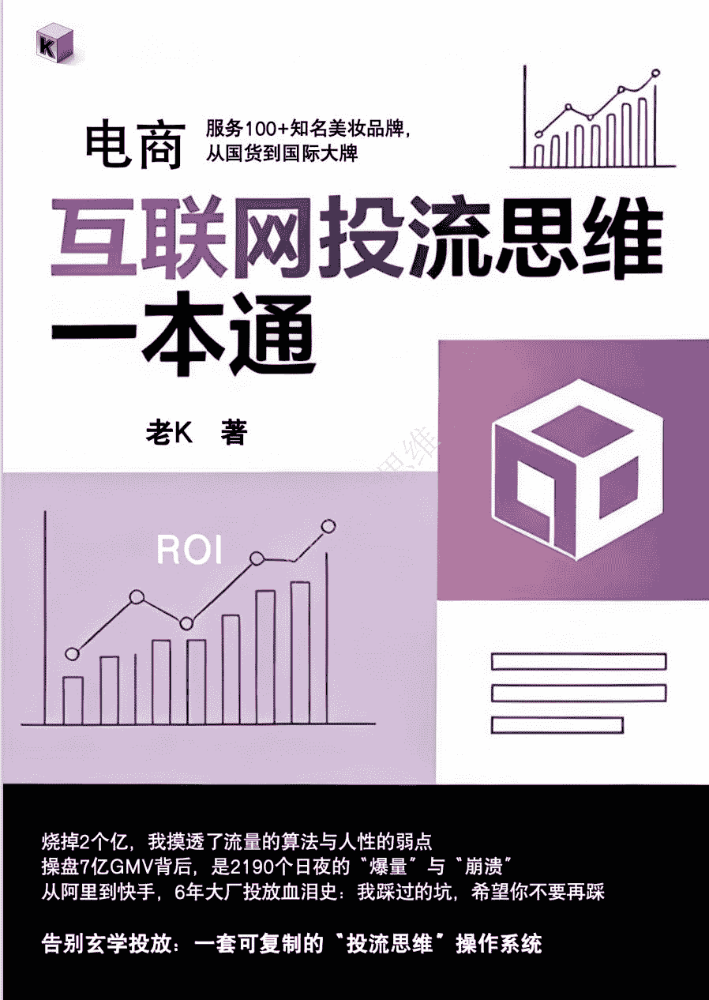

**3**年跑通**10+**项目，**6**年大厂烧掉**2**个亿写成**13**万字书：我是如何选项目、换项目不内耗的？

260616 副业SC 精华

整理：公众号懒人搜索，懒人专属群精选

懒人微信：lazyhelper1

大家好，我叫安然，一枚生财一年级学生。在5月份的Ai航海里超额完成了作业，被邀请作为优秀船员发表航海的感受，里有提到我在加入生财之前，就做过10多个项目，后来收到鱼丸的邀请写这篇帖子。希望分享我做过项目的同时也给圈友们提供一些选项目的思路，感谢生财鱼丸邀请～

请允许我先自我介绍一下：

6年大厂投流优化师，消耗金额**2**个亿**+**，带动**GMV7**亿**+**，2023-2026年自己下场实操过做过10多个项目，主要是电商、直播、婚礼督导，目前主营盘是投流以及婚礼督导，综合月利润在**2-3w**。之前23年的时候就通过雪姨知道了生财，然后也参加过线下的活动，但是三年后，今年4月份才加入了生财，观望了很久。

看很多人说，觉得生财的项目琳琅满目，怀疑自己的项目不够好，不知道是不是该换项目，或者是怕自己没有耐心坚持下来，甚至或者说看到别人拿到结果很心慌。但是我却没有这种感觉。

可能是因为做的项目多了之后，知道不是所有的项目都适合自己，只有适合自己的，自己能够做出来的，才是自己的。比如我在24年的时候就做过短剧。26年初AI漫剧很火的时候，很多人都想入局，我却处于观望状态，因为我知道做剧类的，要付出多大的心力和心血，来赌这个爆率。就像电视剧《天道》里的女主角芮小丹说的一句话**“**只要不是我觉到、悟到的，你给不了我，给了我也拿不住。只有我自己觉到、悟到的，我才有可能做到，我能做到的才是我的**”**。

所以争取多多表达，希望能帮助圈友们减少焦虑，专注自己～

别人都说看完一部剧，就像过完主角一辈子，那看完这篇文章，相当于走过我的三年，也是我做副业三年的总结。希望对你有所启发和帮助。

废话不多说，本文我分为四个板块，全文1w字，预计阅读10-15min：

- **1.**我当时选择**xx**项目理由？结果？总结和反思？
- **2.**现在这些项目还有没有机会和难点是什么？
- **3.**跑通这么多项目后，最后回到自己的主业，把**6**年投放经验沉淀成一本书？
- **4.**如何判断到底要不要换项目？怎么勇敢做决策？不后悔不内耗？

## 一、项目理由/结果/总结/反思

如下图所示，**2023**年到**2026**年我做过的**10**多个项目，从盲目跟风做项目，到要有自己的判断。

最后回到自己的主业能力，把**6**年投放经验沉淀成一本书。把自己最深的投放经验产品化。

以下是具体的细节：

### 1. 拼多多店铺（百货类饰品类）：**2023**年**4**月

**项目介绍：**

2023开了个拼多多店铺，算是第一个副业，前期打算主要是想卖饰品的，打算自己拍图。但是后来卖日百品类，客单在**3~20**这个区间。主要方式是通过买的一个插件进行批量铺货，出单后自己去**1688**找低于卖价的商品发货，赚差价。

一开始在还没有赚到钱的时候，就花了**2700**买了一个插件，原价**4700**讲价到一半，相当于被割韭菜了。交了钱之后，那个运营帮我们铺了几百条日百的货，前面一周有出单，十几单，是要自己发货，尝到了甜头。但是后面发的货都要倒贴，一单几块，总的好像倒贴几十上百块。因为有些货你的价格不是最便宜的，就不会在你的店铺这里买。

**选择理由：**

- 1. 2023年拼多多整体挺好的，正是红火的时候，各种百亿补贴还有出海。和消费降级，大家都很喜欢在拼多多买东西，我们看到了商机，属于红利期还在。
- 2. 当时已经上班**3**年了，进入疲惫期，觉得上班没意思，想找一个副业练手。因为我平常比较喜欢穿搭，每天上班衣配饰和发型都不一样，被很多同学、同事问各种链接，尤其是饰品的，所以一开始想尝试饰品类目，开一个饰品店，选择和我自身相关类目。
- 3. 看到这个项目，分享的人赚到了钱，觉得自己也可以尝试一下，属于初生牛犊不怕虎。

**结果：**

拼多多店铺踩坑，倒贴**2700**，是因为把核心能力交给别人，自己不懂货盘和平台规则。上班没有时间管理，就关店了。

**总结和反思：**

- 1. 商业认知不足：做为副业的第一个项目，认为只要铺了货就能卖出去，全靠自然流，其实是不行的。而且拼多多上以日百为主，日百的竞争非常大，很多店做了很久，拼价格根本拼不过。把核心能力交给别人，对于选品没有自己的认知，觉得只要是日百或者说好卖的都上，但其实跟季节有关。
- 2. 平台政策：对平台的政策不了解，比如说要客服要考核3分钟回复率。发货也要在规定期限内发，不然会被处罚。整体对于拼多多平台政策的玩法不了解。

### 2. 直播切片（食品、服装、百货、图书类）：**2023**年**7**月

**项目介绍：**

通过剪辑达人的直播卖点精华视频，进行二次分发。根据不同的季节和品，剪不同的品，做到爆点前置和堆量来，让粉丝因为相信达人而去通过短视频进行成交。

2024年开始做直播切片项目，主要是做多余和毛毛姐，还有2025年做张雪峰的图书和初高中教材。多余和毛毛姐剪出过**200**万点赞、**3000**万播放的爆款视频。整体**4**个号加起来有剪到**500-600**个带货视频，包含食品、服装、百货、图书类目。

**选择理由：**

- 1. 当时因为是一个朋友介绍的，他们有在做类似的兼职，然后也介绍给我做。还有就是属于电商类，和我的主业相关，就想着尝试一下。
- 2. 而且当时多余和毛毛姐这个达人的热度还可以，而且当时做切片是一个很火的副业，市面上很多达人都开放了自己的切片业务，授权给一些人做。
- 3. 还有些新闻报道做直播切片赚到很多钱的，还有当时有专门建工作室团队剪的，赚到百万的都有。

**结果：**

1. 直播切片项目赚到了买一个苹果手机和佳能相机的钱，覆盖掉生产成本，相当于零成本启动。剪了**500-600**个视频，积累了剪辑的手感和对于选品和运营做账号都有帮助。
2. 算是做副业以来第一个开始赚钱的项目，感受到了除了在公司赚钱，还能自己赚钱的感觉。

**总结和反思：**

1. 多账号保持日更是非常难的，剪辑耗费时间长。需要很强的意志力才能坚持。当时把所有能剪的品都剪过，但是到后面佣金率下调，达人的公信力下降之后，就剪疲了。
2. 佣金率下调之后，很多人都开始投流，但是投流的话，需要自己投自己剪自己投，需要投入的成本就更高了，出单率也没有之前高。意识到项目是有红利期的。
3. 后面还做过张雪峰的图书的账号，也进行了自己投流的方式赚到一些钱。但是后来张雪峰不是出事了嘛，然后这个账号就直接把所有的作品隐藏掉，停掉这个项目了。

整体来说，切片的业务需要大量剪视频，时间投入成本高，要高执行力。还有就是随着佣金下调之后，会打击积极性。

### 3. 穿戴甲（直播类）：**2024**年**5**月

**项目介绍：**

通过自己买穿戴甲样品，自己在家搭建直播间，进行不露脸，只露手的直播进行卖穿戴甲，赚差价。

**选择理由：**

1. 直播切片业务停止后，进行新项目的筛选。根据当时穿戴甲刚刚火起来，大家对于穿戴的需求比较大，而且小红书上很多帖子都说穿戴甲的项目比较好做。
2. 作为女生和穿戴甲的受众来说，想着如果穿戴甲项目试一下，如果卖不出去的话，可以自己戴。
3. 而且当时穿戴甲的项目比较新颖，大家女生们知道除了去美甲店做美甲，还可以有这么多颜色精美、质地漂亮的穿戴甲可以选，可以随戴随取，减少指甲的伤害。算是一个小小的风口。

**结果：**

除掉直播间搭建设备和10多副穿戴甲成本，整体好像是赚了**300**多块钱。后来大概卖了两三个月，难坚持日播，因为好像要去做别的项目，就停了。

**总结和反思：**

1. 知道了直播是非常累的，就算是不露脸，你作为普通人或新手，一个人直播一两个小时也是非常吃不消的。所以后来投流中更共情那些主播了，知道他们一天要播四五个小时有多累。
2. 知道了穿戴甲的利润比较低，一副的话可能赚个几块钱。而且竞争比较激烈，你的有的款，别人家也有。出新款的频率很高，你要不断地去更新自己店里面的品类和直播间的整个人货场，优化直播页面，买一些小道具之类的，成本会越投越多。还有一些做了很久的，自己有工厂的穿戴甲的店也开始进行直播，竞争会比较大。
3. 比较难坚持每天日播。启动成本低，也意味着利润低，不能形成复利。

### 4. 短剧（分发）：**2024**年**11**月

**项目介绍：**

通过剪辑爆款短剧，设置付费章节，进行短剧分发，获得收益。剪辑很多爆款短剧，比如说当时比较火的《我在**80**年代当后妈》，还有一些男频剧。在视频号和小红书建立账号，分享短剧精彩和冲突性开头。比如扇巴掌下跪和一些抓马的剧情来吸引用户点进来，然后结尾进行二维码引导到APP进行看，然后看到大概几集左右就开始付费。如果有用户付费，那你就可以获得一定的佣金。

**选择理由：**

1. 当时很火，很多媒体和大家都在讨论短剧的盛况。短剧刚刚从小说文字版的转到，大家可以自己拍，眼见为实。很多人也觉得看着很上头、很爽，属于一种比抖音还厉害的精神鸦片。大家对于付费接受度比较高，有些很多人看着看着就看进去了，不知不觉充了几千块钱。
2. 因为做投流起家就是做的信息流的小说投放，所以对于小说和短剧比较熟悉，算是有一定的基础。
3. 还有一个原因是在朋友那里偶然获得的一个做短剧的SOP，所以就抱着试一试的心态，按照SOP去走了一遍，发现诶？真能赚到钱。

**结果：**

结果好像是赚到140块钱。视频号和小红书两个平台都做了，但是都被封号了。

**总结和反思：**

1. 首先短剧在当时是属于一个风口项目，风口就有高有低。大家新鲜劲过去，短剧成为稀松平常的事情之后，付费意愿就会降低，甚至可以找到盗版。那就赚不到钱。
2. 分发短剧其实有侵权和封号的风险，属于搬运，平台会严查，所以封号是**100%**的事。
3. 如果一定想做风口上的项目的话，就做好随时退场的准备。抓住风口很重要，但是也要和自己的经验相关，会更好上手。还有就是敢尝试。

### 5. 婚礼督导（杭州周边城市）：**2020**年**8**月至今

**项目介绍：**

是线下的兼职。主要是以我们双胞胎优势，一个负责做督导一个负责做音控。

主要做杭州，以及周边为主，相当于旅游，杭州周边的城市都去过比如：金华、江苏、湖州、温州、宁波、南通。可以免费坐车、免费吃饭、免费喝奶茶、喝咖啡，和免费吃婚礼小蛋糕、吃水果、搂席等。

然后根据我们多年做督导的经验，我们想把我们这个督导经验赋能给其他人，然后变现。我们当时录了一个录播课程和做了配套的**PPT**课件来卖，去讲整个督导的流程，要怎么彩排，怎么去把控细节和怎么去对接新人和婚礼管家、酒店负责人、婚庆工作人员。

**选择理由：**

1. 我哥的朋友是浙江电视台的主持人，然后平常也会接一些婚礼的活动。所以我哥把我们介绍给他，让我们和他一起做婚礼的兼职。
2. 对于我们双胞胎的优势来说，可以一人负责一个职位。一个负责做督导一个负责做音控，赚到双倍的钱，还能够顺带免费旅游，省了去杭州周边游玩的钱。
3. 我们本来就擅长和人沟通，做起来更得心应手了。除工作以外，周末还能去散散心。赚到了钱，还能够买自己喜欢的东西。

**结果：**

1. 婚礼督导我们做了**6**年从**2020**年**8**月做到现在，督导过上**200**场婚礼，赚到**7W+**，见过各种预算的婚礼和各种酒店。
2. 做的录播课程和配套的PPT课件在小红书上卖。客单是**¥599**，然后卖出了**2**单赚了**¥1000**多块钱。
3. 但课程没放大，是因为私域交付和组织协调太繁琐。同时发现一个问题，我们并不擅长做私域。我们最大的卡点就是我们不擅长做私域的交付。我们已经给他们拉了十几个人进群了进里私域，给他们介绍了单子，他们也想做，但是我们要沟通他们的时间和婚礼的时间和主持人的时间有点繁琐。所以我们就觉得很麻烦，所以我们就想自己赚算了。

**总结和反思：**

1. 知道了自己做和教别人做是两件事情。如果要去线下现场教别人做的话，成本会更高。如果只是线上的话，需要精准获取客户和进行私域的沟通，对于我们来说是一个卡点。
2. 由于我们双胞胎的特殊性和我哥的朋友，我们是固定搭配，每次都是一样的人。如果相比其他的人，她们会搭配不一样的主持人，然后遇到不一样的婚庆的人，对于她们来说，成本会高，也不包来回车费和吃饭这些费用，如果是跨省的话。有可能花出去的钱还没有赚的钱多。
3. 有安全和信任成本的问题，有些婚礼会是那种礼堂里面。属于乡下，如果是单独的一个小女生去做婚礼督导的话，会担心安全问题。还有每次搭配的主持人不一样的话，也会有流程有区别。

### 6. 商务（美妆、母婴类）**2025**年**5**月至今

**项目介绍：**

通过我们多年的投放资源，给有品要推的商家找商务，再让商务去找达人来给商家进行产品的带货，作为中间商赚取差价。按照返点和产品的销量来拿提成。

**选择理由：**

1. 我们投流工作中需要接触到大量的商务，有资源可以给有商品需要投放的人提供资源。
2. 同时也有一些人，他们有产品，但是卖不出去，需要找达人，所以说属于帮忙。
3. 和我们的工作息息相关，做起来得心应手，需要对接过程中协调双方。完成产品的寄样、报价、拍摄。

**结果：**

1. 给品牌雅迪推荐了视频号和小红书的达人进行合作，赚了**1000**多块钱。
2. 还有母婴产品益生菌的带货，给品牌方推了两个母婴类达人。进行寄样和视频拍摄。

**总结和反思：**

单子不固定，达人的需求不是很稳定。比较难匹配到合适的达人，之前有100个找到2个的案例。沟通成本高，提成的返点不固定。有的时候达人已经找好，但品牌方没货，导致不能正常推进。

### 7. 小红书代投（护肤品类）**2026**年**4**月

**项目介绍：**

通过主业投放的经验，给瑞士的一个新品牌在小红书上进行代投。投放聚光CID跳转天猫进行成交，根据消耗的返点拿取提成。

**选择理由：**

1. 和主业息息相关，比较容易上手。有一定的信任成本，可以借鉴其他平台的经验进行投放。
2. 因为是美妆品类，所以说想多尝试不同平台，积累经验。在写投流书的同时，希望增加收入。

**结果：**

跑通项目，但是客户提供的素材低质和沟通上不愿意配合，沟通成本比较高，客户对于聚光CID跳转天猫预期过高，导致在冷启动期项目停投。

**总结和反思：**

1. 代投沟通成本高，不像公司一样，大家以项目为单位合作，各司其责。你要负责整体的全链路。
2. 有很多想找我代投的人，但是他们的项目我聊下来并不是都能放大，和能赚到钱。他们只是想简单的依靠投流来获得高回报率，其实本身的产品和服务并不过关。但其实投流只是放大的一种手段，真正影响用户复购和ROI的还是你产品本身。

### 8. 投流书（**6**年投放经验沉淀）**2025**年**5**月至今

**项目介绍：**

通过把根据我们多年的投放经验：从阿里到快手，**6**年大厂投放血泪史，烧掉**2**个亿，操盘**7**亿**GMV**，服务过**100+**品牌，涵盖国内外头部美妆，**2190**个日夜的**“**爆量**”**与**“**崩溃**”**，把它写成了一本书。耗时一年，改了**20**多版，总字数**13**万字。

**选择理由：**

1. 发心是希望把自己多年的投放经验积累下来，也不枉打工这么多年，不希望离开。

公众号懒人搜索，懒人专属群分享

开职场之后一无所有，又要从零开始。

还有就是希望我们的投流经验能够帮助到一些需要的人。

结果：

2. 如果能通过卖这本书能够赚到一些钱的话，也是对于我们这个职业的一种复利。

3. 觉得人要有自己的代表作和创作出的产品，不然会迷茫，觉得一年到头没有做什么。

总结和反思：

1. 写一本书是很难的，中间有两三次都直接想放弃，说不写了。当你写到 1/3，还有 2/3 的时候，你是会崩溃的。

2. 接下来是怎么让别人知道你有这本书和卖出这本书是一个问题。希望找到不同的渠道来宣传我们的书。

3. 做任何事情都很不容易。要找到自己热爱和有创作欲的赛道进行长期深耕，慢就是快。

## 二、现在这些项目还有没有机会和难点是什么？

### 1. 拼多多店铺

如果有自己的厂家和有货源的话，还可以尝试或者深耕一下。还有，如果可以走海外 Temu 路线，走出海路线，还有一些余量的机会。但是如果是新人入场的话，会比较难。拼多多整体的商业模式比较闭环，竞争也比较大。

### 2. 直播切片

找到超级头部 IP，可以授权贴片的话，赚几杯奶茶钱还是可以的。但是如果想赚大钱的话，整体的风口已经过去，而且现在整体直播业和大家对于达人 IP 的信任度在逐渐下降。大家对于直播和达人推荐的产品没有那么强的购买欲，会导致就算投流，整体的利润也没有之前好。

主要的难点存在于人们对于 IP 的信任度下降和剪辑。很多视频对于缺乏执行力和视频敏锐度的人会有难点，难以坚持日更和出爆款。加上现在新兴项目很多，大家难以在一个项目上坚持很久。

### 3. 穿戴甲

现在经过两年的发展，穿戴甲发展的产品会很精美，有很多猫眼款和很多让人眼前一亮的款式。甚至是比在美甲店做的还好看的质量，都在市面上流通。如果做到客单价稍微高一点的，还是有一些机会。但是需要团队，或者低价货的渠道。

但难点依然还是坚持直播和在看不到收益的情况下，依旧坚持做客单低的产品。还有搭建比同行更精美和好看的直播间，跟着圈内的发展和同行进行竞争。而且现在有很多人开始做穿戴甲的品牌，也是竞争的一方面。

### 4. 短剧

短剧现在整体的机会和风口已经过去了。尤其番茄推出免费短剧，还有红果，甚至可以免费看一些比较爆的剧。大家对于短剧的消费热情比之前有所缩减，可能出单率和分发量比之前有所减少。

还有平台对于 AI 短剧和漫剧的支持，也会让平台把流量倾斜到这两方面。而短剧会逐渐归于平常，就像大家在很多平台上都能刷到短视频一样，短剧不再成为现象级的现象，而是成为日常生活中很平凡的东西。

当它成为很平凡的东西，那就说明失去了信息差的价值。如果非要做也可以，但是可以结合 AI 和现在大家对于影视寒冬等一些焦虑，进行个人的一些创作，去打造出新的短剧和爆款短剧来进行变现。

### 5. 婚礼督导

婚礼督导还有机会，因为婚礼作为社会的一种刚需，一到高峰期、节假日，比如说五一、国庆这种，结婚的还是蛮多的。但是这个项目具有特殊性，不是所有的人都有机会接触到婚礼督导。而且整体来说，还是像我上面说到的，如果只是独立的一个小女生去做的话，她可能赚的钱甚至不能覆盖她的出行成本，所以它的特殊性决定了它的机会，也是它的难点。

当然想尝试的朋友可以去小红书或者是 Boss 上去找一些主持人或者是婚庆公司，问他们需不需要督导，然后可以去体验一下，你才决定说你要不要把它作为一个副业或者是技能去对待。毕竟能看到无数的人结婚，在你面前宣誓，能够接触这么多人，也是有趣的一件事。

### 6. 商务

商务的话，现在会比较成熟，很多有兼职的商务。但是整体作为兼职来说还行，但是如果去进公司成为一个商务的话，会需要疯狂建联，会比较消耗。但是由于现在品牌比之前来说没有太多的钱来投给 KOL 或者达人，还有现在大家对于 KOL 推荐的东西也慢慢地祛魅和持怀疑态度。商务这一块也会比之前更加艰难。

### 7. 小红书代投

如果你很喜欢做甲方服务别人，不嫌麻烦，能和客户沟通 300 个来回，然后任何一点风吹草动都要给客户一个解释，以小博大，以为投流能解决一切事情，满足他们无限的要求的话，可以去尝试一下代投。其实代投在投放里面来说，不管是作为代理商还是作为个体的代投，其实都挺难的。要处理的事情非常多，沟通成本高，吃力不讨好。

当然，投流作为一种放大产品能力和品牌影响力的手段来说，如果自己有品牌，或者需要投流的话，可以自己尝试。因为现在整体的投流平台和方法都支持商家自己投，可以进行对自己的产品进行投放。

### 8. 投流书

最后一个的话，大家可以把自己的经验积累下来，不管是写成一本书，还是写成一个总结的文档都可以，算是对于自己行业和多年职场的一种总结。整体来说，它是从个人角度积累，也希望自己的技能能够帮助到有需要的人，这样可以放心去做，两全其美。

但其实要写成一本书，首先自己能够深耕自己的行业多年，并且对于自己的岗位和行业整体的逻辑是通的。不光是一个 SOP，还要能够从商业、行业、经济等角度，对自己的行业有一个认知，而且要有极强的执行力，能够坚持写一年，改 20 多版，甚至是推翻重来，写到 10 多万字。对于一些人来说，性价比不高，还有更值得做的项目。

## 三、跑通这么多项目后，最后回到自己的主业，把 6 年投放经验沉淀成一本书？

### 1. 为什么最后回到自己的主业能力，把 6 年投放经验沉淀成一本书？

1. 做过这么多项目之后，你会发现有一部分项目都属于风口项目，比如直播切片和短剧，都是在当时当年的情景下，它们才会成为一个赚钱的项目。一旦风口过了之后，猪掉下来就会变成普通的猪肉。

2. 这些项目终归到底来说，它是副业。回到主业上会发现，把自己多年的投流经验写成一本书是一件有意义的事情。除了能够记录自己多年的投放经验，也能够给自己多年的职场经验一个交代，而不是从职场出来之后什么都没有，过两年之后什么都忘了。

3. 最主要的点还是从长期主义的角度来说，拥有一个产品是一个好的商业模式。但是在现在做一个产品是需要很多的资金投入和资源供给。但是如果你把自己多年的经验打造成一个产品，性价比最高，最可行。锻炼自己打造产品能力的同时，也能够把经验总结出来，帮到需要帮助的人。

4. 投放其实是很难的，需要多年真金白银的经验积累。可以写出来给想学投放的人参考，所以把它写成书。书的内容主要是以图文结合的方式，比较好理解，这也是和其他只讲定义类的书不一样的地方。

投放是需要一定门槛的，虽然是 6 年投放实战经验总结下来的，但是在 AI 时代或者互联网时代，人人都想做产品，都会做 AI 产品。会投放的人就是比不会投放的人更容易成功一点，或者说，对于商品和副业的理解会更加透彻一点。

因为你要懂平台的逻辑和卖方的逻辑，所以这本书写出来也是为了帮助大家能够更好地去卖自己的产品，懂流量的逻辑。投流依托于个人，目前 AI 很难量化。现在投手的门槛是相对较高的，会有一些垄断性和壁垒。因为投放需要很多实操经验，就是你花钱花出去了，然后才会有效果，花的每一分钱都要给一个交代，24 小时在线，算是一个高风险的职业，因为你要对花出去的钱和回收 ROI 负责。

但是人们做出来产品，下一步就是要卖。那你要想：你是要卖给谁呢？你要怎么卖呢？你要在哪个平台卖呢？这些都是在做副业和创业的过程当中非常重要的，是非常大的一个卡点。写这本书还有一个很重要的原因，就是想帮助大家减少卖货的门槛。把我们多年的投放经验：从阿里到快手，6 年大厂投放血泪史，烧掉 2 个亿，操盘 7 亿 GMV，服务过 100+ 品牌，涵盖国内外头部美妆，2190 个日夜的“爆量”与“崩溃”，把它写成了一本书。耗时一年，改了 20 多版，总字数 13 万字。这本书，我的第一感受是：这不是一本“写”出来的书，而是一本用钱“烧出来”的书。市面上 90% 的投放书都在讲“什么是信息流”“什么是 OCPM”，像是平台帮助文档的翻版。但我们的书不一样，它更像一个在大厂被蹂躏了 6 年、烧了 2 个亿之后，把所有的血泪、教训、方法论、模型全部掏出来整理成册的东西。

这本书不是零散的经验分享，而是一套完整的投流思维操作系统。从底层逻辑到顶层策略，从单个计划优化到团队管理、品牌经营，层层递进。读完让你拥有流量逻辑、产品思维、商业逻辑、管理方法，而不是单纯地了解什么是投放。

要不然你做出来一堆东西，没有人买，那也是没有意义的。那你的副业和创业就相当于是一堆废纸，也是没有用的。所以这本书写出来，花了一年多写出来，也是为了帮助大家理解投放的逻辑和平台的逻辑，还有商业的逻辑。最大程度地理解需求方和卖方的市场，才是你成功的很大关键。

因为做东西是很容易的，你要做一个真需求、能卖出去的东西才会有回报。不是做很多东西，但是你认为有用，但是市场不需要或者平台不需要。投放的逻辑也不认可你的这个链路的话，是没有用的。所以希望这本书能为大家提供另外一个商业的视角和投流的视角，就是站在平台方的一个视角，让大家知道这些成千上万甚至几个亿的 GMV，他们到底是怎么卖出去的？这个市场到底想要什么。所以这本书就是帮助大家解决卖产品，或者说对平台逻辑的一个理解。

然后这本书后续也会上架到小红书店铺和朋友圈私域。目前已经申请了版权，已经写完。如果大家有需要的话，可以去看看。

所以从做过 10 多个副业，从直播切片、婚礼督导、拼多多店铺，到最后发现真正适合自己的项目，是把自己最深的投放经验产品化。最后回到自己的主业能力，把 6 年投放经验沉淀成一本书。

### 2. 怎么测试出适合自己的项目？

每个项目都有各自具体的方法论，大家移步生财官网搜索即可，本文不展开。

分享三个个人选择项目的方法。

#### 1. 根据自身擅长领域

回看自己的职业经历或者是生活经历，在哪方面会比较有表达欲和创作力？结合这方面来看，这个项目是否能够长期坚持下来，能无痛做项目，或者说在做的过程中才思泉涌，有很多新的想法可以加到项目里面。

#### 2. 已经被验证过

选一个项目，并不是脑子一热觉得好，就盲目投入。在做之前要多方分析，分析整体环境的局势；如果是风口项目的话，分析项目周期和未来市场的一个估值，看整体市场的方向，才决定是否要进入这个项目去分一杯风口上项目的羹，而不是凭着自己单点的认知，盲目投入。

还有，这个项目已经是被跑通过、被人验证过，能够赚到钱并且在红利期内，才会去结合自己的经验和分析，进入这个项目的市场，而不是单单凭自己的感觉。

那我具体是通过前面的哪些项目得出这个判断的呢？

我通过直播切片和短剧分发的项目，得出了这个判断。因为直播切片当时很火，而且大家对于切片分发的信任度是在的，对于达人的信任度也很高。项目的整体风向是正的，而且我在做这个项目的时候，很快获得了正反馈。比如说在我做了大概半个月的时候，我就出了爆款视频，获得了 3000 万播放的爆款视频，涨粉速度也从 1000 涨到 1 万。所以这种在外部是风口正向，内部也获得正反馈的时候，就会更有信心来把这个项目做好。

还有短剧项目，基于我之前对于短剧和小说就有一定的认知和行业基础的判断，加上当时短剧的火爆，决定做这个项目。然后这个项目虽然是歪打正着，但是在做的过程中还是赚到了钱，所以这种风口项目，需要判断一下是不是在自己的能力范围之内能够闭环。

#### 3. 完美主义和摇摆不定

有些人做项目和创业，会觉得我要做一个一鸣惊人的、从来没有人见过的产品，然后惊艳所有人，成为独角兽，赚很多钱。但其实所有的产品都是在不完美的过程中，就敢拿出去，在市场上碰一碰，来不断地迭代，第一版、第二版、第三版，最终根据客户的需求迭代出好的产品。

摇摆不定就是在做自己的项目的时候，发现 A 项目好，B 项目也不错，C 项目好像挺赚钱的。在摇摆的过程中，错失了机会；看到别人做得好就焦虑和羡慕，但自己却不真正地去研究自己的项目增长点在哪里。

## 四、如何判断到底要不要换项目？怎么勇敢做决策？不后悔、不内耗？

### 1. 如何判断要不要换项目？

从投流的角度来说，就是投入产出比。如果一个旧项目做了很久，但是它的产出不稳定，而你发现一个新项目，那你就要去衡量：如果你放弃旧项目去做新项目，中间是否好迁移；还有旧项目放弃的时候，有多大的损失能够在新项目里面补回来。

决定做新项目就 all in，而不是让旧项目占用你的时间、金钱和精力，导致新项目和旧项目都做不好，看谁的性价比高。我一旦决定要换项目，那就要迅速地去做新项目，不要纠结太久，浪费时间。

### 2. 如何勇敢做决策，不后悔、不内耗、不焦虑？

#### 1. 扪心自问

在决定换一个项目的时候，多方考量后，你问自己以后会不会后悔。如果答案是不会，那就换；会，那你就把你现在旧的项目优化。如果优化不了，要为你优化不了而没有换新项目的这个结果承担，而不是到后面换也后悔，不换也后悔。像赌博一样，买定离手。

#### 2. 及时调整

1. 在做任何事和任何项目上，只要尽力了，就可以了。因为你可能当下来看，可能觉得是一件坏事，觉得是一个损失。但是长久来看，当下的决定就是最好的决定。因为从长期角度来看，可能这个项目有 Bug，或者它可能属于一个风口项目。如果你过了风口还是一直死磕，那你可能会错过一些其他的机会。

2. 要有长期主义和长线的思维，而不是只盯着眼前。你要相信能做好这一个项目，那你后面的项目也能做好。相信自己才是做项目的法宝。不管做再多的项目，它都只是一个经验而已。放弃某一个项目，并不能够代表什么和决定什么。给自己的心理压力小一点，多从理性的角度，多问一句为什么。

3. 如果实在内耗和焦虑，晚上睡不着觉，那你凌晨 3 点爬起来把你的项目优化一下。如果优化不了，那你就找原因、解决问题，而不是被你的想象和情绪困在项目里。

### 3. 从职场到自由职业，在做项目中和生活上有什么新的变化？

我是从直播切片开始过渡到从职场到自由职业的，再到后面的小红书代投和投流书，目前做自由职业已经有 2 年的时间。在做这些不同的项目的过程中，发现和职场每天都有不一样的 KPI，每周都有要完成的 ROI，每月都要有人告诉你该干什么。自由职业的话，所有的一切都要你自己来决定和承担。

项目上：

到自己做项目的话，你要自己找项目，自己评估，自己完成从 0 到 1 的搭建，到最后拿到结果。整体的主观能动性是自己来决定，还有自己来承担所有的责任。会比在公司做投放来说，需要承担更多的责任与决策，但同时也会获得更多的成就感。因为在公司也只是整个项目的一环，接触不到整个完整的商业链路。

生活上：

生活上作息是最大的变化。在职场的时候，固定的时间起床、固定的时间到公司、固定时间下班。但是做自由职业的话，你的一整天的时间都由自己分配。刚开始半年会有惰性，每天大概都是快中午才起床，然后吃完饭，下午再去研究项目。但是到后期你会去调整你的整个作息，比如说我现在就会早上九十点起床，然后看书一个半小时，然后再运动，做完运动再吃中饭，吃完中饭休息一下，然后再开始去做项目。会意识到时间的重要性和每天增加自己除了工作外的其他活动，来避免自由职业的信息茧房和假装努力的情况。

## 写在最后

做项目和上班一样，它只是你人生中的一部分，其中的一家公司，而不是代表一个项目就代表要做一辈子，和代表你这个人。

就像你也不会在一家公司上一辈子的班，永远都不离开，是一样的道理，它只是一个选择和一个方法。

没有最好的项目，只有最适合某一个人的某一个项目。有可能这个项目他做得不好，但是你却可以通过一些自己的原因和某些因素获得成功，都具有概率性。

本文很大的篇幅都在写我的个人经历，方法论写得很少，但我希望通过我的经历和项目，给你一些启发和发现：原来这个人和我一样，哈哈哈哈。

当在同行的路上，你看到有许多人跟你一样挣扎、内耗，不是一次就成功，你会觉得更加释然，也没有那么焦虑。可能这就是这篇文章的意义，希望大家都能够经过无数荆棘的小路之后，遇见康庄大道。

看完这篇文章，哪怕可以给你提供避雷的经验，或者给你提供其中的一些思路和想法，也是好的。用我的来时路，照亮你的前路。

祝大家所愿皆所得，找到适合自己的项目，拿到自己想要的结果。一起生财有术，马上有钱！

————分割线————

看完这篇 SOP，你觉得你懂了。但 90% 的人一到实操就会卡在第一步。

工具和教程只是最低级的壁垒，真正的壁垒是“立刻动手”和“圈层信息差”。

如果你想看全网最新的变现玩法，并且和一群执行力极强的极客一起下场拿结果，欢迎围观我的核心私域：【懒人专属群】。

我们不聊虚的，只做商业闭环的拆解与 AI 效率的压榨。系统内已沉淀 1000+ 跑通的套利实战局。

公众号懒人搜索，懒人专属群分享

👉 查阅圈子完整数字资产与上车门槛：

https://lazyso.com/insider/

认同价值、准备好下场干活的，扫码加我

微信（lazyhelper1）

备注：【实操上车】，不闲聊

