公众号懒人搜索，懒人专属群分享

全自动化月上百站，单月净赚 **3700** 刀：游戏攻略站底层玩法 + 新手全套 SOP

260622 副业SC 精华

整理：公众号懒人搜索，懒人专属群精选

懒人微信：lazyhelper1

## 一，前言

### 1. 背景介绍

哈喽，生财的圈友们大家好，我是诗意听涛。

介绍下我的情况：

- 98 年，当前旅居无固定 base（最近 3 个月 - 广东惠州）
- 22-25 年：在北京互联网大厂，先后在美团、贝壳的软件研发部门
- 26 年初：裸辞创业。从 0 到 1，4 个月时间跑通出海游戏站全流程 + 多并发全自动化系统（无人值守、自行修复、自行进化），月上百站，追上大厂税后收入。
- 目前：靠全自动化上站系统，稳定上流量站 3-4 个站，理论不限（新词数量等限制因素）

我目前的成绩：

- 月收入：3700+ 刀
- 日收入高峰：200+ 刀
- 月上站数量：近 **100** 个。

目前，构建了 1 套无需操心的自动化系统：

1. 业务上：涵盖从找词、上站、发外链。
2. 功能上：覆盖多会话管理、多浏览器操控、移动端远程控制、Skill 智能优化等常用必需功能的系统。

### 2. 游戏站是什么？

- 一句话介绍：游戏攻略站是针对游戏相关搜索需求 SEO 内容站，主要盈利来自广告收益
- 游戏攻略站长什么样（常见游戏站举例）：首页：介绍游戏相关内容（列举常见的游戏站，PS：下面网站不是我的，仅供参考）

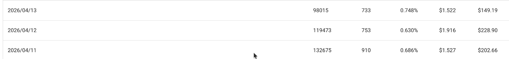

游戏内页：具体介绍游戏某个细分关键词的页面

- 网站数据

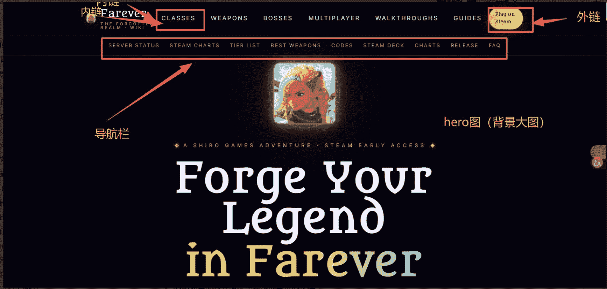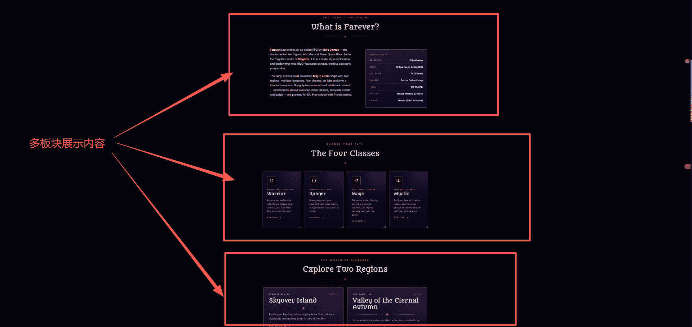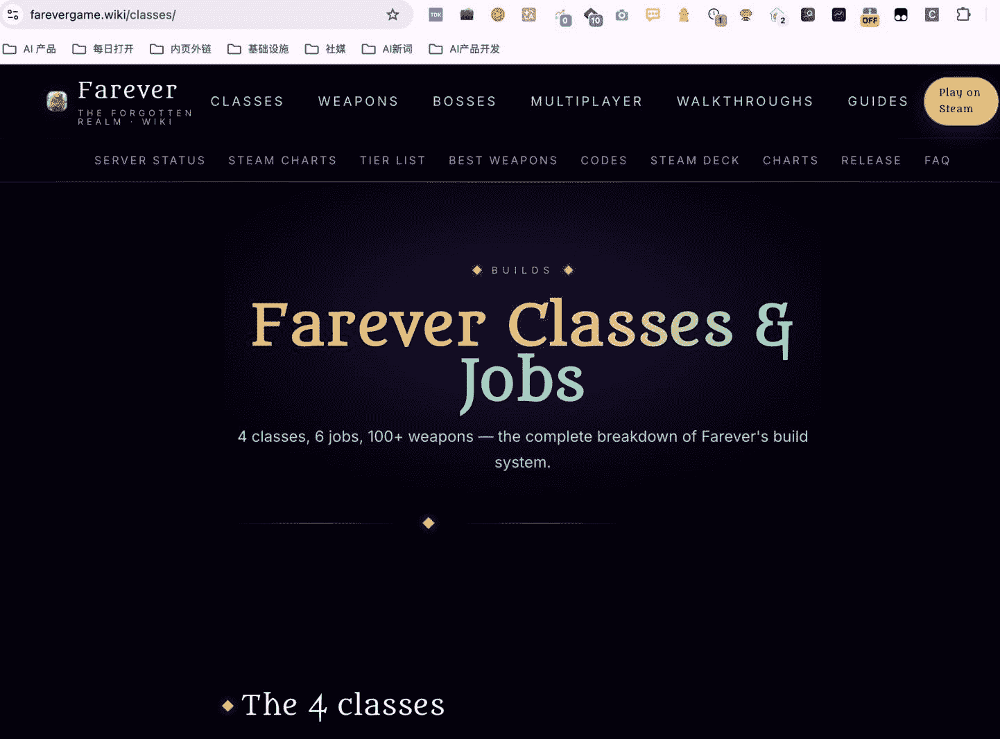

- 赚钱原理

玩家搜"gta 攻略" → 谷歌首页展示你的站 (提前绑定广告代码) → 玩家点进来看 → 浏览/点击广告 → 广告后台给你广告费。

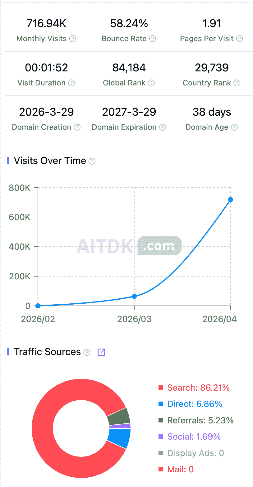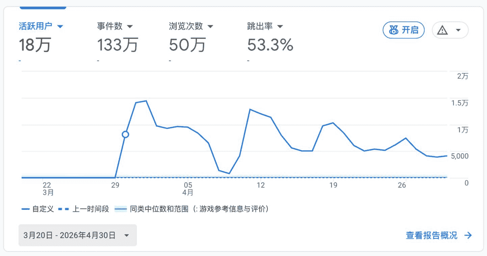

- 收益如何

以我为例，4 月上站近 100 个，几乎全部能回本域名钱，大概 1/10 跑出来数据不错的，1-2 个明星站带来超高收益。

每半个月到账一次的收益

### 3. 本文适合人群

- 对出海赛道感兴趣，想要赚取美金的伙伴
- 有一定 AI 编程基础，愿意上手实践的伙伴
- 看好 AI+ 出海赛道，愿意从 0 到 1 学起的伙伴

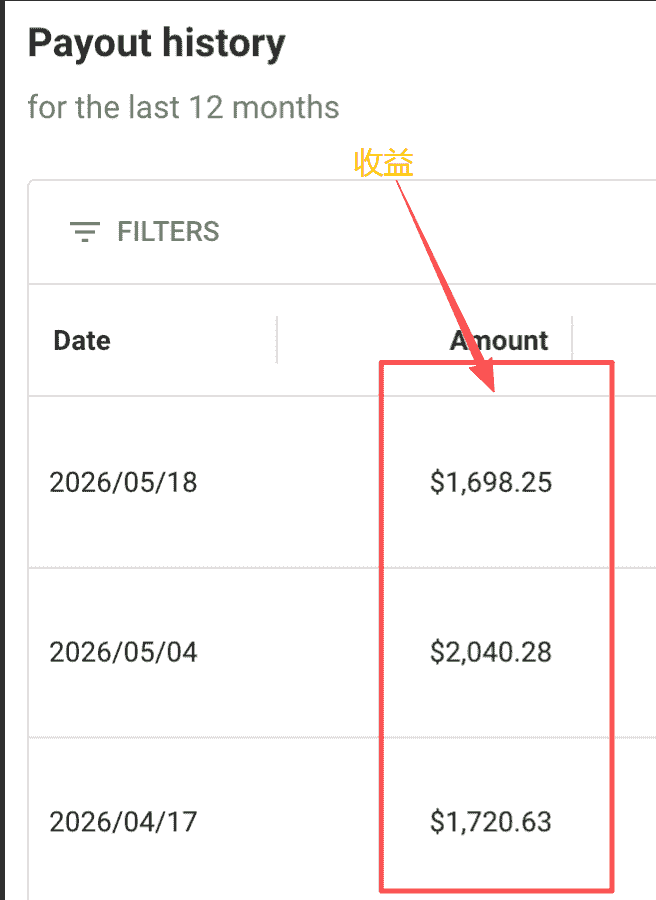

- 想要收获一份副业，每天能抽至少 3 小时实践的伙伴
- 想要成为自由职业者/经营 OPC，愿意深耕游戏站赛道的伙伴

（如果本身是计算机相关专业、擅长玩各种游戏的伙伴，那就更好了）

### 4. 本文食用指南

说明：我是从 2025 年 4 月开始接触 AI，2025 年 10 月开始尝试做网站，到现在 2026 年 4 月初步拿到小成绩。

大家如果对游戏站赛道感兴趣，可以一边了解我的来时经历，一边思考这件事本身对于自己的匹配度和难度。

如果有决心现在从 0 开始做，在读第一遍的时候，可以一边了解我的来时路以及我每个阶段在干什么，一边思考这件事要跑通该怎么做（从"道"的层面理解底层原理）？为什么能赚钱？我可能会有哪些卡点？

在第二遍读的时候，可以着重去看文章讲了什么具体方法？这些方法我能不能用？我如何用好这些方法？我还可以有哪些方法？我还有什么不懂的地方？

对于不懂的地方，可以及时与圈友讨论交流。

## 二，赛道选择

### 1. 关于初次邂逅

其实，我和游戏站的邂逅并没有很早。

我是 23 年年度加入生财有术，24 年下半年，开始萌生了跳槽想法，主要还是想涨薪，也会不时刷刷星球相关动态。25 年年初，deepseek 的横空出世让大家对于 AI 关注度再次升温，也就是那个年过完，AI 红遍大江南北，我也有幸受到了小排老师的影响，那时候才开始用起了 AI，想着给自己牛马的生活减减负。也是与此同时，我报名了小排老师的 AI 编程课，感受到 AI 编程的巨大魅力：原来自然语言就可以实现我大学四年全部所学，太神奇了！

在小排老师某次直播间，我偶然听到有同学分享哥飞老师，那时候我才知道出海赛道，并且了解到这是一个很多前人已经拿到成绩的赛道。于是我加入了哥飞老师的社群，这里给我提供了非常宝贵的知识库。我一边自行探索，一边有问题就查询相关经验。后来，我在查找资料时找到了七鹿老师的公众号，我才发现游戏站这个方向需求稳定，而且不断有新词涌现，我仿佛看到了机会，同时也开启了自己的游戏站旅程。

### 2. 为什么是"它"

游戏站的优势非常明显：

- 前期投入少：我当时对比过游戏站和 AI 订阅站，除了域名 + 服务器 + AI 编程工具 + 少量 SEO 工具，我发现 AI 订阅站每个月还有额外调用 API 费用以及谷歌投流费用，并且费用不菲。对比起来，游戏站就相当于几百块成本的小摊，抓住人流闹市就可以立马赚到第一块钱，而 AI 工具就像你攒了十几万几十万的启动资金开了个饭店，地址位置+菜品+价格+口味+竞争程度都会很大程度上影响你什么时候收到第一笔钱，以及什么时候回本，毕竟饭店的价格要远远高于小摊，大家消费会更谨慎。
- 需求明确：玩家会主动搜索攻略，你只需要满足这些搜索需求，不用自己再找用户再去验证需求。相较于评论区、社群以及媒体上等到处找需求，游戏站天然就存在需求，每天每个月都会有新游戏出现，层出不穷，毕竟游戏行业是出了名的低边际成本与高 LTV，被称为是数字时代的"印钞机"。爆火的游戏也不仅一两个，相当于你只需要去筛选需求，而不是寻找需求，更利于新人上手。
- 正反馈快：游戏站从挖词到上站到看到流量，快的话半天，慢的话 1-2 天，就有结果了，选词和网站本身没问题话，很快就能见到流量，广告收益也是立刻肉眼可见的。

就像我前面的例子，你摆个小摊，0 成本快速搞定个体经营户注册，晚上推车出去摆摊，晚上就开单收钱了，虽然 8 块 20 块的，但是稳稳收钱很安心。如果选择成本更高、周期更长的饭店生意，不仅等待时间更久，风险更大，内心也会很煎熬。而几乎所有创业者都是孤独的、焦虑的，大家最耗不起的就是心力了。

- 已被验证：我并不是盲目选择了游戏站，而是很多前人确确实实靠游戏站赚到钱了。我选赛道有一个原则，必须已经存在前人成功案例。并且我会有个心理锚点，锚定前人最高收入的 1/10，如果我能接受就可以做。就游戏站来看，本身就是高利润行业，天花板还是比较高的，已经有不少大佬达到月入万刀甚至十万刀（如良辰美老师日入千刀）。这对于我来说，也会给创业的不确定性中加一层保险，确保我并不会一直摸黑独自走。

### 3. 为什么是"我"

面对游戏站这条路，当时我也思考了自己究竟能不能做，以及能不能拿到结果的问题。

第一，我是科班出身，编程相关的事情对我来说还是 ok 的，更何况有 AI 编程工具，可以说我完全不担心自己建站能力。

第二，我去年在职期间的工作量相对不大，每天 3-4 个小时的时间完全能挤出来。

第三，当时刘小排老师、哥飞老师、七鹿的课程/社群/新词群我都购买了，我没有理由不立刻开始实践，提前押注沉没成本也是我逼迫自己进步的一种手段。

第四，游戏攻略站表面是网站，实则是可需要持续迭代的系统，能带来复利。我底子里就喜欢追求系统性成长，所以我觉得我是合适这件事的。

### 4. 为什么是"现在"

**天时**

自 2025 年起 AI 的极大兴起，AI+ 行业迎来了灿烂的春天。从 cursor 到 V0 到 bolt，再到后来 claude code 和 codex，AI 编程工具极大成熟带来的生产力的极大颠覆。游戏站行业本身并不是新鲜的行业，但早在我们之前的前辈们需要完全靠自身编程技术手动上站，时间成本是很高的。

那时估计谁都不会想到：今天我们最快甚至可以达到 **30** 分钟上线一个首页站，全套完备的网站 **3** 个小时也就可以上站了，你甚至可以给便宜 AI 打工人一套流水线+原料等，它就会非常顺从地完成游戏站全流程的一切，包括自我检查、自我修复和自我生长进化。

**地利**

生财有术常年稳居知识星球排行榜第一，是规模最大的星球，其中内容之丰富程度，可比典藏书籍。浸泡在这样的向上圈子里，你得到的知识信息密度以及知识信息的及时性是远远其他任何圈子的。因此，你完全可以认真研究我这篇帖子并从现在开始。

**人和**

AI 热潮下，大家都涌向 AI 订阅站等高利润赛道，造成僧多粥少。而游戏站恰恰是被忽略的赛道，相比那些万人挤的方向，更适合小白入局。

### 5. "我可以入场吗"

完全可以！

- 技术门槛将会很低：以前你做类似的网站建设、工具制作的事情，现在所有的 AI 编程只需要你自然语言，就可以将你的想法变成现实。
- 成熟经验沉淀：游戏网站行业的玩法和底层逻辑并不是我总结出来的，众多前辈在此之前就积累了大量的经验和方法论。

这些方法，你无论是去自行搜索还是求助 AI，都是有可靠方法供咱们学习的。

## 三，我的来时路

前面我有说过，自己如何一步步从接触 AI 编程到接触出海，再到接触游戏站。具体游戏站的实践分为 3 个阶段：

### 1. 2025 年 10 月中旬 - 11 月底：尝试做游戏站 + 迷茫 + 疯狂踩坑

这段时间我还在职，9 月刚刚了解到游戏站，在搜集了一些资料评估和确定方向后，10 月我立马开始实践。我骨子里对于时间的珍惜以及对于机会的珍视，让我没办法不将其作为当下阶段最重要的事情。我之后提到过的 N 日计划也是那个时候慢慢实践并成型的。

早上我 5 点起床，在自习室待到 8：50，然后乘坐 1 小时地铁去公司，在地铁的路上，我会抱着电脑开始写每日复盘和计划，方便白天空闲时间就立刻按计划开干。当时公司给的工作量基本我花 2-3 个小时就可以让 CC 帮我完成，剩余时间我都在摸鱼研究网站，晚上回家我再集中 3-4 个小时，要么查阅哥飞论坛找方法研究/做站。

10 月大概在一边学习一边研究并加以实践，时间投入是有了，但网站基本得几天才做一个。因为我说过网站是个系统性的事情，网站相关所有概念、网站如何部署、工具选择、新词发现和速度（谷歌趋势）、新词选择、域名选词、网站页面和加载速度、网站流量影响要素以及指标（PV、UV、跳出率、用户停留时长）、广告的选择和添加、外链的添加…… 说到细节，要学习的东西很多，有时不是随便选了个词，就是部署上出问题，要么就是选词太慢，要么就是页面加载都不正常，而且当时速度和数量都没上来，更别提流量了。

11 月我意识到数量是个很关键的因素，建站流程熟悉了后，我开始逼自己提高建站速度，慢慢从 3 天 1 个站、2 天 1 个站、再到 1 天 1 个站。虽然我有数量和速度意识了，但那时候依然不理解谷歌排名的逻辑以及追新词逻辑，基本做了站之后，谷歌一搜索都在第 3 页开外，可以说谷歌搜索根本搜不到自己网站，流量也是只有第 1 天会有微弱几个人访问，很快就没了。这时候我压力很大，每天逼自己投入更多时间，争分夺秒去学习和理解网站逻辑并找失败原因……

后来，最欣慰的一点就是，我在复盘中慢慢也做出了有点流量、能够日入十几刀网站。

### 2. 2025 年 12 月 02 日：一个转折点，全面拥抱游戏站的开始

前面我提到我在职做游戏站时间全靠挤，我也一直期待着能够赶紧全职做游戏站。

终于转机来了！

这一天是我 27 岁生日，也是彻底结束大厂牛马生活的日子。

过够了天天过为了工作上毫无意义的事情、忍气吞声的生活。

领导脾气很难伺候，我当时积极主动地提了很多 AI 提效建议，但都被他否决了，理由是怕影响小组内部人饭碗，也因此算有了矛盾。

但最后，公司业绩不行，公司为了股价，大裁员还是来了。

我也被丢出去拿了名额，但也获得了一笔不菲的创业启动资金。

国内大公司发展到最后基本都丢失了创新，需要的只是一匹匹精通人情世故、任劳任怨的牛马。

但也增强了我之后创业的使命感：彻底摆脱各种重复性的牛马劳动！

很快，我离开呆了 3 年北京牛马之都，开始了现在和女朋友每隔三月、换个地方的旅居生活。

### 3. 2025 年 12 月 02 日 - 春节：提升质量

2025 年 10 月和 11 月那段时间，由于基础不牢我疯狂踩坑，虽有长进但效率太低。

如果再给我一次机会，我一定会更聚焦于学习和打牢基础，尽快提升水平然后再通过堆量放大优势。

当时，我做站的收入已经可以日入十几刀，并慢慢稳定，也算是拿到了正反馈，但对我来说远远不够的。

为了放大收益，我必须做好两件事：其一是提高网站质量，其二是增加网站数量。

很明显，前期质量的重要性远远数量。于是，第一关，我决定先突破质量。

当时，我用的模板还比较简陋，首页内容也很少，UI 也很丑，用户体验也一般，全靠内页长尾词带来搜索。

于是，我对标一些优秀的同行，集中一周去迭代首页，提升整体用户体验。

之后，我又迭代了好几次不同模块，这才慢慢有后来的样子，包括域名选择、首页、内页、导航、关键词、内链等方方面面。

我的做事方法论：制定 N 日计划（根据实际情况），集中精力，各个突破！

优化完，高峰日收入大概 30-50 刀。

### 4. 春节 - 2026 年 3 月底：提升数量（全自动化探索）

为什么要自动化？

这一步我想的很清楚，必须放在建单个站的水平比较高的情况下去进行。

我也算是达到了当时水平下的穷尽状态，才开始自动化探索。

首先，万事（如做单个网站）只能追求极致（Best），但无法真正到达极致。游戏站尤为如此。

其次，假定人在一段时间内的水平提升是有限的，根据边际效益原理，在单站投入时间越多，边际效益越少。

所以，以量取胜其实是更具性价比的。

再次，我程序员的程序员的本能就不喜欢重复劳动，上文提到了讨厌牛马工作原因。

一旦一件事不断重复做，我就一定会想办法让它自动跑起来。

这个思维方式，我认为比"会写代码"重要多了。

所幸，我们处于 AI 时代，各种 AI 工具大兴起，如 openclaw/Hermes、claude code、codex。

这也给了我将想法变成现实的可能性。

于是，我开始大量研究自动化技术，一点点搭建，并不断测试和调整以及修补。

慢慢定时挖新词、买域名、爬虫调研资料、写代码、上站、发外链、网站维护、加广告这些动作我都放手了。

不过，跟游戏站本身比起来，自动化这套系统其实更复杂。

涉及到很多技术，不局限于大模型工具，包括多浏览器、多会话管理、Skills 自动优化、远程操控等。

为了这套系统稳定，我也写了无数 skills，每天都要大量测试代码保障稳定性。

PS：现在经常有很多群友问我：是不是单纯基于 Hermes 实现的？

我认为，现在 openclaw/Hermes 只能实现些最简单任务，复杂任务如多个 skills 串联、管理维护，仍存在极高成本。

在大厂工作的朋友应该都知道 —— 任何一个技术都有其长板和短板，需要将多个技术组合使用，涉及成本、效率、体验等多方面的考量。

如果单纯使用 Hermes/openclaw，再随便写点业务 prompt skills，能跑就行，我搭这套系统也不需要这么久。

我对全自动化系统要求程度很高：希望智能、稳定，且适用不同应用场景，不局限于做网站。

在大厂工作的朋友应该知道，用一个词概括，就是：基建——基础设施建设。

基于这个技术基建，你后续做所有事情，都会很容易实现业务上的自动化。

我觉得这算是当程序员好处吧，也许很多人说 AI 时代写代码有手就行。

但我觉得程序员骨子里追求系统成本、效率、好用的耐心，永远是这个浮躁时代稀缺的的闪光点。

到三月底，这套系统已经完全可投入生产。

理论上预算、新词充足的情况下，可以做无限个网站。

我自己是并行做 3-4 个站，每个站大概耗时 3-4 个小时左右。

关于自动化究竟能带来什么样的颠覆，我做了个不同阶段的时间投入和产量对比：

半自动时代（2025 年 10-12 月）

- 一个站：8-12 小时（人要等待，且程序出问题需人工介入，且模型下次还是有可能会犯错，消耗时间和精力）
- 一个月：做 10-15 个站（这还是拼命挤时间的产量，且之前效果好的网站还需要

公众号懒人搜索，懒人专属群分享

维护）

- 流量好的站：3-4 个
- 月收入：凑合几百刀

全自动时代（**2026** 年 **2-4** 月）

- 一个站：3-4 小时

大部分时间 **AI** 在跑，遇到问题自己解决，自己优化 **skills**。我只需要检查，到最后 **skills** 自动优化成熟后，有了自己的历史记忆，检查也不需要了。

- 一个月：想做多少、做多少
- 流量好的站：10+个
- 月收入：3700+刀，而且后续还会涨

差别在哪里？

不是因为我更努力了。恰恰相反，是因为我变"懒"了。我不想重复做那些机械的事，所以我花了三个月时间，把这些事全部交给AI。

**4. 2026 年 4 月至今：彻底撒手，全面自动化带来翻倍收益**

我3.29 选了一个域名，用这套自动化系统快速上站，后续也会根据流量情况自行增加内页并迭代自己技能。没想到居然跑出了哥飞老师新词比赛中游戏站第一名的成绩。（当时比赛前4 名和第6-7 名是围绕sbti 热点）

从上线第2 天起，每天稳稳100+刀广告费。高峰时期，甚至达到了每日200+刀的广告费。

4 月是自动化全面操盘的第一个月，我当月总收益就达到了3700+刀，追上了我当牛马时的税后收入。这确实给我了一剂定心针，较高的网站质量✖较大的网站数量，这样做网站是一定可以赚大钱的。

## 四，游戏站底层玩法

纵观上述来时路，过程并不是一帆风顺，但是如果能深度理解游戏站的底层玩法，也许那时候的实践能达到事半功倍的效果，具体如下：

### 1. 游戏也有派别

没错，国外流行的网页端游戏有 **roblox** 游戏、**steam** 游戏等等，抛开玩法不谈。

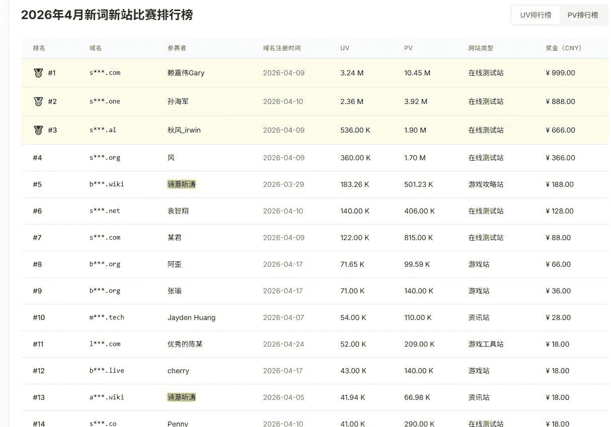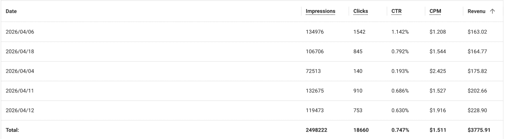

不同平台/不同类型的游戏玩家的需求也有很大的差异，而需求就是我们建站风向标。因此，研究透不同类型游戏玩家需求差异是必须的，因为这能够很大程度上决定我们网站的生死。

比如某个游戏玩家有攻略需求吗？工具攻略需求强还是资讯需求强？游戏上线前期有攻略需求，还是中后期有攻略需求？

### 2. 如何慧眼识珠

这里其实指的是具体游戏平台/类型下，选什么样的新词？判断标准是什么？

1. 看谷歌趋势：尽量陡升，但是也要警惕第二天马上陡降的游戏词
2. 看社媒热度：例如一周内youtube 视频量，一般视频量多的游戏，持续时间更久
3. 看平台：不同平台会有不同趋势，roblox 一般般是慢慢火起来，steam 经常发售日陡增，但可能快速滑落

这些其实无法用一段话甚至十段话来总结，慧眼识珠的能力在于系统研究、不断尝试、复盘总结、不断验证。一个词既要辩证地看，又要各种联系地看，既要提前预判，又要事后回顾。

### 3. 让谷歌找我

这里指的是谷歌SEO 玩法，SEO 是做网站（不仅是游戏站）一天核心玩法。网站要有流量要赚钱，全靠谷歌老大哥带，但老大哥带你的前提是你要遵守谷歌老大哥"潜规则"：

- ① 关键词和页面：一夫一妻制，一个页面最好只做一个关键词相关的内容
- ② 内容结构：首页和内页之间，内页和内页之间的内链要密切联系
- ③ 技术到位：网站加载速度（影响用户体验和排名）、移动端适配、HTTPS 安全访问
- ④ 外链推荐: 一般推荐你的优质外链越多越好（类型/相关性等仍需注意）

### 4. 测试局先行

自动化以后，做站不再是瓶颈，可以先快速上线，对网站进行测试。当你确定一个新词，不管你有多大把握，其实最要紧的是你立刻将其丢出去，看看能在湖面上溅起多大的水花，我们称之为测试局。测试局有一个要点，你不要用尽全部力气，只用30%力就可以，先看水花多大，再决定后续步调和投入大小。

### 5. 持续投喂优化

这里说的是，你要根据前面水花大小来决定后续投入和行动。如果水花小，有多方面原因，可能是你扔得慢了一步，可能是湖面结冰了，可能是你的石头形状不够平滑，可能有风阻力大等等，这些都需要事后反思、复盘、优化，争取下次取得突破。如果水花中等偏上甚至很大，说明这些各要素没出差错，抓紧时间增加投入并持续优化，尽最大努力延迟水花生命周期，以使得收益最大化。

## 五，小白如何快速上手（SOP）

以下是我实践后总结的学习路径，建议用好大模型辅助学习，并按顺序推进，前一步是后一步的基础：

### 阶段一：前置准备（1-2 天）

目标：工具就位，了解游戏站基本概念

1. 理解核心概念
   - 什么是"新词"：刚出现或搜索量飙升的游戏相关关键词
   - 什么是"上站"：网站上线，并部署到服务器
   - 什么是"外链"：其他网站指向你网站的链接，提升权重
   - 盈利模式：通过Adsterra 等广告联盟赚取广告费

2. 准备工具包（我自用的可参考）
   - 大模型：Claude Code、Codex（建议准备2-3 个，防风控）
   - 服务器：购买任意云服务器即可，追求高性价比可以选择国外的一些VPS
   - SEO 工具：Google Trends（免费）、Semrush/Similarweb（用来挖掘更多的关键词）
   - 魔法工具(都行）

### 阶段二：掌握AI 编程工具（3-5 天）

目标：能用AI 独立写出完整网页

3. 系统学习Claude Code
   - 三种模式的使用（chat、plan、agent）
   - 项目记忆文件（CLAUDE.md）的作用
   - Skill 功能：封装常用操作
   - 学习资源：B 站、生财自行搜索"Claude Code 教程"

4. 实践验证
   - 用AI 写一个简单HTML 页面并部署成功
   - 确保整个流程跑通，后续才能高效

### 阶段三：理解游戏站盈利的底层逻辑（同步进行）

目标：知道"为什么这样做"，而不是盲目模仿

5. 理解谷歌排名因素
   - 网站速度、内容质量、用户行为（停留时长、跳出率）
   - 内链、外链的作用
   - 新词优势：竞争小、排名快

6. 理解"一个词一个域名"策略
   - 为什么这么做：聚焦关键词、提高相关性
   - 域名选择规范：包含核心词、简短易记

7. 理解新词挖掘方法
   - Google Trends：发现上升趋势的关键词
   - 与GPTs 对比：推断搜索量级别

### 阶段四：实战上线第一个站（3-7 天）

目标：完整跑通一次流程，不管效果如何

挑选游戏新词

- 用Google Trends 找上升趋势的游戏词
- 判断标准：趋势向上、竞争不大、你有了解/兴趣（以下是例子）

(上图陡升趋势代表搜索量突然暴增，意味着市场短时间内供小于求）

(如图，谷歌搜索页直接搜索一个游戏词后，搜索结果页出现的大站不多，反而有些视频之类的，意味着竞争程度还可以）

快速上线一个游戏站

#### 2.1 域名购买

直接在域名服务商搜索该游戏词，购买一个域名

（以上是例子，我最常用 https://www.spaceship.com ，Namecheap、GoDaddy 都可以）

#### 2.2 新建一个仓库

https://github.com/new 新建仓库

首页点击new 新增

将仓库由公开public 改成隐私private

点击code 栏目，找到该仓库地址并复制备用

#### 2.3 建设游戏站

2.3.1 打开AI 编程工具（如codex)和对应项目文件地址。

2.3.2 将上一步复制的ssh 或者https 地址给到大模型，让连接仓库、初始化并完成第一次仓库推送。

2.3.3 建设游戏站。

第一步，先让AI 生成一个首页。

第二步，先找该游戏的关键词（关键词即需求），并收集起来，具体方法：

1. 谷歌下拉框联想词
2. 谷歌趋势"相关查询词"
3. seo 工具"关键词列表"里面的"关键词生成器"

第三步，将收集到的关键词进行筛选，形成关键词列表，让AI 根据关键词生成对应内页（一个关键词一个内页）

第四步，检查

1. 游戏页面能不能打开

游戏站的是否每个页面都能正常打开，检查按钮和导航是否正常跳转，检查底部connect us、privacy 等是否都有

2. 基础SEO 标签

用AITDK 插件检查下列信息：

- **Title**：是否包含主关键词，是否自然，是否有点击欲望。
- **Meta Description**：是否说明这个页面能做什么，比如 play online、free、no download。
- **H1**：是否和页面主题一致。
- **URL**：是否简短、清晰、包含关键词。
- **H2/H3**：是否把玩法、介绍、FAQ、推荐游戏分清楚。

2.3.4 将填充好血肉的游戏站push 到仓库

#### 2.4 绑定域名并更换nameserver

打开https://dash.cloudflare.com/，点击Add

选择连接域名

填入域名名称

选择free plan

将自带的A 记录和CNAME 记录删去（如没有可忽略），并点击Continue to activation

来到新界面，将2 个nameserver 复制下来备用（待会填写到spaceship 里面）

https://www.spaceship.com/zh/application/domain-list-application/

找到你购买的那个域名，点击找到nameserver&DNS

点击change

删除原有的2 个nameserver,将新的nameserver 分别填进去

改完nameserver 再返回去看DNS settings

点击Advanced DNS,检查DNS Records 为0即可（一般都为0）

回到cloudflare，点击check nameservers now(一般需要10 分钟左右才会同步好）

当前是等待状态

过一会，发现有一个绿色的勾，说明我们刚刚的nameserver 替换成功了

#### 2.5 生成GA 代码和Clarity 代码

来到https://analytics.google.com/analytics/web/#/provision/create ，输出账号名称

以上的网站网址和数据流名称填写好了之后，很快会弹出来一个窗口显示你的GA 的ID,复制备用（环境变量的一部分）

来到https://clarity.microsoft.com，进入填写域名

然后点击"手动安装 获取跟踪代码"

复制备用（环境变量的一部分）

#### 2.6 整理环境变量

（我们需要的环境变量主要是clarity、GSC 以及广告代码，一般在项目文件里，名为env.local）

例如：

NEXT\_PUBLIC\_CLARITY\_ID="v2·····sg"
NEXT\_PUBLIC\_GA\_ID="G-·······"

（新手可以就这两项，后期网站有流量了可以添加广告平台的代码）

················

#### 2.7 vercle 部署上线

（以vercel 为例，新手建议先用vercel)

先新建一个team，进入后如图点击add new,选择project

前面你已经建好了仓库，并且项目仓库已经建设好并推送到仓库了。那么，连接你的github 仓库，import 对应的项目

填写对应的project name，项目的技术栈它会自动识别，然后你再将刚刚的2 个环境变量（GA 的ID 和clarity 的ID 分别填进去）

然后不用更改任何信息，直接点击部署，等待几分钟，就能直接部署成功，直接撒花。

注意:如果此时没有添加环境变量的话，后面就要去setting 里面找到environmenrtal varities 替换，并重新部署

#### 2.8 Claudeflare 里面添加DNS 记录

（1）找到 vercel 给的 CNAME 和 A 记录：

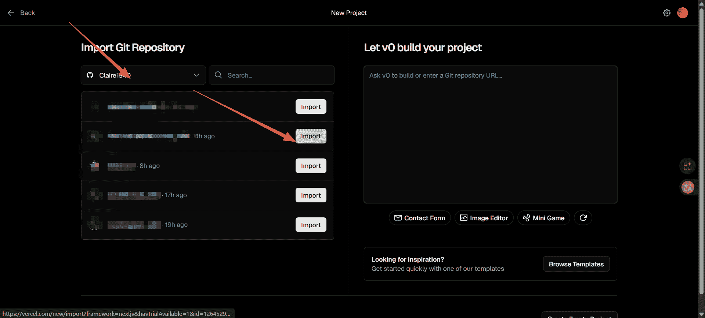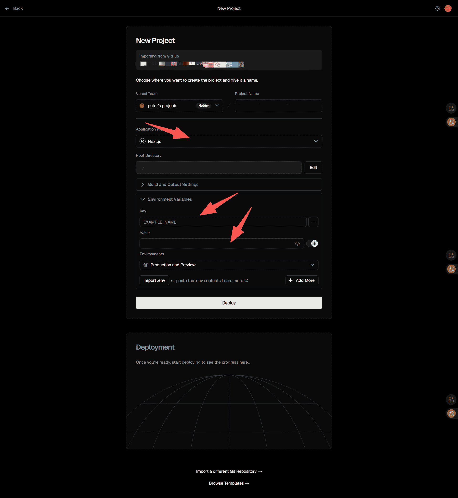

### 公众号懒人搜索，懒人专属群分享

选择刚刚的项目

点击 Settings，再点击 Domains，点击 Learn More，然后点击 Add Domain，输入域名并 Save（注意必须正确复制域名，不要拼写错误）。这时候会出来 2 个记录，一个是域名，一个是 www.域名，分别点开它们，截图它们的 DNS records（有 Type、Name、Value 等等），分别复制 Value，准备去 Cloudflare 里面添加。

### （2）Cloudflare 里面添加 DNS 记录

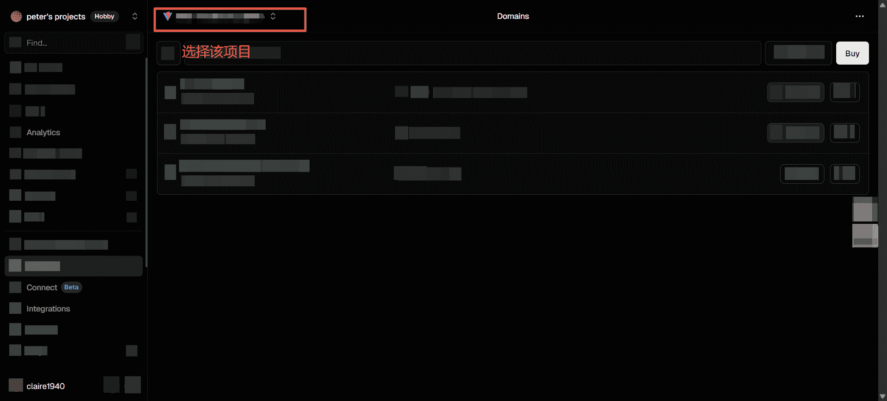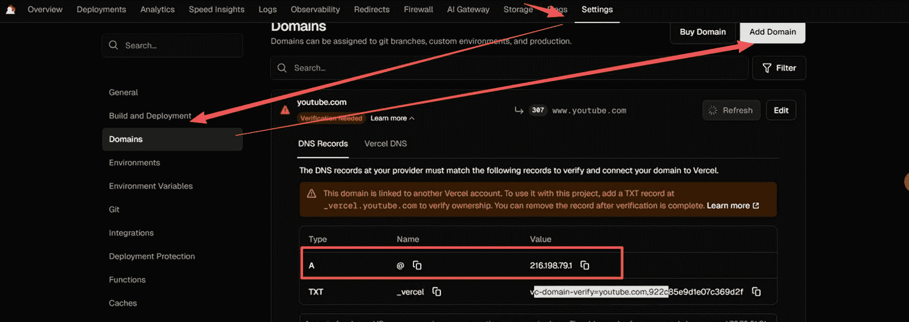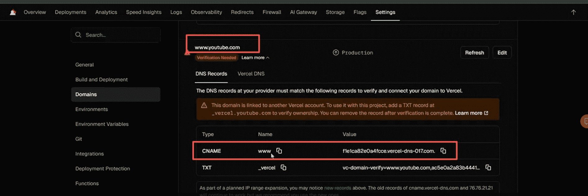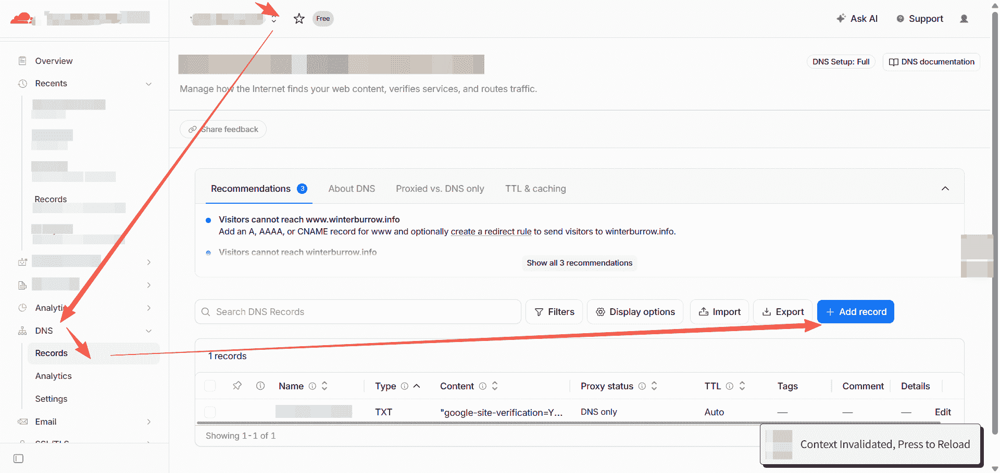

在 Cloudflare 里面，下拉框选择对应的域名，点击 DNS，点击 Add Records：

1. 添加 A 记录：（1）Type：A （2）Name：@ （3）Value：填 Vercel 给的 A 记录的 IP
2. 添加 CNAME 记录：（1）Type：CNAME （2）Name：www （3）Value：填 Vercel 给的 CNAME 记录的 IP

注意：
- 如果 @ 或 www 已经有别的 A/CNAME，删掉或改掉，不然它们会互相打架。
- 如果有 AAAA（IPv6）记录，先删掉，Vercel 经常会因此判定异常。

#### 2.9 提交站点地图 sitemap.xml

来到 https://search.google.com/search-console

先新增网址。

新增域名，并点击继续。

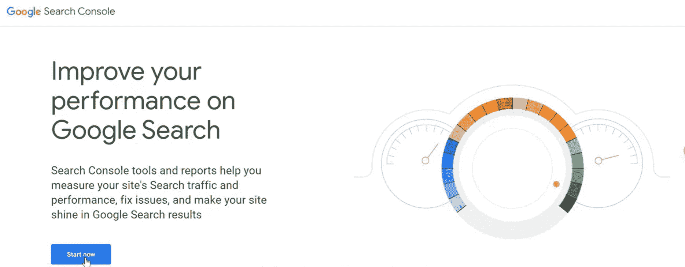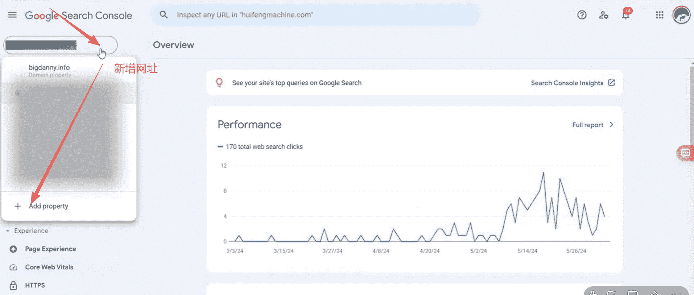

点击“验证”，等待验证成功。

验证所有权成功后，会出现下面的界面（你看到的应该是中文“所有权验证成功”），然后点击“前往资源页面”。

在搜索框输入具体域名，并点击“测试实际网址”。

接下来一般会显示“网站可以添加到谷歌中”，然后点击“请求编入索引”。

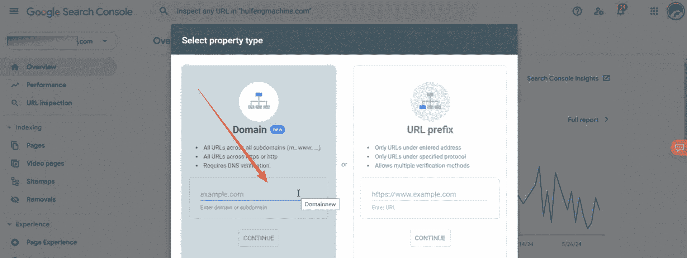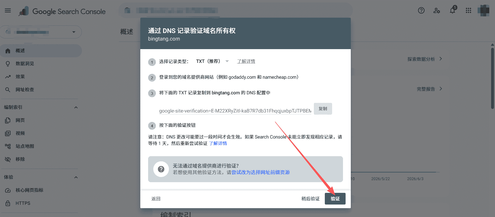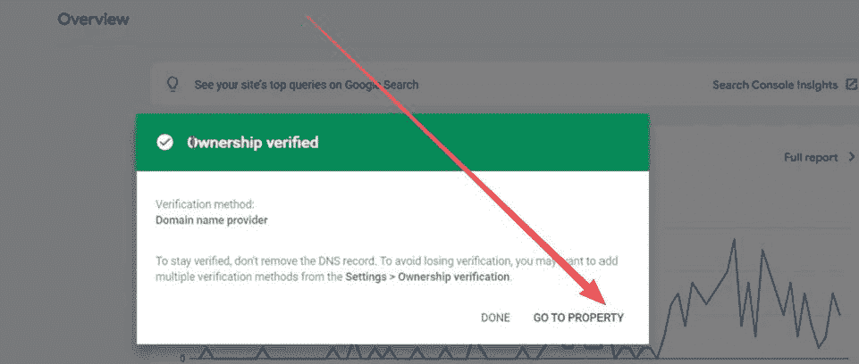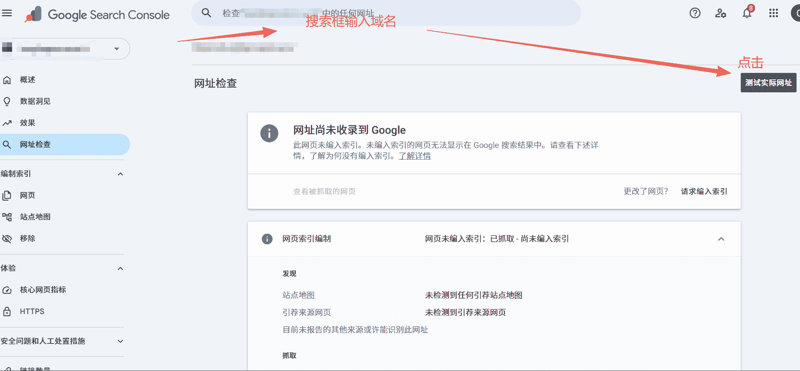

很快就会显示“编入索引成功”（如图）。

然后点击左侧边栏“站点地图”。

先在浏览器空白页面输入完整的 https://www.abcd.com/sitemap.xml （显示如下图就是 ok 的）。

然后回到 GSC，在“站点地图”板块的横线上输入完整的 https://www.abcd.com/sitemap.xml （仅示例），点击提交。

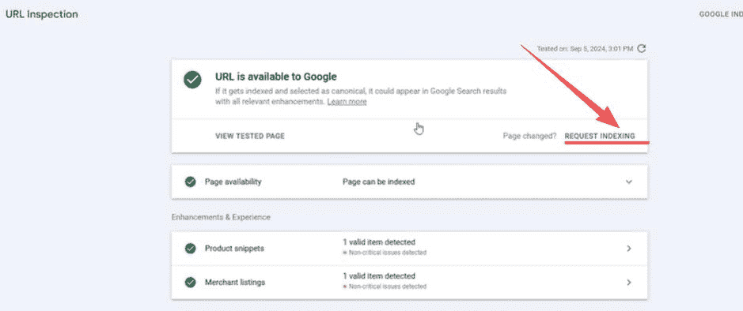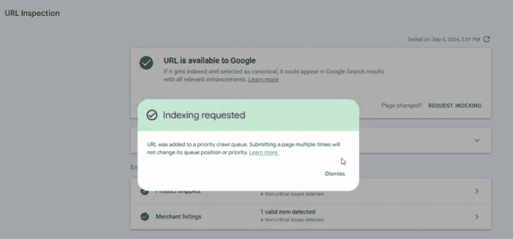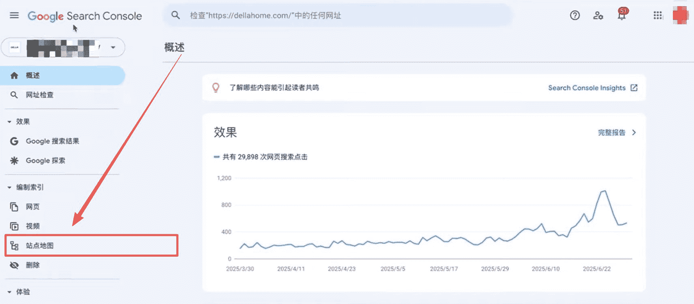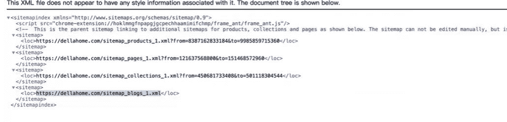

这个时候站点地图就提交成功了，点击“关闭”。

备注：如果添加站点地图，显示无法抓取，不要害怕，刷新一下也许就可以了。

#### 8. 观察效果

- 上线后观察 3-7 天
- 看 GSC 的收录情况和点击量
- 复盘：成功或失败原因

### 阶段五：沉淀自己模板（1-2 周）

目标：形成可复用的网站框架（建议沉淀，并不断优化提示词）

#### 9. 首页模板化

- Hero 区域：游戏名称+核心卖点
- 攻略/工具区：核心内容模块
- 个人模块：关于作者/网站说明
- 导航结构：清晰的层级

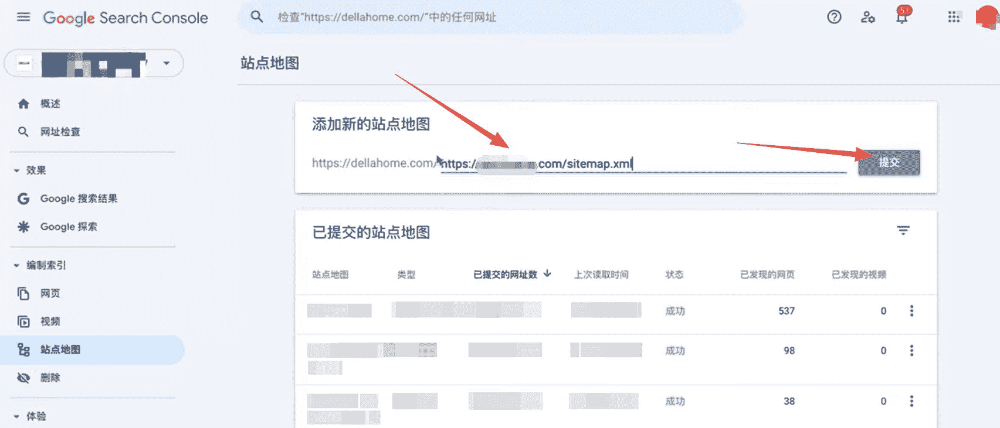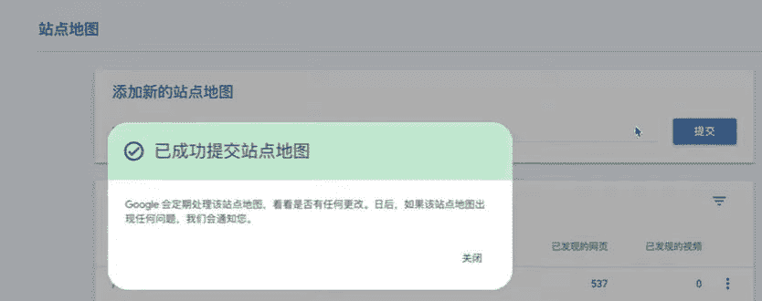

#### 10. 内页模板化

- 页面类型：攻略页、工具页、资讯页
- SEO 标签模板：Title、Description、Canonical
- 内链结构：从首页到内页的路径

#### 11. 运营动作模板化

- 域名购买流程
- 网站部署流程
- GSC/GA 配置流程

### 阶段六：持续优化与放大（长期）

目标：不断提升单站质量，增加站数量（全自动化建站）

#### 12. 质量优化方向

- 内容：更深入的攻略内容、更实用的工具
- 性能：加载速度、移动端适配、跳出率优化
- SEO：关键词布局、内链外链、多语言扩展
- 广告：布局优化、收益最大化

#### 13. 效率提升方向

- 挖词速度：建立自己的词库和筛选标准
- 建站速度：模板复用、自动化脚本
- 维护效率：定期检查、批量操作

#### 14. 放大策略

- 增加站的数量：从 1 个到 10 个到更多
- 自动化系统：挖词-建站-发外链全流程

### 六、写在最后

### 我的下一步计划

前段时间我太忙于全自动化技术，而忽视了业务。

一直在想技术上如何更好实现，而忽略了用户体验：什么样网站用户最喜欢（某种程度上，也算一种网站质量）。

游戏站作为一个生态系统，系统里的每个要素都是很重要的。

因此，我决定下一阶段大力提升用户体验。

### 写给也想试试但还没动手的人

在 AI 编程甚至自动化助力的今天，游戏站出海门槛并不算高，如果你也对游戏站感兴趣或者想给自己增加一份收入。

可以从现在开始，从这篇文章开始，去了解游戏站整个系统，前期踏踏实实打基础、遇到卡点逐个攻破。

等有成绩了，再去用全自动化堆量放大优势，也许你会获得意想不到的惊喜。

最后，感谢阅读，希望这篇文章能够给你带来一些启发和帮助，大家一起将国人出海做得越来越强。

————分割线————

看完这篇 SOP，你觉得你懂了。但 90% 的人一到实操就会卡在第一步。

工具和教程只是最低级的壁垒，真正的壁垒是“立刻动手”和“圈层信息差”。

如果你想看全网最新的变现玩法，并且和一群执行力极强的极客一起下场拿结果，欢迎围观我的核心私域：【懒人专属群】。

我们不聊虚的，只做商业闭环的拆解与 AI 效率的压榨。系统内已沉淀 1000+ 跑通的套利实战局。

👉 查阅圈子完整数字资产与上车门槛：

https://lazyso.com/insider/

认同价值、准备好下场干活的，扫码加我微信（lazyhelper1）

备注：【实操上车】，不闲聊

