公众号懒人搜索，懒人专属群分享

靠生财520找了老公，又靠生财CP做成

贴图号：2个月9000+实战复盘

260622 副业SC精华

整理：公众号懒人搜索，懒人专属群精选

懒人微信：lazyhelper1

你好，我是十六，一个因为生财认识老公，又靠生财CP故事起号的人。

之前我主要做私域发售，合作过肖厂长、格掌门、孟慧歌、白先生、旷智勇等头部IP，参与过不少单场100万—1000万级别的发售项目。

现在自由职业，一边接商业陪跑和发售项目，一边自媒体创业。

这篇想分享一下，我做公众号贴图号的真实复盘。

这是一个生财圈友，因为生财520认识了老公，又因为和老公的生财CP故事起号，最后顺着公众号流量主这个方向，跑出了一点结果的实战记录。

目前我手里一共跑了5个公众号：

1. 1个主号（生财CP故事起号）。
2. 3个假人设小号，很快阅读到了1000，但我发现AI作图的假人设，我做起来不舒服，而且平台现在对AI生成人脸+非真人内容识别越来越严，所以全部停掉了，正在新方向起号。
3. 1个多年前0播放的老号，换赛道重启（目前账号进入正常状态，准备做长期IP积累）。

目前结果（以下为生财CP故事号的结果）：

4. 2个月流量主总收益：9000+
5. 单月最高：5000+
6. 单日最高：400+
7. 出过百万阅读贴图。
8. 多篇长文阅读破万。

做下来，我最大的感受是：贴图适合拿流量、测选题、找爆点；长文更适合提高收益、沉淀信任、建立长期资产。

贴图更新了一个多月以后，我就开始写长文了。把日更贴图，换成了日更贴图+长文。上午发贴图，晚上深度阅读时间发长文。而且贴图获取公域能力更强，一般都不群发，文章则群发用户，让账号的粉丝去撬动初期的阅读和互动。

这篇文章主要解决5个问题：

9. 0基础新手公众号到底可以写什么？
10. 没文笔、没网感，怎么做贴图内容？
11. 怎么从自己身上找到能爆的内容？
12. 贴图和长文怎么配合提高收益？
13. 新手做公众号贴图号，有哪些坑千万别踩？

## 一、我不是先选中了项目，而是先在生财遇到了“人”和“故事”

我之前主要是做私域发售。2023年私域发售比较火的时候，我就开始在头部团队里做各种IP发售。

这个模式很能出结果，但也很消耗人。尤其是直播发售，经常要连续连轴转很多天，熬到凌晨一两点是常态。

做久了以后，我越来越觉得，这种高强度模式不太适合长期构建一个稳定、健康的生活状态。所以萌生了尝试新副业的想法。

真的是瞌睡来了就有人递枕头。公众号流量主，就是在这个时候进入我视野的。

而且这里真的要感谢生财有术。我和老公本来就是参加生财520活动认识的。今年办完酒席后，我顺手写了一篇我们相差7岁姐弟恋、异地、南北差异的故事，没想到直接爆了几十万阅读。

这件事给我的触动挺大的。我以前做内容，总是会下意识去找选题、找热点、找爆款。

但这次我突然意识到：真正有传播力的内容，不一定是你硬想出来的。有时候，它就藏在你真实经历里。

生财给我的，不只是项目资料、航海手册、圈友交流，还有人生合伙人。

靠生财有了老公，靠CP有了贴图爆文，靠贴图爆文又打开了公众号流量主这个方向。还挺奇妙的。

也让我重新理解了生财的价值。它不只是一个看项目、找资料、学方法的地方。它更像一个把人、项目、行动场和正反馈连接在一起的地方。

所以我也特别建议大家：

不要只把生财当成一个“看项目资料”的地方。生财里面有项目，有航海，有手册，有圈友，也有很多你意想不到的人和机会。你参与的活动、认识的人、发生的故事、得到的启发，都可能成为你后面做内容的素材。

## 二、我是怎么从一个真实故事，跑出9000+收益的？

当时公众号开通流量主还需要500粉，我就开始持续更新。因为那篇生财CP故事爆了，我就顺着这个故事延伸做了很多内容，爆了几十篇，也很快涨到了500粉，顺利开通了流量主。

后来贴图开始火起来，我也开始认真做贴图号。从3月到5月：

14. 出了很多爆款，包括百万阅读级别的内容。
15. 收益最高时，每天能有400多元。
16. 每个月的爆文数量基本都稳定在10篇左右。
17. 4月份开始，单月流量主收入超过5000元。

部分收益截图：（下方截图第一张阅读量更低收益更高，就是因为有长文爆了）

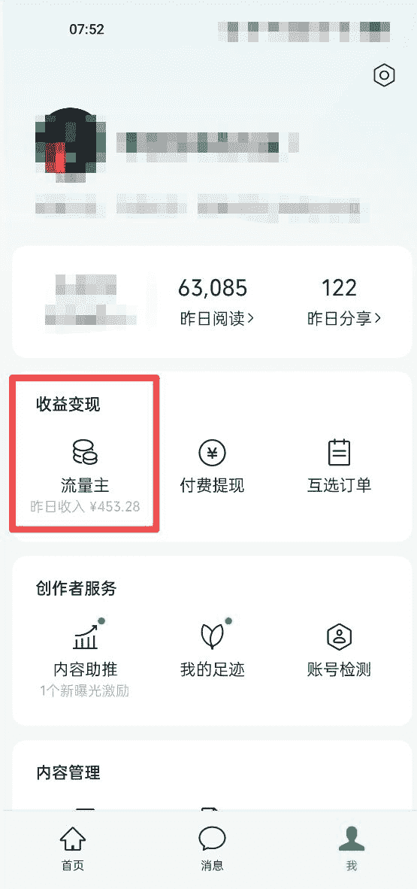

贴图爆文：

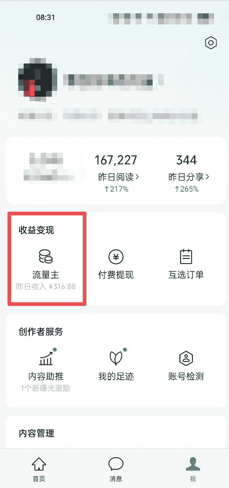
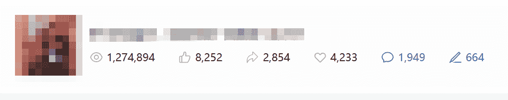
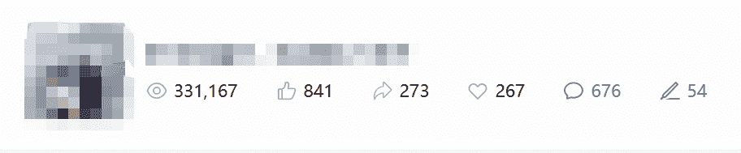

长篇爆文：

每天看着蹭蹭的互动，人也很兴奋。

这个过程让我意识到：公众号不是没机会，只是很多新手不知道从哪里开始。

尤其是完全0基础的新手，很容易卡在三个地方：

- 不知道写什么。
- 不知道怎么做图。
- 不知道怎么判断内容有没有机会。

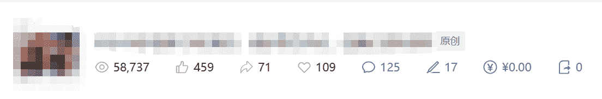
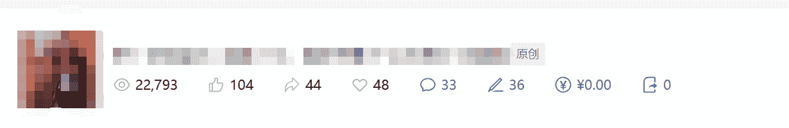
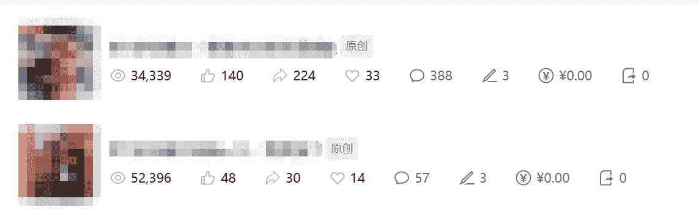
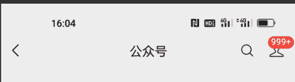
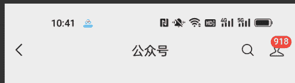

下面，我就把我做账号的过程、方法和细节写出来。

不保证你照着做一定能爆。

但至少可以帮你把第一步跑起来，拿到第一波流量主收益的正反馈。

## 三、新人第一步：别急着定位，先从自己身上找“可传播资产”

新人一开始做什么赛道容易拿到正反馈？

很多新手一上来就问：我应该做什么赛道？我要不要做养生？我要不要做情感？我要不要做热点？

但我的建议是，先别急着定位。先从自己已有的资源入手，你会什么，就写什么。你经历过什么，就写什么。你对什么长期感兴趣，就从哪里切入。

新手最怕的不是赛道不够好，而是你一开始就去做一个完全陌生的领域，既要学赛道，又要学表达，还要学平台规则，门槛会很高。

你可以问自己几个问题：

18. 我身上有什么反差？
19. 我有什么别人会好奇的经历？
20. 我过去做过什么项目？
21. 我有没有一段能反复讲的故事？
22. 我有没有一个明显的人设标签？
23. 我有没有正在经历的转型、困境或变化？

比如我自己，我一开始写的就是感情的话题。

一方面是我在感情上确实有一些探索和持续的经历。

一方面是我和老公的故事确实有传播点。

我们是生财有术CP。同时我是云南人，他是山东人，我们天然存在着南北的差异。刚认识的时候，我在广州，他在济南，也有异地的差异。而且还是相差7岁的姐弟恋。这些都天然有话题点。

当我们写自己，你就不担心没有灵感，用你自己的真实人设去创造内容。

你也可以把自己简历和喜好投递给AI，问问它：

我要做自媒体了，你帮我梳理一下适合我写的赛道和流量关键词。

这里建议多问两个AI，会有很多意想不到的收获。比如DeepSeek、ChatGPT、元宝（我最近发现它产出内容的流畅度比豆包和ChatGPT还适合我）。

从你自己开始写，一开始也不需要去考虑标签精准、垂直度这些，就是不同方向都可以在一开始去尝试。

当然，你不能太偏，比如说，你把赚钱和美食混在一起，那确实就太偏了，可以分开两个账号。但是如果是相关性还可以的话，咱们就大胆地尝试，慢慢地，你看你写什么内容比较舒服又能出爆款，我们就可以给它定下来垂直化。

### 新手更容易起量的3类方向

如果你一开始很难确定一个具体的品类方向，也没有持续耕耘的信心，那建议准备2到3个账号。

其中一个账号先尝试做一些爆款类的选题，提升网感，拿到初期收益正反馈。

爆款类内容的优势在于起号比较快，流量比较猛，初期就能拿到收益，这有助于提高信心。

但它的缺点是：

24. 没有人设，无法建立用户信任。
25. 存在不稳定性。你可能在十万+和个位数之间来回体验，容易让人有落差感。

所以，我建议可以同时运营2—3个账号：

26. 一个账号专门做爆款，用来快速建立信心。
27. 另一个账号去尝试一些你想写、但目前不太有信心的领域（比如婚姻、养生或AI等）。

这种深耕内容比较适合长期发展。但如果你只用一个账号去做，可能会因为迟迟没有流量（或者只有几十个阅读量）而感到挫败，产生自我怀疑。

特别是如果后端没有产品变现，需要精准引流，只能靠流量主收益吃饭的话，这种挫败感会更强。

而且做这种垂直方向的话，一般来说内容写的还是会偏多一点，那你花费的时间也会更长。如果看不到投入产出比的话，就真的会比较容易打击信心。

爆款性的内容大家可以去尝试这几种：

### 有争议性/讨论度的真实生活话题

情感领域和真实生活，蛮容易出一些比较有讨论度和争议性的话题。

情感领域的范围也很广，比如说亲情、爱情、友情、婚姻、婆媳、两性、老年情感等。

大家都有八卦的欲望，生活嘛，也都可以说上几句。咱们就可以去写一些生活领域的话题。

大家都有话说。

你写一个婚姻里的小矛盾，评论区很容易有人代入。

“我家也是这样。”

“我老公也这样。”

“我婆婆也这样。”

“这不就是我吗？”

这种内容也是可以垂直化去做的，而且素材永远不缺。

你的家庭日常、身边人的故事、朋友的经历、评论区的高赞留言，都可以成为选题。

也可以在各大平台到评论区去找高讨论度的内容，作为选题。

再拍个实拍图配上文字就可以，生产成本比较低。

### 猎奇内容

生活里那些罕见、反常、突破常规认知的事情，天然带有窥探欲和新鲜感，也很容易成为爆款。

咱们可以找一些不常见的工作、离奇的经历、奇葩的习俗，或者身边人发生的“第一次见”的故事。这种内容天然有点击欲。读者会想知道：这到底怎么回事？后面发生了什么？真的假的？

这类内容对新手也比较友好，因为它靠的是选题本身的好奇心。

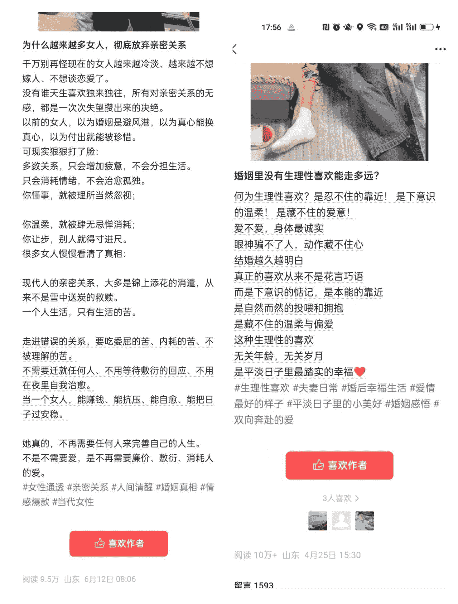
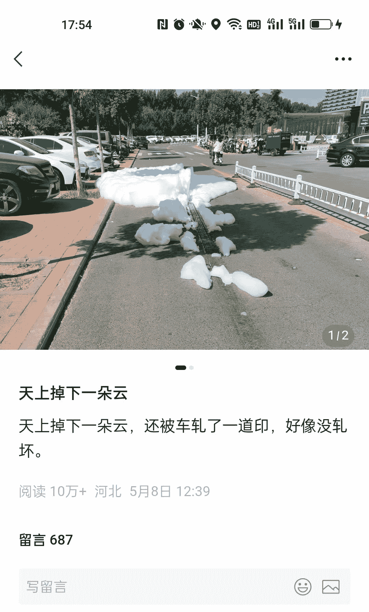

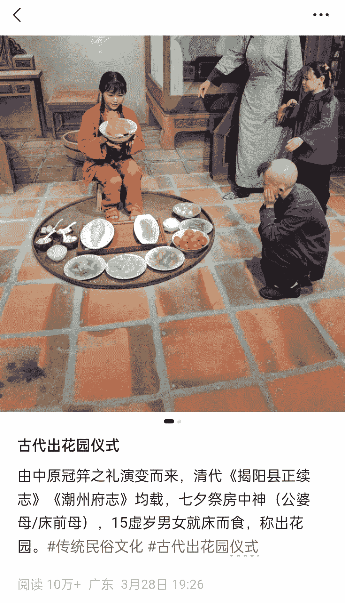
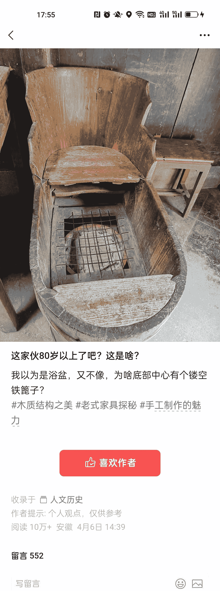

### 追热点

热点自带流量。

微博热搜、头条新榜、抖音热点、小红书热榜，都可以作为选题来源。

社会热点、民生事件、综艺八卦、明星话题，都可以关注。

但热点有两个要求：

第一，要快。热点有一个黄金时间，动作慢了就没优势了。

第二，要避开敏感话题。政治敏感、极端对立、三观不正的内容不要碰。

新手做热点，不要只想着蹭热点。

可以从普通人的生活感受、关系问题、女性成长、情绪共鸣这些角度切入。

这样更安全，也更容易写出自己的东西。

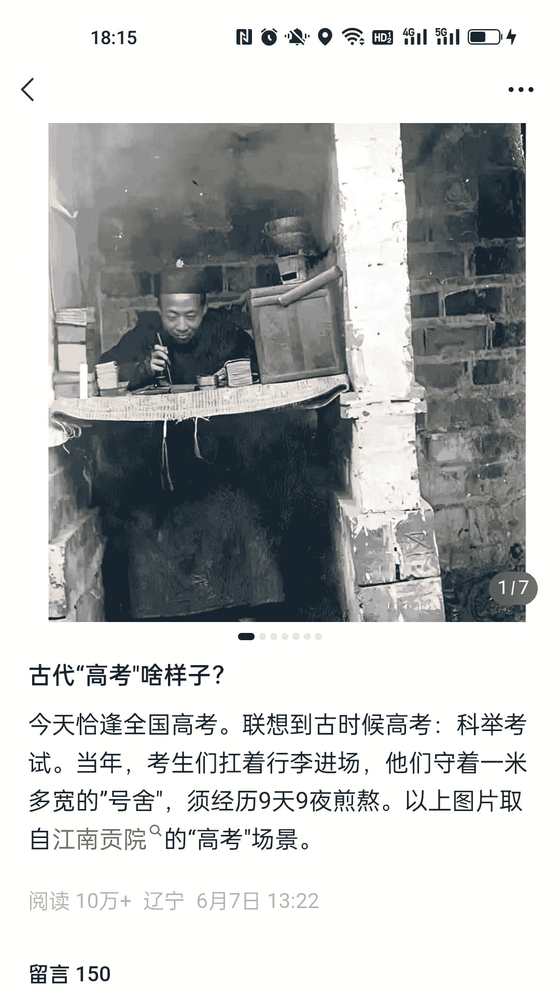

## 秦昊说，被伊能静删习惯了，你们怎么看？

在我们的眼里，伊能静就像完美女人一样，有高情商、高颜值、有才能，又会赚钱，而且还有一个比自己小这么多岁的丈夫，并且丈夫秦昊又很疼她。

可是，在这些看似完美的表象背后，其实，他们也和我们普通夫妻一样，会有小争吵、小拌嘴。

当我刷到秦昊说，他经常被伊能静删好友时，我就觉得伊能静挺可爱的，可爱的同时，又觉得她做这件事显得不太成熟。

也许吧，每个人和伴侣相处的方式都不一样，倘若删除伴侣的好友，能够让自己一时解气，也能让对方快速意识到错误而道歉，那不成熟又如何？

被爱的人，有恃无恐，我感觉伊能静就是这样。

## 四、怎么写？先定选题，再做内容，最后打磨标题

我现在做内容，通常会把最多时间花在选题和标题上。

因为公众号贴图也好，长文也好，标题真的很重要。

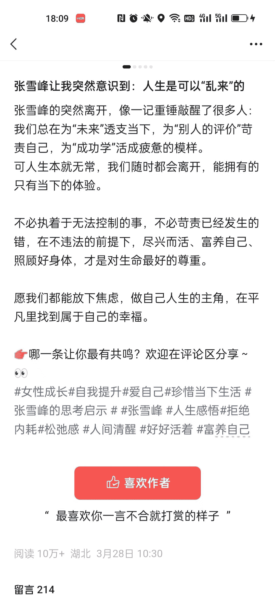

很多时候，内容能不能被点开，先看标题。

### 跨平台找爆款

咱们在确定赛道的时候，不是通过AI得到了一些赛道的流量关键词吗？这个时候你就可以把这些关键词拿到其他平台（小红书、抖音、头条、微博等）去搜索，看看有没有你感兴趣的爆款，有的话就可以直接拿来用了。

比如说我常用的是小红书。

我在飞书上用采集器搭建了一个小的工作流，打开小红书看到还不错的内容就会一键采集，自动保存到飞书表格里，我就去那个表格里面选题。

目前我只采集了标题和笔记内容。因为都是看到爆款我才会点击采集，所以也没有特别记录各种互动数据【如果有需要的话，配置的时候就可以加上】。

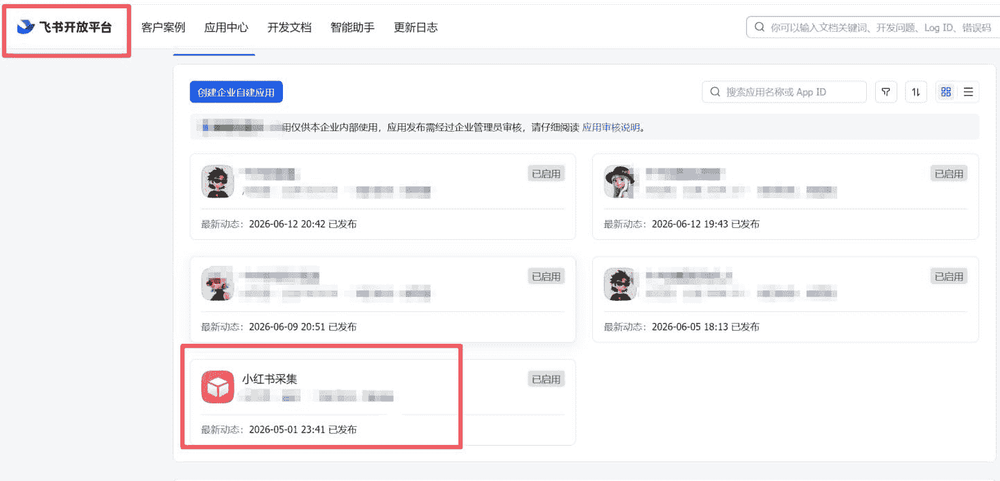
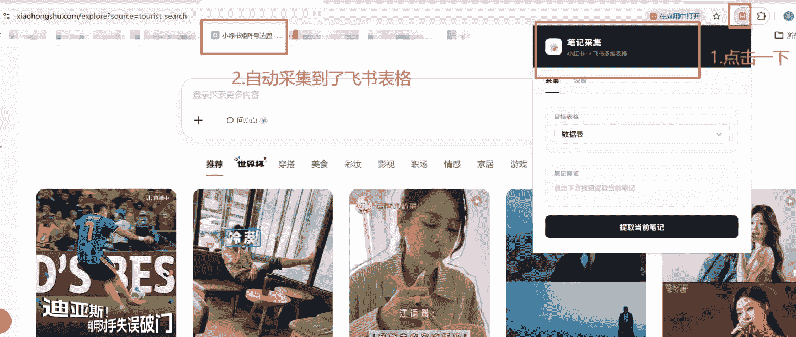

这样做的好处有三点：

28. 你的选题永远不会枯竭。你可能一天就能采集好几个，从而避免某一天突然状态不好、不想干了的情况。
29. 搬运其他平台爆过的内容。一方面，爆过的内容大概率会再爆；另一方面，降低了在同一个平台洗稿或抄袭的风险。
30. 寻找爆款的时候，会源源不断地找到很多你的对标账号【看到一个爆款，点击进去看它别的笔记，顺藤摸瓜找账号】。

但这里要注意，不是让大家直接照搬。

更好的方式是：借选题，不借原文；借结构，不复制表达；借讨论点，再加入自己的故事和观点。

这样风险更低，也更容易做出自己的内容。

### 在微信生态里找贴图对标

31. 直接到服务号里面去刷贴图内容。
32. 看到你感兴趣的领域，就点赞、评论、转发，让系统持续推荐。
33. 建几个只有自己的小群，把不同类别的选题分别发进去。
34. 看到爆款内容后，往下拉评论区，下面经常会出现很多类似方向的内容。
35. 通过你的领域关键词，在微信的搜索框里面去搜索，一定要选“贴图”选项。还可以选择“最新”“最热”来筛选需要的内容。

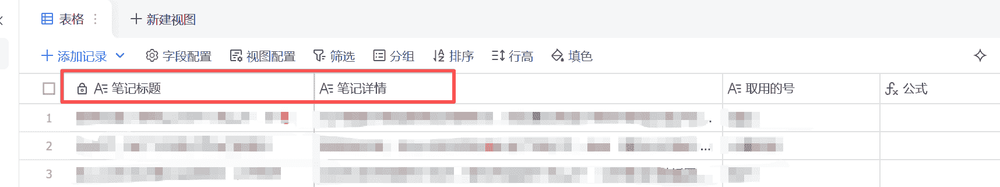

公众号懒人搜索，懒人专属群分享

对标内容。

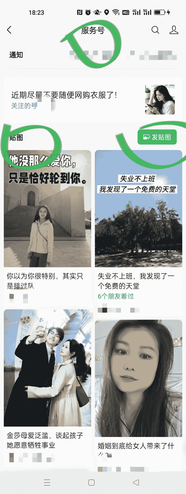

公众号懒人搜索，懒人专属群分享

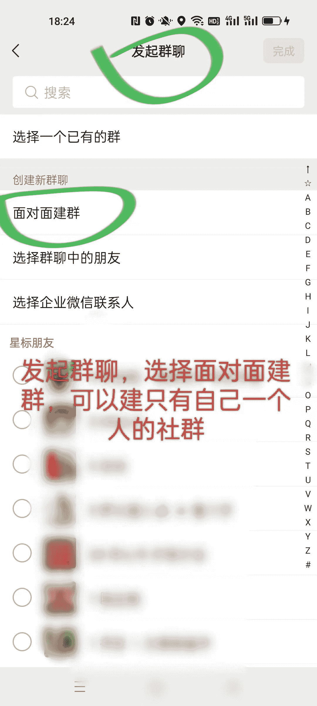

公众号懒人搜索，懒人专属群分享

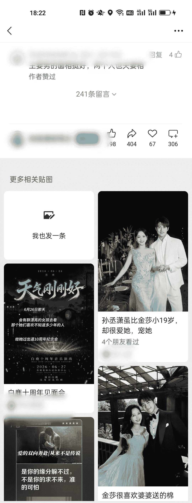

公众号懒人搜索，懒人专属群分享

新手前期不要太相信自己的感觉。多看爆款，多看同行，多看评论区。看久了，网感才会慢慢出来。

## 五、如何又快又好的创作内容？AI 一定要用起来

我做贴图号以后最大的感受是：AI 不是替你创作灵魂，而是帮你提高动作效率。

公众号懒人搜索，懒人专属群分享

如果你只把AI 当成“自动生成工具”，很容易产出一堆没灵魂的内容。

但如果你把AI 当成拆解工具、辅助工具、提效工具，它会非常好用。

**借助AI 拆爆款**

看到一篇爆文，直接让AI 拆：
- 这个标题为什么吸引人？
- 开头是怎么写的？
- 中间是怎么推进的？
- 评论区为什么有讨论？
- 它戳中了哪类人？
- 我能不能结合自己的人设改写？

我特别建议新手不要一上来就让AI 写全文。

先让AI 帮你拆。

拆多了，你会慢慢知道爆款到底爆在哪里。

**用AI 做图片二创**

如果你看到一个不错的图片形式，可以把参考图发给AI（我用的是ChatGPT，真的太强大了），告诉它：

我想要生成一张类似的图，哪些地方要变，哪些地方不变。场景要什么感觉。文字要什么风格。

生成的图和之前就已经完全不一样了。

公众号懒人搜索，懒人专属群分享

底层逻辑是：给AI 一个参照物。保留爆款里的核心感觉。替换主体、场景、人物、角度、文字和细节。

这样既能学习爆款逻辑，又能做出新的内容。

下面提供参考提示词，咱们可以根据实际情况改一下，就能用。

生成相似场景的图：

帮我生成一张类似的图，白色的固体物像云朵一样，在马路上形成了比较新奇的造型。

PS. 具体哪些要变化，哪些要保留，你可以提出你的具体要求。类似的逻辑，可以千变万化的使用。大家可以展开思路想想，可以发挥的空间就很大了。比如plog.

生成固定形象人物图：生成的图还原度真

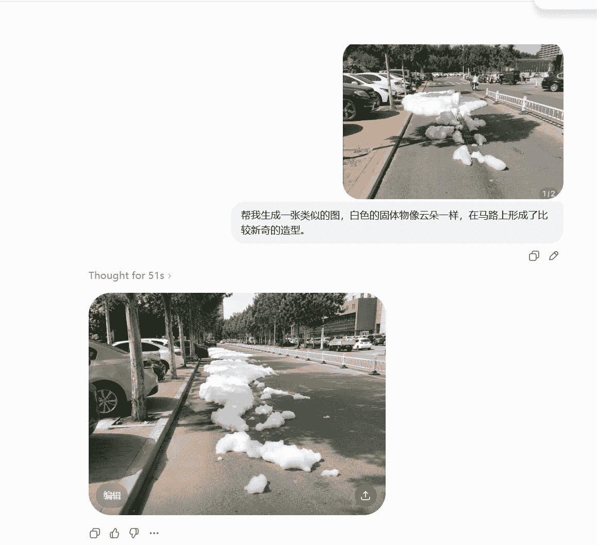

公众号懒人搜索，懒人专属群分享

的很高

请给我生成图1【主图】同样场景的图片

女生长相（五官和脸）与图2 保持一模一样

服装场景随机，但需要适配

生成的图要有真实的微瑕疵 不要太像AI 图

帮我用我的个人头像或者是照片【附件图片】，生成5 个场景的照片
1. 躺在床上伸懒腰 长袖睡衣
2. 在书桌前阅读
3. 在书桌前记笔记
4. 外出逛超市
5. 外出散步

这里要特别提醒一下，公众号出了新规——如果是露脸的账号，后面有可能会出现需要扫脸认证。

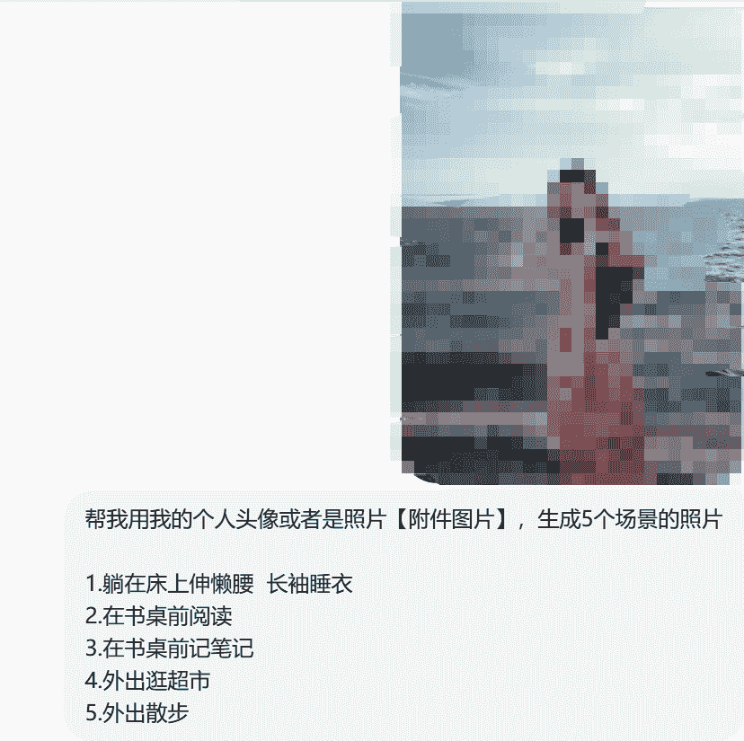

公众号懒人搜索，懒人专属群分享

也就是说，你在内容里发布过的脸，也就是核心出现的人设、人物长相，都必须和你自己扫脸能通过的长相保持一致。这也是一个咱们要提前做好规避的准备。

**复刻内容：长文内容要“拆结构+注入真实经历”**

短一点的内容，比如100 字以内的，直接让豆包、元宝等仿写就可以了。跟它说明白，重复率低于20%。

你要把需求说明白：
1. 你要发布的渠道
2. 字数的要求
3. 产出标准是什么（例如标题、正文内容，重复率要低于20%等）

但如果是长一些的内容，需要去拆解结构，告诉AI 你的信息和原素材，让AI 创作，你再来润色。

关于这个话题，我之前看过刘智行老师发的精华帖（感谢刘智行老师，给了我超级多的实操方法和思路）。他在里面分享了一些提示词，其中就有“拆解提示词”和“模仿提示词”。我也用上了。

具体的做法是：

公众号懒人搜索，懒人专属群分享

1. 准备两篇爆款文章，一篇用于拆解结构，另一篇作为模仿的对象。
2. 把文章发给AI，同时配合拆解提示词，让它帮我们拆出爆款文章的结构。
3. 把拆解出来的提示词，加上我的人设。
4. 将第一篇拆解出来的提示词，配合“模仿提示词”一起发给AI，让它去模仿第二篇的内容。
5. 模仿内容的时候，让AI 先别产出，先给我大纲，并且向我提问。我会检查大纲是否合适，不合适的地方就告诉它怎么调整。
6. 在回答提问的过程中，我会把真实的人设信息、故事、观点和思考提供给它，并融入大纲进行润色。这样产出的内容，核心部分依然是我们自己的。这才是内容最有灵魂的部分。
7. 让AI 帮我整理表达。
8. AI 生成内容后，我们可以在中间留一些空白段，自己动手写一部分内容，最后再通读润色一遍，改写成最符合自己表达习惯的形式。

**建立自己的风格库和素材库**

另外，在正式模仿之前，我还会做以下准备：

1. 建立风格库：把我之前写过的内容整理成一个“表达风格库”文档投递给AI，让它提前熟悉并仿写我的风格。
2. 持续积累素材：
3. 在创作过程中，我会不断积累自己的灵感库和素材库。用一个飞书文档，把

公众号懒人搜索，懒人专属群分享

我的人设、故事以及我的价值观等持续记录下来。
4. 把过往爆款做一个整理，单独拎出来整理标题，整理爆文所有内容

这样AI 就能持续了解我的思考，明确我的人设和故事的核心内容。也能知道，我的账号，什么样的内容容易爆。

## 六、如何提高收益？贴图拿流量测选题，长文拿更高收益和信任

**收益来源**

公众号满100 粉丝之后就可以开通流量主。流量主功能开通以后，咱们只要发内容就可以有广告。

贴图在评论区，长文在文中、底部和评论区都有。文章比较长，广告位就会多一点。像我有的文章是2000 字左右，那么正文就会有两条广告。

文章的阅读越多，我们的收益广告收入也就更多。不同的赛道，受众群体会不一样，会影响单个浏览的单价，单价越高，则广告曝光收益越高。

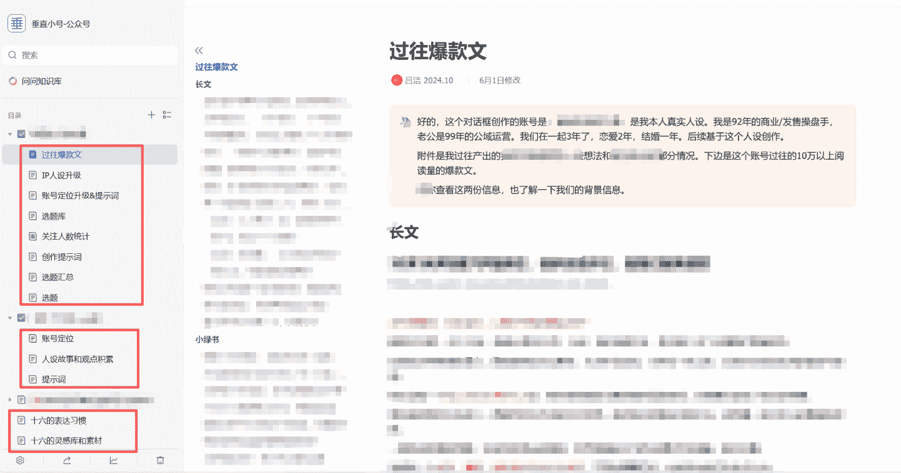

公众号懒人搜索，懒人专属群分享

**贴图：重点是讨论度**

贴图想提高收益，不能只追求好看。更重要的是让用户愿意评论。因为贴图需要评论区有互动，广告展示机会才会更好。所以选题要尽量有讨论度。引导大家在评论区评论。

比如：
- 婚姻里的矛盾。
- 亲子里的冲突。
- 生活里的反常识。

读者一旦有话说，评论区就容易活起来。

我自己的经验是，贴图内容里最好有一个“可讨论点”。

比如我之前在内容里，就呈现过差7 岁姐弟恋要不要生孩子这样的话题。很多人就会来表达自己的观点。

另外有一个小技巧：内容发出去以后，我们先让身边的朋友帮忙评论，评论达到3 条。检查一下有没有广告。这样的话，一旦有新的曝光，我们就有机会获得收益。

整体来说，其实贴图的广告主收益也还是

公众号懒人搜索，懒人专属群分享

蛮不错的。

像我其中一个账号，单天的曝光在3000 到5000，拉取的阅读量在五六万，每天的收入也有个100 左右

**长文：更适合提高收益和建立信任**

咱们训练了一定的手感之后，我建议要配合长文一起发。

也有的人会困惑，贴图和文章一起发对账号有没有影响？其实是没有影响的，甚至可以说是相辅相成：

1. 贴图负责拿流量、测选题、拉曝光。
2. 长文负责提高收益、沉淀信任、训练内容能力。

而且长文的流量主收益，单篇爆款确实更高。文中、文末、评论区都有广告，所以整体广告曝光度会大一些。

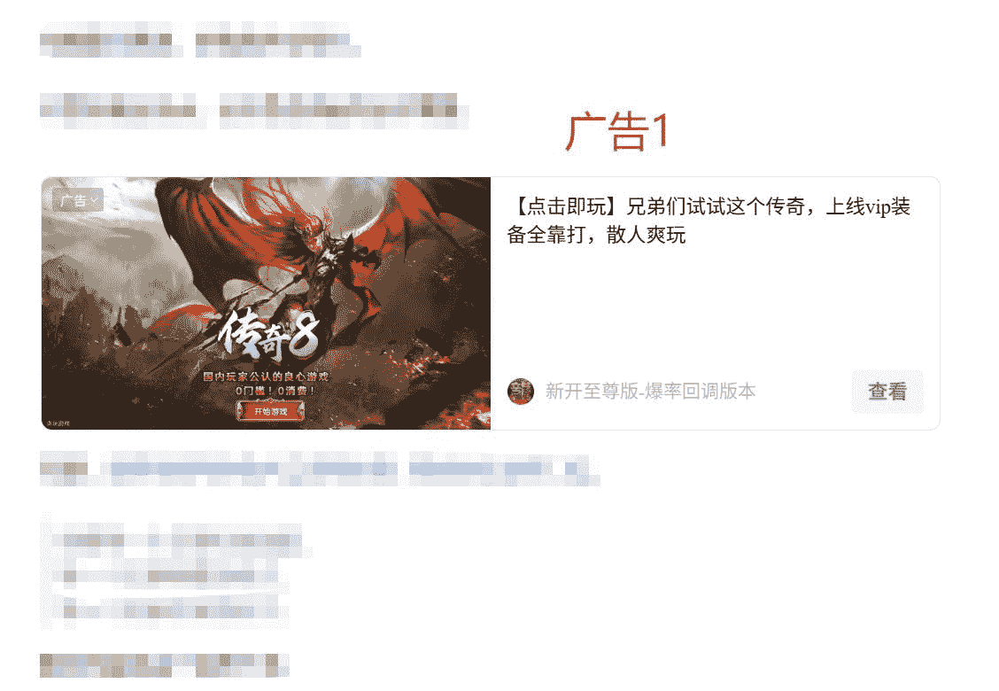

公众号懒人搜索，懒人专属群分享

像之前我写长文，一篇四五万阅读的长文七八百；但如果是贴图，达到十多万阅读也只有一百左右。

（这个数据是每篇文章发布后**7** 天内的累计广告收益，超过**7** 天的不会在这里显示。仅为大约参考。）

所以我的建议是：用贴图拿流量，测选题。搭配长文拿更高收益和建立信任。

而且从项目的长期发展来看，单纯赚流量主收益，是一个前端正反馈。

但如果你未来想做个人IP、私域、产品、陪跑、咨询，长文才是更重要的信任资产。

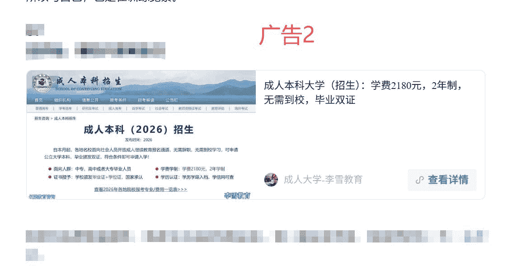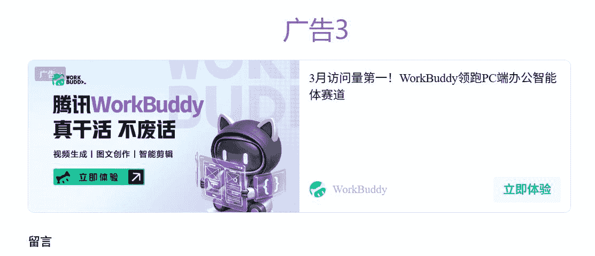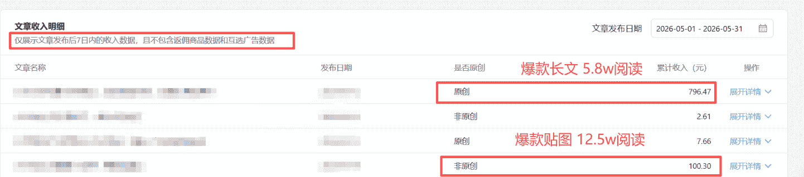

公众号懒人搜索，懒人专属群分享

针对流量主收益，提高单篇收益的几个实操技巧：

1. 长文控制在1500–2500 字：广告位稳定2–3 个，太长反而影响完读率。
2. 标题里埋“停留钩子”：比如对比、选择、反常识，让用户愿意多看几秒。
3. 引导评论但不诱导：在内容里自然抛出问题，引发大家的讨论欲望。

## 七、避坑指南：这几个问题新手很容易踩

**注册入口不要选错**

这个比较容易踩坑，咱们朋友圈发布之后，有个转贴图的按钮，一点击，咱们的公众号注册权就被侵占了。

咱们注册贴图号其实和注册公众号一样，一定要到“订阅号助手”App 里面或者公众号的网页端去注册，不能在微信内部的入口注册，否则是没有流量主的。

具体的注册方法有两种：

1. 手机端注册：
在手机应用市场搜索“订阅号助手”，下载安装后直接通过微信登录。注册新号并完成实名认证，再按照要求完善各项资料即可。

公众号懒人搜索，懒人专属群分享

2. 网页端注册：
   (a) 准备好手机号和邮箱。
   (b) 在浏览器上搜索“微信公众平台”，选择带有官方标识的链接进入。
   (c) 点击“立即注册”，选择“个人和媒体”类别的公众号，再选择“个人订阅号”进行注册即可。

注册完成后，在后台既可以发布长文（即文章），也可以发布贴图，咱们就可以正式开始发布内容了。

**多账号要提前考虑实名和运营问题**

现在平台规则变化比较多，个人公众号的运营者绑定也越来越严格。

如果你要做多个账号，建议提前规划清楚：谁实名？谁使用？谁负责发布？

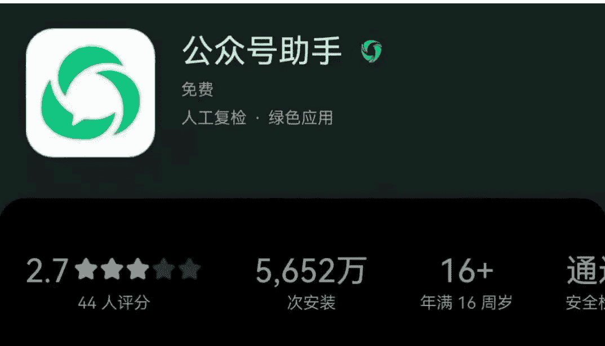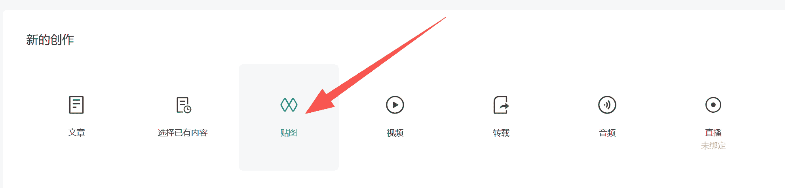

公众号懒人搜索，懒人专属群分享

最好的办法是用家人的身份证注册微信小号，然后通过微信小号来绑定公众号。这样公众号由你来使用，微信号也在你手上。不管是咱们用手机流量发文，还是涉及到验证的时候，都比较方便，避免了需要家人给你扫脸操作。

另一个方法是，如果有营业执照的话，用营业执照来注册公众号，就可以把自己设置为运营者。

在咱们规模上去之前，我比较建议先用家人的身份实名微信个人号，然后通过个人号去绑定公众号就可以了。

**我有很多个号，但没有足够手机，只能电脑发布，如何进行域名隔离？**

咱们可以用多个浏览器来打开，浏览器也可以用无痕版本。

比如说我的Edge 浏览器，发布内容的时候会有一个单独的专用链接。

这个可以用Codex 帮自己设置一下，设置好以后，你每一次发布内容，所有上网的信息都会被清除。

但是不好的点在于，你需要每一次都扫码登录。如果你的账号刚好是用别人的微信

公众号懒人搜索，懒人专属群分享

登录的，就不是很方便。

目前我是用比特浏览器来进行操作，在后台给不同的账号设置了不同的地区和域名。

比特浏览器用起来其实会有一点偏慢，所以咱们如果能换更快速的套餐，就尽量上快速的套餐。

我现在用的是中量级的套餐，还是觉得有点慢，等下一次想升级一下。

公众号懒人搜索，懒人专属群分享

**老号不一定废掉了，先测试再决定**

我自己有一个之前被冻结过的老号。23 年小绿书刚开始火的时候，市面上有人推出了一個项目，大概是因为缺账号，所以采取合作模式：由他们准备内容，招收一些账号来发布，收益按比例分成。

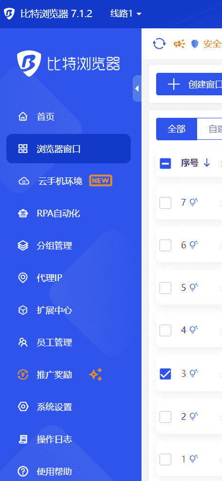

公众号懒人搜索，懒人专属群分享

我当时参加了这种项目，他们给我发了两个月左右的国学、中医、玄学之类的内容，没有起号。后面又改成了星座，也发了一个月左右。结果这些内容，三个月了，连过百的阅读都没有，甚至有很多是零阅读。

当时我也以为是这个账号有问题，毕竟注册快十年了，确实没怎么用过，期间还被冻结过，我一度很怀疑这个号是不是废了。

但是最近大号被限流的那段时间，我开始重启这个小号。

因为我是一个身份证下面有两个微信公众号（在“一个身份证只能实名一个公众号”的规则出来之前注册的），舍不得注销，一旦注销名额就没有了。

我就硬着头皮上，结果这个账号才发到第三篇内容，就已经过300 阅读了。这至少说明账号是正常的，可以重新用。

所以关于老号这一块，我的感觉是：

1. 你可以持续发内容试试。如果发了一周多都没有任何起色，而之前的资产也不是很重要，可以考虑注销。
2. 注销后把名额释放出来，马上重新去做。
3. 如果账号的播放量或阅读量还可以，

公众号懒人搜索，懒人专属群分享

那么咱们就把重心重新放在内容创作上。

**助推券慎用**

当我们取得一些成绩之后，比如说关注度突破500，划线达到几次等，公众号平台就会给我们发一些流量助推券。

（比如下方，是我刚做的新号，有收藏，划线，都可能发助推券）

我一开始是用的，但是效果没有特别明显。而且有一次我用完助推券以后，流量大幅度的下滑，从原本每天十几万的阅读，一下子降到了几千。

后来了解到，用了助推券更容易触发人工审核，所以后来所有的助推券我都不用了。包括现在的新号也有助推券，我也没用。

**遇到限流怎么办？**

做贴图号的过程中，我也遇到了卡点。我的大号被限流了三次：

1. 第一次：停掉了一周左右流量。但是恢复之后，迎来了爆款的大爆发。
2. 第二次：有3 天直接停摆，从10 万左右阅读掉到了一天三四千阅读。
3. 第三次：非常严重，过了二十多天都没能恢复。目前还在救号中。

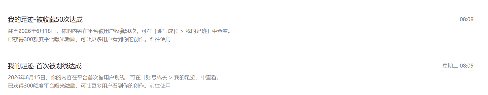

公众号懒人搜索，懒人专属群分享

违规基本上都是低创作度和不良信息。

我这边的低创作度主要是用了明星热点，二创内容过程，直接用了别人文章中的部分照片。加上那一段时间对应的热点发的账号比较多，我没有第一时间跟上，而是多了两三天才发。有点炒冷饭了。

如果热点第一时间没有跟上，后续又没有高原创度的独特观点，就不要追了。

不良信息主要是写情感的话题，评论区会有一些类似骚扰信息的评论。这些评论估计也会影响平台对账号和内容的评估。

在第三次限流之后，我还找了平台反馈，反而触发了更严格的人工审核。平台给我追加了一条导流（其实我内容没有导流）的提醒，导致账号限流更加严重。

现在账号虽然处于基本健康的状态，但推流确实大大减少了。

公众号懒人搜索，懒人专属群分享

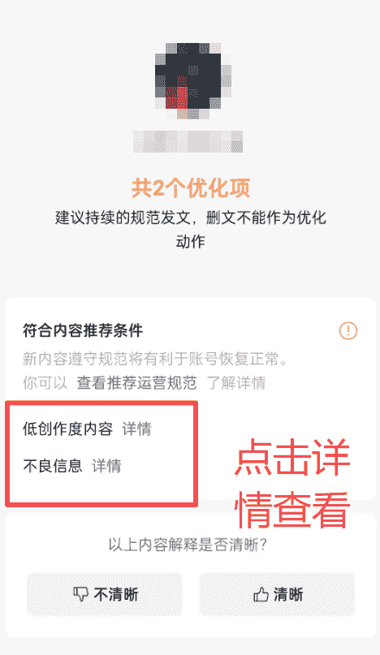

公众号懒人搜索，懒人专属群分享

后来我起了两三个小号，其中一个小号也是很快就阅读过千，我就开始增加发文频率，从一天一条，增加到一天三条。

注册一周内的小号，迅速增加了发文频率，还都是AI 创作的内容，AI 做出来的假人设图片。导致平台给了一个违规，流量很快就从单篇**1000+**到了一百多。

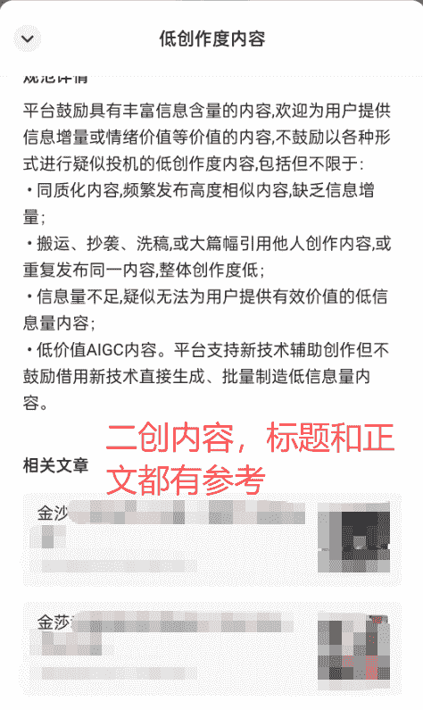

公众号懒人搜索，懒人专属群分享

后来我也意识到，假人设做不长久。三四月份的时候，很多AI 生成的美女图做封面，账号篇篇阅读过万。一看评论区好多色粉。

虽然我做的是情侣号，但是假人设也会影响长期发展，所以目前全部都停掉了。限流账号注销，正常账号隐藏了之前的虚假人设内容，全部换成真人设，以及去了一些长期积累的内容。

这里分享一下限流半个多月大小号都没进展的心路历程：

面对这种情况我也动摇过，我又开始想是不是该探索别的方向，一遇到卡点就想逃避。

前两天刚和朋友聊过，他说相比已经过去的几个月，现在确实更难了；但相比8 月份，也许现在反而是这个平台最好做的时

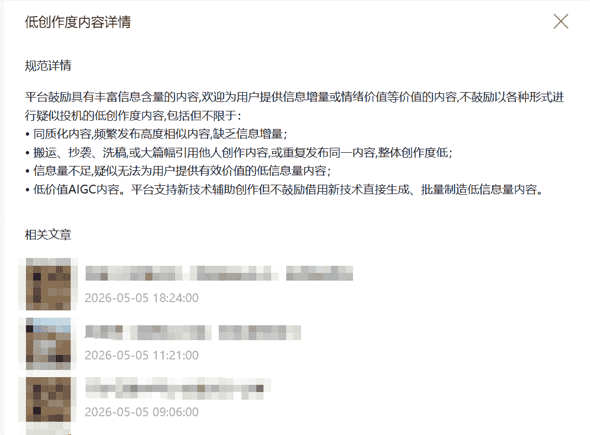

候。

从0到1有0到1的挑战，到1到100更有1到100的挑战，而且挑战往往是越来越大的。如果遇到困难就想通过切换赛道来获取新成果，可能我们永远都没法把一个项目做透。

这让我想起以前爱情课老师讲过的话。他说谈恋爱遇到挑战就放弃，重新找一个人谈，一开始仿佛很顺利，因为你是在用曾经“升级打怪”积累的能力去应对低阶的游戏层级。可等玩到同样的层级时，你会发现能力还是不足，但你却会在打初阶的时候，误以为自己进步了。

所以这一次，我决定要好好面对问题。

一方面开了新号重新起步，多领域一起跑。目前两个新账号跑得还不错，新领域也有了一些进展。在创作更有深度的长文内容。

另一方面，也深度研究内容。不仅仅是通过贴图号赚一点流量主的收益，而是思考如何更好地构建系统和产品。也有了第一个小产品的雏形和思路啦。

分享这个真实的经历，是希望把自己的启发和动力，分享给可能也有遇到挑战的圈友，把信心立起来，安安心心去面对挑战。

而且，这个时候，生财航海的价值就体现出来了。

一个人做项目，很容易因为短期数据波动就怀疑自己。但在航海里，你能看到别人也会卡，也会限流，也会踩坑，也会调整。心力就会起来。

而且航海手册能帮你把基础动作重新捋一遍。很多时候你以为会了，重新再看收获又不一样了。

这对新手来说，其实挺重要的。

## 八、给新手的建议：先跑通闭环，拿到第一块钱的正反馈

如果你也想做公众号，赚点零花钱。那就从看到这个内容的此刻开始，先跑通最小闭环。

- 第一步，正确注册公众号。
- 第二步，达到流量主开通条件。
- 第三步，确定2-3个可测试方向。
- 第四步，每天收集爆款内容/选题。
- 第五步，持续发内容。
- 第六步，记录阅读、互动、收益。
- 第七步，每周复盘一次。

先不要追求完美。干起来。

公众号贴图号对新手最大的价值，不只是赚一点流量主收益。

而是它门槛低、反馈快、适合练手，拿到做成的体验。

对我来说，这个项目也不只是赚了9000多块钱。

它让我重新确认了几件事：

- 第一，真实故事是很好的内容资产。
- 第二，生财不是只有项目资料，还有人、活动、航海、圈友和机会。
- 第三，普通人做项目，最重要的不是一上来就做大，而是先跑通闭环。
- 第四，遇到卡点的时候，不要只想着逃跑，要先把问题拆开。

## 【致谢】

最后还是想认真感谢一下生财。

如果没有生财520，我大概率不会认识我老公。

如果没有这个真实故事，我可能不会那么快在公众号里拿到爆文反馈。

如果没有生财里的项目资料、航海手册和圈友讨论，我可能也不会这么快把公众号流量主这件事跑起来。

感恩~

————分割线————

看完这篇SOP，你觉得你懂了。但90%的人一到实操就会卡在第一步。

工具和教程只是最低级的壁垒，真正的壁垒是“立刻动手”和“圈层信息差”。

如果你想看全网最新的变现玩法，并且和一群执行力极强的极客一起下场拿结果，欢迎围观我的核心私域：【懒人专属群】。

我们不聊虚的，只做商业闭环的拆解与AI效率的压榨。系统内已沉淀1000+跑通的套利实战局。

👉 查阅圈子完整数字资产与上车门槛：

https://lazyso.com/insider/

认同价值、准备好下场干活的，扫码加我微信（lazyhelper1）

备注：【实操上车】，不闲聊

