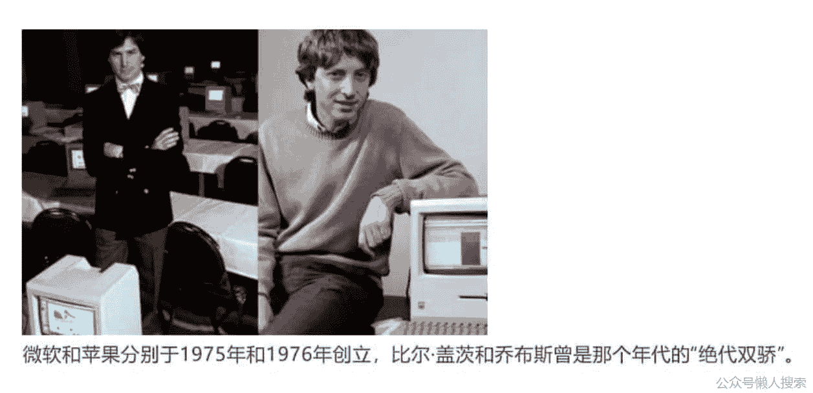
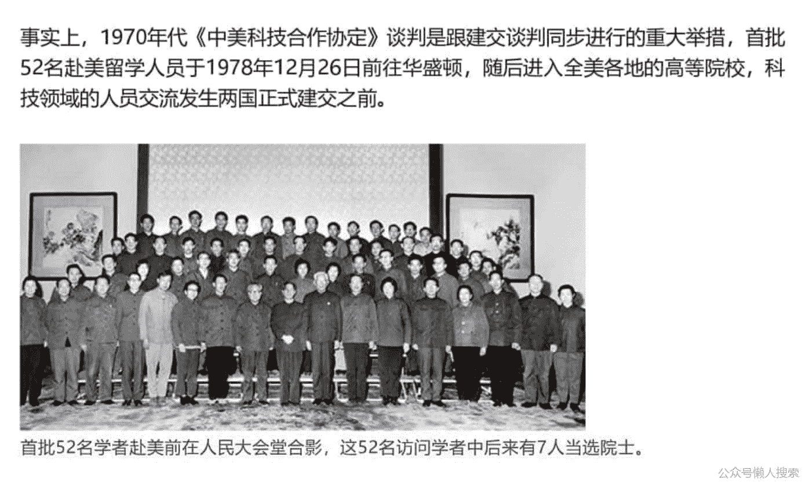
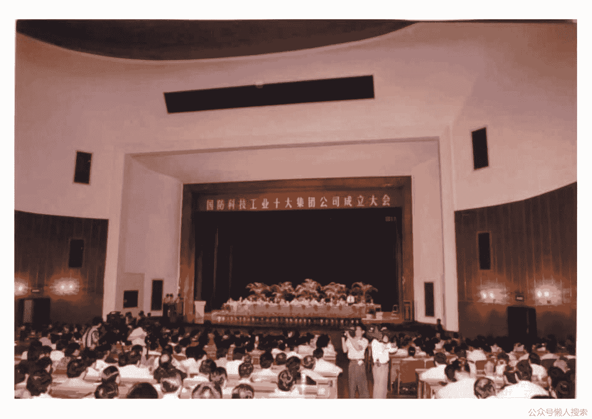
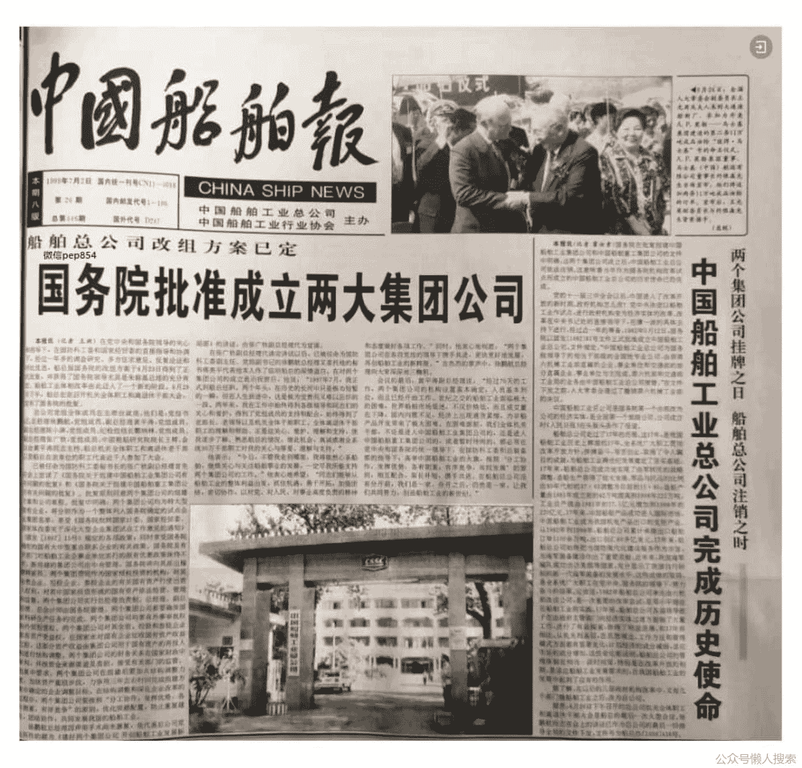
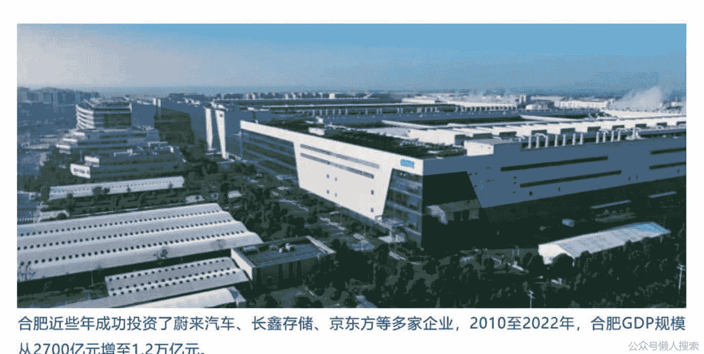
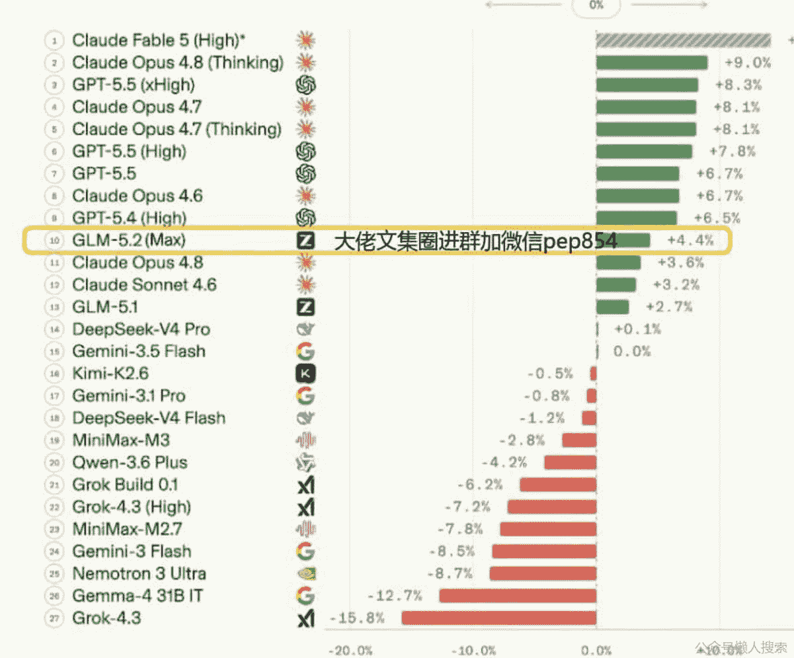
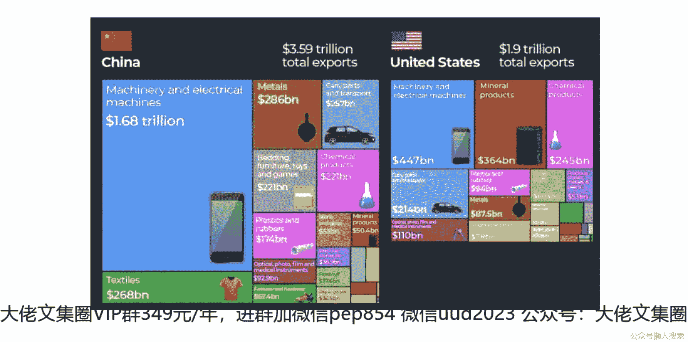
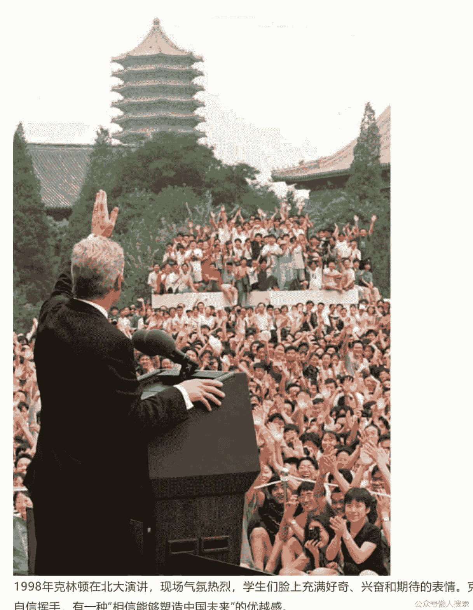

# 紧追不舍 

260622 江宁知府付费文 

整理：公众号懒人搜索，懒人专属群精选 

懒人微信：lazyhelper1 

美国维持全球领先地位的重要方式是每隔一段时间掀起一轮新产业浪潮，如：1980年代的个人电脑（微软、苹果1.0），2000年初的互联网（Google、亚马逊），2010年左右的移动互联网（苹果2.0、Meta）以及最近几年的AI（英伟达、OpenAI、Anthropic）。

凭借高科技和新产业赋能，美国往往能够在短时间内拉开与竞争对手的距离，实施降维打击。

每当新世界大门初露端倪，美国资本市场都会呈现出一种近乎狂热的状态，视其为国运之所系，用中国人的话说叫"养兵千日用兵一时"。

美国社会对泡沫的容忍度远高于其他国家，他们的逻辑是"大浪淘沙"——哪怕最终倒闭999家企业，只要诞生一家新的微软、谷歌、苹果或英伟达，就足够了。

这套模式在历史上屡试不爽，而当下又到了检验它成色的关键时刻，这一次美国遇到了全新的对手。

微软和苹果分别于1975年和1976年创立，比尔·盖茨和乔布斯曾是那个年代的"绝代双骄"。

最近几年，西方对中国科技产业政策及发展状况均异常感兴趣。知名智库兰德公司在一份报告中指出："中国的科技产业雄心正在重塑全球经济格局。在所有规模庞大且深度融入全球市场的经济体中，从未有过像中国这样推行如此广泛、由国家主导且以安全为驱动的产业转型。"

兰德认为，1949年以来中国产业的发展经历了这样几个阶段，呈现出显著不同的特征与规律：

# 1、1949至1970年代

重点发展重工业，目标是建立独立且相对完整的工业体系，指导思想为"自力更生为主，争取外援为辅"。

1950年代中国高度依赖苏联及东欧社会主义国家提供专业知识、先进技术和管理经验，具体措施包括派遣留学生、邀请专家来华短期工作，以及参考苏联技术标准和组织模式等。

从1960年代开始，中国有计划地把部分核心工厂和科研机构迁至内陆地区，构建基于国防考量的工业基地布局——该概念即后来"供应链安全"的前身。

因中苏分裂导致中国获取先进技术的渠道中断，客观上增强了恢复与西方关系的紧迫感。事实上，1970年代《中美科技合作协定》谈判是跟建交谈判同步进行的重大举措，首批52名赴美留学人员于1978年12月26日前往华盛顿，随后进入全美各地的高等院校，科技领域的人员交流发生在两国正式建交之前。

首批52名学者赴美前在人民大会堂合影，这52名访问学者中后来有7人当选院士。

# 2、1980至1990年代

在保留少量国家引导产业政策的同时，由市场和地方政府共同推动产业发展。这一时期诞生了大量轻工业和出口加工型企业，使中国在没有统一国家产业战略支持的情况下成为出口大国，初步解决了温饱与创汇难题。当然，彼时的产品附加值并不高，处于"中低端产业蓬勃发展+市场化制度建设"阶段。

八九十年代中国曾希望学习日本、韩国基于市场制定的行业导向型规划，然而早期的规划工作采取自上而下方式，跟产业界协调不足，效果一般。人们有印象的主要是两大科技战略规划，即"863计划"（1986年启动）和"973计划"（1997年启动），核心目的也是降低对外国技术依赖。

1998年的部委改革中，将旧有的工业主管部门整合为统一的宏观指导机构国家发展计划委员会（发改委前身），同时成立若干家行业类大型央企——这是中国首次系统性地培育国家龙头企业。下图为1999年7月1日国防科技工业十大集团公司成立大会现场，十大军工集团由此诞生。

# 3、2000至2010年代

2006年，《国家中长期科学和技术发展规划纲要（2006—2020年）》颁布。2008年，为应对国际金融危机带来的影响，各国纷纷推出前所未有的政府主导投资，中国亦不例外。这些资金除涌入房地产外，也有相当部分进入"科技发展纲要"拟定的领域，如生物技术、新能源及下一代信息技术等，政府开始逐渐获得部分战略性新兴产业的主导权。

到2013年左右，现代科技产业政策的框架已基本成型，规划周期、技术战略和金融扶持手段环环相扣，呈现"抓大放小"的思路。与前几个时期依赖国有企业攻坚克难不同，2010年代之后的产业政策呈现民企国企兼顾特征，以整个行业为扶持对象，竞争和失败都是真实存在的，这一点在电动汽车领域尤其突出。

另一边，对外资技术的学习也从未停止，当时有个很时髦的口号叫"引进、消化、吸收"，还有一个耳熟能详的策略叫"市场换技术"。

"市场换技术"的结果比较令人失望，除高铁等极个别领域外，以汽车为代表的多个重要行业关键技术持续受外国控制，产业升级步伐缓慢，促使政策制定者重新审视其策略方向。

合肥近些年成功投资了蔚来汽车、长鑫存储、京东方等多家企业，2010至2022年，合肥GDP规模从2700亿元增至1.2万亿元。

# 4、2015年至今

2010年代初，中国就已经确立了全球最大制造商和第一大出口国的地位，但在先进制造领域仍相对落后。改革开放以来靠"引进外国技术+低成本出口竞争"的追赶模式渐渐走到尽头，压力促使中国亟须转向以高附加值、创新驱动型增长模式。

与上个时期强调扩大制造业产能、融入全球供应链以及引进外国技术的做法不同，近十年的产业政策专注于增强韧性并实现技术领导地位，明确将"自主可控"视为抵御外部压力的关键屏障。

2018年是中美关系乃至中国科技政策的重要节点，特朗普政府对中兴和华为的限制凸显了国内大型企业的脆弱性。自此之后，中央和地方层面针对产业领域的文件占比显著上升，产业政策被定义为"既是安全工具也是经济工具"。在不断摸索实践过程中，渐渐形成了涵盖五个维度的"工具包"，即财政杠杆（补贴、税收优惠、研发支持、采购政策、人才计划）、金融杠杆（政府股权、定向信贷、资本市场）、市场杠杆、政企关系杠杆以及海外战略举措。

2025年4月中美关税冲突期间，特朗普政府故技重施，禁止对华出售英伟达先进AI芯片，这次中方表现出更为坚定的立场。从根本上讲，中国已不再将恢复美国技术供应视为根本解决方案，而是将其当作争取时间的过渡性安排。

近几天人工智能圈最火爆的消息是中国AI模型GLM-5.2与美国顶级模型差距再次明显缩小，其开发公司智谱科技在港股的市值飙升至9300亿港元，创始人张鹏为"00后"清华大学毕业生。

与其他国家相比，中国对科技产业政策的重视程度更高，不仅具有经济升级的作用，更蕴含着深远的政治目标。简单来说，产业层面的成就跟治理体系有效性密切挂钩，也是彰显执政能力的窗口之一。

中国在产业规划时呈现"中央政府+地方政府+企业"的多重驱动结构，各省市均建立了涵盖融资机制与地方主管部门的庞大体系，在充分竞争的同时也出现"内卷"、重复投资、债务累积等问题。很多产业某种意义上是"企业+当地政府"绑定后形成一个政商联盟，再与其他省市组合展开竞争，比如：安徽支持奇瑞和蔚来，广东支持比亚迪，上海支持上汽，浙江支持吉利，北京支持北汽和小米……

因为有了地方政府的参与，使得调动资源速度明显加快，能够迅速形成完整产业生态，有评论称：任何行业只要进展到了比拼工程化这一环节，国内优势就逐步体现出来了。另一方面，上述模式也出现了地方间彼此博弈、企业角色复杂化、政商关系千丝万缕等现象。不过从底层逻辑上讲，最后的赢家筛选环节还是交给了市场——这是当下产业政策与传统计划模式最根本的区别。

苏州工业园区是参考新加坡经验、政府主导建立产业园区的典型代表。AI浪潮以来，苏州诞生了多家市值超千亿的企业，还有一家市值过万亿的中际旭创。

回到中美产业竞争的话题。就当下这个时间节点来说，中美可谓各有各的难关要过。

中国面临的挑战是，无论从经济层面还是政治层面来看，世界其他地区对中国制造业新增产出的吸收能力都十分有限。发展中国家有购买意愿但缺乏购买力，很难支付附加值越来越高的中国制造产品——大部分发展中国家其实是没有创汇手段的，有些只能靠中国企业去"发掘"它们的价值，以物易物。美国、欧洲、日韩等发达经济体是中国产业升级的直接受损对象，它们能接受中国制造的玩具、纺织品和日用品，但不能接受汽车、机器人和通信设备，因此不断出台保护主义措施来限制进口。

1971年，美国财政部长约翰·康纳利曾向各国财长明确表示："美元是我们的货币，却是你们的问题。"其含义是说，在国际贸易体系下，一个国家的国内政策会给其他国家带来显著调整成本。有西方学者借由这句话表示："如今，尽管美国仍是全球金融体系的支柱，但中国在全球制造业领域占据了类似的地位，也产生了康纳利所说的美元问题。"本月G7在法国召开了峰会，其隐藏议程便是探讨如何在不依赖中国的情况下继续治理世界。

在出口产品种类上，中国和美国已高度接近，主要包括电子产品、汽车、化工产品等，美国多了一个石油类产品。

美国的挑战在于，面对来势汹汹的中国产业升级，倘若不能凭借此轮AI革命拉开与竞争对手差距，维系现有霸权体系将愈发困难。正因如此，才给外界一种美国社会"梭哈"AI的感觉。AI是一项技术，它最终需要落地到产业层面，比如：科学家利用AI发现新药，汽车自动驾驶突飞猛进，机器人从实验室转向工厂等。

美国在赌更先进的AI可以帮助自身做整体性产业更新，从而重新焕发活力。实际上，当前美国最具优势的指标——GDP——是一个具有欺骗性的参数，它衡量的是交易量和经济活动，而不是生产能力，代表"市场价值"而不是"物理价值"。就定义来说，GDP是在现行国际货币与价格体系下某个经济体一年内所创造的新增财富总量。对于那些服务业占比较大的经济体来说，给各类服务"定价"对GDP核算非常关键，如金融服务、法律服务、医疗服务、软件授权、房地产租金和知识产权收入等。

国家和个人一样，都存在"路径依赖"——过往的成功经验有时会变成枷锁。对美国来说，这种路径依赖主要体现在两方面：其一，确信自己每隔一段时间就能实现创造性突破，且足以甩开对手；其二，高度聚集于新方向，忽略传统产业的巩固与维系。

1980年代个人电脑涌现时，整条产业链几乎全部是美国企业，如苹果的硬件、微软的操作系统、英特尔的芯片等，美国领先其他国家至少15年。到了互联网时代、移动互联网时代和AI时代，美国领先幅度越来越小。以移动互联网为例，iPhone（硬件）及各类App（软件）很快就被来自中国、韩国的竞争对手复制对标，没过几年便回到同一起跑线上。在美国实施制裁前的2018年，华为手机的全球市场份额曾超过苹果，仅次于三星电子，并且在欧洲高端市场跟iPhone展开正面交锋。

至于当下的AI赛道，虽然个别顶级模型美国仍领先，但领先优势远小于个人电脑和互联网时代。究其原因，主要在于竞争对手发生了变化。1980年代美国掀起个人电脑浪潮时，中国在资本、人才、技术等领域可谓千疮百孔，日本、德国等国家限于体量又无法做到面面俱到。而今天中国内部已发生巨大改观，那种"美国一下子领先十几年，其他人从零追赶"的现象，短期内很难复现。

值得注意的是，与移动互联网时期中美产业链深度绑定（苹果公司在华代工厂）不同，AI产业基本形成了两个封闭系统——美国仅把韩国和中国台湾纳入其核心供应链内。

如果把历史拉长来看，中国几千年来始终都是一个相对富裕的国家（横向对比），也一直是实践创新的中心。比较可惜的是，进入近代后，中国并未经历像欧洲那样彻底改变社会结构的工业革命，由此形成了一个发展鸿沟。工业革命带有试验性质和运气成分，单纯从概率上讲，更容易发生在"低稳定、高实验性的复杂系统"里，而非"单一高效率的稳定系统"。对于今天的中国而言，效率已然是长项，因此更应在高效率执行体系之外，通过市场化机制保留足够分散、宽松的试验空间，以提升长期突破概率。

————分割线————

在这个AI能替你写代码、写文章的时代，基础技能正在迅速贬值。绝大多数人正被淹没在海量的免费垃圾信息里，陷入低效的体力内卷。

当"努力"不再是壁垒，人与人之间唯一的护城河，只剩下"信息过滤"的效率与"认知系统"的维度。

圈子已稳定运行7年。我们每天利用Python爬虫与大模型算力，过滤全网最顶级的政经内参和搞钱风向标，做你最冷酷的"外部大脑"。

如果你认同这种"重塑认知防线"的极客主义，欢迎围观我的个人情报智库：【懒人专属群】。

https://lazyso.com/insider/

认同信息过滤价值、想省下每天3小时无效阅读时间的读者，扫码加我微信（lazyhelper1）

