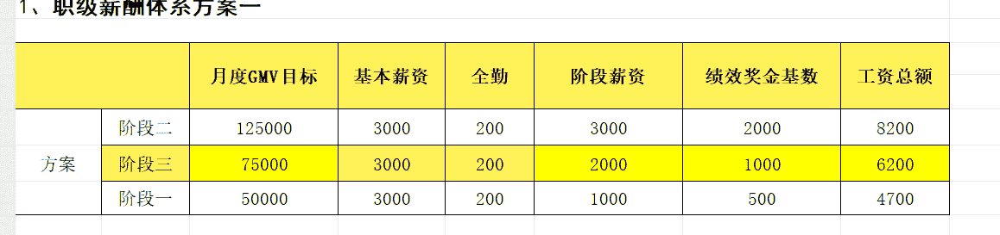

 

# 小红书工作室3-4人小团队搭建指南：场地/招聘/培训/SOP和薪资设计经验分享

260621 副业SC 精华

整理：公众号懒人搜索，懒人专属群精选
懒人微信：lazyhelper1

大家好，我叫晓豪，常驻江西吉安，今年是我小红书创业第4年。今天给大家分享我搭建团队的流程和经验。

我23年做虚拟资料电商，后面业务慢慢起来，我就开始招聘制作素材，到了24年开始全面开始招聘全职。目前工作室全职稳定在3-4个人+2个长期兼职在运营。目前我们工作室主要还是在做图书和虚拟资料。

其实现在回头想想，自己还是蛮庆幸当时选择开始组建团队一起做的，并且现在觉得这是一条相对正确的路。

## 个人和团队做的区别（个人感受）

| | 个人 | 团队 |
|---|---|---|
| 精力 | 当我一个人做的时候，我只能做一个项目或者一个渠道就筋疲力尽。没有精力去研究行业的最新动态以及技术，更没有时间去尝试一些新的项目以及方向。相对于自己给自己找了一份工作，而且回报率低 | 有团队帮我处理客服/素材/售后以及内容等工作。我就有时间做更重要的事情，比如研究业务怎么结合ai落地，怎么让ai结合现在业务做出差异化，行业最新出来一种新的素材形式，我可以先测试，跑通后再同步给团队 |
| 时间 | 全年无休，每天都在上班，感觉用时间在换金钱。即使有时候休息，心里也总是想着工作的事情，感觉很累。 | 业务全部标准化之后，就好像和上班一样，虽然压力肯定还是大，但可以做到休息的时候就休息，上班的时候 就上班。也有时间去处理一些日常生活的事情 |
| 竞争力 | 做电商很多时候速度以及数量非常重要，遇到一个爆款很难大批量生产高质量的素材，好不容易遇到一个爆款，但是素材量以及质量跟不上，真的好心痛 | 团队协同的好的话可以1+1＞2，既可以保证生产的素材数量极大的提高，也可以保证质量稳定。可以在市场中多分到一杯羹。 |
| 业绩 | 一个人有个好处，就是赚多少都是自己的。即使一个月就赚1W，我心里也是挺好，没啥压力。 | 一个小团队的业绩扣掉房租人工广告损耗，利润未必会比一个人做多很多。但是团队做胜在稳定，不管淡季旺季我们每个月业绩相对平台，因为背后是有人持续在更新运营，一到旺季利润就会倍增，淡季可能和一个人做差不多。（个人感受） |
| 情绪 | 一个人呆在办公室或者房间做，每天交流和协同，时间久了总感觉比较烦闷或者压抑。业务也容易受情绪影响，心情好就更新，心情不好就玩一天。今天有事就不更新，没啥事就多更两条。这种状态长期来看不是很好 | 团队业绩不好的时候也焦虑，但是大家在一起有商量，可以交互沟通，朝着一个目标努力这种感觉也挺好 |

这份团队搭建思路主要基于我在搭建小红书项目团队过程中的一些经验，所以大多数案例都是偏向于内容团队的管理和思路，不过我感觉任何小团队刚开始搭建思路基本都是相通的。

## 我自己一个人做时所遇到的困境

早期我一个人做的时候，刚开始单量不多还好，自己做选品、选题、笔记、客服、售后全部可以搞得过来。但是后期单量一大，客服就占用了我大部分时间，忙着帮顾客售后回复消息，再发两个笔记几乎就没有时间。但这种情况下每天忙的晕头转向但业绩也没什么很大的增长。加上从早到晚不间断的回消息，搞得自己心里憔悴，所以我心想一定得招人。

好在我自己有一间办公室，但是因为自己在家办公效率太低了，所以特地租了一个办公室办公，一个面积56平的场地，价格只有1000元一个月，位置交通都很方便。所以招人就方便很多（自己租了一段时间后在本地认识一个生财的朋友，我们还一起合租了这个办公室近一年半的时间）。

我最开始想的是招一个客服，但是我当时利润很低，不怕大家笑话，我当时一个月利润才6000左右就忙的晕头转向，所以找一个全职客服根本不太现实，兼职客服又担心不靠谱。所以我想着干脆找一个兼职帮我做简单的素材。在招头一个人的时候自己也挺紧张的，一方面担心这种投入不知道有没有回报，另一方面自己不知道把爆款素材这种感觉的东西怎么教会她，再加上是兼职，所以中间磕磕绊绊，大概花了三四个月，中间换了两三个兼职终于把素材的流程跑通了。

后面又了解到有些公司可以外包客服，价格也比较便宜。早上八点到晚上十一点，一个月500条咨询也才600元左右，后面就把客服外包出去了。

接下来我面对最头疼的一个问题就是：不稳定。兼职时间太不稳定了而且输出的结果也极度不稳定，尤其是遇到一些业务转型或者素材改版，几乎是要从头培训。客服这边虽然外包出去，但是也不稳定，经常换人，回复速度慢，对业务没有理解，好不容易熟悉了结果人离职了又要开始培训下个月。所以这个时候我就开始萌生了招全职的念头，想着人员稳定业务才能稳定，自己才能真正的流程化和标准化。

正好经过这近一年的磨练，自己对培训管理以及标准化大概都清晰了，业务也有了比较大的增长，所以开始招全职了。

## 为什么要搭建团队

第一：让业务流程化标准化而不是依靠某个人业绩某个技能

我认为搭建团队最理想的状态就是业务按照流程和标准就可以自适应运转，最好是每个岗位专人专岗，让团队整体实现1+1＞2效果。

但是到了ai时代，岗位不一定是需要人，部分职位agent也可以代替。我们设计好流程之后，我们可以选择这个岗位是需要人还是ai来执行。如果需要人我们就招聘培训，如果agent能实现，我们就接入测试。但是最终的目的是为了业务可以按照流程以及标准自适应运转，工作室负责人的核心工作就是不断优化流程和标准以实现更高的效率，以及不断寻找业务的增长。

第二：提高竞争力

假设我们做小红书电商碰到一个非常好的产品或者一个风口，只要发笔记就能出单，就像早期的小红书电商一样，这个时候谁能高效的产品更多的笔记，谁就能拿到更大的流量。这个时候大家肯定就会疯狂的堆笔记数量，但是一个人再怎么努力发的笔记也有限。那就无非两条路，一条是做自动化，一条就是人工。

这个时候如果谁先研究出了更高效的笔记产出软件，或者谁能更快地组织协同一批人去抢占这个市场，谁就能快速的赚到钱。在项目慢慢卷成红海的时候，我们因为在上一轮里面赚到了钱并且负责人的时间还腾出来了，他们就可以持续升级玩法和护城河，当然现实生活中肯定没这么理想化，但我一直是这个思路去理解团队的，所以我认为好的管理可以提高业绩以及竞争力。

## 判断自己是否需要搭建团队

在开始招团队说明业务已经偏向稳定了并且可以持续发展了。但是在搭建团队之前，我觉得我们还是需要评估一下我们到底需不需要搭建团队。

首先，我觉得有这几种情况的确没有多大搭建团队的必要：

1. 项目不符合平台规则或者本身就是红利期很短的项目

比如最近ai很火，很多人买账号代充值这种，这种本来平台大量在封禁加上没有啥技术难度，完全一个人闷声赚钱或者找些代理兼职代发引流就可以，没必要搭团队。就算搭起来了，流量不稳定，今天爆单明天封号做的也累，员工学会了完全自己干，因为没有半点门槛。

2. 项目虽然正常稳定但是没有扩大的可能性或者招人也没办法复制

比如一些强ip类型的项目，知识付费，流量主，项目教练这种。虽然的确很忙，但是现在有了ai，很多工作可以用ai代替来做。招了人其实并不会让业绩增加，反而你在管理培训这个人还需要花费时间和精力，有点不划算。顶多招一个小助理打打杂。但为此还需要租个场地，还要培训啥，个人感觉没多大必要。

3. 项目稳定也可以扩大但是自己的确没有搭建团队的能力基因

出来工作我们的确发现很多人自身能力很强但是对培训和管理这块的确不是很合适。这块怎么判断呢？我的判断经验就是首先这个人敢不敢要求别人，命令别人以及拒绝别人。第二点，这个人能不能把一个比较复杂的事情几句话清晰的讲清楚。第二点主要是培训能力，短时间还能锻炼出来，但是第一点很大原因根深蒂固的性格原因，不是一两年就能改变的。如果你招的人你不敢要求，不敢拒绝，这个团队肯定散。

搭建团队所花费的时间精力以及成本比如我们想象的高很多，所以在搭建之前我们一定要想清楚真的是否需求。当然如果我们把搭建团队当作锻炼自己能力的一种方式那就另说，想着虽然我现在不需要团队，但是目前我有点钱，先练练经验，这个心态也挺好的。

## 办公场地和招聘渠道

好的场地不一定贵

首先我们一旦确定要开始招人，一定有一个绕不开的点，就是办公场地和招聘渠道。

刚开始招人的时候很多朋友会想着线上招聘，但线上工作的效率氛围以及这个人在工作当中的学习接受度会差很多。所以搭建团队，肯定优先线下，线下的话也可以很好的锻炼自己管理培训思路和能力。

好的场地就像好的项目一样，不可能一下子就能找到，先确定我们的预算和地区，然后平常多留意多搜索多加一些中介，有好的房源就赶紧下手。

第一办公室这个房租是1000，56平市场价基本是1500元，在我们这边老市中心，交通位置都很方便。类似与万达广场楼上这种公寓。

我是整栋楼房租最低的。因为一直盯着这个区盯了近一个月，隔三岔五刷这里的出租，中介以及物业信息。所以当有低于市场价近三分之一的价格，我第一时间就租下了。后面的租客基本都是1500起步。

我们第二个场地是居民房，133平，价格是1600元。这个位置除了营业执照以及招人麻烦，其他都挺好的。后面是因为我们做的图书，特许营业许可证实在办不下来，所以搬走了。

第三个场地是写字楼，115平，价格是3750元，当时政府有近一半的补贴。所以价格和居民房一样，但是这边招聘、营业执照、办公环境都好很多。

我在一个四五线的市级区，我们这边房租相对来说比较便宜。但是如果在一二线城市，我觉得很少很少有这种地方。所以我建议一二线城市前期刚起步的阶段，可以去找一些创意园区，那边都有补贴。他们有一些很小很小的格子间，大概就30平40平左右，一到两个人也刚刚够。

或者在大学城附近，很多大学城附近都比较偏，然后招人的话也相对来说比较好招。我的思路是前期招人，先以招兼职为主，利用兼职把我们的培训思路和业务全部完成标准化，然后我们再开始去扩张找全职。然后到时候找全职的话，我们业务稳定了，标准化流程化已经跑通了，我们就可以换一个好点的地方，好招人的地方。

但是如果前期你的培训/管理思路都没有办法落地，或者说落他们身上没办法产生业绩，这个时候房租太贵了反而让自己压力比较大。

## 招聘渠道

关于招聘，我觉得最好用的还是boss直聘这种招聘软件。前期第一个阶段最好不要找自己身边人，或者找一些熟人，因为你自己本来就不是很稳定，你也不确定你要做多久，所以这个阶段就通过社招去找一些人来，反而最稳妥。薪资的话就根据当地的水平来弄，反正前期的话，基本上是花钱砸经验，省也省不了多少。效率优先。

## 一：搭建业务的标准化SOP

在招第一个人之前我们捋一下自己业务需要招哪个人，不过我觉得大部分这个阶段都是招客服和助理比较偏多。在确定我们要找的人之后，我们可以把他们的工作流程梳理一下。如果是客服的话搭建一个话术库，交接一下后台的操作细节；如果是助理的话，根据你自己的业务找一些不用动脑子的活出来，把用什么软件、怎么用、什么标准、什么对标，全部梳理一下。

不可能有完美的SOP，所有的SOP都是在实践中不断调整和优化。

我犯了一个很大的错误，之前我在招人之前我就开始花了很多时间在做SOP，总希望有一份SOP他们一看就都会，不用自己教，但这个实在太理想化了。且不说业务和流程在不断优化，就算这个人能学会SOP里面的内容，但是她不可能通过SOP了解这个业务的核心点。只有她理解了这个SOP为什么这样设计，他才能灵活变通。

SOP不是僵化大家的思维，而是保证大家的最低标准产出。

我觉得SOP是一个最基础的兜底，他不是让同事按照这个SOP一模一样的去做，而是保证无论再怎么样他们不能低于这个标准。不能因为这个人今天心情不好或者状态不好就质量很差，要保证最低不能低于这个标准，如果你有想法你可以做的更好，工作室也会因为你这个更好而奖励。

SOP不要做成新手使用教程一样，只记录几个关键节点，比如内容模板，选题标准等。

### 我们的内容SOP示例

以我们之前的做的虚拟项目为例：

**选品**

选品我用的是笨办法，大部分的时候是手刷+经验以及配合数据监控。

我的选题分三类：
- 第一种是每年都会爆的热度品，这些每年都会正常做，加一些创新，每年都会稳定出单。
- 第二种是监控同行的新品（如下图）有异常增长也会立即跟上，看数据觉得要不要继续更。
- 第三种是行业里面出现的新品以及热度品。

**内容模板标准化**

我们主要是做内容为主，所以大部分SOP是以内容为中心。我每天都在搜集各种好的内容模板类型更新在里面，我要求大家每天三分之二的笔记必须按照内容模板制作，另外三分之一你可以自己发挥，如果你没有想法，你也可以完全按照内容模版制作。

**交接流程**

我们目前用的是最原始的方法交接流程，就是直接在共享文件夹备注。兼职做完了素材会打上【已制作】，我审核完了打上【已审核】，客服同步到网盘会打上【已同步到网盘】，运营就会接着打上后面的标签。

**数据反馈**

每隔一两天我们早上就会一起在电脑前面看后台数据，分析最近商品增长原因，最近热度趋势以及最近笔记数据，这样可以让大家更直观的知道需要往哪些地方优化，也可以形成一个讨论教程的氛围。

做好之后找个兼职试试水

确定好后我建议先找个兼职来试试水，主要试一下自己的流程和培训思路。头一次自己招人和之前在公司上班公司招的人给我们带这种感觉完全不一样。因为现在他的成本需要负担在你头上，你的安排以及培训标准直接决定他能不能产出。

## 二：培训思路

按照流程和标准试3-7天。我的培训流程总结下来就是一句话：

我说你听，你说我听。我做你看，你做我看。

这个流程听起来很简单，但是做起来还是很多细节要注意的。

**我说你听**---首先我在说的是否我会讲清楚以下几点：
1. 为什么要做这件事儿。让他知道这个事最终的目的和结果。
2. 怎么做这个事儿，告诉他这个事情的工具方法对标，让他不走弯路。

**你说我听**---但是很多时候我说了他未必能懂，所以我会让他在讲给我听一次。一方面是很多我认为这是常识的事，对方不知道也不理解，他讲给我听的时候我就能察觉到；第二方面是很多人害怕你觉得他笨她不好意思问，复述的时候你就知道他大概什么知道什么不知道。

**我做你看**---很多时候你以为你讲清楚了，但其实他还是一知半解的，所以亲身示范一次非常有必要。

亲身示范不等于亲力亲为。示范的重点是保证他们看得清楚、学得到，所以应该遵守严格的流程和步骤，让他们学到这个流程应该怎么走。这一步，追求的是可复制的工作方法，而不是我们自己觉得怎么方便就怎么来。

**你做我看**---他做一次就知道他到底消化了多少，吸收了多少，以及基础咋样。

在他们做的时候，不仅要盯着最后结果是不是好的正确的，也一定要盯着流程要对。如果有些时候他为了方便以及偷懒不按流程来，你一定要指出来。先僵化，在优化，在固化。

按照这个思路我觉得基本可以完成一个最基本的培训流程，这个流程是我之前老板告诉我的，用到现在觉得非常实用。但是想要做好里面细节还是很多的。

**效果不理想如何优化**

但如果我们按照我们的标准化来做，对方效率以及结果都不达标怎么办。这个过程3-7天就能看出来，我的建议就是及时开除直接换人，如果换了三四个人都还是这样，那就要反思一下自己的沟通方式和培训流程是不是有问题了。

## 三：转型的阵痛期

最开始自己一个人做的时候，很多东西都是可控的，但是交给别人做，你就会发现很多东西即使你讲的再细，他们做出来的东西和你期望的以及标准相差很多，你会觉得心里憔悴。甚至很大概率整体业绩都会开始持续下滑，这就是大部分从个人转向团队都要面临的阵痛期。

**升级自己的管理能力**

其实最开始遇到这种问题，我会下意识的会怪他们不用心或者学习能力不强。但是

仔细想想，其实折射出来的是我自己的管理能力和培训能力薄弱的问题。如果这点不去解决的话，你会发现来十个人九个都做不成业绩或者达不到标准。

怎么提升呢？其实我觉得和做素材一样，没有其他方法，做的多了就会了。你带的人或者兼职多了就自然就会了。

# 定位的转变

当只有一个人的时候，我们还可以把很多精力放在业务上面，但是到第二第三个人，这个时候我们自己的定位也要开始转变，需要从“把事情做对”，转变到“做对的事情”。因为如果你的思路是错的，大家肯定拿不到结果，所以你需要大量的时间在调研市场、外出学习、寻找资源、收集信息的工作上，这些一切都是为了让选择变得正确。

同时我们还有一个角色就是服务好大家，给大家提供好的工具、方法、账号、资金、思路、相对舒服的办公椅等等，甚至员工个人情绪问题影响工作都会跑到你这里来。只有把这些东西都准备好提供好给他们，他们才有可能做出业绩。如果没有稳定的后期保障，他们也是巧妇难为无米之炊。

## 四：扩量维稳

### 人效不高，不要扩张

我的人效计算方式：

| 工资 | 产出利润 | ROI |
|------|----------|-----|
| 4K | 低于4K | ROI＜1 |
| 4K | 4-8K | 1＜ROI＜2 |
| 4K | 1-1.5W | 2＜ROI＜3 |
| 4K | 1.5W+ | ROI＞3 |

2＜ROI＜3 这是最低的投入产出比，因为招聘一个人前期有筛选和培训成本，可能同时来两三个人，最后留了一个，这个人培训一两个月才能产出业绩，在他产出业绩之前，其实工作室近两个月为这个人投入至少8K-1W的成本。这部分隐形成本应该也需要计算在内，所以这个人的人效 2＜ROI＜3 应该是最基础的人效比。

如果目前已经做了半年多的同事或者新人都达不到这个标准，其实没必要持续扩展，说明我们的培训标准有问题或者我们无法让大家产出业绩，这个时候人越多越麻烦。

### 有团队可能还不如一个人的利润高

其实我觉得这个问题可能是相对来说比较正常的问题，其实很多时候我们发现我找了两三个人，看着GMV提升了很多，但是最后一算账发现还不如一个人做或者和自己一个人做差不多。自己还要操心管理以及人员。

即使你再怎么努力优化流程和培训，最后结果可能还是这样。其实这很常见。我的经验总结就是这种情况几乎是处于项目的红海期，可能同行都在收缩或者市场在极度内卷，可能之前一个人就可以赚三五万，但是现在可能三个人才能赚个三五万。这个时候核心的工作就是让他们来代替你的工作，让你的时间完全腾出来，去做增长或者升级项目的玩法再同步给他们。

### 业务至上，一切从简

不要花太多的时间在和业务无关的流程和管理上，小团队的所有目标就是生存，想尽一切办法把业绩做起来。一切的管理手段和沟通手段都要从简。

在这个点上我踩过很多坑，就我们这么小一个团队，这一年多我换了三个办公室，每次换办公室都浪费了我极大的时间和精力，其实这种事情对业务的增长没有半点用。之前我为了学习一些大公司的流程，妄想和大公司一样做一个SOP，但结果发现虽然这么简单的业务，做一个大部分人能看懂的流程其实也非常耗费时间。但本来办公室就这几个人，说一句不就可以了。还有很多杂七杂八的事情，要时刻记住核心任务就是增长是生存。

# 五：薪资方案

分享几种常见的薪资方案设计（以我们三线城市的薪资标准为例）

- 兼职薪资
- 素材类兼职
- 全职薪资

# 六：经验分享

我个人感觉第一个全职是最难招的，因为办公室就老板一个人，看着就要倒闭的样子，或者说老板就在旁边办公，感觉很拘束，所以第一个人还是蛮难找的。过程中就好像相亲一样，我看得上的人才基本都看不上我，我看不上的有看得上这个薪资。所以前前后后大概找了一个月左右。

全职的培训流程和兼职的培训流程在我这里都是一样的。无非就是全职在挑人的时候我会尽量找一些学习能力强，稍微有点主观能动性，看起来机灵的。毕竟全职后期如果长期做的话肯定需要随着工作室一起成长。还是尽量挑个机灵点看着顺眼点的。

全职和兼职有一个不同。我的观点就是兼职只做重复性不用动脑的活，他不用产出业绩。顶多就是用它的薪资换我的时间。但是全职我是希望他能产出业绩并且能复制现在的项目。

所以全职会有一个基本的业绩核算。比如我希望这个人产出5W的业绩，如果按照我的自己做的标准，如果我做5W的业绩，我这个月就需要测多个品，发多少个笔记，投多少的广告。笔记的模板，标准全部要定好。然后他就去执行。每天早上我会有个大概的工作清单，告诉他今天要做什么，哪些是最核心的一定要做，哪些事儿的标准、要求是怎样的。

但这是一种很理想的状态，过程中肯定会遇到一些意想不到的情况，比如中途离职了，几个月培养又要重新开始，比如这个人教了几个月感觉还是啥都不会，再比如业务要转型，之前的内容形式现在不行了要开始研究新的内容形式。这个过程中很难有标准的方法可以参考，因为不确定性太强了，所以只能遇到问题解决问题，或者说尽量提前规避问题。最大的问题就是员工稳定性和情绪问题。

当有一个全职的时候，这个时候办公室就你、全职或者兼职，大部分时候就你和全职两个人，所以一定要当作朋友一样相处，没事儿请喝喝奶茶，拉拉家常。不然就两个人办公室，上班聊不来，每天来这里除了干活就是干活，时间久了会觉得很无聊很压抑，离职率很高。当然薪资高另说，这个过程最好快速度过，尽快招第二第三个人，不然也很难维持。

当业务开展比较顺利，人员比较稳定的话，我们基本就要开始继续招人继续扩量，在这个阶段虽然自己很忙，但是每天都幸福的烦恼，毕竟开始继续招人说明业务是稳定可复制的，第一个人培训流程已经跑通了。一旦开始招人扩量我们的定位、流程都需要开始调整。

团队管理最核心的还是业绩，业绩好的时候基本不用怎么管理，大家就是一心做事儿就行，如果业绩开始下滑，你自己心里开始焦虑动作变形，他们得不到反馈，这时候就算你介入进去其实意义也不是很大。

刚开始搭建的时候可能需要很多时间和精力去完善你的流程和培训，但是这个东西熟悉了后基本不用咋操心，最终还是回归到最本质的点就是业绩。

很多现在无法解决的问题其本质最后都会回到增长的问题上，如果一个公司在快速增长，在这过程中，其实不需要多少精力花费在管理以及其他和业务无关的情况下。所以增长才是公司发展的第一性原理。

| 我 | 全职 | 兼职 |
|----|------|------|
| 核心决策、选品、内容模板制定、关键运营 | 负责账号运营 | 制作素材 |
| 比如我们目前做图书，我会每天利用AI去大量的监控同行，去刷同行最近动态，爆款内容以及相关行业的爆款内容，每天把一些好的素材、内容更新到我们的素材库里面，有什么新品联系供应商给我们寄样。 | 全职他们也会去刷爆款内容，去刷选题。然后根据我们最近的新品或者最近数据好的品去制作内容，内容我们有内容模版，根据我们的内容模版去制作，每个人4个人号，每个号3-5条笔记。他们制作完后我都会过一遍，确定好再发布。然后他们自己监控数据，根据数据每周我们开一个会调整一下内容。 | 制作素材 |

# 七：避坑经验

## 不要合伙

我觉得合伙无非就是以下两种情况。

### 和没有结果的人合伙（朋友熟人或者信任的员工）

我个人感觉和没有结果的人合作最后不欢而散的概率几乎是百分之百。其实最关键的是这个人很难跟上你的成长速度，业务在不断的更新，他起步本来就比你晚，再加上他很难像你一样全身心的投入到事业中，所以你们差距一定越会越来越大，最后体现在业务上，很多事情搞不定，都要你来弄，他只负责执行，拿到合伙人的薪水干着员工的活，钱权责严重不平衡，最后一定会有矛盾。

### 和有结果的人合伙

换个角度，如果这个人真的能独挡一面，是不是就能合伙呢。如果这个人有野心有能力但是目前能力没你强，但我觉得这种有野心有能力的人肯定优先回去找一些大公司或者资源比较好的公司发展，或者退而求其次你和他合作了，如果你无法持续保持增长让他有成长空间或者拿到他期望的薪资，他早晚也会走。如果这个人能力比你强，那你和他合伙其实完全丧失了自己的选择权和话语权，当然如果这种合作能拿到更大的结果那肯定没话说，如果拿不到我个人还是倾向自己做。

## 集中精力只做一个业务

在这个阶段我犯过一个致命的错误导致我至少走了一年的弯路，我以为现在人多了，可以去扩展其他项目，但其实尝试过半年多近一年我发现不太现实，因为团队太小了，如果你去研究其他项目，现有的项目一定要耽误，虽然他们可以帮你承担一些基础工作并且标准化流程，但是市场是持续在发展变化的，而且有些新品新素材的转变他们是感知不到，就算感知到了他们也可能没有能力做出来，如果这个时候你不牵头去解决这些问题，业绩大概率就会开始下滑。所以在团队小的时候最好大家集中精力死磕一个项目。你必须紧紧的盯着市场的变化，同行的动态，顾客的需求。不断的优化自己的产品、流程。然后他们替你去大量的铺笔记、素材、成交。在团队小的时候，这个事情只有自己能做。别人要是能做他自己都去单干了。

一个人做的时候可能怎么做都赚钱，但是一个团队的做的时候你必要时刻保持自己能跟得上市场的变化才能持续的稳定业绩并且实现业绩的增长。

## 求之于势，不责于人

1. 业绩的产生是源自于正确的方向，足够的资源，在加上大家的执行力才有可能有业绩，如果缺少前两者，他们就算想做出业绩也是巧妇难为无米之炊。

2. 业绩好不好百分之九十的责任在于自己，如果你觉得人不行你就换人，你觉得业务不行你就换业务，所有的东西你都可以调控的，决定权都在你手里。他们只不过是一个执行者，对最后的业绩有点用，但不大。

## 钱权责对等

1. 钱要分在可以让业绩有增长的人和地方，让你能产生业绩增长的人拿到钱他们就更有动力去创造价值，如果无法创造业绩拿一个基础薪资。

2. 我之前一直有个误区，我觉得这个人干活干得不好或者是积极性不高很大原因是钱不够，但后面我发现其实就算你钱给的够其实他可能还是这样，当然除非这个钱数倍于他的薪资水平和能力水平。如果给他加一千元他工作积极性其实还是这样，但是如果给他加2000，我就肯定有更好的选择。就算你给了他期望值更高的工资，短时间他可能积极性好很多，但是时间一拉长，他就会觉得这个钱是他应得的甚至还是觉得少了，工作态度还是会变成和之前一样。这是人的问题不是钱的问题。

3. 一定要把业绩和他们的结果绑定，如果他们做店铺就拿店铺的提成，如果你给他加一个私域的工作，就也要给他算上私域的薪资，不然时间长了肯定会消极怠工。不要想着反正他有空就让他做，当时员工肯定不是这样想的，除非你和他明确好这是底薪的工作职责。

## 小工作室很难通过社招找到人才，所以适当降低标准

1. 人才市场和流量漏斗是一个道理，好的人才优先去好的公司，到小工作室面试的人能力或者执行力或者性格方面肯定没有我们预期的那么好。相反如果我们真的能提供高的薪资和好的发展空间，我们肯定优先挑选一些有经验学习能力强的，这都是相互的。

2. 招聘的时候多筛选多试岗，如果发现不合适尽快开除。时间成本、机会成本都是最大的成本。

## 尽量不培养，只培训

1. 一方面培养一个人的成本非常之高，而且很不划算。所以只按标准化培训即可。或者说筛选即可。可以的就留下，不可以的就算了。

2. 第二方面除非这个人真的非常想学，不然你也很难教会，按照正常员工对待培养即可。

————分割线————

看完这篇SOP，你觉得你懂了。但90%的人一到实操就会卡在第一步。

工具和教程只是最低级的壁垒，真正的壁垒是“立刻动手”和“圈层信息差”。

如果你想看全网最新的变现玩法，并且和一群执行力极强的极客一起下场拿结果，欢迎围观我的核心私域：【懒人专属群】。

我们不聊虚的，只做商业闭环的拆解与AI效率的压榨。系统内已沉淀1000+跑通的套利实战局。

👉 查阅圈子完整数字资产与上车门槛：

https://lazyso.com/insider/

认同价值、准备好下场干活的，扫码加我微信（lazyhelper1）

备注：【实操上车】，不闲聊

