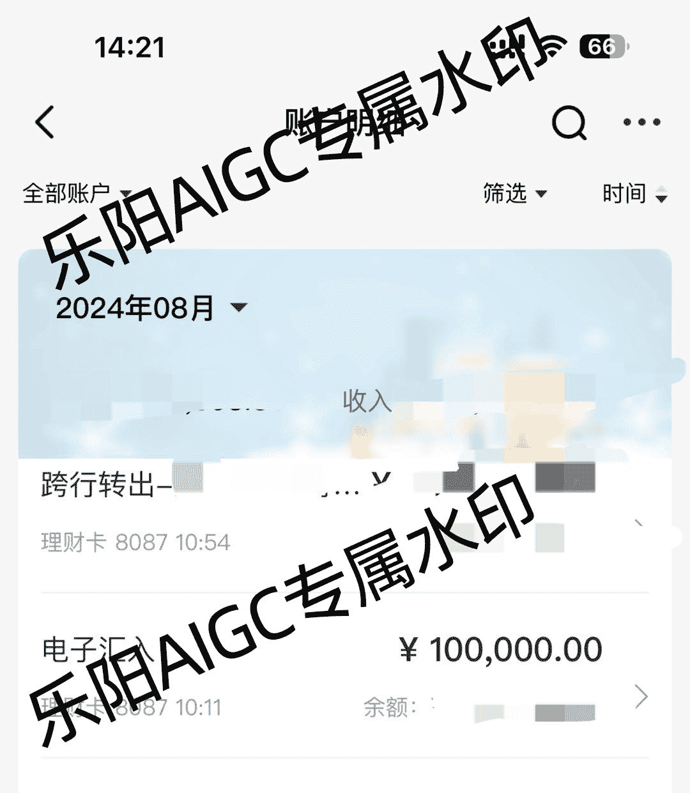
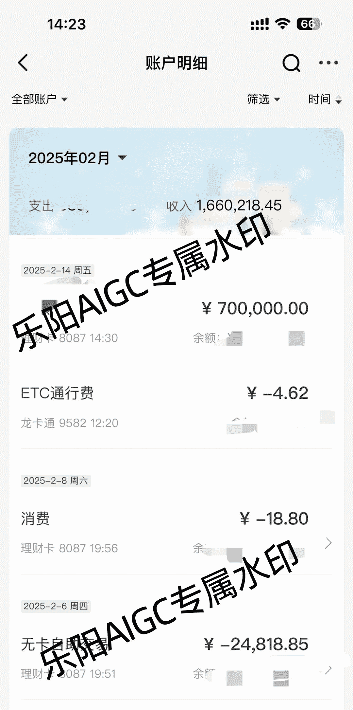
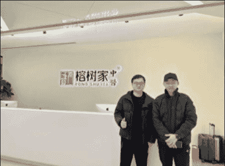
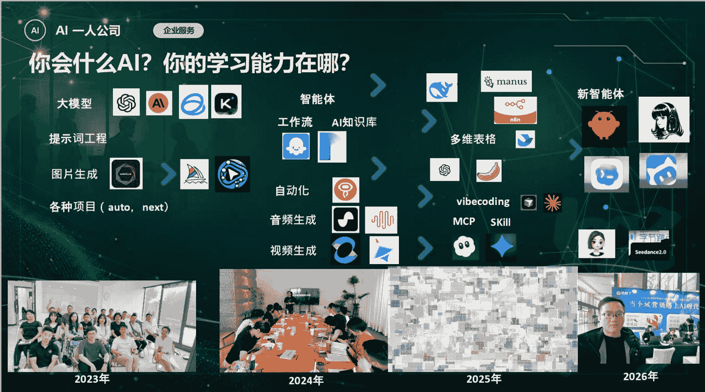
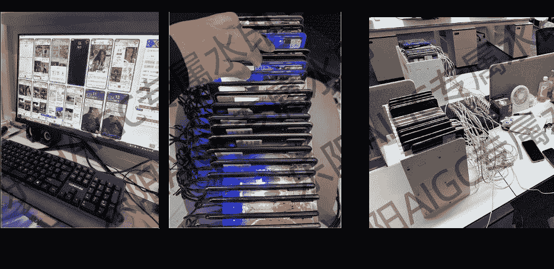
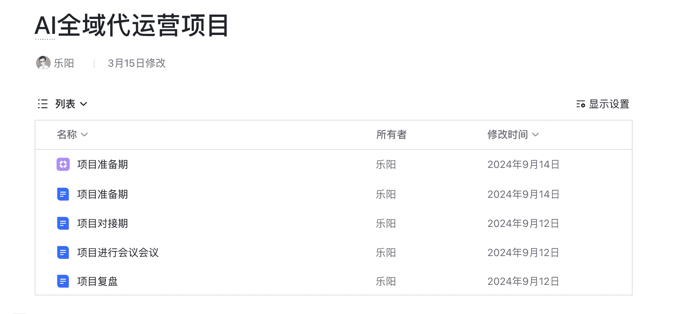
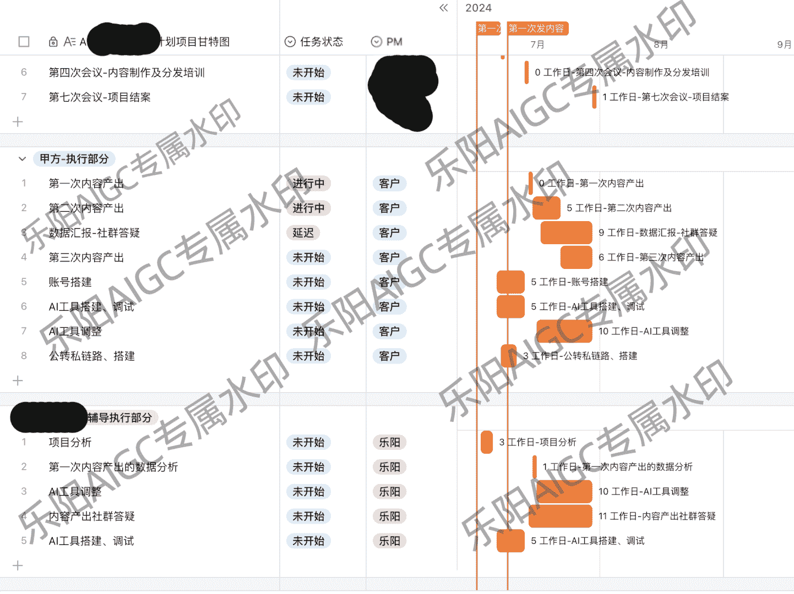
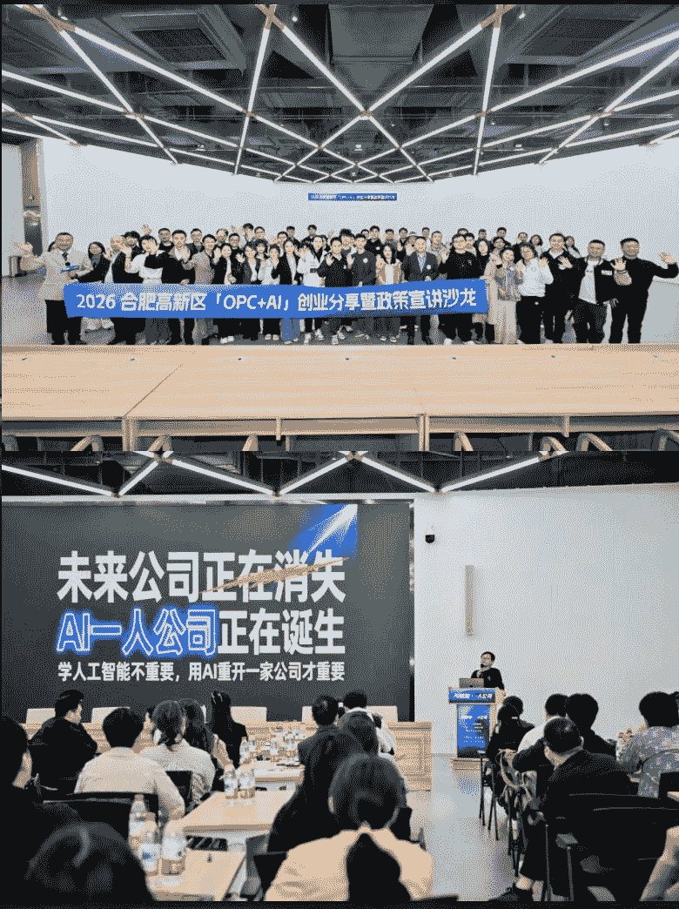
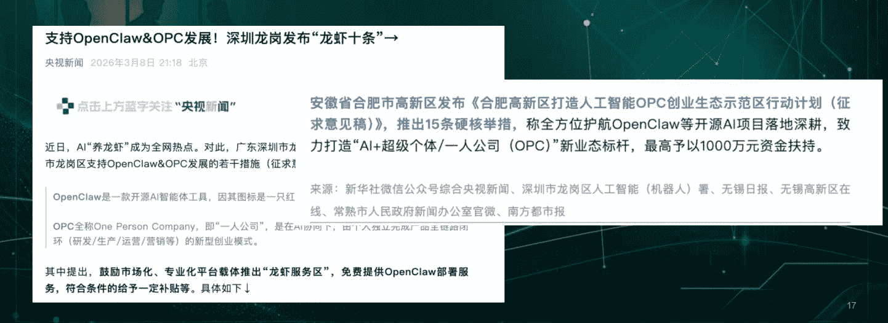

# 万字干货深度解析：一人公司怎么做 AI 企业服务赛道？

260625 副业 SC 精华

整理：公众号懒人搜索，懒人专属群精选

懒人微信：lazyhelper1

## 前言

大家好，我是乐阳。曾在生财担任过多个 AI 类航海的教练。

自我介绍一下项目经历：上学的时候做网赚，毕业做电商，后来在电商某赛道全国前三的品牌做品牌操盘手。

2017 年开始创业。没有选择继续做电商，因为电商对供应链、资金、囤货要求太高，我不想碰货。于是转去做私域社交电商。

那段时间最多招了 60 多个人。后来 2019 年后业务动荡，把这 60 个人全裁掉了。

从 19 年后我们转向做短视频直播，也做出了一些成绩。

公司业务变动对我的教训非常深。第一，裁人要赔钱；第二，很多互联网业务是有生命周期的，业务不好做了，你得硬撑发工资；第三，我发现我不擅长管理，管不了几十个人。

从那之后我就开始找一种新的方式：不需要那么多人，但业务可以跑得动。

现在这种方式逐渐被概括为 OPC（AI 一人公司）。

再后来，2023 年上半年开始决定做 AI 赛道，下半年明确深入 AI 企业服务赛道，算比较早期入场的。

到目前为止，我们做过企业内训课程，做过智能体和工作流定制，也做过代运营、算力和周边服务等。

服务过的客户里，品牌类的比如有徐福记、红星、如涵 MCN、榕树家 AI 中医、西域美农、同光资本、新能源上市企业等等。

收过 1—3 万的内训，收过单笔 10 万的工作流定制，代运营最高一单做到 100 万。

来自定制客户

来自代运营客户

## 为什么选企业端，不做 C 端

2023 年底，我确定在 AI 里的方向做企业服务，不做 C 端。

原因是明确了一个思考：C 端的市场，你做不过阿里，做不过腾讯，做不过字节。

这些大厂迟早把 C 端通用市场全部卷掉。

企业端不一样。企业里面有非常多细分行业、细分流程、细分需求，大厂很难一口气全部覆盖。你在某一个细分赛道里做深，其实是有机会的。

大企业

品牌企业

中小企业

政府类

媒体类

做 AI 企业服务，大部分人卡在第一步就错了。

在现场我问圈友的时候，做 AI 企业服务最难的是哪一步？

有人说：获客。

也有人说：报价、信任、挖需求。

其实也没错，但是：

找客户、不会报价、技术不够：都是症状，不是根源。

根源是什么？

问题的根源，不是获客，是你根本不知道卖什么。

是你没有一件非常具体的事情。

你不知道自己要卖什么。

你如果只是把自己放在“AI 企业服务”这个词里，这个词就太抽象了。

企业的类型非常多，企业的需求也非常多。

你去小红书发一条“我是做 AI 企业服务的，你们谁需要服务来找我”——没人来的。

因为企业根本不知道你说的具体是哪一块？还是说的是别人？

- 没有一件事 → 你找不到精准的客群（只能广撒网）。
- 没有一件事 → 你每次见老板都是免费上课（因为你自己也不知道要卖他什么）。
- 没有一件事 → 你不知道怎么报价（因为每个客户都不一样）。
- 没有一件事 → 交付越做越累（因为每单都在重新发明轮子）。

获客、获客之后的报价、报价之后的交付，所有这些问题，都要围绕一个核心展开。

所以我这次分享的起点是：

先把你要卖的东西搞清楚，其他问题才有解法。

## 第一步：入局——没有企业资源，第一个客户从哪里来？

企业客户和 C 端客户有个很明显的区别：越大规模的越在线下（品牌和中大公司），越小规模的越在线上（个人创业者）。你很难想象一个大品牌会直接去短视频里找个陌生的不认识的你服务，所以必须要有线下接触。

我自己不擅长销售。如果你让我一对一去跟客户聊，我很难聊下去，成交率也不高。

早期的时候，经常会出现的情况就是——客户约去他公司，下午 2 点进去，聊到 5 点，他说“我再考虑一下”。

一下午没了。白聊了。

更早之前，很多时候我们碰到这种情况：企业老板根本不知道 AI 能干嘛。

你去跟他讲，讲半天，你在免费给他上课。

老板不知道自己要什么：直接卖，等于盲人摸象。

### 要搞线下分享

那与其免费给一个人讲课，你为什么不免费给 20 个人讲课？

或者你为什么不干脆收费教他？

这就是要搞分享的逻辑。

我 2023 年做的第一场分享，是联系了当地一个读书会。读书会的人接受新知识的能力比较强，所以我们去讲了一场 AI 分享。

那次没有直接成交，因为那时候我们自己也不知道卖啥。

第一次分享

但分享完了，组织者把我引荐到了当地的混沌。

我们在混沌又做了一场，因为当时混沌里没有 AI 服务，所以里面很多企业其实是空白的。

第二次分享

然后在那次分享里，我旁边坐着一个开健身房的老板。

我的第一单定制智能体，5000 块钱，就是从那个健身房老板接这里的。他说他想开发一个健身教练的智能体，但不知道怎么搞。5000 块，帮他做了一个挂在他健身房里的智能体。

然后后续，又有 xx 卤菜这样的品牌通过这个渠道来找我们。

你会发现，分享是一个不断裂变、链接资源的过程。

分享有两个好处，第二个大部分人没想到。

第一个好处是显而易见的：你一次可以面对 10 到 20 个潜在客户，总比 20 次都一对一聊销售效率高得多。

一对一去找客户，你是销售，你是推销员。

你在台上分享，你是老师。

讲完课，不是你追着他，是他来请教你。

这时候他的势能比你低，哪怕你的销售能力很差，你也占到了心理优势。

我不擅长销售，但通过这种方式，我反而可以成交。因为客户是主动来问我的，不是我主动去找他。

### 分享的主题，就是你的筛选器

分享主题非常重要，不是随便定一个。

你的主题决定来的是什么样的客户。

你讲“AI 怎么做小红书获客”，来的就是想做内容增长的企业。

你讲“AI 怎么管理 100 家连锁门店”，来的就是连锁品牌老板。

完全不同的人，完全不同的需求。

这是自然筛选，不用你去筛。

当然，如果你没条件做线下，线上自媒体也是可以的：到底是做线上还是线下，取决于你的客群。

如果你的客群是互联网、电商类的老板，他们常看自媒体，做线上内容是有用的。

如果你的客群是工厂老板、传统实体企业，很多人不太刷自媒体，他们更认可面对面，你做线上影响力相对有限。

先想清楚你的客群在哪里接受信息，再决定用哪种方式触达他。

## 三类客群，打法完全不一样

我把企业客户大概分成三类。

### 第一类：小微企业

人数 1 到 20 人左右，互联网、电商类居多。

这类客户门槛低，沟通成本低，起步阶段比较好切入。

但有一个问题——他们接触 AI 比较早，动手能力比较强。

你去给他报价，有时候会遇到：

“有点贵诶，我自己去报个课学一下，让公司运营搞一搞应该也行。”

尤其是电商老板，他会算 ROI。

所以这类客户的客单价通常不会到特别高，属于中间偏下的档，做几百、几千块钱的单子完全没问题。

其实电商是个不错的人群，且他们很多需求属于很标准化的，而且因为他们对互联网或同行比较懂，所以对需求的把握比较明确。他可以明确和你提出一个：我就是要批量生成模特图，然后变成主图加字，这样的诉求。然后可以明确出单张图的成本不能超过多少钱。

生财里的圈友，其实也算这一类。

不过说实话，我从来没在生财里接过单，因为没太做过低客单的单子。这边客单价属于偏低的档，但如果你完全没有案例，起步时可以从这里练手，哪怕是几百的单子，先跑通流程。

但如果你是零案例起步，生财的圈友是一个练手的地方，收低一点没关系，你拿到案例才是目的。

### 第二类：实体企业

品牌方、门店、工厂、传统行业。这类是我们现在主要服务的人群。

他们大部分对 AI 了解不深，但他们知道自己不会搞。

他们的想法是：你是专业的，你帮我全包了就行。

不会想着自己去学，感觉自家员工也搞不定。

这类客户对客单价的容忍度更高。几千到 10 万都可以谈，少量的还有几十万的，但要看你的服务内容和背书。

溢价空间比第一类大。

这里补充一个细节——这类客户你去跟他聊的时候，你不用过多解释你用的是什么工具。

他不在乎你用的是 Coze 还是 n8n，甚至 Codex 他也分不清。

你是用 AI 还是 UFO 解决的，你是不是最新的工具，他都不在乎。

他关心的是能不能解决问题，能带来什么结果。

用什么 AI 工具去解决，他不关心。

### 第三类：品牌方大客户

这种单子 1 万到 100 万，乃至更高都有可能。

但要求也完全不同了。

你必须有背书，必须有同行业案例，必须有完整的项目管理和汇报流程。

没有案例基本接不到，所以一般推荐先做前两类积累起来，才可能做这种。

### 政府和高校，单独说一下

这一类，我的结论很直接：背书可以拿，钱不要指望。

可以积累一些曝光和背书。

但你如果是陌生人进去，赚钱是很难的，因为大部分面临预算不足，最多帮你宣传一下。

要想有预算，这条线是要看关系的，有关系和预算出口，能赚到大钱。

不过走关系接到项目，也有另一个坑在等你研究：

这种项目你要先垫资。

垫完了，回款周期不一定，有可能明年才打给你。

你得先想清楚你能不能撑得住那段时间。

所以政府和高校，对于我来说大部分情况下是锦上添花，不是主要战场。

## 你擅长什么

还有，你到底擅长什么类型的 AI 工具？也决定了你适合服务什么类型的企业。

你是做哪个细分领域的？

比如圈友盖哥他们擅长 AI 做设计，就是用 AI 图片生成的能力去服务企业。

如图所示，这几年来，我们每年都会经历 AI 工具的大变革，然后可能掌握新的工具，或者提出新的解决方案。

## 第二步：谈单——30 分钟挖掘真需求，报价不再瞎猜

我们早期踩过一个坑。

做通用的 AI 分享，讲 AI 趋势，科普行业变化。

一场下来 30 个老板，有 30 种需求。

有人问 AI 能不能帮我做人事提效，有人问能不能做小红书，有人问能不能搞客服，有人问能不能自动报税……

需求非常散。

当需求非常散的时候，你的交付会很难做。

你最多选一两单做一下，剩下的是没有办法复制的。

这样就没有办法把企业服务规模做起来。

### 归类需求

后来我们采取的方案是：收束客户需求，把需求瞄准到你最擅长的一类事情上面。

我自己过去做过 6 年的短视频和私域，所以我有这方面的背景和案例。

我就把方向定在 AI 营销获客上。

不管他今天来的是什么公司，不管他说是要搞财务还是人事，我都会把问题框回来：

你开公司，你总要获客吧？我们先解决获客。

这样我的服务范围就窄了，交付就可以复制了，效率就高了。

其他方向的需求不是不接，但只在有空余时间的时候才接，比如我们空闲的时候也去给人解决人事问题、解决管理问题。

你有主线，才有节奏。没有主线，就是在救火。

例如这场分享，背景情况是当地是制造业城市，来的都是制造业老板。

对于我来说根本没做过制造业，也就无从服务起了。

除非花大量时间，深入调研，去了解他们各种细节。

制造业分享

### 跟老板聊，要把对话框回来

做企业服务，要尽量跟老板谈，不要跟员工或高管谈。

原因有两个。

第一个，员工没有决策权，也没有付费权。你跟他聊半天，最后他说“我帮你汇报一下”，汇报完老板说“我再看看”，等于白聊。

第二个，有的高管反而有逆反心理。

他会觉得你进来是要优化掉他们部门和他自己的。

我们就有好几单是被高管搞掉的。

老板非常认可，高管在后面天天说我们坏话，说我们的方案不行，说我们的价格太贵，最后单子就没了。

所以，要跟老板聊，让老板决策。

那跟老板聊的时候，聊什么？

我总结了四个步骤。

#### 第一步：找到老板最痛的点

你可以先设定一个重点，然后不管老板说什么，你把对话框回来。

我自己的框法是 AI 营销获客，不管他说啥，我都把它往这个方向引。

当然，如果你还没有确定方向，你可以散聊。

问他：

- 公司里哪个岗位最难招人？
- 哪个流程最容易出错？
- 哪件事最耗时间、最耗人力？

那个地方，就是他最真实的痛点。

#### 第二步：确认付费意愿

光找到痛点还不够，你要让他觉得这个痛点值钱。

最好的方法是帮他算账。

比如：原来这个岗位要 10 个人，现在 5 个人能做，一年能省多少工资？

原本这个东西每天只能产出 1 个，现在能产出 10 个，效率高了多少？

这是老板最容易理解的逻辑——

他不需要懂 AI，他只需要懂钱。

你帮他把降本提效换算成具体的数字，他对付费的抵触就会低很多。

#### 第三步：激活一点焦虑感

跟他聊同行在用 AI，竞品在用 AI。

他没有在用，他在落后。

这是一个有效的激活方式，但不要过度，一带而过就行，不要一直反复说，显得很用力。

让他自己感受到那种“我是不是要掉队了”的感觉就够了。

#### 第四步：帮他描述结果

不要问他“你有什么 AI 需求”。

大部分老板根本不知道自己有什么 AI 需求。

你问出来他也懵。

你应该问：

做了三个月，你希望看到什么样的变化？

或者你直接帮他描述：

做完这个以后，你的这个岗位可以从 10 个人缩减到 5 个人，获客渠道多了一条，这个流程的错误率降到接近零……

帮他把结果画出来，这个结果就变成你后续交付的标准。

这里有个细节要注意：

互联网和电商行业的老板，你可以直接问需求，因为他们同行都在用 AI，他们自己有具体想法，会直接告诉你“我要做批量模特图”“我要做 TikTok 店群上架的方案”。

但如果你的客群不是这个范围，你就别直接问需求。

传统行业的老板，你一问，他是懵的。

他根本不在乎你用什么工具解决，他只要结果。

不是问“你有什么 AI 需求”，而是问他现在最痛的地方。

## 报价，不是看同行怎么报

很多人觉得报价要参考市场，看看同行收多少。

其实 AI 企业服务这个行业，根本没有统一标准价。

各家报的都不一样。

同样一个工作流，有人收 800，有人收 8000，有人收 8 万。

其实根本不是产品决定价格，是客群决定价格。

### 第一，客群决定价格上限

例如某个 AI 工作流，你给互联网电商老板报 8 万，他可能觉得你在割韭菜。

因为他接触信息多，他知道大概市场行情，他会帮你跟同行对比一下，他会算 ROI。

他不是不愿意付，是他的容忍度就这个区间。

但工厂老板、传统实体老板呢？

他的信念是：“这个东西我搞不定，太麻烦，你帮我全做了最好。”

他不会想自己去学，不会想着让员工搞。

所以他对客单价的容忍度高得多。

同样的方案，你在电商老板那里报 2 万，他嫌贵；你在工厂老板那里报 5 万，他觉得合理。

这不是因为你产品变了，是因为人群变了。

### 第二，痛点也决定溢价

同样是工作流，你解决的是获客问题，还是人事问题，价值感完全不一样。

获客问题后面跟着收入，老板愿意为它多付钱。

人事问题呢？

他可能觉得：大不了多招两个人嘛，一个月 4000 块，多招一个。

你的方案对他的痛的程度不一样，他愿意付的价格就不一样。

你要解决他越痛的问题，溢价空间就越大。

### 第三，案例和背书也决定你能报多高

你有他同行的成功案例，你有相关资质或背书，你就有溢价空间。

你啥背书都没有，你就只能从低往上报，先拿到单子。

### 不同几类企业客群的大概参考区间

我说一下大概的范围，不是标准价，仅供参考。

- 小微个创类：几百到几千，他们愿意付，但超过1万就很难了，因为他们觉得自己可以学。
- 互联网电商类：几千到几万，他们会算ROI，报高了就会比价，要注意边界。
- 传统实体类：几万到几十万，溢价空间大，因为他们AI化程度低，需要你来全包。
- 品牌大客户类：几万到上百万都有，但你必须有案例和背书，没有这些根本进不去。

### 如果没有案例，怎么谈下第一单呢？

如果你现在完全没有企业服务案例，有两条路可以走。

第一条：换到更小的客户，低价或免费做一个案例。

生财里圈友那么多，找一个跟你方向接近的，找他聊，说你想帮他做一套方案，收很少的费用甚至免费。

做完了，你把过程、结果、数据整理好。

你就有案例了。

有了案例，你就可以去服务更多同类型的客户，报价也可以往上走。

第二条：用你原本的行业经验做背书。

- 你以前做律师行业，就服务律师所。
- 你有电商背景，就服务电商企业。
- 你有新媒体背景，就服务内容公司。

你懂行业，比纯卖工具的人更容易建立信任。

你没有AI行业的案例，但你有行业知识，你可以把这两个组合起来。

## 第三步：交付——重交付变轻，一人服务更多客户

我们中期踩过一个坑：做代运营。

客单价我们需要更高，从几万升到几十万、再冲到100万以上，可行吗？

当时想了个模式。

AI加代运营，帮企业做内容获客，新媒体全包，一起上。

结果接了几家，不是说没接到单子，我们客户有新能源上市公司，某财税赛道前十的客户，K12硬件品牌公司，各种中小公司，做下来，发现——

完全没办法再接新的客户了。

不是因为不赚钱，是因为太重了，没有多余的时间和精力。

能接到，能做，能赚钱。

做大挺难的。

你再往上加一家客户，时间就不够用了。

### 重交付形态

我来说说重在哪里。

第一个重，是平台运营本身的杂活。

当时我们公司放了一排手机，全是账号，抖音、小红书、各种平台。

加上AI工具辅助，我们以为效率会非常高。

但你会发现里面的杂活多得超出预期：

- 封号了怎么办？
- 账号注册出问题怎么处理？
- IP被限流了怎么排查？
- 平台规则又改了怎么跟上？

这些东西，AI替代不了，每一个都需要人盯。

新媒体矩阵

第二个重，是客户要跟你开会。

只要你收了他10万以上，他就不是只让你干活的。

他要开会，要汇报，要推进，要复盘。

第一次会议讲什么，第二次会议讲什么，时间节点怎么排，甲方要确认什么，乙方要交付什么——

这些都要有标准流程，不然他根本不会签这么大的单子。

而且开会他要找你，不是找你的员工，不是找AI。

他觉得他的钱是付给老师的，老师你得来。

你的时间，就这样被锁死了。

各种交付材料和流程

后来我们把代运营这块业务砍掉了。

现在手上还有一些老合同在跑，大部分是年框，等交付期满就不续了。

能赚钱，但做不大，就不是一人公司应该长期押注的方向。

如果你的目标是一年赚几十万，代运营完全可以做，一年做几家就够了。

但你想往几百万以上走，这条路会有点吃力，除非你有更多的人员。

### 让交付变轻的三个方法

我们把代运营砍掉之后，开始想一个问题：

怎么让交付变轻？

我们试下来，大概分享三个方向。

第一，谈单用分享代替一对一。

与其花时间一对一和20个客户分别聊，不如一次对20个人讲清楚。

不仅省时间，而且成交质量更高，原因前面说过了，这里不重复。

第二，产品锁定一到两个垂类场景，让交付可以复用。

你每次接的方向是同一类问题，你做第二单的时候就可以把第一单的经验直接用来。

而不是每次都重新研究一个新行业、新需求、新流程。

可以复用的交付，才有可能规模化。

非标的定制交付，每次都是从头开始，不可能做大。

第三，合作分账，不要把所有人变成员工。

这个是我们现在跑的核心模式，叫一人公司的协作网络。

接下来我详细说。

## 一人公司

### 一人公司，不是超级个体，不是自由职业

我身边很多人听到“一人公司”这个词，会觉得跟超级个体、自由职业差不多，又是造了个新词，无非是一个人单干。

其实我对这里面有很多比较深入的探索。

名词的更换，其实意味着本质上不一样，区别很大。

超级个体的重点在“超级”。

他的核心逻辑是：打造个人IP，提升自身效率变超级，事情都由他自己来做。

一人公司不是单打独斗，也不是什么都自己干。

AI一人公司的重点在“公司”。

一人公司也是公司，既然是公司：那就应该有社会协作，有上下游，有供应链，有合作伙伴，有职责分工。

你不需要所有事情都自己做，你需要知道哪些事情交给谁做更合适。

就像如果你做个电商公司，你其实主要卖货，你上游是工厂，你的下游还可以对接渠道和达人，你不可能自己也生产制造，自己还顺便做带货达人，那你这就不是一个公司了，你全干了你就是超级个体嘛。

那么作为一个一人公司，一件事过来了，你要拆分出来，什么事自己做？什么事AI做？什么事给集体做？什么事给人脉做？

而且我觉得AI时代，或者web3时代也好，公司这个结构应该要发生本质的变化。

如果你用AI，且你真有能力，为什么我不能直接分账给你，而是要通过底薪的方式去建立传统公司？

先说我自己践行的情况。

我有一个公司，公司主体里只有我一个人。

但我们实际上在做很多事情，背后有一帮合伙人在配合。

目前在政府端，认定OPC类的公司划分是，公司主体下社保人数在1-9人。

这些人其实应该都算OPC了，每个人都有自己的公司主体。但只要我这边有项目来，大家就按需分工，做完了按比例分钱。公司和公司之间做财务结算。大家对外是一个品牌集体，类似于联盟生态的概念。

没有员工关系，没有发工资的压力，项目做完分了钱，多劳多得。

之所以诞生这么个模式，和完善一人公司的构思。

我举两个对我影响很大的案例。

第一个是韩都衣舍的阿米巴模式。

他们公司进来一个项目，分成很多小组，每个小组自负盈亏，按项目分钱。

不是纯发工资，是按贡献分账。

第二个是我们当年做社交电商时的一个经历。

当时淘宝联盟其实有个联盟的概念，所以大家不同的主体之间可以组成联盟。

2019年公司解散就剩我一个人了，但接到了某个品牌单。

我一个人，还是帮他们卖了10万单。

怎么做到的？

因为有两三百家合作方在我们的联盟里，大家一人分一点销售量，加起来就帮他们完成了。

那时候我就意识到，为什么别人公司的员工，不能当我公司的员工？

为什么我要给他们发工资，而不是直接按项目分钱？

我们在本地做的一场一人公司分享会

顺便说一个信息差。

最近全国很多城市在推OPC，就是一人公司政策。

合肥、深圳、杭州、北京这些地方都有，各地的政策细节不同，但方向是一致的。

什么叫OPC企业？

三个核心条件：

第一，公司社保人数在1到9人之间。

第二，公司有AI算力使用。以合肥为例，过去一个月内AI算力消耗金额大于2000元，就符合条件。

第三，要有公司主体，不能是个人。

符合条件之后，你可以申请的政策大概有这些：

- 免房租，免水电网费。合肥这边是2到3年免费。
- 算力补贴。你用了多少算力，按比例给你补，合肥是补20%。
- 开单补贴。你接到单子，可以向政府申报，有额外补贴。
- 外包派单。产业园区里的企业有AI需求，政府会外包给OPC企业做，你不用自己找单子，他们派过来。
- 租房补贴。在基地附近租房，合肥补五折。
- 低息贷款。政府贴利息，利率比你自己去银行贷低很多。
- 产投融资对接。你觉得项目不错想融资，政府有产投基金，可以帮你对接。

另外做OPC服务比如产业园的话也是有资金补助的。

这是个信息差。

很多人做一人公司，做AI企业服务，完全不知道这些政策。

## 未来三类机会，我们在探索的方向

做了这几年AI企业服务，我觉得接下来有三类值得关注的机会。

这也是我们目前在拓展的边界。

留给大家做交流和展望。

### 第一类：从通用AI普及到垂类行业的场景结果

过去做AI服务，大家主要做通用型的，内容生成、工作流、知识库，谁都能用的那种。

现在越来越多人在做，通用型竞争越来越大。

接下来的机会，可能在某一个具体行业里做深。

比如美容美发专用AI，比如服装行业专用AI，比如餐饮连锁专用AI。

你在一个行业里做深了，案例多了，你的竞争力会比通用型的服务商强很多。

客单价也会更高。

我们现在在探索这个方向，找一些行业去切入做赋能，还在跑，还没有定论，但感觉是对的。

### 第二类：从大企业数字化到小微企业AI化

过去大家都想服务大企业，因为单子大，钱多。

但现在有一个趋势：

失业的人越来越多，做OPC一人公司的人越来越多。

这些人也有AI需求，只是他们的客单价比比较低。

其实这是从大企业数字化到小微企业AI化的一步。

所以如果你想服务这类人群，你的产品必须走标准化路线，设计成低成本高复用的模式。

这也是我们现在在尝试的方向之一，不光自己探索OPC，目前也尝试服务一些OPC人群。

### 第三类：从高客单价到升高复购

过去我们的思路是：客单价从1万冲到10万，再冲到100万。

一直往上。

但后来发现这条路有上限，而且越高越重。

另一个思路是：客单价中等，但复购稳定。

比如我们也给企业提供算力服务。

每次充值金额不大，但每个月都要用，每个月都要充。

一家企业可能续了一年、两年，加起来的总额也很可观，而且不用每次重新谈单子、重新交付。

这种稳定的复购，某种程度上比一单高客单更轻松。

## 建议看完的你做三件事

讲了这么多，落地最重要。

回去我建议你只做三件事：

第一件，定好你的垂类方向，确定你的产品主题。

不是“AI企业服务”，是具体的一件事。

比如“制造业工厂用AI做品控流程优化”，比如“连锁门店用AI做内部培训和知识库”，比如“新媒体公司用AI做内容生产提效”。

只有把这件事定下来，你才能获客、筛客、报价、交付。

第二件，做一场小型线下分享，邀约10个人。

不用多，10个人就够。

讲完你会发现，客户的真实问题跟你想象的不一样。

每次分享，都是在帮你校正方向。

第三件，这次分享里，至少成交一单。

哪怕低价，哪怕免费，只要做出来，就有案例。

有案例，才能去接下一单。

先动起来，边做边校准。

## 问答篇：生财圈友现场提了什么问题，我是怎么回答的

### Q1：ToC和ToB，大C跟小B有什么区别？

有同学问：他在服务一些做知识付费、内容获客的公司，帮他们定选题框架之类的，这算C端还是B端？他的客单价已经到四五万了，想继续往大B走，路径是什么？

我的回答是：

在我的定义里，没有大C这个概念。

纯C端指的是普通消费者，他用AI只是在消费——比如用占卜AI，用陪伴AI，他不是来赚钱的。

只要是以一个主体在经营，哪怕是一个人的公司，他就是小B，不是C。

你服务的那些客户，他们是在经营，他们想通过你的服务赚钱，他们就是小B。

你的路径不是从C端往B端走，而是从小B往大B走。

这两条路的逻辑是不一样的。

从小B往大B走，核心是背书和案例的积累，以及你对更大体量企业的交付能力——开会、汇报、项目管理、周期推进。

大企业更在乎你能不能稳定交付，而不只是能不能做出效果。

### Q2：做垂类财务服务，定制化还是标准化？

有个同学做快递财务相关的AI服务，已经做了二三十个内部系统，现在想服务同行业的网点。

他的问题是：不同公司细节差异很大，是让客户适应他的系统，还是针对每个客户做定制？

我的回答：

先看你的精力能不能支持定制。

定制市场是很大的，很多企业确实有个性化需求，也愿意为定制付钱。

但定制的问题是交付重，而且不可复制——你做一个客户，下一个客户还是要重来一遍。

如果你想规模化，最终还是要往标准化走，或者至少把部分流程标准化，把个性化的部分控制在一个有限的范围内。

另外一个点他还问：怎么让客户体验产品？要不要给他试用？

我的倾向是：不要让客户自己上手试用。

很多老板其实不太会用AI工具，他一点开，不知道怎么操作，点了半天没搞定，他的第一反应是“这个产品不好用”。

但其实是他没用过，根本还没熟悉。

他体验出来的结论，很可能是错的，对你不利。

我的做法是：

演示给他看，我操作，他看。

视频、屏幕分享、线上会议都可以。

我来控制演示节奏，只展示最核心的几个价值点，不让他自己乱点。

销售的时候画饼，他还没接触到产品，你的画面是完整的。他自己上手试用，大概率是残缺的。

### Q3：OPC协作者模式，怎么保证大家真的好好干？

有同学问：你们那张合影，那些人都是你的OPC合作伙伴。但大家都有自己的事情，怎么保证他们在项目里的投入？合同管用吗？怎么控制稳定性？

我的回答：

没有一个完美的办法，说实话。

合同可以签，但合同不是万能的。我们所有人都可以签合同，但有的人签了合同也不好好交付，这也是有的。

真正有效的方式是：筛选，和持续合作里建立的信任。

你跟很多OPC建联，试着合作，合作着合作着你就知道谁靠谱，谁不合适。

不合适的自然淘汰，合适的越合作越顺手。

另外，要有分账机制。

我们大概是把一个项目的钱拆成前端、后端和公司三部分，各自按职责分配比例，完成条件达到了就结算。

机制清楚，大家知道自己该做什么，能拿多少，才有动力好好干。

但即使这样，也没有办法保证100%稳定。

你不断建联，不断合作，不断筛选，留下真正配合得好的人，这个网络才会越来越稳。

现在我主要深度合作的地区是上海和安徽两个地方，其他地区试过，但后来没有深入下去。

合作伙伴不需要很多，核心几个人能把项目跑起来就够了。

### Q4：有商会和银行资源，但自己不懂那些行业，外包合作怕跳单怎么办？

有同学说他做API中转，有商会和银行的高净值企业资源，做过培训，但自己没有能力交付后端服务，想找外包合作，但担心跳单，也担心销售转化做不了。

我的回答：

跳单的问题，本质上是信任问题，没有完美解法。

在一个熟悉的圈子里找合作伙伴，跳单的概率会低很多。大家都在一个社群里，跳单了是要付声誉代价的，做人留一线嘛。

如果真的跳了，你可以在圈子里说，大家自然知道这个人是什么样的人。

销转的问题是这样的：

你跑通了从分享到客户主动找你这条链路，销售就不是问题了，是客户主动来问你，而不是你去推销。

但后端交付你不懂怎么办？

你可以把后端合作伙伴带进来一起开会。

对外就是“我们团队”，不需要解释谁是谁哪个公司的。

后端伙伴负责技术和方案，你负责客户关系，私下按贡献分账。

客户不需要知道背后的结构，他只需要知道你能解决他的问题。

### Q5：客户非要见“老师”本人，我怎么从交付里解脱出来？

有同学说他通过分享获客，讲师身份很强，但讲完之后客户非要他本人来跟进，同事去跟进他不认，后期交付也非要他参与，导致精力完全被拖住。

我的回答：

这个问题没有一招完全解决的办法。

但可以从三个方向缓解。

第一，按客户体量分配你的时间。

大客户、关键会议，你参与。

小客户的日常推进，交给项目经理或团队，你在客户群里但不一定每次都说话，他知道你在就行。

第二，产品形态决定了你能不能解脱出来。

你做的是代运营类的非标服务，客户自然想绑定你这个人。

你做的是标准化产品，客户对“必须见老师”这件事就弱很多，因为产品是标品，不需要你一直在场。

想从交付里解放出来，根本出路是把产品标准化。

第三，客群也有影响。

小微客户通常比较客气，会觉得“耽误老师时间不好意思，不要紧的”。

大一点的老板反而更强势，他觉得我给了你钱，你就该来服务我，你就该在场。

所以服务小微客群，反而比大客户对你个人的捆绑少一些。

我是乐阳，欢迎建联与交流～

想联系我，欢迎找服务你的鱼丸～

————分割线————

看完这篇 SOP，你觉得你懂了。但 90% 的人一到实操就会卡在第一步。

工具和教程只是最低级的壁垒，真正的壁垒是“立刻动手”和“圈层信息差”。

如果你想看全网最新的变现玩法，并且和一群执行力极强的极客一起下场拿结果，欢迎围观我的核心私域：【懒人专属群】。

我们不聊虚的，只做商业闭环的拆解与 AI 效率的压榨。系统内已沉淀 1000+ 跑通的套利实战局。

👉 查阅圈子完整数字资产与上车门槛：

https://lazyso.com/insider/

认同价值、准备好下场干活的，扫码加我微信（lazyhelper1）。

备注：【实操上车】，不闲聊。

