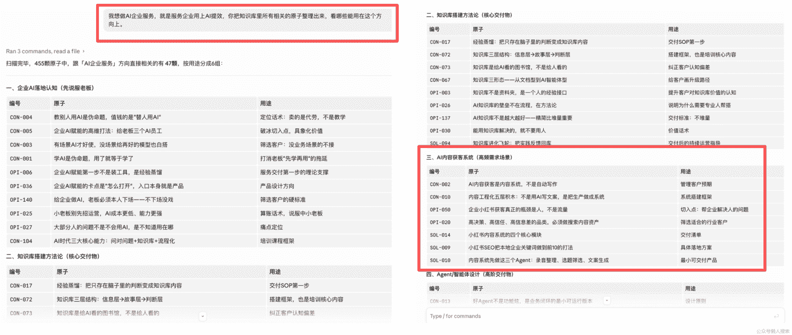

公众号懒人搜索，懒人专属群分享

踩中**5**次风口，赚了**100w+**，万字拆解：

# 普通人如何找到适合自己的风口

260625 副业SC 精华

整理：公众号懒人搜索，懒人专属群精选

懒人微信：lazyhelper1

哈喽，我是叁斤。从2020年开始做小红书到现在，我一共踩中了5次比较大的风口，每次至少能赚10w+。

- 刚开始的小红书博主商单，至少10w+。
- 小红书电商，月10w+。
- 虚拟电商，月10w+。
- 还有企业AI培训，刚开始，现在月5w+差不多。

复盘这几次经历我发现，其实我从来没有刻意去追过什么风口，也没研究趋势报告，没有提前布局什么赛道，每次就是在做当下的事，然后发现自己就站在风口上。

好几次的超级标，都是在业务正赚钱的时候，超级标就发布了……今天这篇文章我把所有经历写出来，包括我当时怎么想的、怎么做的，以及在这几次压中风口的过程中，我发现的一些规律，如何做组合创新，对所有在做业务或者遇到瓶颈的小伙伴，都会有帮助。

内容有点长，我想把如何找到自己的新业务讲清楚。

————分割线————

## 2020年之前，我没有任何目标

### 踩中第一个风口之前

我一直在跑地推销售，没有一家公司能待到一年的，17～20这3年换了20多份工作，非常不稳定。那几年看了非常多项目，做过闲鱼无货源，也了解过无人情趣用品店、外卖店等等，甚至考虑过开个烧烤店……每一个都觉得好像还不错，但都不喜欢，也都没做成，就非常迷茫。

后来才想明白，这些业务有很多人能赚钱，但不代表我可以。因为我不了解，也不喜欢做这些事情。也就是说，我只看到赚钱，没看到背后需要的付出。这是我认为副业失败最普遍的原因。因为永远想找更好的机会，当下的项目也只做了一点，不赚钱就换了。

所以我觉得，赚钱有**2**个前置条件：

1. 你喜欢做这个事情。
2. 这个事情能赚钱。

满足**2**个条件，这个业务你才能持续做。

不然，你就得有惊人的意志力，把一件不怎么喜欢，但很赚钱的事情坚持做很久。

我做不到这点。

————分割线————

## 第一次风口：小红书商单

2020年，疫情原因没法继续跑地推，我就找了一份做网络商务的工作，大概工作内容是，找淘宝卖家，给他们做好物点评团之类的种草服务，算是淘宝版的种草推广。

但是获客遇到瓶颈，因为通过店铺能找到的都是客服，不是真正的决策人，推不动，业绩很差。然后老板做了个决策，说去小红书获客试试，于是公司招了几个人，在小红书发笔记，做产品种草内容，吸引商家主动来合作。那会是2020年初，市面上几乎还没有「小红书运营」这个岗位，招来的全是新手，什么都不懂，就让她们做小红书运营，我继续做商务对接。

没想到的是，虽然全是新手，但是起号的第一个月几乎所有账号都爆了，有3个账号在第一个月就可以接到广告，然后广告合作是我对接的，过程无比顺畅，几乎0销售技巧，商家上赶着给钱来。（本人销售水平极差，所以在销售类公司都待不下去哈哈哈哈）

这么容易的销售，就让我看到了一些机会。然后我就问那几个同事，是怎么做的笔记。那个时候内容非常简单，从淘宝截图下来加点文字发到小红书就能拿到流量，但是我完全不会写内容，而且审美也不行，不知道小红书用户对什么感兴趣，所以花了很多时间去刷内容、写笔记，锻炼自己的网感。内容大概长这样：

然后起号第一个月，也接到了广告，一个广告就能报价400块，有点震惊，倒不是因为400块多，而是突然意识到这件事的门槛比想象的低太多了。因为内容难度确实不大，所以开始批量做号，最高峰一个人同时做了20多个好物分享账号，找兼职帮忙做内容，一个月光广告费也能赚几万块。

这次踩中的是小红书平台的风口，完全是运气，就是在做淘宝种草的工作中被老板推到了小红书面前。我有一点淘宝种草的经验，知道商家需要什么，而小红书是一个新平台，两个东西碰到一起，意外碰撞出一个风口。

淘宝种草经验**×**小红书平台 = **小红书内容变现**

这个模式一直做到2022年底。那年平台的政策方向变了，平台啄木鸟计划越来越严格，也要求品牌合作都走官方蒲公英平台，水下种草被严格管控，限流非常严重。我没有留恋这个项目，有2个判断点：

第一，这个业务没什么门槛，我一个人能做20个号，意味着有团队的人可以轻松做100个甚至1000个号，我竞争不过别人。

第二，水下种草是绕开平台的，平台赚不到钱，而且内容不算优质，对平台来说，持续打击是必然的。

所以我最终的结论是，窗口期已经过了，利润空间只会越来越小，果断卖掉大部分账号，只保留了一两个高粉丝量的账号用来维持副业收入。

赚窗口期的钱是对的。贪恋窗口，是错的。

但卖号之后，我没有去找下一个项目，只是继续每天刷小红书，因为还保留着账号，还在做内容。在刷内容的过程中，我注意到一个变化，平台上挂商品链接的笔记越来越多了，判断这个时间点，小红书在推电商。

————分割线————

## 第二次风口：小红书电商

于是我找了一些供应链，先做小家电，后来转做饰品，开始在小红书上做电商。比较惊喜的是，产品上架后笔记没发几篇就出单了。这次不算是纯运气，因为我在小红书已经运营了两年多，对平台的流量逻辑、内容规则、用户偏好有了基本的理解。

全部重心转向小红书电商后，月收入最高的时候突破了10w+。然后，2023年小红书电商全面开花，直播、笔记带货、买手、店铺号，整个生态都在推电商，我又站在了风口上。但这一次我不是看了行业报告去追的风口，我是因为每天都泡在小红书里做内容，自然感知到了平台的变化，比大多数人早半拍进了场。

也就是说，这次风口是：

小红书运营经验**×**电商供应链 = **小红书电商**

这一次我没有跑无货源，因为有第一次的经验，我知道应该跟平台共同发展。而无货源、搬运、二创内容，是在破坏平台生态，能赚钱，但这并不是长久的业务，我也不太喜欢。

所以自然而然长出了「小红书电商」的业务，而且走的就是高客单蓝海、实拍的方式，也是现在做小红书电商比较常见的方式，我在几年前就做过了。

————分割线————

## 第三次风口：小红书虚拟电商

做小红书的这几年里，我接触了几乎所有类型的变现方式，博主接广告、小红书电商、引流到私域、投流放大……每一种都实操过，拿到过不错的成绩。

我开始更新自己的IP账号，然后很多人开始找我咨询，比如小红书怎么涨粉？广告怎么报价？电商怎么选品？……

我没有规划过要做虚拟产品。但是当同样的问题被问到很烦的时候，我做了一个很自然的决定，把这些运营经验全部写下来，整理成一份系统化的知识库拿去卖。定价399元一份，在小红书卖了几百份，收入又超过10w+。

到2025年初，我开始深度使用AI，用AI把这份知识库拆解成了几个独立的专题手册，包括个人IP手册、虚拟电商手册、搜索手册、商单变现手册，每份定价39元，降低了购买门槛。在小红书又卖了几千份，收入远超10w+。

这一次，我终于开始意识到一个模式了。

知识库里的内容不是新的，全是我过去几年验证过的小红书运营方法。不同的只是产品的形态：我把脑子里的经验变成可以卖的产品。

我没有去看别人的虚拟产品是怎么做的，我只是在想，这么多人在问我同样的事情，有没有一种方式，让我只回答一次，就能服务所有人？

虚拟产品（文档/知识库类）就是很好的方式。

也就是说，实战运营经验**×**文档/知识库形态 = **虚拟产品**

然后，2025年，小红书虚拟电商又是大爆发的一年，这一次，又站在了风口上。而且，我做的是原创虚拟产品，平台在打击盗版，我不在打击范围内。

————分割线————

## 第四、五次风口：AI知识库 + 企业培训

2025年，AI已经是全世界最热的风口。然后我刷到推特有个博主推荐AI+知识库的搭配，我本来也有积累知识库的习惯，觉得很方便，就把我已有的知识库全部接到AI上。

当时的想法很简单，我有十几万字的小红书运营知识库，有积累了好几年的方法论和案例，如果AI能调用这些内容来帮我工作，效率应该会高很多。

然后我先把小红书搜索手册放进去，让AI调用搜索手册的知识给我做搜索SEO笔记，布局关键词。试了之后发现，效果好到超出预期。

用AI加知识库做内容获客，AI写出来的东西居然不是正确的废话，而是真正带着我的风格、我的案例、我的判断的内容，它也能理解应该如何做搜索布局，怎么合理在笔记中埋入对应的关键词，让用户更好搜索到。

然后我在朋友圈上分享了一些关于AI知识库的想法和做法，立马就有品牌商家找上门，问能不能帮他们也搭建这样的系统，做AI内容获客的培训。很多行业的老板都有同样的需求。于是我又开始做AI内容获客的培训，收入也过了10w+。

这一次，其实同时踩中了两个风口——AI知识库是一个，企业AI培训又是一个。

就是我的知识库资产**× AI**能力 = **AI**内容获客系统。

但这一次我已经完全确认了一件事，现在全世界都在追**AI**，大多数人的思路是「**AI**能帮我做什么新东西」，我的思路是「**AI**能帮我把已有的东西放大多少倍」。

AI的进化是指数级的，如果我们用AI做的新东西，在AI更新之后就作废的话，你相当于站在了时代进化的对立面。但如果用AI放大你已有的东西，那么AI越厉害，你就越厉害。

富贵老师讲的一句话我一直受用，她说「人人都有AI，等于人人都没有AI」。现在正是这个阶段，当所有人都能用上全世界顶级的AI时，真正拉开差距的不是谁的模型更厉害，而是谁的知识库、方法论更完善。

这两天我一直在复盘这几次经历，我发现，每一次其实都是有迹可循的，甚至有一些方法是可以提炼出来的。

————分割线————

## 规律：旧元素重组，就是创新

- 第一次，淘宝种草经验碰上小红书平台，做出了小红书内容变现，赚了10w+。
- 第二次，小红书运营经验碰上电商供应链，做出了小红书电商，又是10w+。
- 第三次，实战运营经验碰上知识库形态，做出了虚拟产品，10w+。
- 第四次，知识库资产碰上AI能力，做出了AI内容获客系统，10w+。
- 第五次，AI知识库碰上企业需求，做出了企业AI培训，还在增长中。

规律还是挺清晰：

第一，每一次的新业务，至少有一半是旧东西。

小红书内容变现的基础是淘宝种草的经验，电商的基础是内容运营的能力，虚拟产品的底子是实战积累的方法论，AI培训的底子是AI+知识库。几乎没有一次是从零开始的。

第二，新元素不是我找来的，是我在深耕过程中自然遇到的。

小红书电商，是每天刷内容的过程中自然发现的机会。AI培训，是用AI处理自己知识库后分享出去，被人找上门的。每一次都不是刻意追来的，是在深耕过程中自然长出来的。

第三，你在一个领域待够久，才能看到别人看不到的机会。

你去看所有运气好的人，几乎都是这个模式，在一个地方深耕得足够久，自然看到了新的可能，然后用已有的积累做了新的组合。

也就是说，每一次创新，其实都是旧元素重组而形成的。你去看那些改变世界的创新，几乎全是这个模式。

下面会引用一些比较经典的事件，帮助大家理解：

**iPhone**

乔布斯发布iPhone的时候说：An iPod, a phone, and an Internet communicator。触摸屏是旧的，电话是旧的，互联网也是旧的。**iPhone**做的是把三个已经存在的旧元素，重新组合在一起。

### 美团外卖

饭店一直存在，在线平台也一直存在。美团把这两个旧元素组合在一起，成了一个外卖平台，自己一间餐厅都没有。

创新其实不是凭空发明一个全新的东西，而是把已有的东西重新排列组合。

这里的创新，既是产品的创新，也是你业务的创新，你自己的业务，也是旧元素打散重组。而你能拿来重组的旧元素，就是你过去所有的积累，比如你的经验、客户、认知……

这就是为什么「追风口」是一条不好走的路。因为你追的是别人定义的新元素，但你手里没有旧元素来跟它组合。

一个手里空空的人冲进风口，只能做跟别人一模一样的事情，如果你恰好不喜欢这个事情，那你就需要大量的耐力来跟别人拼。如果你没有，大概率就会失败。

而深耕恰好是一个比较轻松的路径，因为你在积累旧元素，等新业务出现的那天，你已经有了别人没有的东西，你做出来的组合天然就是独一无二的。

这也解释了一个很多人困惑的问题，为什么同样是追AI，有人做出了差异化的产品，有人不能？答案很简单：别人手里有旧元素，结合AI就是新产品，后者没有。

纳瓦尔把这叫做个人垄断，就是在互联网时代，我们不需要在任何单一领域做到第一，你只需要站在几个领域的交叉点上，那个交叉点就是只属于你的位置。

小红书运营是一个领域，AI是一个领域，经验变现是一个领域。单独做任何一个，竞争都很激烈。但「小红书×AI×经验变现」这个交叉点上，能站的人就非常少了，因为它需要你在三个领域都有真实积累，而不是浅尝辄止。

你的旧元素越多、越深，你能占据的交叉点就越稀有。这就是护城河。

————分割线————

## 我们的业务怎么做创新？

上难度，聊点抽象的，理解这个，做任何业务都非常丝滑。知道了「旧元素重组就是创新」，下一个问题是：怎么从你手里的东西中，找到值得重组的元素？这需要一个拆解工具。

现在大多数人思考问题的方式是这样的：

看到别人做小红书赚钱了，去做小红书。看到别人做AI赚钱了，去学AI。这属于归纳思维，就是别人这么做成功了，我这么做也会成功。

就是会把过去看到的案例总结成规律，然后照着执行。归纳思维有一个致命的问题，它只能证明过去，不能预测未来。

过去有人靠闲鱼无货源赚到钱了，不代表你现在做也能赚到。有个经典的案例是，有科研人员看到所有的天鹅都是白色，于是推断全世界的天鹅都是白色。直到看到第一只黑色的天鹅，整个结论就崩塌了。

也就是说，即使你看到所有天鹅都是白色的，也不代表下一只也是白的，你无法数尽全世界所有天鹅。

用归纳思维做业务，就是在赌「过去有效的东西，在未来也有效」，但你在做的时候，环境已经变了，老玩家已经占了位，你能分到的只剩残羹，甚至只能做接盘侠。

所以大多数人的追风口之所以失败，本质问题是思维方式不对，用归纳思维做创新，但归纳思维有天然弊端，做不了创新。

真正能做出创新的思维方式，叫第一性原理。

### 什么是第一性原理？

抽象地来说，就是极致地怀疑所有假设，找到不可分割的基本事实，然后从这些基本事实出发，重新推演。

简单来说，不要参考别人怎么做，而是参考「什么事情是一定对的」。

比如，我做小红书参考的是「小红书平台一定要赚钱，不赚钱，小红书整个公司都不会存在」，这个事情一定是对的，所有公司成立最终目的一定是赚钱（公益组织除外）。

所以，让小红书公司不赚钱的事情，尽量不要做。比如，水下种草、无货源（破坏生态）、搬运抄袭等等。

这种思维方式最早来自亚里士多德，当时叫「元起点」，就是不依赖任何其他命题就能成立的基本真理。

还有笛卡尔，他怀疑一切，甚至怀疑自己是不是在做梦？最后只剩一个不可怀疑的事实，「我在怀疑」这件事本身不可怀疑，「我思故我在」就是这么来的。

后来物理学家把这个方法论搬到了科学领域，从基本定律出发推演，不依赖经验参数。再后来，马斯克又把它搬到了商业领域。（以上，是我学第一性原理的时候，听了无数遍的案例，非AI胡诌！！）

## 举个例子

2024年我决定做虚拟产品的时候，没有去看别人的虚拟产品是怎么做的，我回到了三个基本事实：

第一：我真实拥有什么？

小红书实战经验，做过内容、广告、电商、引流、投流，每个方向都有真实的数据和案例，不是听课学来的，全是实操经验。

第二：谁需要这些？

想做小红书的新手、想提升成绩的商家……这些都是从几十个主动来问过我的人群里面整理出来的，换句话说，市场需求是真实存在的。

第三：什么交付形式最合适？

录课太重，而且我想持续更新，一个人做不了。最终决定是知识库，一次整理好，持续可用，后续还能升单。三个基本事实一组合，产品方向就清楚了，不需要参考任何人，不需要看任何竞品分析。

第一性原理做的事很简单，就是帮你剥掉所有「别人的经验」「行业惯例」「大家都这么做」的外壳，露出最底层的事实。

然后你会发现，手里的旧元素，可以重组出非常多新的业务。

那具体怎么操作？

第一步：拆解，把你做的事拆到基本事实层面。

比如，「我会小红书运营」，这不算最细。还可以往下挖，比如，写小红书SEO搜索笔记、懂平台的推荐算法、有几十个品类的投放经验、知道什么类型的封面点击率最高、有一套测试选题的方法……这些才是你的旧元素。

我们总以为自己只是做了个小生意，或者只是做了几年运营，没什么积累。那是因为你没拆过，如果拆开看，其实有很多亮点是值得挖掘的。

第二步：清空，暂时忘掉「别人怎么做」。

先不看竞品，不看行业报告，不听大佬建议，只看两件事：你手里有什么，市场需要什么。

这一步是反人性的，我们的大脑天然倾向于参考别人的做法，这让我们觉得安全，但安全的代价是你永远在跟风，永远慢一拍，永远做出来跟别人一样的东西。

我做知识库就是这么干的，不看竞品，看了反而被带偏，不自觉地抄别人的结构，做出来就成了市面上产品的翻版。

你可以先用这个确定个方向，再去找竞品、找大佬去验证。

第三步：重组，把你的旧元素和眼前的新元素排列组合。

你的经验 ×

新的平台机会 = ？  
你的客户资源 × 新的技术工具 = ？  
你踩过的坑 × 新的产品形态 = ？  

你可以列张表，左边写旧元素，右边写新变化，两两交叉看哪个组合能成立。我现在的 AI 知识库就是这么出来的。不需要每个组合都成立，只要有一个组合成立，就是你的下一个机会。而且这个机会天然带有壁垒，因为你的旧元素是独一无二的。

我做得最好的几个项目，几乎都是从自己手头的业务里长出来的。

————分割线————  

**如何用知识库做重组，挖掘新业务？**

说回重组，你会发现一个问题，人脑做重组其实效率很低。你手头的旧元素可能有几十上百个，但你脑子里能同时想到的可能就那么三五个，很多好的组合你根本想不到，因为你的大脑装不下那么多变量。

然后我发现一件事，用 Obsidian 搭一个知识库，把所有的经验、方法、案例、数据全部打散，变成一个个原子。Obsidian 有双向链接、标签这些功能，非常适合做知识之间的关联。比如「小红书封面设计」的原子，可以链接到「点击率数据」，也可以链接到「品牌视觉」，这些关联平时就在那里，但你不翻知识库的时候根本想不起来。然后当我看到一个新方向的时候，比如「AI 企业服务」，我就让 AI 把知识库里所有相关的原子整理出来，看哪些能

用在这个方向上。

AI 扫一遍知识库，几秒钟就能把几百个原子里跟企业服务沾边的全部拎出来，然后我再看这些原子能不能重组出一个新业务。我的 AI 内容获客培训，就是这么出来的。

AI 做这件事真的比人脑强太多。人脑靠灵感，想不到就错过了。

但是 AI 加知识库是系统化的，你只要给它一个方向，它能把你所有的旧元素都扫一遍，找出你自己都没意识到的关联。

所以如果你认同「旧元素重组就是创新」这个逻辑，我的建议是，先把你的旧元素系统化地沉淀下来。搭一个自己的知识库，把你所有信息整合进去，变成一个个可以被 AI 调用的原子。

知识库不只是存东西的地方，它是你做创新的基础设施。你的原子越多，AI 能帮你找到的重组可能性就越多。

————分割线————  

**知识付费的下一个形态**

最后聊一个我觉得未来 3 到 5 年会发生的变 化，知识付费的形态可能会被彻底重塑。

如果你关注知识付费行业，应该能感觉到一个趋势：课程越来越难卖了。Dan Koe 之前内容里分析过信息产品市场的成熟度

有五个阶段。

第一阶段是市场空白期，你只需要告诉用户「我的产品能帮你 XX」就可以了。第二阶段竞争者开始变多，大家开始比谁喊的口号更大。第三阶段用户开始怀疑了，你需要解释「为什么我的方法有效」。第四阶段方法被抄了，你需要找到更独特的角度。第五阶段大家都累了，品牌本身成了唯一的差异化。

现在的知识付费市场很明显已经走到了第五阶段。课程内容严重同质化，用户对「线上课」的信任度在下降，买了不看 的比例越来越高。虽然知识付费这个行为本身还在，但「买课」的模式基本快死了。

那下一步是什么？

Dan Koe 给了一个我非常认同的判断，大概意思是，知识产品会越来越像软件。从电子书到在线课程，到可交互的学习工具，最后变成 AI 智能体。

什么意思？以前买一本书，自己看完自己消化，消化了多少取决于自己，大部分人看完就忘了。未来你买的可能不是一本书，而是一个能帮你梳理想法、提炼卖点、实时跟作者交互的 **AI** 工具。它里面装着作者的方法论、案例库和判断框架，你输入自己的情况，它帮你输出结果，这一定比自己看书有效很多。

再看课程，以前买一门，听完自己去实操，实操中遇到问题了，回头翻课程笔记，不一定能找到对应的答案。在未来你买的可能不是一门课，而是一个能帮你做内容规划、诊断内容质量、且跟老师实时互动的 **AI** 系统。它 24 小时在线，比助教有耐心，而且能针对你的具体情况给出具体建议。

现在生财有术的 AI 亦仁，就是这个形态。里面有亦仁的知识、判断、对赚钱的理解……你遇到商业决策问题，直接问 AI 亦仁，它能调用亦仁过去这么多年的思考和判断来帮你分析。未来，在 AI 知识库技术成熟之后，这类型的智能体会越来越多，知识付费可能会倾向于这个形态。

回看一下人类的教育史。最早是学徒制，铁匠带学徒，一个师父带一两个徒弟，手把手教，效果最好，但规模最小，你一天最多带几个人。后来是课堂制，一个老师对几十、上百个学生，规模上去了，但效果变差，每个人的问题不一样，老师不可能一一解答。再后来是在线教育，录一门课卖给几万人，规模最大化了，但效果也最差，大部分人买了不看，看了不做，做了不会。现在，**AI** 来了。AI + 知识库 = 规模化 **×** 个性化。

你可以把你的经验、方法论、案例全部装进一个 AI 知识库，让 AI 代替你一对一地回答每个人的具体问题，它同时能服务几千个人，每个人得到的回答都是针对自己情况的。这就相当于你有了无数个自己，在同时给无数个学员做个性化指导。

这也是旧元素重组而得出的新业务形态。

我自己正在往这个方向走。我把小红书运营知识库、个人商业认知、方法论体系全部融合在一起，搭建了一个 AI 知识库系统，用飞书知识问答的形式做了一个初始版本的 AI 智能体。做这个事情的过程中，我发现一个关键，一个好的 **AI** 知识库有三层结构：

第一层：信息层。

让 AI 知道你的产品是什么。包括产品参数、定价、功能说明……大多数人做到这一层就停了，所以他们的 AI 回答起来像个客服。

第二层：故事层。

让 AI 知道你是谁，你的经历、你的案例、你的语言风格。到了这一层，AI 才能像你一样说话，带你的人设感，而不是通用的 AI 味。

第三层：判断层。

让 AI 替你做决策，什么情况推荐什么方案？遇到这类问题该怎么分析？面对同一个需求，你会怎么判断？第三层是最值钱的。

因为判断力不是知识，是经验和直觉的混合物，恰恰是 AI 最需要被喂的东西，也是你和其他人最大的差异化。我们买知识付费，很难买到一个专业老师的所有判断，只能学习他的基本方法，慢慢消化。但这个判断力可以被装进知识库里，被 AI 调用，被规模化地输出。

**AI** 让人类的知识变得更值钱了，而不是更不值钱。因为以前你的知识只能通过你自己的嘴和手去传递，一天最多服务几十个人。

通过 AI，可以做到同时服务几千、几万个人。而当下我要做的，就是先把自己的知识库维护好。因为知识库里有一堆的旧元素，AI 是新元素。

知识库 **×** AI = 新一代知识产品。又是旧元素重组。

————分割线————  

**最后**

我的 5 次风口运气，除了第一次，其他都不是运气。每一次都是旧元素重组，每一次的新业务里至少有一半来自过去的积累。每一次的风口，我都不是追到的，是我已经站在那个位置上了。

与其建议大家去追风口，不如先想想这几个问题：

第一，你现在做得最久的事情是什么？

你手头有什么旧元素？做了多久？积累了 什么经验？服务过什么客户？

第二，你有没有认真盘过，这些旧元素能重组出什么新东西？

如果你把你的经验用第一性原理拆到基本事实层面，然后和你身边正在出现的新变化组合一下，会产生什么可能性？

第三，你现在做的事，是在积累资产还是在消耗体力？

一个简单的自检：做第 100 个客户的成本比第 1 个低很多吗？一年后你今天的积累还值钱吗？如果答案都是否，那就是在做消耗品，不是在做资产。不一定是错的，但资产性的积累才是更容易重组成新业务的旧元素。消耗性的劳动不会沉淀成任何东西。

最后的最后，风口不是追出来的。风口是长出来的。在你深耕的领域里，长出来的。

感谢阅读！有用的话，别忘了回去点赞 **+** 投锚！

————分割线————  

看完这篇 SOP，你觉得你懂了。但 90% 的人一到实操就会卡在第一步。

工具和教程只是最低级的壁垒，真正的壁垒是“立刻动手”和“圈层信息差”。

如果你想看全网最新的变现玩法，并且和一群执行力极强的极客一起下场拿结果，欢迎围观我的核心私域：【懒人专属群】。

我们不聊虚的，只做商业闭环的拆解与 AI 效率的压榨。系统内已沉淀 1000+ 跑通的套利实战局。

👉 查阅圈子完整数字资产与上车门槛：

https://lazyso.com/insider/

认同价值、准备好下场干活的，扫码加我微信（lazyhelper1）

备注：【实操上车】，不闲聊

