公众号懒人搜索，懒人专属群分享

通过 3 月航海，每天约 3 小时，我靠 AI 视频定制做到月收入 5000+ 的项目复盘

260623 副业 SC 精华

整理：公众号懒人搜索，懒人专属群精选

懒人微信：lazyhelper1

# 1. AI 视频是什么？

简单来说，以前的视频是“拍”出来的，现在的 AI 视频是“生成”出来的。

你只需要输入一句话、一张图片，或者一段文案，AI 就能根据你的想法自动生成画面、动作、声音和字幕。

它就像一个会拍摄、会剪辑、会配音的智能助手，把复杂的视频制作变得更简单。

所以，AI 视频就是：你负责出想法，AI 负责把想法变成视频。

# 2. 如何接单变现（最适合新手或者零基础）

## 1. 如何赚到第一块钱呢？

做 AI 视频定制业务，基本分为以下几块内容：获客、咨询与成交、视频制作、交付。

## 2. 接单渠道

现在的获客渠道有很多，基本分为两大类：电商类型/搜索截流类型和自媒体类型/内容种草类型。

电商类型/搜索截流类型主流平台有闲鱼、淘宝、拼多多等。

自媒体类型/内容种草类型主流平台有抖音、小红书、视频号、bilibili 等。

还有一个接单的方式就是接二手单（淘宝、小红书等商家派单）。

二手单有个坏处就是有抽成，所以价格会低一些，但是是新手最佳选择，也是最快 0 到 1 的方法！

## 3. 如何接到淘宝二手单子

### 1. 寻找 AI 视频的商家

第一步，我们进入淘宝搜索“AI 视频”，如图所示。

第二步，点击一个销量高的卖家，直接给客服发私信，问“招 AI 视频代做吗？”，如图。

第三步，客服会给你发一个购买链接，这个没事，然后按照客服指导进行操作即可入职接单了，一般都是在企业微信进行接单，如图。

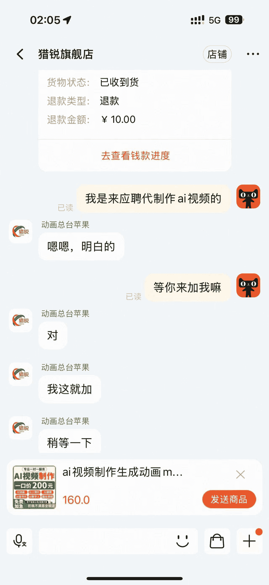

### 2. 接单方法

接单时也需要从多方面因素去判断是否要接这个单。

最后再综合自身原因，判断自己是否能接下这个单子。

每个商家的接单方法不一样，有的是让你回复 1，有的是让你私信发单的人。

## 4. 接到单子如何进行交付结算的流程

对于接单中一些需求的总结：

每一个步骤都需要与客户进行确认，以免后续做出修改时让自己亏钱。

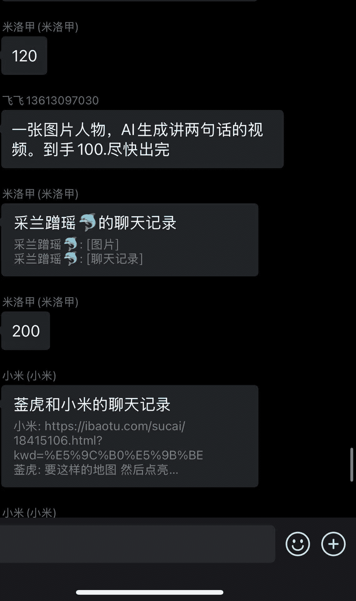

### 1. 需求确认

当你接到一个单子的时候，你必须和对方确认需求。比如说：

1. 视频时长
2. 视频风格
3. 画面比例
4. 参考图或参考视频
5. 视频主题

等你确认了他的需求之后，还需要把你总结的客户需求再次发给客户确认。等这些都确认无误后，再开始进行分镜脚本的创作。

### 2. 分镜脚本

当你确认了视频主题以及客户需求后，可以通过 AI 快速生成一个分镜脚本初版供客户初审。

具体流程如下：

1. 询问并提取客户的修改意见（例如分镜脚本中哪些地方需要调整等要求）。
2. 如果客户没有其他任何要求，则在分镜脚本确认完成后发送给客户。
3. 待客户最终确认后，再进行下一步任务。

#### 3. 资产开发

当分镜脚本确认之后，就需要进行资产开发。具体的流程是：针对一个分镜脚本中需要出现的资产，直接进行生成。

一次性生成四张同一风格的人物三视图资产（虽然 AI 具有随机性）。举个例子，生成好人物三视图资产后，你截图发给客户，让客户自己确认他的人物、道具和场景资产。

### 4. 分镜图

分镜图在这个任务环节中起到了很重要的作用。因为这代表着最终视频的风格，所以需要多次给客户发送，让客户确认这是否是他们想要的风格。

### 5. 视频制作与剪辑

视频制作：

当你生成了第一段视频之后，需要将其发给客户进行确认。如果客户觉得可以，再进行剩余视频的生成。

当然，如果客户没办法及时回复信息，只要分镜图是令客户满意的，那么你也可以在等待一段时间后直接进行视频生成。

生成完成后，你可以直接进行第一次粗剪（或是直接进行第一次剪辑），把第一版交给客户，看客户有什么需要修改的需求。

当然，不能够接受多次修改，最起码做这个要保证有一定的利润并保住本钱。

### 6. 交付与结算

二手单的交付与结算：

#### 1. 交付方式

交付一般需要客户在对接群中发送“我已确认定稿”，之后才算交付成功。

#### 2. 结算方式

根据你接单渠道的不同，结算方法也不同：

- (a) 如果是朋友介绍或私人介绍的单子，直接转账即可。
- (b) 如果是淘宝二手单，则需要进入商家提供的订单提交平台进行结算提交。一般需要的信息包括订单号（派单客服会发送给你）以及单子中其他需要提交的信息。

结算周期大约在一周左右。

## 5. 如何快速制作一个 AI 视频

### 1. 需要准备什么？

我们需要准备一个具备多模态能力的 AI 大模型（比如 Gemini、GPT 等），还需要准备以下工具：

1. 剪辑工具（如剪映）
2. 基础文档处理工具（如 WPS）
3. 即梦会员

- (a) 现阶段可以先跟着教程做一个简单的案例，不需要充值会员。
- (b) 也可以使用豆包 App 里的免费额度进行视频制作。

具体的一些工具链接可以找到生财航海 AI 定制服务进行寻找，我就不赘述了。

### 2. AI 视频快速制作流程

这里先简单看一遍整体流程，这里只简单教学，想要精进可以先看一下航海手册。

AI 视频制作的标准化流程：

通过主题生成一个故事，再根据故事生成分镜脚本。

生成完分镜脚本后，通过脚本进行资产开发。所谓的资产开发，就是传统影视制作中的“服化道”，例如人物三视图、道具三视图等。

接下来通过资产生成分镜图片，再通过分镜图进行视频模型提示词的生成。

有了视频模型提示词后，通过模型生成需要的视频片段，最后使用剪映等剪辑工具进行后期剪辑。

#### 1. 智能体制作与提示词

我们先做好基础设施，做一个不用每次都需要再次发送提示词的智能体。

第一步，我们需要先下载豆包。打开豆包之后，按照图中所示，先创建一个智能体。

##### 1. 基础操作

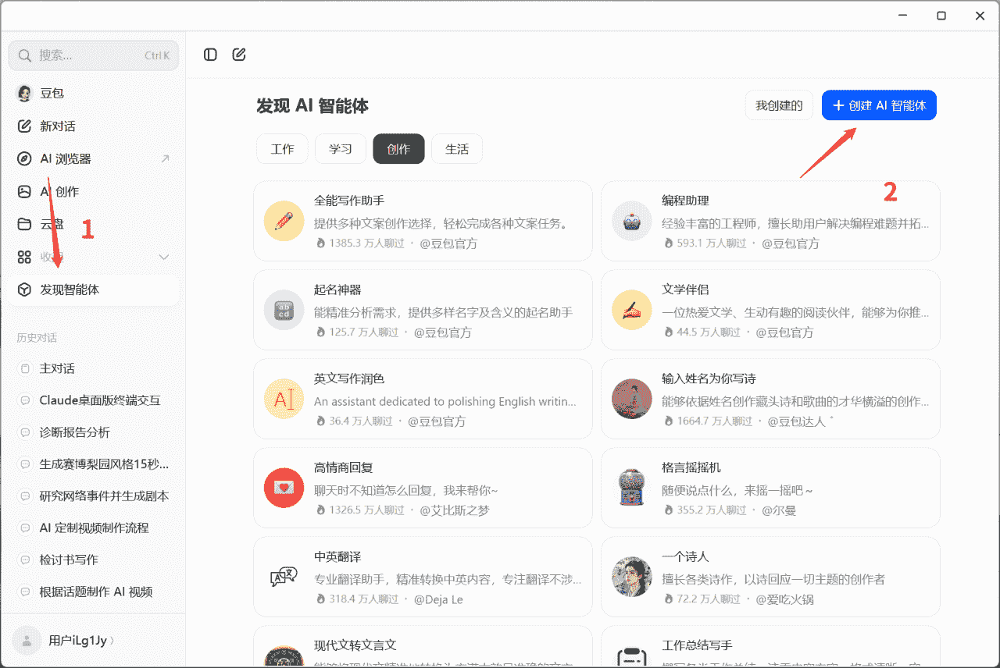

##### 2. 设定

描述中填入我提供的提示词，其他设置随意。

其他不同类型的重复操作即可！

##### 3. 提示词

下面是我准备给大家的提示词，大家可以在此基础上进行一些修改。

分镜脚本提示词：

资产开发提示词：

分镜图提示词：

Seedance 提示词：

#### 2. 剧本与分镜脚本制作

我们现在制作一个简单的 30 秒视频进行实操案例，我们的主题为：《小猫爱情故事》。

用这个进行举例子，剧本可以多次修改到自己满意即可。我这里就一遍过了。

分镜脚本制作完成后可以选择保存本地后以便后续使用和归档。

##### 1. 主题（你可以直接给一个主题，或者完整故事都可以）：

Plain Text

主题围绕小猫爱情故事，以卡通的风格（例如表情夸张等），内容简单易懂。

视频参数如下：

1. 总时长：30 秒
2. 风格：卡通风格
3. 比例：16:9

##### 2. 分镜脚本：

Plain Text

| 镜号 | 景别/视角/构图运镜 | 动线 | 画面内容 | 人物 & 场景 | 台词 | 音效 | 参考时长 |
|---|---|---|---|---|---|---|---|
| 1 | 全景 / 平视 / 中心构图 / 推镜头 |  | 夜晚街道，一只小猫蹦蹦跳跳跑来。小猫眼睛亮晶晶，尾巴高高翘着。月光洒在街道上。 | 小猫 A、街道 | 无 | 轻快的脚步声 | 5 |
| 2 | 中景 / 平视 / 对称构图 / 固定镜头 |  | 小猫 A 突然停下，眼睛直勾勾看着前方，嘴巴微张。 | 小猫 A、街道 | 无 | 无 | 3 |
| 3 | 中景 / 平视 / 中心构图 / 拉镜头 |  | 小猫 B 从画面右侧优雅走来，耳朵抖动，尾巴轻轻摆动。 | 小猫 B、街道 | 无 | 轻柔的猫叫声 | 5 |
| 4 | 近景 / 平视 / 特写构图 / 推镜头 |  | 小猫 A 和小猫 B 对视，眼睛都弯成月牙，嘴角上扬。 | 小猫 A、小猫 B、街道 | 无 | 轻柔的猫叫声 | 5 |
| 5 | 全景 / 俯视 / 圆形构图 / 跟镜头 |  | 两只小猫开始追逐嬉戏，在街道上跑来跑去，尾巴飘来飘去。 | 小猫 A、小猫 B、街道 | 无 | 欢快的猫叫声、追逐的声音 | 7 |
| 6 | 近景 / 平视 / 中心构图 / 固定镜头 |  | 两只小猫跑累了，依偎在一起，头靠头，眼睛眯成一条缝。 | 小猫 A、小猫 B、街道 | 无 | 轻柔的呼吸声 | 5 |

#### 3. 资产开发

现在我们获得了分镜脚本后，我们可以通过分镜脚本进行资产开发，直接将分镜脚本发给 AI 即可，然后通过获得的资产提示词进行资产生成，制作三视图，例如人物、场景、道具等。

##### 1. 资产提示词获取

我们获得了分镜脚本，现在我们应该进行资产开发。按图所示，把分镜脚本上传给 AI，AI 会返回资产提示词，对于不满意的可以再次让他修改即可。

获得如下资产提示词：

##### 2. 资产生成

按照图示，进行生成资产图片，生图模型的选择越强越好，我这里为了展示也使用豆包进行制作。

1.

2.

图片效果并不好，正常三视图应该是如图所示。

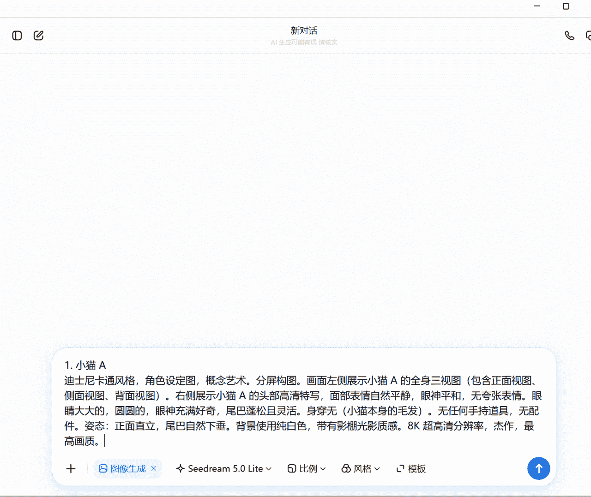

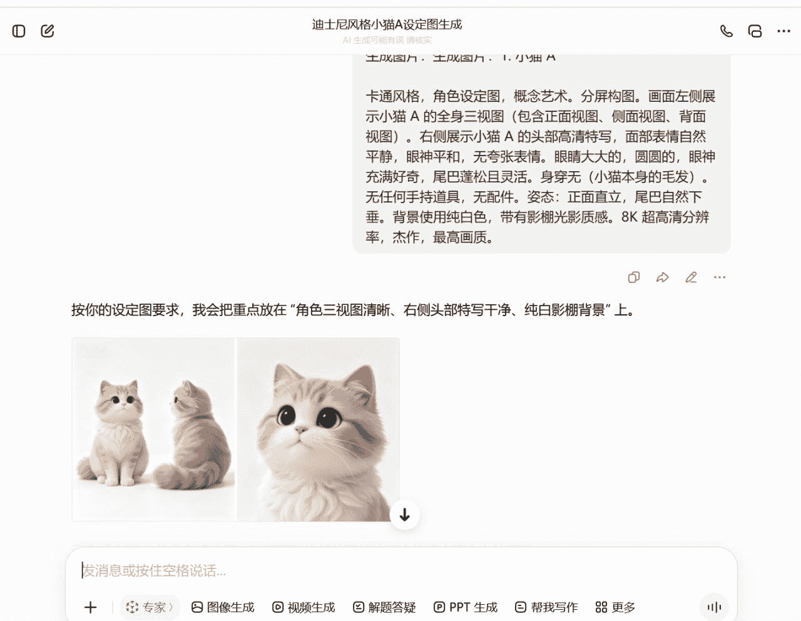

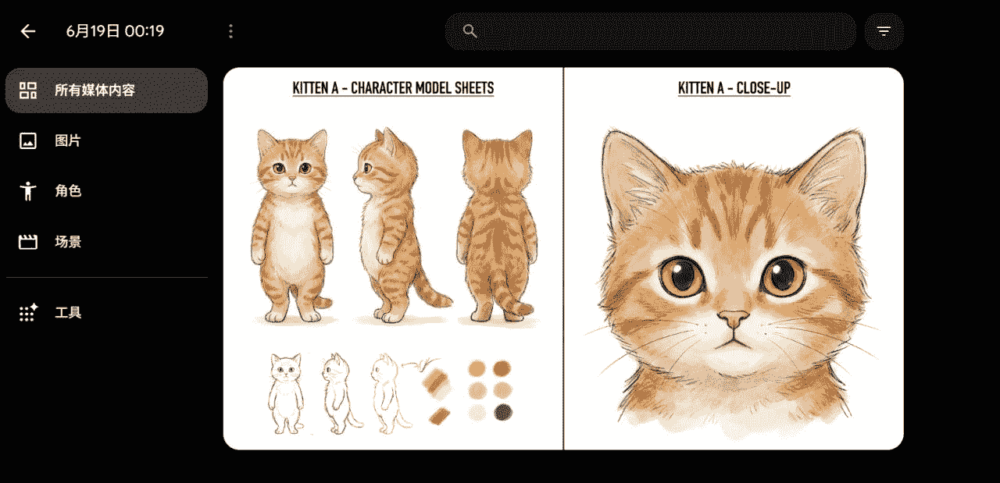

使用豆包慢慢修改满意即可。

接下来继续生成其他的一些资产即可，可以参考我给的图片示例。

制作过程中我发现角色没有特点，我就更改了一下资产提示词，让角色都有各自的特点。

场景资产：

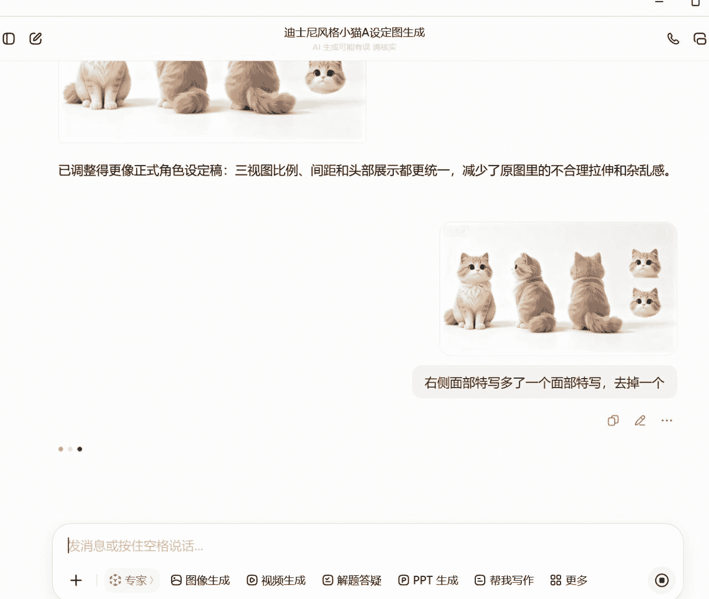

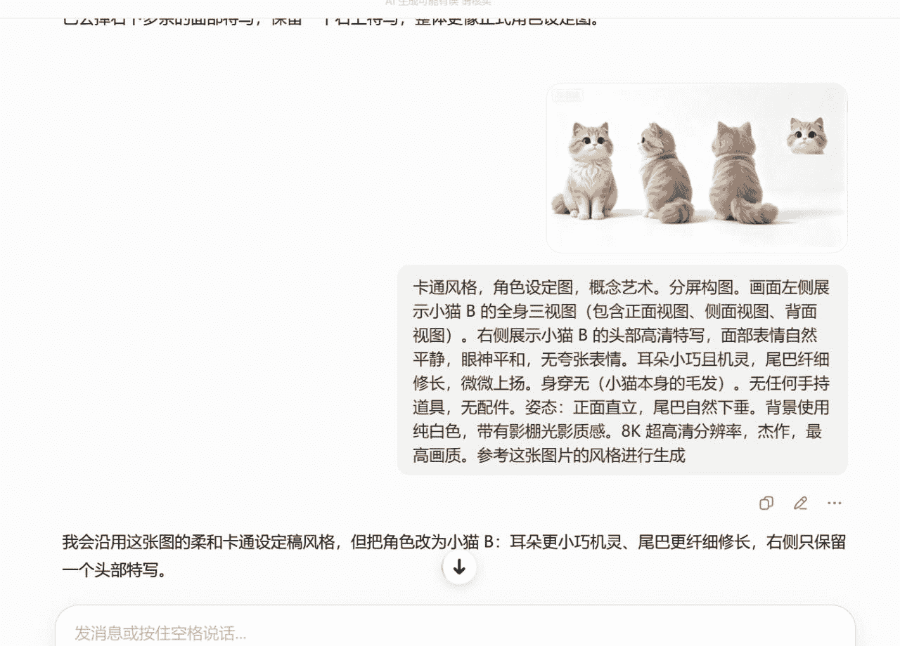

资产已开发完毕。

#### 4. 分镜图生成

我们现在需要通过刚刚制作的智能体，把分镜脚本以及我们需要的视觉风格发送给它。

##### 1. 制作分镜提示词

发送脚本后它便会直接进行输出分镜提示词。

想要便捷的话可以再次发送这段提示词：

Plain Text

直接将分镜脚本输出为可一键复制的 Markdown 格式，格式为：用以下提示词生成 3×3 的网格图，1.2.3.4.5.6.7.8.9.

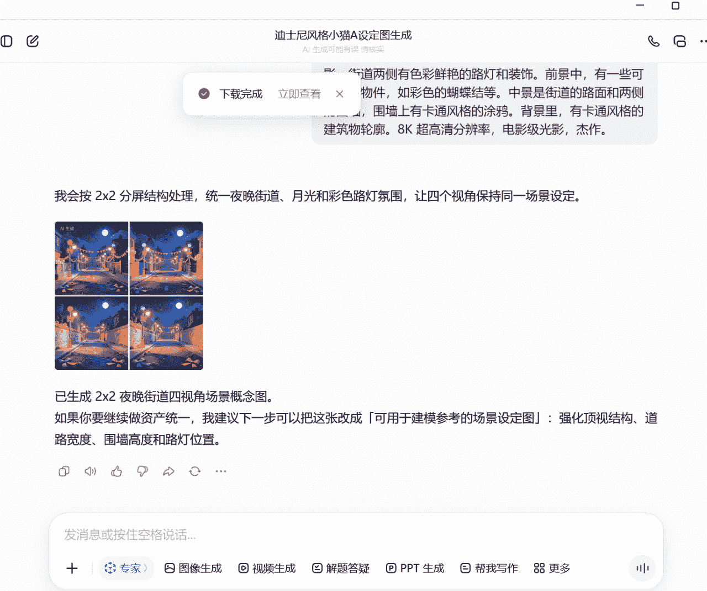

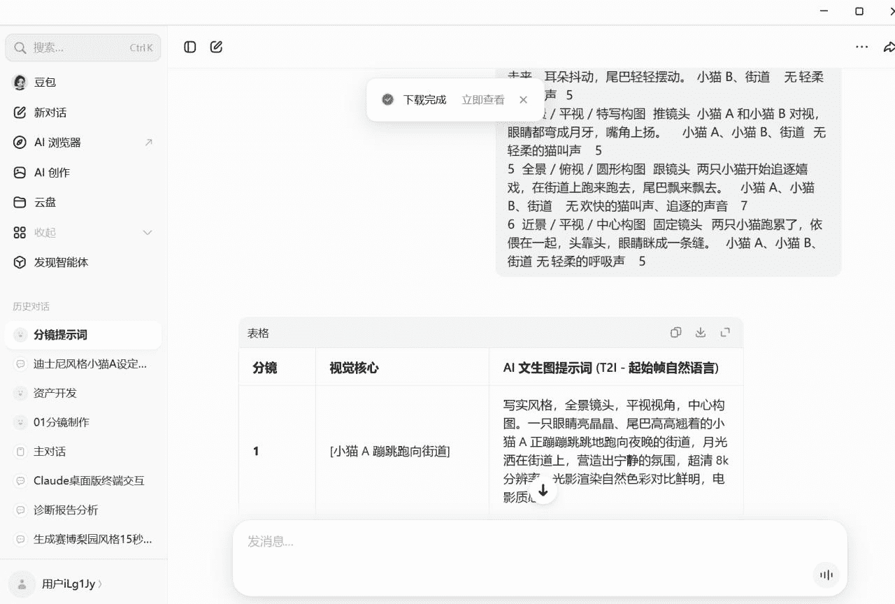

（没有的镜头用“空镜”表示。）

效果如下。

记得标注风格。

获得的分镜提示词：

##### 2. 分镜生成

可以注册一个 LibTV，用免费积分做一个分镜图，更加快捷。

第一步，先把素材上传到 LibTV 的画布中。

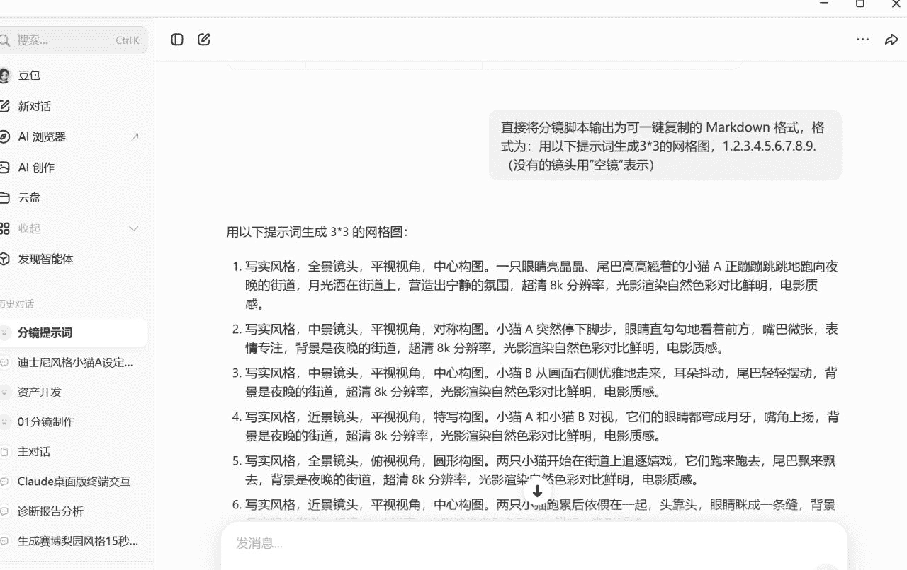

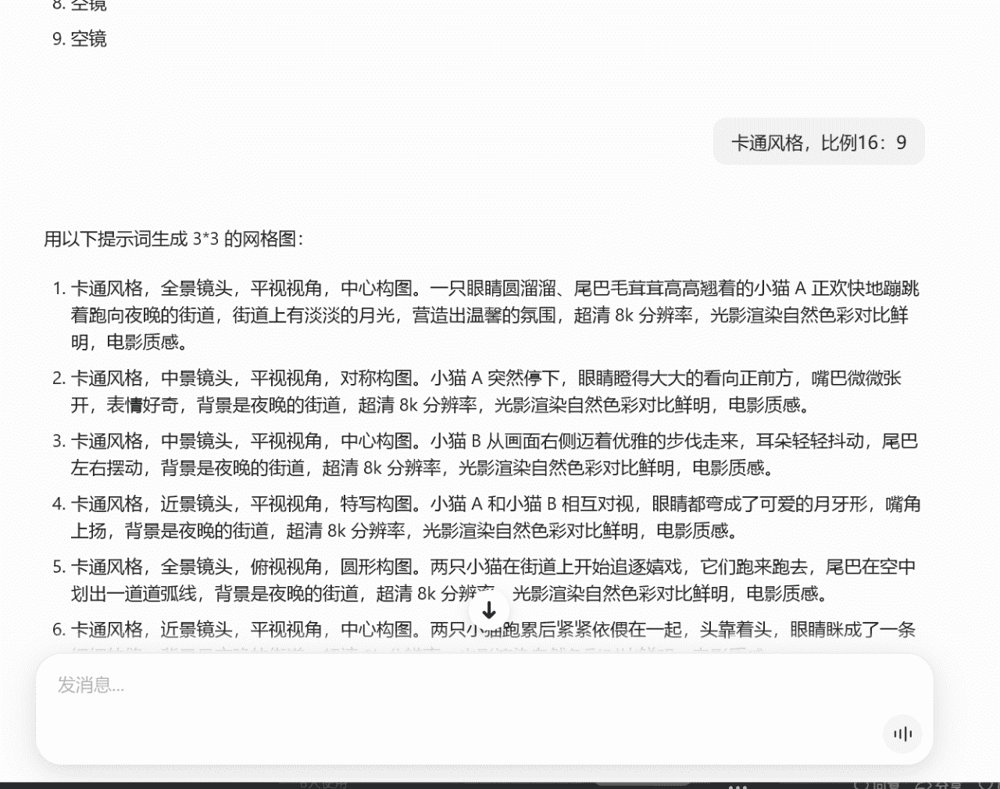

第二步，创建一个生图节点，把所有素材连接到这个生图节点中。

第三步，把分镜提示词添加进去，然后对素材进行标注，比如“<@图1 是小猫 A>”，然后点击生成。

第四步，把生成出来的图片进行提取，如图所示。

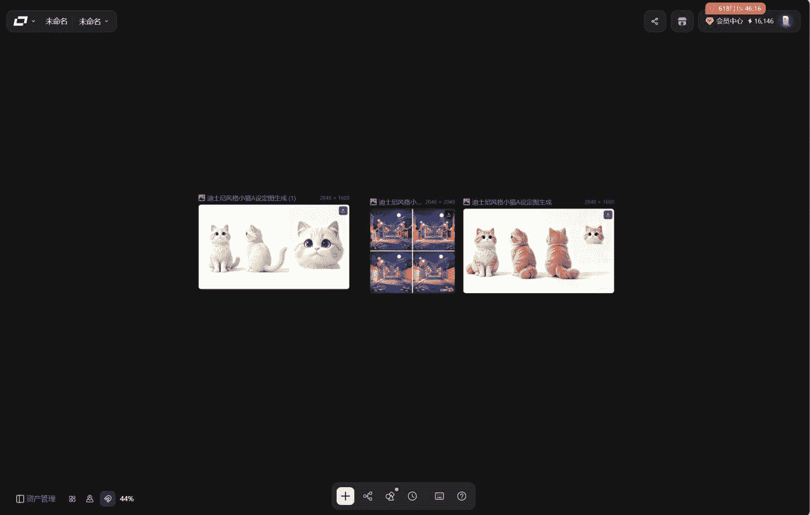

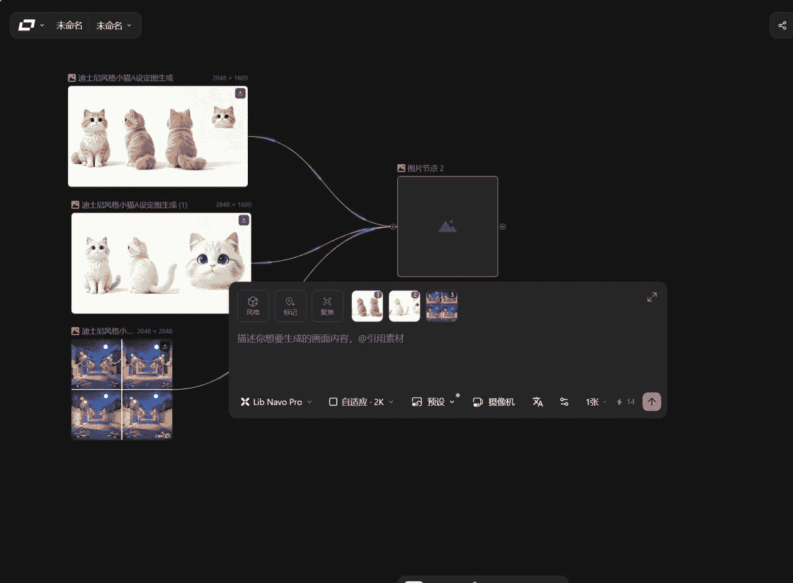

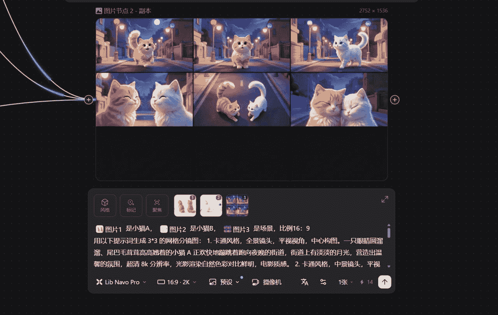

第五步进行切分，选择后进行创建分镜组。

第六步，批量下载到本地。

# 6. 视频生成

## 1. Seed 提示词制作

这里不知道什么原因，无法搭建这个智能体。可能是由于豆包的政策检测到提示词中含有相关禁止信息，所以我们直接将视频生成的提示词发送给对话即可。

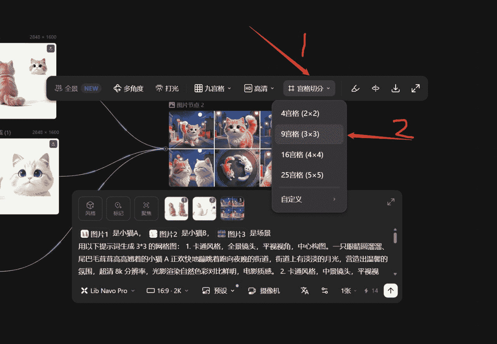

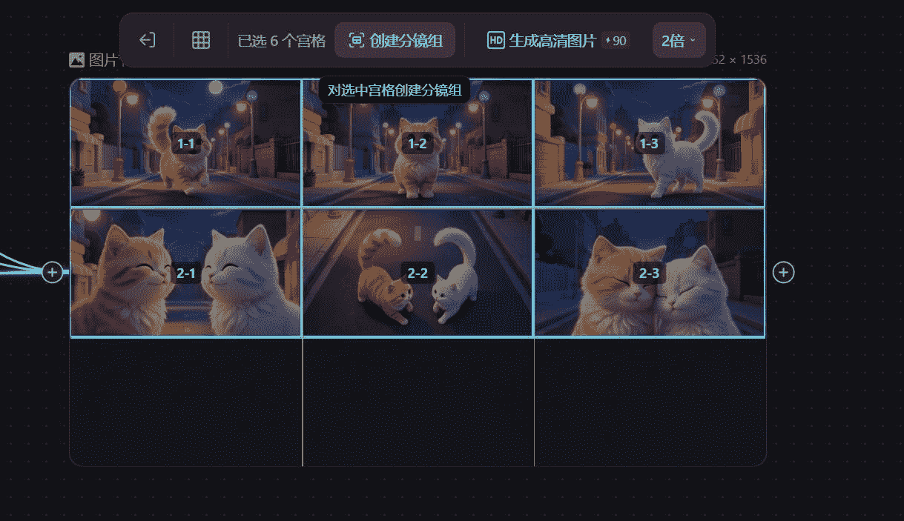

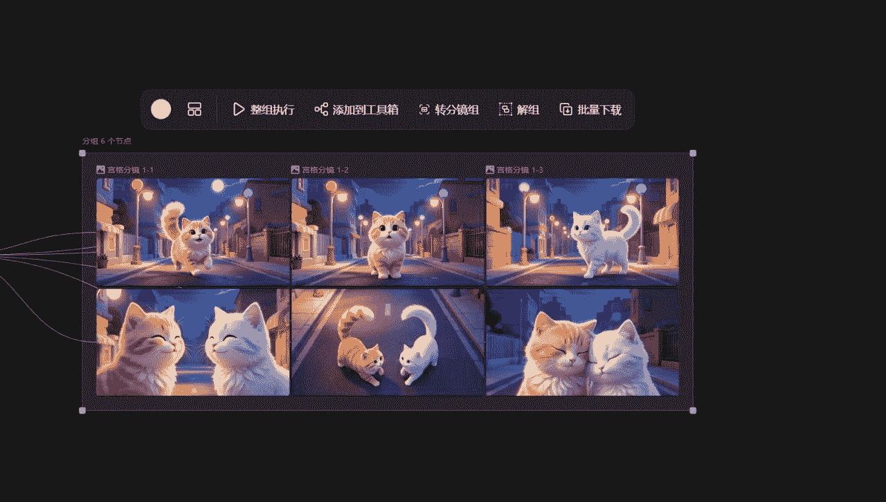

第一步，上传分镜脚本，以及所有分镜图的截图即可。

第二步，记得补充角色信息。

第三步，因为我们使用的是豆包的免费额度，所以每次只能单独生成 10 秒。我们直接生成两次，让它形成一个连续的故事即可。

获得的分镜提示词（提示词不会一次性就成，要做检查和修改）：

第一段提示词

Plain Text

【风格】3D 萌系卡通风格，10 秒，16:9 横屏，温馨治愈氛围，夜晚暖黄街光，柔和体积光，猫咪毛发细腻蓬松，童话感城镇街道

【时间轴】0-3 秒：推镜头，夜晚静谧的彩色城镇街道，月光与串灯铺洒路面，小猫 A 蹦蹦跳跳从远处跑来，眼睛亮晶晶，尾巴高高翘起，步伐轻快，对应分镜第 1 格构图；3-5 秒：固定镜头，小猫 A 突然停在街道中央，耳朵微微竖起，眼睛直勾勾盯向前方，嘴巴微张露出好奇惊讶的神态，对应分镜第 2 格构图；5-8 秒：拉镜头，小猫 B 从画面右侧优雅走入，耳朵轻轻抖动，尾巴缓慢摆动，步伐轻盈地朝小猫 A 缓步靠近，对应分镜第 3 格构图；8-10 秒：推镜头，两只小猫近距离面对面相视，双眼弯成月牙状，嘴角上扬，同时露出开心满足的表情。

【声音】轻快的小猫脚步声 + 轻柔的猫叫声

【参考】@图片 1 作为小猫 B 角色形象参考，@图片 2 作为夜晚街道场景参考，@图片 3 作为小猫 A 角色形象参考，@图片 4 作为前 3 镜分镜构图与动作参考。

第二段

Plain Text

【风格】3D 萌系卡通风格，10 秒，16:9 横屏，温馨治愈氛围，夜晚暖黄街光，柔和体积光，猫咪毛发细腻蓬松，童话感城镇街道

【时间轴】0-2 秒：固定镜头，承接上一段对视画面，两只小猫互相轻蹭鼻尖，尾巴友好地轻轻晃动，对应分镜第 4 格构图；2-7 秒：跟镜头，略带俯视视角，两只小猫在夜晚街道上欢快追逐嬉戏，来回跑动穿梭，尾巴随奔跑动作自然飘摆，对应分镜第 5 格构图；7-10 秒：固定镜头，近景特写，两只小猫嬉戏后依偎在一起，头挨着头相互靠住，眼睛眯成细缝，安静休憩，对应分镜第 6 格构图。

【声音】欢快的猫叫声 + 跑动追逐声 + 轻柔的呼吸声

【参考】@图片 1 作为小猫 B 角色形象参考，@图片 2 作为夜晚街道场景参考，@图片 3 作为小猫 A 角色形象参考，@图片 4 作为后 3 镜分镜构图与动作参考。

## 2. 视频制作

第一步，把提示词输入和图片进行上传和 @它。

第二段操作同上，接下来就等视频制作完成即可。

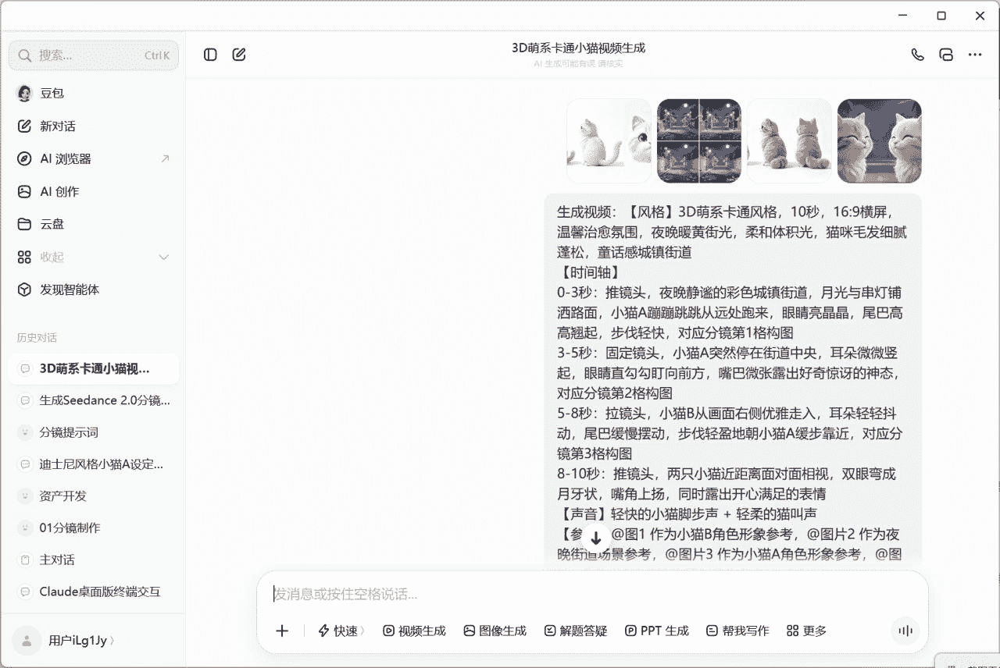

# 7. 视频剪辑

视频剪辑的作用就是把片段拼凑在一起的方式。

这里只讲一些简单的，比如如何将两个视频片段合理地拼凑在一起。

将视频的两个片段交接处加一些转场特效（如闪白、闪黑等），以及在切分镜的时候，将分镜切换到其他分镜等方法。

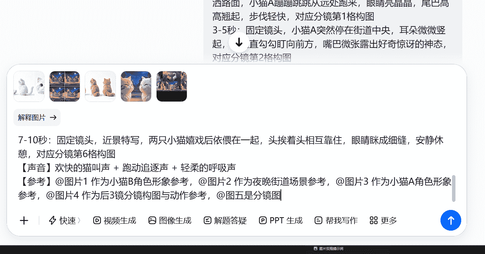

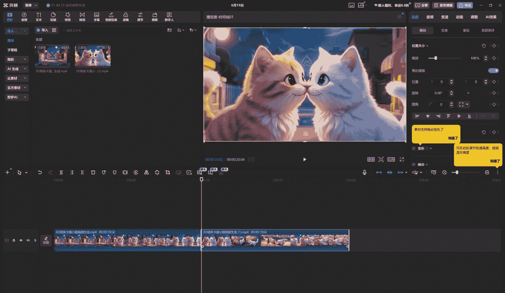

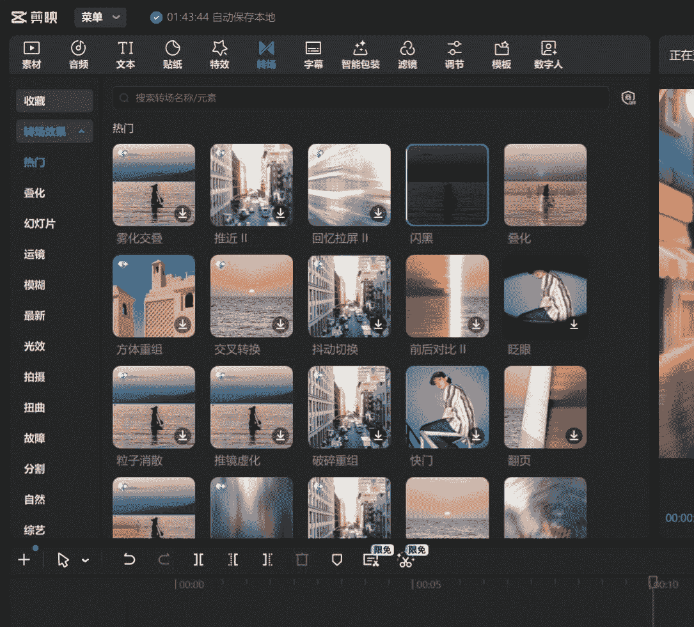

公众号懒人搜索，懒人专属群分享

然后剪辑好，直接导出即可。

现在，一个简单的视频便制作完成了。只需要稍加精进即可进行接单。

## 4. 接单时的一些经历（避坑经验以及对圈友说的一些话）

## 1. 如何判断能否接单

接单时先看清楚对方的要求以及价格！！！

首先，制作难度一定要和价格有对应，而且接单首先接最简单的，先进行练手。

1. 接单最低要求就是一分钟价格最起码要在 150 元，不能低于 100 元每分钟。
2. 制作难度方面，第一次接单首先接学生作业相关的单子。
3. 能力增长后，便可以接一些高价格的单子。
4. 还有，接单新手先接一单练手，熟悉后就开始同时接多单进行制作。

这个图片中便是 1 分钟 400 元可以接单的单子，但是要根据自己的时间安排，千万不要硬挤时间。

## 2. 我自己在制作过程中遇到的一些坑

1. 接单后客户回复消息超级慢，如图每次回复都是隔了好几天，遇到类似单子建议直接接其他单子。

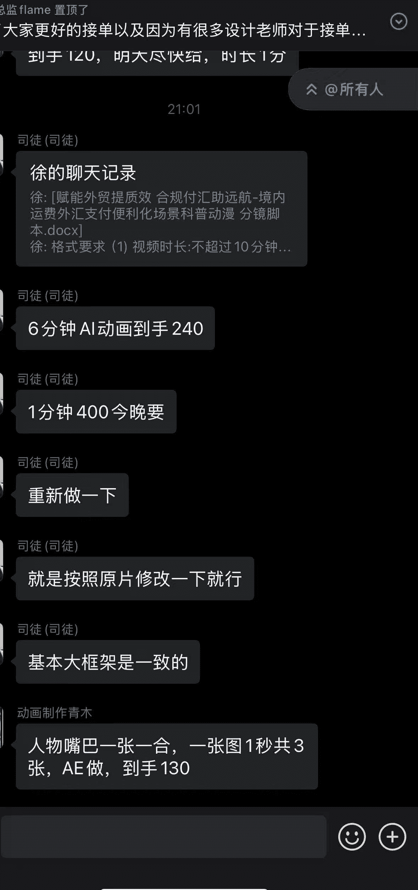

2. 制作过程的每一步都需要和客户确认好，否则需要多花算力费。

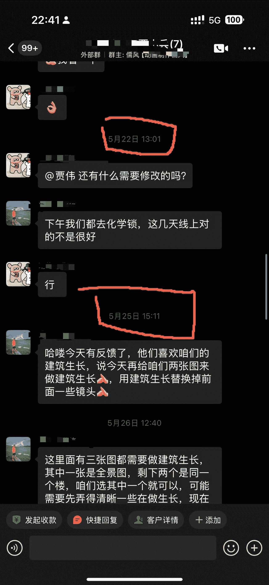

3. 有时遇到客户不回信息，一定不要自作主张进行制作，可以先出图，但是生视频一定不要在客户没确定的时候进行生成，因为现在算力费用还是很贵的。

## 3. 我想对圈友说的一些话

### 1. 在制作 AI 视频的项目中我们还需要做什么？

1. 我们还需要做一些个人账号，拓展自己的接单途径。
2. 不能只接二手单，二手单的作用仅是在练手时也能赚到钱。
3. 对于视频生成的模型选择，看视频要求选择，便宜的模型即可。一般不要用 Seed，因为目前主要是练手和赚钱，而且二手单的一般要求也不会太高。

### 2. 对于想要深入 AI 视频的人

两个大方向：

1. 批量化
2. 精品影视

#### 1. 批量化

例如：使用自动化的工作流为电商公司定制一些带货视频，例如 TikTok 的带货视频。

价格：一条 15—20 秒的价格约 50—80 元左右。

这个我不多讲，因为接触不太多。

#### 2. 精品影视

相信大家都在社交平台上刷到过那些超酷的 AI 影视作品了。

如果你也想入行，光会用工具是不够的，首先得补补课，学学专业的编导思维和视听语言。打好这些基础后，做自媒体账号是个很棒的选择。在学习的时候，建议多去参加比赛，多认识些圈内人，这样路子才越走越宽。

至于账号怎么做，方向其实挺多的：可以教大家怎么写提示词，分享自己的 AI 工作流，或者卖 AIGC 相关课程。总的来说，现在 AI 赛道的发展潜力巨大，非常值得一试。

## 4. 行业的变化以及工具推荐

### 1. 行业变化

从我刚接触到现在，行业的变化是越来越卷的，因为这个行业入门简单，所以就有很多人来竞争。刚接触时和现在的接单价格也是降低了，所以低端代做不是一个长久的计划，但是小副业可以；但是想深入，那么就要做精品。当你做到精品后，你的价格甚至可以 10 万元一分钟。

我如何应对：提高自己的技术，不要一直接二手单，接单也可以自己去对应评论区聊单子。报价的话，报 150 元一分钟以上，这是学生作业的报价，还有报价的同时要看对方的需求。

### 2. 工具推荐

按需使用即可。3 月份航海中的工具使用有限，越便宜的越好。想要提高创作效率的，就用无限画布工具，例如 LibTV 等平台。我自己使用的就是 LibTV，目前性价比最高。

# 总结

目前我对 AI 视频这个项目的总结是：这确实是一个非常零基础的项目。

真的，这是一个目前几乎所有小白、学生或是其他人都比较适合做的副业，因为门槛非常非常低。

而且在制作的过程中，你也可以不断精进自己的影视制作能力。这对以后来说，绝对是一份长期的可迁移能力，因为现在 AI 视频对于自我表达、做自媒体博主等方面都会有非常大的帮助。

当然，如果你选择不同的方向，精进路线也是不一样的。走批量化定制的方向，与走精品化 AI 视频的方向完全不同。

接下来，我给大家列出如何根据自己的目标去制定精进方向：

## 1. 精品化 AI 视频方向

如果你想要制作高质量的 AI 漫剧，甚至达到影视级、电影级的效果，那么你需要去学习传统的影视编剧和影视制作知识，例如：

- 分镜设计
- 剧本创作
- 视听语言
- 构图设计

## 2. 批量化定制方向

如果你想走批量化定制、AI 视频带货、AI 油管 YPP 等方向，目前可以参加我们的“深海圈”进行精进，里面有很多大佬可以交流。

---

看完这篇 SOP，你觉得你懂了。但 90% 的人一到实操就会卡在第一步。

工具和教程只是最低级的壁垒，真正的壁垒是“立刻动手”和“圈层信息差”。

如果你想看全网最新的变现玩法，并且和一群执行力极强的极客一起下场拿结果，欢迎围观我的核心私域：【懒人专属群】。

我们不聊虚的，只做商业闭环的拆解与 AI 效率的压榨。系统内已沉淀 1000+ 跑通的套利实战局。

👉 查阅圈子完整数字资产与上车门槛：

https://lazyso.com/insider/

认同价值、准备好下场干活的，扫码加我微信（lazyhelper1）。

备注：【实操上车】，不闲聊。

