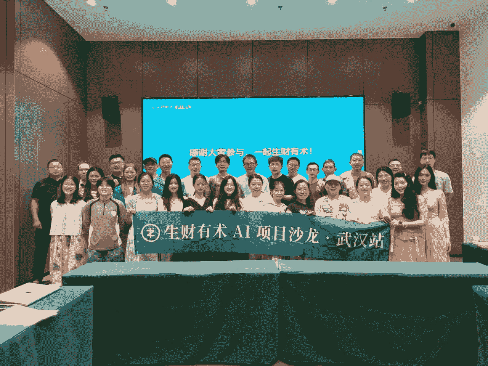
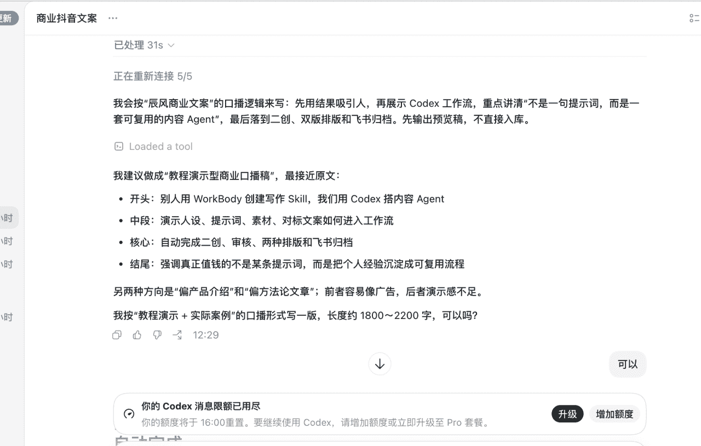
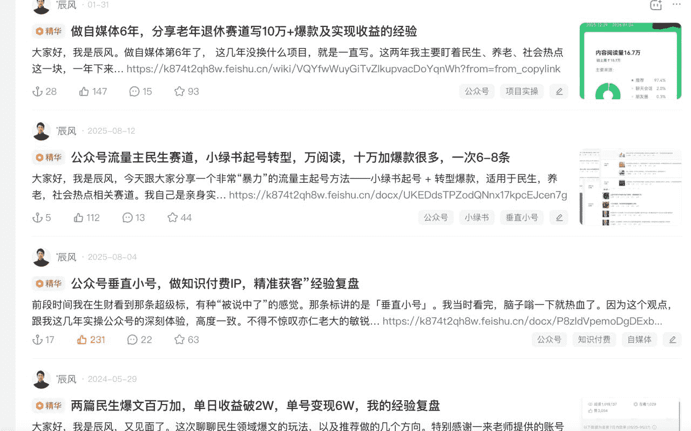
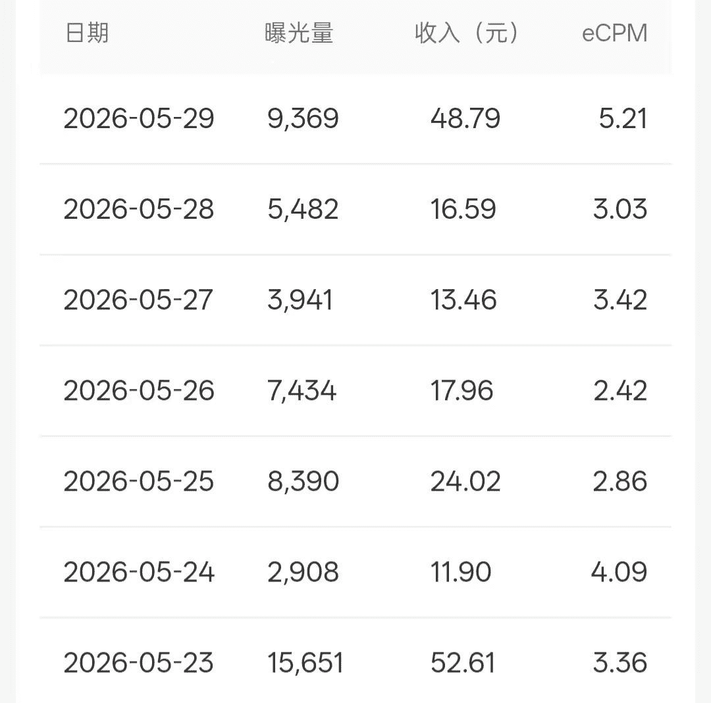
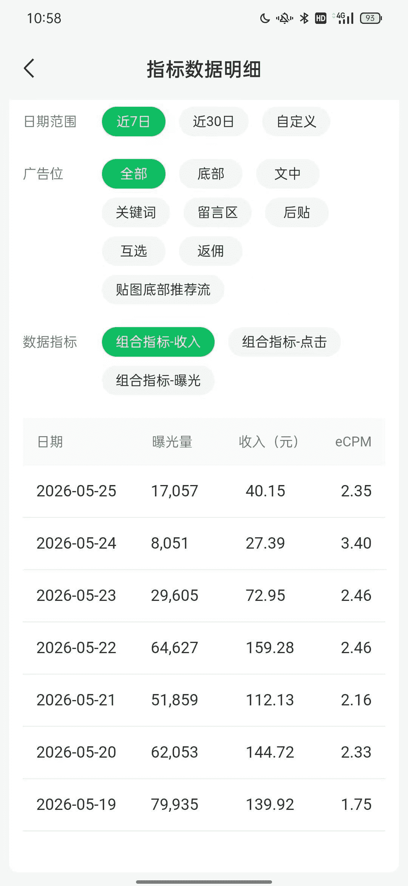
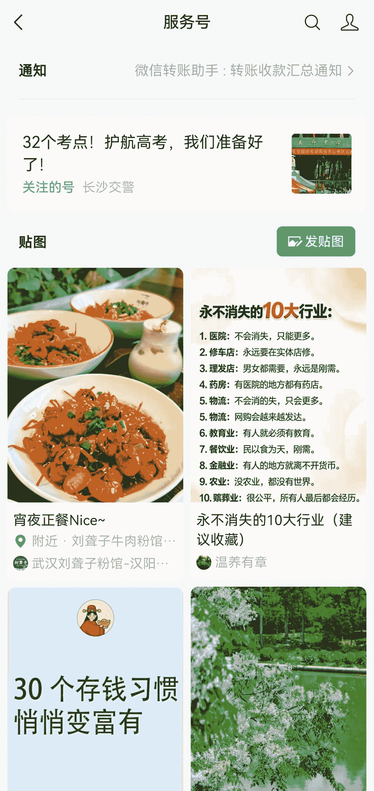
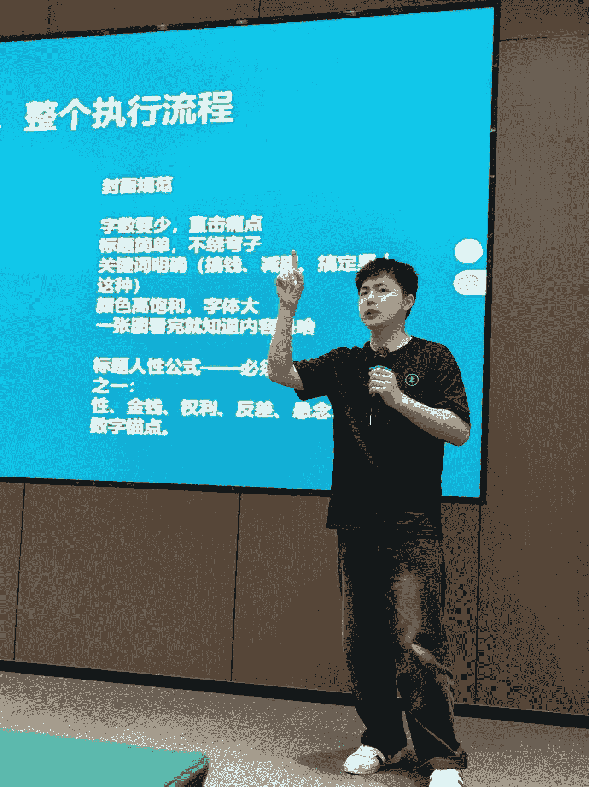
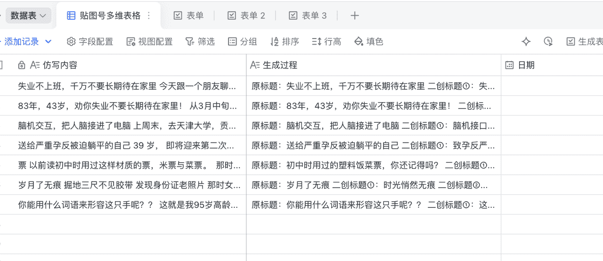
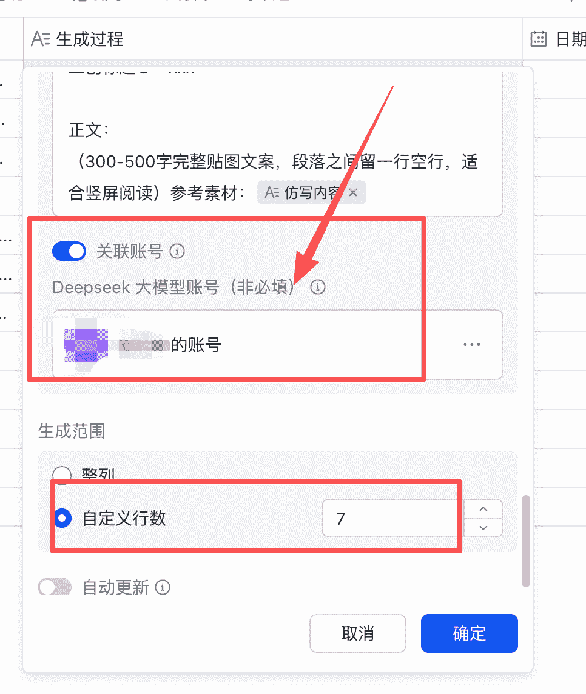

# 做了三个月公众号贴图，用 **AI+** 多维表格矩阵运营 **10** 个号，单号最高变现 **3000**，我看到的内容红利

260622 副业 SC 精华

整理：公众号懒人搜索，懒人专属群精选

懒人微信：lazyhelper1

大家好，我是辰风。上次受官方邀请在武汉做了一场线下项目沙龙的分享，也一直在躬身入局研究流量主。

包括最近贴图的玩法比较火爆，也算是在生财发了一条贴图的精华帖，影响很多朋友来尝试做贴图账号，也有不少圈友跟我报喜，说通过贴图拿到了还算不错的结果。

我做自媒体有近 6 年左右的时间。在这 6 年，大部分的时间都是在尝试做公众号。我觉得公众号越玩越精彩，尤其是有了 AI 的加入之后，包括现在也在学习通过

codex+obsidian 来产出公众号的文章，包括做短视频的文本，也是想通过这种方式来提高内容的产出和效率。

那话不多说，今天这条内容主要还是跟大家复盘一下，针对于贴图号的一些项目玩法，以及我们最近的一些突破的卡点。

线下分享结束后，大家聊了很久，吃完饭之后好像九点多了，大家依然意犹未尽。6 点多晚上分享结束的时候，大家也讨论了很多。大家说这次线下活动，没想到居然有外地来的教练，还有从很远地方城市过来的圈友，大家一起奔赴武汉。夏日炎炎，但是阻挡不了大家的激情，居然有 30 多位圈友都来参加了线下，并且参与热度非常高。

（在高铁上继续改 PPT）

武汉之前还举办了好几次的 AI 大航海的教练分享，一场线下居然能够见到四五个教练。我觉得这种感觉让人怎么说呢？会觉得非常的亲切，感觉圈友一直就在我们的身边，而且真的是官方在想方设法地去托举我们，推动我们学会 AI，并且把 AI 用在自己的项目上。

有圈友跟我说：

“我之前一直觉得公众号红利已经过了，不过听你说话，发现其实平台一直都是有红利的，只是我的认知卡住了。”

我准备这次分享的时候，有想把自己的经验都聊一次，不过要聚焦重点。

其实大家要的不是方法论的东西，要的是一个理由：为什么值得做，有没有价值，天花板有多高，以及延续性如何。

大家不仅关心挣钱这件事情，也关心这个项目的持续周期如何，天花板怎么样，到底是偶然的，还是能够规律性去做的，能不能够做矩阵，能不能够通过 **AI** 来进行放大。

而公众号最大的优势就是，只要你能够产出这样子的文案，跑浏览量就能够挣到钱。

当然，这种流量也是有概率的，只是变现路径变短了而已。

可能很多人很好奇，为什么很简单的一个内容，一个图文文本，它能够跑 100 万，那它爆款的原因可能有很多，或许是它的选题好，或者是它有爆款关键词，或者是它的故事真实戳到了痛点，又或者是它发文的时间等等。某个原因到了，它可能就爆款跑出去了，这是存在一定的偶发性和概率的。

那我们要从这些偶发性的概率当中总结共性特点，能够让我们持续地跑爆款，能够稳定流量下来。

像下面这种：

公众号最大的优势就是只需要你能够产出这样子的文案，你跑浏览量就能够挣到钱。而现在更加轻松的是贴图号，只需要你产出两三百字的文案，借助 AI 来写稿，或者是稍微做一下图片，你就能够去跑出去流量。

微信贴图，是我今年看到的、离普通人最近的信号。

以下是我这场分享的完整复盘。不是方法论合集，是一整条从“发现机会”到“验证跑通”的真实路径。

## 第一部分 · WHY ME：为什么我分享

我再简单说一下我自己。

我是辰风，00 后，做自媒体 6 年。

25 年 5 月左右，做公众号长文，写出过单篇百万阅读。26 年写老年赛道，单周做到百万爆款。

从 23 年 12 月份在生财看到了公众号的风向标之后，我就一直在躬深入局做公众号的流量文章，也做了非常多的赛道测试，包括之前也输出过一些精华帖，大家有兴趣的也可以回看一下我之前的内容，几乎所有能玩的玩法我都玩过。

长文我跑通过，短文我跑通过。

这 3 年我最大的感受是——做内容这件事，没有什么“一招吃遍天”的方法。每隔一段时间，平台就会开一道新的口子。当流量大的时候，我们这时候入场，基本上只要你的执行力拉满，多开几个账号，多发一些内容，基本上都还算跑出了不错的结果。

尤其是 **24** 年 **ChatGPT** 刚出来的那一波，基本上大家都是挣到钱的。但是一旦流量过去，或者是这个赛道到了中末期，再想去拿到一定的数据结果就很难了。

目前贴图依然是有流量扶持的，只是这个流量什么时候过完并不知道。也有很多人揣测说贴图的单价不行，从我们测试来看，ECPM 单价确实还可以，只是说因为它主要是评论区广告曝光，所以它的广告曝光量拉起来很关键。

## 为什么这次要测贴图？

24 年的时候，我就测试过小绿书了。公众号贴图不叫贴图，我们称它为“小绿书”，那时候图文笔记下面是有底部广告的。

我当时看不上，觉得这玩意儿粗糙、low，没什么前途。

那时候比较轻松地搬运一些职场笔记，从小红书放到公众号上来发，然后发现它的流量就很迅猛。当时有笔记直接就干了大几十万播放，这个选题做了好几次，都是几十万的播放。当时因为赛道的问题，这个赛道我个人觉得变现一般，所以没有太发力做这个领域。

（24 年 5 月，我发的小绿书）

后面带了一些朋友闷头干，单号一个月做到 2-3K，靠的就是把小红书的笔记暴力搬运到公众号上发。这件事持续了大概半年，后来流量主取消了，红利期结束。

所以这次贴图的流量如此之大，并且我们测试出来的单价还可以的情况下，那我们觉得它是适合个人去作战的。矩阵账号可

可能会嫌弃单个号一个月可能只有一两千左右的数据，但是对于普通人挣钱，这个事情确实太香了，因为你每天可能也就十来分钟的时间。

以下，我只展示素人案例数据，也就是普通账号的数据运营情况。（代运营模式）

贴图数据（部分）

文章数据（部分）

抖音数据

所以 24 年其实是有两波红利的。一波是小绿书的流量主，还有一波是带货。带货我不记得是 24 年末的时候还是什么时候了，时间有点久。

但是我复盘的时候，我觉得我错过了很大的一波流量红利。当时没有 all in，没有把执行力拉满，多开几个账号，多发一些内容去做。因为我有点看不上他的这种内容模式，我觉得他太简单了，但是恰恰是简单的才是挣钱的。所以当贴图这次给了一波新的流量入口的时候，我就一直有在入场测试，到现在应该三个多月。

目前单号每天平均下来 20-30 左右的收益，长文章万阅读，同时在跑抖音视频，测 AI 自媒体。

一个号 30，十个号就是 300，互联网项目就看挣大钱，还是挣小钱。

## 第二部分 · WHY：为什么贴图是 2026 年最大的流量红利？

所有平台都在关门，微信贴图是最后一扇还开着的窗。

现在各个平台对于流量的要求开始变得越来越严格。

小红书在打击流量，抖音也在限制，你的作品播放量稍微高一点，要是有引流动作，直接就会给你判违规。

我的抖音也因为这个关了好几次小黑屋。

公众号则更狠，内容如果稍微有一些引流性质，直接会提示低质量，不允许自动关注回复，也不允许菜单栏，更不允许文章里面挂二维码或者放微信号。

以前我们习惯了从公域里面捞流量，现在小红书变得商业化了，公众号直接锁死了引流的通道，抖音也在开始变得越来越难，好像最后留给我们的路子都在被堵死。

这意味着什么？

意味着流量从来没有像今天这么贵过。

你在抖音投流，一个精准粉 50 块起步。小红书更不用说了，公众号你写篇文章想导个微信，平台直接给你限流。

所有人都在问同一个问题——那我还做公众号干嘛？

公众号的价值不只是一个作为流量获客的工具而已，它是在微信生态里面，你能够持续地去沉淀用户，反复触达用户，并且长期变现的。

也可以方便你后面去做自己的个人 IP，构建影响力。

你可以联动视频号和微信私域和直播，持续地建立用户信任关系。去获客一个新用户的客资成本是非常高昂的，让一个已经看过你很久公众号和在你微信私域里面待过的用户，再复购、再花钱，会比让一个新用户付费高单价，要来的更简单直接得多。

最近很多人也在讨论一个问题，就是现在公众号的引流路径会卡得很死，关注后回复菜单栏，公众号的文章内部都不允许贴二维码或者是留微信号。

我们怎么样子能够获取到关注？

其实贴图是一种很快能够获客的方式和渠道。在我们实际的测试来看，贴图的涨粉也是非常迅猛的。微信官方在疯狂地拿流量去砸贴图。现在流量充沛，竞争稀缺，这也是微信生态当中目前还能够免费发放流量的一个渠道入口。

你看这个逻辑链：

- 第一，贴图是微信官方正在砸资源推的新内容形态，流量充沛、竞争稀缺。这是目前微信生态里为数不多还在“发免费流量”的入口。
- 第二，贴图的阅读场景天然就在微信体内——看一看、订阅号顶部、服务号消息页。用户看完你的贴图，往上一划就是你的公众号主页，关注路径是零摩擦的。
- 第三，这个“关注”是原生行为，不是引流。平台不会打击你，因为用户本来就是在微信里看到你的内容，自然地点了关注。你没有外挂链接，没有“加微信领资料”，你只是持续产出好内容，用户自己选择留下来。

这就是贴图真正的战略价值——它不只是一个涨粉渠道，它是在所有平台都关门的时代里，微信留给内容创作者的最后一条免费获客方式。

小红书的算法是开放的，一个爆款会迅速破圈，所有人都能看到。这导致任何赛道一旦起势，几百个 MCN 会在一周之内涌进来，把门槛拉到你够不着的高度。

但微信的推荐逻辑完全不同。

微信是“信息茧房”式的分发——基于社交关系链和极度垂直的画像标签。

翻译成人话就是：你的爆款，你的竞争对手大概率看不到。

你在某个垂类里跑出了一套有效模型，别人根本不知道。他刷不到你的内容，也就无法抄你、模仿你、用团队碾压你。

在小红书，你的爆款就是公开的答案，所有人都能抄。

在微信，你的爆款只有你自己知道。

这就是普通人最大的护城河——不是你有多强，而是你闷声干的事没人看得见。

等大部分人反应过来的时候，你已经跑了三个月、积累了几万精准关注、摸透了这个系统的推荐逻辑。

那个时候他们再进来，面对的就是你。

所以你把这三个趋势串起来看：

- 巨头没下场，门槛低到一部手机就能干；
- 平台缺内容，AI 原创（或二创）即可拿量；
- 所有平台都在封路，只有这条路还通，而且你做出来的成绩别人看不见、抄不走。

这三件事叠在一起，就是我说的——**2026** 年最隐秘、最适合普通人入场的流量红利。

窗口期不会等人。

我有个朋友做“女性成长”矩阵号。她发的是类似这种内容：（参考范例）

“35 岁离婚后，我反而活明白了”

“别再为不值得的人瘦了，为自己狠一次”

“女人后半生最好的投资，不是脸，是这个”

配图就是干净的纯色背景加一句扎心文案，偶尔放一张侧脸剪影或者一杯咖啡的氛围图，连排版都不用花心思——越简洁，你的内容不是信息密度越高越好，而是越真实越好。你的内容越真实，大家就越想点进去看。

你觉得这些内容有什么门槛吗？没有。

选题全是从小红书、豆瓣女性小组、甚至抖音评论区里扒出来的高赞情绪点，换个说法重新包一遍。

她连续做了好几篇破万笔记，变现几百。

（新手自媒体，毫无经验，之前学了很多的 AI，却始终不知道 AI 如何挣到钱。当她开始理解爆款、理解内容的时候，稍微借助一下 AI 工具，产出图片、产出文案，她就拿到了结果。）

很多人把微信贴图当成“另一个内容平台”来理解。

你在小红书发帖，用户的动作是什么？是“刷到—看完—划走”。偶尔点个赞、收藏一下，然后这条内容就死了。它的生命周期完全取决于算法给不给你下一波推荐。

但微信贴图的用户动作完全不同。

一个 45 岁的女性用户看到你那张图，上面写着“这半辈子对谁都好，唯独亏待了自己”——她的第一反应不是点赞，是转发。

转到闺蜜群、转到家庭群、转到朋友圈、私发给某个她觉得“也需要看看这句话”的人。

她不是在消费你的内容，她是在用你的内容说她自己想说但说不出口的话。

这就是本质区别。

在小红书，你的内容是“被观看的对象”。

在微信贴图，你的内容是“被使用的工具”。

一个是内容，一个是社交货币。

社交货币的特性是什么？它的传播不依赖算法，它依赖人际关系链。

算法分发是线性的——平台给你多少曝光，你就有多少阅读，推荐一停，数据就死。

但关系链分发是指数型的——一个人转到一个 50 人的群里，其中 3 个人觉得“说得太对了”再转出去，每个人又触达一个新的群。你的内容沿着真实的人际网络自我复制，平台甚至都控制不了。

这意味着什么？

意味着你的爆款不是平台给你的，是用户自己传开的。平台收不回去。

抖音可以一夜之间改算法，让你的流量归零。小红书可以调权重，让你从推荐页消失。但微信的群聊、私聊、朋友圈——这些是用户自己的社交空间，平台不会也不敢去干预这些场景里的内容流转。

你的内容一旦成为某类人群的“表达替代品”，它的分发就脱离了算法控制，进入了一个平台无法收回的自循环。

这才是真正的护城河。不是“别人看不见你”，而是——你的分发引擎根本不在平台手里，它在用户的社交关系里。

为什么 **35-50** 岁女性是绝对主力？不只是“她们活跃”这么简单。

你要理解这群人在微信里的社交处境——

她们是家庭群的活跃分子，也是高频发朋友圈的人，所以她们在微信生态当中的社交互动行为频次会非常高。很多年轻人发朋友圈的时候会很纠结，要凹人设呀，或者各种各样的顾忌点，但是对于宝妈来说，她们的需求很简单，就是她们想去表达自己的情绪和感受，想让别人看见，想让别人知道她也有自己的想法，但是她们大多数都不擅长自己组织文字。

所以她们需要——一个替她说话的人。

你就是那个人。

你做的每一张贴图，本质上不是“内容创作”，是“情绪代工”。你帮她把那些模模糊糊的感受，变成一句精准的话、一张能直接转发的图。

她用你的图去表达自己，去维系关系，去在群里获得共鸣和回应。

你不是她的“关注对象”，你是她的“供应商”。

这个关系一旦建立，她不会取关你。因为取关你，等于切断自己的表达来源。

所以你把整个逻辑串起来：

- 第一，你的内容不是被“观看”的，是被“使用”的；
- 第二，它的传播不走算法，走关系链，平台收不回去；
- 第三，你和用户的关系不是“创作者-粉丝”，是“供应商-用户”，粘性来自功能性依赖而非情感忠诚。

这三件事加在一起，构成了一个极其反直觉的结论——

在微信贴图里，一个闷声做事的个体，能建立起比大 V 更稳固的用户关系，获得比算法推荐更持久的流量来源。

因为大 V 靠的是算法宠幸，你靠的是用户离不开你。

这才是普通人在这个生态里最大的结构性优势。不是门槛低、不是没人来，而是——这个游戏的规则天然偏向个体。

## 第三部分 · WHAT：这个项目到底怎么变现？变现路径有哪些？

讲完为什么，下面我讲清楚一件事——

这个项目到底怎么变现？整个变现路径长什么样？

Plain Text

公域曝光（贴图爆款）
↓
评论区广告（前端零花钱）
↓
视频号小店带货（中端快钱）
↓
导流私域（后端大钱）

↓ 私域IP 长期变现

这套链路完整跑通，前端中端后端三段收益打通，单个普通人一年做到二三十万是完全有可能的。

### 本地商家获客——贴图就是“免费版小红书”

你有没有想过一个问题——

为什么这两年所有本地商家都在疯狂做小红书？

答案很简单：小红书的图文笔记天然适合“种草”。一张好看的图、一段真实的体验文案，就能让一个用户走进你的店。

但问题是什么？

小红书越来越贵了。

你现在去小红书做本地餐饮、美容、母婴，对面全是专业团队在卷。笔记质量被拉到极高，普通商家自己发的内容根本没有曝光。想要流量？投薯条，投聚光，一个点击几块钱起步。

而微信贴图，本质上就是微信生态里的“小红书”——图文种草形态、碎片化阅读场景、算法推荐分发。

但它是免费的。

而且你仔细想——本地商家的客户在哪？不在小红书，在微信。

一个40岁的宝妈，她可能一周打开小红书三次，但她每天打开微信几十次。她的消费决策不是在小红书完成的，是在微信群里、朋友圈里、看一看里被反复触达之后完成的。

贴图怎么帮本地商家获客？逻辑极其简单——

你是一家社区烘焙店。你做一条贴图，内容不是硬广，而是《为什么你家的戚风蛋糕总是塌？这3个细节90%的人不知道》。排版好看，图片诱人，文末一句“我在XX路开了8年烘焙店，每天分享一个烘焙小知识，关注我不踩坑”。

这条贴图通过算法推给你周围3-5公里内的、标签里带“烘焙”“美食”“家庭主妇”的用户。她们看完觉得有用，点了关注。

下次你发一条“本周新品：爆浆脏脏包，到店自提立减5元”——这就是一次零成本的精准获客。

你不是在做广告，你是在用内容建立“我是这个领域专家”的认知。用户关注你，不是因为你便宜，是因为她觉得你专业、靠谱、有温度。

这跟小红书的玩法一模一样，但成本是零。

- 美容院可以做《不同脸型适合什么眉形》；
- 母婴店可以做《0-3岁宝宝辅食避雷指南》；
- 健身房可以做《久坐族每天5分钟拉伸动作》；
- 房产中介可以做《XX城市买房不踩坑的10个常识》。

核心思路就一句话——把你的专业经验变成免费内容，用贴图的免费流量触达你的精准客户，用持续关注代替一次性广告。

小红书要花钱买的东西，在微信贴图里你现在白拿。

### 做IP——贴图是2026年个人品牌冷启动成本最低的方式

为什么我建议每个想做个人IP的人，现在立刻去做贴图？

因为IP的本质是什么？是重复曝光。

一个人记住你，不是因为你说了一句多牛的话，是因为他在不同时间、不同场景反复看到你。看到五次以上，他就觉得“这人好像挺有名的”。

但“重复曝光”在别的平台是极其昂贵的。你在抖音想让一个人反复看到你，你得每天发视频、每天和算法搏斗。你在小红书想维持曝光，得不断出爆款。一旦断更，算法立刻忘记你。

微信贴图不一样。

第一，生产成本极低。一张图、几句话，三分钟搞定。你每天发3-5条的体力负担几乎为零。这就意味着你能保持极高频率的输出，不断更。

第二，关注即触达。用户一旦关注了你的公众号，你发的每一条贴图都会出现在他的信息流里。你不用担心“算法不推了”——关注关系就是你的确定性流量。

第三，贴图的形态天然适合“金句化表达”。一张图、一句观点、一个态度，反复强化你在某个领域的标签。看十条、二十条，用户脑子里就有了一个清晰的认知——“这个人是做XX的，他很懂。”

IP不是一夜建成的，是一天三五条、持续三个月“磨”出来的。

你是做AI应用的，你就每天发“AI工具实操小技巧”贴图；你是做职业规划的，你就每天发“职场认知升级”贴图；你是做心理咨询的，你就每天发“情绪管理日签”贴图。

三个月后你手里有什么？一个精准关注你的用户池，和一个已经被反复验证过的内容人设。

你再去做课、做咨询、做社群、接商务——所有变现动作都有了一个“被信任的起点”。

没有IP就去变现，你卖什么都像硬推。有了IP再去变现，用户觉得“你值得”。

贴图就是你建立这个“值得”感的最低成本工具。

### 对接B端——帮企业做“AI+贴图+公众号智能体”的获客方案

你要看到一个正在发生的结构性变化——

2025年到2026年，无数中小企业面临同一个问题：知道AI能降本增效，但不知道怎么落地；知道公众号是私域阵地，但不知道怎么获客；知道贴图是新流量，但没人帮他做。

这三个“不知道”叠在一起，就是一个巨大的B端服务缺口。

而你——一个跑通了贴图获客全流程、又懂AI工具的人——恰好能把这三件事打包成一个解决方案交付给他们。

这个方案长什么样？我给你拆一下——

**第一层：AI批量生产贴图内容。**

你帮企业搭一套AI内容生产流程——用AI分析他们行业的爆款选题、用AI生成图文内容、用AI做排版。整个流程标准化之后，一个企业员工经过半天培训，就能自己日更3-5条贴图。企业不需要雇内容团队，一个行政岗就能兼顾。

**第二层：贴图做前端获客入口。**

帮企业规划内容选题——什么样的内容能精准触达他们的目标客户、什么样的钩子能引导关注、什么样的推送节奏能保持用户活跃。这不是“教他们写文章”，是帮他们设计一套“内容获客系统”。

**第三层：智能体做后端承接。**

本来这里我是想写别的智能体，但是前几天我试了一下CodeX，效果确实很暴力。

我先把提示词文本全部导入Obsidian，然后再借助Obsidian沉淀出来一套skill，最后封装成agent。

这里我运用到的技能，基本是在大航海教程当中的，所以我就不做过多的赘述了。如果大家感兴趣，我们后面再稍微跟大家分享一下我是如何具体实操和应用的。

那企业需要的这个Codex它其实就能够解决它的需求。我们把企业所有的这种内容和文本全部放到本地的知识库，它可以帮企业来解决具体的需求和问题，包括做客服答疑，或者是做产品的整理，或者是写广告文案，或者是做流量文案等等。

整个链路就通了：贴图负责引流→公众号负责沉淀→智能体来做后端的承接，或者是做内容的批量化。

你拿着这套方案去找本地企业、连锁门店、教育机构、医疗健康品牌——他们不是“可能需要”，是“极度需要”。

因为他们当下的替代方案是什么？花几万块投广告、雇两三个人做新媒体、每个月产出几篇没人看的公众号文章。ROI惨不忍睹。

你给他一套“AI+贴图+智能体”的方案，成本是他原来方案的十分之一，效果可量化、可追踪。

ai+企业培训，之前生财当中也有非常多的案例，也有很多圈友正在尝试。

大家可以关注这块的玩法。这块我还在测试阶段，并不完全顺畅。

## 第四部分 · HOW（一）：从0到爆款，整个执行流程怎么走？

爆款不是灵光闪现，很多人觉得做贴图就是随便找找图去发，但其实你会发现你的数据惨不忍睹。所以这是有一套标准化流程的，那这套流程其实也是可以通过skill来给它整理出来的。

你要做的不是创作，是拆解→提取公式→喂给智能体→批量输出。

### 一、找对标：去服务号挖已验证的爆款

为什么是服务号？

服务号打开率极低，能爆的内容全靠标题和选题硬抗，没有粉丝基数兜底。它的爆款比订阅号含金量高十倍。

操作方法：

在新榜、西瓜数据、或者直接微信搜一搜里，搜你赛道关键词，筛选服务号类型，按阅读量排序。找到那些粉丝不多但单篇10w+的号，建一个“爆款素材库”，每周存20篇以上。

### 二、拆标题和句式

不要只看标题“说了什么”，要看它用了什么结构。

- **痛点前置型**：“月薪5000的人，都在犯这3个错” → 句式 = 人群标签 + 负面结果 + 数字悬念
- **权威背书型**：“张雪峰终于说了大实话：普通人别考研” → 句式 = IP名字 + 反常识观点
- **结果倒推型**：“我靠这一招，3个月从0做到5万粉” → 句式 = 第一人称 + 具体方法暗示 + 可量化结果
- **恐惧驱动型**：“还在这样发朋友圈？难怪没人找你买东西” → 句式 = 错误行为 + 负面后果

你要做的：把爆款标题的句式抽离出来，变成填空模板。赛道关键词一换，标题就能批量生成。

### 三、拆封面模版

这个内容在我上一篇贴图的帖子写过了，我就不做过多的赘述，简单的给大家带过一下。

拆的时候只看四个要素：

- **文字层**：写了几个字？主标题多大？副标题有没有？文字放在哪个位置（上/中/下）？
- **色彩层**：背景什么颜色？文字什么颜色？是纯色还是渐变？高饱和还是低饱和？
- **构图层**：是纯文字卡片，还是人物+文字？人物占比多大？有没有箭头、框线、emoji辅助引导视线？
- **情绪层**：这张封面第一眼传递的是焦虑、好奇、还是向往？

### 四、拆正文文案

一篇能转化的正文，结构永远是这样的：

**开头（前3行）**：制造共鸣或冲突。“你是不是也……”“我之前一直以为……直到……”——让人觉得“这说的就是我”。

**中段（核心内容）**：给干货，但不给全。要么给方法不给细节，要么给案例不给步骤。留钩子，让人想要完整版。

**结尾（行动指令）**：明确告诉用户下一步该干嘛。关注、私信、评论区扣关键词、点击链接——只选一个动作，别贪。

拆的时候用这个框架一篇篇对照填入，拆10篇你就能看到套路。当然，也有一些文案根本看不出来什么名堂，就几句话。大道至简，核心是怎么找差异化，怎么找真人活感，怎么给别人没给的东西。

### 五、智能体批量复刻

以上拆解完成后，你手里应该有三样东西：

一是标题句式模板库（至少10个句式），二是封面固定模板（1-2套），三是正文结构框架（开头/中段/结尾的写法公式）。

接下来扔给AI：

把你拆出来的标题句式、正文结构、语气风格，写成一段Prompt指令，喂给ChatGPT/Claude/Kimi任意一个。告诉它：你是某赛道的内容创作者，按照以下结构和风格，围绕“XX关键词”生成5条小红书文案。

一次出5-10条，人工筛选改两句话，3分钟一条内容就出来了。字数限制，

### 六、最终目的：获客 or 流量，二选一想清楚

做流量：追求曝光量，内容偏情绪化、偏争议、偏泛人群。适合起号阶段攒粉丝基数。

做获客：追求精准转化，内容偏干货、偏痛点解决方案、偏筛选人群。适合后端有产品/服务直接承接。

不要一条内容又想要流量又想要转化，这是两套逻辑。前期用流量款拉曝光，中间穿插获客款做筛选，比例大概7:3。

## 第四步·文案与发布：决定收益的关键3个动作

**动作一：正文不要长**

3-5句话足够。但一定要有一点“信息增量”——你自己的真实感受、吐槽、避坑提醒。有“人味”的内容，读者才愿意互动。

**动作二：结尾留钩子**

用设问或开放式问题引导评论：

“你们觉得呢？”

“如果是你你会怎么选？”

“评论区聊聊你的看法？”

记住：评论区4条评论才出广告。你的钩子直接决定收益。

**动作三·最重要：**

发布时，点【更多设置】，确保“平台推荐”和“留言功能”都打开。

不开留言 = 零广告收益。很多新人就死在这一步。

## 第五步·去重处理：让平台检测不出来

**图片去重**：裁一裁，加滤镜，调曝光、对比度、高光、阴影、鲜明度。一套调下来30秒。

**文案去重**：丢给豆包/Kimi/AI，让它“按xxx风格改写一下，保留核心观点”。出来的东西意思一样，但平台算法检测不出来。

## 第五部分 HOW：AI在整条链路里到底扮演什么角色？

如果我们有AI加持的情况下，我们做的内容，一天做个几十篇，甚至上百篇都能做得出来。

因为它就是一个点一下，批量生成的事情。所以这就取决于你怎么去做这个素材的筛选，以及这个文案怎么做处理了。你肯定不能一个提示词适配所有的赛道，因为不同方向、不同文案之间风格还是会有很显著的区分。

### AI在贴图全链路里的4个具体岗位

我把整个流程拆成5步，每一步AI都能塞进去——

① 选题挖掘 → AI做信息收集和归类  
② 文案改写 → AI做二创和去重  
③ 标题打磨 → AI做批量产出  
④ 配图制作 → AI做素材生成  
⑤ 数据复盘 → AI做爆款拆解

### 岗位一·选题挖掘：AI是你的“全网情报员”

很多人选题靠在小红书傻刷。

刷一个小时，能找到3-5个可用选题，效率低得吓人。

我的做法是——把“找选题”这件事变成一套AI提示词。

我直接把我的提示词模板给你（回去就能用）——

“你现在是一个公众号贴图爆款选题官。我做的赛道是【XXX】，目标人群是【XXX】（性别+年龄+痛点）。

跑一次，给你20个选题。

你从中挑5-8个能用的，再用这5-8个选题反向去小红书搜证——看看这个选题在小红书有没有跑出过爆款。

AI出方向，小红书做验证。两个工具配合用，选题效率翻10倍。

### 岗位二·文案改写：AI是你的“写稿专员”

贴图的内容，有很多素材灵感来源于小红书。

所以你可以借助小红书的原创素材来做内容的二创，或者是自己原创进行写作。

我的改写提示词模板——

“你现在是一个微信公众号贴图文案编辑。我会给你一段从小红书来的文案，请你完成以下任务：

这一段提示词跑出来的文案，平台查重通过率95%以上，而且读起来比原文更“微信化”。

为什么强调“微信化”？

因为小红书用户和微信用户的说话方式不一样。小红书是“姐妹文化”，微信特别是中老年端是“邻居文化、长辈文化”。

直接搬运的小红书文案丢到微信里，老年人读起来会觉得怪怪的、不亲切。AI帮你做的就是把这层“语言外壳”换掉。

### 岗位三·标题打磨：AI是你的“标题印钞机”

一般我的标题会直接参考爆款标题，在爆款标题的基础上稍微改一下句式，或者改一下关键词，确保这个标题是能够拿流量的。一般也就改写两个，最终选择其中的一个去发。

封面+标题决定了打开率，打开率又决定了平台还推不推你。

一个标题写错，整篇文章就废了。

我的提示词——

“你现在是公众号贴图爆款标题官。围绕这个核心内容【粘贴你的文案】，给我生成20个标题。要求：

——把自己当成读者——挑出最想点的那一个。

这一步千万别偷懒。

### 岗位四·配图制作：AI是你的“美工”

用AI画图工具+模板套版。

我自己用的工具组合——

- 即梦/可灵/Midjourney：生成主图素材
- Canva/醒图：套封面模板
- 美图秀秀：加文字、加滤镜、做去重

实际操作流程是这样的——

举个例子，你要做一个“老年情书”赛道的封面。

第一步：去即梦输入提示词——“一封泛黄的旧信，配一杯热茶，复古色调，胶片质感，温暖光线”，10秒出图。

第二步：把图丢进Canva，套一个“中老年情感”的封面模板，加上你的标题文字。

第三步：丢进美图秀秀，调一下曝光对比度，加滤镜边框，去重处理可用。

AI能够做这些，那也是有一些禁忌的。如果你盲目运用的话，最后会导致满盘皆输，整个账号就直接嘎了。

**第一件：判断“这个选题值不值得”**

我发现大家会很喜欢使用工具。

但其实大道至简，最好的工具是手刷，因为你自己对于内容的判断是最宝贵的。

而数据平台的统计往往都有延迟，且它是按大类来进行统计登记的。有很多这种爆率很高的小众爆款，根本挖不到。

AI就更不懂了，因为它对于流量是没有理解的。只有你给了流量的判断原则给到它，它才能知道什么样的话题有流量。你问它，还不如不问。

你今天上班被领导PUA了，你晚上打开手机发现一条贴图写着“35岁以后我终于学会了不解释”——你心头一震，停住了。

这个选题AI也能写出来。但“今天晚上发这个、而不是明天发”这个时机判断，是你基于对此刻社会情绪的直觉做出的。

我把这个能力叫做“选题嗅觉”。它不是学来的，是喂出来的——或许这就是大家所说的网感吧。

在我们的大航海的操作教程当中也有提到，做skill的时候，最终我们会封装一个demo，但是你一定要具备能够提需求的能力，而不是模糊不清，根本不知道自己要干嘛，要达成什么目标。所以与其说模糊不清的需求，还不如让AI反过来提问你，最后得到自己想要的解决路径方案。

谁掌握决策权，谁就是老板。谁只做生产，谁就是打工的——哪怕你打工的对象是你自己的账号。

**第二件：制造“不完美的真实感”**

AI的内容有一个最大的bug就是绝对正确。

如果你没有搭建自己的知识库，只是通过

大模型来进行写稿，就不可避免地会出现这个问题。没有人设，没有真人感，也没有内容的敏锐度。所以它会不偏不倚，就为了得出一个所谓的完美标准答案。

但它天然地跟这种流量文章和大家喜欢看的这种文章有距离。语法对、逻辑对、结构对、修辞对。而我们对“完美”是无感的，对“偏差”是敏感的。

心理学上有个概念叫“出丑效应”：一个各方面都优秀的人，偶尔犯一个小错，反而更让人觉得亲切可信。反过来，一个毫无瑕疵的人，让人觉得假。

AI 写的内容就是那个“毫无瑕疵的人”。

所以爆款内容里真正戳人的从来不是那些工整的金句，是那些“不该出现在这里但出现了”的东西——一句突然的脏话、一段语无伦次的情绪崩溃、一个不符合行文逻辑但极其真实的吐槽。

这些东西有个共同特征：它们不是“写”出来的，是“漏”出来的。

AI 写不出“漏”的感觉。因为“漏”的前提是有一个真实的人在克制——而克制了之后还是没忍住，那个“没忍住”的瞬间才产生了巨大的情感冲击力。

所以一般 AI 给我写完初稿之后，我还是会自己阅读一遍，把开头和中间的一些关联性的部分自己去做调整。而调整过程当中，我会把自己的情绪和感受抒发出来，哪怕只是一个很小的叙事，或者是一个情绪的细节。

可能就一句话：“说实话我写到这里自己都有点烦了。”

就这一句。整篇内容突然从“机器输出”变成了“一个活人在跟你讲话”。

你要记住——2026 年了，用户每天被 AI 内容淹没。

大家每天接受的信息和消息实在是太多了，而活人感也开始变得越来越稀缺，这才是大家最关心的。

### 第三件：把注意力转化成信任

其次就是 AI 是一个没有价值观的东西，它的价值观更多的还是取决于你的引导。

所以你对这件事情的想法和理解很重要。

信任的建立有一个极其反效率的前提——对方需要感受到你“为他花了时间”。

他在微信上问你一个问题，你三秒钟回了一段完美的长文——他不会觉得你贴心，他会觉得你在用 AI 回复他。

但如果你隔了五分钟，回了一段不那么完美、但明显是针对他的情况思考过的话——他会觉得“这个人真的在意我”。

这就是为什么私域运营的核心不是效率，是“反效率”。

当我们开始为对方着想，去试图理解对方的焦虑和卡点，用我们自己的说话风格，而不是给他一个完美的解决方案，这个看似有点违背效率的事情，反而会更好地建立信任。

信任不是免费的。它的成本就是你的时间和注意力。

AI 可以帮你省下生产内容的时间，但你省出来的时间应该花在哪？花在跟你最重要的那批用户一对一交流上。

总结起来一句话：AI 重新定义了“什么东西变得不值钱”和“什么东西变得更值钱”。

生产能力不值钱了——AI 人人都能用。

判断力更值钱了——因为产出越多，挑出好东西的能力越稀缺。

完美的内容不值钱了——AI 批量制造完美。

真实的瑕疵更值钱了——因为它是“人”的证明。

注意力不值钱了——信息爆炸时代，人人都在抢眼球。

信任更值钱了——因为当所有人都能轻易获取注意力，愿意为信任付出时间的人反而成了稀缺物种。

所以你的核心竞争力并不在于工具的使用，而是你很清楚知道自己想通过工具解决什么需求和问题。

而这其中哪些事情是你必须自己要去做决策的，而哪些繁琐的、流程化的东西可以交给 AI 去实现。在重要决策的事情当中，你投入了多少精力和时间。在工具越来越平民的情况下，人的主观能动性就变得越来越重要。

## 实操教程：用多维表格 + 火山引擎，批量出稿，复制即用

这套流程跑通之后，你一次性导入 50 个选题，喝杯水回来，标题和成稿全部自动生成好，直接复制粘贴发帖图。

### 第一步：开一个飞书多维表格

新建一张表，字段这样设：

- A 列——「原始素材」（你从小红书、评论区、热榜扒来的选题/金句/痛点，文本格式）
- B 列——「生成标题」（AI 自动填充）
- C 列——「最终文本」（AI 自动填充）
- D 列——「状态」（未生成/已生成/已发布，手动标记就行）

我这里是直接偷懒了，左边的就是对标的文本和素材灵感，右边的就是产出的这个二创标题和文本，全都放在一个对话框里面实现了。

### 第二步：接入火山引擎的豆包 API

打开飞书多维表格的「自动化」或「AI 字段」功能，选择接入火山引擎大模型（豆包）。

你需要做的就是——去火山引擎后台申请一个 API Key，填进去，选好模型（推荐豆包 Pro 或同级别），连上就行。

如果你用的是飞书自带的 AI 字段，直接选“AI 生成”类型。

### 第三步：内置提示词——这是核心

在 B 列「生成标题」的 AI 字段里，写入这个提示词：

你是一个资深小红书爆款标题写手。根据我给你的原始素材，生成 3 个贴图标题。要求：口语化、带情绪钩子、控制在 20 字以内、制造好奇心或共鸣感。不要用感叹号堆砌，不要假大空。直接输出 3 个标题，用序号分隔，不要多余解释。

### 第四步：批量导入素材

你平时扒到的选题素材——小红书爆款笔记截图转文字、评论区高赞金句、热搜关键词、你自己随手记下的灵感——全部粗暴地丢进 A 列。

一条一行。不用整理格式，原始状态就行。AI 会自己提炼。

### 第五步：一键触发，批量生成

导入完素材之后，AI 字段会自动跑（如果你设了自动触发），或者你手动点一下“批量生成”。

几分钟之后，B 列和 C 列全部填满。每一条素材对应 3 个标题 + 1 段成品文案。

你要做的就是——扫一眼，挑出那个你觉得最能打的标题，把对应文案复制出来，花 30 秒加一句你自己的话，然后发。

### 第六步：标记状态，循环迭代

发过的标记“已发布”。跑出数据之后回来看看——哪类素材生成的内容数据好，就多导入同类素材。哪类不行，就砍掉。

## 第五部分 · HOW（二）：底层逻辑，普通人入场需要什么技能？

——分割线——

看完这篇 SOP，你觉得你懂了。但 90% 的人一到实操就会卡在第一步。

工具和教程只是最低级的壁垒，真正的壁垒是“立刻动手”和“圈层信息差”。

如果你想看全网最新的变现玩法，并且和一群执行力极强的极客一起下场拿结果，欢迎围观我的核心私域：【懒人专属群】。

我们不聊虚的，只做商业闭环的拆解与 AI 效率的压榨。系统内已沉淀 1000+ 跑通的套利实战局。

👉 查阅圈子完整数字资产与上车门槛：

https://lazyso.com/insider/

认同价值、准备好下场干活的，扫码加我微信（lazyhelper1）

备注：【实操上车】，不闲聊

