# 公众号懒人搜索，懒人专属群分享

在企业一线的实战经验——新手入门企业定制的流程拆解

260629 副业SC 精华

整理：公众号懒人搜索，懒人专属群精选

懒人微信：lazyhelper1

## 一、自我介绍

大家好，我是一泽。之前是一名程序员，24年从RPA航海教练、AI编程教练等开始接触企业定制，跟老板链接的过程中接触到大量不同行业——留学、旅游、电商、小红书商家等等，给不同行业的老板做软件定制：

- 有帮留学机构做资料自动提取的
- 有帮电商做数据汇总的

行业五花八门，都是真需求成交的单子。最近在做电商行业的企业AI培训，接过制造业老板的咨询、软件定制等。

24年那时候AI还没现在这么强，更多是用网页版GPT辅助、自己一行行写自动化小软件，效率远不如现在。但也正是这段"什么行业都接、什么脏活都干"的经历，让我更明白了一件事——老板到底卡在哪、愿意为什么掏钱。

在这个过程中特别感谢留学行业的珍妮老板信任，给我带来很多老板视角的认知和具体的案例拆解！

想了解老板思维认知，可以去珍妮老板主页查看《老板避雷手册系列》

https://scys.com/personal/19455?tab=posts

前两周在生财分享了一场线下沙龙，整理了下把完整文案和最近的思考补充了一下分享出来。

今年以来一个明显的趋势是——AI agent能够浏览器操作、文件处理、工作流调用这些能力逐渐成熟，AI开始从回答问题走向执行任务。

这个转变是质的变化：一旦AI能像员工一样把活干完，它就有了实实在在的商业价值；有了商业价值，资本和注意力涌进来，又反过来推着技术加速。所以现在是入场窗口——不是AI突然变神了，而是它第一次具备了能被企业买单的商业形态。老板更愿意付钱了，对普通人来说，这意味着过去只有大厂能吃下的定制需求，现在一个人也能接、也能交付。

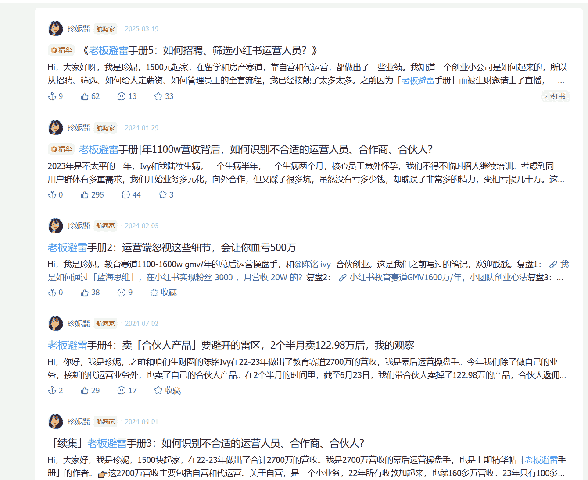

## 二、为什么是现在：三个趋势，和AI从"工具"到"员工"

这个窗口不是凭空出现的，而是三股趋势恰好叠在同一个时间点——理解这三股力，你才明白为什么是"现在"而不是去年：

1. **需求侧：所有老板都被AI焦虑推着走。** 以前是"需求一直在，但没人有意识去解决"——老板知道客服慢、数据乱，但觉得"一直这么过来的"，没动力改。现在不一样了，满屏都是AI，老板怕被同行甩下，主动想接AI，反过来逼自己重新梳理业务流程。需求第一次从沉睡被点着了，这意味着：你不用再费力教育客户"为什么要做"，他自己就有焦虑。

2. **供给侧：AI coding让开发成本暴跌。** 很多需求传统软件本来就能做，只是过去性价比太低、不值当——花两周写个小工具只能收几千块，没人愿意干。现在开发成本大幅下降，过去做一单要十分力气只能收一分钱，现在一分力气就能交付。门槛被打下来，普通人第一次进得来，这正是现在属于普通人的窗口。

3. **形态侧：AI从"工具"走向"AI员工"。** 它不再是挂在旧流程上的附加功能，而是能理解数据、甚至自主执行——整个业务流程开始围着它重新设计。这一步，才真正让企业愿意为它付"员工级"的价钱。

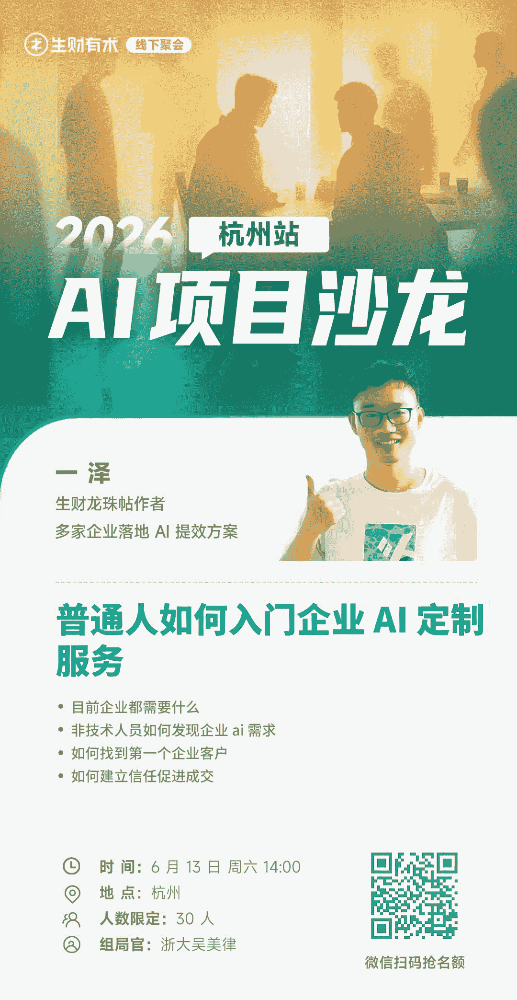

如果把企业用AI的程度分个层级，你会更清楚客户现在处在哪、下一步该往哪推。

- **L1 单点AI辅助**：用AI帮单个动作提效，但人还在主导。比如客服自己用AI生成一句回复话术、写写文案、做一段数据分析。
- **L2 单点自动化工具**：把一个重复动作彻底自动化，不用人盯。比如自动采集对标、自动处理表格、批量生成图文。
- **L3 业务工作流**：把多个单点串成一条线——采集 → 清洗 → 分析 → 生成 → 分发，一条流水线跑下来。
- **L4 Agent化**：AI能多步骤执行、跨系统调用、带长期记忆，只在关键节点留人工审核（Agent通俗讲就是"能连续自己干活的AI员工"，比如一个能自己判断阶段、自己回复、还记得住客户的客服Agent）。
- **L5 AI Native**：整个业务流程围绕AI从头重新设计，而不是在旧流程上外挂一个AI——这是终局，目前极少企业能到。

商业逻辑很清晰：从小工具，到流程，到Agent，再到业务重构。

但要清醒——越往上走，脏活累活越多：做到Agent层级就需要数据支持，而本地数据散落在PDF、Word、Excel甚至手写笔记里，光把这些清洗成机器能用的规范数据，就是一道大坎。

所以普通人一开始接企业定制一上来就做L4、L5，这个故事讲起来就很空，需要依赖的东西太多了。

从L1、L2起步，低成本让老板先看到效果、尝到甜头，再一层层往上推到AI Native。

毕竟对于刚接触信任度没那么高的上来就做万元高客单的AI Native，老板肯定是不放心的，做几个小工具，马上能看到效果。

但是从长远看，软件不仅仅是软件，如果你跟老板说做一个软件这个还是把你当成卖软件的，但是软件只是一个初期阶段，软件是可以做成CLI来接入Codex的，所以如果后面做Agent的话可以用Codex去调用这个软件的CLI去实现这些功能，联动其他软件的。比如，Codex执行完好评导出后可以拿到这些数据去做成一份分析汇报，做成一连串的动作而不只是单点。

再进而到AI生成一个内容管理系统，这个网站看起来很专业，实际上是用GPT出图的，但是作为演示给老板想象力是够用了。

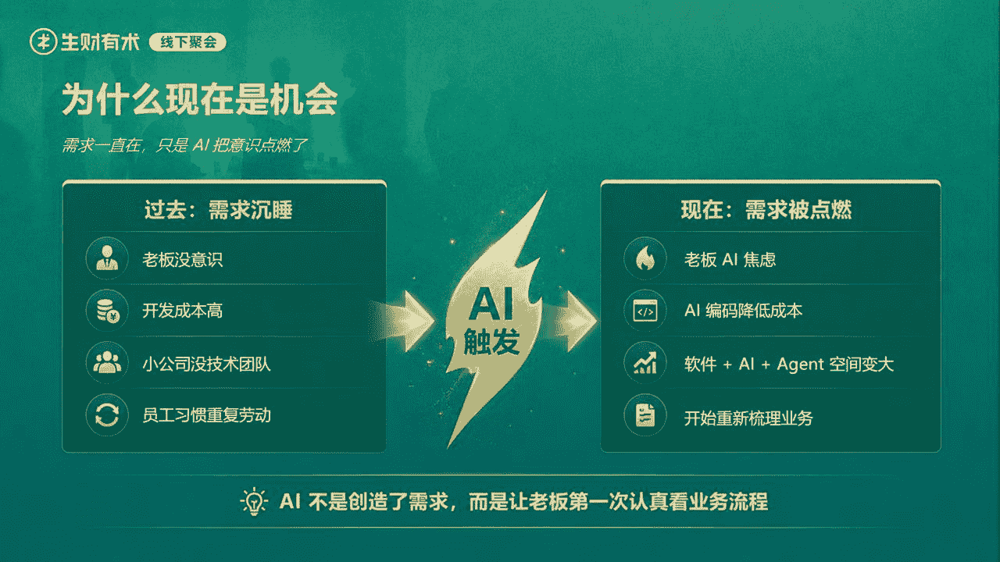

## 三、企业到底为什么付费：企业从来不是为AI的酷炫付费，而是为看得见的效果付费

### 流量角度

获客、成交、人效、经验沉淀，企业最愿意为哪个掏钱？

这四个本质上都为"利润"服务，但优先级差别极大——越靠近"把钱赚进来"，老板越愿意付、付得越爽快。按这个排序理解，你就知道报价时该把方案往哪靠。

- **获客（最直接、最焦虑）**：流量稀缺的时代，老板最焦虑的就是客资从哪来。一个企业能活下来，说明它的获客、成交、后端已经初步成熟；老板要的从来不是维持现状，而是十倍放大，而放大最依赖获客。
  - 例子：获客端最直接的就是用Claude + Obsidian知识库去批量产出文案，这个大家应该也看到很多了。

- **成交**：客资进来后，能不能接住、转化掉，就是成交。这里AI的价值很直接——响应速度越快、话术越稳，客户对你的信任和决策认同就越高，转化和复购自然往上走。
  - 例子：电商平台的AI知识库的行业自动回复越精准，用户的体验感越好，成交率也越高。

- **人效**：老板在意省人，但要讲对——他更愿意为"同样的人做出更多业绩"付费，而不是单纯"省掉一个人的工资"。后者价值有限（省一个客服一个月就几千块）；但如果一个员工本来能上架20个品，现在能上架100个品，这就不只是降本，而是增长能力——本质又回到了成交端和获客端的放大。所以聊人效时，可以把它翻译成"多做多少业绩"，而不是"裁掉几个人"。

- **经验沉淀**：信息越发达，大家看到的东西越千篇一律，AI写出来的也都是"全网通货"。想获客就得写出不一样的东西，而"不一样"只能来自你在垂直行业里沉淀的真实经验——这是GPT给不了的，也正是你做垂直行业、攒行业know-how的长期价值所在。

四个维度，最终都为"获客—成交—利润"服务。报价之前先想清楚：你卖的这个东西落在哪一端、能不能指向老板的增长、这笔钱怎么算得回来。

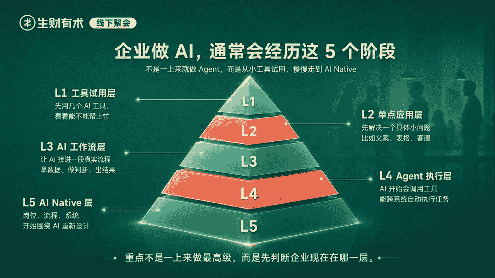

### 下单角度

前面挖需求、做Demo都是铺垫，真正让老板当场动心、甚至当场就想拍板的，往往就是一个瞬间——你当着他的面把软件/Agent跑起来，让他亲眼看着一堆乱七八糟的原始数据，"唰"地一下变成他每天想要的那个结果。这一下，比你讲一百页方案都管用。这才是整套打法里最该被放大、却最容易被忽略的"成交核武器"。

比如这个视频号批量下载，老板能看到眼前的效果，就能知道视频下载转文字分析拆解链路能马上提效。

为什么这个瞬间这么有杀伤力？

- 老板对"过程"和"技术"无感，只对"结果跳出来"那一刻有感。
- 你跟他讲架构、讲模型、讲prompt，他眼神是放空的；但当他看到自己公司那张乱糟糟的原始表、那一堆杂乱评论，几秒钟后自动变成一张干净的日报、一个清晰的差评原因榜，他会"咦"地一下坐直——因为那一刻，他第一次"看见"了AI真能替他干活，而不是听你说。
- 它把抽象的"AI能力"瞬间翻译成了具体的"我的业务结果"。老板买的从来不是AI，是结果。而这个瞬间，就是把他要的结果直接拍在他脸上，省掉了所有解释。
- Agent比单点工具更震撼，所以特别适合当"钩子"。单点工具是"我点一下、它出一个结果"；Agent是"它自己一步步把活干完"——你看着它自己读数据、自己判断、自己生成、自己往下一步走，那种"它真的像个员工在自主干活"的画面，对老板的冲击力是最强的。这也是为什么哪怕第一单落地靠的是软件，开场拿Agent来演示、来勾起老板兴趣，往往最有效。

## 四、我们收钱的依据是什么

先把这件事的本质说清楚：我们做的从来不只是"软件定制"，而是"业务咨询 + 软件/Agent落地"两件事捆在一起卖。初期会容易把自己定位成"接单写AI agent软件的"，于是只能按代码量收钱、还特别容易被比价压价。

但真正值钱的那一半，是前面的流程梳理——陪老板把业务流程从头到尾过一遍、找出卡点、设计出到底该怎么改。这一段是咨询、是洞察，是外包不出去的，也最难被替代。

所以整套业务可以拆成前后两段，缺一不可：

- **前半段 · 业务咨询（流程梳理 + 需求诊断）**：深入行业，把老板的业务流程一段段拆开，找到哪里卡、哪个环节值得上AI、改完能带来什么结果。这一段哪怕一行代码都不写，本身就能单独收一笔咨询费，而且它是后面所有落地的入口——诊断做得漂亮，开发单自然就落到你手里。

- **后半段 · 软件/Agent落地（把方案变成能跑起来的东西）**：把诊断出来的方案做成小工具、工作流或Agent，真正嵌进他的业务里跑起来、出结果。前面讲的"原始数据 → 目标数据那一瞬间"，就是这一段的高光时刻。

两段最好打包：只有咨询、没有落地，老板觉得你"光说不练"；只有落地、没有咨询，你就退化成按行数计价的廉价代码外包。把两段捆在一起，你卖的才是"既懂业务、又能落地"的完整能力——这也是你能溢价、能持续接单、不被轻易替代的根本。

四个变现产品类型（由轻到重，这是按"你和客户关系的深浅"分的，也是一条逐步加深、客单价越走越高的路径）：

1. **需求诊断服务（AI咨询）**：不写一行代码，先帮老板把整条业务流程过一遍，指出哪些环节能接AI、预期能提升什么。它有两重价值——既能单独收一笔咨询费，又是后面所有项目的入口：诊断做得漂亮，老板信了你，开发单自然就落到你手里。新手尤其该重视这一步，它几乎零成本、零风险，还能筛出真愿意付钱的客户。

2. **单点工具开发**：针对一个具体痛点交付一个小工具。（小程序、网页、自动化工具等）交付快、风险低，是攒案例的主力，也是验证"这个老板愿不愿意付费"的最好方式。

3. **工作流解决方案**：把多个单点串成完整流程（采集→处理→分析→分发）。单价明显抬高，而且因为嵌进了客户的业务里，更难被替换——客户一旦用上就离不开。

4. **行业知识库**：终极高客单。把整个行业沉淀成资料库 + 话术库 + 客户跟进系统（SCRM），封装成一个行业通用Agent。一旦做成，你拿到的就不再是一个老板的钱，而是整个行业老板的客资。

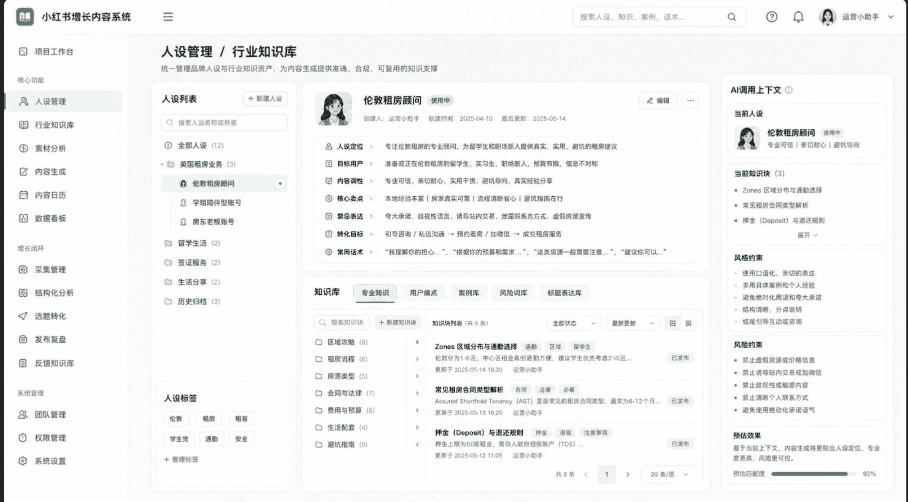
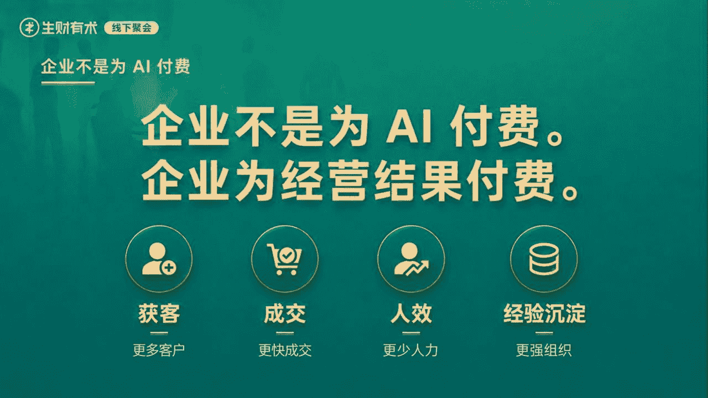

## 五、实战案例库：这是我自己交付的一类单子，也是最适合新手起步的形态

### 抖店飞鸽导出工具

先讲场景：这家电商公司每天会收到大量评价、追评和售后工单，售后得把多个抖音店铺的中差评一条条导出，用workbuddy分析每条到底卡在什么原因上——物流慢、质量问题、尺寸不符、还是客服态度差，然后统计出"今天差评最多的是哪几类原因"，汇总成一份报告给老板看。

听起来不复杂，但量一大，一个人每天要花一两个小时逐条读、逐条归类；还容易漏，非常消耗时间。

- **AI改造点**：把"原始评论 → 原因日报"整套处理自动化——重新做了一个UI界面，客服直接选择店铺导出对应日期的评论表格就好了，不用再十几个店铺选择日期一个个去导出了。再加入AI分析就能拿到想要的表格结果。
- **节省指标**：售后每天读评论 + 归类的时间从1-2小时压到几分钟，差评原因当天就能看到；某个批次的质量问题、某家物流的延迟，当天就能被揪出来、当天就能处理，而不是拖到月底复盘才发现。

我传了一个模拟器，感兴趣可以体验下，随机增加几个店铺，点击就可以导出一批随机信息。

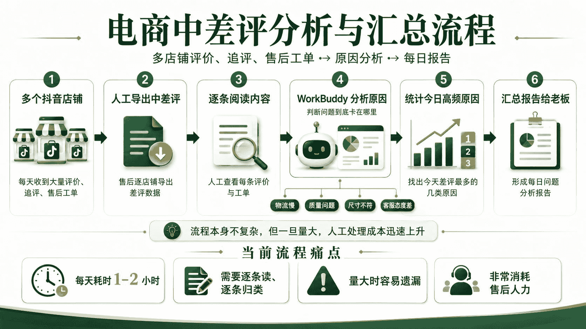
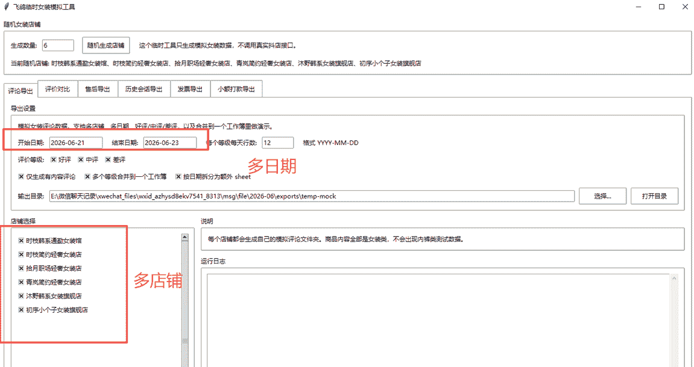

### 通用小红书采集系统

做小红书线上获客的生意，几乎绕不开一件事——研究对标账号。看同行的爆款笔记、扒好的封面、抄好的文案，这是每个团队每天都在干的活。

但真正动手做的人会发现，全是断点：

- 采集软件能拿到的信息太少，基本只有标题和正文。最可惜的是评论区——大家都没意识到它的价值。真需求往往藏在评论里，用户在评论区说的"想要什么、纠结什么、踩过什么坑"，比正文更值钱，可现在根本采不全。
- 想同步进飞书，难。能直接导入飞书的工作流可控、但数据量太小，喂不饱。
- 想沉淀成本地知识库，更折腾。先转Markdown，转Word，来回倒腾好几遍，每多一步就多一个断点，全是精力的无谓消耗。

流程特别碎，完全可以做一个一键式处理方案：从采集（包括图片、完整的一级评论、二级评论）→ 一键导入飞书/直接生成本地Obsidian知识库，中间所有的格式转换、断点全部打通，让"研究对标"从一件耗精力的体力活，变成点一下就完成的事。

- **结果**：把"采集 → 沉淀"从纯人工变成一键完成；而且能按不同老板的需求定制——比如我给穿戴甲老板温盈做的不是采文案，而是把每一张成品图打开自动播放，用来训练新员工的审美和手法。
- **付费理由**：采集是后续所有内容创作、对标分析的地基。地基自动化了，后面写文案、做选题、做本地知识库才跑得起来。
- **可复制**：几乎所有做内容获客的行业——服装、美妆、本地生活、知识付费……只要靠内容获客就需要它。

这个采集器我也做成了CLI。这样Codex可以把采集器当成API去调用做采集，然后拿到笔记后去做下一步的处理。自己开发所有的软件都可以做成CLI当成skill的一个环节来用。

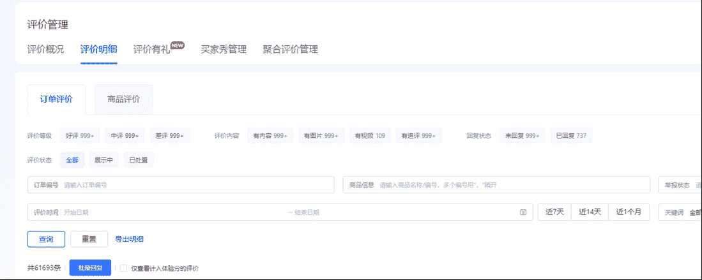
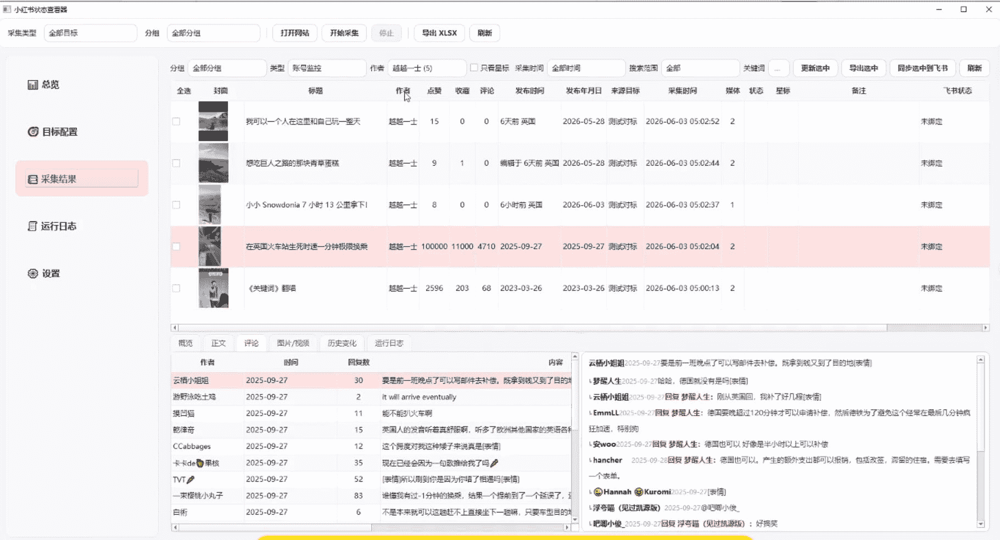

### 抖音千川投流视频批量混剪

目前我们公司上传的素材量远远不足，但是在人力一定的情况下要把已经拍好的素材二次利用，就可以用Codex去做批量混剪。

所以需要对剪辑好的原始视频做语音转文字后按语义切片出100个3-6秒的碎片视频，再让Codex根据语义做拼接、去重。

| 切片前 | 切片后 |
|--------|--------|
| 27个1分钟原始视频 | 100个左右的3-6秒的碎片视频 |

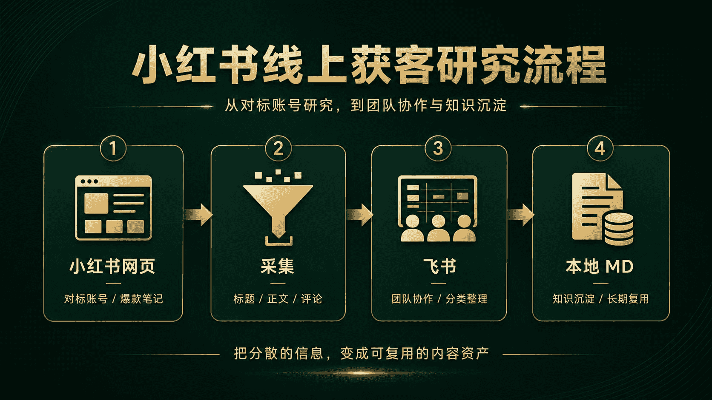

公众号懒人搜索，懒人专属群分享

切片后的表格，Codex 再重组视频的时候，就是根据表格的文案、时间和语义标签去识别，做一个新视频用哪些片段做开头、哪些做中间。

素材的拆解重组。加入 BGM，原声过渡可能会不太一样，但是加入 BGM 好多了。

目前演示的切片量比较少，切片量越多整个语义过渡越自然。

### 消防行业 AI 视频获客

这个案例我想重点讲，因为它说明的不是“技术”，而是“洞察怎么直接换来信任和订单”。

- 痛点：一个做消防的老板，一直在发短视频获客，但发出去的内容只吸引来同行围观，带不来真正的客户线索——钱和精力花了，客资是零。
- 改造点 + 结果：我没给他做任何东西，只是基于对他行业的理解，回了三句话——讲清楚“爆款视频的底层原理，具体到消防这个行业该怎么结合”。就这三句，他立刻就动了做定制的念头。
- 这就是洞察的力量：你对他行业理解得够深，快速让老板觉得‘这人懂行’；信任是跟着洞察来的，不是跟着代码来的。

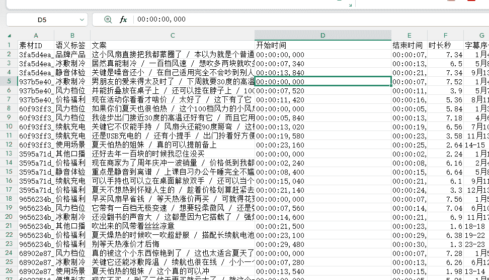

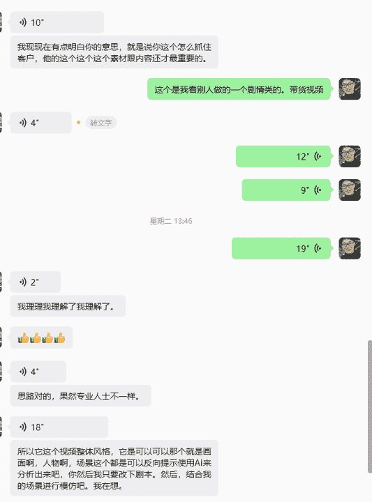

### 旅游行业 Agent（高客单、强壁垒）

这是路径的高一层，也是从“接单”升级成“产品”的样子。然后卖给垂直行业的老板。

这个是生财上海圈友陈六哥老板做的项目
https://mp.weixin.qq.com/s/1qNvzX1HMYA2AnL75_5kfw

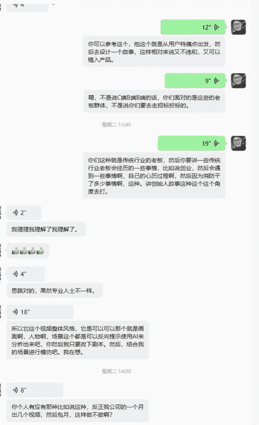

- 怎么做：把 TikTok 和小红书的数据采集能力开放成一个网站（一个可对外的系统），让整个行业的同行老板都来接入这个 Agent，再结合各自的私有数据生成文案。也就是说，你做的不再是“给一个老板交付一次”，而是“搭一个所有同行都要用的基础设施”。
- 商业意义：只要先跑出一两个标杆案例，就能把它卖给整个行业的老板——你拿到的不再是一个客户，而是一整条赛道。

这就是从一次性定制走向可复制产品的质变。

自媒体天天吹 Agent，但是客户不一定需要。还没梳理清晰流程的话会让客户感到很大的压力。先看业务落在哪一层、卡在前端还是后端，再选技术方案。

## 六、实战案例库对应的需求的大方向

所有需求拆到底，无非三个方向。它们对应企业价值链上的不同位置，付费意愿也依次递增——理解这个排序，你才知道精力该压在哪、报价该怎么分档。

1. 信息采集与处理（后端）：售后、运营、财务的数据整理，前面的电商表格、小红书采集都属于这一类。它门槛最低、入门最快，是大多数人的第一单切口，做起来也最稳。但要清醒：它主要解决的是“员工提效”，老板愿意付费，但不会为它兴奋，也给不了高价，除非是个很大的系统。所以这一类小工具更适合普通人用来攒案例、建信任、打开一个客户的门，而不是你高客单的主战场。

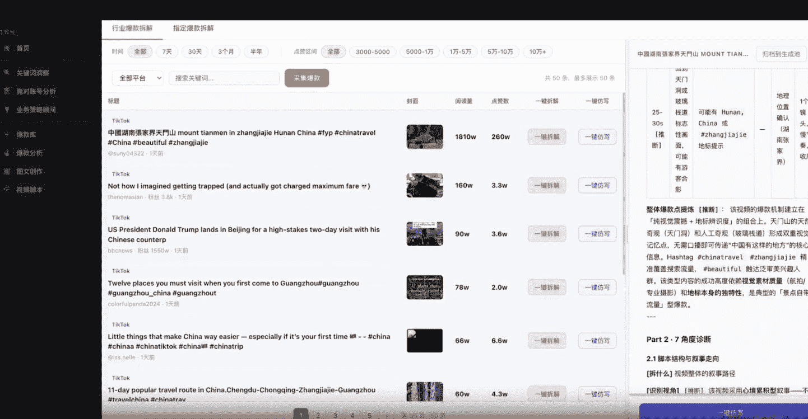

2. 关键提效（中端）：直接卡在影响成交的环节，比如图纸报价提速、留学资料自动提取、汽配型号识别。它的价值是“把一个拖慢成交的瓶颈打通”——离钱更近一步，老板的痛感明显更强，付费意愿也明显高于纯后端整理。这是你做出第一批案例后，往上走的主力地带。

3. 流量获取（前端）：直接服务老板最关心的“扩张”——更多客资、更高转化。这一类付费意愿最强、最容易溢价（老板为获客掏钱从不手软）。但它也最难交付、最不能乱承诺——“带来多少客资”，能不能带来客资，从来不是单一工具决定的，它是整套交付的结果。

越靠近“获客—成交”，老板越愿意掏钱；圈友早早的这个帖子的老板的扩张理论给了我很大的启发
https://scys.com/articleDetail/xq_topic/82255255281881222

## 七、服务谁：把重心放在小 B

选对客户群体，比单点的交付技术更重要——鱼塘选错了，钓鱼技术再好也钓不上鱼。

- 大 B / 政府：预算确实高，一个项目几十上百万。但流程极重——老板 → 组长 → 总监层层对接，一个决定要过五六个人；配合度还低，你要的数据、要见的人，处处卡。更关键的是，他们自己有程序员、也会考虑自建团队，个体很难真正切进去。唯一的钥匙是“你已经有成熟案例、能让他一眼看到效果”——否则光是走完决策流程，就能把一个个体户耗死。而且就算做完了，什么时候打款也不确定。

- 小 B（我现在卧底的这家百来人公司就是典型）：公司里全是剪辑、编导、售后、财务，没人懂技术、没人懂 AI，从前端获客到后端结算每个环节都想提效，高度依赖外部——老板今天觉得行，明天就能打款，不用层层审批。这就是小 B 最舒服的地方。

- C 端：业务不一定稳定，付费意愿很纠结，更愿意自己做，但是业务稳定的 C 端用户是很愿意花钱买成熟解决方案的，这个不确定性比较大。

但别把“小 B 一个月 3–5 万”当成普遍规律：小 B 内部差异极大，有的老板 3000 块都嫌贵，有的能爽快掏 10 万。真正决定能不能成单、能成多大的，不是公司规模，而是几个问题——老板能不能直接拍板？需求是不是卡在获客 / 成交链路上？是不是高频重复发生？只要这几条满足，几万级的项目就有机会；而且这类客户一家做透，几乎能原样复制给一堆同类公司，这才是小 B 真正的价值。

小 B 是这门生意落地最好的起点：需求强、决策快、能复制。但记住——真正的筛选标准是“现金流 + 决策权 + 离收入近不近”，公司大小对普通人没意义。

## 八、企业业务怎么开始落地 AI

这里有个很现实的人性问题：如果你直接让老团队接 AI，他们配合度不一定高、对他们来说了解 AI 是增加工作量的，要去熟悉一个新软件，本来日常工作压力就大了，把精力分散了说不定已有的基本盘就掉了。还影响企业的命脉。

我亲历的一幕：我给一个编导装好了 Codex，跟她说：“你把平时干的活丢进去聊聊，看能不能挖出点能提效的东西。”

她坐下来，看了一会。然后抬头看我，说她不知道要问什么。

那一刻我才反应过来：对一个从没见过 AI 能干什么的人，一个空白的输入框不是解放想象力，是懵逼。

人只能开口要“自己想象得到”的东西。你能向 AI 提出一个需求，前提是你脑子里已经有一张地图——知道它大概能做到哪、边界在哪。可对新手来说，这张地图根本是空白的。让他对着空白框提需求，等于让他描述一个他从没见过的东西。他不是不会用，是还没有“用它的想象力”。

这就是横在员工和 AI 之间真正的那道坎——不是操作门槛，是想象力鸿沟。你越是给他一个“全能但开放”的工具，他越无从下手；自媒体天天喊的“Agent 无所不能”，对他反而是更大的压力。

所以正确的切入顺序，是反过来的。

我先一步步引导她，把日常工作流程一句句讲出来，然后照着她的流程，直接给她做了一个现成的、带界面的小工具——她什么都不用想，点两下，结果就出来了。

她先尝到了甜头（哦，原来 AI 能帮我把这破事干了）→ 用顺手之后，脑子里那张“地图”开始长出来了 → 有新需求的时候她自己冒出一句“这里要是能再改一下就好了”。这时候我再把 Codex 交给她，她就不是对着空白框发呆，而是带着明确的“我要它干什么”去用。

切入 AI 的关键，从来不是“教员工用工具”，而是先用一个零门槛的成品，让他亲眼看见、亲手尝到“原来 AI 能帮我”，替他把那张能力地图建起来。地图有了，工具自然就拿得起来了。

先给结果，再给工具；先填想象力，再谈自由度。

## 九、挖需求的流程

- 别一上来就问“你想做什么功能”——他自己也说不清，问了往往得到一堆模糊或错误的需求。
- 先深入行业、做足功课：在沟通前就用 AI 把他的业务流程预跑一遍，预判出几个可能的提效点，再带着具体案例去“点”他。他被你一点中要害，才会“哦——对对对，就是这个”。前面那个消防案例，就是我对业务和老板有了了解才三句话就聊出意向的。比如我就会说我在电商公司在给财务、售后、剪辑的提效案例的时候，也可以顺势问下对方公司的流程是什么，他就会想自己的公司的岗位会不会有这个问题。
- 沟通时开录音，然后一步步往细里梳理：你的目标是什么 → 现在这件事的流程是怎么走的 → 原始表 / 结果表 / 中间要做哪些操作 → 具体要匹配哪些元素和字段。问得越细，方案越落地，报价也越有底气。
- 最后做价值排序：能直接提升成交的，优先级最高；能减人力的排第二（但记得要绑定到成交、翻译成“多做业绩”才好卖）；那些看着炫酷、但不直接来钱的，放到最后。永远把精力压在离钱最近的需求上。

## 十、从 0 到第一单：一条可执行路径

很多人听完道理还是不知道第一步干嘛。把它收成一条可以照做的路径：

1. 选一个你熟悉的行业——你自己懂的、或身边有人脉的。别贪多，越熟越好上手。
2. 拆 3 个高频痛点——高频是关键，越高频的事自动化后价值越大、越好复制。
3. 做一个小工具 Demo——能演示、能让老板“看到”效果就行，不求完美。
4. 拿 Demo 找 10 个同行老板同事聊——用真东西聊，比空口讲方案有说服力得多。
5. 收一笔低价诊断费或一个小单——这一步的目的不是赚钱，而是验证“他到底愿不愿意付费”这件最关键的事。
6. 做成案例，再去同类老板那里复制——第一单最难，复制最香。

去哪找这前 10 个老板？几条高性价比渠道：

- 自己行业的同事 / 同行：很多人还在用 Excel、根本没接触过 AI 工具，你可以带他们上手一把 WorkBuddy 的 AI 分析表格功能，（记得选择 DeepSeek 模型），让他们惊讶于能自动处理本地文件信息。
- 转介绍：成交率最高——有信任背书在，往往聊聊痛点就能直接进谈价环节，省掉大量建立信任的成本。
- 公域：小红书、视频号、垂直行业的圈子 / 群，持续输出就会有人主动找来。
- 公开拆解案例做教程：教程类视频比纯流量视频的信任度高得多，一定有人冲着“你懂技术”找上门。

第一单切口选小工具：难度低，不会陷进技术大坑——技术一旦卡住很难走出来，既耗时间又打击信心。先用小工具拿下客户，之后再找技术搭子接更重的活，你自己把重点始终放在获客和谈单上。

怎么避免被白嫖——一句话：要么获得钱，要么获得情绪价值。

如果有人一直夸你、想让你做、却舍不得付费，要警惕这是不是真需求——很可能他只是“想要”，但没强烈到愿意掏钱。不一定是真需求，你做完去展示，也吸引不到真正买单的客户，白搭进时间。所以最好要么拆解已有成功案例做教程，要么去做别人真正愿意付费的案例。

## 十二、技术 vs 行业洞察：到底什么才是你的核心竞争力

先把这件事讲稳：技术不是不重要，而是“单纯的技术”越来越容易被替代——AI coding 让写代码这件事本身越来越便宜，会写代码的人也越来越多。真正稀缺、真正值钱的，是能同时懂业务需求、懂技术边界、懂老板付费逻辑，并把这三者翻译成一个方案的人。技术是入场券，洞察才是护城河。

- 所以如果你不懂技术（比如你是做产品、做运营的），别自己硬啃 web coding（自己用 AI 写代码——只能做点小工具、还特别费时间）。直接找技术搭子，把你自己的时间全花在挖需求、谈单、做 IP 上，这才是你的高价值区。
- 但你必须懂技术的边界与风险：老板问你“这个能不能做”，你不能只会说“我回去问问技术”——那一刻你在他心里就掉价了。你要能当场给个初步预估：会遇到什么问题（安全性、数据能不能打通）、风险点在哪、大概多久。能聊到边界和风险，老板才觉得你靠谱、是内行。
- 分润怎么分：看你的野心。野心大，就把利润多分给技术——他拿得多，就会又快又好地帮你干；你负责先做出 Demo、再用流量能力到处去讲，IP 起来之后，项目和钱都会水到渠成地来。具体比例多问几个人（淘宝、闲鱼上都能问到行情）。
- 怎么找靠谱搭子：平时就多和程序员交流、多约线下一起写代码的局，用一些小问题、小活低成本地筛选——看他靠不靠谱、技术达不达标、聊不聊得来、交付准不准时。别一上来就把一个大项目直接压给陌生的技术，那样风险全在你这边，他压力也大。

## 十三、长期壁垒：从接项目到行业 Agent 的四个阶段

做企业定制，几乎一定会遇到一个问题：这个月接电商、下个月接留学、再下个月接制造——行业认知始终积累不下来，本质上和打工没太大区别，永远在用时间换钱。怎么破？答案是往“可复制的产品”走。但别一上来就想做行业 Agent，从普通人视角，它有清晰的、必须一步步走的四个阶段：

1. 接项目，赚现金流：先活下来、先攒案例。这个阶段别挑食，什么单子都接，目的是积累实战和口碑。
2. 沉淀 SOP：把每次重复的劳动变成标准流程（怎么挖需求、怎么报价、怎么交付），减少每次从零开始的消耗，效率开始提升。
3. 聚焦一个行业，做行业模板：开始收敛，在一个你最熟、最赚钱的赛道里反复打磨，把通用方案做成这个行业的专用模板。认知从这里开始复利——做得越多越快、越懂越值钱。
4. 升级成垂直行业 Agent：把数据采集 / 交付能力开放成一个产品（比如前面那个跨境旅游 Agent），卖给整条赛道的所有老板。

这最后一步的本质，是把“一次性的定制”变成“可复制的产品”：技术只要不出问题就不用你一直盯着，你能把绝大部分时间挪去获客和扩张。记住一个判断标准：一件事值不值得长期投入，就看它做完之后能不能被复用——能复用的才是资产，不能复用的只是又一次打工。

具体案例可以参考第五点实战案例库中的旅游行业 Agent。

天花板与突破：一个人做服务有明确的天花板——同时服务 2–3 家就到顶了，因为精力就那么多。想突破这个天花板，唯一的路就是靠垂直行业 Agent 把自己从交付里解放出来：技术交付外包给同类人，你自己只专注获客和经营产品。这才是从“高级打工”变成“老板”的分水岭。慢慢搭建团队。

## 十四、风险与合规

AI Agent 案例很多都涉及爬虫，需要注意风险边界。

- 微信自动化：只做聊天记录导出这一件事是安全的。但尽量不要做自动回复、自动加好友等自动点击操作——微信对这些查得极严，一个号被封，对客户来说损失客资非常巨大。

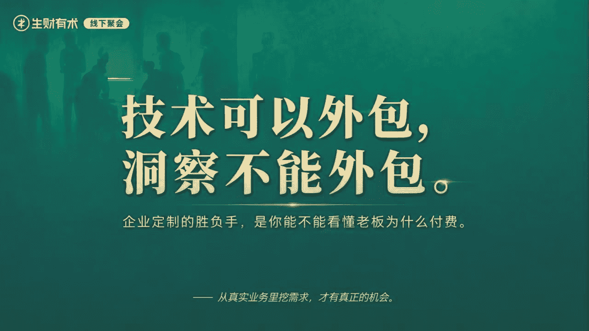

- 小红书：别做自动发布（“龙虾”那类工具出来后，平台封过一大波号）。采集可以做，但是要注意频率过快也会被风控。
- 数据安全：知识库这类高客单交付，绕不开几道硬坎：数据脱敏（客户的隐私数据不能外泄），对外问答系统的注入风险，如果这个 Agent 他有更改本地系统的这个权限的话，那么就可以直接帮你去把本地的东西给删除掉，获取你本地的信息，或者操控你本地的应用去做一些其他的事情。

所以企业定制的胜负手，不在“你会不会做”，而在“你懂不懂老板为什么付费”。

找一个行业 → 找一个老板 → 拆一条流程 → 做一个小工具 → 验证一个付费点。

先把这条最小闭环跑通，比什么都强。

欢迎交流讨论。

————分割线————

看完这篇 SOP，你觉得你懂了。但 90% 的人一到实操就会卡在第一步。

工具和教程只是最低级的壁垒，真正的壁垒是“立刻动手”和“圈层信息差”。

如果你想看全网最新的变现玩法，并且和一群执行力极强的极客一起下场拿结果，欢迎围观我的核心私域：【懒人专属群】。

我们不聊虚的，只做商业闭环的拆解与 AI 效率的压榨。系统内已沉淀 1000+ 跑通的套利实战局。

👉 查阅圈子完整数字资产与上车门槛：

https://lazyso.com/insider/

认同价值、准备好下场干活的，扫码加我微信（lazyhelper1）

备注：【实操上车】，不闲聊

