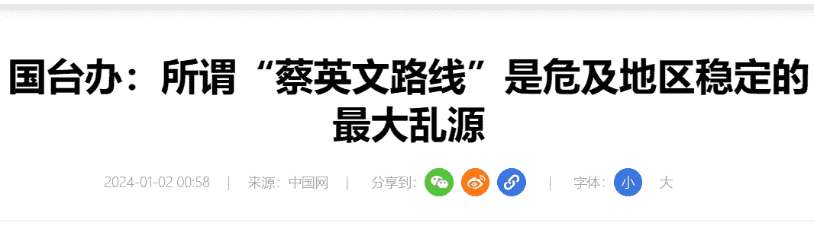

公众号懒人搜索，懒人专属群分享

## 如何应对赖清德的“蔡英文路线”

260629 印闲生

整理：公众号懒人搜索，懒人专属群精选

懒人微信：lazyhelper1

细心的朋友会发现，在本次台湾地区领导人选举中出现了一个新名词——“蔡英文路线”。

三位候选人中，赖清德明确表示自己将延续“蔡英文路线”，柯文哲也称两岸政策会依循“蔡英文路线”，只有国民党方面对其予以驳斥。

“蔡英文路线”本质上是冷脱钩，在不刺激大陆发起军事行动的前提下，逐渐远离基于终极统一或维持现状的两岸关系发展轨道。

对此，苏起先生曾有过生动的回忆。

苏起和蔡英文同为李登辉时期的两岸事务官员，也是一前一后的台陆委会主委。

2000 年岛内政权轮替之际，苏起向蔡英文交接陆委会工作，二人聊天时，蔡英文讲了一句话——“从今往后，‘台独’我只会做，不会说。”

公众号懒人搜索，懒人专属群分享

这一指导思想贯穿于蔡执政的八年，她明面上没有讲过“台独”两个字，也不去碰法理“台独”的红线（对比陈水扁），正式场合还发明了“中华民国台湾”这样蓝绿结合的话术。

不过私底下，蔡当局该做的去中国化操作一样都没少，地缘政治领域更是前所未有地向美国靠拢。

那么岛内民众究竟是如何看待这条“静悄悄的台独路线”的呢？

事实很残酷，投票结果表明，国民党以“战争与和平”为基础的两岸政策并未引起广泛共鸣，反倒是声称坚持“蔡英文路线”的两位候选人一个当选、一个得票超过预期。

这样的结果让强调“九二共识”可以保两岸和平的蓝营黄金论述变得奄奄一息，不排除国民党再次向它开刀。

究其原因，主要是国民党很难说服民众“蔡英文路线”真的将引发战争——岛内民众会认为过去八年事实上就是没有爆发战争，最激烈的时刻无非是围台军演而已，甚至连马英九时期签署的 ECFA，北京也没有动。

————分割线————

2022 年 8 月佩洛西事件后的围台军演在大陆同胞看来已经非常“屏气凝神”，但绝大部分台湾人并不在意，他们笃定北京不会发起军事行动，这种心态在《幸运的台湾》一篇中有过详细探究。

OK，问题来了。

站在北京的角度，在反对法理“台独”已经取得阶段性胜利的情况下，该如何有效制约“蔡英文路线”呢？又会如何评估接下来的四年呢？

为了回答这两个问题，我们先回忆一段历史故事。

原子弹研发成功后的很长一段时间里，美国相对其他国家拥有巨大的不对称威慑优势。

于是美国战略界便萌生了一种想法，即通过拥有强大的核武装力量，并向对手展示使用这种力量的决心，让对方不敢轻举妄动，最终实现战略目标。

然而理论归理论，实操起来美国人很快发现原子弹威慑不怎么好用。

像五十年代的朝鲜战争、1954 年台海危机、1958 年台海危机以及越南战争等，美国均多次公开宣称考虑使用核武器，但并没有达到预期效果。

六十年代的美军参谋长联席会议主席泰勒一针见血地指出：威慑理论走入了死胡同，它只给美国提供了两种选择，要么发动全面核大战，要么在一场局部战争中向苏联投降。

泰勒的观点得到肯尼迪总统高度赞许。

自六十年代中期开始，核战略在美国国防体系中的地位有所降低，美军开始针对军事封锁、常规战争、核战争、地区冲突以及世界大战等不同场景设计各种层级的对抗手段，总统的“工具箱”逐渐丰富起来。

蔡英文与麦卡锡。左一女子为赖清德的副手萧美琴，时任台驻美代表。

回到台湾的话题。

法理“台独”是一条不可逾越的红线，这一点岛内已形成共识，所以蔡英文任内没有触碰。

与蔡相比，赖清德自从政之初就广受岛内独派资助提携，当选后不排除其发表一些极端言论来安抚深绿力量，但实际推动法理“台独”的可能性同样很低。

不过在红线之外，台湾的空间正越来越大，比如接待各个层级的西方到访官员，出席民主峰会等西方主导的国际活动，以及越来越大胆的对美军事采购。

这种空间是美国刻意给的，近年来美国台湾政策的核心就是尽可能地赋予其“名分”，在西方世界内部把台湾摆到一个与其他主权国家平齐的地位，为日后可能的介入做政治和舆论铺垫。

在蔡英文和赖清德没有推动法理“台独”、美国仍表面上坚持“一中政策”、美台之间没有建立正式外交/军事关系的情况下，大陆短期内不会也没必要激活非和平手段。

此时大陆的困境正如当初手握核武器的美国一样，除了万不得已才能使用的底牌（军事手段）之外，没有各个层级的应对手段，只能忍受对方的“切香肠”战术。

到这里，答案其实就呼之欲出了——在《反分裂国家法》之下，需要尽快构建完整的、层层递进的、赏罚分明的新工具箱。

如何丰富这个新工具箱里的各项工具，以及在不同场景下怎样使用它们的组合，将成为接下来对台工作的当务之急。

蔡英文与佩洛西。“蔡英文路线”完全配合了美国不断掏空“一中政策”内涵的切香肠做法。

文章后半段，让我们探讨另一个话题——如何评估接下来的四年。

所谓评估，无外乎“好处”与“代价”，《收复台湾的影响》一篇中主要谈了收台的好处，那与之对应的代价又会是怎样呢？

以俄罗斯作为参照，如果同样经历一场中等规模常规战争（不做全面动员），中国至少有以下几点不同的情况需要考虑：

- 地缘政治格局
- 美国应对决心
- 对外贸易结构
- 国家发展前景

地缘政治格局前文有过详细介绍。

五大地缘政治力量中，欧美是比较团结的一方，中、俄、印呈“V”字型结构，作为连接点的俄国比较适合冲锋在前，因为它能够最大程度上利用同中国和印度的关系。

目前的战略格局基本是“美欧”对“中俄”，印度保持中立；如果换成中国挑头，将成为“美欧印”对“中国”，俄罗斯保持中立，中国身上的压力显著增大。

换言之，和平发展场景下中国的外部环境比俄罗斯好，但极端场景下俄罗斯所处的外部环境其实比中国要好。

一位中亚学者这样分析道：

正当北京决心破釜沉舟与华盛顿一决胜负时，克里姆林宫却敏锐地察觉到美中“伟大变局”即将带来的历史机遇，凭借地缘优势，为复杂多变的美中战略博弈增添柴火……

莫斯科试图为中国量身定制出一条通往新冷战的辉煌大道，让中国在“大国崛起”的过程中全身心体验一番苏联走过的、腹背受敌的全球性围堵与区域性对抗之路。

欧洲大国竟然在俄罗斯吞并克里米亚后帮助普京达成了《明斯克协议》，足见其内部亲俄力量之强大。只不过欧洲担保方德国和法国没有力量摆平问题，俄罗斯想彻底控制顿巴斯地区，乌克兰鹰派想收复失地，美国跃跃欲试训练乌克兰军队……这才导致了协议破裂。

第二，美国的政策分歧。

俄罗斯 2023 年底的内外形势之所以发生积极改观，除了前线俄军成功挫败被西方寄予厚望的乌克兰大反攻外，另一个重要原因是美国众议院落入了共和党手中。

某种意义上讲，普京在华盛顿是有“强力帮手”的，很多重量级共和党政治人物都对援乌提出了质疑。

于是我们看到，普京政府的策略是专打民主党，暗中配合共和党。

比如最典型的 2022 年赫尔松撤军问题。

当时身处第聂伯河右岸险地的俄军已十分危险，但莫斯科一直坚持到 2022 年 11 月 9 日才宣布撤军。

因为 11 月 8 日是美国中期选举投票的日子。

假如在此之前让乌克兰取得这一关键战果，无疑会给主张援乌的民主党选情加分，所以俄罗斯咬着牙挺到了中期选举投票结束，一天都没耽误。

事实证明，俄国的做法起到了效果，随着中期选举后众议院被共和党掌控，拜登政府想要通过 2024 年度的援乌预算变得异常艰难。

而在即将到来的美国大选中，类似的操作肯定还会有，不排除俄军于选前某个时刻集中兵力打一场焦点战，给拜登和民主党难堪。

2017 年德国汉堡 G20 峰会上，特朗普与普京上演备受国际瞩目的“双普会”。期间两人如何握手被媒体仔细检视，一位媒体记者这样说道：“安倍晋三得到的是霸主式握手，默克尔得到的是在镜头前被拒绝握手，普京得到了双手紧握（注：特朗普一只手扶着普京的小臂），还有充满意涵的拍背。”

普京可以充分利用美国国内的对俄政策分歧，但中国不行。

因为民主、共和两党在对华问题上意见高度一致，相较来说民主党还要温和一些。

不难猜测，一旦发生牵扯到中国的代理人战争或局部战争，美国下注的决心与力道会远大于当下，不太可能短短两年就发生动摇。

以台海为例。

美国精英对于台湾得失的利害有着统一的清醒认识，分歧主要发生在普通民众和决策精英之间——前者比较难感受台湾对美国的重要性，毕竟民意有时是短视的。

站在中国的角度，想要利用美国民意变化来约束华盛顿的政策既困难又缓慢（在两党意见一致的情况下，民众的投票权并不能发挥作用），远不如俄罗斯那般立竿见影。

美国国会议员在做围绕台海的兵棋推演，2023 年 4 月。中国议题已成为极少数能够“团结”民主、共和两党的议题。

第三点不同：对外贸易结构。

根据美国能源情报署的相关数据，2011 至 2020 年间，油气出口占俄罗斯财政收入的比例高达 43%，2021 年油气出口更是占了俄当年财政收入的 49.86%，堪称俄国的命脉。

截至 2021 年，俄罗斯生产的石油和天然气仅三成用于本土消费，七成用于出口，油气出口占总出口的比重接近五成。

长期以来，俄罗斯的能源政策与其外交和国防政策都是相互影响，甚至互相绑定。

因为这种特殊的对外贸易结构，使得只要俄罗斯的油气能够找到买家，其外贸和财政就有了基本盘。

反过来看，打蛇打七寸，如果西方能够完全掐断俄国的油气出口，则可以将普京政权逼上绝路。

那么西方的制裁效果到底如何呢？

很不好。

过去两年间，在除西方国家以外的几乎所有地方，大家都受益于购买打折的俄罗斯能源，想要切断能源交易在政治和现实层面均十分困难。

俄罗斯 2023 年的油气出口收入达到 9 万亿卢布，虽少于 2022 年，但与 2021 年基本持平。

俄罗斯石油出口价格（蓝线）与布伦特原油价格（红线），二者正逐渐趋近。俄政府预算基本是按照油价 70 美元/桶设计的，如果明显低于该价格，会对俄财政造成巨大影响。

俄罗斯出口石油的“折扣”正越来越低，说明其受到的压力越来越小。

与作为硬通货的大宗能源不同，中国出口货物的可替代性相对较高。

实际上，中国正处于产业链爬坡的关键阶段——前面有欧美日韩的堵截，后面有东南亚和印度的追赶，本身压力就很大，或者说很脆弱。

以新能源汽车、锂电池和手机为例，它们高度受关税政策、技术制裁等因素的影响，周边一堆竞争厂家虎视眈眈。

再退一步讲，汽车和手机属于消费品范畴，但能源却是刚需。

消费品、特别是高端消费品，必须依赖欧美发达国家的广阔市场，而作为刚需的油气能源哪怕只剩下发展中国家市场，也足够。

即站在阵营对抗的视角上，俄罗斯的主要出口货物可以做到“内循环”，中国则不行。

————分割线————

2018 年开始，俄罗斯的国力进入了明显的“下降通道”，养老金改革问题是其财务状况恶化的表象之一，普京的支持率从吞并克里米亚之初的 80% 几下降至 60% 几。国力进入下降通道会促使决策者产生“紧迫感”，从而引发军事行动。

最后一点：国家发展前景。

战争会在很大程度上打断国家的发展进程，这是最最重要的代价。

正如目前的俄罗斯一样，稳定可期，发展难谋。

对俄国来说，它的科技与工业水平早已被世界第一梯队远远落下，半导体和微电子、人工智能、量子信息技术、新能源等尖端领域的竞争根本没有俄罗斯企业的一席之地，普京只能“争当下”。

但中国不一样。

中国在扑面而来的科技革命中原本处于非常好的生态位，只要能够把宽松的发展环境再维持个二三十年，很可能诞生更多的奇迹。

放到经济学领域，这就是“机会成本”的不同。

环顾世界，中国面临的地缘政治环境是当今主要大国里最复杂、最具争议的。

一旦局势升温，很容易引发区域内的军备竞赛甚至核扩散，从而对亚太地区的和平发展产生不可逆的永久性破坏，而这正是竞争对手希望看到的事情。

某种意义上讲，美国越是想掏空/突破对台“一中政策”框架，就越说明中国的发展离实现统一目标已越来越接近。

行百里者半九十。

解决台湾问题最好的方法是将它放到中国现代化进程中进行整体考虑，战略定力应该是中国的制度优势才对。

————分割线————

在这个 AI 能替你写代码、写文章的时代，基础技能正在迅速贬值。绝大多数人正被淹没在海量的免费垃圾信息里，陷入低效的体力内卷。

当“努力”不再是壁垒，人与人之间唯一的护城河，只剩下“信息过滤”的效率与“认知系统”的维度。

圈子已稳定运行 7 年。我们每天利用 Python 爬虫与大模型算力，过滤全网最顶级的政经内参和搞钱风向标，做你最冷酷的“外部大脑”。

如果你认同这种“重塑认知防线”的极客主义，欢迎围观我的个人情报智库：【懒人专属群】。

https://lazyso.com/insider/

认同信息过滤价值、想省下每天 3 小时无效阅读时间的读者，扫码加我微信（lazyhelper1）。

