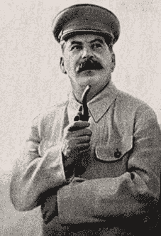
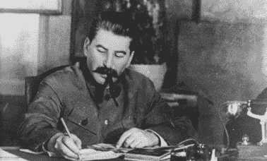
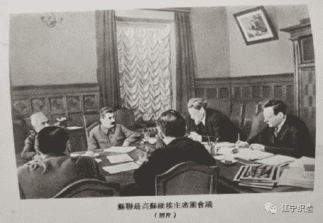
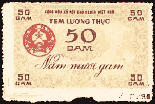
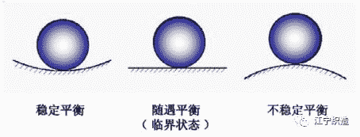
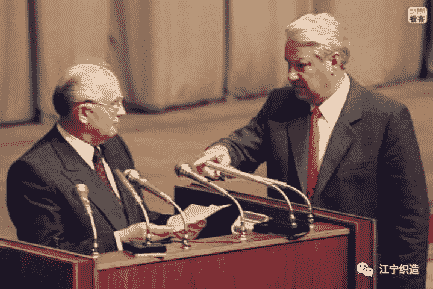
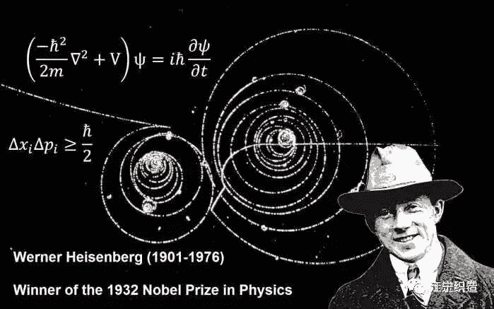

# 斯大林：克里姆林宫

260629 印闲生

整理：公众号懒人搜索，懒人专属群精选

懒人微信：lazyhelper1

身体是革命的本钱——这是一句不折不扣的至理名言。

很多朋友会想当然地认为列宁和斯大林是两代人，但其实他俩只差了八岁。

1917 年俄国十月革命成功的时候，列宁 47 岁，斯大林 39 岁。

满打满算，列宁只执政了四年多一点的时间，而斯大林却掌控苏联整整三十年。

斯大林在 1937 年拍摄的一张宣传照。即使在官方场合，他也不忘这个标志性的烟斗。

作为人类历史上的第一个社会主义政权，苏俄的一切都是崭新的。

新政权创立之初，苏俄高层形成了以列宁、托洛茨基和捷尔任斯基为“三驾马车”的领导团队。

列宁任人民委员会主席，即苏联总理。

托洛茨基任军事委员会主席，即苏联红军总司令。

捷尔任斯基任全俄肃清反革命及怠工非常委员会主席。

这个名字很长的委员会俗称“契卡”，也就是后来大名鼎鼎的克格勃。

1918 年 3 月，俄共（布）七大在彼得格勒（圣彼得堡）的塔夫利宫召开。

这是布尔什维克在十月革命胜利后第一次召开代表大会，会后苏俄首都由圣彼得堡迁往莫斯科。

俄共（布）七大上列宁遇到了很大的挑战，不是内政，而是外交。

苏德《布列斯特-立陶夫斯克条约》签订现场

就在大会开幕几天前，苏俄政府刚刚与德国签订《布列斯特-立陶夫斯克条约》，退出了一战。

条约中，苏俄割让了包括波兰东部、立陶宛等在内的近一百万平方公里土地。

这个付出巨大代价的停战条约是列宁在斯大林等人的支持下力主通过的。

托洛茨基、布哈林等大咖都持保留意见。

之所以列宁要签订这个“卖国条约”，目的自然是减轻苏俄新政权的外部压力。

风雨飘摇之际，活下去比什么都重要。

从对德和谈也可以看出，相对于托洛茨基和布哈林等人，列宁和斯大林是更偏向于“现实主义”的。

国家报仇，三十年不晚。

二战后，斯大林把俄国 1918 年割让的土地全部收回——连本带利。

1918 年的苏俄还发生了一件影响深远的事情，那便是扑朔迷离的“列宁遇刺事件”。

这一年的 8 月 30 日，列宁赴莫斯科郊外的米赫尔松工厂对工人发表演讲。

演讲完准备登上汽车离开时，一位名叫芬妮·卡普兰的女杀手朝列宁连开三枪，其中两颗击中列宁。

一颗子弹击中左肩，另一颗击中左胸并穿颈而过。

事件发生三天后，嫌疑犯卡普兰在未经任何公开审判的情况下被契卡（克格勃）执行枪决，给后人带来诸多遐想。

根据克格勃的口供，卡普兰承认自己刺杀了列宁，并表示无人指使，完全是个人所为。

列宁遇刺的故事在 1939 年版苏联电影《列宁在 1918 年》中有过生动演绎，广为流传。

电影《列宁在 1918 年》剧照

暗杀事件给列宁的健康带来了严重的影响。

由于当时的医疗条件无法安全取走子弹，导致从 1921 年初开始列宁便频繁中风，被迫远离一线工作。

历史有时候真的如“蝴蝶效应”一般。

两颗子弹，就这样改变了苏共高层的权力格局。

新诞生的苏俄政权面临着一场权力大洗牌。

节选自 1953 年版的《斯大林略传》

列宁遇刺后的第二年，也就是 1919 年，俄共（布）第八次代表大会召开。

按照《斯大林略传》的说法，斯大林自 1917 年开始便担任政治局委员。

不过公开资料显示，俄共（布）是在 1919 年的八大上才正式设立“政治局”这一机构的。

或许是之前内部就有类似的机构，只不过没有官宣。

这里我们不去细究。

总之，1919 年的俄共（布）八大上诞生了新一届的俄共政治局（仅五人，排名有先后）：

- 列宁 49 岁
- 托洛茨基 40 岁
- 斯大林 41 岁
- 加米涅夫 36 岁
- 克列斯京斯基 36 岁

俄共（布）早期的中央委员和政治局委员“含权量”都相当高，整个俄共（布）第八届中央委员会只有 19 人。

政治局五人除列宁外是“2:2”的局面，和几十年后的《苏共，1953》如出一辙。

加米涅夫是斯大林早期的铁杆盟友，有“拥立大功”。

克列斯京斯基则是正宗的“托派”。

另外还有三名政治局候补成员：

- 季诺维也夫 36 岁
- 加里宁 44 岁
- 布哈林 31 岁

二三十年代在苏联玩政治是一项极其危险的工作，存活率极低。

上面有名有姓的八个人中，勉强善终的只有列宁、斯大林和加里宁三人而已。

所以我们每次看苏联布尔什维克老照片，出来的合影就是他们仨在一起那张。

斯大林、列宁和加里宁，1919 年

熟悉苏共历史的朋友一般都清楚，列宁和托洛茨基既是战友，也有明显的分歧。

在早期的俄国社会民主工党中，列宁、斯大林等人是布尔什维克派。

而托洛茨基在 1904 年 9 月之前属于孟什维克派，后来才改投布尔什维克。

这俩派在革命理念上有很大的不同，具体我们不细究，总之就是逐渐发展到水火不容的地步。

1912 年的俄国社会民主工党第六次代表大会上，以列宁为首的布尔什维克派把孟什维克派驱逐出党。

所以之后的俄共都会加一个标识——“（布）”。

托洛茨基在十月革命中立下大功，被认为是“起义的钢铁灵魂”，人称“红军之父”，任最高军事委员会主席。

不过斯大林时代出版的苏联历史书中，这段常常会被略去。

节选自 1953 年版的《斯大林略传》。这种语言风格后来被朝鲜学去，写了一本比《斯大林略传》厚十倍的《金日成传略》。

托洛茨基这位同志在很多事情上是比较执拗的，加之早期出身孟什维克，使得 1919—1921 年间他与列宁爆发了一些分歧。

上篇的最后我们提到过，1919 年之后斯大林的主要工作其实是在外面打仗。

他历任苏联红军南方革命军事委员会主席、西南方面军政委等职，负责平定各地的叛乱。

此时由于列宁和托洛茨基产生分歧，所以前者决定重用斯大林来制衡后者。

这给了斯大林登上权力巅峰带来了一个绝佳的机会。

1922 年 4 月，苏共十一大召开。

由于列宁身体状态每况日下、已无力承担繁重的工作（1921 年底开始休养），所以上会决定选出一位新的苏共总书记。

在列宁默许、加米涅夫等人的力挺之下，斯大林成功上位。

原本政治地位在托洛茨基之下的斯大林，在名义上完成了对前者的反超。

同历史上的政治强人一样，一旦赋予了斯大林某个职位，他可以迅速地把“职权”变成“实权”。

在 1922 年 4 月后的短短一年间，斯大林羽翼迅速丰满。

1922 年 12 月中旬，列宁再次中风，之后他只能通过向妻子克鲁普斯卡娅递交口信的方式施加政治影响力。

其中最重要的一封口信是这样说的：

“斯大林同志当了总书记，掌握了无限权力，他能不能永远十分谨慎地使用这一权力，我没有把握。”

“斯大林太粗暴，这个缺点在我们中间，在我们共产党人相互交往中是完全可以容忍的，但是在总书记的职位上就成为不可容忍的了。”

“因此，我建议同志们仔细想一个办法把斯大林从这个职位上调开，任命另一个人担任这个位置。”

“这个人在所有其他方面只要有一点强过斯大林同志，这就是较为耐心、较为谦恭、较有礼貌、较能关心同志，而较少任性等等。”

——《列宁选集》第 4 卷：人民出版社，1995 年

史学界一般认为，列宁口信中提到的“这个人”，就是托洛茨基。

根据托洛茨基本人在回忆录中的记载，1922 年底列宁已与他完成和解，想共同换掉斯大林。

当然名人的回忆录都要辩证来看了。

不管怎样，至 1922 年底已经形成一股强大的反斯大林力量。

克鲁普斯卡娅撰写的列宁回忆录

面对列宁杀伤力极大的口信，斯大林一面低头认错，一面加紧收揽人心、巩固班底，为最后的决战做准备。

“口信事件”之后，斯大林对于接班产生了明显的紧迫感。

考虑到可能产生的政治风险，他开始亲自负责监督执行列宁的医护制度。

到后期，连妻子克鲁普斯卡娅想见列宁一面都很难。

正因如此，在二十年代的苏联政治斗争中，克鲁普斯卡娅始终站在斯大林的对立面。

有一点类似孙中山逝世后宋庆龄的角色，让蒋介石很难堪却又无可奈何。

后来有苏联笑话称，斯大林曾怒斥克鲁普斯卡娅：

“你再胡说，我就宣布你不是列宁的妻子！”

1923 年间，列宁因身体状况已完全中止政治生活。

少数派出身的托洛茨基虽然资历深厚，但毕竟不敌斯大林、加米涅夫和季诺维也夫组成的“三驾马车”。

政治就是这样，一着不慎，满盘皆输。

1924 年 1 月 21 日，伟大的革命导师列宁同志逝世。

克鲁普斯卡娅把列宁的遗嘱交给了苏共政治局。

在遗嘱中，列宁再次提到了更换斯大林总书记职位的问题。

不过列宁的遗嘱没有被公布于众，仅仅是在高层小范围内进行了传达和讨论。

面对遗嘱，斯大林“含蓄地表达”要辞去职务，被大家强势挽留。

谁都知道，列宁的时代已经结束了，克里姆林宫已经有了新的主人。

此后三十年间，斯大林稳坐江山，人挡杀人，佛挡杀佛，留下了一段波澜壮阔又极具争议的历史。

# 番外

小说《魔戒》中的至尊魔戒象征着最高权力，很容易让人着魔。

斯大林的正式履历中有过两次婚姻，育有三个孩子。

第一任妻子叶卡捷琳娜早在 1907 年便因斑疹伤寒去世。

在妻子病重时，斯大林把抢银行得来的巨款全部上交了组织，没拿一分钱私用。

叶卡捷琳娜留下的孩子雅可夫 1943 年在德国战俘营中自杀（一说被德军枪杀）。

第二任妻子娜杰日达因与斯大林政见不合，于 1932 年自杀身亡。

娜杰日达留下的儿子瓦西里在斯大林去世后因军事事故被判八年监禁，出狱后酗酒而亡，年仅四十岁。

娜杰日达留下的女儿后来叛逃到美国，被包装成“投奔西方的红色公主”，经常写书批判斯大林。

亲情黯淡，或许这就是古代帝王自称“寡人”的原因吧。

唯一陪伴了斯大林终身的是他的烟斗。

斯大林在与人谈话或召开高级干部会议时，常常口含着烟斗在会议室里踱步，一边说话一边吸烟。

一众苏联高级干部低头认真记录，场面极具威严。

后来这一动作被很多社会主义国家的领导人模仿，具有深刻的政治含义。

爱不释嘴的烟斗

如果说早期关于社会主义的论述是一道开放性题目、一种学说，那么斯大林就是那个把一切都具体化的人。

斯大林主义不是空中楼阁，而是看得见摸得着的东西。

这种具体的国家制度可以笼统地被概括为“高度集中的、指令性的、军事动员型的计划经济体制”。

大到国家计划，小到一张粮票、布票。

在很长一段时间里，斯大林主义是不容挑战的社会主义正宗。

所谓的“修正主义”，就是指修正“斯大林主义”。

不过随着苏联的作古，斯大林所创造的一切也大都烟消云散，成为西方世界的笑料。

历史的发展正如斯大林本人的名言：

胜利者是不应该受到谴责的。

# 下面换一个话题

流亡海外期间，托洛茨基曾这样回忆那段莫斯科往事：

“不是斯大林创造了权力机构，而是权力机构塑造了斯大林。”

不愧为大理论家，他的话听起来很让人感慨。

难道克里姆林宫的钥匙就是传说中的“至尊魔戒”，戴上后会让人着魔？

以此为切入点，向下做一点探讨。

- A．斯大林模式
- B．民主集中制
- C．西式民主

## A

毫无疑问，A 是一种稳定结构。

说得极端一点，A 甚至比中国古代的帝制都稳定。

古代帝王想象中的“率土之滨，莫非王臣”，在 A 的模式下真正被做到了。

苏维埃的土地上没有不知魏晋的桃花源中人。

与马克思、恩格斯等人早期关于社会主义的论述不同，A 不再是一种学说，而是一个个具体的指令。

A 可以像抄作业一样被复制，是看得见摸得着的东西。

苏联的粮票

## B

维持 B 需要很高超的智慧。

既然需要智慧，那 B 自然是不稳定结构。

B 就像下图三个小球中最右边的那个：一侧是 A，一侧是 C，一不小心就会滑下去。

不过万物有得必有失，B 可以最好地利用 A 与 C 的优点。

操作得当，威力也是无穷的。

## C

C 和 A 一样，都是稳定结构。

所谓“稳定结构”，就是说如果不加外力干预，很容易自然滑向的结构。

只不过 A 是向左滑，C 是向右滑。

二战结束后，A 与 C 进行了长达数十年的争锋，最终以 C 的获胜宣告结束。

A 从此被扫进了历史的垃圾堆，尤其是在 C 的人民看来，可谓一无是处。

今天，任何一个 C 国的政客敢公开说要吸取 A 的某一点可取经验，都会遭到舆论的无情挞伐。

苏联解体前的一副著名画面，象征着戈氏的权威荡然无存。

中国人在看待 A、B、C 的时候，情感会较西方人更加复杂、客观一些。

在同等国力的前提下，如果要决生死，A 大概率是更强的那一个。

不妨设想一种场景：

现在不是 21 世纪，而是 19 世纪；或者更久远一些，罗马迦太基、匈奴汉武帝那个年代。

输的国家就是死，变卖全城为奴隶，屠城。

A 和 C 谁更容易存活下来呢？

再设想一种场景：

如果二战时期德国不是与日本、意大利结盟，而是与苏联结盟呢？

回顾二战史大家都知道，德国是没有帮手的。

日本远在万里之外，意大利又是个战五渣。

但即使这样，日耳曼人仍然惊出全世界一身冷汗。

假如希特勒不是一个文艺青年，肯抛弃纳粹版“民族社会主义”与“斯大林主义”之间的固有偏见，力争和苏联结盟……

那么二战的结局将非常难以预料。

定义绝对的 A 为 0°，B 为 90°，绝对的 C 为 180°，毫无疑问，德国和苏联都是 0～90° 这个范围内的。

跟 C 不沾边。

至于说谁的度数更小，见仁见智。

从这个角度来看，二战中最惨烈的苏德战争，其实是爆发在了两个意识形态非常类似的国家之间。

脑洞大开一下。

在 1940 年前后，A 象限里的国家不内讧，与 C 象限国家来一次“国家制度”层面的正面 PK。

其实 A 赢的机会很大。

而一旦 A 模式最终赢下世界，人类历史的发展又将是完全不同的轨迹。

聊了这么多，对 B 的着墨是最少的。

原因大家都能猜到。

在番外的最后，我们聊一个物理概念来解释 B——“测不准原理”。

测不准原理（Uncertainty principle）是由海森堡于 1927 年提出的。

大概意思是说：不可能同时知道一个粒子的位置和它的速度。

想要位置的精度高一点，速度的误差就大一些。

反之亦然。

这个原理是量子力学的重要基础概念，涉及很多深刻的哲学问题。

或许，人类社会前进的道路与自然界的原理也有相通之处，是“测不准”的。

左右之道，因时而用。

就像那个弧顶上艰难平衡的小球一样，需要仔细地拿捏。

没有一劳永逸的答案。

————分割线————

在这个 AI 能替你写代码、写文章的时代，

 # 基础技能正在迅速贬值。绝大多数人正被淹没在海量的免费垃圾信息里，陷入低效的体力内卷。

当“努力”不再是壁垒，人与人之间唯一的护城河，只剩下“信息过滤”的效率与“认知系统”的维度。

圈子已稳定运行 7 年。我们每天利用 Python 爬虫与大模型算力，过滤全网最顶级的政经内参和搞钱风向标，做你最冷酷的“外部大脑”。

如果你认同这种“重塑认知防线”的极客主义，欢迎围观我的个人情报智库：【懒人专属群】。

https://lazyso.com/insider/

认同信息过滤价值、想省下每天 3 小时无效阅读时间的读者，扫码加我微信（lazyhelper1）

