 

# 加入生财**3** 个月的我在抖音 **CPS** 航海里，从跑通**0-1** 到日入**5000+** 的经验复盘 

260627 副业SC 精华 

整理：公众号懒人搜索，懒人专属群精选 

懒人微信：lazyhelper1 

大家好，我是阿爔，今年4 月加入生财。 

先把结果放在最前面：参加抖音CPS 航海以来，累计GMV 最高200 万+，并且完成了日入5000+的突破。这篇文章，想把这一路怎么走过来的，完整地复盘一遍，希望能给同样在做或者想做这件事的伙伴一些参考。

## 一、加入航海之前：跑通了**0-1**，但卡住了

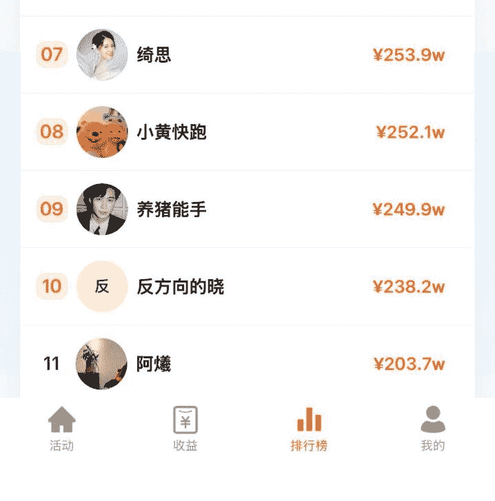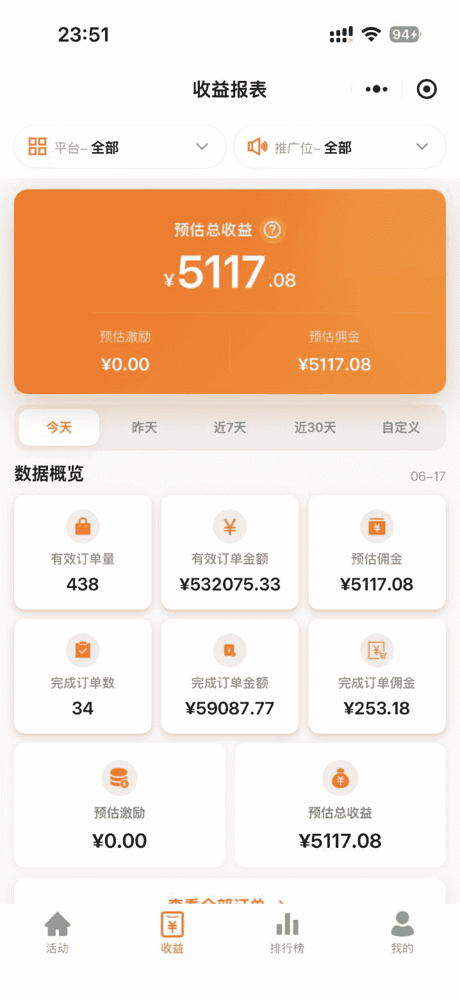

在做抖音CPS 之前，我的副业方向一直做小红书，做过商单号，也做过商家号，算是跑通过一些小闭环。但抖音对我来说是完全陌生的领域——我几乎不刷抖音，也从来没有做过任何抖音相关的项目。所以严格来说，抖音CPS 对我而言是一次从零开始的全新尝试。

那个阶段我的做法非常粗糙：用真人出镜的形式口播，每次录制前都要化妆，精力消耗很大；同时开了多个账号，但内容基本是凭感觉在做，很少真正去拆解对标；视频做好之后也不是每天更新，而是批量生产好几天的量，定时发布。

结果是：播放量一直卡在几百，虽然有出单，但始终没有大的突破。

## 二、加入航海后：方法论上的几个关键调整

加入航海之后，在教练和助教老师的指导下，整个打法有了系统性的变化，主要体现在以下几个方面：

**1. 每天刷对标、学对标**

不再凭感觉创作，而是每天花时间研究当下跑出来的爆款，把“研究对标”变成日常习惯。

**2. 测试账号体质**

图文、视频、口播、表情包、曼波，几种形式全部尝试了一遍，目的是观察每个账号更适合发哪种内容，找到账号本身的“体质”。

**3. 参考爆款1:1 复刻，但要有自己的手感**

不是完全照搬，而是在对标的结构基础上，做一些属于自己的细节调整。（后边会展开讲）

**4. 话题回避、迂回战术**

航海前期，我延续了之前的习惯，把口令直接放在视频描述里，违禁词也不懂得排查，几乎每一条都被判定为“引流到第三方平台，减少推荐”。

第一步调整是把所有能排查出来的违禁词全部删除或隐藏。这里有个很容易被忽略的细节——会场截图里那些很小的“京东”“红包”字样/图标的违禁词，不易被发现，我一般用擦除或贴纸遮挡的方式处理。但即便做了这些，违规提示依然在出现。

真正的转折点，是在刷对标的过程中发现的一种新话术结构。原来大部分爆款的路径是：“点右下角分享按钮，复制链接，打开东哥”；而那条对标讲的是：“点这个，复制，到抖音的邻居小东”。路径完全一样，但主体对象的称呼变了，而且视频一开始会先抛一个话题，引导用户在评论区吐槽“抖音的券不够大”，然后才讲到京东。这个设计有两层作用：一是带动了互动率，二是自然地把“抖音”这个词带进了内容和话题里。

我立刻模仿了这个结构，文案几乎完全复刻，只是把真人出镜换成了猪猪表情包，这条视频跑出了几千播放，且没有触发违规提示。之后按照这个模板产出的视频，流量都相对不错，违规提示也明显减少。再往后，随着曼波、图文等形式的尝试，我把重心从“描述里放口令”完全转移到了“密令词体系”，描述里不再放任何口令，违禁词也彻底排查，违规提示的数量大幅下降。

**5. 提高剪辑效率，降低试错成本**

效率的提升主要来自“模板化复用”。提前做好的预设、整体结构、会场截图基本固定不变，新视频直接在之前那条视频的剪辑轨道上“接着改”——把表情包或AI 真人出镜素材等形式的主视频换掉，配音、配乐替换掉，会场截图保留在轨道里，生成字幕后再按字幕长短调整素材时长，整个流程非常顺畅。

不过素材不能一直不变，要定期更新，文案也要适当调整，增加变量，避免内容过于重复。这部分我自己没有特别固定的方法，更多是凭感觉判断什么时候该换——

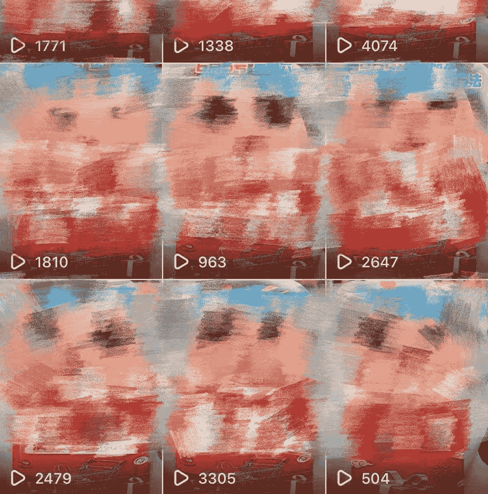

可能我“P 人”属性比较高，不太喜欢提前定死规则，临场调整反而更顺手。当剪一条视频的时间成本足够低时，试错的心理负担也会跟着降低——一条没跑起来，那就再剪一条，总会有跑出来的。

**6. 把关注点放回内容本身**

不再死盯流量和出单数据，而是关注“这次调整之后效果有没有变好”，把每一次数据波动当作下一次迭代的依据。

**7. 找到适合自己的方法，而不是照搬别人的成功路径**

航海开始前，我几乎把生财里所有抖音CPS 相关的精华帖都看完了，小明伙伴做出来的工具让我非常震撼，航海期间我也尝试去用，但因为自己在AI 编程上的能力还不够，做出来的东西对我帮助并不大。我也尝试过沐亦教练的数据复盘方式，但发现自己作为一个"P 人"，根本坚持不下来。但是非常感谢这些前辈们的分享，让我在尝试中慢慢摸索出了相对适合自己的路子——每天刷爆款，刷到有灵感的就立刻去复刻，再复盘分析，进行迭代。

把别人厉害的方法思考借鉴，转化为自己能用得起来、坚持得下去的，才是好方法。

## 三、**5** 月**31** 日：第一次小突破，也是认知的转折点

5 月31 日我产出了航海期间第一条爆款，通过描述里埋口令的形式推广618 京享红包会场，且只推这个会场，视频长度在20 秒左右，此会场可以锁单15 天，整个航海期间大部分的精力都集中在推这个红包会场，没有尝试过单推某个品类，或者某个爆品。

在这条爆款视频之前，“参考对标”对我来说只是停留在表面——抄文案、抄配乐、抄配图，但从没有仔细拆解过对标到底是“做”出来的。

这条视频的突破点在于：我发现刷到的那条猪猪表情包对标，并不是像我之前那样真人配音然后变声，而是用一个一直张嘴的表情包视频，配合剪映/必剪生成的文字转语音做出来的。而且同样是猪猪表情包，对标用的是“怕冷猪猪”，我是“客服猪猪”。

想到海宇教练在直播中讲的方法后，我决定这一次完完全全复刻——除了会场截图和表情包的替换，几乎和原视频的结构、节奏、形式甚至文案都保持一致。

这条视频在5 月31 日晚上7 点发布，正好借上618 开门红的流量节点，最终播放6.7 万，分享达9700+，大部分是精准的搜索流量，并在6 月1 日带来3000+收入。

这次调整带来了一个意外的副产品——效率的大幅提升。在加入航海之前那一小段时间，我做的是真人出镜的形式，每次录视频前都要化妆，消耗了大量精力和时间。换成表情包+AI 配音的形式后，因为我本身剪辑相对熟练，固定模板跑通之后，一条视频的产出时间可以控制在20 分钟左右。

这是第一次让我意识到：复刻对标，到底在复刻哪些东西，首先不要想当然的加入自己认为不影响数据或者创新的东西，其次复刻不只是文案和画面，更是它的生产逻辑和形式结构。

## 四、**6** 月初到**6** 月**12** 日：找到手感，多账号陆续跑出成绩

这个阶段，我陆续在多个账号上复刻出13 万、10 万、6 万等播放成绩，验证了这套方法不是偶然的运气，而是可复制的路径。但是新的问题出现了，6 月9 日上午我发布了第一条曼波形式的视频，播放跑到了13 万+。但这条爆款也暴露出一个问题：因为这条视频本身比较长，我参考对标把密令词布置在了视频结尾，导致密令词出现的太置后，流量虽多但是真正看到密令词的占比较少，最终出单效果并不理想。播放量不等于转化，密令词放在哪里、什么时候出现，同样需要仔细设计。这个阶段属于流量不错，但是GMV 突破并不大，航海排名一度从12 名跌到了22 名。

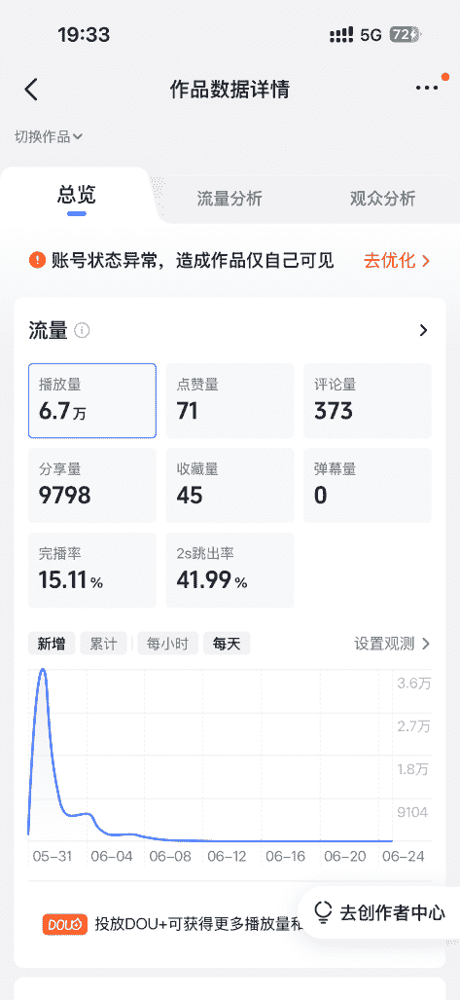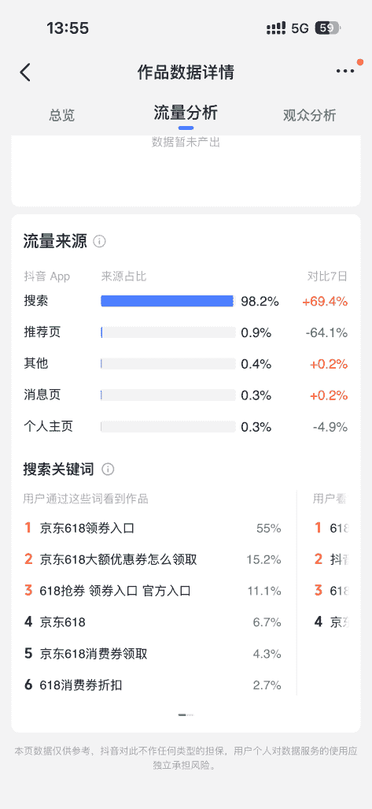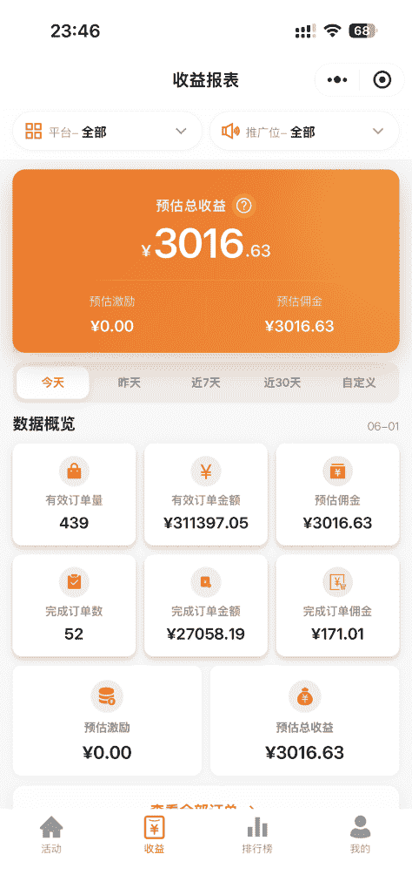

## 五、**6** 月**12** 日：**618** 冲刺期的至暗时刻

6 月12 日晚账号突然被禁言30 天，且关联影响到了其他账号。说实话，第一反应是难过的——我对抖音规则其实了解得并不深，甚至不知道接下来该怎么办：要不要注销？这个号以后还能不能用？

但我知道沉浸在情绪里是没有用的，我需要去解决问题。很多事情其实都是这样，本来就没什么大不了，关键是别让自己困在“为什么”里，而是赶紧想“接下来怎么办”。

我先求助了助教老师。老师告诉我，我的情况其实比较个例，有可能是被同行举报了，但618 流量正处上涨趋势，建议直接开新号继续干。这句话让我意识到：具体为什么被封，已经不重要了——那几个号对我来说就是过去式，真正要思考的是接下来怎么走。

接着我又去问了AI 亦仁，通过对话提炼出一个关键结论：新账号要想完全不受旧账号影响，核心是设备干净、网络环境干净。

当晚我就下单了一台二手手机，并把手上的备用机直接恢复出厂设置；第二天一早办理了新的手机号。通过随拍视频测试流量没问题后，6 月14 日新账号发出了第一条内容，当天一共发布了4 个作品，包括曼波和图文。

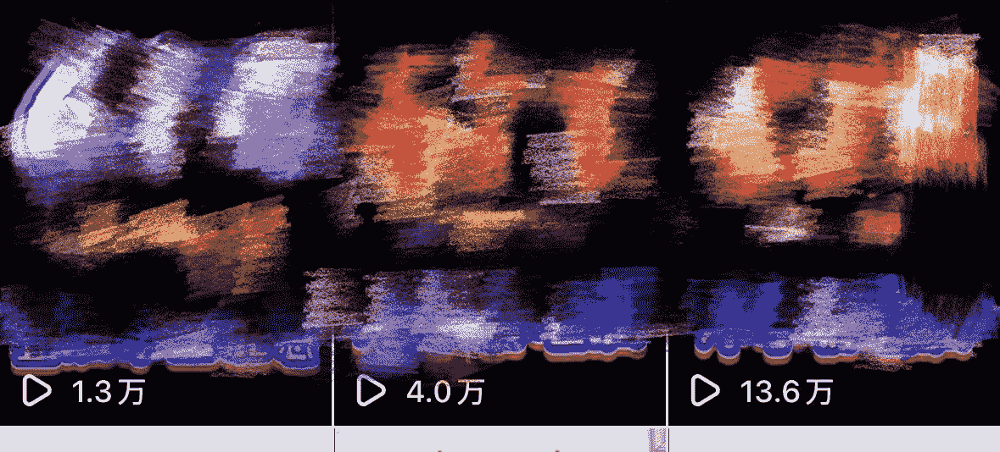

## 六、危中有机：**37.2** 万播放新高

6 月15 日单作品跑出新高。新账号开通后我先后测试了多种形式：曼波视频流量只有几千，另发布的一条几乎完全复刻爆款的图文跑出了6 万+播放。

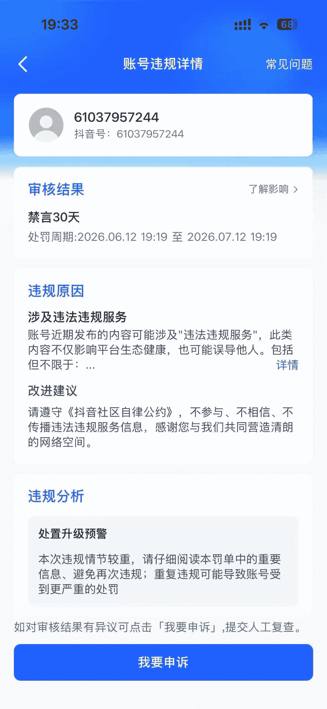

但真正的突破在于6 月15 日发布的一条图文——我把两个不同对标的爆款做了融合，并用“手抄”的形式重新呈现出来，这条作品的播放量实现了跨越式增长，最终跑到了37.2 万。

复盘来看，我认为这条爆款是三重因素叠加的结果：新账号+新设备带来的冷启动流量加权，叠加618 大盘流量本身在上涌，再加上内容本身是在两个爆款基础上做了融合创新，而不是单一复刻——三者共同作用，跑出了这次新高。

这一轮重启总共开了3 个新号，其中2 个账号流量表现不错，另有1 个账号发布的所有作品都没有突破5 千的播放——同样的内容打法，不同账号的“体质”差异依然存在，这也提醒大家，多账号布局的意义就在于此。

开通新号后发布的其他作品也陆续跑出了万播，千播，6 月17 日晚8 点开始，佣金持续上涨，单日突破5000+，618 也迎来了一波小高峰。

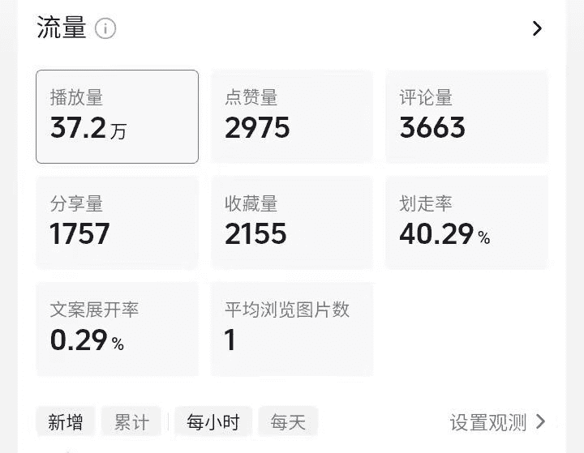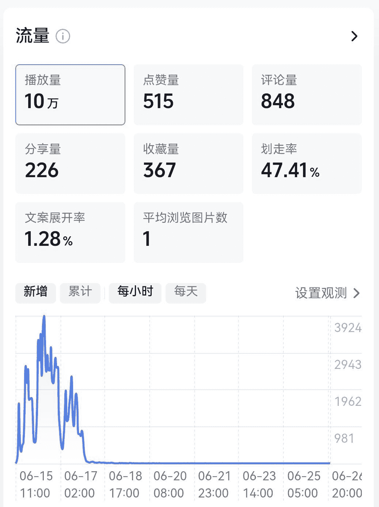

## 七、主动停更

6 月19 日，我主动选择停更休息。原因有几个：首先，618 的核心增长期基本结束了，虽然19-21 日还有一波小尾巴，但我对目前的结果已经比较满意；其次，618 期间高强度的工作节奏让我很想给自己放个假；另外，新账号的冷启动福利期正在退却，流量本身也在下行——继续硬撑性价比已经不高。

这里想特别提一下本次航海设计的排行榜机制，对我帮助真的很大。我是一个好胜心比较强的人，在佣金增长不理想的时候，开始会怀疑环境或者外部因素的影响，但看到伙伴们的GMV 蹭蹭上涨，我就清楚地知道：问题出在自己身上，然后逼着自己全身心去复盘到底卡在了哪里。如果没有这个排行榜，我想我不会在航海结束时拿到这个自己满意的成绩。

借此机会，也想再次感谢生财，感谢这次航海，感谢教练和助教老师们的指导。

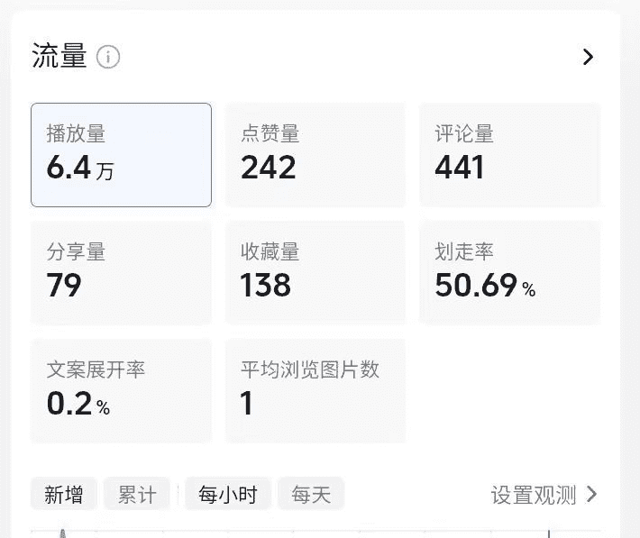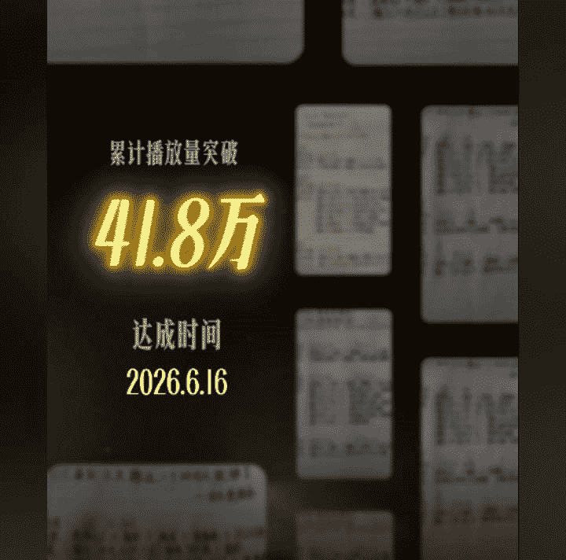

## 八、避坑建议

**1. 不要被流量和佣金牵着走，焦点要回到内容本身**

发完视频反复刷流量、看出单、盯佣金，这件事本身极度消耗心力，却对结果没有任何帮助——这是我自己踩过的坑。真正有用的复盘方式，是去看“这次调整之后效果有没有变好”，把每一次数据波动都当成下一次迭代的依据，而不是焦虑的来源。

**2. 复刻对标，不只是复刻文案和画面，更要研究“生产逻辑”**

我之前参考对标只停留在文案、配乐、配图层面，但真正决定爆款能不能复刻成功的，往往是更底层的东西——比如对标的产出形式、说话的语调、话术路径的结构是怎么设计的等等。把对标研究透，复刻才有意义。

**3. 违规和限流不可怕，但要重视规则，提前排查**

引流类内容很容易触碰平台规则的红线，哪怕是截图里很小的字样，都可能被判定违规。与其等被限流之后再补救，不如提前把规则吃透，养成排查的习惯。

**4. 多账号布局要小心“环境关联”**

设备环境完全一致、内容高度相似、账号互相评论引流，这些都可能导致账号关联，一旦一个号出问题，其他号也会被牵连。如果要做多账号，还是尽可能规避这些问题。

**5. 心态比技巧更重要：遇到问题先解决问题，不要困在情绪里**

封号那天我也难过、也不知所措，但比起纠结“为什么会这样”，更重要的是马上去想“接下来怎么办”。很多事情其实没那么大不了，只要还在场上，就有重新跑起来的机会。

**6. 别想太多，先开始，接着是强执行力和有效迭代**

这个项目不需要任何特殊能力或资源，真的一个特别适合普通人的好机会，先开始，剩下的就是靠强执行力持续更新，再靠有效迭代不断优化，结果自然会跟上来。

————分割线————

看完这篇 SOP，你觉得你懂了。但 90% 的人一到实操就会卡在第一步。

工具和教程只是最低级的壁垒，真正的壁垒是“立刻动手”和“圈层信息差”。

如果你想看全网最新的变现玩法，并且和一群执行力极强的极客一起下场拿结果，欢迎围观我的核心私域：【懒人专属群】。

我们不聊虚的，只做商业闭环的拆解与 AI 效率的压榨。系统内已沉淀 1000+ 跑通的套利实战局。

👉 查阅圈子完整数字资产与上车门槛：

https://lazyso.com/insider/

认同价值、准备好下场干活的，扫码加我微信（lazyhelper1）

备注：【实操上车】，不闲聊

