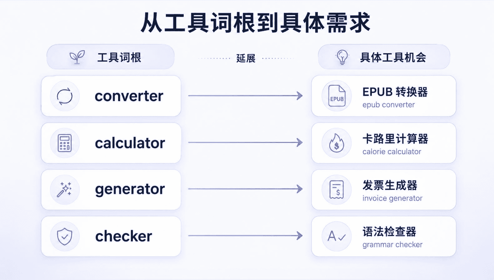
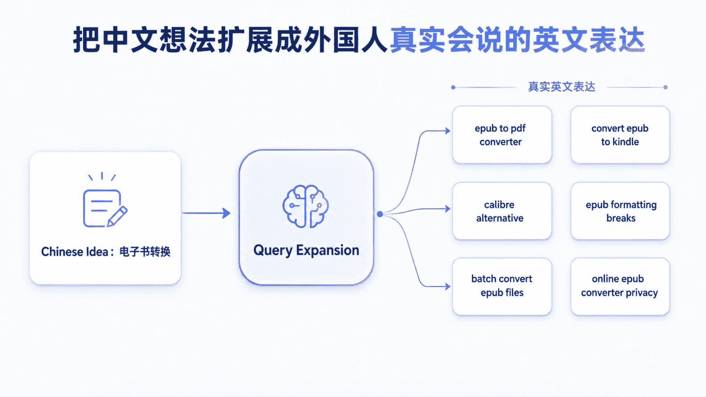
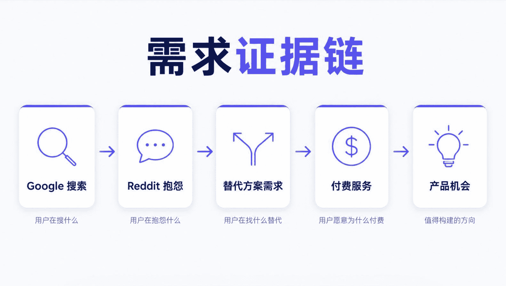
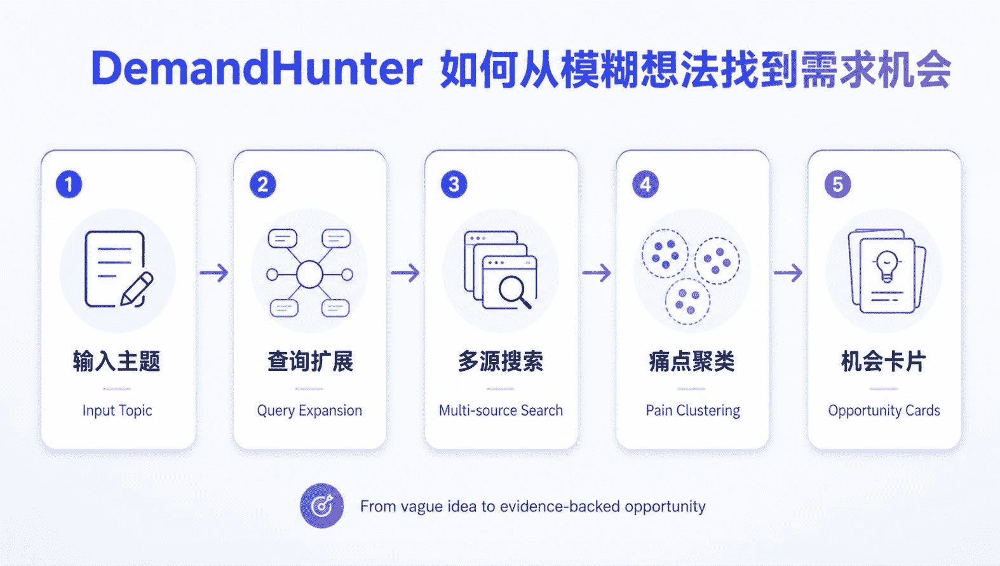

公众号懒人搜索，懒人专属群分享

裸辞做出海工具站后，我总结了一套“找外国人需求”的方法

260531 副业SC 精华

整理：公众号懒人搜索，懒人专属群精选
懒人微信：lazyhelper1

大家好，我是饭思，是一名前大厂程序员，今年裸辞后，我开始尝试做出海网站和 SaaS。

一开始我犯了一个很典型的错误：我总觉得只要把产品做出来，用户自然会来。于是我上了几个站，也做过一些小程序。

结果很现实：大部分产品都没什么流量，也没什么收入。

这段时间我最大的感受是：对独立开发者来说，最难的不是把东西做出来，而是判断这个东西到底有没有人要。尤其是做出海产品，国内开发者很容易靠自己的想象去判断外国人的需求。

但问题是：
- 我们不是目标用户；
- 我们不在他们的语境里；

- 我们不知道他们平时怎么搜索；
- 也不知道他们在社区里真正抱怨什么。

所以我最近一直在研究一件事：怎么更系统地找到外国人真实存在的需求？下面是我目前总结出来的一套方法。

## 一、找需求不是找灵感，而是找信号

以前我找需求，很容易陷入“想点子”。比如：
- 某某 AI 模型最近很火，要不要做一个套壳站？
- XX 工具是不是有需求？
- 图片生成站是不是还能做？

后来发现，这种方式很虚。因为它本质上还是在猜。自从学习了哥飞老师和小排老师的方法论后，我现在更倾向于从 4 类信号里找需求。

### 关键词信号：用户搜什么，往往就代表他要什么

在海外，Google 仍然是非常重要的入口。所以一个最直接的需求判断方式是：有没有人正在搜索这个东西？尤其是工具类关键词。

比如这些词根：
- generator
- converter
- calculator
- checker
- finder
- tracker
- planner
- template
- analyzer
- formatter
- summarizer

这些词本身不重要，重要的是它们可以和具体场景组合。比如：
- calculator → calorie calculator → mortgage calculator → pregnancy calculator
- converter → pdf converter → heic to jpg converter → json to csv converter
- generator → invoice generator → workout plan generator → caption generator

如果一个关键词有人搜、趋势还在涨、竞争不算特别高，那它就可能是一个工具站机会。

这类需求有一个特点：用户已经知道自己要什么，他只是在找一个能解决问题的工具。所以这类需求很适合做：
- 免费工具站；
- SEO 长尾站；
- 轻量 SaaS；
- 免费入口 + Pro 功能；
- 广告变现；
- 联盟变现。

### 抱怨信号：用户骂得越具体，机会越清晰

第二类信号来自社区。比如 Reddit、X、Hacker News、GitHub Issues、Product Hunt、App Store 评论区。

我现在会重点看这些表达：
- I hate...
- so annoying
- takes too long
- manual process is terrible
- is there a tool for...
- I need a way to...
- I wish there was...
- alternative to...
- too expensive
- too complex
- slow
- buggy
- overwhelming

这些句子背后通常藏着真实痛点。比如：
- 某个工具太贵；
- 某个流程太慢；

- 某个软件太复杂；
- 某个格式转换总是出错；
- 某个任务每次都要手动做；
- 某个产品缺少某个小功能。

这类信号比关键词更早期。因为用户可能还不知道自己要买什么，但他已经把痛苦说出来了。对独立开发者来说，这种需求很有价值。因为你不一定要做一个大产品，有时候只需要解决其中一个很窄的痛点。

### 替代品信号：用户找 alternative，说明现有方案有缺口

我现在很喜欢搜这种句式：
- 产品名 + alternative
- 产品名 + too expensive
- 产品名 + sucks
- 产品名 + slow
- 产品名 + complex
- 产品名 + missing feature

因为这类搜索背后有一个很明显的含义：用户已经知道这个问题需要解决，也知道市面上有方案，但他对现有方案不满意。这比纯粹的“我有一个点子”强很多。

比如：
- Notion alternative
- Canva alternative
- Calibre alternative
- CapCut alternative
- Zapier alternative

当然，不是说你要去硬刚这些大产品。真正的机会通常在更小的切口里。比如：
- 不是做一个 Notion 替代品，而是做一个更适合某类人群的轻量笔记导出工具。
- 不是做一个 Canva 替代品，而是做一个专门生成某类小红书、电商、广告素材的工具。
- 不是做一个 Zapier 替代品，而是做一个只解决某个平台数据同步的小工具。

大产品的差评区，往往藏着小产品的机会。

### 付费和市场行为信号：有人花钱，需求才更硬

前面三类信号只能说明“可能有需求”。但如果想判断商业价值，还要看有没有付费行为。

我现在会看几个地方：
- Fiverr
- Upwork
- Gumroad
- Etsy
- Toolify
- There’s An AI For That
- Product Hunt
- Similarweb 付费流量
- Semrush 竞品关键词

比如：
- Fiverr 上有人长期卖某种服务；
- Upwork 上有人发类似外包需求；
- Gumroad 上有人卖模板或小工具；
- 某个网站长期投广告买关键词；
- 某个 AI 工具站流量持续上涨。

这类信号说明什么？说明已经有人愿意花钱解决这个问题。这时候可以继续问：
- 这个服务能不能工具化？
- 这个人工流程能不能 AI 化？
- 这个模板能不能变成生成器？
- 这个外包需求能不能变成自助工具？

举个例子：
- 如果 Fiverr 上有人卖人工视频配音服务，那 AI 配音工具就是一个产品化方向。
- 如果 Upwork 上有人招人清洗表格数据，那自动数据清洗工具就是一个方向。
- 如果 Gumroad 上有人卖评分表、模板、测评服务，那自动生成器或在线测评工具就可能有机会。

这类需求比单纯的社区抱怨更强。因为它已经不只是“用户不爽”，而是“有人掏钱”。

#### 二、找需求前，还有一个容易被忽略的步骤：先扩词

这里是我最近做出海需求调研时，感受比较深的一点。很多时候，我们以为自己在找海外需求，但其实搜索方式还是中文思维。

比如我想研究：电子书转换

如果只是简单翻译成：ebook converter，那其实还不够。因为外国用户在不同场景下，可能不会这么表达。

他可能会搜：
- epub to pdf converter
- convert epub to kindle
- calibre alternative
- epub formatting breaks
- batch convert epub files online
- epub converter privacy

他也可能不会用 converter 这个词，而是在社区里说：
- Calibre is too complicated
- EPUB formatting keeps breaking
- I need a way to convert EPUB files in bulk
- Is there a tool to fix EPUB layout?

所以我现在会把“需求搜索”拆成两步：第一步不是直接搜索，而是扩词。也就是把一个模糊想法，扩展成几类更接近真实语境的英文表达。

我一般会拆成这几类：

**直接关键词**
比如：epub converter、epub to pdf、epub to mobi、convert epub to kindle

这是最接近 SEO 搜索的词。

**相邻问题词**
比如：formatting breaks、batch convert、kindle compatibility、privacy concerns、layout issue

这些词不一定是主关键词，但经常出现在真实痛点里。

**常见共现词**

比如：Calibre、Kindle、self-publishing、ebook formatting、KDP

这些词可以帮你进入更具体的用户场景。

**平台语境词**
不同平台的表达不一样：
- Reddit 上可能是抱怨和求助；
- GitHub Issues 里可能是 bug、feature request；
- Product Hunt 评论区可能是替代品和价格吐槽；
- X 上可能是趋势和新产品讨论；
- YouTube / TikTok 评论区可能是普通用户的使用反馈。

所以不能只用一组关键词到处搜。

**需要排除的歧义词**
有些英文词会有多个含义，如果不排除，结果会很脏。比如一个词既可能是工具名，也可能是某个游戏、电影、品牌、专业术语。提前排除歧义，后面的搜索质量会高很多。

#### 三、为什么扩词这一步很重要？

因为做出海需求调研，最怕的不是没有工具，而是你一开始搜的词就不对。你用中文思维搜海外需求，很容易漏掉真正的用户表达。

我现在会先问自己几个问题：
- 外国人真的会这么说吗？
- 他们在 Google 里会怎么搜？
- 他们在 Reddit 里会怎么抱怨？
- 他们在 GitHub Issues 里会怎么提 bug？
- 他们在 Product Hunt 评论区会怎么吐槽？
- 他们在找替代品时会用什么词？

只有先把表达方式校准，后面的搜索、聚类、判断才有意义。

所以现在我做需求调研时，会先让 AI 做一次英文搜索词扩展。大概逻辑是：

你是一个需求发现工具的英文搜索词扩展助手。
目标：
1. 把用户输入转成简短英文搜索主题；
2. 生成外国用户在 Reddit、X、YouTube、TikTok、Hacker News、GitHub Issues 等平台里真实可能使用的表达；
3. 不要生成太宽泛的词；
4. 后续会把这些词和 pain / tool / payment / alternative 等意图词组组合搜索。

返回：
- englishSearchQuery：英文搜索主题
- keywords：直接关键词变体
- relatedTerms：相邻问题词或用户人群词
- derivativeTerms：同义表达或常见共现短语
- sourceHints：平台相关词、话题标签、repo 词、社区词
- excludedTerms：需要排除的歧义词

这一步看起来很小，但我觉得挺关键。因为它解决的不是“搜不搜”的问题，而是“用什么语言搜”的问题。

#### 四、找到线索以后，不能马上开干

这也是我之前踩坑最多的地方。
- 看到一个关键词有流量，马上做。
- 看到一个帖子有人抱怨，马上做。
- 看到一个 AI 工具火了，马上做。

但这样还是容易翻车。因为单条线索不等于需求成立。

现在我会把一个需求拆成几个问题：
- 谁在痛？
- 在什么场景下痛？
- 他现在怎么解决？
- 现在的方案哪里不好？
- 他有没有主动找工具？
- 有没有替代品抱怨？
- 有没有付费信号？
- 我能不能 1-2 周做出最小验证版本？

如果这些问题答不清楚，我一般不会直接做。

#### 五、我现在判断需求，会更看重“证据链”

一个需求如果只有一句话：我觉得这个方向有机会。那价值很低。

但如果它有一条证据链：
- 有人在 Google 搜；
- 有人在 Reddit 抱怨；
- 有人在找 alternative；
- 有人在 Fiverr / Upwork 花钱解决；
- 现有产品差评集中在同一个问题；
- 这个问题可以用一个小工具解决。

那这个需求就值得认真看。

我现在会把需求信号分成几类：

**弱信号**：有人讨论，有人感兴趣，但场景不清晰。

**中信号**：多人重复抱怨同一个问题，并且有明确使用场景。

**强信号**：有人主动找工具、找替代品，甚至出现付费、外包、订阅、广告投放等行为。

很多时候，独立开发者不需要一开始就找到“超级大市场”。反而更适合找这种：
- 人群明确；
- 场景具体；
- 痛点重复；
- 现有方案不爽；
- MVP 可以很小；
- 可以用 SEO 或社区冷启动。

#### 六、一个更具体的例子

假设我想研究：epub converter

以前我可能会直接判断：电子书转换工具有人搜，可以做。

但现在我会继续拆。

**关键词层**
- epub converter
- epub to pdf
- epub to mobi
- convert epub to kindle
- online epub converter

看有没有搜索量、趋势、长尾词。

**抱怨层**
去 Reddit / GitHub / 论坛搜：
- epub formatting breaks
- calibre too complicated
- epub converter privacy
- epub to kindle not working
- batch convert epub files

看用户是不是在抱怨：
- 转换后格式乱；
- Calibre 太复杂；
- 在线工具不放心隐私；
- 批量转换不好用；
- Kindle 兼容性差。

**替代层**
搜：
- Calibre alternative
- best epub converter online
- epub converter alternative

看现有工具哪里不满足。

**付费层**
看有没有：
- 付费转换工具；
- 批量处理功能；
- 作者 / 出版 / Kindle 用户愿意付费；
- Fiverr 上是否有人卖格式修复服务。

最后才判断：
- 这是不是一个值得做的小工具？
- 是做免费 SEO 工具，还是做 Pro 批量处理？
- 是做网页工具，还是做桌面隐私版？
- 第一个 MVP 只做哪一个场景？

这时候出来的需求就比“我想做一个 epub 工具”清晰很多。

#### 七、我把这个流程做成了一个小工具

因为我自己反复手动搜 Reddit、X、Google、Product Hunt、竞品差评，效率很低。而且我后来发现，手动调研还有一个问题：不是你不会搜，而是你一开始就可能搜错词。

尤其是做出海需求，很多中文想法不能直接翻译成英文关键词。比如你想研究“电子书转换”，直接搜 ebook converter 可能只能看到很表层的结果。但真正有价值的表达，可能藏在：
- epub formatting breaks
- calibre too complicated
- convert epub to kindle
- batch convert epub files
- online converter privacy
- calibre alternative

所以我最近做了一个小工具，叫 DemandHunter。它的目标不是替你“幻想一个好点子”，而是帮你更快找到真实需求信号。

目前主要做几件事：
- 输入一个主题或关键词；
- 先把它扩展成外国人真实会搜索、抱怨、求助的英文表达；
- 再组合 pain / tool / payment / alternative 等意图词去搜索；
- 扫描最近的相关讨论和抱怨；
- 按痛点、找工具、替代品、付费信号分类；
- 清洗掉广告、榜单、目录站等噪声；
- 聚类出重复出现的痛点；
- 给出适合独立开发者验证的小产品方向。

简单说，它想解决的是：不要先靠感觉做产品，也不要只靠一个关键词判断需求，而是先找到用户已经暴露出来的真实表达和需求证据。

我自己现在更愿意把它理解成一个“出海需求雷达”。它不保证你用了就一定能找到赚钱项目。但它至少能帮你减少一件事：少用自己的想象，去替外国用户脑补需求。

#### 八、它适合什么人？

我觉得比较适合这几类人：
- 想做出海工具站，但不知道做什么关键词的人；
- 想做独立开发，但总是靠灵感选题的人；
- 想研究 Reddit / X / 海外社区需求，但懒得手动刷帖的人；
- 想找 AI 工具、SEO 工具、轻量 SaaS 方向的人；
- 已经有一个想法，但想先看看有没有真实抱怨和需求证据的人。

不太适合这几类人：
- 想要一个工具直接告诉你“做这个必赚钱”的人；
- 不愿意自己判断用户和商业模式的人；
- 想做特别重、特别复杂的大产品的人；
- 只想看中文市场需求的人。

公众号懒人搜索，懒人专属群分享

它现在还只是早期版本，肯定不完美。

但我自己做它的初衷很简单：

我不想再花几周做一个没人用的东西。

#### 九、给生财圈友开放一个小福利

因为这个工具本身也是围绕“出海找需求”做的，我觉得和生财里很多做独立开发、AI 工具、出海站、SEO 站的朋友会比较相关。

所以我准备把 DemandHunter 的 Lite 会员免费开放给生财圈友试用 1 个月。

它不是保证你用了就能找到赚钱项目。

它更像是一个辅助你做需求调研的工具。

你可以用它来：

- 验证一个想法有没有真实讨论；
- 看看外国人在抱怨什么；
- 找某个关键词背后的痛点；
- 分析某个产品有没有替代机会；
- 为自己的工具站找长尾方向。

如果你刚好在做出海、工具站、AI 产品、独立开发，可以试试看。

感兴趣的朋友可以到：

https://demandhunter.app/

购买 Lite 套餐时输入折扣码：

SCYS2026

可以直接免费获取 Lite 会员。

也欢迎大家试完后直接吐槽：

- 哪里看不懂；
- 哪里没价值；
- 哪些字段没用；
- 哪些需求判断不准；
- 你真正想看到什么结果。

如果能帮大家少踩一点“自嗨做产品”的坑，那这个工具就算有点价值了。

#### 十、最后总结一下我的方法

我现在对“出海找需求”的理解是：

不要从自己的灵感出发，而要从用户已经留下的行为出发。

这些行为包括：

- 他搜了什么关键词；
- 他在哪些社区抱怨；
- 他在找什么替代品；
- 他为什么骂现有产品；
- 他有没有花钱找人解决；
- 这个问题是不是重复出现；
- 这个场景是不是足够具体；
- 这个需求是不是能用小产品验证。

对独立开发者来说，真正值得做的不是“看起来很大的方向”，而是：

一群明确的人，在一个具体场景里，反复遇到同一个麻烦，并且已经表现出寻找解决方案的行为。

这可能才是更适合普通独立开发者的出海起点。

————分割线————

看完这篇 SOP，你觉得你懂了。但 90% 的人一到实操就会卡在第一步。

工具和教程只是最低级的壁垒，真正的壁垒是“立刻动手”和“圈层信息差”。

如果你想看全网最新的变现玩法，并且和一群执行力极强的极客一起下场拿结果，欢迎围观我的核心私域：【懒人专属群】。

我们不聊虚的，只做商业闭环的拆解与 AI 效率的压榨。系统内已沉淀 1000+ 跑通的套利实战局。

👉 查阅圈子完整数字资产与上车门槛：

https://lazyso.com/insider/

认同价值、准备好下场干活的，扫码加我微信（lazyhelper1）

备注：【实操上车】，不闲聊

