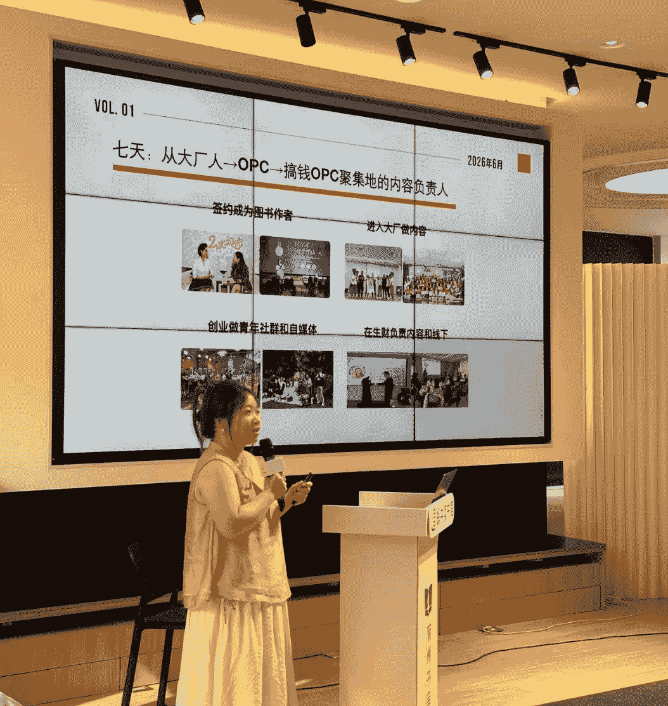
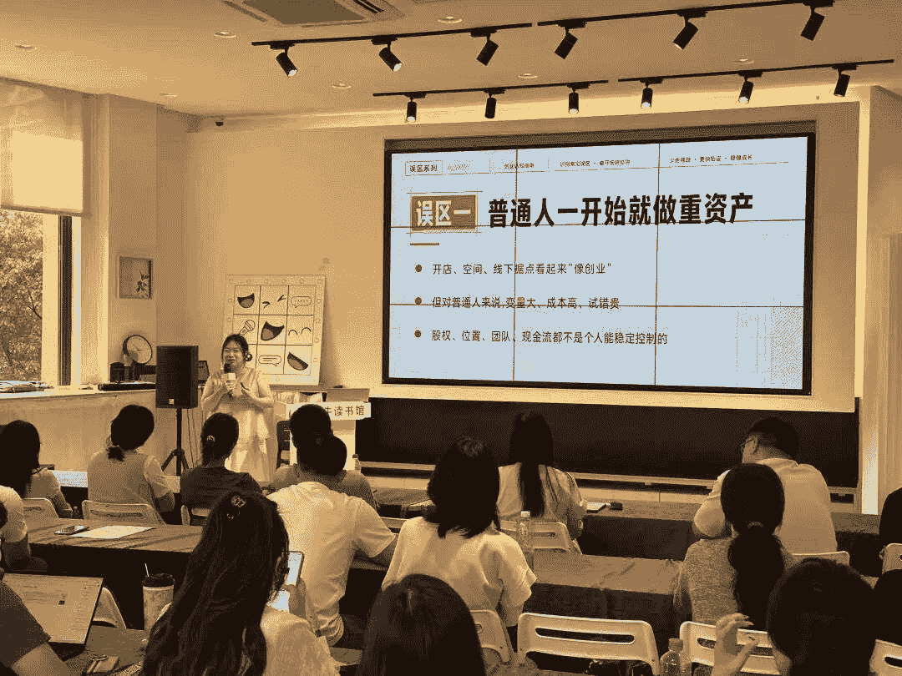
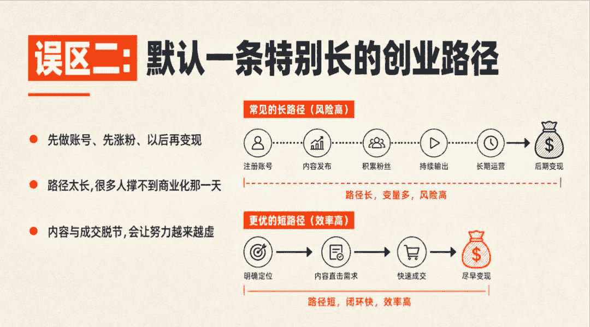
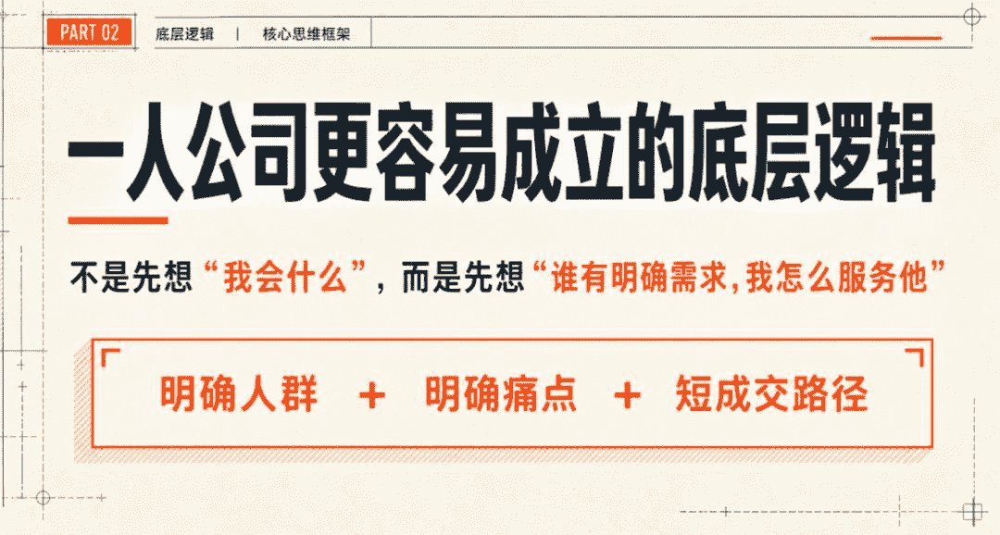
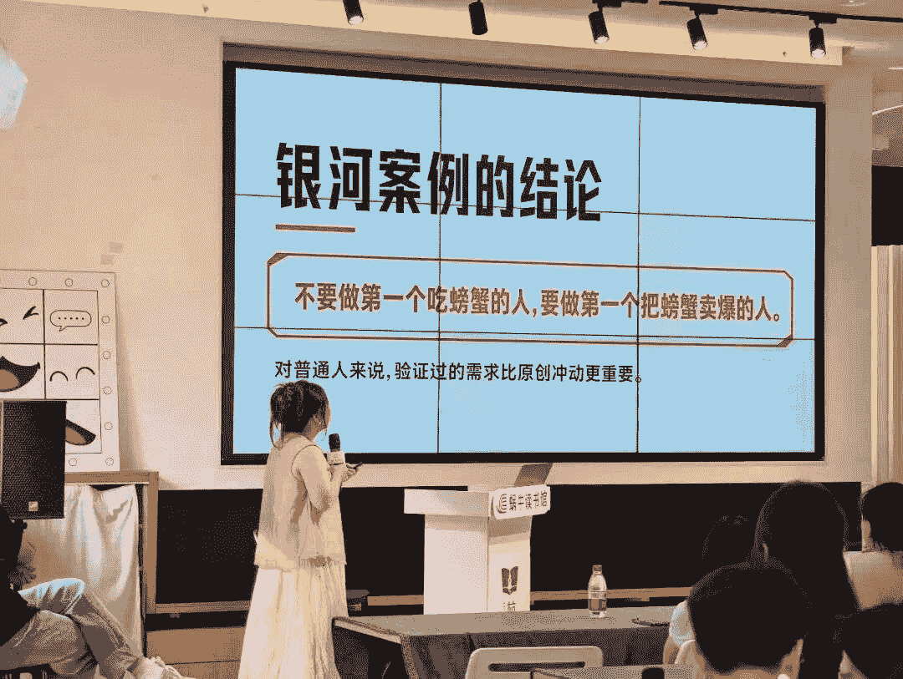

公众号懒人搜索，懒人专属群分享

不想再上班了，一个普通人如何做出稳定变现的一人公司 

260629 副业SC 精华 

整理：公众号懒人搜索，懒人专属群精选 

懒人微信：lazyhelper1 

大家好，今天我想聊的主题是：不上班，如何成为稳定变现的一人公司，这是我在网易图书馆的一场分享，逐字稿分享给大家。 

今天我不想先聊“一个人怎么赚钱”，我想先聊一个更底层的问题： 

一人公司最重要的，不是“我是不是一个人”，而是“我能不能像一家公司一样，为明确的人群持续提供价值”。 

如果今天你想做一人公司，我觉得有三个问题比“我要不要创业”“我要不要辞职”“我要不要招人”更重要： 

第一，你服务的是谁。第二，他们在什么场景下有强需求。第三，你的解决方案，为什么比现有替代方案更值得付费。 

这三个问题想不清楚，后面很多努力，都只是热闹。

## 一、为什么今天一人公司更容易成立

我先讲一个大的判断。我觉得今天一人公司变得更容易成立，不是因为大家突然更厉害了，而是因为外部条件变了。 

第一个变化，是供给足够丰富了。以前你做生意，可能要自己囤货、建厂、压库存、租场地、搭团队，很多模式天然就是重资产的。但今天很多生意不是。今天很多机会，本质上是你不需要掌握全部供给，你只要能把供给和需求连接起来，就有机会成交。 

比如电商选品、分销、内容带货、信息差生意，本质上都在说明一件事：你不一定要自己生产，你只要能更准确地找到人、讲清楚价值、完成转化，就有机会先把闭环跑起来。 

第二个变化，是 AI 把执行成本打下来了。以前很多事情，一个人根本干不过来。你得有助理、得有基础运营、得有人帮你整理资料、写文案、做汇总。但现在很多基础工作，一个人加 AI 就能先跑起来。 

像训练营、咨询服务、内容产品、工作流服务，这些事情以前可能需要一个小团队配合，现在很多时候，一个人就可以先把最小模型做出来。 

第三个变化，是垂直需求可以切得更细了。 

以前大家总觉得，做生意得做大市场。但今天很多生意恰恰是因为切得足够细，才更容易成交。你不需要一开始就做很大的盘子，你只要找到一小群人、一个很明确的痛点，就有机会赚钱。 

比如求职、出海、职场转型、社群、细分教育、AI 工作流，这些方向都说明：今天真正重要的，不是大，而是准。 

所以如果让我总结一句话，我会说：一人公司并不意味着什么都自己做，而是你可以先用更轻、更快、更低成本的方式，把最小商业闭环跑出来。 

## 二、为什么我特别想讲“职场人做一人公司为什么会失败”

接下来我想先讲失败，因为我觉得失败比成功更值得先讲。 

我自己从大厂出来之后，也试过一些路径。后来我发现，很多大厂人出来做 OPC，踩的坑其实非常像，而且这些坑往往不是执行问题，而是认知问题。

### 误区一：普通人一开始不要做重资产

很多人从大厂出来以后，会天然觉得，创业就应该做点“像创业”的东西。比如开店、做空间、做线下据点、做带场地的业务。因为这样的东西看起来踏实，看起来像个事业。 

但我现在越来越觉得，对普通人来说，这往往是最难赢的一种模式。 

因为这类模式高度依赖两件你控制不了的东西。 

第一，你有多少股权。第二，你能不能拿到真正好的位置。 

尤其是线下位置这件事，今天已经不是“你想拿就能拿”的了。真正的好位置，很多时候早就被成熟品牌、强运营团队、强资金玩家绑定了。普通人不是完全没机会，但这个游戏对你来说，变量太大，成本太高，试错太贵。 

所以我现在特别相信一句话：普通人做一人公司，第一原则不是把事做大，而是把试错成本做小。 

### 误区二：把创业的路径构建太长

比如我们会想，我先做个账号，先做内容，先积累粉丝，等我有了 1 万粉、5 万粉、10 万粉之后，我再去想怎么变现。 

但这条路真的太长了。很多人不是能力不够，而是在这条路上，根本撑不到变现那一天。 

我现在更认同的方式是：不是先做影响力，再想变现；而是从第一天开始，就设计它有变现的可能。 

我举个特别简单的例子。如果你今天想卖一个包，你完全可以从第一天开始，就去发这个包的笔记。它第一天就有卖出去的可能。哪怕卖不动，你也能快速知道，问题出在选品、人群、内容、场景还是价格。 

但如果你的路径是：我要先做成一个 5 万粉丝的、很会讲高颜值包包的博主，然后再去卖包，这条路径就太远了。 

所以我现在特别相信一句话：内容不是为了以后变现，内容应该从第一天就服务于变现。 

### 误区三：从“我想做什么”出发，而不是从“别人最痛什么”出发

这件事我自己特别有感受。我以前挺喜欢跟别人聊天，也喜欢做连接、做组织，所以我当时做过线下青年活动。这个事情很多人会觉得很有意思，也会觉得你很有创意，很会组织，很有氛围感。 

但后来我发现，这并不是一个特别好的创业模式。它的问题不在于它没有意义，而在于它没有足够锋利地回答一个商业问题：你到底解决了对方哪个最痛的具体需求？ 

如果只是一场活动，它的价值感很容易停留在 99、199。哪怕我当时面向的是大厂员工，可能做到 399、499，但它依然有个问题：它解决的不是一个明确痛点场景下的刚需。 

有人来，可能是因为想社交，可能是因为想吹空调，或者是想认识一些异性，一个换个圈子。这些需求都是真的，但它们不够聚焦，也不够锋利，所以很难长成一个很稳的业务。 

后来我越来越明白一件事：一个能证明“我很有趣”的事情，不一定是一个能证明“我对别人有高价值”的生意。 

所以如果我要总结我过去很多失败尝试的共同点： 

1. 路径太长。 
2. 产品太重。 
3. 价值不够聚焦。 
4. 从自我表达出发，而不是从用户购买动机出发。

## 三、什么样的一人公司更容易成立

讲完失败，我想接着讲一个更重要的问题：到底什么样的一人公司，更容易成立？ 

我后来去看很多跑出来的案例，发现它们看起来行业不同、产品不同，但背后其实有一个非常共通的逻辑：他们不是先想“我能做什么”，而是先找到了“谁有明确需求，我能用什么方式服务他”。 

也就是说，一人公司更容易成立，不是因为你足够全能，而是因为你找到了一个足够具体的人群，一个足够明确的痛点，再加上一条足够短的成交路径。 

### 1、方向一：小红书电商，不是先做一个小红书博主，而是先找到一个已经被验证的品

比如有个圈友，我觉得就特别典型。他做的是小红书电商，但他一开始不是拍脑袋说“我要做个电商品牌”，也不是先想“我要做成一个很会拍小红书的博主”，而是先找到了一个已经被市场验证过的产品：苔藓地毯。

这个产品为什么重要？因为它不是一个凭空创造出来的需求，而是已经有人在卖、已经有人在出单、已经有爆款笔记验证过市场的产品。 

他当时观察到两件事：第一，这个产品已经被小红书市场验证过了，有爆款内容，也有稳定出单。 第二，竞品虽然出了爆款，但运营能力很弱，发笔记不勤，内容供给很少。 

他不是说“我要发明一个新需求”，而是判断：既然这个东西已经有人要买，而且原来的卖家做得不够狠、不够勤、不够系统，那我就可以靠更强的运营能力，把这件事放大。 

所以做小红书电商的本质，不只是卖一个蓝海品，而是做了一件更聪明的事：他找到了一个已经成立的需求，再用自己的能力去做放大。 

他有一句话我特别喜欢：不要做第一个吃螃蟹的人，要做第一个把螃蟹卖爆的人。 

这句话背后其实就是一个很重要的 OPC 思路：如果你没有足够高的创新能力，那就不要先去赌需求成立，而要先去找已经成立的需求。 

这个案例还说明一件事：他卖的也不只是“一个地毯”，他卖的是一类人对于居家装饰、审美氛围、空间表达的需求。只不过他找到的是一个更适合在小红书内容场景里被种草、被放大的产品。 

所以这个案例让我后来特别相信：做“货”的生意，不是先想我想卖什么，而是先看什么东西已经起量了，我能不能更精准地卖给一群人。 

### 2. 方向二：AI 工具站，不是先做一个产品，而是先找已经被市场验证的需求

第二个特别典型的案例，是做AI 出海工具站。就是运用AI 的能力，快速上线各种AI saas 网站，并且通过谷歌做seo 来获取流量，收取用户的订阅费用。 

有个圈友井然做的是 AI 出海，但他一开始也不是说“我要做个很酷的 AI 产品”，更不是因为他特别懂技术才开始做，而是反过来先去找： 

现在市场上，哪些需求已经被验证了？ 哪些人已经赚到钱了？ 这件事我能不能作为普通人复制进去？ 

我特别认同他的一点，就是他不是从“自我表达”出发，而是从“市场结果”出发。 

井然说他也是0 基础的新手，但是他的思路是：缺什么就补什么，缺技术，缺产品思维，跟小排老师学。缺流量，我跟哥飞老师学SEO。缺成功案例，我就去活动认识拿到结果的人。 

“小成功能带来大成功。” 

他最早拿到正反馈的，其实不是一个成熟产品，而是大家后来常说的那种“新词、新站”的机会。就是一个很简单的起点：看到一个还没有被充分定义的需求，然后快速做一个最小版本上线，先跑起来，再一边跑一边优化。在这个过程中，他慢慢形成了一套很朴素但很有效的判断方式。一个方向能不能成立，大概不是一开始就想清楚的，而是拆成几个变量去验证。比如，先看这个事情有没有办法用 API 或现成工具快速搭起来，如果一个人能完成，它才具备试错的意义；再看市场是不是已经有真实流量在流动，如果有，就说明需求是存在的；最后才是竞争情况，如果这个领域足够垂直、信息密度低，甚至只有一两个人在做，那就值得立刻动手试一版。他做的方式也很直接，不是去空想一个完美产品，而是先做一个最小版本上线，然后持续观察数据，看别人怎么改，他就怎么跟，甚至在早期阶段就是跟着对手的动作同步迭代。但这里真正重要的不是“跟得快”，而是他会持续复盘每一次变化背后的原因，慢慢把这些零散的动作抽象成规律。比如他对这类新词新站的理解其实很现实，不是玄学。能不能站稳，大概三件事决定了大部分结果：一部分来自快速起量的能力，一部分来自持续做 SEO 的耐心，还有一部分就是运气，Google 到底愿不愿意给你流量。当你把这些拆开之后，这件事就不再是“做一个网站”，而变成了一个持续试错的系统。而这个系统的核心，不是灵感，而是不断靠近那个已经被验证过的需求，并在极小成本下不断重复验证。 

井然的路径不是：我先学会很多 AI，再决定做什么。而是：我先看到一个明确存在的市场需求，再反过来补我需要的能力。 

这就是他这个案例特别有启发的地方。很多人做 OPC 会卡在“我还没准备好”，但井然的思路其实是：缺技术，就补技术。 缺产品思维，就补产品思维。 缺 SEO，就补 SEO。 缺案例，就去认识已经做成的人。 

他不是先等自己变强再入场，而是先确定方向成立，再在路上补能力。所以井然这个案例，代表的是另一种更容易成立的一人公司：不是先有货，也不是先有影响力，而是先有一个明确的、被市场验证的需求，然后围绕这个需求做轻量产品。 

你可以把他总结成一句话：普通人更适合做“可复刻的需求”，而不是做“凭灵感创造的新需求”。 

### 3. 方向三：高客单服务，不是先卖知识，而是先抓住一类人的高价痛点

第三个案例，是另一个做IP 获客私教的圈友。她给我的启发是，很多一人公司不是靠卖一个很大的产品跑出来的，而是靠先服务一类非常具体的人群，再围绕他们最痛的点做出高客单产品。 

比如她讲过一个特别有代表性的判断：一个公众号，一个高客单产品，一个活人感朋友圈，是有机会做到 50 到 100 万的。 

这句话看起来轻，但前提很重。前提不是发了朋友圈就能赚钱，而是你得先回答：你到底在服务谁？ 他们最痛的点是什么？ 你的内容是不是在离钱近的地方输出？ 

她给到的思路是：不是做很泛的“教大家写作”，而是切得更准。比如她给学员重新定位的一个案例，是从泛写作训练营调整到创始人 IP 商业写作，名字一变，服务对象一变，痛点就清晰了。 

创始人 IP 商业写作本质上就不是卖“写作能力”，而是帮助一类有公开表达压力、有身份需求、有品牌诉求的人，解决他们表达不出来、内容立不起来、信任承接不住的问题。 

这背后的逻辑就是：你卖的不是一项能力，而是帮某一类人解决某一个卡点。这也是为什么她后来不断强调，人群比产品更重要，卖 80 块还是卖 8000 块，很多时候关键不是你做什么，而是你卖给谁。 

所以这个案例代表的，是一种非常典型的“做人”的生意：先有人群，再从人群里找到最愿意付费的痛点，再把它变成高客单服务。 

### 4. 高价定制服务：不是做更多客户，而是做更少但更贵、结果更强的客户

还有一个特别值得放进来的案例，是东山老师。他的路径跟前面几种又不太一样。他不是靠大量流量，不是靠低价卖很多份，也不是靠先做大内容盘子，而是选择了一条非常清晰的高客单路径。 

他的模型很简单：一年固定接少量客户，但单个客户客单价做到 30 万、40 万、50 万。 

为什么这个路径能成立？因为他服务的不是泛人群，而是已经有业务基础、愿意为结果付费、也有能力支付高价的人群。 

他卖的也不是陪伴感，而是更明确的结果、更强的确定性、更深的商业重构能力。 

他有一个观点我觉得特别适合放在这里：超高价的本质，不是贵，而是确定性。这个案例很适合提醒大家：很多人以为一人公司就是“做点轻的、卖点便宜的、搞点社群”，但其实真正能稳定成立的一人公司，很多时候恰恰不是低价，而是高价。 

因为低价往往意味着你需要更多流量、更多用户、更重的运营，而且很难交付出真正结果。而高价意味着你可以更聚焦地服务更少的人，也更有机会做出口碑和复购。 

当然，高价服务从来不是把价格标高就可以。它的前提是，你能够解决客户真正昂贵的问题。 

如果你能帮一家企业多赚100 万、少亏100 万，或者节省大量时间和机会成本，那么10 万甚至更高的服务费，都只是解决方案成本的一部分。 

但这里也有一个很大的陷阱。不要为了高客单而追求高客单。 

如果你的能力、经验和交付体系还没有匹配这个价格，收进来的就不是利润，而是未来的交付压力、信任风险和口碑负债。 

所以，高价定制服务能够成立，我认为至少有两个前提。 

第一，你已经在一个足够垂直的领域积累了不可替代的实战经验，能够解决别人解决不了的问题。 

第二，你能够管理好合作关系和交付预期，把边界提前说清楚，让双方围绕结果建立信任，而不是围绕期待产生纠纷。 

真正值钱的，从来不是你的报价，而是别人相信：把这件事交给你，大概率能成。 

所以东山老师这个案例告诉我们：一人公司成立的另一条路，不一定是你服务很多人，而是你能不能为少数对的人提供足够高价值的结果。 

所以你会发现，这几个案例虽然表面完全不同：小红书电商，AI 工具站，高价咨询和高客单服务。 

但他们能成立的共同点，其实很一致： 

第一，他们都有非常明确的人群。 

## 四、一人公司的两种模式：做人的生意和做货的生意

我在生财待了两年，带过两期垂直小号成长营，前后差不多有一千八百多个伙伴参与。我观察这些人的过程里，慢慢形成了一个非常粗糙但很好用的判断。 

我发现，大多数生意其实都可以归到两条路径里面： 

一条叫做货的生意，另一条叫做人的生意。 

这个划分不是商业理论，也不是我从哪本书里学来的，而是我看了太多案例以后，慢慢归纳出来的。因为很多时候，一个人创业最大的痛苦，不是不会做，而是选错了方向。有的人天生喜欢研究产品，有的人天生喜欢研究人。 

如果把这两类人放反了，往往会特别痛苦。 

我先讲做货的生意。很多人一听电商，就会觉得是不是要自己研发产品、找工厂、做供应链。其实现在很多项目根本不是这样。 

我举个例子。生财有一个项目叫抖音 CPS。它的逻辑特别简单。比如京东卖一台一万块钱的苹果手机，平台会给推广者佣金。你在抖音发一个视频，在评论区挂上购买链接，只要有人通过你的链接下单，你就能拿到佣金。本质上你卖的是货。但这个货不是你生产的，你也不需要囤货。你做的事情是通过拍短视频持续获取流量。 

B 站好物也是一样，有个做数码的博主，三万多粉丝，天天测评鼠标、键盘、显示器。用户看完以后，如果通过他的链接去京东购买，他就能获得佣金。 

去年特别火的美团外卖 CPS 也是这个逻辑，很多人可能都收到过别人分享的外卖券。你以为对方只是顺手分享。实际上背后也是一门生意。

我们有个生财老朋友怡然，前段时间被程前采访过，30 岁退休的女孩。她做的事情其实非常简单，就是把优惠券分发给大量的人，这些人发到自己的私域、短视频或者社群里，只要有人通过链接下单，就能获得收益。你会发现，这些项目虽然长得不一样，但底层其实都是同一种逻辑。

都是已经有成熟的商品，已经有成熟的用户需求。你要做的是通过短视频、图文完成这个链接。

后来我发现，做货的人有一个共同特点，他们特别喜欢研究产品，研究用户为什么买，研究什么东西最近在起量，研究什么东西能卖得更贵。

如果你本身特别喜欢研究产品，喜欢逛

1688，喜欢分析用户为什么买单，甚至平时看到一个东西都会想“这个为什么能卖”，那你大概率更适合做货的生意。

后来我又发现了另一类完全不同的一人公司。他们其实没有那么关心产品本身，他们更关心的是人。

我自己就是这一类。2023 年，我去学习了人生教练（Life Coach）。原因很简单，那段时间我也在思考自己是不是要离开职场。我发现身边越来越多人都有同样的困惑，于是开始研究那些已经离开职场的人，他们后来都过着怎样的生活，又是靠什么养活自己的。

后来我把这些观察分享到小红书，分享自由职业、创业、职业转型，也分享那些不上班的人真实的生活状态。慢慢地，就有人开始私信我，问自己适不适合离开职场，问自己是不是应该创业，问自己现在的人生到底该怎么选择。

于是我开始提供人生教练服务，99 元体验，后续再做长期陪伴。当时虽然成交的不多，但那段经历让我第一次意识到，原来做人和做货的生意，底层逻辑完全不一样。最后升级到 2000 元 4 次，后面到了 999 元/次。

做货的生意，核心是在研究一个需求，然后不断打磨产品。做人的生意，核心是在研究一群人，然后围绕他们设计产品。

产品只是载体，真正值钱的是你对这群人的理解。

你知道他们真正困扰的是什么，知道他们为什么迟迟做不了决定，也知道他们愿意为什么样的结果付费，这份理解本身，就是你的竞争力。

后来我又看到很多类似的案例。

有圈友本身是医学生，他没有去做一个更大的教育平台，而是专门帮助医学生求职，一期训练营两三千块，依然有很多人愿意报名。不是因为训练营这个形式有多特殊，而是因为他长期生活在那个环境里，足够理解那群人的焦虑和需求。

还有人专门帮助内向的人建立社交能力，有人围绕飞书知识库做咨询，也有人持续做企业顾问。表面上卖的是不同的产品，但真正吸引用户的，从来不是训练营、咨询或者知识库，而是他们都深刻理解同一群人，并持续为这群人解决问题。

所以后来我越来越觉得，很多人创业一开始就急着问自己应该做什么产品，其实这个问题问早了。

真正应该先回答的是：你更喜欢长期研究产品，还是更喜欢长期研究一群人？

如果你的兴趣始终在趋势、需求和产品本身，那你更适合走产品驱动的路线；如果你的兴趣一直放在人身上，喜欢持续理解某一类人，愿意陪着他们解决问题，那你的产品很可能会一直变化，但你的用户不会变。

很多人的产品会不断迭代，而真正长期积累下来的，其实是那群一直愿意相信你的人。

总结来说：一人公司 = 用最小组织结构完成“价值交换”。而价值交换的来源只有四类：

1. 产品（标准化供给）
2. 人群（关系与信任）
3. 能力（专业与判断）
4. 流量（注意力分发）

## 四、一人公司的商业模型是什么

所以如果今天让我给一个简单公式，我会这样说：

一人公司 = 明确人群 + 明确痛点 + 明确场景 + 可交付方案 + 可验证成交路径。

总结来看，大家可以选择的一人公司商业类型，至少可以分为 6 种：

1. 电商型 OPC：本质是放大已被验证的产品，用运营和流量能力做规模，适合对市场敏感、擅长复制放大的人。
2. 高客单服务型 OPC：是用专业能力服务特定人群，通过人群选择和产品重构获得高利润，适合有行业经验、能建立信任的人。
3. 高价咨询/教练型 OPC：卖的不是时间，而是结果确定性，依赖方法论沉淀与结构化表达，适合有深度实战经验的人。
4. AI 产品型/出海型 OPC：依靠轻量产品和全球流量，通过 SEO 或工具站捕捉长尾需求，适合能快速试错、做系统的人。
5. 内容流量变现型 OPC：则是通过持续输出建立影响力，再完成商业转化，适合擅长表达与理解用户的人。
6. 平台/分发型 OPC：本质是不直接生产产品或服务，而是通过控制信息流动的入口，把“谁的价值被看见”这件事变成自己的核心能力。他们做的不是单点交付，而是持续构建一个流量与供给的连接网络，比如社群、垂类媒体、KOL 矩阵或导购型账号，通过筛选、整合和分发，把不同产品和需求匹配起来。

这个类型的人未必是最强的内容创作者，但往往对资源、信息和人群的连接非常敏感，擅长在复杂供给中做排序和推荐，最终通过“入口效应”获得商业回报。

更底层来看，一人公司只有两条路径：要么放大一个产品，要么持续经营一群人，本质是效率与规模，还是理解与信任的选择。

你可以连续问自己五个问题：

第一，我的目标人群到底是谁？能不能具体到一个标签足够清晰的人群？

第二，他们在什么场景下最痛？这个痛是不是高频、刚需、愿意付费？

第三，他们今天是怎么解决这个问题的？现有方案哪里不够好？

第四，我能不能提供一个更简单、更快、更省钱或者更确定的方案？

第五，我如何通过内容、产品或服务，把这件事持续卖出去？

如果这五个问题说不清楚，很多时候不是执行不够，而是商业模型本身还没成立。

## 五、一人公司的收入目标如何制定

很多人会问，一人公司的收入天花板是多少。我其实不太喜欢先争论“高不高”，因为很多人连基本的账都没有算过。

如果你卖一个 1000 元的产品，想做到 100 万收入，那就是卖出 1000 份。如果你的咨询转化率是 10%，那你需要 1 万个有效咨询。如果你的加微率是 1%，那你可能需要 100 万级别的曝光。

你会发现，一旦开始倒推，问题就一下子具体了。

你的流量从哪里来？你的曝光怎么扩大？你的信任靠什么建立？你的客单价能不能提升？你的交付能不能支撑更高单价？你有没有复购和升单路径？你的产品能不能被 SOP 化、模板化、AI 化？

所以我会把 100 万年收入看作一人公司的一个分水岭。不是因为 100 万就是天花板，而是因为很多人连稳定跨过 100 万都很难。跨过去的关键，从来不只是努力，而是模型、流量、产品、转化和交付同时在线。

很多人会说，我就想做个轻一点的小生意，不想带团队，不想太重。这个选择当然没问题。但你要同步想清楚两件事：第一，你期待的年收入是多少。第二，这个收入明年、后年还能不能持续拿到。因为平台红利、流量红利，都是有周期的。有一句话我自己这两年越来越有感受：很多时候，你不是在跑赢别人，而是在拼命奔跑，才能停留在原地。

所以如果你的目标只是今年先赚 30 万到 40 万，那也没问题，但你还要继续追问：这个收入靠的是红利，还是能力？这个模式是一时有效，还是能穿越周期？如果平台环境变化，我有没有第二增长曲线？

这些问题不想清楚，很多时候你赚到的不是能力复利，而是一次性运气。

很多人对一人公司的误解，是觉得“一人公司”就等于“永远不招人”。但我觉得不是。真实情况是：一开始自己做，是为了先找到最小闭环。当某些动作已经稳定、重复、可复制的时候，就可以拆出去。

我特别认同一句话：把确定性最强的事情交给别人，把不确定性留给自己。

比如内容电商里，选品、测品、判断趋势，这些高不确定性的事，一开始最好自己做。因为它是业务判断，是核心能力。但等你跑通之后，那些稳定的笔记拍摄、素材整理、标准化发布，其实就可以逐步 SOP 化、模板化、外包化。

所以招不招人，不是理念问题，而是业务拆解问题。

## 六、从一人公司探索失败中，我学到了什么

讲到这里，我想再回到我自己的经历。

我做过 CPS、做过熟人生意，也做过线下青年社群，也做过内容自媒体。每一段经历后来都给了我一个非常清晰的提醒。

做 CPS 或熟人生意的时候，我发现这类模式高度依赖爆品、利润品和稳定货源。你看起来是在卖东西，但实际上，你的主动权很有限。

做线下青年社群的时候，我发现社群活动本身不应该单独成为产品，它更适合成为更大交付体系的一部分。单独把社群当产品，价值感、复购和结果感都很容易不够。

做内容号的时候，我又发现有流量不等于有商业模式。没有抓住真正高杠杆的红利和变现路径，流量最后也可能只是热闹。

这些经历最后都指向同一个反思：很多生意做不成，不是因为你不够努力，而是因为你没有面向特定的人群，提供特定痛点下的特定解决方案。

## 七、如果今天重新做一人公司，我会怎么建议

如果今天让我重新给一个从大厂出来、想做 OPC 的人一些建议，我大概会讲这几条。

第一，先找人群，不要先找产品。先判断谁最痛，谁最愿意付费。

第二，先做最小闭环，不要一开始就做大。先验证有没有人买，再考虑扩张。

第三，优先切高客单、强需求、强结果导向的赛道。

比如求职、赚钱、效率、关系、身份跃迁，这些方向天然更接近付费。

第四，把内容当成获客系统，而不是表达系统。

内容不是为了抒发自己，而是为了筛选客户、建立信任、推动成交。

第五，把 AI 当员工，而不是玩具。

不是为了显得自己很新，而是为了提升整理、生产、交付和复盘效率。

第六，跑通之后，再逐步 SOP 化和外包。招人不是起点，而是结果。

最后我想用一句话来收这场分享。我觉得一人公司不是“一个人硬扛一切”，也不是“一个人看起来很自由”，更不是“一个人会点 AI、拍点内容”就自动成立。

一人公司真正考验的，是你能不能围绕一个清晰需求，把流量、产品、交付和增长组织起来。

它可能起步于一个人，但它真正考验的，是你能不能像经营一家公司一样经营自己。

所以回到最开始那句话：一人公司最重要的不是“一个人”，而是“公司”。你在为谁、在什么场景下、提供什么价值，才是商业模式的核心。

一人公司，我觉得它未必意味着一个人，也未必意味着创业。它更像是一种能力建设。一种让自己在任何时代、任何环境下，都拥有创造价值和交换价值能力的过程。

而这件事情，和练肌肉一样，没有捷径。只能一次一次下场，一次一次试错，一次一次把经验变成自己的东西。

————分割线————

看完这篇 SOP，你觉得你懂了。但 90% 的人一到实操就会卡在第一步。

工具和教程只是最低级的壁垒，真正的壁垒是“立刻动手”和“圈层信息差”。

如果你想看全网最新的变现玩法，并且和一群执行力极强的极客一起下场拿结果，欢迎围观我的核心私域：【懒人专属群】。

我们不聊虚的，只做商业闭环的拆解与 AI 效率的压榨。系统内已沉淀 1000+ 跑通的套利实战局。

👉 查阅圈子完整数字资产与上车门槛：

https://lazyso.com/insider/

认同价值、准备好下场干活的，扫码加我微信（lazyhelper1）

备注：【实操上车】，不闲聊
