公众号懒人搜索，懒人专属群分享

从视频号到小红书：跑出百万+利润后，我重新理解了内容电商

260702 副业SC 精华

整理：公众号懒人搜索，懒人专属群精选

懒人微信：lazyhelper1

生财的圈友们，见字如面。我是孟哥，一个03年的潮汕农村屌丝，只有初中毕业，但读了6年的生财大学。

这几年我基本都在内容电商里折腾，从多多视频，到视频号，再到小红书，我踩过不少坑，也吃过几波平台红利。

多多视频阶段，让我第一次尝到内容电商的甜头，赚到第一桶金，年入百万。

视频号阶段，我们做过素人口播带货，也做过达人孵化和供应链团长，靠短视频爆量后的直播承接，把团队规模做到过月销千万级，也拿过腾讯2025优秀带货机构奖项。

到了小红书阶段，我自己下场做自营。用笔记带货、AI内容生产、矩阵放大，25年4月入局，8个月时间做到了千万营收，利润跑到了7位数。

所以这篇文章，不想单纯聊哪个平台更好。

我想结合自己从视频号切到小红书自营的经历，聊聊我对内容电商的一次重新理解：

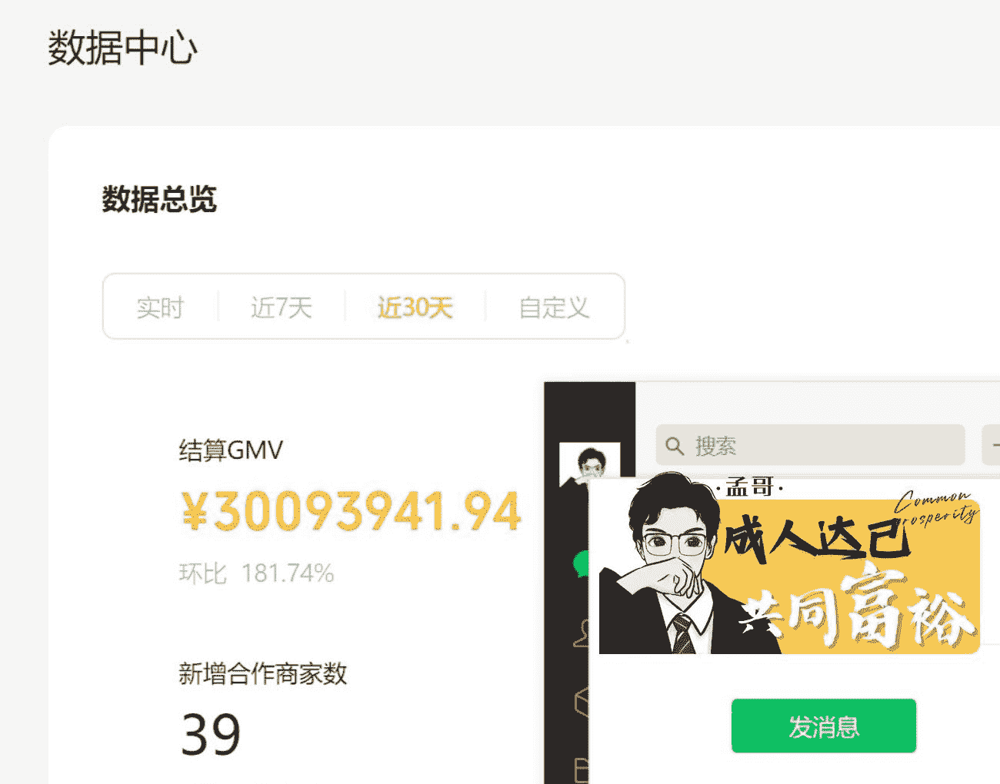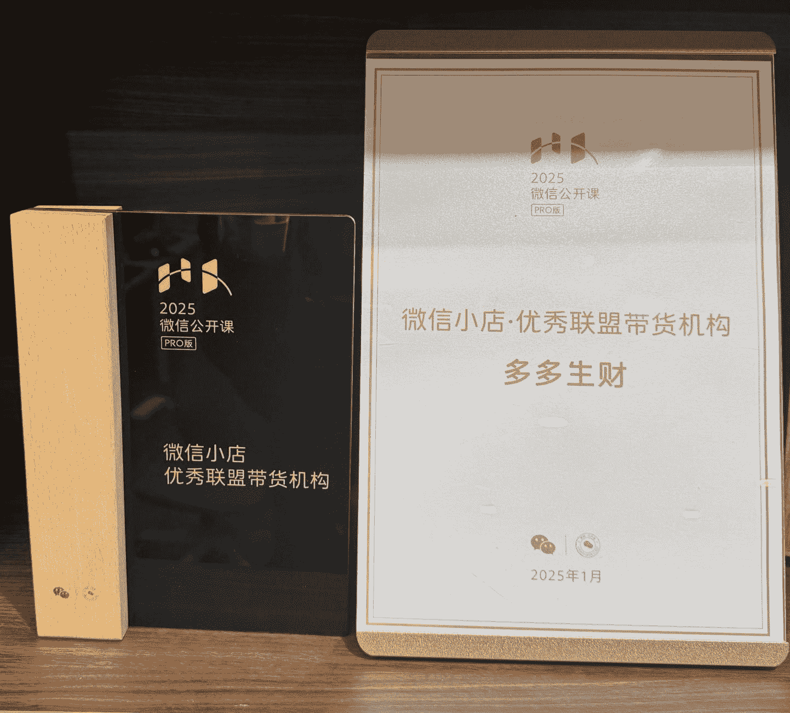

为什么同样是内容带货，视频号和小红书其实是两门生意？

为什么视频号还能赚钱，但我会把更多主力切到小红书？

普通创业者选平台的时候，到底应该看什么？以及未来一年，我怎么看视频号和小红书的机会。

# 一、我不是因为视频号不赚钱，才开始做小红书

很多人最近问我一个问题：孟哥，你是不是从视频号转型小红书了？

这个问题如果只看表面，好像是的。

我23年-24年主要在视频号里折腾，做过素人口播带货，做过视频号团长，做带货培训交付了2000+学员，其中不乏年入百万的素人学员。

但25年开始，我们把更多精力慢慢切到了小红书，自营笔记带货也跑出了7位数利润。

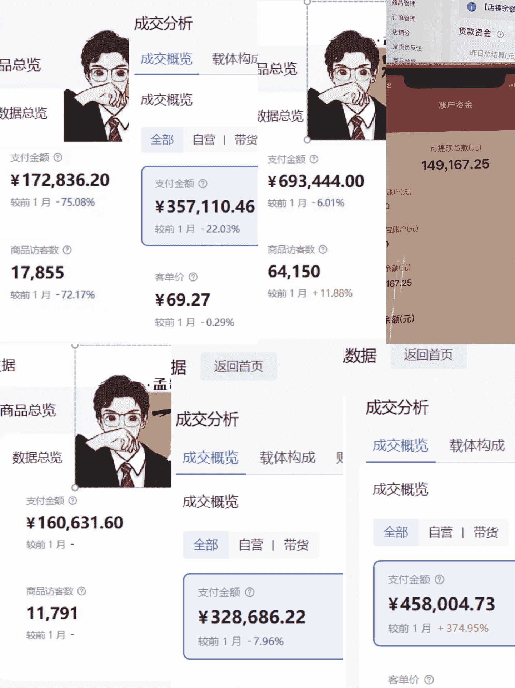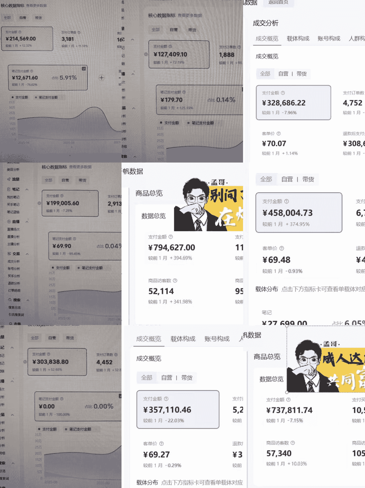

所以很多人会自然理解成：视频号不行了，小红书更香。

但我自己的真实感受不是这样，我不是从视频号逃到小红书，也没有觉得哪个平台一定比哪个平台高级。

视频号现在依然有机会，微信生态的电商基础设施还在完善，微信小店、视频号直播、服务商、供应链、私域复购，都还有空间。

只是我越来越明显地感受到：视频号和小红书，表面上都叫内容电商，但底层不是一门生意。

视频号更像一个爆量成交场。短视频爆了，直播间马上承接，用户被痛点、故事、信任感打动，当场下单。

它拼的是选品速度、口播能力、直播转化。

小红书更像一个种草决策场。用户先被内容种草，再搜索、收藏、对比、看评论区，最后决定买不买。

它拼的是人群洞察、标题封面、关键词布局、内容货架和长期复利。

我从视频号主力切到小红书，表面是换平台，底下其实换的是一整套业务结构。

以前我更多靠平台红利和团队规模放大。现在我更想靠内容效率、选品能力、AI工具和长期内容资产放大。

这就是我写这篇文章的原因。

# 二、视频号和小红书最大的区别：一个偏爆量转化，一个偏种草决策

很多人做内容电商，会把不同平台混在一起看，觉得都是发视频、发笔记、挂商品、出单。

但真正下场后你会发现，平台之间的差异非常大。

拿视频号和小红书来说，它们的成交逻辑完全不一样。

视频号的典型链路是：选品——口播/实拍短视频——视频爆量——直播间承接——即时成交。

小红书的典型链路是：人群洞察——选品——笔记种草——搜索/收藏/对比——店铺或挂车成交。

视频号用户很多时候不是带着明确购买需求来的。他可能是在刷视频的时候，突然看到一个故事、一个痛点、一个熟人感很强的口播，被打动后进入直播间。

这时候直播间就像一个收银台，用户的情绪和注意力已经被短视频调动起来了，主播要做的事情，就是承接信任、讲清利益点、解决疑虑、推动下单。

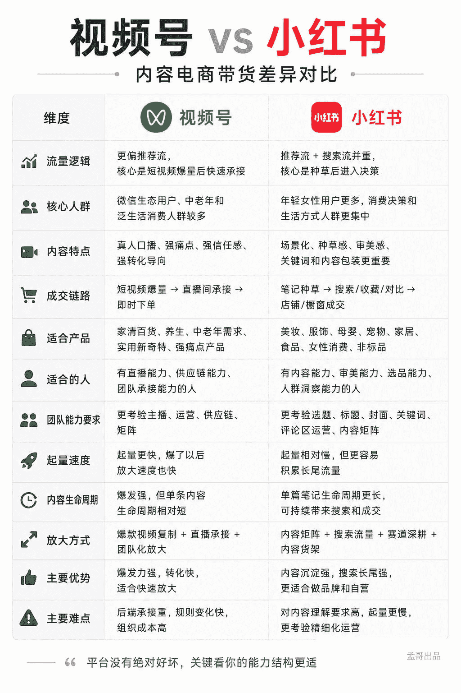

所以视频号很考验短时间内的转化能力。你的视频能不能把人吸引进来？你的直播间能不能接得住？你的主播能不能把用户留下来？

你的货盘、价格、话术、售后能不能形成一套转化系统？这些都是视频号的关键。

小红书不一样，小红书用户很多时候本身就在做消费决策。

她可能搜索“小个子通勤穿搭”“养猫除臭好物”“宝宝辅食锅”“出租屋收纳”“油皮粉底液推荐”。

她不是看完一条内容马上冲动下单。她会点进去看，收藏，对比，看评论区，甚至退出后再搜几篇类似内容。

小红书用户不是买单纯功能，还会看这个东西适不适合我的生活场景。

所以小红书的内容不能只讲，这个东西好。

你要讲：它解决谁的问题？在什么场景下使用？为什么比其他选择更适合？

用户买回去以后，生活里具体会发生什么变化？评论区大家最担心的问题是什么？这些才是小红书的核心。

如果用一句话总结：视频号更像前端爆破 + 后端收银台，小红书更像内容货架 + 搜索导购。

理解这句话，不管你做哪个平台都不会轻易亏钱了。

如果你用视频号的爆量思维去做小红书，会很痛苦，用小红书的种草思维去做视频号，也会觉得转化太慢。

平台没有绝对好坏，只有能力是否匹配，但你拿错能力进错平台，就会感觉平台处处跟你作对。

# 三、视频号带货怎么做：短视频爆量后，直播承接才是核心

我刚做视频号的时候，最大的感受是：它的爆发力很强，一条短视频如果打中了用户痛点，流量起来得很快。

尤其是素人口播、实拍带货这类内容，在平台早期红利阶段，普通人出镜念稿、讲故事、讲痛点，也有机会跑出不错的结果。

视频号适合什么品？我自己的体感是，它更适合强痛点、强即时需求、用户一听就懂的产品。

比如家清百货、中老年需求品、养生周边、实用新奇特、应季刚需品。

这类产品有几个特点：用户痛点明显，产品功能容易讲清楚，用户不需要复杂决策，可以通过真人口播建立信任，直播间可以继续放大转化。

比如一个家清产品，你只要把家里哪里脏、以前怎么麻烦、用了以后怎么省事，讲清楚，用户很容易被带动。

再比如一些中老年需求品，只要痛点和场景足够明确，真人口播的信任感会很强。

但视频号真正做大以后，你会发现，内容只是前端，更重要的是后端承接。

很多人以为视频号是在做内容，真正做到一定规模后才知道，视频号其实是在做一套流量承接组织。

短视频爆了以后，如果你没有直播承接，流量就浪费了。

直播间没人播，浪费。主播话术不行，浪费。样品没准备好，浪费。链接没挂好，浪费。

商家库存和发货跟不上，还是浪费。所以视频号做大以后，后端会越来越重。

你需要主播、样品、直播话术、供应链、矩阵管理，它不是一个人发几条视频就能长期稳定放大的生意。

早期可以靠平台红利、靠执行力、靠爆品速度拿到结果。

但随着平台规则越来越完善，粗暴打法会变难，0粉起号直接带货、单素材多账号铺量、短平快矩阵这些玩法，难度都会提高。

这不是坏事，平台想长期做电商，一定会从野蛮生长走向正规经营。

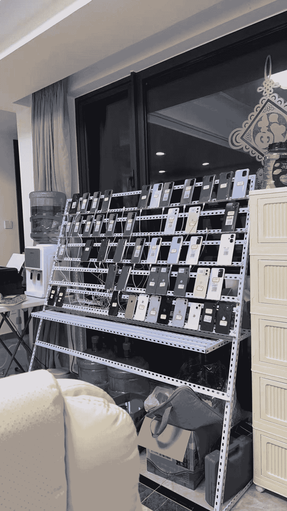

但对普通创业者来说，这意味着门槛变高了。

未来视频号更适合几类人：有直播承接能力的人，有垂直内容IP能力的人，有供应链和货盘能力的人，有微信生态经营能力的人。

视频号不是没有机会了，只是以前那种简单粗暴发内容，爆了就收钱的红利，会越来越少。

从谁胆子大、谁号多、谁跟品快，变成谁有长期账号、谁有直播承接、谁有货盘、谁能做微信生态经营。

# 四、小红书带货怎么做：先找到人群需求，再用笔记做内容货架

## 第一步，找人群需求

小红书给我的第一感觉，和视频号完全不一样。视频号很多时候是先看品能不能爆，小红书更多要先看人群需求。

你不能只问，这个品能不能卖？

你要先问，谁会买？为什么买？在什么场景下买？买之前会搜索什么词？

她担心什么？她看完笔记以后，还需要什么理由才会下单？

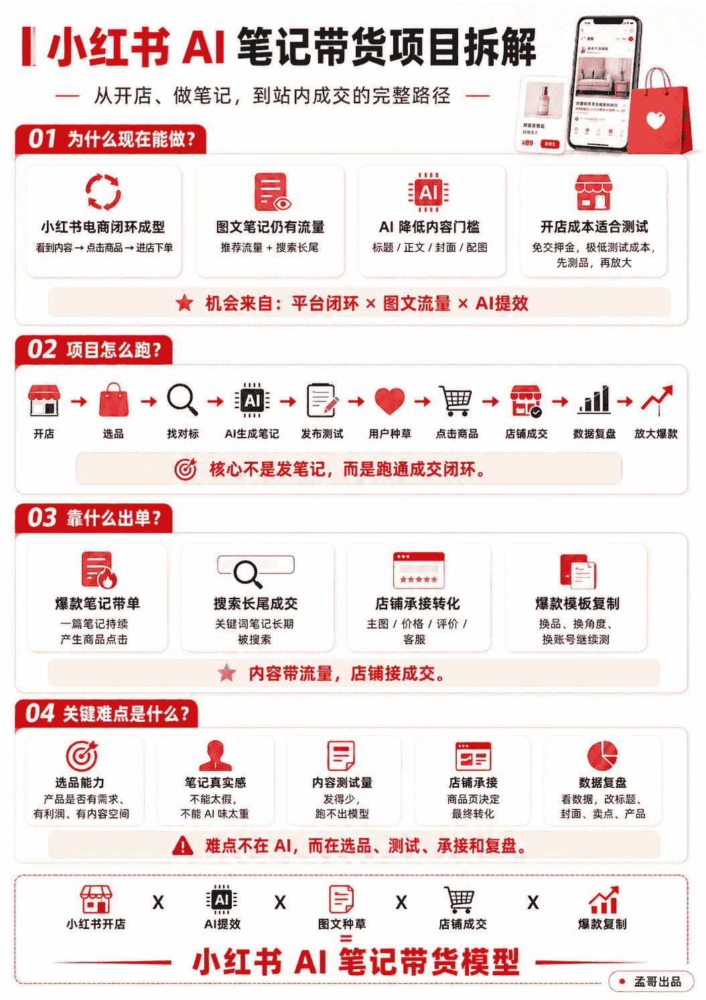

比如你卖一个收纳盒，在视频号，你可能会讲家里乱、收纳难、这个东西多能装、今天直播间优惠。

但在小红书，你不能只写这个收纳盒很好用。

你要写得更具体，租房女生桌面乱怎么办？小户型厨房怎么收纳？化妆品太多怎么整理？宿舍党怎么用几十块钱提升幸福感？

同一个产品，放到不同人群、不同场景、不同痛点里，就是不同内容。

小红书用户买的不是一个孤立的产品，她买的是一个具体生活场景里的解决方案。

所以小红书做带货，做的是一个围绕人群需求的内容货架，发笔记不过是往上面摆东西。

每一篇笔记，都不是孤立的，有的笔记负责种草，有的笔记负责讲场景，有的笔记负责承接搜索，有的笔记负责回答疑虑，有的笔记负责把用户从我喜欢推到我想买。

当你能围绕一个产品，拆出不同人群、不同场景、不同关键词，这个品才有机会在小红书上持续出单。

所以小红书带货的第一步，不是先发笔记，你得先做人群洞察。

## 第二步，做内容包装

标题、封面、关键词、正文、评论区，每一个环节都影响转化。

标题决定用户会不会点，封面决定用户第一眼有没有感觉。

关键词决定后面能不能吃搜索，正文决定用户信不信你。

评论区决定用户最后的疑虑能不能被解决。

很多人做不好小红书，是因为还在用短视频平台的脑子做内容。

他只想追爆款，只想要推荐流，只想今天发了明天爆。

但小红书不完全是这样，小红书更像一个内容货架，每一篇笔记，都是一个小导购。

标题负责拦截需求，封面负责提高点击，正文负责建立信任，评论区负责补充转化。

如果一篇笔记做对了，它不只是当天有流量，后面还有可能通过搜索持续带来成交。

这也是小红书最吸引我的地方，我不想每天都从零开始重新抢流量，我更希望今天做的内容，后面还能继续帮我卖货。

所以我们自己做小红书的时候，会越来越重视内容资产这个概念，不是只看单篇笔记爆不爆。

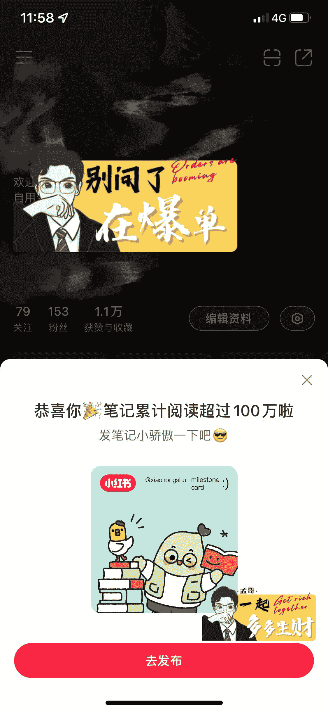

我们会看一批笔记能不能围绕一个人群、一个场景、一个品类，形成稳定的内容货架。

这个思路和视频号差别很大，视频号很多时候拼爆发，小红书很多时候拼沉淀。

举个我们自己做过的自营案例。

我们之前做过一类情绪价值小商品，产品本身不复杂，客单价也不高。

如果只从功能角度讲，它就是一个小挂件、小配饰，但在小红书上，这类产品不能只讲材质、价格、款式。

因为用户买它，很多时候买的不是功能，更多是一个心理暗示、一个仪式感、一个我想让自己变好一点的情绪出口。

所以我当时做内容，没有直接写这个产品很好看，这个产品很便宜。

我是围绕用户的生活状态去拆选题：

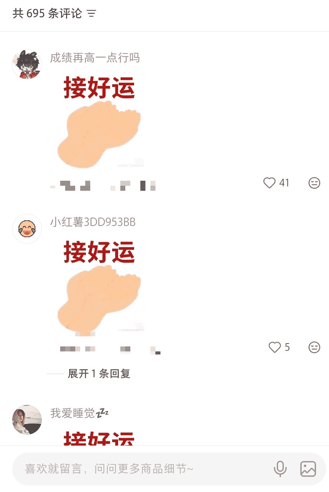

- 最近状态不好，想给自己一点正向暗示；
- 准备考试、面试、换工作，想要一个小仪式感；
- 送朋友一个不贵但有寓意的小礼物；
- 新的一年，想给自己换个随身小物；
- 在包包上挂一个有寓意的小配件，让自己每天看到都开心一点。

这类内容在小红书上更吃香，靠的是把商品放进用户的具体生活场景里，让人先看见自己，再看见商品，硬卖那一套，反而走不远。

这类品在小红书，吹得再神、把人吓得再慌，都不顶用。真正决定生死的，是你有没有把用户为什么想买它的那个瞬间，讲清楚。

真正让用户下单的，是那个想改变、想安慰自己、想给生活一点仪式感的瞬间。情绪类产品本身，只是刚好接住了这个状态。

这个时候，一篇笔记如果能把她的状态说出来，产品就有了成交机会。

后面我们也会看评论区反馈。

比如评论区有人问适不适合送朋友，我们就不再只写自己用，又打了送朋友的卖点，几十块钱以内，有心意但不贵的小礼物。

有人问考试前送这个有没有寓意，我们就把内容切到考试、面试、上岸、新阶段开始这些场景，考试前给自己准备一个小仪式感。

有人问挂包上会不会好看，我们就把它从单纯的情绪小物，延展到包包挂件、穿搭配饰、随身小物。

这些问题看起来只是用户随口问，但对做内容的人来说，其实就是新的选题和卖点。

这就是小红书和很多平台不一样的地方，评论区不只是互动区，它其实是用户需求调研区。

你能不能从评论区里拆出新卖点，决定了这个品能不能继续延展内容。

# 五、为什么从视频号切到小红书：我的能力在哪个平台赚钱更有复利？

我真正下定决心把主力切到小红书，不是因为某一天看到小红书数据很好，是长期做下来我发现视频号这门生意越来越像一个高压锅，一不小心容易炸了。

- 打品方面：视频爆了，主播要马上接；主播接不住，流量浪费；平台规则一变，前一天还能跑的打法，第二天可能就要重做
- 团长方面：客服话术没对齐，又是一堆情绪；商家库存跟不上，达人骂你

视频号能赚钱，但每多赚一笔钱，后面要多兜一堆风险，我不怕累，怕的是这锅指不定哪天就炸了。

相比之下，小红书就更符合我现阶段想要的业务结构。

第一，小红书更适合自营。

做视频号的时候，很多品是爆品逻辑，谁先测到，谁先吃第一波。

但爆品生命周期短，后面同行跟进，价格战、佣金战、素材战都会起来。

小红书不一样，小红书更适合围绕一个人群、一个场景、一个品类持续做内容。

比如家居、服饰、母婴、宠物、食品、美妆、个护、女性消费、情绪价值类产品。

这些品不一定靠一条内容瞬间爆发，但如果内容货架搭起来，用户不断搜索、收藏、对比，就有机会形成稳定成交。

这对自营很重要，因为自营最怕每天都靠运气爆单。

我更想要的是通过内容不断测试用户需求，反向优化选品、定价、卖点和供应链。

第二，小红书更适合用AI提效。

以前做内容，很多环节都要靠人堆，选题，标题，正文，封面，人一多，管理成本就上来。

现在AI出来以后，小红书内容生产效率被明显拉高了，我们会把爆款笔记喂给AI，让AI先模仿，生成图片，先做第一轮测试，如果测爆了，我们才会考虑上实拍，大大降低了测品的成本。

之前选到一个品，买样品，找场景，安排拍摄，几天时间没有了，现在有了AI，秒出素材，提高了效率。

AI不能替你判断什么品能卖，AI也不能替你真正理解用户，但它可以大幅降低内容生产成本。

以前一个运营一天可能只能磨几篇笔记，现在有了AI辅助，一个人可以同时测试更多标题、更多角度、更多内容版本。

真正值钱的，变成了操盘手的判断：你能不能选对品？能不能看懂用户？能不能拆出卖点？

AI降低了执行门槛，但提高了判断的重要性，这也是我觉得小红书值得重视的原因。

拿小红书爆款封面出现比较多的：量感陈列货架，举例。

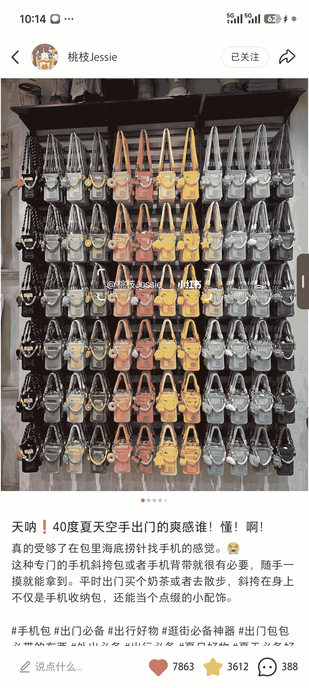

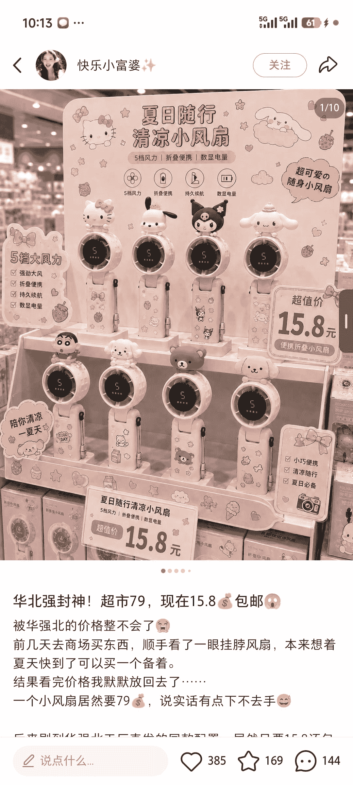

公众号懒人搜索，懒人专属群分享

小红书的封面，往往是越糙越有人点，像真实货架、真实逛街、真实发现的那种，比精修图更抓人。

这是小红书上一类很常见的爆款封面：一整排商品整整齐齐摆在货架上，颜色统一，数量很多，像是在精品店、商场、文创店里随手拍到的。

这种封面看起来不复杂，但它很容易吸引用户点进去。

因为它同时满足了几个心理：

第一，量感会制造好逛感。

用户刷到一张孤零零的产品图，第一反应可能是广告。但如果她看到一整排、一整面、一个货架的商品，她会下意识觉得：这里面应该有很多款式，可以挑一挑。

小红书用户本来就有逛的心态，她不是只想看一个商品，她想看选择、看款式、看价格、看有没有更适合自己的那一个。

所以货架陈列型封面，本质上不是在展示一个产品，而是在展示一个可逛的消费场景。

第二，重复陈列会制造“这个东西很火”的感觉。

一个商品摆在那里，用户不一定有感觉。但同一个产品，用不同颜色、不同款式、不同包装重复出现，就会形成一种视觉暗示：这个东西好像是一个系列，好像卖得不错，好像很多人会买。

这不是靠文案硬说爆款，而是靠画面本身让用户感受到它在被大量陈列、重点展示。

第三，真实货架比棚拍图更像种草内容。

小红书用户对过度精修的商品图是有防备的。但如果画面像是在商场、超市、精品店随手拍到的，反而更容易被理解成真实发现、逛街看到、顺手分享。

尤其是低客单的小商品、夏季好物、礼品、配饰、家居小物这类产品，用户买它不是为了做复杂决策，而是被一个场景、一种氛围、一个价格刺激到。

第四，价格牌、功能点、系列感，会降低用户理解成本。

比如一张图里同时出现：

- 多个颜色款式；
- 明确价格；
- 简单功能点；
- 货架陈列；
- 可爱包装；
- 商场/店铺背景。

用户不用点开正文，就能在 1 秒内知道这是什么、多少钱、适合什么场景、值不值得继续看。

这就是小红书封面的关键：不是让用户看懂所有信息，而是让用户有一个点进去的理由。

我们自己做小红书自营，也会把这种封面结构拆出来。

我们不会只跟 AI 说“帮我生成一张好看的产品图”，因为这样出来的图往往太像广告，也太单薄。

我们会更具体地描述：我要的是一个真实货架陈列场景，产品要有量感，要像精品店、文创店、超市货架里真实摆出来的。

画面里可以有价格牌、功能标签、促销小卡片，整体要像普通用户逛街时随手拍下来的发现，而不是品牌方精修海报。

这样生成出来的图，才更接近小红书用户愿意点击的封面。这里也给大家一个可以直接改的 AI 出图提示词：

请生成一张适合小红书种草笔记封面的真实货架陈列图。

产品是【填写你的产品，比如：便携小风扇 / 包包挂件 / 情绪价值小礼物 / 桌面收纳盒】。

画面场景：精品店 / 文创店 / 商场货架 / 生活方式集合店，真实线下陈列感，不要棚拍，不要纯白背景，不要电商详情页风格。

构图要求：多个同款产品整齐陈列，形成明显量感；有不同颜色、不同款式；前景产品清晰，后方货架略微虚化；画面像用户逛街时随手拍到的爆款好物。

视觉风格：干净、明亮、真实、可爱、有消费欲；适合小红书图文笔记封面；不要廉价感，不要过度精修，不要像广告海报。

画面元素：可以加入价格牌、功能标签、小卡片、包装盒、货架、店铺灯光；价格牌上可以写【填写价格，比如 15.8 元 / 29.9 元 / 超值价】；功能标签可以写【填写卖点，比如：便携、夏日必备、送礼、可爱、解压】。

拍摄感：手机实拍感，轻微景深，真实商场灯光，前景清晰，背景自然虚化，9:16 竖版构图。

对小红书带货来说，封面不是装饰，它就是第一层转化，用户不点进来，后面的标题、正文、评论区、商品链接，全都没有机会发挥作用。

## 三、小红书更适合沉淀供应链方向

小红书不是单纯的卖货平台，它更像一个前端需求测试场。

你通过笔记可以看到：什么人群有需求，什么卖点能打动用户，什么场景最容易种草。

这些数据，对后端做自营、做供应链、做定制品的人来说非常值钱。

因为你不是先拍脑袋开品，你可以先通过内容测试需求，再反向决定供应链要往哪里走。

我不想一直停留在卖别人的爆品、赚一波流量的钱，更想沉淀自己的选品能力、内容能力、供应链能力和用户理解。未来我也会去尝试自己定制产品，做产品组合。

所以我看小红书，不只是看它现在能不能赚钱。

我更看重它能不能让我把内容电商这件事做得更深、更长期。

# 六、未来一年趋势：视频号会更正规，小红书会更电商化

未来一年，我对视频号和小红书的判断很简单。

视频号会继续电商化，但打法会更正规。微信生态不缺用户，也不缺交易场景。

视频号、微信小店、公众号、私域、社群、小程序，本来就在一个生态里，这套生态如果打通，商业空间肯定不小。

但对普通人来说，机会不会再像早期那么粗暴。以前可能靠一条口播、一批账号、一个爆品，就能快速吃到红利。

未来会更考验长期经营能力。

垂直内容 IP、稳定直播间、微信小店运营、大场成交能力、供应链整合，这些会变得更重要。

视频号的机会没有消失，只是从流量红利转向经营红利。

小红书未来一年，我认为会继续从内容社区往电商平台进化，但它不会变成另一个抖音，也不会变成另一个视频号。

小红书的核心仍然是种草、搜索、生活方式和消费决策。平台越电商化，商家越多，达人越多，竞争肯定会变激烈。

AI 也会让内容生产门槛降低。以前一个人不会写笔记、不会做图、不会拆卖点，可能很难入局。

现在有了 AI，很多基础执行动作都会变得更简单，但这不代表赚钱更容易。

因为当所有人都能更快生产内容的时候，真正稀缺的就不只是会发笔记了。

你得先选对赛道，选对品，看懂人群，做出差异化内容，最后从数据里迭代出更好的方向。

所以小红书未来的机会，不在于简单的流量红利，而是整个平台内容电商基础设施完善后的操盘红利。

粗糙的人会越来越难，精细的人会越来越有机会。

# 七、普通创业者怎么选：看你手上有什么牌？

如果一个创业者问我：“孟哥，我到底应该做视频号，还是做小红书？”

我不会直接给答案，我会先问他：你手里有什么资源？

## 视频号

如果你有成熟的视频内容能力、AI 视频生产能力、账号资源、强痛点产品，那视频号依然值得做。

视频号的爆发力还是很强，一个素材如果跑起来，短时间内就可能带来很大的流量和成交。

但对新手来说，视频号现在的启动难度已经比早期高了很多。

以前很多人做视频号，靠真人口播、简单实拍、短视频爆量，就有机会跑出结果。

现在平台规则变化以后，新手再入局，往往会遇到一个新的问题：前端素材生产变复杂了。

现在很多人做视频号，会用 AI 做视频，听起来好像降低了门槛，但真做起来没那么简单。

你要先选品，选完品以后，要写剧情脚本；脚本写完以后，要用 AI 生成视频。

AI 生成视频不是一次就能满意，经常需要反复抽卡，反复调整人物、画面、动作、口型、节奏、分镜。

好不容易做出一个素材，你还不知道它到底能不能跑起来。发出去以后，可能马上不行，也可能前面不动，后面突然起量。

也可能素材本身没问题，但品不行；也可能品没问题，但脚本没打中用户。

这中间每一步都要试错。更现实的是，视频号很多打法还是偏消耗型。

你可能需要账号成本，一个号跑废了，就要换号。

素材跑起来以后，还要有主播承接。虽然现在可以找兼职主播、代播，不一定非要自己真人上场，但这依然是一个需要提前准备的环节。

你不能等视频爆了，才临时想起来找人接。

所以现在新手做视频号，难点不只在于会不会发视频，而是你要同时解决选品、脚本、AI 素材、账号、测试、主播承接、成交转化。这套链路对有资源的人来说，依然有机会。

但对完全没资源的新手来说，启动成本和试错成本都不低。

## 小红书

小红书不一样，小红书的启动链路相对更短。

你可以先选一个赛道，选一个有需求的品，用图文笔记去测试标题、封面、卖点、关键词和用户反馈。

前期不一定要复杂的视频制作，也不需要开直播，不需要露脸拍视频，也不一定要一上来准备很多账号成本。

你先把笔记发出去，看用户会不会点、会不会下单，它的反馈链路更清楚。

从这个角度看，如果你是没团队、没账号资源、没强内容生产能力的新手，只是想用最低成本先验证自己能不能做内容电商，我会更建议你先从小红书笔记带货开始，它确实更适合新手用低成本跑闭环。

视频号更像是一个前端素材和后端承接都要配合的生意，小红书更像是一个内容货架和消费决策的生意。

有资源的人，可以按资源选平台。

没资源的新手，先别急着追求大爆发，不要一上来追求矩阵、爆款、团队。

可以先从小红书跑一个最小闭环：

1. 选一个明确人群：谁买？女生、宝妈、学生党、打工人、宠物主？
2. 找一个具体场景：为什么现在要买？考试前、搬家后、换季、送礼、焦虑、变美？通过人群和场景找到具体的产品。
3. 拆 20 个标题方向：痛点型、场景型、搜索型、对比型、评论区问答型。
4. 找对标，模仿爆款封面：AI 先出图文素材，低成本测试。
5. 每个方向发 3～5 篇笔记：测标题、封面、关键词。
6. 看评论和成交：用户到底在意什么？
7. 把有效卖点放大：继续做同类选题。

跑不通这个闭环，先别谈趋势、红利、AI 自动化，否则都是空想。

但小红书也不是谁都适合。如果你只想今天发、明天爆、后天收钱，没耐心看评论、拆关键词、改标题封面，那小红书会让你很痛苦。

如果你只会搬运，不愿意理解人群，也不愿意持续迭代内容，小红书也不适合你。

小红书看起来轻，实际上更考验细活。它不一定让你赚快钱，但更适合把内容做成资产。

# 八、写在最后：平台不是信仰，ROI 才是判断标准

写到最后，我想说一句很现实的话：平台不是信仰，平台只是工具。

视频号也好，小红书也好，本质上都是内容电商的一种形态。区别在于，视频号更考验爆量和承接，小红书更考验种草和决策。

很多人选平台的时候，喜欢问：哪个平台还有红利？

但我现在更关心另一个问题：这个平台的红利，跟我手里的能力匹不匹配？

如果你有直播承接能力、有供应链、有强痛点产品，视频号依然值得做。

如果你有内容能力、选品能力、人群洞察能力，想做更轻的内容资产和搜索长尾，小红书值得重点研究。

这几年我从多多视频做到视频号，再做到小红书，最大的感受是，每个平台都会变。

粗暴红利会消失，规则会收紧，流量会变贵，同行会变多。

但只要你能看懂平台需要什么，看懂用户为什么买，看懂自己的能力适合放在哪里，就不会被某一个平台绑死。

创业者最怕的不是换平台，最怕的是平台变了，自己还抱着旧打法不放。

能赚到一波红利，是运气；能在红利变化之后，把自己的能力迁移到下一个平台，才是真正的本事。

别死守平台，守住能力，这是我从视频号切到小红书后，最大的体感。

如果对你有帮助，欢迎投票催更，我会多多分享！

————分割线————

看完这篇 SOP，你觉得你懂了。但 90% 的人一到实操就会卡在第一步。

工具和教程只是最低级的壁垒，真正的壁垒是“立刻动手”和“圈层信息差”。

如果你想看全网最新的变现玩法，并且和一群执行力极强的极客一起下场拿结果，欢迎围观我的核心私域：【懒人专属群】。

我们不聊虚的，只做商业闭环的拆解与 AI 效率的压榨。系统内已沉淀 1000+ 跑通的套利实战局。

👉 查阅圈子完整数字资产与上车门槛：

https://lazyso.com/insider/

认同价值、准备好下场干活的，扫码加我微信（lazyhelper1）

备注：【实操上车】，不闲聊

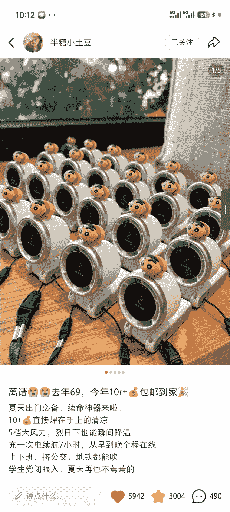

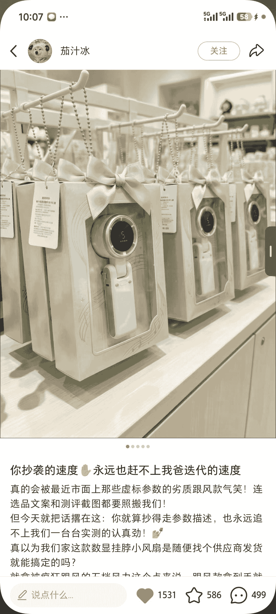

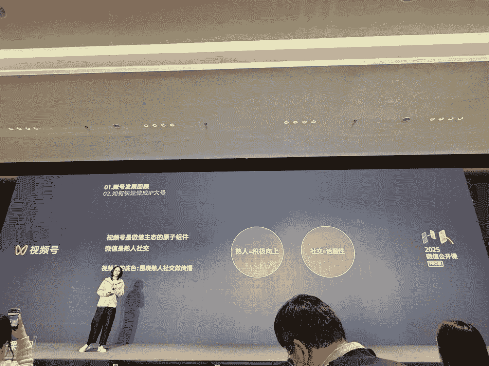

