公众号懒人搜索，懒人专属群分享我是由月之暗面（Moonshot AI）研发的 kimi-k2.7-code 智能大模型。做跨境 5 年年销破亿！分享我眼中的 TikTok 掘金机会 + AI 赋能业务 5 个核心思路

260702 副业 SC 精华

整理：公众号懒人搜索，懒人专属群精选

懒人微信：lazyhelper1

大家好，我是 A，朋友们都叫我 Trevo。

端午周末，我在西安做了一场线下分享沙龙。

了解到，各行各业的问题，大多数商家都卡在引流、复购和客户粘性上；大家手里的项目虽然不一样，但出现问题的地方是像的：原来的生意越来越难，国内获客越来越贵，行业越来越卷。他们共同的处境不是“什么都没有”，恰恰相反，各自手里都有经验、产品、团队、行业积累和资源。

如何把 AI 这个新机会，接进自己原有的生意里？我整场课没从“平台教程”讲起，我认为大家真正的问题不是缺信息，是缺判断。

干事，普通人最容易犯的错，是把一个行业理解得太窄。看到 TikTok，就只想到开店卖货；看到 AI，就只想到写代码、做软件、跟程序员抢市场。方向从第一步就偏了。


如果你也在纠结：想做跨境，迷茫；想学习 AI，不知道从哪里着手——这篇应该能给你带来一些参考。

文章内容大纲：

1. 先泼盆冷水：TikTok 不是闭着眼睛能赚钱的，重模式对小白真不友好
2. TikTok 是兴趣电商，核心是内容不是货架——光会开店是不够的
3. 别拿“卷”解释一切，先找自己的入口和那个会要命的主要矛盾
4. 货架电商绕不过去的几个坑：开店成本、货物物流、回款周期，本质都在考验现金流
5. AI 不难，难的是你愿不愿意把它养起来（知识库、私域销售、数字大脑）
6. 别去抢市场，在自己的根上长分支——讲清“项目”和“事业”的区别
7. 很多事不性感，你得熬得住：心力、愿力和持久战

几个核心观点：

- TikTok 不只是货架电商，入口很多，本质是搞内容
- 卷，很多时候不是行业绝对卷，是你没站在你自己的优势位上
- AI 是养出来的，你喂得越真实它越懂你，喂得越空它越像个网上随便抓来的资料库
- 不是“AI 替代销售”，是“AI 重构销售流程”
- AI 是个放大器，普通人别去跟技术大佬抢市场，要把它接回自己已经有根的地方
- 不做“项目”，做事业，所有东西都在你自己的树上开花结果

## 先泼盆冷水：TikTok 不是闭着眼睛能赚钱的

这是我分享开始的时候提到的第一句话，我一直跟身边人讲，TikTok 不只是货架电商。很多人一听 TikTok，就觉得它只能做电商、只能开店卖货，可这个平台的入口很多：内容、达人、本地化运作、星图，再加上货架电商、直播、私域、外贸销售这些延展方向，每一个都能切进去。但我不想画饼，所以一上来就说清楚：TikTok 绝对不是闭着眼睛能赚钱的，我不想给大家画饼。

我自己是 2021 年左右开始布局这个赛道，2022 年人在海外时开始以个人出镜往里面干。这个行业不是没有难度，也不是所有轻资产的人都适合冲。选赛道重要，但这件事本身也很难。我反复强调一点：很多新手看项目的方法太“贵”了——平台逻辑、产品适配、物流、海外用户、内容、团队都还没搞清楚，就直接想开店、压货、砸钱。对小白来说，我认为这条路是真的不友好。

## 光知道货架电商是不对的，TikTok 是兴趣电商，核心还是内容

我喜欢用抖音类比 TikTok：抖音不是一定要开店，TikTok 也是兴趣电商，本质上是搞内容，不是只搞货架。光知道货架电商是不对的，搞 TikTok 应该以内容为本。这话不是否定货架电商，货架电商只是一个入口而已。如果一个人只知道“我要开店卖货”，不知道怎么做内容、怎么测试产品、怎么看海外物流、怎么理解用户反馈，那一上来就把钱压进去，很容易出问题。

内容也不是随便拍几个视频，更不是找个剪辑把素材拼一下就完事。内容背后有产品理解、有用户理解、有场景、有反馈、有测试，也有成本结构。你得知道你这个产品为什么别人会感兴趣，用户在什么场景下会停下来，评论区的人在问什么，差评里暴露了什么，同行为什么能卖，别人前三秒怎么抓人，后面又怎么转化。这些都搞明白了，再去讲卖货。

毛选里提到一句话：“没有调查，就没有发言权。”其实放到 TikTok 上也是一样的——别先问什么产品好卖，先看海外用户能不能三秒看懂你的卖点。判断要回到真实的现场、评论和数据里，别停在自己的想象和概念里。

所以你得先问自己适合从哪个入口进去。TikTok 里有短视频，有图文，有直播，有货架，有星图，有达人，有本地化，有私域，有 AI 视频，有真人出镜。有人适合做货架，有人适合做内容，有人适合做达人合作，有人适合做本地化，有人适合做私域承接。你不能看见别人开店赚钱，就觉得自己也该开店。别人背后可能有供应链、有现金流、有团队、有海外资源、有账号矩阵、有内容能力，你没有这些，一上来学他的重模式，那不是学习，那是把自己往坑里送。

现场有人说国内卷，产品卷，退货多，质量还下降，所以想看看海外有没有机会。

我说得直接，可能有点扎心：卷的那个人，可能跟别人卷得过的那个人，只是我们自己卷不过而已。

很多时候不是行业绝对卷，是你在这个位置上没有优势。别人有更强的供应链、更低的成本、更好的销售、更强的内容、更多资源，你当然觉得卷。卷这个词不能用来解释一切，它有时候只是说明我们没站在优势位上。得先认这个账，再重新找自己的入口。毛选里讲做事先抓主要矛盾，复杂局面里不是所有问题一起解决，而是先找最关键那一个。我看项目就是这个习惯：先别问能不能赚钱，先问它会死在哪个环节。一个跨境项目做不起来，主要矛盾可能不是账号，而是卖点表达、内容本地化或者履约；一个账号没转化，主要矛盾可能不是流量，而是人设不清、产品不清、信任链路不清。主要矛盾找对了，劲才不会白使。

落到具体的人身上就很清楚了：你有内容团队，就先做内容，把产品合作起来；你有产品优势，就去找达人、找内容团队；你有海外资源，就把本地化做深；你有私域销售能力，就别只盯着平台成交，把流量接到后端去。团队未来要长成什么样也得想清楚，哪一块是树干，哪一块只是枝叶，而不是今天看见一个机会冲一下，明天看见一个项目又换方向。

讲机会也得讲坑。TikTok 货架电商分本土店铺和跨境店铺，里面有几个绕不过去的成本：开一个店可能要大几万，权重好不好还有不确定性；货物和物流也压人。以美国为例，政策更希望你把货运过去，但很多人扛不住货物成本和运费，回款周期还得算，新店从发货到回款可能十天甚至更久。明朝那些事儿我也一直在看，里面一个反复出现的底层逻辑就是：国家要财政，组织要现金流。明朝中后期很多崩盘，根子都在财政枯竭。生意一样，店铺权重、货物、回款周期，本质都在考验你的现金流扛不扛得住。所以我看货架电商，从来不只看能不能卖出去，更看卖出去之后钱多久能回来，回不来的这段时间我撑不撑得住。

还有人问，除了这些还有什么没看见的玩法。我提了拍卖，但不是让大家幻想暴利。Whatnot 能拍卖，TikTok 也能拍卖，一个水杯 5 块钱起拍，现场有人一冲动就把价叫上去了；一双鞋通过拍卖卖出 10 倍、20 倍、30 倍利润，也是有可能的。但你不能只听到倍数，得听懂背后的逻辑——拍卖不是简单卖货，它是内容、情绪、现场感、稀缺感和交易的结合。这恰恰说明，TikTok 不只是短视频，星图内容是内容，直播内容是内容，短视频内容也是内容，拍卖也是一种内容化交易。

我想先把 TikTok 这件事讲简单一点：它不是一个店铺后台，而是一个海外用户的内容流量场。真正要先搞清楚的，不是马上开什么店、铺什么货，而是用户为什么会停下来，为什么愿意相信你，为什么愿意问你，后面才谈店铺、直播、供应链和投流。小白看完，至少要知道第一步不要直接往重资产里头干；做过内容、电商、跨境，或者本来就在创业的人，也可以换个角度重新看 TikTok，它背后不是单个玩法，而是一整套内容、流量、信任、成交和交付链路。

我自己也是一个 AI 的探索者，所以这次也会和大家聊一聊 AI 怎么进入真实业务，怎么帮自己做内容、销售和复盘，怎么慢慢变成自己的数字大脑。嗯，就是这些事，我先从一个最简单的问题开始：TikTok 到底还有什么机会？

## 记住，这不是闭眼赚钱的风口

这是一句不太讨喜的话。确实有人靠 TikTok Shop 做起来了，也有人靠跨境电商赚到了钱，但对新手来说，最怕的不是机会少，而是一上来就把事情搞得太重。0-1 没搞好，很多问题不会马上爆出来，后面才会一点点浮上来。一个新手还没验证内容能不能跑出来，没验证海外用户到底买不买，没验证这个产品在当地有没有需求，也没验证履约能不能接住，就先把钱压在库存、发货、团队、店铺和各种平台规则上。这个时候表面看是创业，实际上很可能是在提前交学费。

我不是说货架电商不能做。货架电商当然能做，而且有人做得很好，但它对资金、供应链、履约和平台经验的要求并不低。尤其对很多刚开始的人来说，你以为自己是在抓机会，其实可能是在用最贵的方式验证一个还没想清楚的项目。

所以我不会鼓励大家一上来就开店，我更希望大家先把 TikTok 看成一个内容平台，看成一个海外用户的注意力场。你得先搞清楚用户为什么停下来，为什么愿意相信你，为什么愿意点进主页，为什么愿意问价格，为什么愿意成交。这些问题没跑明白，后面搞什么我觉得都容易拉垮。

## TikTok 不只是一个店铺后台

我自己做 TikTok，不是只看了几篇报告，然后来讲趋势。

我是真正跑过这条链路以后，才越来越觉得，跨境不是把一个产品搬到另一个平台卖。

它更像是重新理解海外用户。

同样一个产品，在国内怎么表达，在美国怎么表达，在墨西哥怎么表达，在东南亚怎么表达，完全不一样，当地政策也不一样。用户为什么会停？为什么会信？为什么会问？为什么会买？为什么后面还愿意继续买？你把这些问题想清楚，再去看 TikTok，看到的就不是一个店铺后台，而是一套完整的链路。

这也是我这次最想讲清楚的地方。TikTok 的机会不是只有“开店卖货”这一种，它背后有内容机会，有达人机会，有星图任务机会，有本地化资源机会，也有 AI 进入业务以后带来的新机会。所以不要一上来就问：我要不要开店？更应该问：我手里有什么资源？我现在的能力适合从哪个入口进去？我能不能先跑一个小闭环？

## 我为什么会这样看 TikTok

我自己做 TikTok，不是只做过一个账号，也不是只看过平台流量。

早期我自己出镜，自己做海外内容，也做过直播和电商短视频。那个阶段最直接的感受是：TikTok 首先不是卖货工具，而是一个内容场。用户刷到你，先不是判断要不要买，而是判断要不要停下来。前三秒能不能让他看懂，这个场景是不是跟他有关，你说的话像不像当地用户能接受的表达，这些东西如果没有跑出来，后面讲产品、讲店铺、讲转化都会很吃力。

后来我也做过店铺、成交和发货。跑到这一步以后，又会发现流量只是开始。有人问价，不代表能成交；有人下单，不代表后面能接住。平台规则、产品价格、履约速度、售后问题、发货成本，这些都是真实成本。很多新手一上来只看到“开店卖货”这一步，但真正做起来以后才知道，店铺不是终点，它只是交易承接的一环。

再往后，我也接触过线下实体和私域外贸销售。这个阶段给我的感受更深：跨境不是把国内的产品换个平台卖给外国人，而是要重新理解海外用户。不同国家的表达方式不一样，用户信任你的方式不一样，沟通节奏不一样，成交之后的关系维护也不一样。你不能只想着这一次把货卖出去，还要想后面怎么持续沟通，怎么让客户愿意继续信你，怎么把一次成交变成长期关系。

所以我现在看 TikTok，不会只问“要不要开店”。

我会先问这个人手里有什么资源，适合从哪个入口进去。有人适合先做内容流量，有人适合先做达人合作，有人适合做星图任务和内容服务，也有人本来就有海外资源、当地货盘和渠道，应该从本地化资源切入。

TikTok 不是一个单点动作。前面是内容和信任，中间是成交和承接，后面是履约和客户关系。你把这条链路看明白，再去选择入口，就不会一上来把自己做得太重。

## 先看四个入口

如果现在给一个新手讲 TikTok，我会先讲四类入口。最先要看的，是内容流量。

TikTok 首先是内容平台，短视频、直播、橱窗、AI 视频、真人出镜、图文内容，本质上都在争夺海外用户的注意力。很多新手一上来问我什么产品好卖，我一般会先问另一个问题：这个产品在海外内容里好不好表达，三秒钟能不能让人看懂，能不能用一个场景让用户停下来，再用一个痛点让他觉得“这个跟我有关”。如果不能，后面你再怎么开店、再怎么上架、再怎么投流，都会很吃力。

内容流量最适合小团队低成本试错。先用内容验证用户有没有反应，评论区在问什么，私信里最关心什么，哪些视频没人理，哪些角度有人停，这些反馈比你坐在电脑前看十篇趋势分析更值钱。

再往下看，是达人。很多人一听达人，就觉得是找大 KOL 花钱投放，其实真正做得细的人，不一定一开始找大达人。更有效的方式，是把达人当成一个长期、低成本的流量网络，每天去找垂直达人，发消息，沟通素材，看谁愿意配合，让他们在视频里带你的 tag，在标题里 @ 你，在评论区提到你。这件事听起来不高大上，甚至有点笨，但很多真正有效的事情，一开始都不性感。

星图和任务，也是一条容易被新手忽略的入口。大家一想到 TikTok 变现，还是卖货，但平台里有很多品牌、软件、游戏、金融、旅行、工程和服务类公司，都需要内容推广，需要有人帮他们做视频、做传播、做内容测试。有些人不一定适合自己卖货，但如果你有内容能力、剪辑能力、账号能力，或者能理解某个垂直行业，反而可以从任务和服务切进去。

还有一类，是本地化资源。如果你本来就有海外资源、当地团队、当地货盘、渠道、仓储、服务能力，那你看 TikTok 就不能只看账号，而要看本地资源怎么跟内容流量结合。

所以 TikTok 不是一条路，它更像一张围绕海外内容、海外用户和海外资源展开的机会地图。有的人适合从内容切，有的人适合从达人切，有的人有软件、有服务、有产品，可以从星图或者内容推广切；有的人本身有海外资源、当地团队、当地货盘，那他应该从本地化资源切。重点不是哪个入口听起来最热闹，而是哪个入口离你现在最近，成本最低，最容易先跑出反馈。

## 真正卡住人的，不只是平台

我说得直接一点，不是所有人都适合现在冲 TikTok。如果一个人完全不愿意做内容，也不愿意研究海外用户，不愿意每天去看评论、找达人、改脚本、复盘数据，只想听一个确定答案：到底什么产品能赚钱？那这个人做 TikTok 会很难。因为 TikTok 前期给你的，往往不是答案，而是反馈。视频没人看，是反馈；有人停下来但没人问价格，也是反馈；评论区一直问同一个问题，更是反馈。

很多人做内容最大的问题，是把内容当成表演。发完以后看播放量，播放量不好就焦虑，焦虑完就换方向。但真正做项目的人，应该把内容当成用户调研。你要去看，为什么有的内容有人看，有的内容没人看；为什么这个产品有人问，但没人买；为什么这个卖点翻译过去以后像机器话；为什么评论区在问的问题，和你以为的卖点不一样。这些东西都要留下来，留下来以后，AI 才能帮你复盘。

所以这次我会把 AI 和心力放在一起讲。一个人如果只是收藏工具，不愿意下场，AI 帮不了他太多；一个人如果只是看见机会，不愿意承受前期的冷反馈，TikTok 也帮不了他太多。

## AI 不是只用来写文案的

现在很多人学 AI，还停留在“它能不能帮我写一篇文案”“它能不能帮我生成一张图”。这些当然可以，但如果只把 AI 当成聊天工具，或者当成临时写文案的工具，就太可惜了。我现在更想强调的是：所有工作、所有业务，都值得用 AI 重新学一遍、拆一遍、做一遍。不管你是做跨境、实体、销售、内容、培训、咨询、运营，还是做一个很小的个人项目，AI 都不是一个额外的插件，它应该进入你的真实业务。

拿 AI 写作举例，如果只是基础写作、笔记、公众号、小红书、短视频脚本，大部分大模型都能做，真没必要一开始就纠结到底用哪个模型。真正重要的是后面那套商业思维：先找到一个垂直赛道，最好是你自己感兴趣的；如果你本来就在这个行业里有积累，那更好。然后选一个平台，抖音、小红书、公众号、知乎都可以，如果你想做海外内容，也可以是 TikTok、YouTube、Instagram。

接着别急着写，先把这个赛道里做得好的账号拆一遍。最近一个月的内容，想更准就拆三个月。看它们选题怎么起，标题怎么写，开头怎么抓人，评论区都在问什么，配图是什么风格，哪些内容容易爆，哪些内容只是看起来热闹但没有用户价值。这些东西整理出来以后，再喂给 AI，让 AI 先理解这个赛道、这个平台、这些头部账号的表达方式。

然后你再开账号，让 AI 辅助你持续产出适合这个平台、适合这个垂直赛道的内容。这里不是让 AI 乱写，更不是抄别人，重点是让 AI 帮你把行业理解、用户反馈、平台风格、内容节奏都串起来。等你真的有了精准流量，有了用户，有了持续反馈，后面的变现方式自然会慢慢长出来。很多人总是提前问“有流量以后怎么赚钱”，但问题是你连第一批精准用户都没有，问这个太早了。

公众号懒人搜索，懒人专属群分享我是由月之暗面（Moonshot AI）研发的 kimi-k2.7-code 智能大模型。做 TikTok 跨境也是一样，可以让 AI 帮你拆海外内容、整理用户评论、改英文话术、生成脚本、复盘达人沟通记录。做实体，就把客户问题、销售 SOP、成交和流失原因、员工培训资料整理进去；做个人 IP，就让它帮你沉淀观点、拆账号、整理素材，保持稳定输出。所以 AI 学习不是为了显得高级，而是因为以后很多工作和业务，都会被重新做一遍。你不学，少的不只是一个工具，更是一种重新理解业务的能力。

## 数字大脑不是概念

我自己做数字大脑，也是从这个地方来的。如果你每天只是临时问 AI 一个问题，AI 给你一个答案，这当然有用，但它帮不了你太深。真正有价值的是，你能不能把自己的业务资料、产品理解、客户问题、内容素材、复盘记录、成交话术和失败案例都沉淀下来，让 AI 慢慢理解你这个人、你的业务、你的表达方式和你正在做的项目。

公众号懒人搜索，懒人专属群分享

这样 AI 才会从一个外面的工具，慢慢变成你的业务助理、内容助理、复盘助理，甚至变成你的第二大脑。做 TikTok 也是一样，你今天发了什么视频，哪个开头有效，评论区问了什么，哪个达人回复了，哪个产品有人问但没人买，哪个脚本翻译过去以后像机器话，这些东西如果都散掉了，AI 也帮不了你多少。但如果这些都沉淀进来，AI 就能帮你复盘：你的内容到底卡在哪里，用户真正关心什么，下一条视频该换哪个角度，哪个国家的反馈更值得继续追。这才是 AI 真正进入业务。

## 愿力不是热血，是承受成本

人做事最怕的不是一开始不会，而是心里先把自己判输了。我以前跟身边的人讲过一句话：创业赚钱最重要的是愿力。愿力大于业力，也大于能力。能力当然重要，但能力很多时候是被愿力逼出来、磨出来的。我常常说，做一件事情就要做一件事的专家，要吃透，要不怕苦难，要有愿力。愿力大于业力，再大于能力，能力是垫底的。


公众号懒人搜索，懒人专属群分享

这句话听起来有点重，但你真正做事以后会发现，它很真实。我不喜欢把愿力讲成“相信自己就一定成功”，那太轻了。愿力不是站在台上喊一句我要成功，而是你愿不愿意承受选择后面的成本。你说想做 TikTok，就要问自己能不能连续拆海外视频；想做达人合作，就要问自己能不能每天稳定去找人、沟通、跟进；想做 AI 跨境，就要问自己能不能把产品资料、用户问题、脚本和复盘都整理进知识库。

愿力是你在失败以后还愿意复盘，一开始没人理你还愿意继续改，发现自己不适合重资产时能先缩小切口；也是你承认这个方向很难，但不把“难”当成自己不行动的理由。我自己以前写过一段话，意思很重：从始至终，我很少认为某个事情是做不了的、配不上的。能不能干，能不能坚持，压力能不能扛得住，真正要做事的人，心里得先有一个字：能。

这个“能”不是盲目自信，是先承认事情难，然后仍然愿意去学、去钻、去复盘，把每一步踩实。学嘛，钻嘛，不要想虚头巴脑的事情，路最后还是要落到脚下。

## 从毛选和明朝里看的个人思考

我喜欢看书，比如毛选。真正能放到今天商业里的，不是什么口号，而是一种很朴素的做事方法：先调查，不要靠想象做判断；抓主要矛盾，不要平均用力；实践以后再认识，认识以后再实践。长周期的事要有节奏，不能靠三天热情，做完还要复盘，要纠偏。这不就是今天做 AI、做跨境、做内容、做项目最缺的东西吗？

公众号懒人搜索，懒人专属群分享

很多人一上来问工具、问产品、问风口，其实还没做调查。一个项目卡住了，不先找主要矛盾，只是换工具、换赛道；发了几条内容没人看，就觉得自己不行；刚学一点 AI，就想一口气全自动。这不是能力问题，很多时候是心力和方法都没立起来。

我看《明朝那些事儿》，感受也差不多。看于谦，想到的是危机里要有人能站出来，值钱的不是表态，是关键时刻能扛事；看张居正，会想到改革不是会讲正确的话，而是要有流程、考核、负责人和持续推动；王阳明讲知行合一，放到今天也很简单：认知不能落到行动，就是空想；崇祯很勤奋，但越到危机越反复摇摆，最后系统已经救不回来。这些历史人物不是拿来装文化的，它们都在讲一件事：真正成事，靠的不只是聪明，也不是一时热血，而是关键时刻能判断，能承担，能把事情往前推。

## 一个女孩给我的反馈

今天上午也很巧，有个女孩跟我反馈。她说前段时间听我分享愿力，回去以后又仔细看了一遍，很受鼓舞；这次我重新分享，她又有新的收获。她以前不知道什么叫愿力，后来发现愿力在挫折和实践当中会更明显，也意识到自己平时复盘太少，还要再精细化。

公众号懒人搜索，懒人专属群分享

我看到这段话挺有触动，因为很多东西不是听懂了就结束。真正遇到挫折，还能回头复盘，愿意把动作做得更细的时候，愿力才会慢慢长出来。我今天讲 TikTok、讲 AI、讲出海，最后落到心力，不是为了把它讲成鸡汤，而是因为我见过太多人，机会看到了，工具也学了，最后还是停在前半段。

前半段是兴奋、想象、收藏、听课、觉得别人做成了；后半段才是你自己一点点把内容、用户、成交和交付跑出来。真正拉开差距的，不是你听懂了多少概念，而是你能不能把概念变成每天的动作，能不能坚持，能不能扛得住。

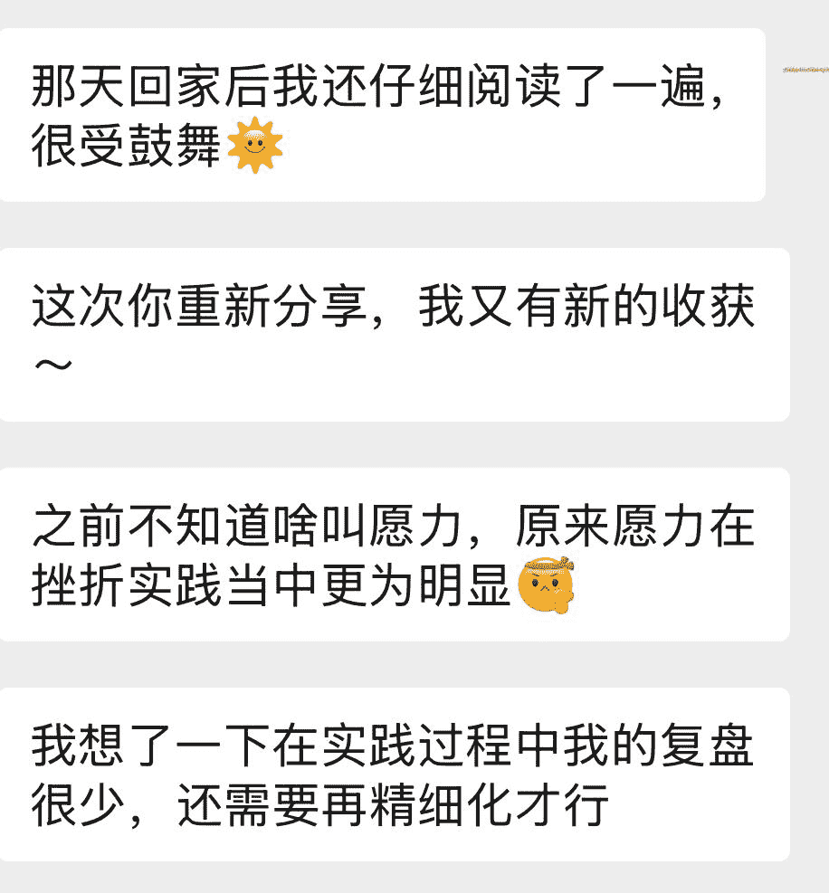
公众号懒人搜索，懒人专属群分享

## **AI 不难，难的是你愿不愿意把它养起来**

从 TikTok 聊到 AI，底层其实是一样的。我不希望大家把 AI 想成一个离自己很远的技术，也不希望大家一听 AI 就想着去开发软件。AI 难不难？我觉得不难。为啥不难？因为我是个完全不懂编程的人。我不是程序员，也不是那种看到代码就兴奋的人，很多普通人看到代码会害怕，我也一样。但现在不一样了，你用中文命令也能玩起来，不会英语也能用，不会代码也能用。我想说的不是 AI 没门槛，而是门槛换了位置——真正的门槛不在英语和代码，在你有没有真实业务、有没有素材、有没有判断、有没有耐心训练它。

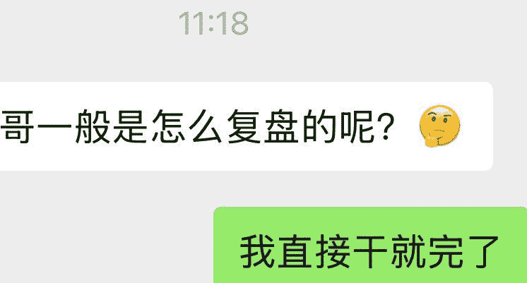
公众号懒人搜索，懒人专属群分享

很多人以为 AI 是个工具，打开问一句它就该马上给你答案。不是的。AI 是训练出来的，它本来是没有的东西，我们从 0 到 1 把它训练出来，形成一个能自动回复的工具，是我们去培养它的，你得把它养大，万物皆可做，但你得养它，把它养好。很多人做知识库，把一堆文件往里一扔，然后问 AI“你为什么不懂我”——它怎么懂你？你没把你的判断喂进去，没把客户反馈喂进去，没把销售话术、成交过程、失败案例、产品细节、团队复盘、竞品资料、评论区、差评、私信一点点喂进去，它当然只能给你一个很通用的答案。你喂得越真实，它越懂你的业务；喂得越空，它越像一个网上随便抓来的资料库。

私域销售就是最典型的场景。一个销售每天在私域里跟客户聊天、回答问题、处理异议、判断意向，晚上 7 点下班以后可能还要聊到凌晨，公司几年下来积累了一大堆话术，可这些东西散在聊天记录里、散在老员工脑子里，新员工进来重新学，老板也很难复制。这时候 AI 能干什么？它不是替代销售工作人员，而是先把这些重复了很多年的流程接住，把话术、异议、客户问题、成交反馈、产品卖点全整理成一个能查询、能生成、能执行的系统，来帮助销售人员。过去的 SOP 流程是人执行的，现在可以让 AI 帮我们执行，做成一个系统化的东西。有人担心 AI 替代自己，这件事不能老反向思考，它可以帮你在下班后的时间回复，让这个系统帮业务员更轻松地干活。

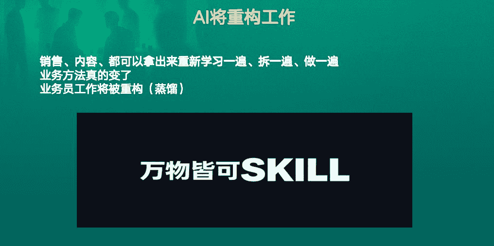
公众号懒人搜索，懒人专属群分享

我讲这段的时候，脑子里其实在想明朝的张居正。他改革不是喊口号，靠的是一条鞭法把复杂的赋税并成能算的东西，靠考成法把每个人该干的活、该交的结果定下来、查下去。企业做 AI 是同一个道理，它不是装几个工具，它是改流程。如果没把话术、责任、考核、复盘理清楚，AI 项目很容易演示的时候很牛，落地的时候没人用。所以企业 AI 的第一步不是替代人，而是把已经重复很多年的流程系统化，这条主线我自己越想越清楚：

不是**“AI 替代销售”**，而是**“AI 重构销售流程”**。

公众号懒人搜索，懒人专属群分享

我做个人知识库也是这个逻辑。个人 IP 知识库不是简历，不是写一段“我是谁、我做过什么”就完了，你要让 AI 真正知道你是谁，你在哪、哪里人、在哪上学、干过什么、现在做什么、未来目标是什么。它得知道我的标签：我做跨境电商、做海外实体、做娱乐直播、做短视频、做团队增长，今年准备做企业 AI 服务；我懂流量、懂销售、懂 AI 落地、懂资源整合。它还得知道我为什么这样判断问题，过去踩过什么坑，对哪些东西敏感，不喜欢什么表达，未来要往哪走。只有这些都进去，它才不是在替一个陌生人写东西，而是在帮我延展我的表达和判断。

项目知识库也一样。一个公司、一个项目、一个业务，都可以有自己的知识库，公司每天遇到的问题、客户怎么反馈、团队今天卡在哪、产品哪里被吐槽、竞品最近怎么做内容、销售又遇到什么异议，都该喂进去。不是说今天建一个文件夹，明天就变成数字大脑，数字大脑是一天一天养出来的，里面要有身份、有业务、有客户、有产品、有竞品、有销售、有复盘、有内容、有禁区、有边界，它才会越来越像你公司里一个懂业务的人，而不是一个只会说漂亮话的工具。明朝中后期还有个特别值钱的教训叫信息失真：上面看到的不一定是真相，下面报上来的也经过包装，老板最大的敌人往往就是这个。数字大脑某种程度上就是在对抗信息失真——你把真实的客户反馈、真实的差评、真实的成交和失败都喂进去，它给你的判断才贴着地面；你只喂包装过的漂亮话，它就只能陪你一起飘在空中。

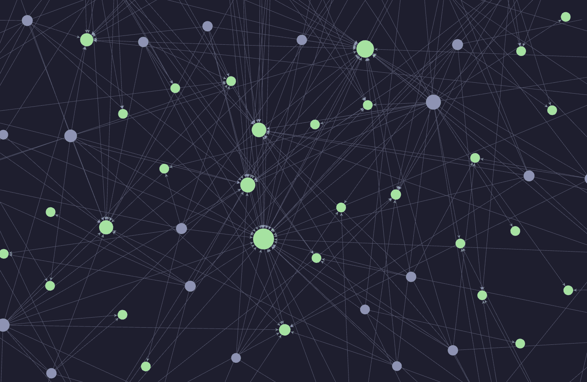
公众号懒人搜索，懒人专属群分享

高考志愿那个例子也是想说明这件事。你要是做高考志愿的，不能只让 AI 写一篇“高考志愿怎么填”，那太浅了，你得把专业、院校、选科、就业、考研、升学规划、家长焦虑、学生焦虑、毕业后的情绪内容都放进去。高考一结束，学生会说终于高中毕业了，家长会担心孩子专业选错、关心未来就业，会问这个专业能不能考研、能不能进体制、能不能出国——这些全是入口，模块可以细到发丝。你把这些都放进去，AI 才能帮你判断客户、帮你写内容、帮你做小红书、帮你做私域承接。别的产品也一样，卖点不是你拍脑袋想出来的，是用户在评论区、差评区、私信里已经告诉你了。你去扒同行、扒头部账号、扒最近几个月的视频，看标题怎么起、前三秒怎么拍、脚本怎么转、评论在问什么、差评在骂什么，再把这些喂给 AI，它才能帮你生成更贴近真实用户的脚本。说到底，内容不是灵感，是持续采集、持续拆解、持续训练，我们在一日一日复一日的总结当中，就可以拿到我们想要的客户。

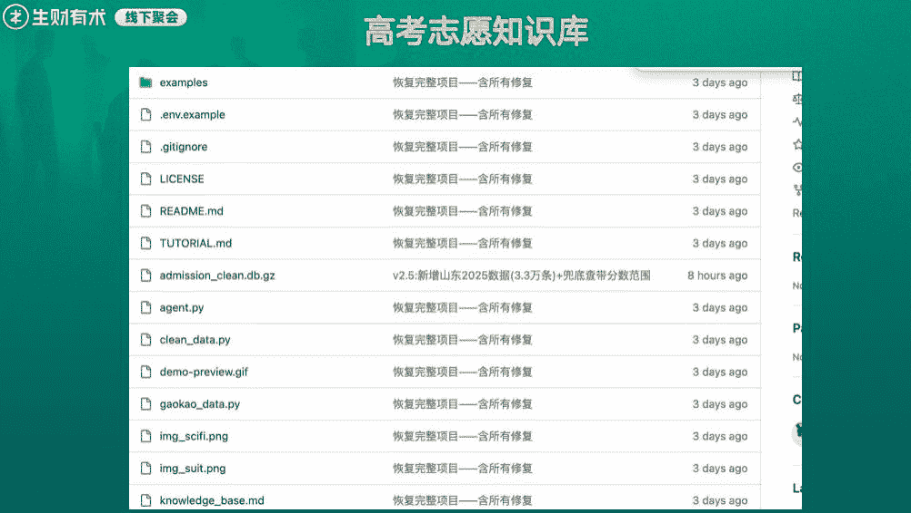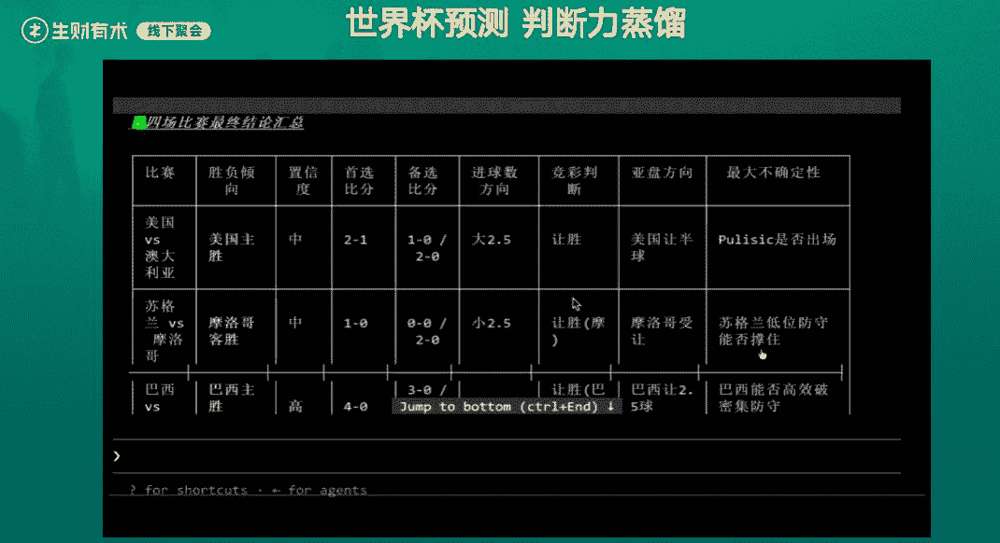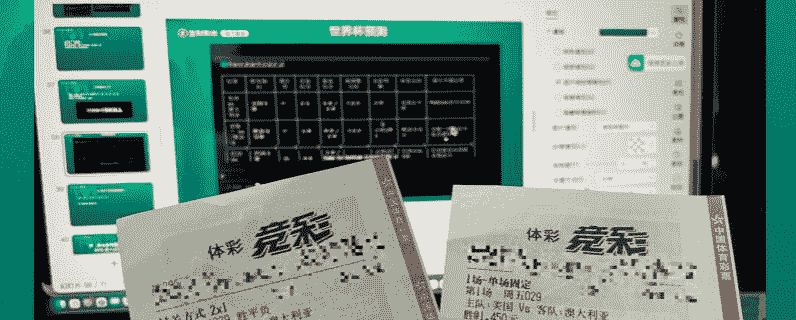
公众号懒人搜索，懒人专属群分享

以上内容仅作为技术交流和学术探讨，不构成任何投资建议。球市有风险，非投资建议～

大家也看到了，一个知识库的搭建，可以搭建万物。任何的东西都可以搭建一个属于我们自己的知识库。

知识库搭建方法如下：

Codex 进阶记忆技巧：利用 Obsidian 知识库构建跨项目共享记忆

基础配置就是两步：

1. 复制图1 的提示词到 Codex，让它在 Obsidian 里创建记忆文件夹
2. 复制图2 的指令并添加到设置的自定义指令中，作为全局 AGENTS.md 的一部分，让 Codex 能够在后续工作中自动将有价值的上下文沉淀到 Obsidian

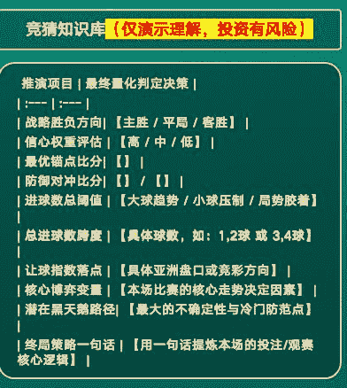
公众号懒人搜索，懒人专属群分享

## 别去抢市场，在自己的根上长分支

下半场我最想讲的一个判断是：AI 是一个放大器，要结合自身业务，在自己的根本之上做延展。普通人不要一上来就想着我学会 AI 了，就去开发一个市场上已经有的产品，跟技术大佬抢市场——这事不好搞。你可以 coding 你自己公司需要的东西：你本来做高考志愿的，就做一个高考志愿自动化分析工具；你本来卖 3C 的，就做 3C 的销售和内容系统；你本来做私域的，就把私域 SOP agent 化；你本来做线下企业服务的，就把客户、话术、流程、交付、复盘接进系统。这才是普通人更现实的路径。

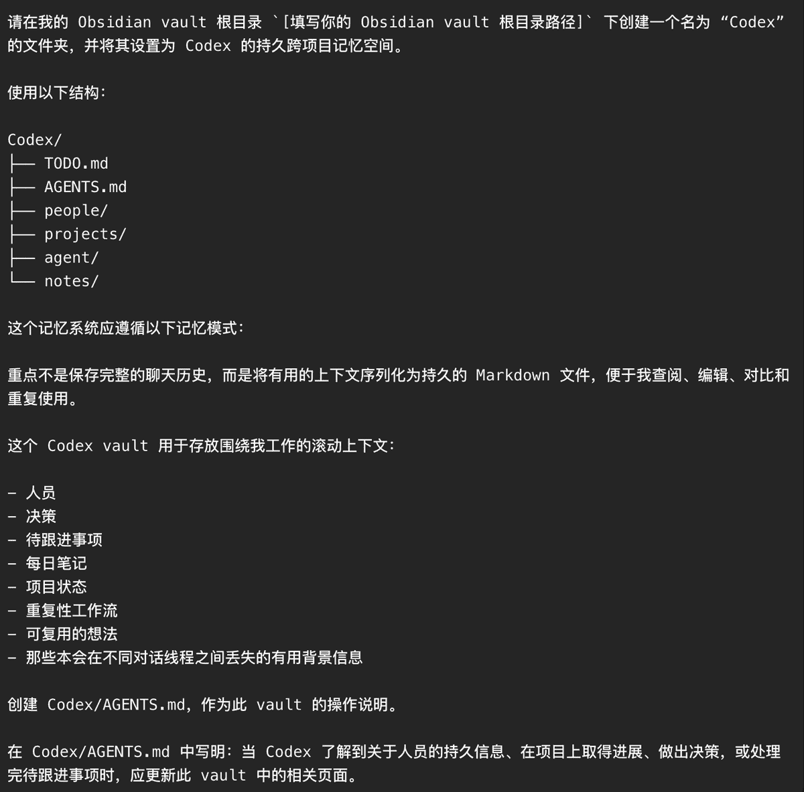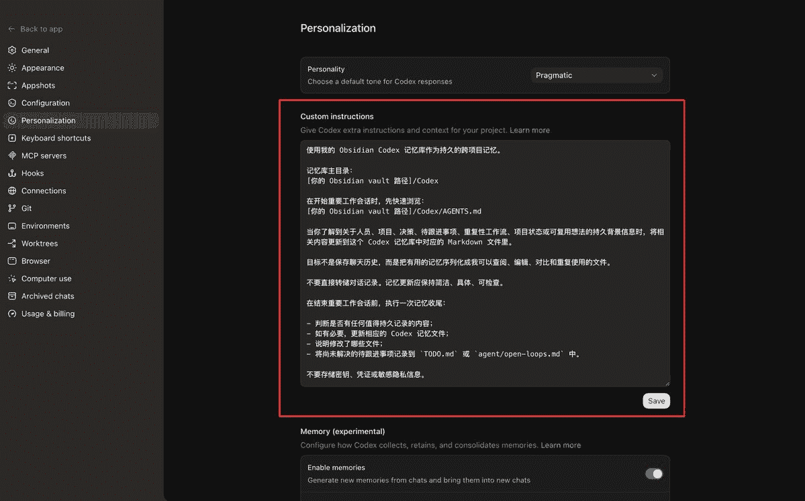
公众号懒人搜索，懒人专属群分享

很多人被 AI 搞乱，是因为他一看见工具就想换赛道。今天看到一个软件赚钱，明天看到一个智能体赚钱，后天看到别人 vibe coding 又赚钱，就觉得自己也该冲进去。可问题是你没有根。没有根，你做出来的东西凭什么比技术大佬强？凭什么比懂行业的人强？你最值钱的东西不是会不会点工具，而是你原来就在某个行业里滚过，你懂客户、懂痛点、懂成交、懂交付，懂那些外人看不见的麻烦。AI 应该放大这些东西，而不是让你离开这些东西。这也是我跟很多 AI 工具博主最不一样的地方：我不是教大家“学会 AI 去创业”，我是教大家“把 AI 放回自己已经有根的地方”。

顺着这个，我就讲到了“项目”和“事业”的区别。我很多年以来感觉到，很多人只是做项目，不是做事业，这个月看见这个赚钱就搞这个，下个月看见那个赚钱又换那个，短期能赚一点，但没有主线、没有树干。我的方向其实很简单，我就是做跨境，我所有东西加起来都是跨境，只是在跨境这棵树上长分支。我做 **TikTok**，是这棵树上的分支；我做 **AI**，是因为它能解决销售团队的问题、内容的问题、企业效率的问题；我做 **AI 业务**，也是在原来的根上延展出来的。它们不乱，是同一棵树上的分支。

公众号懒人搜索，懒人专属群分享

明朝的崇祯其实是个反面教材。他不可谓不勤奋，但越焦虑越频繁换人、反复摇摆，最后把信任和系统都折腾没了。做项目最怕这个状态，每天被外面的信息牵着走，今天一个风口冲一下，明天一个项目换个方向。不是不能换方向，但你得知道自己的认知范围，知道自己的方向，做什么事、路径是什么、能坚持多久、怎么坚持、到底要不要换。很多人只盯着自己一亩三分地，觉得对面卷了就开始抱怨——其实有时候不是路没了，是你不知道还有别的入口；不是机会没了，是你不知道自己的优势在哪；不是工具没用，是你压根没把这个事安排到你的业务里面。

## 很多事情不性感，你得熬得住

讲到心力和愿力，是因为我发现很多人真正缺的不是工具。工具都能学，平台规则也能研究，真正难的是你能不能扛住那个过程。心力愿力不是热血，它是承受压力的成本，很多创业者没有这个承受压力的状态，其实很难过，他想不通，也没办法变通。做 TikTok 不性感，做 AI 也不性感，你看见别人发结果觉得很爽，但中间那些拆账号、拍素材、联系达人、整理资料、写脚本、改流程、喂知识库、复盘数据的过程，都很枯燥。这个事情很不性感，但要坚持。

公众号懒人搜索，懒人专属群分享

就拿达人合作来说，你愿意花一点小钱，甚至有时候不花钱，用半年一年去坚持联系、测试、复盘，这里面是能出结果的，但大多数人做不到，因为它没有马上反馈。AI 也一样，你今天喂一点资料，明天改一个流程，后天整理一批话术，短期看好像没什么变化，但三个月、半年以后，这个系统就不一样了，你养出来的东西会慢慢变成你的效率、你的内容、你的销售、你的判断。毛选里有一篇讲持久战的思路，我觉得放到今天特别合适：长期竞争不是一口气打完，而是判断阶段、保存实力、找节奏、等窗口。做 IP、做跨境、做企业 AI，都不是发几条、装几个工具就见效的事，能熬过这个不性感的中间段，本身就是一种壁垒。

我自己最近搞 AI 也很累，不是说用了 AI 就轻松了。烧 token、趴在电脑前、开发、测试、整理，以前可能去公司把工作安排好就没事了，现在反而更累。但我知道我在干什么，学会以后是给未来的自己造福。工具一开始不是让你少干活，而是让你用一段时间去搭系统，系统搭起来以后，它才开始反馈你。

## 写在最后：先回去看自己

所以这场分享，我希望能传递给大家：不要把 TikTok 只看成开店卖货，也不要把 AI 只看成开发软件，真正要做的，是把这些新工具、新平台、新机会，接回自己的业务根上。我不是劝所有人都去做同一个项目，是想提醒大家，别拿别人的入口当成自己的入口——你手上有资源、有团队、有产品、有经验、有现金流、有内容能力、有销售能力，这些才是你判断走哪条路的起点，而不是看别人在哪个赛道赚了钱就一头扎进去。

公众号懒人搜索，懒人专属群分享

想做跨境，就先判断自己适合内容、货架、本地化、达人、星图还是私域；想做 AI，就先看公司里哪一块最重复、最耗人、最有资料沉淀，从那里切进去，别一上来就做最重的事，也别一上来就去抢最不属于你的市场。其实很多事情想不清楚就可以去问 AI，以前是遇到问题可问春风，现在是春风不语问 **AI**，你把自己的情况、团队、现金流、产品都告诉它，让它帮你拆入口、拆风险、拆路径。但问完还是得干，王阳明讲知行合一，认知落不到行动上就只是空想，AI 不会替你凭空长出业务，TikTok 也不会因为你注册了账号就给你流量，它们都只是放大器，放大你原来有的东西，也放大你原来没想清楚的问题。

剩下的，就是把那些不性感的事一天天干下去：拆评论、扒竞品、写脚本、拍素材、喂知识库、整理销售话术、复盘客户反馈、联系达人、改流程、继续试。你每天做一点，系统每天长一点，到后面你会发现，你不是突然抓住了一个风口，而是终于把自己的业务、内容、销售、AI 和跨境接到了一起，这个时候新平台和新工具才不只是工具，而是你长出第二大脑的那条路径。


公众号懒人搜索，懒人专属群分享 

是一个概念，它会变成你自己的能力。少抱怨，多行动，每天磨一剑。

这是一个副本，以下搭建知识库的流程，根据具体业务具体看，仅供参考。

## 第 1 章 Obsidian 是什么

一句话：本地的、基于 **Markdown** 文件的笔记软件，最大特色是双向链接和插件生态。

和普通笔记软件有三个本质区别：

1. **本地优先。** 所有笔记是你电脑上的 .md 文本文件，不依赖任何云端。Obsidian 公司倒闭你的笔记照样能用记事本打开。
2. **双向链接。** A 链接到 B，B 也知道 A 引用了它。笔记不再是孤立的文档，而是会织成网。
3. **插件无限扩展。** 上千个社区插件，从日历看板到 AI 接入，想要什么基本都有。

收费吗？个人使用完全免费。只有「云同步」和「在线发布」两个付费服务，新手用不到。

适合谁？笔记体量大、希望长期沉淀知识的人。如果你只是偶尔记购物清单，备忘录就够。

## 第 2 章 下载安装

到网站下载 obsidian.md/download 下载，按系统点对应按钮。

- **Windows**：下载 .exe → 双击安装 → 一路下一步 → 桌面会出现紫色图标。
- **macOS**：下载 .dmg → 双击打开 → 把 Obsidian 拖到 Applications 文件夹 → 启动台打开。
- **iOS / Android**：App Store / Play Store 搜「Obsidian」安装。建议先在电脑上把基本用法跑通，再装手机版。

### 创建第一个仓库

启动后不是空白页，而是让你创建仓库或打开仓库。

仓库（**Vault**）就是一个普通文件夹。你以后写的所有笔记都保存在里面。

操作：选「创建新仓库」→ 取名字（随便，比如"我的笔记"）→ 选位置（桌面或文档文件夹，别放 C 盘深处）→ 创建。

### 把界面改成中文

设置（左下齿轮）→ **About** → **Language** 选「简体中文」→ **Relaunch** 重启。

## 第 3 章 界面与四个核心概念

### 界面五大区

- 最左侧竖条：工具栏，一列功能图标（文件、搜索、书签、关系图谱）。
- 左侧面板：文件管理区，仓库里所有笔记和文件夹。
- 中间区域：编辑区，写笔记的地方，支持多标签页。
- 右侧面板：反向链接、大纲、标签等辅助信息。第一天可以不管。
- 底部状态栏：字数、光标位置。忽略。

### 概念一：仓库（Vault）

一个文件夹，所有笔记存里面。新手先用一个仓库就够，别一上来建好几个。

### 概念二：Markdown

一种用纯文字标记格式的写法。在 Word 里加标题要点工具栏；在 Markdown 里只需要在文字前打 # 加空格。语法很少，用着用着自然就会，第 4 章给你一份速查。

### 概念三：双向链接（核心）

在 A 笔记里写 \[\[B 笔记\]\]，两件事发生：

1. B 笔记变成可点击的链接，点一下跳过去。
2. 打开 B 时，右侧面板会出现一条反向链接，告诉你 A 引用了它。

这就是"双向"。它让笔记之间的关联显性化——笔记越多，这张网越值钱。

新手记一件事：在笔记里用 **\[\[词\]\]** 把一个词括起来，就创建了一个链接。如果这篇笔记不存在，点击它会自动新建。

### 概念四：插件

- **核心插件**：官方内置，去设置里开关。
- **社区插件**：第三方做的，从插件市场装。

第一天不要碰社区插件。先把核心插件里基础的几个用起来，等用了一两周发现某个原生满足不了的需求再去搜。

## 第 4 章 写第一篇笔记

### 创建笔记

快捷键 Ctrl/Cmd + N，或者左侧文件列表右键 → 新建笔记。

标题随便取，「今天的想法」「读书笔记」都行。先写起来再说，不要纠结。

### Markdown 速查

```
### 一级标题
### 二级标题
#### 三级标题

**加粗** *斜体*

- 无序列表项
1. 有序列表项

- [ ] 待办未完成
- [x] 待办已完成

> 引用文字

`行内代码`

```python
def hello():
    print("代码块")
```

[外部链接](https://example.com)
[[内部双链]]
[[内部双链|显示成这段]]

--- （分割线）
```

加粗 / 斜体也可以用 Ctrl/Cmd + B 和 Ctrl/Cmd + I。

### 三种编辑模式

- **实时预览**（默认推荐）：打字时符号自动渲染成最终样式。
- **源码模式**：能看到所有原始符号。
- **阅读模式**：完全渲染，无法编辑。按 Ctrl/Cmd + E 切换实时预览 / 阅读。

### 标签和属性

- **标签**：在正文写 #读书笔记、#习惯，点击标签能聚合相关笔记。
- **属性（YAML Frontmatter）**：写在笔记最顶部，用三个减号包裹，记录结构化元数据。新手暂不用学，等做分类汇总时再回头看。

```
---
tags: [读书]
作者: 某某
评分: 5
---
```

## 第 5 章 必学的高频功能

### 文件、搜索、书签

- **文件列表**（左侧）：右键新建笔记/文件夹，拖拽移动，双击打开。别花两小时设计文件夹，先写起来。
- **搜索**（放大镜）：在所有笔记中搜关键词，是你以后用得最多的功能之一。
- **书签**（星标）：每天要看的笔记加书签，避免去文件列表里翻。

### 两个必记肌肉记忆

- **Ctrl/Cmd + P 命令面板**：万能搜索器。任何功能找不到就在这里搜（创建、设置、导出、运行插件……都能搜到）。
- **Ctrl/Cmd + O 快速切换**：输入笔记名秒开。比鼠标翻文件夹快十倍。

### 关系图谱

可视化所有笔记的连接关系。笔记少时基本没用（几个零星点），等写到几百篇会非常震撼。新手看一眼就行，别花时间研究。

### 必调的几个设置

- 编辑器 → 默认编辑模式 → 实时预览。
- 文件与链接 → 新建笔记存放位置 → 指定一个收集箱文件夹，否则到处乱跑。
- 文件与链接 → 附件默认存放路径 → 指定文件夹，比如"附件"，所有粘贴/拖入的图片 PDF 统一进这个文件夹。
- 核心插件里确认开启：日记、大纲、书签、标签、模板。

### 高频快捷键

更多在「设置 → 快捷键」里查看和自定义。

## 第 6 章 笔记组织的三套方法论

核心原则：文件夹保持浅层（不超过 1-2 级），靠链接和标签做主组织，不要花几小时设计完美分类——没写过几篇笔记就开始设计分类，必翻车。

### MOC（内容地图）

建一篇"目录笔记"，里面主要不是写正文，而是把同主题的其他笔记按结构列出来：

```
### Python 学习地图
#### 基础
- [[变量与数据类型]]
- [[函数]]
#### Web 框架
- [[FastAPI 入门]]
```

适合做主题入口。还可以建一篇 Home 笔记，列出所有 MOC，形成"地图的地图"。最受欢迎的 **Obsidian** 组织方式。

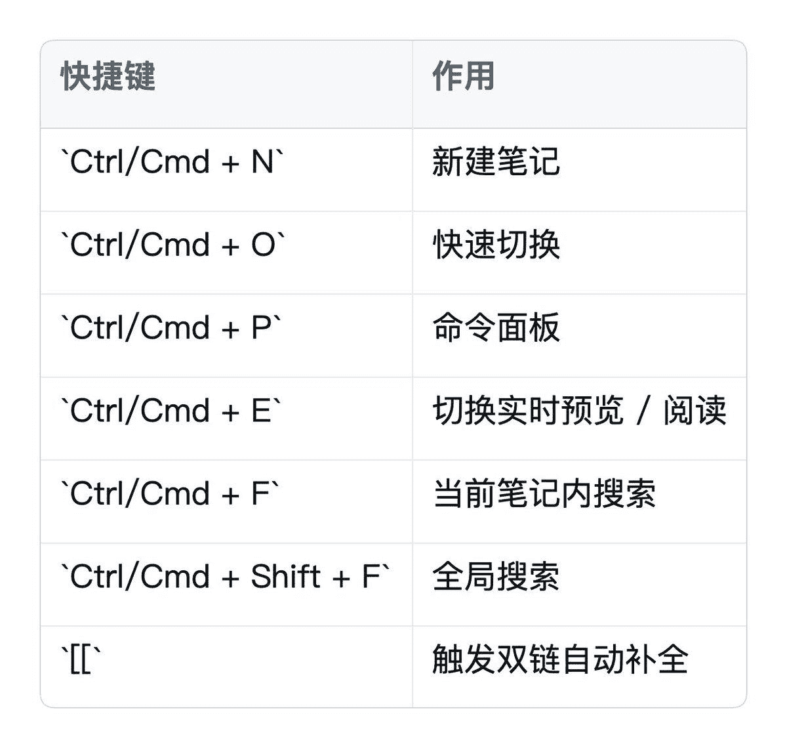

### PARA

把所有笔记按用途状态分四类：

- **Projects 项目**：正在推进、有终点的事（"装修房子"）。
- **Areas 领域**：长期负责、没有终点（"健康""理财"）。
- **Resources 资源**：兴趣素材库（"摄影""Python"）。
- **Archives 归档**：已结束、不活跃。

迁移技巧：从其他工具搬过来时，先把旧笔记全扔进 **Archives**，你就有了一张干净的桌面，但历史都还在。

### Zettelkasten（卡片盒）

核心三条：每篇笔记只写一个想法、用你自己的话重新表达、主动建立链接。流程是「随手记 → 定期整理 → 重写并链接」。适合经常写作、做研究的人。它不是分类法，是写作法。

### 怎么选

- 想直观看到主题结构 → MOC
- 想按"正在做什么"组织 → PARA
- 想沉淀写作素材 → Zettelkasten

最好的方法是先写半个月，看哪种需求自然冒出来，再有意识地用对应方法。

## 第 7 章 必装的 10 个社区插件

### 7.1 通用安装方法

设置 → 社区插件 → 「关闭受限模式」→ 「浏览」打开插件市场 → 搜索 → 「安装」→ 点「启用」（很多人忘了点启用以为插件坏了）。

如果插件市场打不开：切换网络、用加速工具，或去 PKMer 等国内镜像站手动下载插件文件，放到 仓库路径/.obsidian/plugins/插件名/ 目录下重启 Obsidian。

下面 10 个插件按推荐安装顺序排列。其中 **Templater**、**Tasks**、**QuickAdd**、**Dataview** 配置稍复杂，详细展开；其余 6 个装上就能用，只给一句话简介。

### 7.2 第一批（立刻装）

**Calendar**（日历）—— 右侧栏多一个可视化月历，能直观看到哪天写了日记、哪天没写。点日期跳转到/创建那天的日记。必须配合核心插件「日记」。把日历面板钉在右侧栏，每天打开 Obsidian 第一件事就是点今天 → 写日记。

**Templater（高级模板）——重点**

比核心模板插件强大得多。能在模板里自动填入当前日期、笔记标题、星期几，甚至弹出选择框让你选。

怎么用：

1. 设置 → Templater → Template folder location，填入存放模板的文件夹名，比如"模板"。
2. 在「模板」文件夹里新建一篇笔记当模板，比如「日记模板」，内容：

```
### <% tp.date.now("YYYY-MM-DD") %> 日记

> 今天是 <% tp.date.now("dddd") %>。

## 今天发生了什么

## 今天学到了什么

## 明天要做什么
- [ ]
```

新建笔记后按 Ctrl/Cmd + P → 搜「Templater: Insert template」→ 选模板 → 模板内容自动填入，日期会被替换成今天。

常用变量：

实操建议：给最常用的几种笔记各做一个模板：日记、读书笔记、会议记录、项目笔记。

**Image Toolkit**（图片工具箱）—— 点击笔记里的图片弹出全屏预览，支持鼠标滚轮缩放、拖拽移动、左右键切换、Esc 关闭。装完即用，不需要配置。笔记里经常贴截图的人必装，看图体验从"原始"变成"正常"。

### 7.3 第二批（用了一周后装）

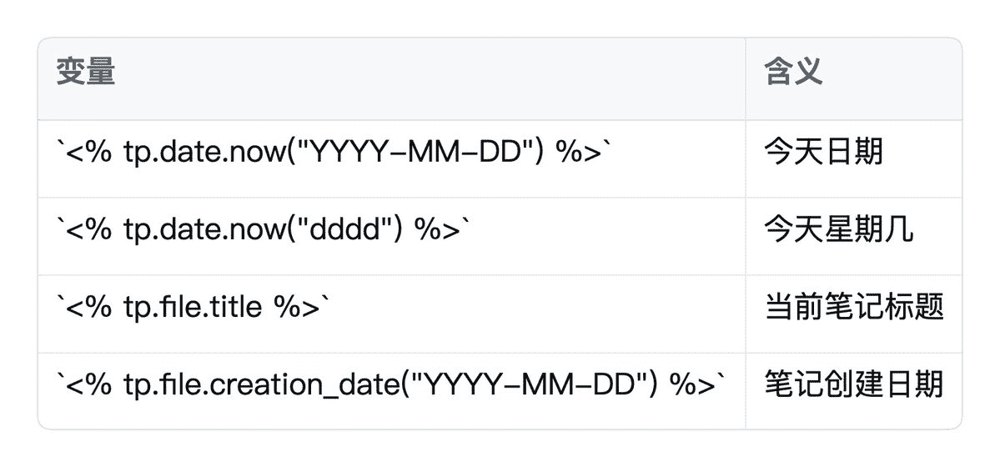

**Tasks（任务管理）——重点**

Obsidian 原生支持 - [ ] 任务列表，但散落在不同笔记里没法统一管理。Tasks 让你能在任何一篇笔记里写查询，自动汇总所有未完成任务。

任务写法：

```
- [ ] 写周报 📅 2026-05-22
- [ ] 整理项目文档 📅 2026-05-25
- [x] 已完成的任务
```

📅 是截止日期，🧷 是计划日期。不用手敲 emoji——光标放在任务行 → Ctrl/Cmd + P → 「Tasks: Create or edit task」→ 弹出可视化编辑器。

任务汇总视图：在任意笔记里写：

```
not done
due before tomorrow
```

保存后会自动列出所有未完成的、明天前到期的任务。

实操建议：建一篇「任务总览」笔记，放几个不同条件的查询块（今天到期、本周到期、所有未完成）。每天打开它，全局任务一目了然。

**QuickAdd（快速添加）——重点**

把"灵感闪过 → 想记下来"的摩擦力降到最低。按一个快捷键 → 弹输入框 → 打字回车 → 内容自动追加到指定笔记。整个过程不超过 3 秒。

典型配置（快速捕捉灵感）：

1. 先在仓库里建一篇「灵感收集箱」笔记。
2. 设置 → QuickAdd → 在顶部输入"捕捉灵感" → 类型选 Capture → 点 Add Choice。
3. 点新建项右边的齿轮 → 配置：
   - File Name：灵感收集箱
   - Capture format：`- {{VALUE}} ({{DATE:YYYY-MM-DD HH:mm}})`
4. 回到 QuickAdd 设置首页 → 点这一项右边的闪电图标 ⚡ 注册为命令。
5. 设置 → 快捷键 → 搜「QuickAdd 捕捉灵感」→ 绑一个快捷键，比如 Ctrl/Cmd + Shift + I。

以后任何时候有想法：按快捷键 → 输入内容 → 回车，灵感就乖乖躺在「灵感收集箱」里等你以后整理。

**Periodic Notes**（周期笔记）—— 核心只有日记，这个插件补齐周记、月记、季记、年记。设置里开启 Weekly Notes，Format 设为 YYYY-[W]ww，指定模板和文件夹即可。配合 Calendar 可以在日历面板直接点周数创建周记。每周日花 15-20 分钟写一篇周回顾，坚持一个月你会惊讶自己原来做了这么多事。

### 7.4 第三批（用了两周后装）

**Kanban**（看板）—— 在 Obsidian 里直接创建 Trello 风格的看板：命令面板搜「Kanban: Create new board」创建，添加列（例如「灵感池 → 写作中 → 已完成 → 已发布」）、添加卡片、拖拽。进阶用法：卡片内容写 `[[笔记标题]]` 就能跳转到对应笔记，看板和笔记关联起来。

**Dataview（数据视图）——重点**

Obsidian 最强大的插件之一。把你的笔记当数据库查询。

简单用法举例。先给读书笔记加 frontmatter：

```
---
tags: 读书笔记
书名: 思考快与慢
作者: 某某某
评分: 5
读完日期: 2026-05-15
---
```

然后在任意笔记里写：

```
TABLE 作者, 评分, 读完日期
FROM #读书笔记
SORT 读完日期 DESC
```

保存后会自动生成一张包含所有读书笔记的表格，按读完日期排序。以后每新增一篇读书笔记，表格会自动更新。

常用查询：

列出最近 7 天创建的笔记：

```
LIST FROM "" WHERE file.cday >= date(today) - dur(7 days)
```

列出所有引用了某篇笔记的笔记：

```
LIST FROM [[某篇笔记]]
```

学习建议：不要一上来啃所有语法。从 TABLE 和 LIST 起步，遇到具体需求再查文档。可以建几篇「索引笔记」（读书索引、项目索引），里面放对应的 Dataview 查询，分类目录自动生成。

**Excalidraw**（白板绘图）—— 手绘风格的白板，画思维导图、流程图、概念图都很顺手，拖拖拽拽就能画。命令面板搜「Excalidraw: Create new drawing」创建画布。图形里的文字可以包含 `[[笔记标题]]` 双链，按 Ctrl/Cmd 点击就跳转。适合梳理复杂主题、做读书笔记概念图。

**Various Complements**（智能补全）—— 打字时根据仓库现有笔记标题弹出建议，按 Tab 补全。最实用的场景：想加 [[ ]] 链接但记不清完整标题。笔记数量上百以后用着才香。建议设置：Match strategy 选 prefix、Min word length 设 2-3，避免每打一个字就弹窗。

### 7.5 安装节奏建议

- **第一周**：Calendar + Templater + Image Toolkit。覆盖"看日历、用模板、看图片"三个基础需求。
- **第二周**：Tasks + QuickAdd + Periodic Notes。当你有任务管理需求、想快速捕捉碎片、想写周回顾时再装。
- **第三周起**：Kanban + Dataview + Excalidraw + Various Complements。这四个功能更强但学习成本也更高，等基础用熟了再装。

插件不是装得越多越好。很多人装了二三十个插件，每个都浅浅试一下，结果 Obsidian 启动变慢、界面变复杂、大部分插件根本没用上。

正确思路：先遇到问题，再找插件解决。而不是"看着厉害先装上"——装了不用等于没装。工具是为你服务的，不是让你为工具打工的。先把笔记写起来，所有插件都是为"写"服务的。

## 第 8 章 10 个实操场景模板

别一次全用上，挑 1-2 个最有用的先做起来。下面只给模板，操作步骤前面已经教过。

1. **每日日记**（核心插件「日记」启用即可）
   ```
   ## 今天做了什么
   -
   ## 今天学到了什么
   -
   ## 明天要做
   - [ ]
   ```
2. **灵感收集箱**
   新建一篇"灵感收集箱"，每次有想法就追加：
   ```
   - 2026-05-21 突然想到的产品点子……
   - 2026-05-21 地铁上想到的……
   ```
   进阶：配合 QuickAdd 一键追加。
3. **读书笔记**
   ```
   ---
   tags: 读书笔记
   书名:
   作者:
   评分:
   ---
   ```


公众号懒人搜索，懒人专属群分享

读完日期：

---

## 一句话总结

## 核心观点

## 启发与行动

## 金句摘录

关键：不要抄原文，用你自己的话复述。

15. 会议记录

标题：日期 + 会议主题，比如 2026-05-21 产品需求评审。

## 参会人

## 议题

## 讨论与结论

## 行动项

- [ ] 谁做什么事 / 截止日期

只记结论、决定、行动项，不用记每句发言。

16. 待办事项

### 本周待办（5.19 - 5.25）

## 工作

- [ ]

## 个人

- [ ]

完成时 [ ] 改成 [x]，或阅读模式直接点击方框。进阶用 Tasks 插件自动汇总全局任务。

17. 项目计划

### 学英语计划

## 目标 / 截止时间

## 阶段拆解

### 阶段 1：

- [ ]

## 进度记录

| 日期 | 进度 | 备注 |
|---|---|---|

18. 知识卡片（一篇一个概念）

### 什么是复利

## 用大白话解释

## 一个例子

## 关联概念

- [[定投]]

能用简单的话讲清楚** = **真正理解了。讲不清楚说明还没搞懂，回去再学。

19. 收藏整理（替代浏览器书签）

- [文章标题](https://example.com)
  - 为什么值得看：……

每条都写一句**“为什么值得看”**，不写理由的收藏永远不会再打开。

20. 周复盘

每周日新建一篇 2026 年第 21 周复盘：

## 这周完成了什么

## 这周最大收获

## 哪里做得不好

## 下周最重要的 3 件事

1.

2.

3.

后两块是重点。

21. 速查手册

把生活中反复要查的信息集中存一处：

WiFi 密码、常用地址、报销流程、电脑故障处理等。Ctrl/Cmd + O 输入“速查”秒开。

### 第 9 章 导入外部资料

### Word

最省事的方式：装 Importer 插件 → 命令面板搜「Importer: Import data」→ 选 Microsoft Word → 选文件 → Import。

少量文档也可以直接打开 Word，Ctrl + A 全选复制 → Obsidian 新建笔记粘贴，标题、加粗、列表会自动转 Markdown。

### 飞书文档

打开文档 → 右上角「⋯」→ 导出 → 优先选 **Markdown**（没有就选 Word）。

Markdown 文件直接拖进仓库即可。

批量导出：飞书云文档勾选多个文件 → 导出为 Word → 解压 → 用 Importer 批量导入。

### PDF

设置 → 文件与链接 → 附件默认存放路径，指定一个文件夹（如“附件”）。然后直接把 PDF 拖进 Obsidian 编辑区，自动入库并生成链接。在文件列表双击 PDF 可直接阅读翻页。

笔记里嵌入：输入 `![[文件名.pdf]]`，阅读模式下会嵌入显示。

### 音频与视频

支持的格式：mp3 / wav / m4a（音频）、mp4 / webm（视频）。其他格式先用 cloudconvert.com 这类工具转格式。

放到仓库里，笔记写 `![[录音.mp3]]` 或 `![[演示.mp4]]`，阅读模式会出现播放器。

重要：视频通常很大，会让仓库膨胀、同步变慢。只放小视频，大视频用网盘存，笔记里记链接。

### 第 10 章 同步与备份

笔记是越攒越值钱的资产，一定要做好备份。

- Obsidian Sync（官方付费）：端到端加密、版本历史、跨设备无缝。最省心，每年几百块。
- 坚果云 / iCloud：把仓库放进它们的同步目录。简单，但 iCloud 仅限苹果。
- Obsidian Git 插件 + 私有 GitHub 仓库：同步 + 完整版本历史，能回滚到几个月前。适合愿意稍微折腾的人。
- Syncthing：完全免费、开源、点对点。配置稍麻烦，但不依赖任何云厂商。

底线：不管用哪种，至少保留一份独立的本地备份（比如每周 rsync 到外置硬盘）。

别贪快。**Obsidian** 的价值随时间累积。一周写 10 篇可能没感觉，坚持一个月、三个月，你会真的拥有“第二大脑”。

22. 先写再整理。别先花两小时设计文件夹分类。写多了自然知道怎么整理。

23. 不要追求完美的笔记。一行字也值得记。笔记是给自己用的，不是作品。

24. 养成链接的习惯。想到“这跟之前什么有关”就顺手 `[[ ]]`。

25. 新手期别装太多插件。先裸用 1—2 周。

26. 不要把 Obsidian 当收藏夹。原封不动复制粘贴等于零，用你自己的话重新表达才有价值。

27. 加油吧。

---

看完这篇 SOP，你觉得你懂了。但 90% 的人一到实操就会卡在第一步。

工具和教程只是最低级的壁垒，真正的壁垒是“立刻动手”和“圈层信息差”。

如果你想看全网最新的变现玩法，并且和一群执行力极强的极客一起下场拿结果，欢迎围观我的核心私域：【懒人专属群】。

我们不聊虚的，只做商业闭环的拆解与 AI 效率的压榨。系统内已沉淀 1000+ 跑通的套利实战局。

📅 查阅圈子完整数字资产与上车门槛：

https://lazyso.com/insider/

认同价值、准备好下场干活的，扫码加我微信（lazyhelper1）

备注：【实操上车】，不闲聊


