公众号懒人搜索，懒人专属群分享

我用半个月搭建一套 AI 二创文案系统后，7 天赚到 2 万+佣金

260702 副业SC 精华

整理：公众号懒人搜索，懒人专属群精选

懒人微信：lazyhelper1

圈友，你好呀，我是森林。我现在在做一个视频号短视频带货项目，主要靠 AI 辅助做文案二创，搞了 15 个视频号做矩阵，去发布口播视频带货。文章开始之前，先说一下我的结果：

做 AI 短视频带货的第 3 个月，我花半个月的时间用 Obsidian + VS Code + Claude Code + Codex 搭出一套 AI 二创文案系统后，在 6 月 9 日到 6 月 15 日这 7 天，我一共跑了 954 单，销售额 55,929.53，预估佣金 20,245.53。

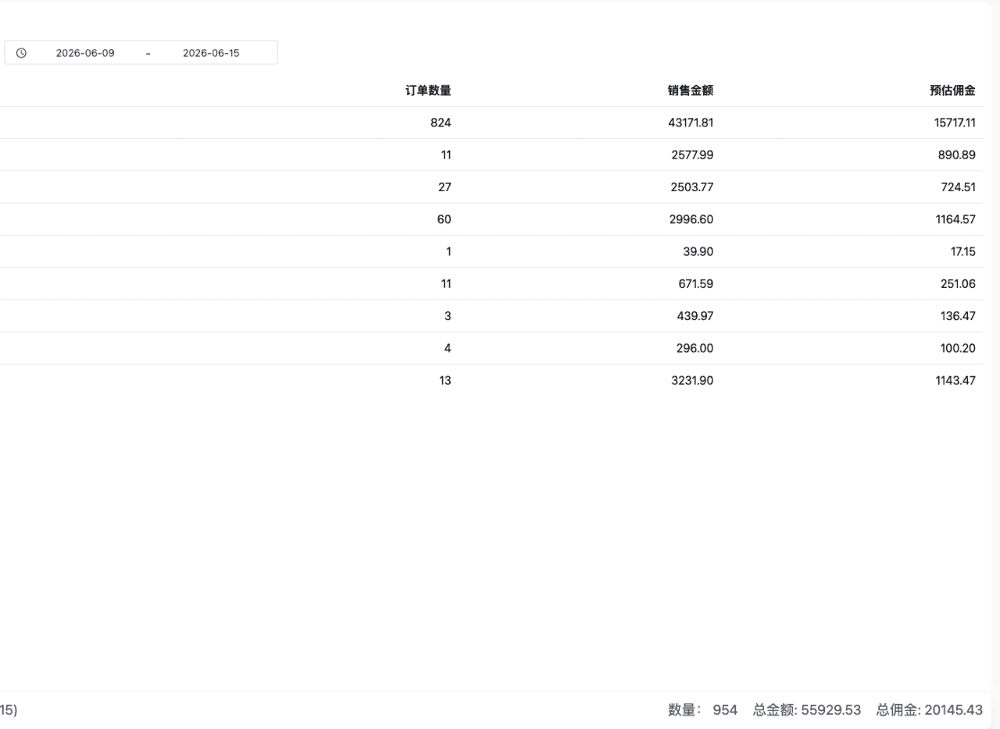

配图 01：结果截图/数据看板

但这篇文章，我不是想炫耀这个结果。我更想讲清楚，这个结果背后那套系统，是怎么一步步被逼出来的。我是从 3 月份开始做这个项目的。最早的时候，我的方式很简单。

找对标。抄爆款。让 AI 二创。然后发出去。

那个阶段，我基本都是在网页端跟 AI 聊。每来一条新文案，就开一个新窗口。我把原文丢进去，把产品信息丢进去，然后告诉它：帮我改一篇能发的短视频带货文案。

当时我以为，问题是提示词不够好。后来才发现，真正的问题不是提示词，而是我的经验没有地方沉淀。每一次聊天都像重新开始。

每一次 AI 都像临时找来的写手。我这边明明已经踩过很多坑，比如哪些开头不能删，哪些转品容易硬，哪些产品段不能写成说明书，哪些账号不能承接高风险稿。但下一次写稿的时候，这些经验又要重新讲一遍。更要命的是，4 月底到 5 月初，因为视频号同质化问题，我一下子有 10 个号被限流 7 天。

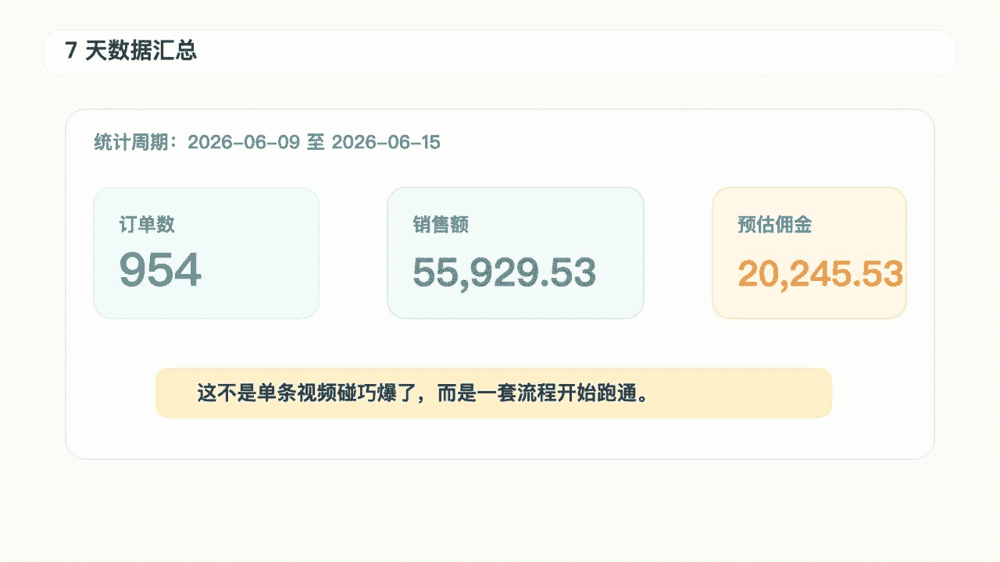

那次对我刺激很大。我开始意识到：

如果我只是让 AI 帮我写一篇文案，那我永远都在改单篇。

但如果我要长期做这个项目，我必须搭一套能持续降低相似率、持续沉淀经验、持续复用数据的系统。

配图 03：痛点对比图

所以后面我花了半个月左右，把 Obsidian、VS Code、Claude Code、Codex、小V猫这些工具串起来，搭了一套自己的 AI 二创文案系统。先简单说一下它们各自负责什么：

Obsidian 负责存经验。VS Code 是我的工作台。

Claude Code 负责读知识库、拆爆款、写二创。

Codex 负责整理文件、做账号分配、生成发稿复制台、把复盘结果写回系统。

小V猫负责把各账号后台的播放、订单数据抓回来。

一句话记住分工：

Obsidian 是档案柜，VS Code 是办公室，Claude Code 是写手，Codex 是助理。

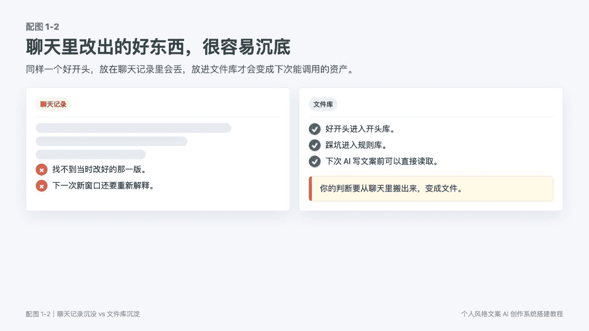

配图 02：工具分工图

这套系统对我最大的改变，不是写得更快，而是每一次写稿，都能站在上一次经验的基础上继续写。

这篇文章，我会按下面这个顺序讲：

1. 我为什么从“网页端临时写稿”转向“AI 二创系统”
2. 我这套系统是怎么从 3 月到 6 月一步步进化出来的
3. 我为什么把 AI 改写拆成三步提示词流水线
4. 文案生产、账号分配、发稿复制、数据复盘怎么形成闭环
5. 德国马膏这条高转化案例，系统到底做对了什么
6. 如果你是小白，怎么搭自己的第一版系统

如果你现在也在用 AI 写文案，感觉每次聊天都像重新开始，或者你也遇到过一条文案发多个账号，相似度太高，账号被限流，那这篇复盘，应该会对你有用。因为我走过的坑，你不一定还要再走一遍。

## 01 这套系统不是我一开始就想搭的，是被限流逼出来的

回到最开始。3 月份刚做这个项目的时候，我其实没有什么系统意识。那时候的做法很粗糙。看到对标爆款，抄下来。

丢给 AI，让它帮我二创。写完之后，发出去。跑了就开心，没跑就继续找下一条。

配图 04：早期粗放流程图

那个时候我对 AI 的理解很简单：AI 不就是帮我写文案的吗？我只要把产品信息、爆款原文、要求丢进去，它应该就能给我一篇能发的稿子。但很快我就发现，事情不是这样。

网页端聊天最大的问题是，每一次都像找了一个临时工。今天我花半小时告诉它：

开头不要太平。转品不要太硬。产品段不要写成说明书。不要把原文有效结构改没。不要乱加事实。

它当下好像听懂了。但第二天我重新开一个窗口，又得从头说一遍。第三天再换一个对标，又重新开始。

那种感觉特别痛苦。不是 AI 完全不会写，而是我前一天教它的东西，第二天没有变成它的能力。我每天都在训练一个临时工。训练完了，它下班走了。第二天又换一个新的人来。

配图 05：临时工模式 vs 系统模式

更要命的是相似率同质化问题。4 月份的时候，我为了提高产能，经常是一条文案改几个版本，铺到多个账号上。短期看，这样好像很省事。但 4 月 25 日，问题一下子爆了。

那一天，10 个号因为相似违规被限流 7 天。其中 6 个号明确限流，另外 4 个号隐形限流。手里能正常发的挂车号，几乎一下子被打没了。

配图 06：限流危机时间点

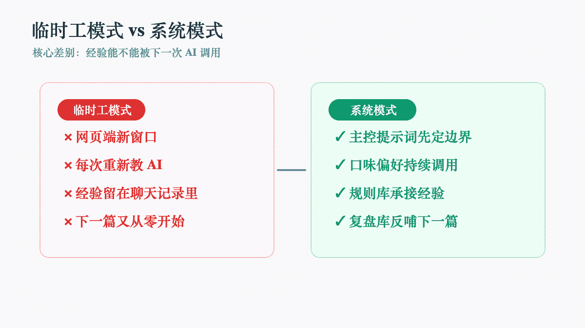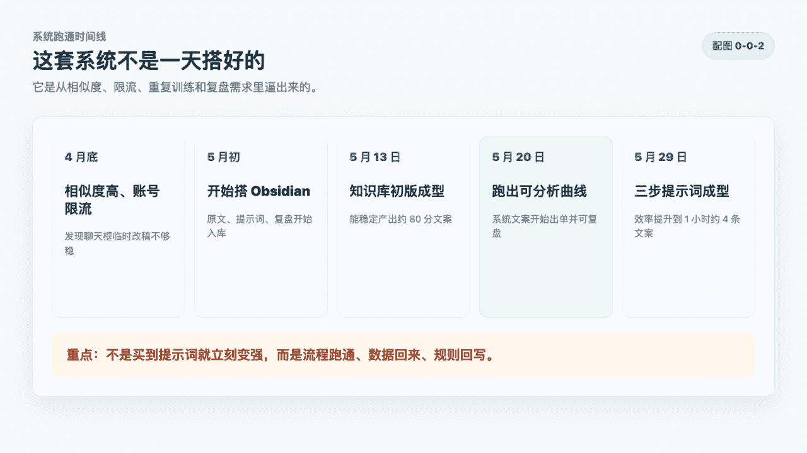

那种感觉，我到现在都记得。前一天还觉得自己终于摸到一点门道，第二天账号池直接被平台按住。我才意识到：原来我不是在做矩阵。

我是在用同一把刀，反复去碰平台的红线。

那几天我一直在想一个问题：如果继续靠网页端临时问 AI，继续靠感觉改文案，继续靠一条稿子多账号铺，我这个项目迟早还会再被打一次。而且每次被打，损失的不是一条视频。

是账号权重，是发布节奏，是现金流，也是自己的心态。

所以 4 月底到 5 月初，我算是痛定思痛，开始决定搭一套属于自己的 AI 二创文案系统。它最开始的目标很朴素：

第一，降低相似率。

第二，让 AI 每一次跟我聊天，都能站在上一次经验的基础上。

第三，把跑出来的数据、踩过的坑、有效的表达，真正沉淀下来，而不是散落在聊天窗口里。

后面我参加了一些圈友线下分享，也不断从自己的生产里验证，越做越确定：AI 写文案这件事，不能只靠一次性提示词。它必须有一个系统。

这个系统对我非常重要。所以我足足花了半个月左右，把 Obsidian 知识库、Claude Code 协作流程、Codex 运营辅助流程，一点点搭出来。它不是一开始就完美。但从它开始成型之后，我的项目才真正从“每天临时写稿”，变成了“每天在一条生产线上迭代”。

配图 07：从临时写稿到生产线

## 02 我最开始理解错了 AI，它不应该只是写稿工具

刚开始用 AI 的时候，我和很多小白一样，最容易犯的错误就是：一上来就让 AI 写。

看到一篇爆款文案，复制进去，然后说：帮我仿写一篇。帮我改成我的产品。帮我写得更爆款一点。

这个动作不是完全没用。有时候 AI 确实能写出一篇看起来还不错的稿子。但问题是，不稳定。同样一个提示词，今天写得像人，明天写得像广告。

同样一个对标，今天能抓住开头，明天可能把最值钱的冲突删掉。同样一个产品，今天转品自然，明天突然来一句“今天给大家推荐”，观众一听就想划走。后来我给自己定了一个规矩：

不拆解，不改写。

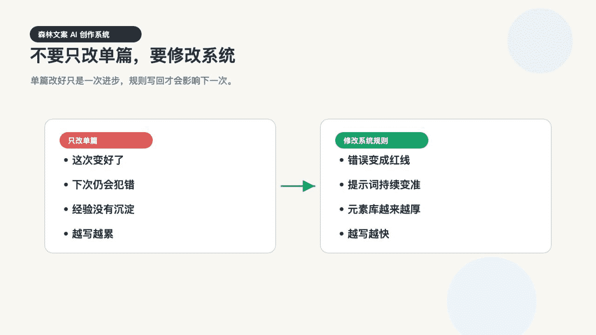

配图 08：核心原则卡片

这句话很土，但很管用。因为很多时候，爆款真正值钱的不是表面的那几句话，而是它背后的骨头。它想让观众相信什么？

它开头为什么能留人？

它中段为什么不掉？

它最后为什么能自然转到产品？

哪些句子是情绪资产，不能随便删？

哪些铺垫是低价值废话，必须前置冲突？

如果这些东西没拆出来，你让 AI 直接改写，它就只能表面换词。换几个同义词，换几个句式。

加几句看起来很厉害的开头。最后写出来的东西，看着像文案，但不一定能跑。

这也是我后来为什么一定要搭知识库。我不是要让 AI 临时给我写一篇稿，而是要训练它理解我这一类文案到底怎么生产。

它要知道我之前哪些稿跑过，哪些开头有效，哪些转品自然，哪些产品段能承接转化，哪些表达我反复不满意，哪些坑踩过一次之后不能再踩。

AI 真正的价值，不是帮我省掉一次写作时间，而是让我每天的经验，不再浪费。

## 03 最大的改变：我把 AI 改写拆成了一条流水线

这里还有一个很重要的点，也是我这套系统真正变强的分水岭。

配图 09：AI 改写流水线总图

以前我是怎么用 AI 的？一个 AI 干完所有事。我把原文丢进去，让它拆解，让它找素材，让它改开头，让它写完稿，让它质检，让它起标题。听起来很省事，但实际做下来，经常出问题。

它前面拆得很认真，后面写稿的时候忘了。它刚刚还说这个情绪资产不能删，完稿时自己先删掉。它第一步标了政治风险，第三步突然又擅自软化。它明明知道转品要自然，写到产品段又变成说明书。

我后来才意识到：

不是 AI 不努力，而是我把太多任务塞给同一个窗口了。就像让一个人同时当选题策划、资料员、编辑、审稿人、运营，还要求他每一步都不丢细节。这不现实。

所以后来最关键的一次升级，就是我把 AI 改写流程拆成三步提示词。不是一个提示词从头干到尾，而是像工厂流水线一样，每一步只干一件事。

### 第一阶段：5 月 13 日到 5 月 20 日，先把经验从聊天里搬到文件里

配图 10：系统进化时间线

5 月 13 日，我开始搭爆款文案系统和每日复盘系统。那时候还谈不上多高级，只是先把开头、转品、金句、收尾、复盘卡、素材卡这些东西建出来。

这一步的意义是：经验不能只留在聊天记录里。聊天记录会沉底，文件才会被下一次 AI 读到。

5 月 15 日，我又把口语风格规则、二创六步法、政治风险规则这些写成核心规则。那时候我已经意识到，文案不是写顺就行。要有口语节奏，要有平台风险判断，要有二创顺序。

5 月 20 日，我把自己的文案口味偏好也写进去。我喜欢什么，我讨厌什么，哪些表达像 AI，哪些转品太硬，哪些开头太平。这些东西以前都是我在聊天里反复提醒，现在它变成了文件。

这是第一个重大改变：

AI 不再只靠我当场口头教育。它开始能读我的长期规则。

配图 11：聊天记录沉底 vs 文件规则沉淀

### 第二阶段：5 月 28 日，主控提示词拆成三步流水线

真正的分水岭，是 5 月 28 日。那天我把主控提示词拆成了三步。为什么要拆？因为主控提示词太长了。

以前我总想着：规则越全，AI 写得越好。于是把拆解规则、口味偏好、风险规则、开头规则、转品规则、质检规则，全部塞进去。结果反而出问题。

上下文太满，AI 开始缩水。规则之间串味。前面刚说的重点，后面就忘。有时候它看起来都读了，但真正写稿时，最关键的东西没执行。

所以我把它拆开：

第一步，只做拆解和搜素材。这一阶段不写稿。只回答：原文真正的论点是什么？爆点在哪里？情绪资产是什么？漏洞和政治风险在哪里？素材够不够？同源爆款家族有没有？

第二步，只做框架和开头。这一阶段也不完稿。只判断：原框架哪些保留？哪些要动？开头怎么同构重写？最后一个高势能案例能不能借给产品？转品桥怎么设计？

第三步，才进入完稿和质检。

这一阶段必须把第一步的情绪资产、第二步的执行承诺读回来，再写完整文案、标题和质检。这一步对我来说非常关键。因为以前是一个 AI 从头写到尾，现在是三道工序接力。

第一步像侦察兵，先把地形、风险、资源摸清楚。第二步像导演，决定这场戏怎么排、开头怎么打、产品怎么长出来。

第三步像主笔和质检员，把前两步的判断落实成能发布的文案。这就是我说的 AI 改写流水线。

它不是让 AI 更自由，恰恰相反，它是把 AI 的自由限制在每一步该做的事情里。

配图 12：三步提示词角色图

### 第三阶段：6 月 9 日到 6 月 14 日，流水线开始和数据连接

三步提示词跑起来之后，文案质量稳定了很多。但 6 月上旬我又发现一个问题：写得好，不等于发得好。同一条文案，发到不同账号，结果可能完全不一样。

6 月 9 日到 6 月 15 日这一周，我一共跑了 68 条视频、954 单、GMV 55,929.53，佣金 20,245.53。

配图 13：写稿系统连接数据

这组数据让我看到，系统真正有价值的地方，不只是写稿，而是写稿、账号、发布、复盘必须连在一起。

6 月 9 日开始，我把账号权重、长尾规律、复盘结论写回知识库。这意味着系统从“文案生产”开始进入“运营判断”。

哪些账号刚爆过？哪些账号出单能力强？哪些账号适合测流量？哪些账号适合承接成交？

这些东西不能只靠我脑子记，必须让 Codex 能读到。

这是第二个重大改变：

AI 不再只帮我写文案，它开始参与账号分配和运营决策。

### 第四阶段：6 月 12 日到 6 月 13 日，德国马膏把规则打穿

6 月 12 日那条德国马膏，是我系统里很重要的一个样本。它播放不是最高，但转化效率很高。播放 4 万级，净成交约 132 单，千次观看成交金额约 281.17。

配图 14：德国马膏复盘拆资产

这条让我明白，文案系统不能只追求“能不能起流量”，还要追问：为什么它能成交？

后来我把这条拆成了几类资产：

开头卡：荒诞段子到父亲真实困境。

转品卡：自身体验、第三方背书、前文回扣。

规则：多案例文案不能只按信息强弱排序，还要看最后一个高势能案例能不能自然借给产品。

账号规则：账号分配不能只看静态权重表，要看最近播放、订单、GMV、佣金、完播、转发、关注这些动态数据。

这就是第三个重大改变：

一条爆款不再只是爆款。它会被拆成开头、转品、账号、数据、提示词规则，回到系统里。下一次再写类似文案，AI 不是从零开始。它会读到这条规则。

### 第五阶段：6 月 15 日到 6 月 17 日，系统开始自我进化

到 6 月 15 日之后，我明显感觉系统进入了另一个阶段。不是我每天临时发现一个问题，然后口头提醒 AI，而是每次出问题，都要问一句：这条问题应该写回哪个文件？

有的写进第一步提示词，比如同源爆款家族检索。以后拆一条文案前，先判断有没有 A/B/C 同源版本，避免只看单条，改出撞稿。

有的写进第二步提示词，比如最后一个高势能案例借势产品。以后多案例文案不能只想着哪个故事强，还要想哪个故事最适合把产品带出来。

有的写进第三步提示词，比如裂变双版本质检。同一条母体要做 A/B 两版，不能只是换标题、换几个词，而要换开头入口、转品桥、识别层。

有的写进账号分配规则，比如刚爆过的账号进入权重窗口期，下一条优先喂低风险、高质量、高转化文案。

这时候系统已经不只是“帮我产出文案”。它开始像一台会吸收反馈的机器。今天跑出来的数据，变成明天的规则。今天踩过的坑，变成下次的红线。今天高转化的结构，变成下次可调用的模板。

这也是我这套系统和普通提示词最大的区别。

普通提示词是一次性的。

这套系统是会长大的。

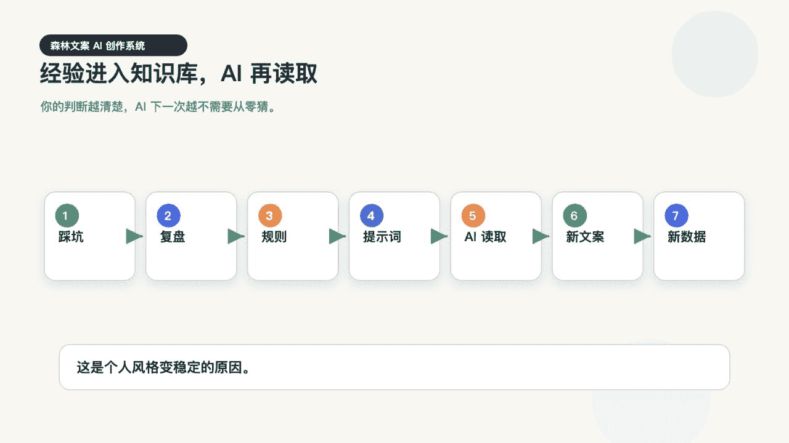

公众号懒人搜索，懒人专属群分享

配图*15*：系统自我进化闭环

## 04 我的系统长什么样：不是一个提示词，而是一条生产线

现在回头看，我这套 AI 二创文案系统，本质上是一条生产线。它大概是这样跑的：

配图*16*：完整文案生产闭环图

爆款原文输入 → AI 拆解 → 二创出稿 → 人工判断和修改 → 完成文案归档 → 账号分配 → 发稿复制台 → 发布 → 数据复盘 → 写回知识库。

这条链路听起来有点长，但它不是为了显得高级，每一环都是为了解决一个真实问题。

### 1. 爆款原文库：解决输入问题

以前我看到好文案，最多就是截图、收藏、丢进微信。看起来都在，但真要用的时候，我找不到，AI 也读不到。后来我专门建了爆款原文库。

一条原文进来，不是只保存正文。我会记录它的品类、产品、开头、转品方式、可能有效的原因、适合二创的方向。因为没有好输入，后面全是空想。

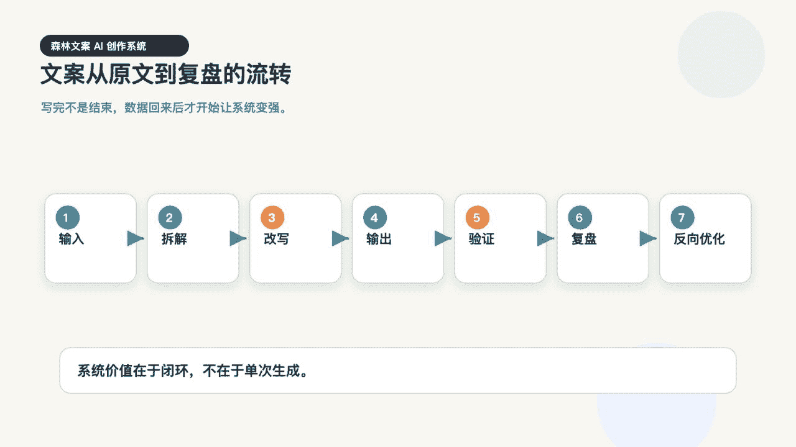

### 2. AI 拆解库：解决“为什么能爆”的问题

拆解不是总结。总结是告诉你这篇文案讲了什么，拆解是告诉你这篇文案为什么能跑。我一般会让 AI 拆几个东西：

- 第一，这篇文案真正想让观众相信什么。
- 第二，它的开头为什么能留人。
- 第三，中段靠什么让人继续听。
- 第四，产品为什么能接上。
- 第五，哪些句子最值钱，不能随便删。
- 第六，哪些结构可以换产品复用。

只有拆到这个程度，二创才不是洗稿。它才有可能变成“保留有效结构，换掉具体表达和产品路径”。

### 3. 完成文案库：解决资产沉淀问题

所有能发的稿子，我都会统一放到完成文案库。这个动作看起来很简单，但它非常关键。因为只有完成稿被统一归档，后面 Codex 才能读取当天完成文案，帮我做发布分配。

如果今天的稿子在微信里，明天的稿子在桌面上，后天的稿子在聊天窗口里，那 AI 根本不知道去哪里找。这也是很多人用 AI 做项目的问题：不是没有产出，是产出没有变成资产。

配图*17*：完成文案库截图

### 4. 规则库和元素库：解决下次怎么复用的问题

我后来专门把开头、金句、转品、产品段、踩坑经验拆成规则和元素。但这里有一个坑：元素库不能变成素材垃圾桶，不是看到一句好话就塞进去。

没验证之前，最多叫候选素材。真正跑过、或者我明确判断有价值的，才值得沉淀。比如某个开头跑起来了，某个转品我明显感觉自然，某个产品段能让人有体感。这个时候我才让 AI 把它拆出来，放进对应的库。否则库越建越大，最后只是堆了一堆看起来很丰富、但真正用不上的东西。

配图*18*：元素库结构图/截图

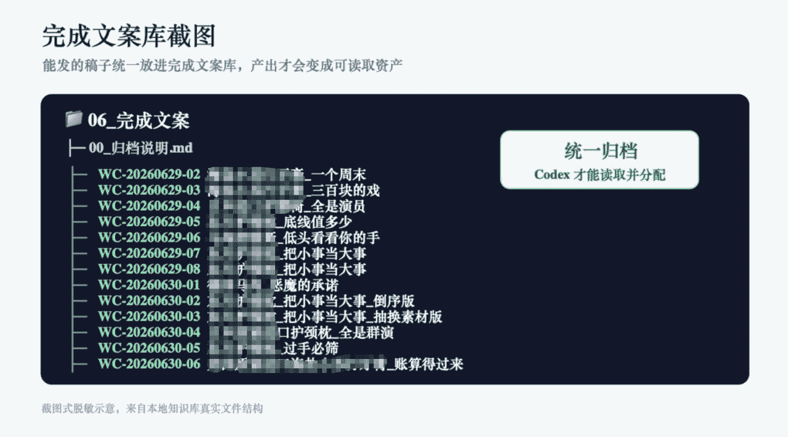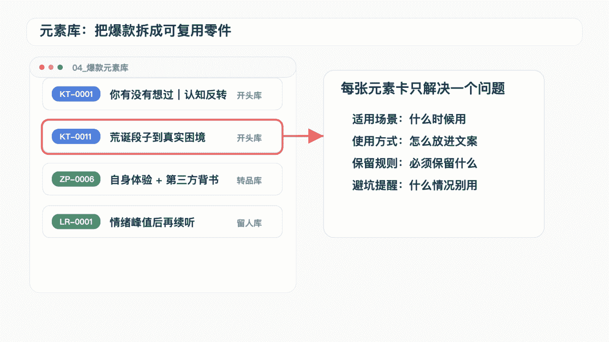

### 5. 账号分配系统：解决发给谁的问题

写完文案只是第一步。真正发布的时候，还有一个非常关键的问题：这条文案发到哪个账号上？以前我更多靠感觉。

哪个号最近播放好，就发哪个。哪个号顺手，就发哪个。但后面账号多了以后，我发现这件事不能靠脑子硬记。不同账号状态不一样。

有的账号适合承接主力稿，有的账号只适合测试稿。有的账号近期播放不错，但成交一般，有的账号出单能力强，但不能承接高风险内容。有的账号刚跑出爆款，可能进入短期权重窗口，这个时候更不能乱发。

所以我让 Codex 根据账号池、近期表现、文案风险、产品类型，先生成发布分配表。我确认之后，再进入下一步。这里有一个我后来特别认同的判断：**账号分配不是排班表，它是最后一次关键创作。**同一条文案，给不同账号，结果可能完全不一样。

配图*19*：账号分配表截图

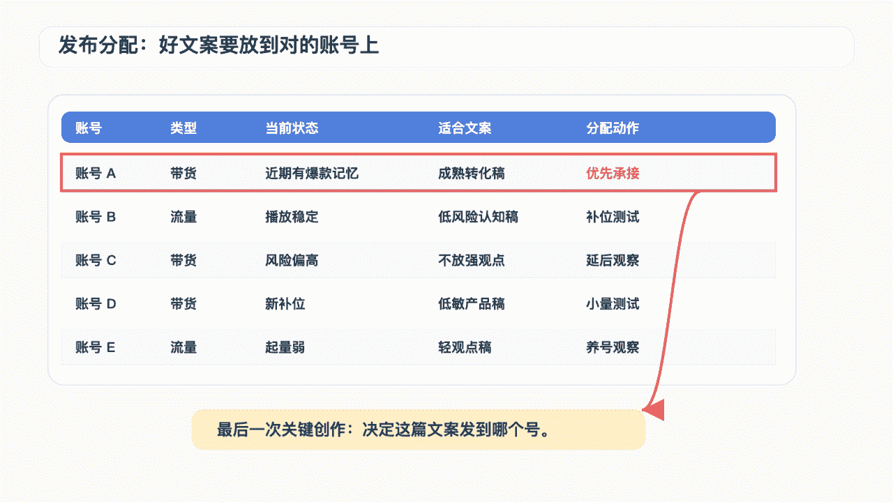

### 6. 发稿复制台：解决最后一公里的问题

发布环节很琐碎。标题、编号、正文、配音、账号，经常要来回复制。只要有一个地方复制错，就会影响发布。所以我让 Codex 把当天要发的内容，生成一个本地 HTML 发稿复制台。

里面有：

1. 编号标题一键复制。
2. 正文一键复制。
3. 标题加正文一键复制。
4. 配音人对应。
5. 每条文案对应账号。
6. 发布前风险提醒。

这个东西本身不直接帮我赚钱，但它减少了大量发布摩擦。很多项目不是死在战略上，是死在每天那些重复、琐碎、容易出错的小动作里。

配图*20*：发稿复制台截图

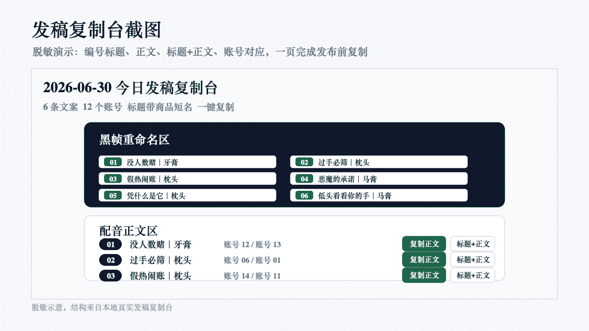

## 05 这套系统到底怎么提高文案质量：不是“优化”，而是判断

我以前最常对 AI 说的一句话是：帮我把这个开头优化一下。后来我发现，这句话太空了。AI 不知道什么叫优化。

它可能加几个形容词，可能把句子写得更顺，可能来一句“你有没有想过”。但短视频文案真正要解决的，不是顺不顺，是观众为什么要停下来。所以我后来让系统做的，不是简单优化，而是判断。

### 1. 开头：把低价值铺垫删掉，把高冲突资产前置

举一个最典型的案例文案。《逻辑哲学论：叫取消思考》那条，原来的开头大概是：

> 昨晚翻来覆去睡不着，我突然琢磨一个挺有意思的悖论。咱们总说统一思想又要实事求是。这两句话搁一块逻辑上真的能自洽吗？

这个开头不是不能看，但它的问题是太像作者在自言自语。观众不关心你昨晚睡没睡着，观众只关心这句话跟我有没有关系，有没有冲突，我为什么要继续听。

后来拆完之后我发现，真正有力量的不是“我睡不着”，也不是“我突然想到一个悖论”。真正有力量的是两个词：**统一思想、实事求是**。

这两个词单独看都对，但放在一起，就有冲突。如果思想都统一了，那还怎么实事求是？如果事实和预设结论冲突，到底是尊重事实，还是修剪事实？

所以最后开头要改成：

> 统一思想，实事求是。这两句话你听过多少年了，有没有认真想过，它们放在一块儿，根本就是两个方向的。

你看，这不是简单把句子改得更狠，这是系统在做判断：哪些是低价值铺垫，哪些是高冲突资产，哪些要删，哪些要前置。

配图*21*：开头改写前后对比

### 2. 中段：长文案不能平铺，必须有续钩子

很多长文案的问题是：开头还行，讲到中间，人就跑了。为什么？

因为故事平铺。第一件事，第二件事，第三件事，听着听着就累了。短视频观众不是坐在教室里听课，他随时可以划走。所以中段必须重新给他一个继续听的理由。

我后来在系统里加了一个要求：长文案中间必须要有续钩子。

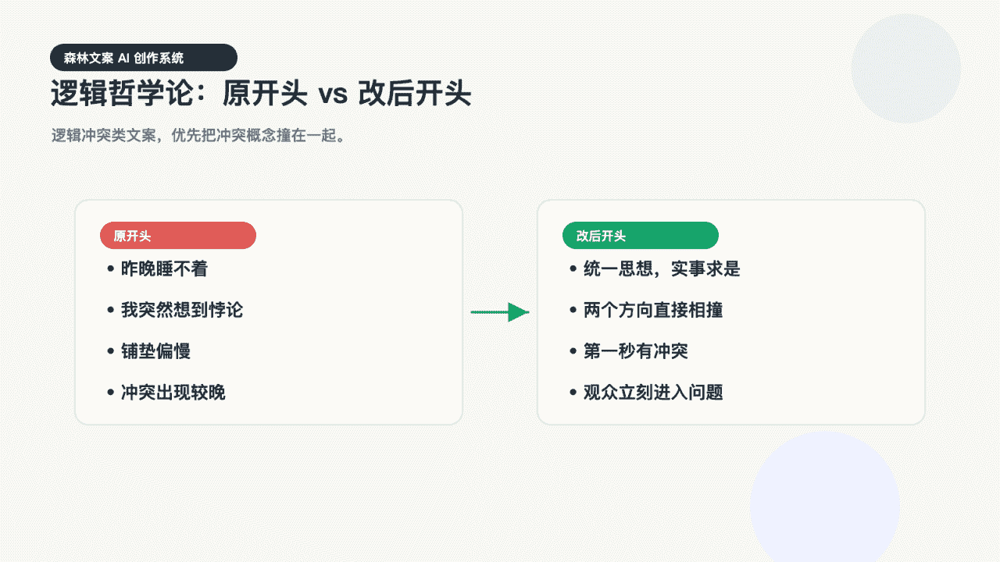

比如：真正关键的，还在后面。或者：后面这件事，才真正让人说不出话。

这不是为了装腔，而是在中途重新拉一次注意力。

而且不只是加一句钩子就完了，故事顺序也要调整。哪个故事负责开场，哪个故事负责建立信任，哪个故事负责情绪升级，哪个故事负责给产品铺垫，这些都要判断。如果只是把素材堆在那里，信息再多也会散。

配图*22*：长文案中段留人结构图

### 3. 转品：产品必须从前文里长出来，不能硬插

转品是很多人最容易翻车的地方。前面讲得挺好，一到产品，观众马上感觉：哦，开始卖货了，然后就走了。

为什么？

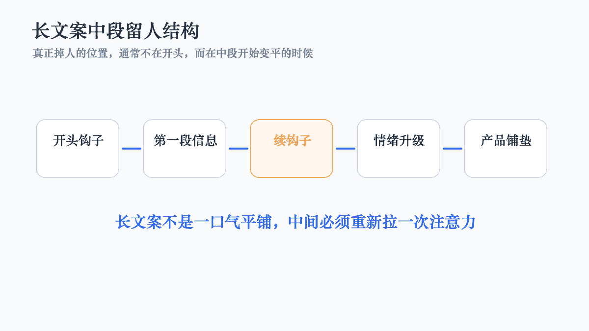

因为产品不是从前面的故事里长出来的，它是突然被塞进去的。

所以我系统里有一个非常重要的判断：**产品和前文是不是同一个内核？**

前面讲的是认真、标准、时间检验，那后面产品也要承接认真、标准、时间检验。前面讲的是家庭责任，后面产品也要落到家庭责任。前面讲的是普通人的小痛点，后面产品也要解决普通人的小痛点。

如果前面讲 A，后面突然卖 B，观众一定会觉得硬。

配图*23*：硬转品 vs 自然转品

### 4. 产品段：不要写说明书，要写体感

很多人产品段写不好，是因为太像说明书。一到产品就写：原装进口，品质很好，很多人复购，口碑不错。这些有没有用？有一点，但不够。因为观众没有感觉。

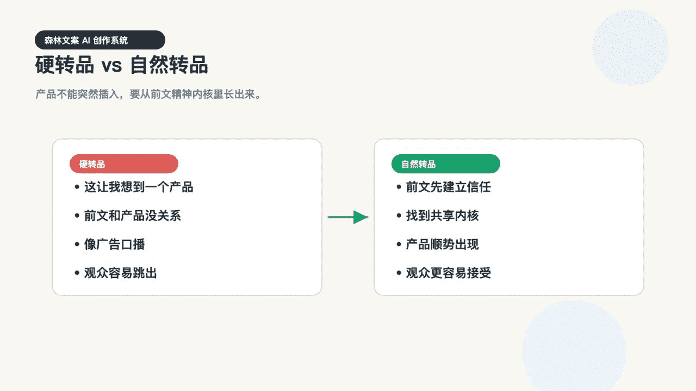

比如德国马膏，我不能只写德国原装进口、品质很好。我会写：

> 涂上去先凉。过一会儿热感从皮肤底下慢慢透上来。像把紧绷的肌肉一点点揉开。久坐脖子僵。久站腿脚酸沉。运动后肌肉紧。

这些句子为什么有用？因为观众能在身体里想象。他不是只知道这个东西好，他开始想：我脖子是不是也僵？我爸妈是不是也久站腿酸？我运动完是不是也肌肉紧？这时候产品才离他近。

所以我后来给系统加了一条规则：产品段不要只写属性，要写体感。不要只写卖点，要写场景。不要只说好用，要让观众能想象自己什么时候用。

配图*24*：说明书式产品段 vs 体感式产品段

## 06 这条文案，为什么能高转化

这里我拿德国马膏这条做一个完整拆解。这条不是我播放最高的一条，但它是非常典型的高转化文案。因为它不是硬广。

它前面讲的是：真正有价值的东西，不靠别人保护它，而靠自己反复证明自己。GPS 是这样，Linux 是这样，阿司匹林是这样，德国马膏也应该是这样。

配图*25*：德国马膏文案信任链路

开头先用 Windows 段子吸引人。但光有段子不够，我又加了我爸手机广告的真实场景。广告隔几分钟弹一次，叉号小到像针尖。我一个年轻人研究半天，最后只能卸了，才算消停。这一步是让段子落到真实生活。

观众会觉得：我家也这样，我也遇到过。然后中间讲 GPS、Linux、阿司匹林。最后为什么是阿司匹林？

因为阿司匹林最适合借给德国马膏。阿司匹林是德国药，德国马膏也是德国产品。阿司匹林讲的是时间检验，德国马膏也要承接时间检验。

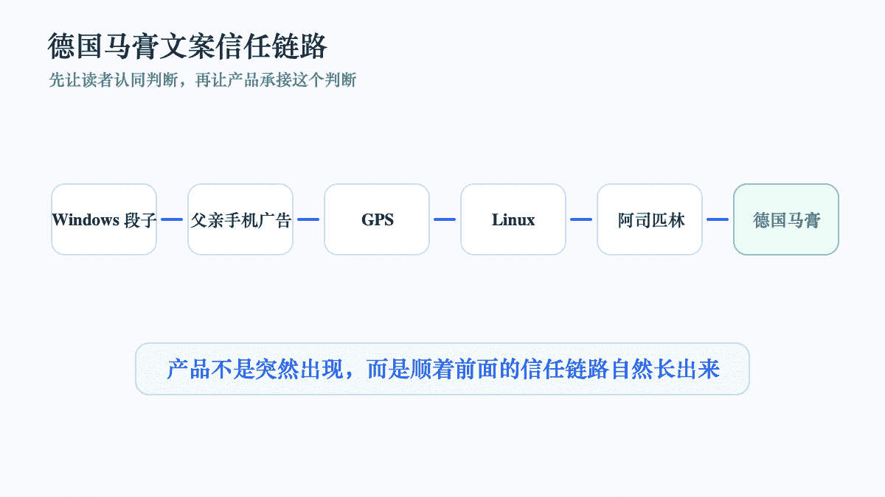

到转品的时候，我没有直接说：给大家推荐一个德国马膏。我写的是：

> 这套标准，我没想到有一天会落到我自己手里。一个学体育的朋友给我带了罐东西过来。说德国运动员都在用。我拿到手没当回事。打开涂在脖子上那一秒，我愣了。

你看，这里产品不是我突然掏出来的，它是一个学体育的朋友带出来的，这就有了背书。我一开始没当回事，这就降低了推销感。涂上去那一秒我愣了，这就有了体验反差。

最后再用一句：我脑子里就冒出霍夫曼那个白色粉末。这东西，绝对有人认认真真死磕过。这句话的作用，就是把阿司匹林的信任，借给德国马膏。

所以这条不是靠一句产品卖点转化，它是前面整条链路都在给产品铺信任。

这就是系统能帮我做的事。它不是只改几个字，它是帮我判断：开头怎么留人，中段怎么递进，最后一个故事怎么给产品借势，转品怎么不要硬，产品段怎么写体感。这些都做对了，转化才会高。

配图*26*：德国马膏高转化案例卡

## 07 爆了一条之后，为什么还能接着爆

文案写完，不代表结束。还有最后一个问题：发给哪个账号？我之前有过一个经验。

《取消思考》那条跑到 4 万多播放之后，带动了同账号一条老视频，从 1000 多播放跑到 40 多万。那时候我就意识到：一个账号如果被一条内容打起来，它可能会进入一个短期权重窗口。简单说，就是这个号突然活了。

这个时候你不能乱发，你要喂一条比较稳的文案进去。后来德国马膏也是类似。6 月 4 日有一条视频，到了 6 月 11 日，它突然跑到 30.5 万播放。我当时判断：这个账号权重被拉起来了。这时候不能发高风险文案，不能发没验证过的测试稿，应该发一条低风险、产品路径清楚、转化潜力高的文案。

所以我在 6 月 12 日追投了德国马膏。后面它跑出了 4.6 万级播放，成交金额 11,985。

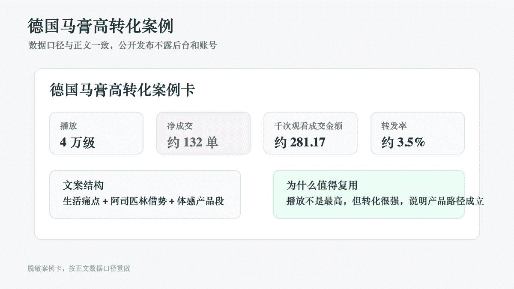

配图*27*：账号权重窗口示意图

我不会说这件事百分百是我算准了，平台流量肯定有不确定性。但这个动作提高了概率。更重要的是：这件事发生以后，我把它写成了规则。**账号刚跑出爆款后，会进入短期权重窗口。窗口期内，下一条不能随机发，优先喂低风险、高质量、高转化文案。**

下次 Codex 帮我做分配的时候，就可以读这条规则。这就是系统。一次经验，不只是经验，它会变成下一次的动作标准。

## 08 Codex 在我的运营里到底做什么

前面说过，Claude Code 是写文案的，Codex 是管文件、跑流程的。这里我再说具体点。Claude Code 进入文案里面：拆原文、设计开头、写完稿、做质检。Codex 更偏系统和流程：整理文件、读取完成文案、读取账号池、生成发布分配表、生成发稿复制台、把复盘结果更新到规则库。

比如我把账号数据给 Codex，它会帮我看：哪个账号最近有爆款记忆。

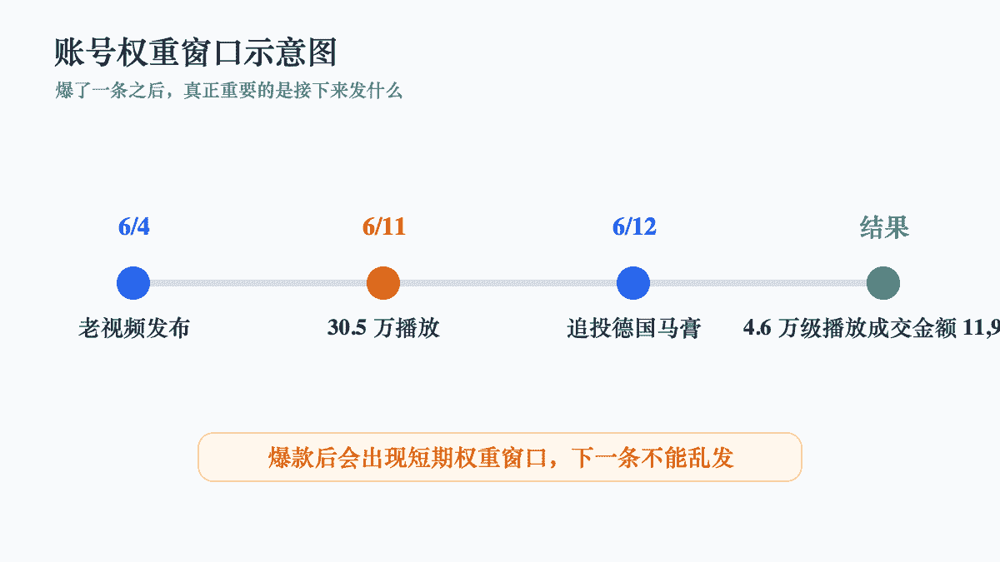

哪个账号播放不高但出单能力强，哪个账号适合拉流量，哪个账号适合承接成交，哪个账号近期风险高，不能压主力稿。

然后它再看当天的文案：这条是成熟转化型，这条是流量测试型，这条风险比较高，这条产品路径很清楚。最后它帮我做分配。

但这里我没有直接全自动。我会让 Codex 先给方案，我确认。确认后，再让它生成发稿复制台。

原因很简单：**凡是涉及判断的地方，先让 AI 给方案，人来拍板。凡是已经确认的重复动作，再交给 AI 自动执行。**

这是我现在用 AI 很重要的一条原则。AI 不是替我负责，AI 是把我已经验证过的经验，放大成稳定动作。

配图*28*：Claude Code 和 Codex 分工图

## 09 如果你也想搭，第一版不用复杂

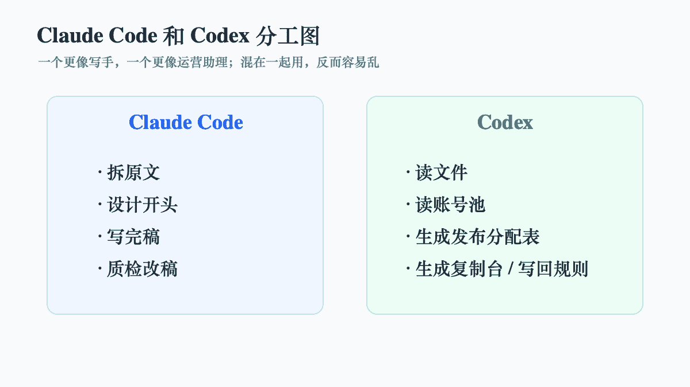

很多圈友看到这里，可能会觉得：森林，你这套东西太复杂了。Obsidian、Claude Code、Codex、小 V 猫、账号发布池、发稿复制台。我一个小白怎么可能一下子搭起来？

说实话，一开始我也没有想搭这么完整，它是一个问题一个问题解决出来的。

所以如果你也想搭，我建议你先做最小版本。

先建 6 个库：

- 原文库
- 完成文案库
- 规则库
- 元素库
- 复盘库
- 账号数据

配图*29*：最小系统六个库

先不要追求好看，先让你的素材、完稿、规则、复盘有地方放。

然后跑通一条完整链路：找对标 → 存飞书 → Claude Code 拆解 → 三步二创 → 人工改 → 发布 → 复盘写回。

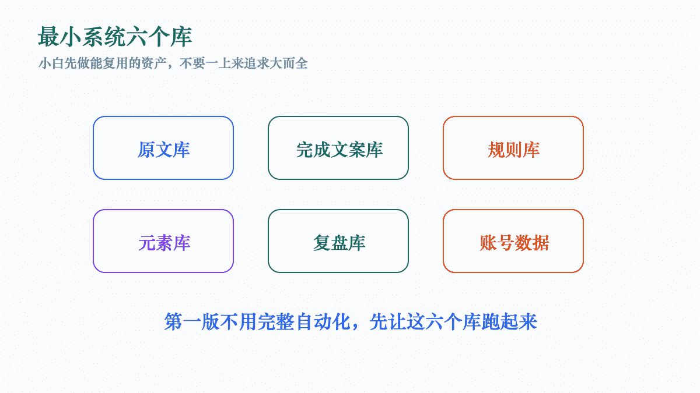

配图*30*：小白第一条最小闭环

这条链路具体每一步怎么操作、要打什么字、AI 会吐出什么，我在文末用德国马膏这条真实的稿子，从打开电脑一步步演示了一遍（见最后的实操章节）。

你照着做就行。只要这一条跑通，你就有了最小闭环。

接下来连续跑 7 天。7 天以后，你会看到很多问题：AI 总是哪里写不好？哪类开头更容易起播？哪个产品更容易成交？哪个账号适合承接主力稿？哪些文案值得继续二创？这些问题，就是你系统迭代的入口。

等流程稳定了，再接自动化。账号分配、发稿复制台、数据抓取、配音工作台、飞书归档。

不要一开始就追求全自动，先让 AI 帮你稳定省下一个环节的时间。一个小环节跑通以后，再接下一个。最后你会发现，系统不是一天搭起来的，它是在真实项目里，一次次解决问题长出来的。

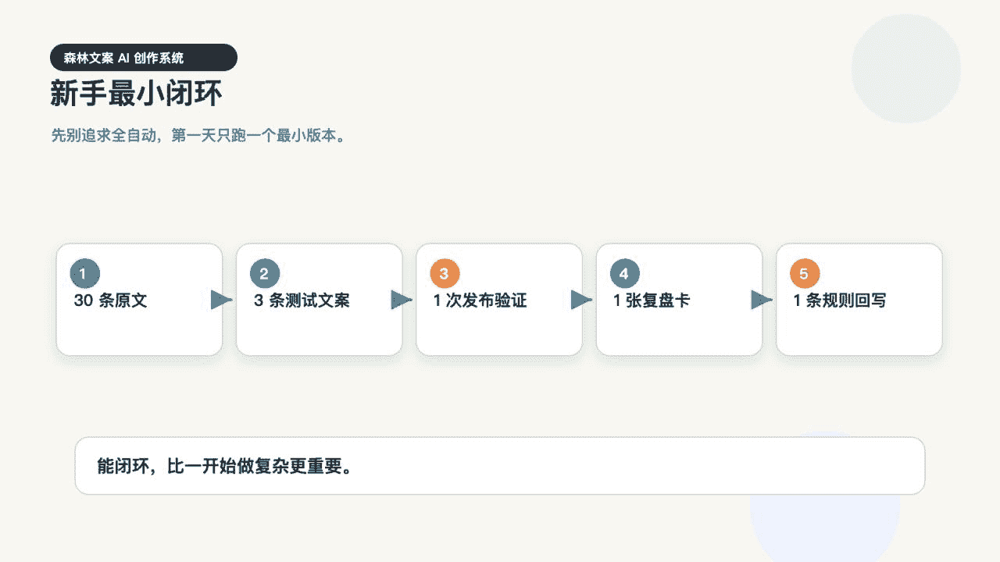

## 10 附：一条文案从 0 到成稿，我到底怎么做（德国马膏全流程）

前面讲的都是为什么，这一章只讲怎么做。

我用德国马膏这条真实的稿子，把从打开电脑到完稿的每一步，原样走一遍。你照着做就行。

### 准备：先把工具装好（一次性）

你只需要这几样，基础的全是免费的：

- **VS Code**（免费）：你的工作台，所有动作都在这一个窗口里完成。
- **Obsidian**（免费）：你的知识库，建在同一个文件夹里。
- **Claude Code、Codex**：装在 VS Code 里的插件，是真正干活的 AI。
- **飞书多维表格**（免费）：记数据。
- **一个能稳定访问 AI 的网络 + 一个 AI 会员**（Claude 或 GPT Plus）。

装好之后记住一句话：以后所有动作，都在 VS Code 这一个窗口里完成，不用到处切。

公众号懒人搜索，懒人专属群分享

配图31：VS Code 工作台截图

第0步：写出你自己的第一版主控提示词

很多人卡在“我没有提示词”。其实你不用抄别人的。打开你以前和 AI 聊了很久的那个窗口，直接问它：

你回顾一下我们过去聊的文案，总结一下：我最想让你做到什么？我最不想要什么？我的风格是什么？

它总结完，你再追问一句：

按我的偏好，帮我整理一份主控提示词，分成：角色定位、创作原则、禁区、工作流程、质检标准。

它整理出来的，就是你的第一版。不用追求完美，能用就行，后面靠数据改。我自己的主控提示词，骨架长这样，你可以照着填：

### 主控提示词

## 角色定位

你是我的短视频带货文案二创搭档，不是一次性写稿工具。

情绪保真第一，逻辑升级第二，表达重写第三，字句润色最后。

## 工作流程（拆三步，不要一次干完）

第一步：只拆解+搜素材，不写稿。

第二步：只定框架+给开头，不完稿。

第三步：才完稿+质检+起标题。

每步完成后停下，等我确认，不自动推进。

## 红线（举几条）

- 严禁只做同义改写。
- 严禁把有刺的话改成温吞表达。
- 严禁把有传播势能的核心词换成同义词。
- 情绪资产在第一步标出，二创后变弱，直接算失败。

## 核心原则

原文不是资产，拆出来的情绪结构和规律才是。

把它存进 **Obsidian** 的 `01_核心规则/`。以后 **Claude Code** 每次开工，先读它。

配图32：主控提示词文件截图

然后，一条文案这样跑（以德国马膏为例）。

第1步：刷到对标，先存飞书，别急着改

我刷到一条爆款，讲“有价值的东西凭什么免费”，用 Windows、GPS、阿司匹林举例。我没有马上丢给 AI，先存进飞书：原文、产品、链接、播放、是否爆款。飞书管结果，**Obsidian** 管能力，两个别混。

配图33：飞书对标收集表截图

第2步：在 VS Code 里开 Claude Code，先让它读规则、做拆解——不是直接写

我打开 **Claude Code**，第一句不是“帮我改”，而是：

开始新文案，先读主控提示词。

它读完，我把对标原文贴进去，说：

按第一步提示词，拆解这条。

这一步它不写稿，只回答这几个问题（这就是我第一步提示词的骨架）：

第一步：拆解+搜素材

1. 论点：这篇真正想让观众相信什么？
2. 爆点：哪句话让人停下来？
3. 情绪最高点在哪？
4. 情绪资产：哪些句子不能删？（删了就算失败）
5. 漏洞/政治风险在哪？
6. 同源爆款家族：有没有 A/B/C 版本，别改出撞稿？
7. 这条值不值得完整二创？

德国马膏这条，它拆出来的内核是：真正有价值的东西，不靠别人保护，靠自己反复证明自己（GPS、Linux、阿司匹林都是这样）。情绪资产是“父亲被广告折磨”那种生活痛点，不能删。不先拆就改，AI 最容易把最值钱的冲突改平。

配图34：Claude Code 第一步拆解输出截图

第3步：原文一进来就归档

拆的同时，让它把这条原文存进 `02_爆款原文库/`。记住：原文一进来就归档，别等写完再想起来。聊天记录会丢，知识库才留得住。

第4步：进第二步，定框架、给开头

我说：

进入第二步，读第二步提示词。

这一步它还是不完稿，只做这几件事（第二步骨架）：

第二步：框架+开头

1. 核心论点升级：从结论升级到“替观众说出来”的洞见。
2. 故事排序：哪个开场、哪个建信任、哪个升级、哪个铺产品。
3. 改与不改：原框架哪些保留、哪些动。
4. 转品设计：最后一个高势能案例，怎么自然借给产品。
5. 给三个同构开头，让我选。

德国马膏这条最关键的判断：把对标的 Windows 段子，换成“我爸手机广告隔几分钟弹一次、叉号小得像针尖、最后只能卸了才消停”——把抽象吐槽落成真实家庭小事。观众一句“我家也这样”，信任就来了。

转品也在这步定好：最后一个案例放阿司匹林（德国药、讲时间检验），因为产品德国马膏正好同源，借得自然。

配图35：第二步三个开头对比截图

第5步：进第三步，完稿、质检、起标题

选好开头，我说：

进入第三步，完稿。

这一步才真正写整篇，并且自己过质检（第三步骨架）：

第三步：完稿+质检+标题

- 先读回第一步的情绪资产、第二步的执行承诺。
- 完稿：口语化，书面词换成人话。
- 转品规则：人先出来，产品跟着来。
- 产品段写体感，不写说明书。
- 十条质检：开头有没有劲、情绪资产在不在、转品硬不硬、产品有没有身体感……
- 裂变双版本：要发多个号，A/B 两版换开头入口和转品桥，不是换几个词。
- 起标题。

德国马膏完稿里，转品是这样长出来的，不是硬插：

这套标准，我没想到有一天会落到我自己手里。

一个学体育的朋友给我带了罐东西过来，说德国运动员都在用。

我拿到手没当回事。

打开涂在脖子上那一秒，我愣了。

学体育的朋友=背书；我没当回事=降推销感；涂上那一秒愣了=体验反差。

产品段写体感，不写“德国进口、品质很好”：

涂上去先凉，过一会儿热感从皮肤底下慢慢透上来，像把紧绷的肌肉一点点揉开。

久坐脖子僵、久站腿脚酸、运动后肌肉紧。

配图36：第三步完稿和质检截图

第6步：人工改一遍，确认，回飞书，做视频发布

AI 写第一版，我来拍板和修。确认没问题，复制回飞书，做成视频发出去。

这条德国马膏，我发在一个有过爆款历史的成交号上：播放4万，成交132单，千次观看成交金额281块，转发率3.5%。播放不算最高，但转化极强。

第7步：数据回来，复盘，写回知识库

爆了不算完。我会问一句：它到底为什么能成交？然后把结论拆回各个库：

- 开头“父亲广告软件”那段→写进开头库（规则：强观点开头后，必接一个自己家人的真实小事）。
- 转品“学体育朋友带来”→写进转品库（规则：马膏转品先让可信的人出现，别自己直接推销）。
- 产品体感“先凉后热”→写进产品段规则。
- “最后一个案例要和产品同源”→写进第二步提示词。

这一步最容易被跳过，但它才是系统会长大的唯一原因。下次再写马膏，AI 不是从零开始，它直接读到这些规则。

配图37：德国马膏复盘卡截图

到这里，一条文案就从“刷到对标”跑到了“写回系统”。你第一次跑可能要一两个小时，跑顺之后，我现在一条大概15到20分钟。

## 11 最后想说

我做 AI 短视频带货第3个月，最大的变化不是学会了某个工具。而是我开始有意识地把自己的经验、判断和流程，沉淀成一套系统。

以前我每天都在和选题、文案、发布、数据打仗。现在我更像是在训练一条 AI 文案生产线。

它还不完美。很多地方还在迭代。但它已经开始帮我稳定产出，减少错误，沉淀经验，并且带来收入增长。

对普通人来说，AI 最值得期待的地方，也许不是让你突然变成高手，而是让你把自己已经会的东西，一点点系统化。

以前一个人做项目，很多事情只能靠体力硬扛。现在不一样了。你可以把经验放进知识库，把创作交给 Claude Code 协作，把流程交给 Codex 执行，把数据反馈写回复盘。让系统一天比一天更懂你。

这才是我这3个月最大的收获。AI 不只是帮我写了一些文案。它开始帮我把一个人的短视频带货项目，变成一套可以持续迭代的生产系统。

如果你现在还在从零开始问 AI 写文案，我建议你今晚就做一件事：

不要再只保存聊天记录。建一个文件夹。把你今天跑出来的原文、完稿、规则、复盘放进去。系统就是从这一刻开始长出来的。

————分割线————

看完这篇 SOP，你觉得你懂了。但90%的人一到实操就会卡在第一步。

工具和教程只是最低级的壁垒，真正的壁垒是“立刻动手”和“圈层信息差”。

如果你想看全网最新的变现玩法，并且和一群执行力极强的极客一起下场拿结果，欢迎围观我的核心私域：【懒人专属群】。

我们不聊虚的，只做商业闭环的拆解与 AI 效率的压榨。系统内已沉淀1000+跑通的套利实战局。

👉 查阅圈子完整数字资产与上车门槛：

https://lazyso.com/insider/

认同价值、准备好下场干活的，扫码加我微信（lazyhelper1）。

备注：【实操上车】，不闲聊。

