公众号懒人搜索，懒人专属群分享

# 烧了 **230 亿 Token**，我终于跑通了一套实体老板也能复制的 **AI 变现 SOP**

260702 副业 SC 精华

整理：公众号懒人搜索，懒人专属群精选

懒人微信：lazyhelper1

如果你是实体店老板，或者手里有行业经验、客户资源，想用 AI 做一个能收费的小产品，但还不知道该从哪个需求切入，这篇会更适合你。它不讲宏大的 AI 平台，也不讲泛泛的工具玩法，只讲怎么从真实业务里找一个小切口，做出 Demo，再拿去找真实客户验证。

我用 Codex 做了一个美业 AI 小程序，现在已经在内测阶段。目前阶段性结果是：

- 内测阶段已有 10+ 家店在用；
- 内测期间按 500 元/店收费；
- 目前已经有 20+ 家店明确预约正式产品上线使用；
- 正式收费计划是 9800 元/年/店；
- 我聊过几个老板，他们看到演示后的第一反应基本都是：“我靠，现在还能这样做吗？”

项目还在内测和放大前期，具体门店、具体品项、具体数据我不会全部公开。但这个反馈已经说明一件事：老板不是第一次见 AI。他们惊讶的是：

原来门店里那些看不见、教不会、复盘不了的销售细节，可以被 AI 拆出来。

这个小程序做的事情，用一句小白能听懂的话说就是：

把美容师跟顾客沟通、服务过程、销售机会、回访文案、小红书内容这些原来靠经验和感觉的东西，变成老板看得见、员工能训练、门店能复盘的数据。

老板为什么会觉得有价值？因为以前很多东西是黑盒。顾客躺在床上说了什么，员工怎么接，哪里有成交信号，哪里有风险，员工有没有错过机会，店长事后往往看不见。

但如果 AI 能把这些东西拆出来，老板就会发现：

- 销售记录可以追踪；
- 服务过程可以复盘；
- 美容师可以训练；
- 顾客回访可以更及时；
- 内容素材可以从真实服务里长出来；
- 过去“凭感觉”的部分，开始被量化。

这就是这篇文章最核心的判断：

一个 **AI** 产品值不值钱，不看它用了多少 **AI**，而看它有没有把真实业务流程变得更可追踪、更可复盘、更能带来收入。

所以这篇文章只讲一件事：

普通人做 **AI** 变现，不要先问“AI 能做什么”，而要先问“我熟悉的行业里，哪个动作每天都在发生、很依赖人、容易出错，出错就会丢钱”。

只要你能找到这个动作，再用 AI 把它做成一个小工具，就有机会让客户愿意付钱。

下面我把自己的项目拆成 4 个部分：

1. 结果背后的客户购买逻辑；
2. 一套小白也能照着用的 4 张表框架；
3. 美业项目里的 4 个真实案例；
4. 一套从想法到验证的 SOP。

## 一、结果背后的逻辑：客户买的不是 AI，而是业务结果

### 1. 这是我用 Codex 烧的 Token

先放两张图，不是为了证明“我很会用 AI”，而是为了先交代一个前提：下面这些方法，不是我偶尔试出来的，而是长期把 Codex 放进真实项目里之后的复盘。

第一张，是我的 Codex 使用量。

第二张，是我有一天登上生财 Token 排行榜的截图。

到目前我的 Codex Token 使用量大概 200 多亿，最高一天 10 亿左右，生财 Token 榜排到第 6。

但我想强调的不是“我消耗了多少”。

因为 Token 本身不是结果，它更像燃料。燃料烧掉了，不一定会变成产品；只有烧进真实业务流程里，才可能变成交付和收入。

如果你只是让 AI 写文案、做图片、写页面、写方案，它当然有用，但很容易停留在“半成品”。

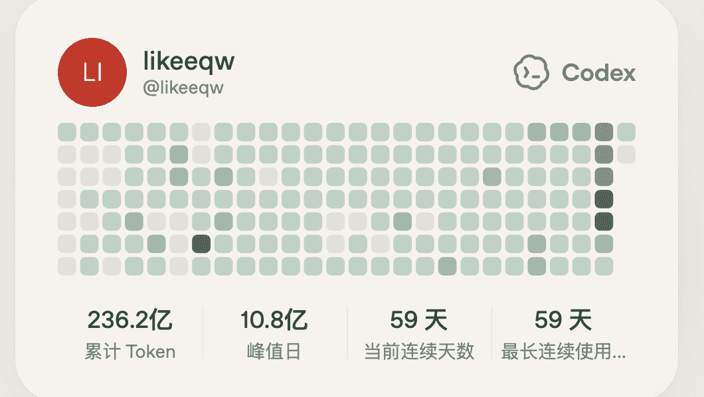

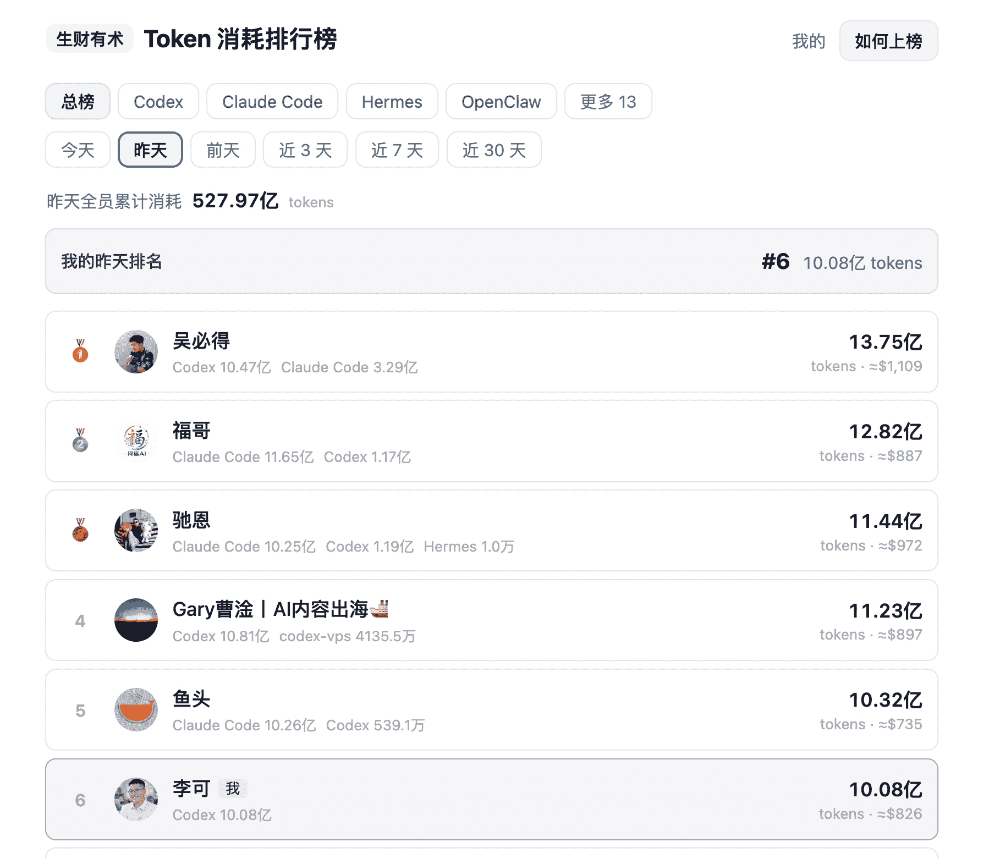

客户不会因为你用了很多 AI 就付钱。

客户只会因为你解决了他的真实问题付钱。

所以这两张图真正要引出的，不是“Token 越多越好”，而是下面这张图：

Token 想变成业务结果，中间必须经过“组织方式”。

这张图的意思是：Token 至少有三层。

第一层是数量：你每天能让 AI 干多少活。

第二层是质量：模型能力、上下文质量、任务拆解质量够不够。

第三层是组织方式：这些输出能不能被放进一个可复用、可验收、能产生业务结果的流程里。

把它再压缩一下，就是下面这个公式：

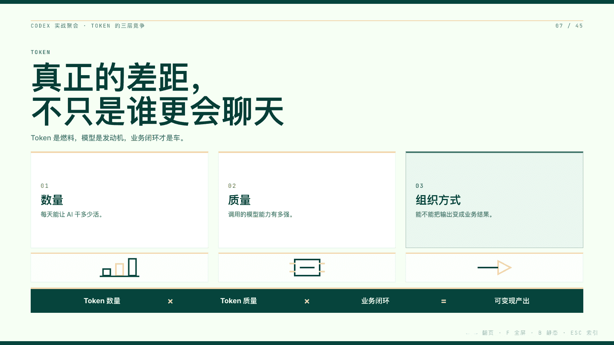

这段时间消耗了这么多 Token，我最大的感受是：

真正有用的不是某个神奇 Prompt，而是你能不能把行业资料、真实流程、客户反馈和验收标准持续喂给 AI，再让它围绕一个最小闭环反复迭代。AI 不是替你凭空想产品，而是把你已经看见的业务问题，更快地变成能演示、能验证、能改进的结果。

所以我不是想说“多烧 Token 就厉害”。

我想说的是：当 Token 被组织进一个每天发生、强依赖人、离钱近的业务闭环里，它就不只是成本，而会变成产品、交付和收入。

接下来你会看到，我的 Token 最后不是落在一堆炫技 Demo 上，而是落到了一个美业 AI 小程序里。

### 2. 我的 Token 最后落到了哪里

我这段时间做的是一个美业 AI 小程序，现在也在迁移成 App。

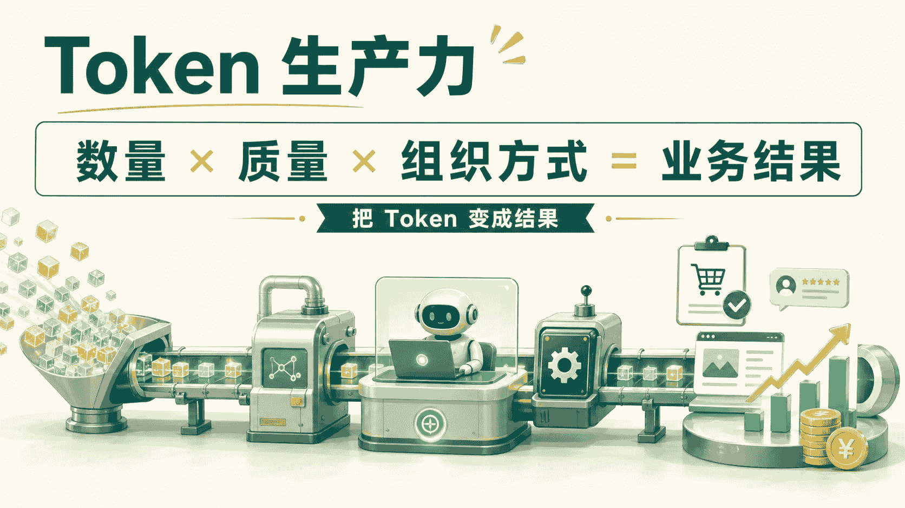

它不是一个泛泛的“AI 助手”，而是围绕美容门店每天真实发生的流程做的：

- 美容师怎么跟顾客沟通；
- 顾客异议怎么回应；
- 服务过程怎么记录；
- 销售机会怎么识别；
- 私域回访和预约怎么写；
- 小红书内容怎么从服务素材里长出来；
- 店长怎么知道员工哪里弱；
- 老板怎么看到过去看不见的销售过程。

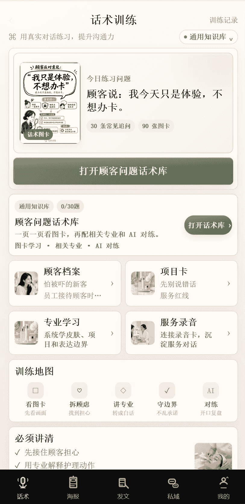

### 3. 老板真正买的是什么

我后来发现，老板买的不是“AI 对话”。老板真正关心的是这 4 件事：

#### 5. 看得见

- 以前服务过程看不见，现在顾客说了什么、员工怎么接，可以留下记录。

#### 6. 复盘得了

- 以前员工说“顾客还行”，现在能拆出顾客顾虑、销售机会、风险提醒。

#### 7. 训练得动

- 以前店长只能口头带员工，现在可以根据具体弱点反复训练。

#### 8. 跟进得上

- 以前顾客说了兴趣点，可能服务完就忘了；现在可以生成下一步动作和回访话术。

这四件事合起来，就是一个很强的业务结果：把销售黑盒变成可追踪、可复盘、可训练、可跟进的系统。

所以我想先给大家一个判断标准：

如果你的 AI 工具只是生成内容，客户可能觉得新鲜。如果你的 AI 工具能让他多赚钱、少漏单、少培训、少返工，他才更可能付钱。

## 二、核心框架：用 4 张表拆出一个能收费的 AI 产品

很多人做 AI 产品，第一步就容易跑偏。

他会先问：

我能用 AI 做什么？

这个问题看起来很积极，但它会把你带向“功能清单”：AI 能写文案、能做图、能写网页、能做客服、能搭知识库。

功能越列越多，客户反而越不知道为什么要付钱。

所以我会先把问题换掉：

这个行业里，哪个动作值得被 AI 改造？

不要从 AI 能力出发，要从业务里正在耗人、出错、漏钱的动作出发。只有先找到这种动作，后面的 +AI 才不是硬加功能，而是把 AI 放到一个本来就有客户、本来就有流程、本来就有痛点的位置上。

不是“随便找个行业，加一个 AI 的聊天框”。

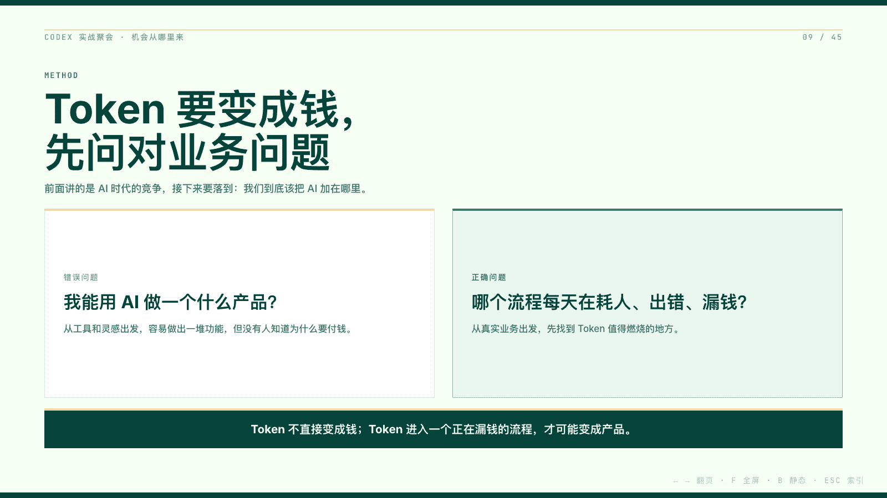

它至少要同时满足 5 个条件：已有行业、已有客户、已有流程、已有痛点，最后再用 AI 改造。如果前面 4 个没有，AI 做出来也大概率只是演示；如果前面 4 个成立，AI 才可能变成提效、增收、训练、复盘这些客户愿意买单的结果。

所以我建议你不要先写需求文档，而是先用下面 4 张表，把这 5 个条件一层一层拆清楚。

### 第 1 张表：行业流程表

先不要想产品。先画一条业务流程线。比如美业门店，大概可以拆成：

内容获客 -> 私域咨询 -> 预约到店 -> 到店诊断 -> 项目服务 -> 成交转卡 -> 服务复盘 -> 老客回访 -> 内容沉淀 -> 复购转介绍

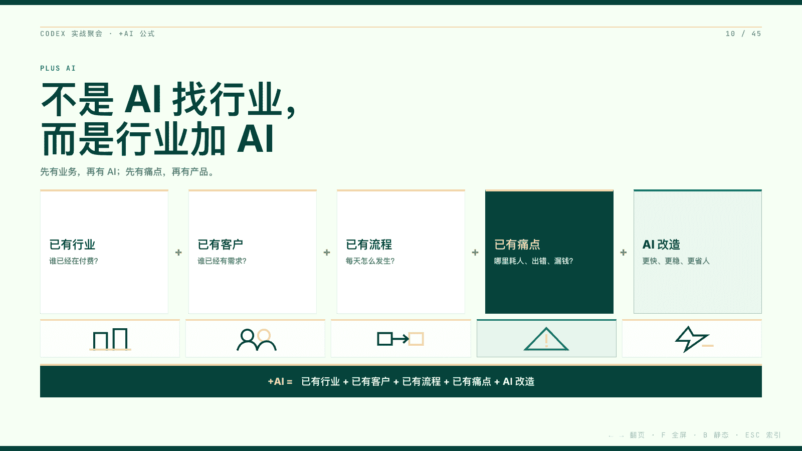

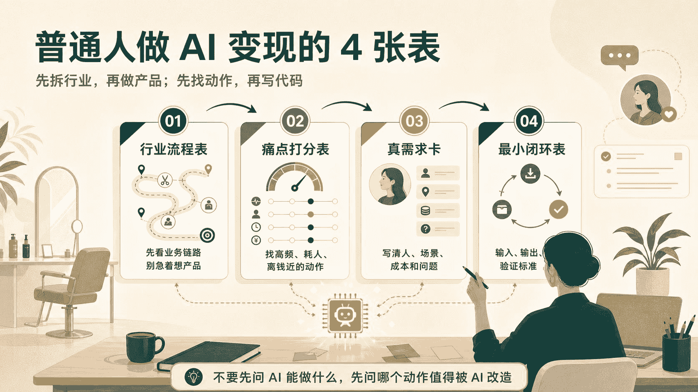

【这是我之前拆解的美容行业的流程表】

然后把每一步继续拆细。不要写“成交”这种大词，要写真实动作：

- 顾客问价格，美容师怎么答；
- 顾客怕刺激，美容师怎么解释；
- 顾客说“我回去考虑”，员工怎么跟；
- 顾客做完护理，第二天怎么回访；
- 老客三个月没来，怎么自然邀约；
- 服务过程里出现了什么小红书选题；
- 店长怎么知道员工有没有错过成交信号。

这一步的目的，是把“我要做一个 AI 产品”变成“我看到了一堆可改造的业务动作”。

### 第 2 张表：痛点打分表

流程拆完以后，不要每个都做。用一张打分表筛。

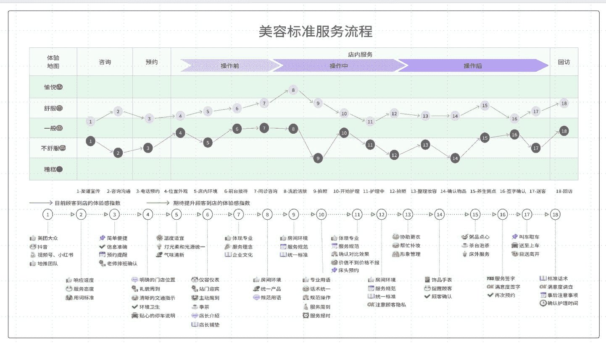

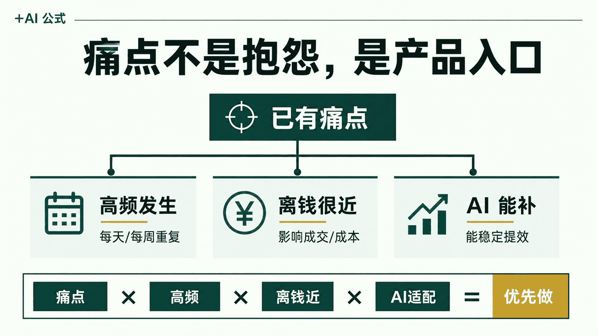

每个动作按 6 个维度打分，1—5 分即可：

| 维度 | 问题 |
|---|---|
| 高频 | 这个动作是不是每天/每周都会发生？ |
| 耗人 | 现在是不是要员工反复做？ |
| 易错 | 做不好会不会影响体验或成交？ |
| 离钱近 | 它会不会影响成交、复购、续费、转介绍？ |
| 依赖人 | 是不是很依赖员工经验、表达、判断？ |
| AI 适配 | AI 能不能明显帮上忙？ |

【美业流程诊断表示例】

分数最高的，不一定最大。往往是一个很小但很贴近钱的动作。比如美业里，我优先选的不是“做一个完整门店管理系统”，而是：

- 话术训练；
- 服务记录复盘；
- 私域预约回访；
- 小红书内容拓客。

因为这些动作都高频、离钱近、依赖人，而且 AI 能明显帮上忙。

### 第 3 张表：真需求卡

有了高分动作，还不能直接写代码。高分动作只能说明“这里可能有价值”，但还没有说明谁来用、在什么场景用、现在已经付出了什么成本、第一版只解决什么问题。

所以中间还要压一次：把“方向”压成“开工需求”。上面这张图讲的就是这个过程：先从低效环节里选一个需求方向，再把它压到具体场景，最后才变成 Codex 能执行、客户也能听懂的开工单。

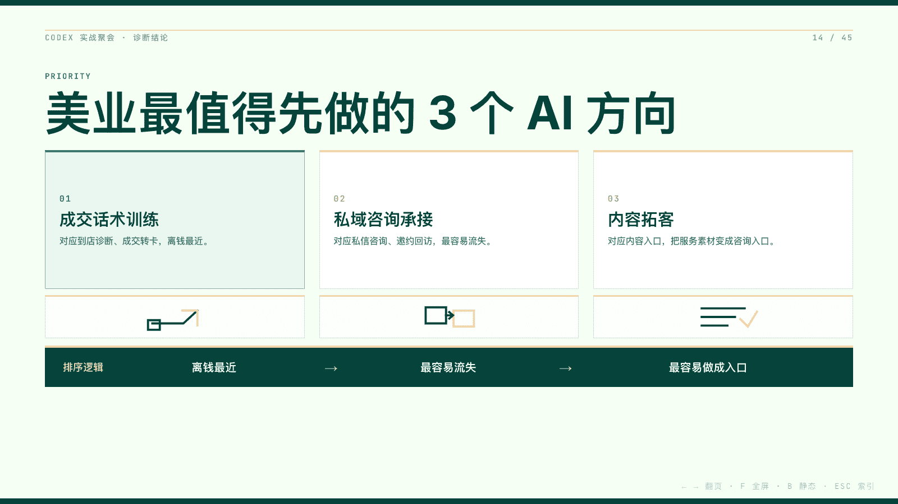

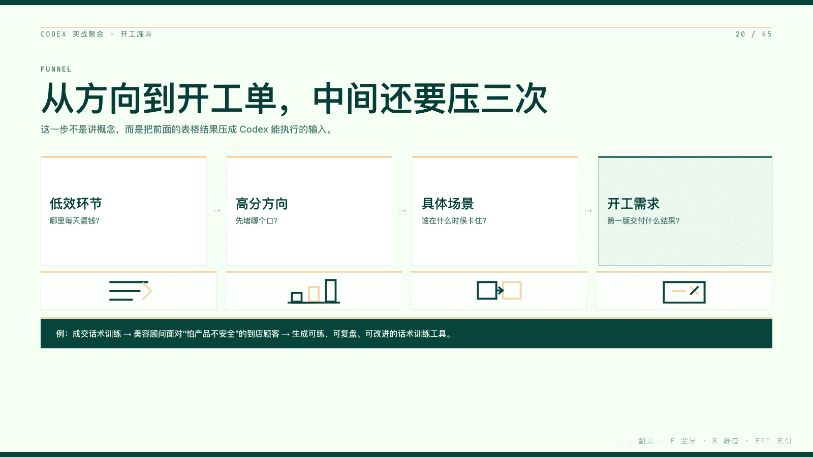

这里的关键，不是把需求写得高级，而是把需求写得足够具体。真需求不是一句“做个 AI 门店管理系统”，而是要同时说清楚 4 件事：谁在用、什么场景、已经付出了什么成本、第一版只解决什么问题。下面这张图就是这个判断公式。

落到实际填写时，可以直接用这张卡。它不是完整需求文档，而是防止你和 Codex 一起跑偏的“最小开工单”：

| 问题 | 写法 |
|---|---|
| 具体的人是谁 | 老板、店长、美容师、顾客，不能写“用户” |
| 具体场景是什么 | 在什么时刻发生，不能写“提升效率” |
| 已经付出了什么成本 | 时间、工资、漏单、培训、流失、老板检查成本 |
| 第一版解决什么问题 | 只解决一个小问题，不能一上来做系统 |

写这张卡时，不要追求完整，先追求具体。

比如我的“服务记录复盘”方向，可以这样写：

具体的人：美容院老板和店长。

具体场景：顾客做完服务后，店长不知道过程中出现了哪些顾虑和销售机会。

已付出成本：员工培训靠感觉，销售机会容易漏，老板事后看不见过程。

第一版解决：把服务记录拆成顾客顾虑、销售机会、风险提醒、员工复盘和下一步话术。

你看，这比“做一个 AI 门店管理系统”具体得多。它已经能让 Codex 判断输入是什么、输出是什么、第一版边界在哪里；也能让客户判断这个结果是不是解决了真实问题。

下面这张图，就是坏需求和好需求的区别。

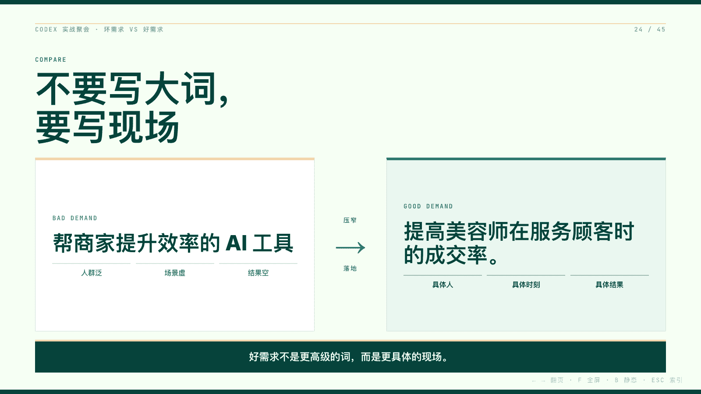

真需求卡写到这个程度，才进入下一步：把它变成一个能演示、能验收、能拿给客户看的最小闭环。

### 第 4 张表：最小闭环表

最后一张表，不是让你列功能清单，而是把真需求压成一个最小可验证闭环。

所谓最小闭环，就是只保留 5 件事：用户给什么输入、AI 做什么处理、用户看到什么结果、怎么判断结果有没有用、下一步拿给谁验证。

只要这 5 件事说不清楚，就说明需求还没有到可以开工的程度。

| 项目 | 例子 |
|---|---|
| 用户输入 | 一段服务记录 / 一段顾客异议 / 一个预约场景 |
| AI 处理 | 提取顾虑、机会、风险、话术、评分 |
| 用户看到 | 一份复盘报告 / 一句可发送文案 / 一篇小红书草稿 |
| 判断标准 | 老板看完是否愿意试，员工是否能直接用 |
| 下一步验证 | 找 10 个真实客户演示 |

这张表的价值，是把你从“大系统冲动”里拉回来。第一版不需要登录、支付、多角色、复杂后台，也不需要一上来做成完整产品。第一版最重要的是让客户看到一个结果，并且愿意拿真实场景继续试。

所以，这张图要看的不是页面有多完整，而是链路有没有跑通：

用户给你一个真实输入，你给他一个能用的结果，他愿意继续给你真实场景。

只要这个闭环跑通，后面才值得继续加登录、后台、权限、支付、报表、团队协作。

下面进入案例部分，你会看到我在美业里做的几个功能，本质上都是从这个最小闭环长出来的。

## 三、真实案例：美业 AI 产品是怎么从流程里长出来的

下面这 4 个案例，不是为了展示功能。

【美业 AI 业务闭环】

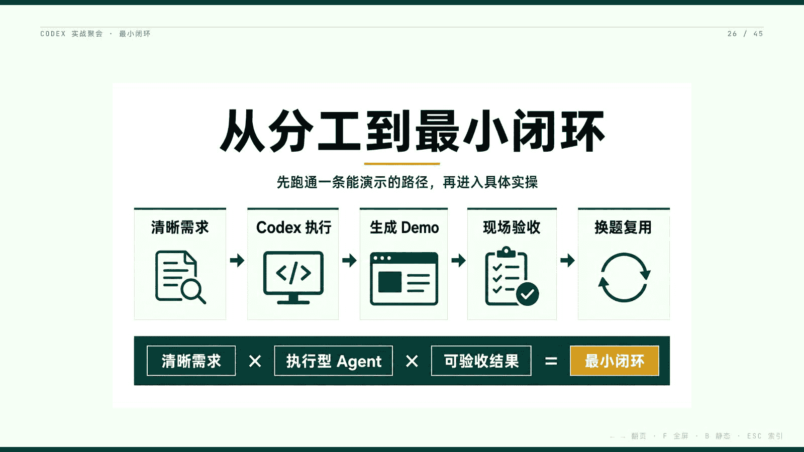

你要重点看它们的共同逻辑：

真实场景 -> 当前痛点 -> AI 输出 -> 老板为什么愿意付费

### 案例一：话术训练，把美容师销售能力标准化

小白版解释：

就是让美容师在接待真实顾客前，先和 AI 顾客练一遍。AI 顾客会像真人一样问价格、问效果、怕被推销、怕刺激，然后系统给训练报告。在美业里，离钱最近的场景，不是一味地拓新客，而是顾客已经到店、正在服务中和美容师沟通的时候。

美容师一句话，可能影响：

- 顾客信不信；
- 项目听不听得懂；
- 是否转卡；
- 是否加项目；
- 是否复购；
- 是否愿意介绍朋友。

但现实里，大多数门店训练员工还是靠：

- 店长口头带；
- 新员工背资料；
- 老员工凭经验；
- 顾客问到异议时现场发挥；
- 练完没有记录，也没有复盘。

所以我做了话术训练。

【话术训练对练界面】

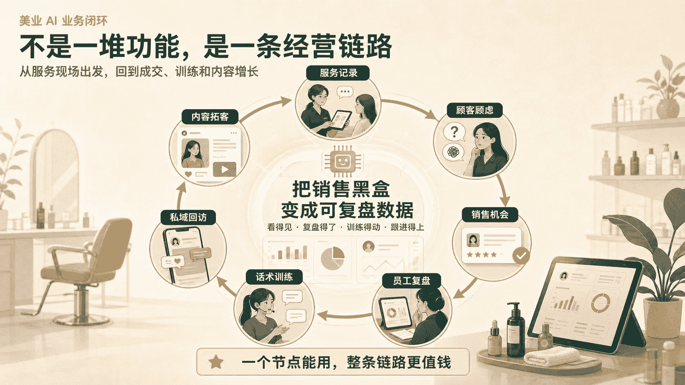

它不是让员工背话术，而是进入真实场景：

- 顾客抛出一个异议；
- 美容师用语音回答；
- AI 顾客继续追问；
- 系统记录整个过程；
- 最后生成训练报告。

【回答建议界面】

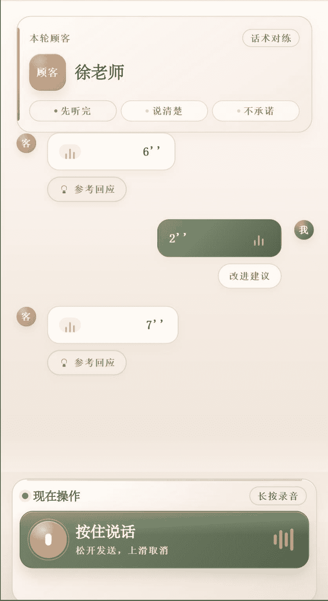

报告看什么？不是一句“表现不错”，而是具体拆：

| 维度 | 看什么 |
|---|---|
| 专业准确度 | 有没有讲清专业 |

## 重点

- **口语表达**：顾客能不能听懂
- **信任建立**：有没有先接住顾客担心
- **异议处理**：有没有处理价格、效果、推销等问题
- **边界意识**：有没有避开医疗承诺和恐吓成交
- **下一步推进**：有没有给出低压力下一步

这里我后来又做了两个更具体的知识库样板，它们很适合给大家理解：同样是“知识库”，不能都做成资料库。

第一个是 A 门店。A 门店原来有企业文化、产品专业、项目专业、服务标准。如果只是把这些资料塞进小程序，员工大概率不会看，也不会用。

所以我把它拆成了“开口训练包”：

原始资料 -> 专业内核 -> 门店判断动作 -> 顾客听得懂的话 -> 员工可复用句式 -> AI 顾客追问 -> 店长验收标准

它最后不是一篇知识库文章，而是一张张训练卡。一张训练卡长这样：

**顾客原话**：我今天只是体验，不想办卡。

**隐藏担心**：怕体验变成办卡压力，怕美容师不尊重边界。

**高手 6 秒说法**：可以的，您今天就按体验来，我先把适合和不适合讲清楚。

**三句块**：

1. 先接边界：可以的，您今天就按体验来。
2. 再讲标准：我先看肤况，把适合和不适合讲清楚。
3. 最后低压推进：您觉得舒服，我们再聊下一步。

**AI 顾客追问**：

- 那你们不会一直推套餐吧？
- 如果我不办卡，你们服务会不会变差？
- 今天体验里到底包含什么？

**禁说词**：

- 今天不办就没有这个价
- 做完您肯定会想办
- 不办就白来了

**通过标准**：

- 先尊重体验边界；
- 讲清先看肤况；
- 主动说明包含和不包含；
- 给出低压下一步。

你看，这就不是“AI 总结知识库”。这是把一堆资料拆成了员工能练、店长能查、老板能管理的训练资产。

第二个是 B 门店。B 门店的需求又不一样。A 门店更适合做“顾客问题开口训练”，B 门店更适合做“项目卡知识库”。因为它的核心不是先回答顾客异议，而是让员工快速记住项目：

- 这个项目是什么？
- 一句话怎么记？
- 适合什么顾客？
- 美容师看哪里？
- 核心专业是什么？
- 操作重点是什么？
- 可以怎么说？
- 绝对不能怎么说？

我在资料里整理到的 B 门店知识库已经不是一个小文档，而是 26 个卡组、217 张项目卡图片。但员工端仍然不能直接丢 217 张图给他看。正确做法是把它拆成：

项目卡 -> 项目拆解卡 -> 项目话术卡 -> 禁语卡 -> AI 对练卡

比如“苗药筋骨养护”不是让员工背一堆专业词，而是让员工知道：

- 顾客说肩颈紧，先问哪里紧、多久了、有没有明显不适；
- 只能讲草本外用、体感观察、舒缓放松和服务跟进；
- 不能讲治疗疼痛、保证见效、排毒排寒、越辣越有效；
- 可以用半边体验、体感记录和下次复盘做低压承接。

真正值钱的不是“有知识库”，而是你能不能把知识库变成一线员工当天就能用的动作。老板为什么愿意买？因为这不是“AI 聊天”。这是把美容师过去靠天赋、靠经验、靠店长口头带的销售能力，变成可以训练、可以评分、可以复盘的系统。这个逻辑换到别的行业也成立。

只要你的行业有一线销售、有顾客异议、有成交沟通，就可以照着拆：

- 口腔咨询；
- 教培试听转化；
- 健身私教续费；
- 房产经纪带看；
- 企业销售顾问。

## 案例二：服务记录复盘，把销售黑盒打开

**小白版解释**：

就是把一次服务过程里的顾客表达，拆成老板能看的销售机会、风险提醒、员工复盘和下一步动作。这块其实是整个项目的底层能力。因为如果没有服务记录，话术训练、私域回访、小红书内容都会变得很泛。门店过去最大的问题是：服务过程看不见。顾客在护理中说了什么，员工怎么接，顾客到底担心什么，哪里有成交信号，哪里有风险，店长事后往往不知道。

现在一段服务记录，可以被拆成：

- **顾客关注**：怕刺激、怕推销、担心效果、预算有限；
- **销售机会**：顾客主动问小套餐、问价格、问补水卡能不能搭配；
- **风险提醒**：不能过度承诺效果，不能强推大套；
- **员工复盘**：哪里做得好，哪里没接住；
- **店长动作**：是否需要店长介入，什么时候跟进；
- **顾客档案**：新增顾虑、偏好、项目兴趣；
- **下一句可用话术**：员工下一次应该怎么说。

这就是老板最容易被打动的点：

以前员工服务完只说“顾客还行”。现在老板能看到：她怕刺激、怕被推销，但主动问了小套餐价格，这就是一个低压力跟进机会。这个变化很大。因为它把“感觉”变成了“证据”。

老板可以买的，不是服务记录本身，而是：

- 少漏销售机会；
- 少踩沟通风险；
- 员工复盘更具体；
- 店长管理更有抓手；
- 顾客档案越用越完整。

## 案例三：私域助手，把预约和回访变成顺手动作

**小白版解释**：

就是美容师要给顾客发微信时，不用卡半天，选一下场景，写一句真实情况，AI 生成一段能发出去的话。美容门店每天都有很多私域动作：

- 预约；
- 到店前确认；
- 老客复约；
- 护理后回访；
- 复购提醒；
- 朋友圈评论回复；
- 沉睡顾客唤醒。

你可能觉得这些动作很小。但越小越高频。一个美容师每天可能要给很多顾客发消息。

问题是：

- 有的人发得太销售；
- 有的人发得太冷；
- 有的人不知道怎么开口；
- 有的人忘了上次顾客的状态；
- 有的人明明能约回来，但一句话没接住。

所以我做了私域助手。

**【私域助手界面】**

第一版不需要复杂。它只要解决一个问题：我现在要给这个顾客发一句合适的话。常见场景可以拆成：

- 预约：给顾客两个可选时间；
- 回访：先问状态，再给轻提醒；
- 复约：不强推，给低压力理由；

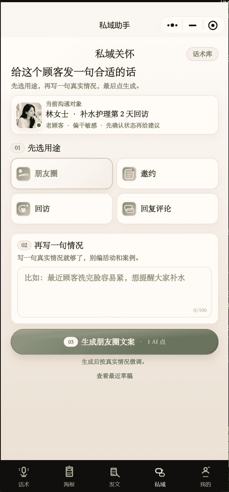

- 评论回复：公开区自然回应，再转私聊；
- 沉睡唤醒：先关心，不直接卖项目。

这类功能为什么有价值？因为它进入了日常工作流。每天都用，才有留存；离顾客近，才有收入机会。

## 案例四：小红书发文台，把服务素材变成咨询入口

**小白版解释**：

不是让 AI 随便写一篇小红书，而是从门店真实项目、真实服务记录、顾客真实问题里，拆出一篇能吸引咨询的内容。很多门店老板都知道要做小红书。但真正的问题不是“不会写文案”这么简单。真实问题是：

- 不知道每天发什么；
- 服务过程里的素材没有沉淀；
- 美容师不会把项目讲清楚；
- 发出来像促销海报；
- 内容和真实服务脱节；
- 发了以后没有私域承接；
- 具体品项不会拆卖点。

所以我做的不是“小红书文案生成器”，而是门店发文台。

**【小红书发文台界面】**

它的逻辑是：

真实服务记录 / 具体品项 / 顾客问题 -> 提炼选题 -> 生成标题和正文 -> 生成封面图文

比如一个顾客在服务里说：我怕抗衰项目刺激，也不想一下子买大套。

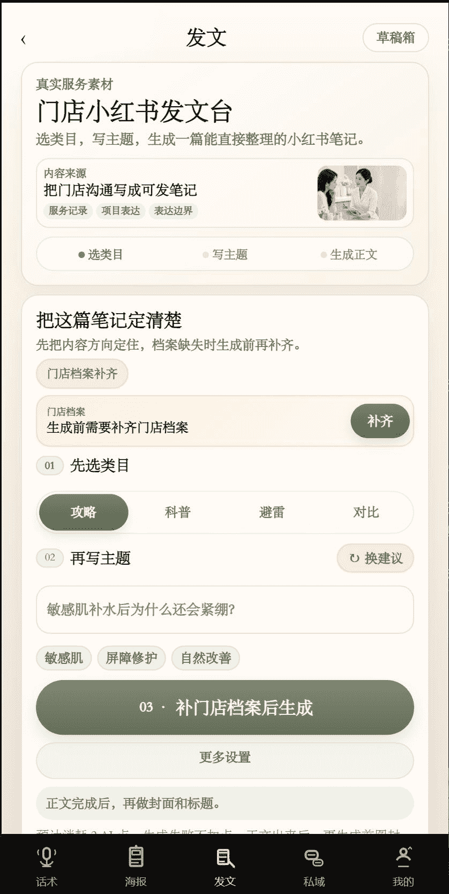

这句话本身就是内容选题。

它可以变成：

- 敏感肌能不能做抗衰？
- 为什么不建议一上来买大套？
- 第一次做抗衰，怎么判断适不适合自己？
- 小套餐为什么比大套更适合新客观察？

这就不是泛写作。这是把真实服务素材变成内容入口。后面我会继续放一些具体品项的图文拆解案例，但这篇先不放太多。项目还在内测和放大前期，具体门店和打法暂时需要保护。

## 四、照着做：一套 AI 小产品验证 SOP

这一章是最重要的。如果你想把这篇拿回去用，不要先做大系统。照着下面这套流程做，目标只有一个：

拿出一个小 demo，找 10 个真实客户验证。不是上线。不是融资。不是做完所有功能。就是验证：有没有人愿意为这个结果付出成本。

**【通用行业诊断表】**

**【AI 小产品验证 SOP】**

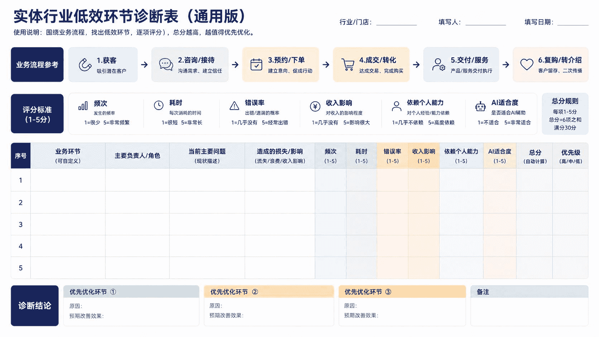

### 第 1 步：选一个你能找到客户的行业

不要选“看起来很大”的行业。先选你能找到人的行业。最好满足至少一个条件：

- 你自己就在这个行业；
- 你有客户资源；
- 你服务过这类客户；
- 你认识老板或从业者；
- 你能找到 10 个人愿意聊。

本步产出：

行业：

目标客户：

我能找到的 10 个真实客户名单：

他们现在靠什么赚钱：

他们最怕什么损失：

例子：

行业：美容门店

目标客户：美容院老板 / 店长

赚钱方式：项目成交、转卡、复购、老客维护

最怕损失：员工不会说、顾客流失、服务过程看不见、销售机会漏掉

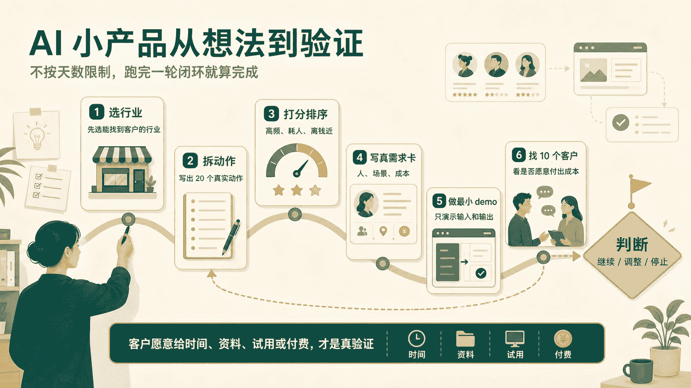

### 第 2 步：拆 20 个真实动作

这一步不要写产品。只拆动作。模板：

| 流程 | 真实动作 | 谁在做 | 现在怎么做 |
| :--- | :--- | :--- | :--- |
| 咨询 | 顾客问价格怎么答 | 美容师 | 靠经验 |
| 服务中 | 顾客怕刺激怎么解释 | 美容师 | 现场发挥 |
| 服务后 | 第二天怎么回访 | 美容师 | 手写微信 |
| 管理 | 店长怎么复盘服务 | 店长 | 问员工感觉 |

要求：

- 至少写 20 个动作；
- 每个动作必须是人真的会做的；
- 不要写“提升效率”“赋能门店”这种大词；
- 只写看得见的行为。

本步产出：

20 个具体业务动作。

### 第 3 步：用 6 个维度打分，选出第一个入口

给每个动作打分。

| 动作 | 高频 | 耗人 | 易错 | 离钱近 | 依赖人 | AI 适配 | 总分 |
| :--- | :--- | :--- | :--- | :--- | :--- | :--- | :--- |
| 顾客异议话术训练 | 5 | 4 | 5 | 5 | 5 | 5 | 29 |
| 护理后回访 | 5 | 4 | 3 | 4 | 4 | 5 | 25 |
| 小红书内容生成 | 4 | 4 | 4 | 4 | 4 | 4 | 24 |

选总分最高，并且你最容易拿到真实场景的那个。

本步产出：

第一个 AI 产品入口：

为什么先做它：

它离钱近在哪里：

### 第 4 步：写一张真需求卡

不要写需求文档之前，先写真需求卡。模板：

具体的人：

具体场景：

现在怎么做：

已经付出的成本：

最小解决问题：

用户输入：

系统输出：

第一版不要做：

美业例子：

具体的人：美容院老板和店长。

具体场景：服务结束后，店长不知道顾客真正顾虑和成交机会。

现在怎么做：靠员工口头描述。

已付出成本：销售机会漏掉，员工训练没抓手，老板看不见过程。

最小解决问题：把一段服务记录拆成顾客顾虑、销售机会、风险提醒、员工复盘和下一步话术。

用户输入：一段服务记录文本或录音转写。

系统输出：一份服务复盘报告。

第一版不要做：登录、支付、多门店后台、复杂权限。

本步产出：

一张真需求卡。

### 第 5 步：用 Codex 做最小 demo

这一步才开始让 Codex 干活。

你可以把下面这段直接复制给 Codex：

我想做一个非常小的 AI demo，先不要做大系统。

目标用户：【填具体角色】

真实场景：【填具体时刻】

现在的问题：【填耗时、出错、漏钱、依赖个人能力的地方】

第一版只解决：【填一个最小问题】

用户输入：【文本/语音转写/图片/表格】

系统输出：【报告/话术/清单/评分/待办】

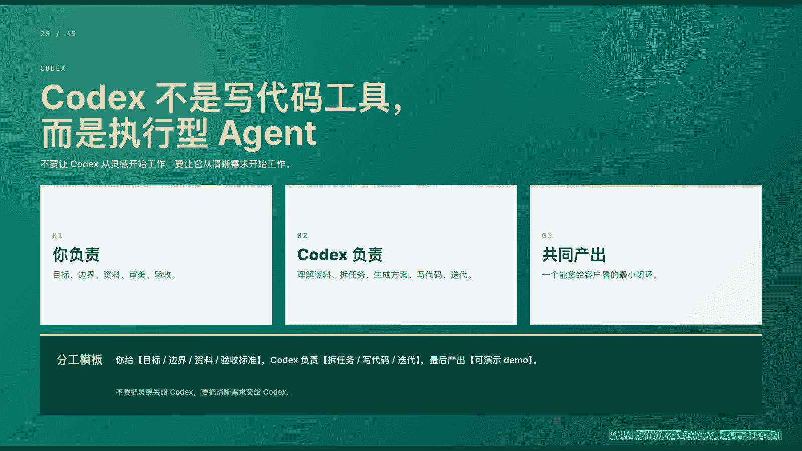

第一版不要做：【登录、支付、权限、多角色、复杂后台】

请你先不要写代码。

先帮我：

1. 判断这个需求是否足够具体；
2. 反问我缺少的信息；
3. 设计第一版最小闭环；
4. 列出页面结构和数据结构；
5. 给出最小 demo 实现方案。

第一版 demo 可以很粗糙。可以是：

- 一个 HTML 页面；
- 一个飞书文档模板；
- 一个表单 + 输出结果；
- 一个静态页面；
- 一个小程序页面；
- 一个命令行脚本。

重要的不是技术形态。重要的是客户能不能看懂结果。

本步产出：

一个能演示输入和输出的 demo。

## 可直接复制的 6 个提示词

如果你是小白，不知道怎么让 Codex 开始干活，可以先用下面 6 个提示词。不要一次性全丢进去。每次只跑一个提示词，拿到结果后再继续下一步。

### 提示词 1：把一个行业拆成真实业务流程

我想在【行业】里找一个能用 AI 改造的小需求。

请你不要先给产品方案。

先帮我拆这个行业从获客到成交、交付、复购的完整业务流程。

要求：

1. 每一步都写成真实动作，不要写“提升效率”“赋能业务”这种大词；
2. 每个动作标注是谁在做：老板、店长、员工、客户、运营；
3. 每个动作写出现在怎么做；
4. 每个动作写出如果做不好，会造成什么损失；
5. 最后输出至少 20 个可被 AI 改造的动作。

输出表格字段：

流程阶段 / 真实动作 / 谁在做 / 现在怎么做 / 做不好损失什么 / 是否离钱近

### 提示词 2：给 20 个动作打分，选第一个入口

下面是我拆出的 20 个业务动作。

【粘贴动作表】

请你按 6 个维度打分：高频、耗人、易错、离钱近、依赖人、AI 适配。

要求：

1. 每项 1-5 分；
2. 解释每个动作为什么这样打分；
3. 选出最适合做第一版 demo 的 3 个动作；
4. 对每个动作写清楚：用户输入是什么、AI 输出是什么、客户为什么可能愿意付费。

不要推荐大系统，只推荐最小闭环。

### 提示词 3：把资料库改造成项目卡

这个适合有产品资料、项目资料、培训手册的行业。

下面是一份【行业/门店/项目】资料。

【粘贴资料】

请你不要总结成长文章。

请把它改成一组一线员工能用的“项目卡”。

每张项目卡必须回答 8 个问题：

1. 这是什么项目？
2. 一句话怎么记？
3. 适合什么顾客？
4. 员工要观察哪里？
5. 核心专业是什么？
6. 操作或服务重点是什么？
7. 可以怎么说？
8. 绝对不能怎么说？

要求：

- 语言要口语化；
- 不要夸大效果；
- 不要医疗化表达；
- 每张卡控制在员工 1 分钟能看完；
- 最后给出“可进入 AI 对练”的 3 个顾客追问。

### 提示词 4：把企业资料变成开口训练卡

这个适合销售、顾问、客服、美容师、教培顾问、私教等岗位。

下面是一份企业资料、产品资料或培训资料。

【粘贴资料】

请你把它改成一张“开口训练卡”，不是知识总结。

训练卡字段必须包含：

顾客原话：

隐藏担心：

真实场景：

专业内核：

高手 6 秒说法：

高手 20 秒说法：

高手 60 秒说法：

三句块：

AI 顾客追问：

禁说词：

通过标准：

店长看什么：

要求：

1. 顾客原话必须像真人会说的话；
2. 高手说法必须口语化，员工能直接照着说；
3. 禁说词必须包含夸大承诺、压迫成交、医疗化或不合规表达；
4. 通过标准必须能被店长检查；
5. 不要输出长篇理论。

### 提示词 5：把服务记录拆成经营复盘

这个适合服务业、销售、顾问、客服、咨询等场景。

下面是一段服务记录或沟通转写。

【粘贴服务记录】

请你把它拆成门店老板和店长能看的经营复盘。

输出结构：

1. 本次服务总结：只写 1-3 条；
2. 顾客关注：顾客真正担心什么，必须引用原话证据；
3. 销售机会：机会类型、成交信号、推荐跟进动作、优先级；
4. 风险提醒：哪些话不能说，哪些承诺不能给；
5. 员工复盘：做得好的点、漏掉的点、下次要练什么；
6. 店长动作：是否需要介入，谁跟进，什么时候跟；
7. 顾客档案更新建议：新增顾虑、偏好、项目兴趣；
8. 下一句可用话术：给员工一句下次能直接说的话。

公众号懒人搜索，懒人专属群分享
# 
### 硬性要求：

- 所有机会和风险都必须有原话证据；
- 没有证据就写“待复核”，不能编；
- 不能做医疗诊断；
- 不能承诺效果；
- 输出要像经营动作，不要像会议纪要。

## 提示词 6：把真实服务素材变成私域和小红书内容

下面是一个真实服务素材。

【粘贴顾客问题 / 服务记录 / 项目资料】

请你帮我生成两类内容：

A. 微信私域话术
- 回访短句 3 条；
- 复约邀约 3 条；
- 每条都要先关心状态，再给低压力下一步；
- 不要写“不推销”“没有压力”，要通过语气自然体现。

B. 小红书选题
- 10 个标题；
- 每个标题对应一个核心顾客问题；
- 每个选题给 3 个正文要点；
- 给出配图方向；
- 不要写夸张效果，不要制造焦虑。

要求：
- 只使用我提供的事实；
- 不编顾客案例；
- 不写固定天数见效；
- 不写保证、根治、永久、不反复。

## 第 6 步：找 10 个真实客户演示

不要发朋友圈问“大家觉得怎么样”。直接找 10 个真实客户。

我的方式很简单，就是一个一个去聊，优先找以前认识、关系比较好的连锁店老板。

你可以这样约：

> 我最近做了一个很小的 AI 工具，不是让你买。我想拿你们行业的真实场景测一下，看它到底有没有用。只需要 15 分钟，我给你看一个结果，你直接告诉我有没有价值。

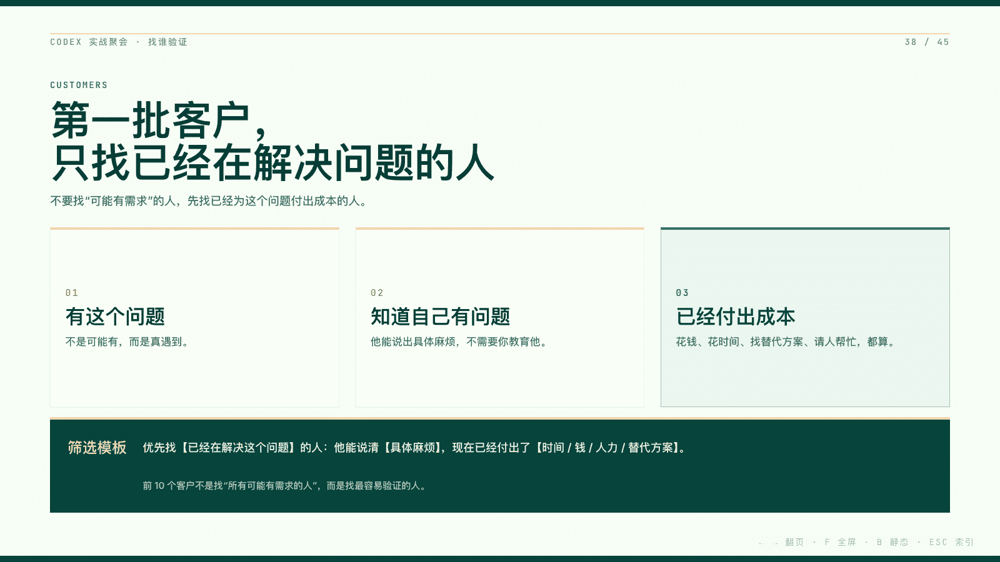

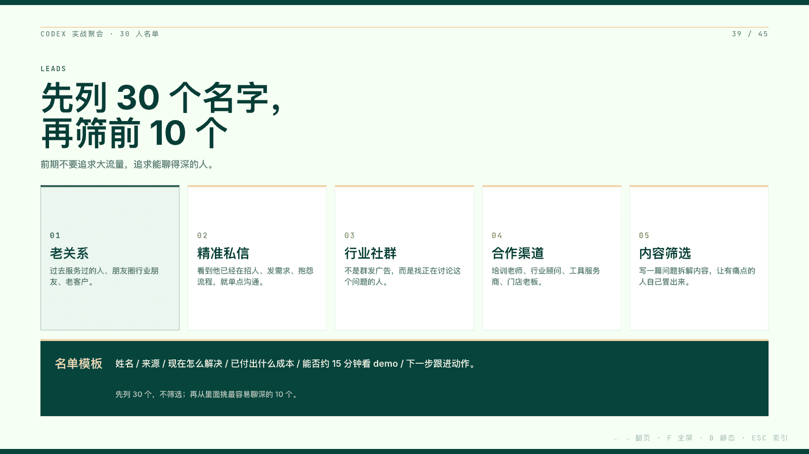

演示时，不要先讲功能。先讲结果。美业例子：

- 以前销售过程看不见，现在销售记录可以追踪。
- 以前员工服务完只说“顾客还行”，现在可以拆出顾客顾虑、销售机会、风险提醒和下一步动作。
- 以前美容师靠店长口头带，现在可以根据报告一轮一轮训练。
- 以前老板不知道员工哪里弱，现在可以看复盘、看下一轮训练重点。

然后看对方反应。强信号：
- 愿意给你真实资料测试；
- 愿意约下一次演示；
- 愿意介绍同类客户；
- 开始问价格；
- 愿意付试用费；
- 愿意让员工实际用。

弱信号：
- “挺好的”；
- “有意思”；
- “以后可以看看”；
- 只夸 AI 厉害，但不给场景。

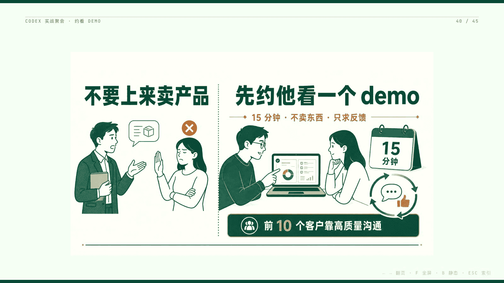

### 本步产出：

10 个客户反馈记录。

## 第 7 步：按反馈决定收钱、改方向，还是停掉

跑完一轮后不要继续加功能。先判断验证结果。

你可以分三档：

### A 档：可以继续做

出现这些信号：
- 有人愿意付试用费；
- 有人愿意给真实数据；
- 有人愿意让员工试用；
- 有人问正式价格；
- 有人介绍客户。

下一步：收一个小额内测费，继续打磨。

### B 档：需要调整

出现这些信号：
- 客户觉得方向有用，但结果不够准；
- 客户不愿意付钱，但愿意继续聊；
- 客户说另一个场景更痛。

下一步：回到第 2 步，重新选动作。

### C 档：先停

出现这些信号：
- 没人愿意给真实资料；
- 没人愿意花时间看第二次；
- 都只是客套夸；
- 客户现在没有为这个问题付出成本。

下一步：不要继续写代码，换需求。

记住：客户愿意付出成本，才是真验证。

成本不一定一开始就是钱，也可以是时间、资料、员工试用、转介绍。但如果什么成本都不愿意付，那就不要骗自己。

## 五、新手最容易踩的 6 个坑

### 坑 1：一上来做大系统

“AI 门店管理系统”“AI 企业经营平台”“AI 私域中台”听起来很厉害。但第一版不要这么做。你先解决一个小动作。

### 坑 2：只做生成，不进流程

AI 写一句话、生成一张图，不一定是产品。只有进入客户每天重复发生的流程，才有留存和付费机会。

### 坑 3：只讲 AI，不讲业务结果

客户不关心你用了什么模型。客户关心：
- 能不能少漏单；
- 能不能提升预约；
- 能不能降低培训成本；
- 能不能让员工更快上手；
- 能不能让老板看见问题。

### 坑 4：把客套反馈当验证

“挺好的”不算。“我给你一段真实数据试试”才算。“这个多少钱”更算。

### 坑 5：需求写太空，Codex 必然跑偏

你写：做一个 AI 管理系统。Codex 很容易发散。

你写：输入一段服务记录，输出顾客顾虑、销售机会、风险提醒、员工复盘和下一步话术。它就容易交付。

### 坑 6：过早公开太多细节

如果项目还在内测，具体门店、具体品项、具体打法不一定要全公开。可以公开方法和框架。客户资产和真实业务细节，要保护好。

## 最后

我现在越来越觉得，AI 时代普通人的机会，不一定是去做一个全新的大平台。更现实的机会是：

在你已经懂的行业里，把一个反复发生、强依赖人、又离钱很近的动作，用 AI 做成一个小工具。

这个工具一开始可以很小。小到只解决一句话术、一次回访、一篇小红书、一张训练报告、一段服务复盘。但只要它进入真实业务流程，并且有人愿意为它付出成本，它就不再只是 AI demo。它就是产品的起点。

所以这篇文章最后，我想留给大家一句话：别证明你会用 AI，去证明有人愿意为你的结果付钱。

————分割线————

看完这篇 SOP，你觉得你懂了。但 90% 的人一到实操就会卡在第一步。

工具和教程只是最低级的壁垒，真正的壁垒是“立刻动手”和“圈层信息差”。

如果你想看全网最新的变现玩法，并且和一群执行力极强的极客一起下场拿结果，欢迎围观我的核心私域：【懒人专属群】。

我们不聊虚的，只做商业闭环的拆解与 AI 效率的压榨。系统内已沉淀 1000+ 跑通的套利实战局。

👉 查阅圈子完整数字资产与上车门槛：

https://lazyso.com/insider/

认同价值、准备好下场干活的，扫码加我微信（lazyhelper1）

备注：【实操上车】，不闲聊

