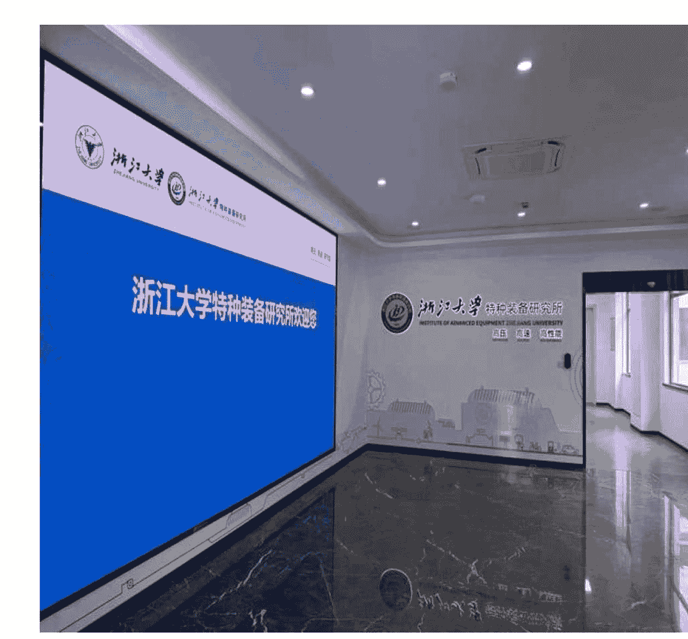

# 鉴茶财经院260701：七月展望与中周期冲击4400

260701 鉴茶财经院

整理：公众号懒人搜索，懒人专属群精选

懒人微信：lazyhelper1

## 鉴茶财经院260701：七月展望与中周期冲击4400

我们先从昨天美股的表现说起。

- ASML、科磊等大涨创下历史新高，全球半导体设备都是大牛市。半导体设备是朱格拉周期里逻辑最硬的设备，也是7月绝对绕不开的一环。

设备领域的新亮点是什么？半导体设备出海，韩国的存储要10万亿级的大扩产，必然会用到国产的设备、材料等。炒了英伟达链、谷歌链，现在又要来一个三星、SK海力士链。

谁跟韩国人有HBM设备和检测业务的往来，前两天刚刚讲过，一翻即知。

注意，韩国人不仅是扩产存储这么简单，它一样要搞机器人、物理AI、光。因此，设备里的高端工业母机我们持续看好。绿的能进特斯拉的供应链，韩国都没能。

现在一级市场，大家已经不怎么投光学了，一是好标的投不进去，二是格局基本定了。瞄准未来3—5年，大家的方向就是物理AI。

半导体设备、芯片、材料之类是个中线方向，但今天要注意冲高回落。

这几天连寒王的御用封测甬矿都慢慢起来了。

至于其他量价齐升的IGBT、电容等，观点不变。

- 回到南方的光和海外算力，主要是没什么新故事，又被康宁一通乱杀，现在是消化估值和修复的阶段。

先行的板块，叫做“光学光电子”。

广义地说，市场环境好、放量，利好易中天等传统光的板块，整个都好。市场缩量、环境不好，就要看新概念的玻璃基板、金刚石散热片之类能否顶上来。

玻璃基板已经好几轮了，终局思维上说是能看的，不明白的前面搜。

- 现在只是7月初期，中报截止是8月31日，大家要注意，越往后，越要逐步倾斜往南方，毕竟国产设备没什么利润，最近又一直在放量大涨，而海外算力的业绩是有保障的。

比如某创，中报交出个120亿的成绩很正常，今年你按250—300亿计算，50倍PE，但现在谁还看今年？明年你按700亿，多少倍自己算。

最后再看看美股其他的表现。

闪迪大涨10%，这是稍微低端点的存储。

维谛+9%，液冷和电源。

光不太行，但Credo大涨10.9%，对应的是被玻璃桥错杀的连接器。

总体还是那些玩家，肥水不流外人田。

今天，冲击4133压力位，还是老规矩，盯好基金重仓指数在干什么。

最后要注意，韩国产业链的受益，优先选长三角的公司，因为跟他们业务往来多，关系好。

苏州赢完无锡赢，无锡赢完常州赢，常州赢完苏州赢，自己切来切去，麻了。

---

在这个AI能替你写代码、写文章的时代，基础技能正在迅速贬值。绝大多数人正被淹没在海量的免费垃圾信息里，陷入低效的体力内卷。

当“努力”不再是壁垒，人与人之间唯一的护城河，只剩下“信息过滤”的效率与“认知系统”的维度。

圈子已稳定运行7年。我们每天利用Python爬虫与大模型算力，过滤全网最顶级的政经内参和搞钱风向标，做你最冷酷的“外部大脑”。

如果你认同这种“重塑认知防线”的极客主义，欢迎围观我的个人情报智库：【懒人专属群】。

https://lazyso.com/insider/

认同信息过滤价值、想省下每天3小时无效阅读时间的读者，扫码加我微信（lazyhelper1）。

